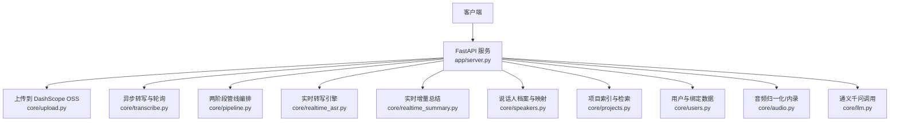
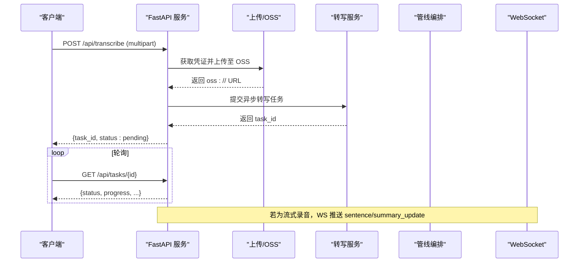
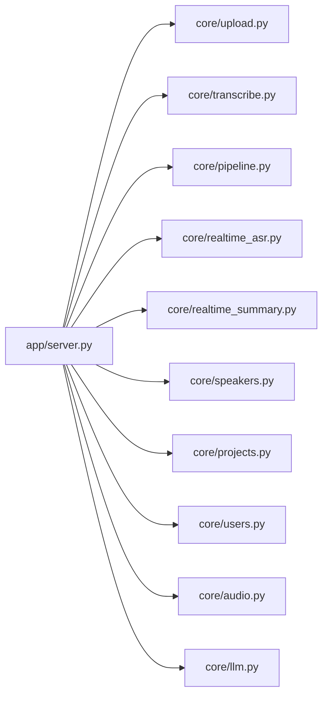

# API 参考

<cite>
**本文引用的文件**
- [app/server.py](file://app/server.py)
- [core/upload.py](file://core/upload.py)
- [core/transcribe.py](file://core/transcribe.py)
- [core/realtime_asr.py](file://core/realtime_asr.py)
- [core/pipeline.py](file://core/pipeline.py)
- [core/realtime_summary.py](file://core/realtime_summary.py)
- [core/speakers.py](file://core/speakers.py)
- [core/projects.py](file://core/projects.py)
- [core/users.py](file://core/users.py)
- [core/audio.py](file://core/audio.py)
- [core/llm.py](file://core/llm.py)
- [docs/API_CONTRACTS.md](file://docs/API_CONTRACTS.md)
- [README.md](file://README.md)
</cite>

## 目录
1. [简介](#简介)
2. [项目结构](#项目结构)
3. [核心组件](#核心组件)
4. [架构总览](#架构总览)
5. [详细组件分析](#详细组件分析)
6. [依赖关系分析](#依赖关系分析)
7. [性能与限流](#性能与限流)
8. [故障排查指南](#故障排查指南)
9. [结论](#结论)
10. [附录：客户端集成与最佳实践](#附录客户端集成与最佳实践)

## 简介
本 API 参考文档面向第三方开发者，系统化说明 open-meeting-scribe 提供的 RESTful 接口、WebSocket 实时转写接口以及任务管理流程。重点覆盖：
- 音频上传与转写任务提交
- 任务状态查询与结果下载
- 说话人管理与映射
- 流式录音与实时转写（WebSocket）
- 认证机制、速率限制与安全建议
- 客户端集成步骤与错误重试策略

## 项目结构
服务基于 FastAPI 提供 HTTP 与 WebSocket 端点；核心能力由 core 模块实现，包括音频处理、上传、转写、管线编排、实时转写与总结、说话人与项目管理等。

图表来源
- [app/server.py:1-21](file://app/server.py#L1-L21)
- [core/upload.py:1-134](file://core/upload.py#L1-L134)
- [core/transcribe.py:1-446](file://core/transcribe.py#L1-L446)
- [core/realtime_asr.py:1-368](file://core/realtime_asr.py#L1-L368)
- [core/pipeline.py:1-271](file://core/pipeline.py#L1-L271)
- [core/realtime_summary.py:1-270](file://core/realtime_summary.py#L1-L270)
- [core/speakers.py:1-325](file://core/speakers.py#L1-L325)
- [core/projects.py:1-522](file://core/projects.py#L1-L522)
- [core/users.py:1-157](file://core/users.py#L1-L157)
- [core/audio.py:1-663](file://core/audio.py#L1-L663)
- [core/llm.py:1-207](file://core/llm.py#L1-L207)

章节来源
- [app/server.py:1-21](file://app/server.py#L1-L21)
- [README.md:1-39](file://README.md#L1-L39)

## 核心组件
- 任务与进度：内存任务表 + 磁盘持久化（JSON），支持后台执行与进度回调。
- 上传与转写：本地文件 → DashScope OSS 临时 URL → 异步转写任务 → 轮询结果 → 组装对话稿。
- 实时转写：WebSocket 长连接，PCM 流送入识别，定稿句子通过事件循环投递到前端。
- 说话人管理：全局说话人档案、会议映射历史、姓名应用。
- 项目与用户：项目索引、检索、当前用户与说话人绑定。
- 音频处理：ffmpeg 归一化、系统内录、流式 PCM 管道。
- LLM：通义千问同步/异步/流式调用，用于纪要生成与实时摘要。

章节来源
- [app/server.py:92-165](file://app/server.py#L92-L165)
- [core/pipeline.py:47-134](file://core/pipeline.py#L47-L134)
- [core/transcribe.py:61-187](file://core/transcribe.py#L61-L187)
- [core/realtime_asr.py:150-368](file://core/realtime_asr.py#L150-L368)
- [core/speakers.py:35-103](file://core/speakers.py#L35-L103)
- [core/audio.py:31-98](file://core/audio.py#L31-L98)
- [core/llm.py:89-160](file://core/llm.py#L89-L160)

## 架构总览
整体数据流：客户端上传音频或开始录制 → 服务侧进行音频归一化与上传 → 提交异步转写任务并轮询 → 组装对话稿 → 用户绑定说话人 → 生成纪要并输出 Markdown 文件。实时场景下，录音期间通过 WebSocket 推送转写片段与增量摘要。

图表来源
- [app/server.py:343-396](file://app/server.py#L343-L396)
- [core/upload.py:33-115](file://core/upload.py#L33-L115)
- [core/transcribe.py:61-187](file://core/transcribe.py#L61-L187)
- [core/pipeline.py:58-134](file://core/pipeline.py#L58-L134)
- [core/realtime_asr.py:216-327](file://core/realtime_asr.py#L216-L327)

## 详细组件分析

### RESTful API 端点总览
以下端点均由 FastAPI 暴露，路径与方法如下：

- 音频与任务
  - POST /api/transcribe：上传音频并提交转写任务
  - GET /api/tasks：获取任务列表
  - GET /api/tasks/{task_id}：查询任务状态与结果
  - PATCH /api/tasks/{task_id}：更新任务信息（如标题）
  - DELETE /api/tasks/{task_id}：删除任务
  - GET /api/download/{task_id}：下载纪要文件
  - GET /api/audio/{task_id}：播放/下载原始录音（支持 Range）

- 说话人管理
  - GET /api/speakers：获取说话人列表
  - POST /api/speakers：添加说话人
  - PUT /api/speakers/{speaker_id}：更新说话人
  - DELETE /api/speakers/{speaker_id}：删除说话人
  - GET /api/speakers/mapping/latest：获取最近一次会议映射（含姓名）
  - POST /api/speakers/mapping：保存会议映射（用于复用建议）

- 说话人绑定与纪要生成
  - POST /api/tasks/{task_id}/speaker-mapping：设置说话人映射并触发纪要生成
  - POST /api/tasks/{task_id}/regenerate-summary：使用当前映射重新生成纪要

- 录制与实时转写
  - POST /api/record/start：开始流式录音（同时启动实时转写）
  - POST /api/record/stop：停止录制，自动进入管线
  - GET /api/record/status：查询录制状态
  - WS /ws/transcript/{task_id}：实时转写 WebSocket

请求与响应要点（节选）：
- 上传音频
  - 方法：POST
  - 路径：/api/transcribe
  - 参数：multipart file（支持 mp3/wav/m4a/aac/ogg/flac/mp4/webm），可选 speaker_mapping 字符串（JSON）
  - 响应：{task_id, status}
  - 错误：不支持的文件类型返回 400

- 查询任务
  - 方法：GET
  - 路径：/api/tasks/{task_id}
  - 响应：任务对象（包含 status、progress、message、audio_duration、dialogue、transcription、speaker_mapping、created_at、error 等）
  - 错误：不存在返回 404

- 下载纪要
  - 方法：GET
  - 路径：/api/download/{task_id}
  - 响应：Markdown 文件流
  - 错误：任务不存在或纪要文件不存在返回 404

- 说话人列表
  - 方法：GET
  - 路径：/api/speakers
  - 响应：{speakers: [...]}

- 保存会议映射
  - 方法：POST
  - 路径：/api/speakers/mapping
  - 请求体：{meeting_id, meeting_name, mapping: {"0": "uuid1", "1": "uuid2"}}
  - 响应：{meeting_id, meeting_name, created_at}

- 设置说话人映射并生成纪要
  - 方法：POST
  - 路径：/api/tasks/{task_id}/speaker-mapping
  - 请求体：{mapping: {"0": "uuid1", "1": "uuid2"}}
  - 响应：{status, message}

- 开始流式录音
  - 方法：POST
  - 路径：/api/record/start
  - 响应：创建任务 ID 并初始化实时转写队列与总结器
  - 错误：已在录制中返回 400

- 停止录制
  - 方法：POST
  - 路径：/api/record/stop
  - 响应：录制完成信息（output_path、duration、task_id）

- 查询录制状态
  - 方法：GET
  - 路径：/api/record/status
  - 响应：录制信息（elapsed、paused 等）

- 实时转写 WebSocket
  - 路径：/ws/transcript/{task_id}
  - 事件：sentence（定稿句子）、summary_update（增量摘要）、summary_status（状态变化）
  - 消息字段：type、text、begin_time、end_time、speaker_id、speaker_name、content、status

章节来源
- [app/server.py:343-715](file://app/server.py#L343-L715)
- [app/server.py:721-800](file://app/server.py#L721-L800)
- [core/speakers.py:109-262](file://core/speakers.py#L109-L262)
- [core/realtime_summary.py:68-184](file://core/realtime_summary.py#L68-L184)

### 音频上传接口详解
- 目的：将本地音频上传至 DashScope 临时存储，获得 oss:// URL，供后续转写使用。
- 流程：
  - 获取上传凭证（getPolicy）
  - multipart 上传到 OSS
  - 返回 oss:// URL（有效期 48h，单文件 ≤1GB）
- 约束：
  - 仅接受公网 URL；本地文件必须先上传
  - 上传凭证接口限流 100 QPS
  - oss:// URL 在转写时需带 X-DashScope-OssResourceResolve: enable

章节来源
- [core/upload.py:25-115](file://core/upload.py#L25-L115)
- [docs/API_CONTRACTS.md:12-25](file://docs/API_CONTRACTS.md#L12-L25)

### 任务管理接口详解
- 提交转写任务：POST /api/transcribe
  - 后台执行第一阶段（音频归一化 → 上传 → 转写 → 组装对话稿）
  - 若未提供说话人映射，任务进入 awaiting_mapping 状态
- 查询任务：GET /api/tasks/{task_id}
  - 返回任务状态、进度、转写结果、对话稿等
- 更新任务：PATCH /api/tasks/{task_id}
  - 可更新标题等信息
- 删除任务：DELETE /api/tasks/{task_id}
  - 清理音频、纪要与持久化文件
- 下载纪要：GET /api/download/{task_id}
  - 返回 Markdown 文件流
- 播放录音：GET /api/audio/{task_id}
  - 根据扩展名设置 MIME，支持 Range 拖动

章节来源
- [app/server.py:343-497](file://app/server.py#L343-L497)
- [core/pipeline.py:58-134](file://core/pipeline.py#L58-L134)

### 结果查询接口详解
- 任务列表：GET /api/tasks
  - 按创建时间倒序返回所有任务
- 任务详情：GET /api/tasks/{task_id}
  - 若处于录制状态，附带 elapsed 累计时长
- 转录结果下载：通过转写服务返回的 transcription_url 获取 JSON（24h 有效）

章节来源
- [app/server.py:399-440](file://app/server.py#L399-L440)
- [core/transcribe.py:134-187](file://core/transcribe.py#L134-L187)

### 说话人管理接口详解
- 列表/新增/更新/删除：/api/speakers
- 最近映射：/api/speakers/mapping/latest
  - 返回上次会议的映射及对应姓名
- 保存映射：/api/speakers/mapping
  - 用于历史复用建议

章节来源
- [app/server.py:532-619](file://app/server.py#L532-L619)
- [core/speakers.py:109-262](file://core/speakers.py#L109-L262)

### 说话人绑定与纪要生成接口详解
- 设置映射并生成纪要：POST /api/tasks/{task_id}/speaker-mapping
  - 校验任务状态（awaiting_mapping 或 completed）
  - 保存会议映射
  - 后台运行第二阶段（姓名化 → 纪要生成 → 保存）
- 重新生成纪要：POST /api/tasks/{task_id}/regenerate-summary
  - 仅在 completed 状态下可用
  - 使用当前 UUID 映射反查姓名映射后再生成

章节来源
- [app/server.py:630-715](file://app/server.py#L630-L715)
- [core/pipeline.py:137-226](file://core/pipeline.py#L137-L226)

### 录制与实时转写接口详解
- 开始录制：POST /api/record/start
  - 创建任务 ID、WebSocket 队列、声纹聚类器、实时总结器
  - 启动 ffmpeg 流式采集，回调送入实时 ASR 与聚类
- 停止录制：POST /api/record/stop
  - 终止 ffmpeg，raw PCM 转为 WAV，进入管线
- 查询录制状态：GET /api/record/status
  - 返回 elapsed、paused 等
- WebSocket：/ws/transcript/{task_id}
  - 建立连接后，服务端通过 asyncio.Queue 推送 sentence、summary_update、summary_status
  - 定稿句子包含 begin_time/end_time、speaker_id、speaker_name

章节来源
- [app/server.py:721-800](file://app/server.py#L721-L800)
- [core/realtime_asr.py:150-368](file://core/realtime_asr.py#L150-L368)
- [core/realtime_summary.py:68-184](file://core/realtime_summary.py#L68-L184)
- [core/audio.py:303-515](file://core/audio.py#L303-L515)

### WebSocket 接口规范
- 地址：ws(s)://host/ws/transcript/{task_id}
- 连接建立：服务端创建队列与转写器，准备推送
- 消息格式：
  - sentence：{"type":"sentence","text":"...","begin_time":ms,"end_time":ms,"speaker_id":int,"speaker_name":"..."}
  - summary_update：{"type":"summary_update","content":"..."}
  - summary_status：{"type":"summary_status","status":"summarizing|idle|paused"}
- 事件类型：
  - 定稿句子推送
  - 增量摘要更新
  - 总结状态变化
- 实时交互模式：
  - 客户端连接后持续接收事件
  - 服务端从 SDK 线程安全投递消息到事件循环队列

章节来源
- [app/server.py:171-219](file://app/server.py#L171-L219)
- [core/realtime_asr.py:57-144](file://core/realtime_asr.py#L57-L144)
- [core/realtime_summary.py:119-184](file://core/realtime_summary.py#L119-L184)

### 认证机制、速率限制与安全考虑
- 认证：统一使用 DASHSCOPE_API_KEY，请求头 Authorization: Bearer {api_key}
- 速率限制：
  - 上传凭证接口限流 100 QPS
  - 实时转写启动失败时内置指数退避重试（2s、5s、10s）
- 安全建议：
  - 密钥通过环境变量注入，禁止硬编码
  - 对上传文件类型进行白名单校验
  - 对 oss:// URL 特殊字符进行编码，避免下载失败
  - 长时间音频分段处理，避免超时

章节来源
- [docs/API_CONTRACTS.md:5-9](file://docs/API_CONTRACTS.md#L5-L9)
- [core/upload.py:25-30](file://core/upload.py#L25-L30)
- [core/realtime_asr.py:212-327](file://core/realtime_asr.py#L212-L327)
- [app/server.py:350-354](file://app/server.py#L350-L354)

## 依赖关系分析
- 服务层（FastAPI）依赖 core 各模块：
  - upload → transcribe → pipeline → summarize
  - realtime_asr → realtime_summary
  - speakers → users → projects
  - audio 提供归一化与内录能力
  - llm 提供通义千问调用

图表来源
- [app/server.py:41-57](file://app/server.py#L41-L57)
- [core/pipeline.py:22-27](file://core/pipeline.py#L22-L27)

章节来源
- [app/server.py:41-57](file://app/server.py#L41-L57)
- [core/pipeline.py:22-27](file://core/pipeline.py#L22-L27)

## 性能与限流
- 上传凭证限流：100 QPS，建议客户端做并发控制与重试
- 实时转写：
  - 每包音频建议 ~100ms（6400 bytes @16kHz/16bit/mono）
  - 启动失败时指数退避重试（最多 3 次）
- 转写任务：
  - 轮询间隔 3 秒，超时 600 秒
  - 长音频建议分段处理
- LLM 调用：
  - 同步版用于后台线程，异步版用于 FastAPI 不阻塞事件循环
  - 连接池复用，降低开销

章节来源
- [docs/API_CONTRACTS.md:114-176](file://docs/API_CONTRACTS.md#L114-L176)
- [core/transcribe.py:28-31](file://core/transcribe.py#L28-L31)
- [core/realtime_asr.py:53-54](file://core/realtime_asr.py#L53-L54)
- [core/realtime_asr.py:212-327](file://core/realtime_asr.py#L212-L327)
- [core/llm.py:26-38](file://core/llm.py#L26-L38)

## 故障排查指南
- 常见问题与定位：
  - 上传失败：检查 DASHSCOPE_API_KEY、网络可达性、文件大小是否超过 1GB
  - 转写失败：确认 oss:// URL 已正确编码、X-DashScope-OssResourceResolve 头存在
  - 实时转写连接失败：检查 WebSocket 地址、语言提示、音频格式（PCM 16kHz mono）
  - 纪要生成失败：核对对话稿是否为空、LLM 调用是否超时
- 日志与调试：
  - 服务层记录任务状态、进度、错误信息
  - 实时转写记录连接、回调、错误与统计
  - 上传与转写记录关键步骤与耗时

章节来源
- [app/server.py:92-129](file://app/server.py#L92-L129)
- [core/upload.py:25-115](file://core/upload.py#L25-L115)
- [core/transcribe.py:134-187](file://core/transcribe.py#L134-L187)
- [core/realtime_asr.py:80-144](file://core/realtime_asr.py#L80-L144)
- [core/llm.py:89-160](file://core/llm.py#L89-L160)

## 结论
open-meeting-scribe 提供了完整的会议音频转写与纪要生成能力，涵盖离线批处理与在线实时转写两种模式。通过清晰的 RESTful 接口与 WebSocket 实时推送，第三方开发者可以便捷地集成到自有系统中。建议在集成时关注认证、限流、错误重试与资源管理，以获得稳定高效的体验。

## 附录：客户端集成与最佳实践
- 集成步骤
  - 配置环境变量 DASHSCOPE_API_KEY
  - 调用 /api/transcribe 上传音频，获取 task_id
  - 轮询 /api/tasks/{task_id} 直到 completed
  - 调用 /api/tasks/{task_id}/speaker-mapping 绑定说话人并生成纪要
  - 下载 /api/download/{task_id} 获取 Markdown 纪要
  - 如需实时预览，调用 /api/record/start 并连接 /ws/transcript/{task_id}
- 最佳实践
  - 上传前对文件名中的空格/中文进行 URL 编码
  - 大文件分段上传与分段转写
  - 实时转写采用 100ms 分包发送 PCM
  - 对限流与超时进行指数退避重试
  - 使用异步 LLM 调用避免阻塞事件循环
- 错误处理与重试策略
  - 上传凭证：QPS 超限则等待并重试
  - 实时转写：连接失败时按 2s/5s/10s 重试
  - 转写任务：轮询超时后重试或分段处理
  - LLM 调用：超时或异常时重试并降级

章节来源
- [docs/API_CONTRACTS.md:12-25](file://docs/API_CONTRACTS.md#L12-L25)
- [core/realtime_asr.py:212-327](file://core/realtime_asr.py#L212-L327)
- [core/transcribe.py:134-187](file://core/transcribe.py#L134-L187)
- [core/llm.py:89-160](file://core/llm.py#L89-L160)