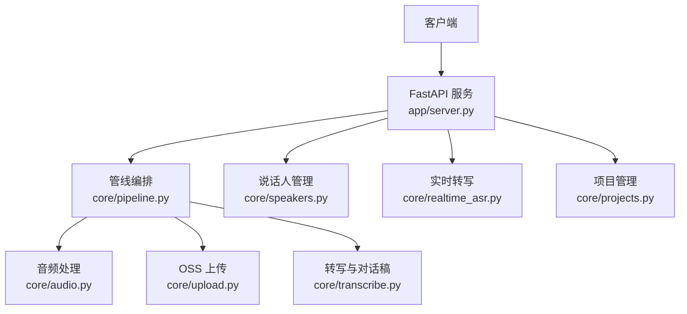
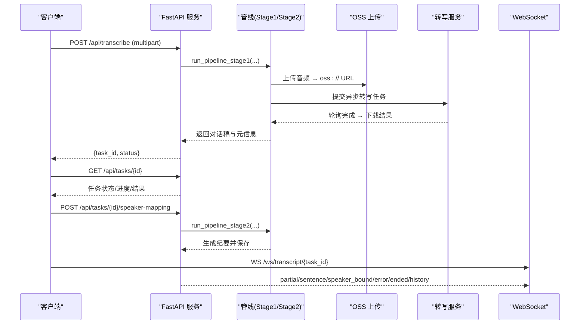
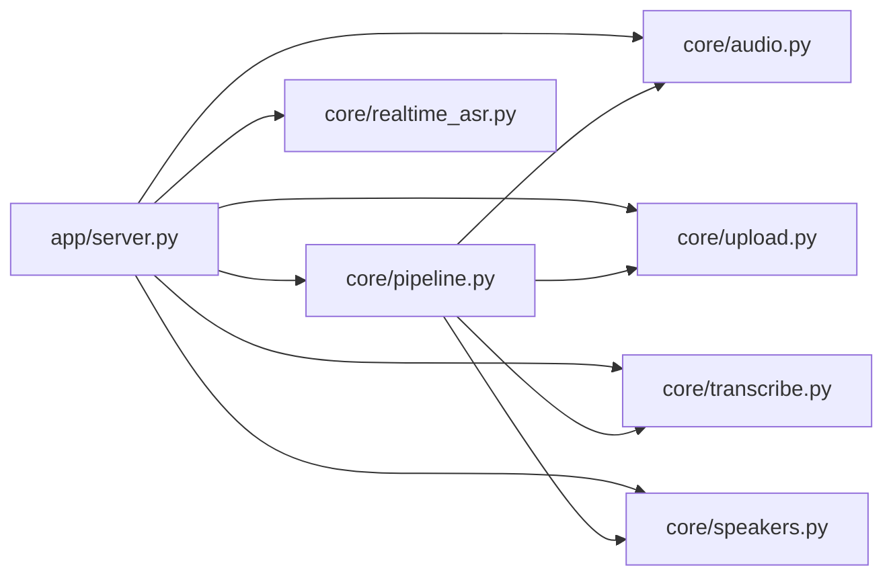

# RESTful API 参考

<cite>
**本文引用的文件**
- [app/server.py](file://app/server.py)
- [core/transcribe.py](file://core/transcribe.py)
- [core/speakers.py](file://core/speakers.py)
- [core/upload.py](file://core/upload.py)
- [core/audio.py](file://core/audio.py)
- [core/pipeline.py](file://core/pipeline.py)
- [core/realtime_asr.py](file://core/realtime_asr.py)
</cite>

## 目录
1. [简介](#简介)
2. [项目结构](#项目结构)
3. [核心组件](#核心组件)
4. [架构总览](#架构总览)
5. [详细端点参考](#详细端点参考)
6. [依赖关系分析](#依赖关系分析)
7. [性能与限制](#性能与限制)
8. [故障排查指南](#故障排查指南)
9. [结论](#结论)
10. [附录：数据模型与约束](#附录数据模型与约束)

## 简介
本参考文档面向 open-meeting-scribe 的 RESTful API，覆盖音频上传转写、任务管理、说话人管理、录制控制、实时转写 WebSocket、项目管理、AI 对话、热词与设置等接口。每个端点均说明 HTTP 方法、URL、请求参数、响应格式、状态码与错误处理，并提供常见使用场景的最佳实践建议。

## 项目结构
- FastAPI 服务入口位于 app/server.py，集中定义所有 HTTP 与 WebSocket 端点。
- 业务逻辑分布在 core 模块：
  - transcribe：提交/轮询/下载转写任务并组装对话稿
  - upload：获取上传凭证并上传到 DashScope OSS，返回 oss:// URL
  - audio：音频归一化、时长查询、系统内录（含流式 PCM）
  - pipeline：编排“音频→上传→转写→纪要”两阶段管线
  - speakers：全局说话人档案与会话映射历史
  - realtime_asr：基于 DashScope SDK 的实时转写（WebSocket）
  - projects：项目关联、文件夹扫描与索引、检索

图表来源
- [app/server.py:33-57](file://app/server.py#L33-L57)
- [core/pipeline.py:1-27](file://core/pipeline.py#L1-L27)

章节来源
- [app/server.py:1-21](file://app/server.py#L1-L21)

## 核心组件
- 任务生命周期：pending → processing → awaiting_mapping → completed/failed；录制中为 recording。
- 两阶段管线：
  - 阶段1：音频归一化 → 上传 OSS → 转写 → 组装对话稿
  - 阶段2：应用说话人姓名映射 → 生成标题与纪要 → 保存 Markdown
- 实时能力：流式录音 + 实时转写 + 实时总结 + 说话人分离（声纹聚类）+ WebSocket 推送

章节来源
- [core/pipeline.py:58-134](file://core/pipeline.py#L58-L134)
- [core/pipeline.py:137-226](file://core/pipeline.py#L137-L226)
- [app/server.py:226-333](file://app/server.py#L226-L333)

## 架构总览

图表来源
- [app/server.py:343-396](file://app/server.py#L343-L396)
- [app/server.py:399-415](file://app/server.py#L399-L415)
- [app/server.py:630-671](file://app/server.py#L630-L671)
- [app/server.py:1760-1832](file://app/server.py#L1760-L1832)
- [core/pipeline.py:58-134](file://core/pipeline.py#L58-L134)
- [core/pipeline.py:137-226](file://core/pipeline.py#L137-L226)

## 详细端点参考

### 音频上传与转写
- POST /api/transcribe
  - 用途：上传音频并提交转写任务
  - 请求体：multipart/form-data
    - file：音频文件（支持 mp3/wav/m4a/aac/ogg/flac/mp4/webm）
    - speaker_mapping：可选，JSON 字符串 {"0":"uuid1","1":"uuid2"}
  - 成功响应：{ task_id, status:"pending" }
  - 错误：
    - 400：不支持的文件类型
    - 其他异常：HTTPException 抛出具体错误信息
  - 行为：后台执行阶段1（转写），完成后若未提供 mapping 则进入 awaiting_mapping

- GET /api/download/{task_id}
  - 用途：下载生成的纪要 Markdown
  - 成功响应：文件流（text/markdown）
  - 错误：404 任务不存在或纪要文件不存在

- GET /api/audio/{task_id}
  - 用途：提供会议录音音频文件（支持 Range 拖动）
  - 成功响应：音频流（根据扩展名设置 MIME）
  - 错误：404 任务不存在或录音文件不存在

章节来源
- [app/server.py:339-396](file://app/server.py#L339-L396)
- [app/server.py:424-472](file://app/server.py#L424-L472)

### 任务管理
- GET /api/tasks
  - 用途：获取任务列表（按创建时间倒序）
  - 响应：{ tasks: [...] }

- GET /api/tasks/{task_id}
  - 用途：查询任务状态与结果
  - 响应：任务对象（包含 status、progress、message、audio_duration、speaker_count、summary、output_path、created_at、error、dialogue、transcription、speaker_mapping 等）
  - 特殊：当状态为 recording 且正在流式录制时，附带 elapsed 字段

- PATCH /api/tasks/{task_id}
  - 用途：更新任务信息（如 title）
  - 请求体：{ title?: string }
  - 响应：更新后的任务对象

- DELETE /api/tasks/{task_id}
  - 用途：删除任务及关联文件
  - 响应：{ deleted: true }

- POST /api/tasks/{task_id}/speaker-mapping
  - 用途：设置说话人映射并触发纪要生成
  - 请求体：{ mapping: {"0":"uuid1","1":"uuid2"} }
  - 响应：{ status:"processing", message:"正在生成纪要..." }
  - 错误：400 当前状态不允许（仅 awaiting_mapping/completed）

- POST /api/tasks/{task_id}/regenerate-summary
  - 用途：使用当前说话人映射重新生成纪要
  - 响应：{ status:"processing", message:"正在重新生成纪要..." }
  - 错误：400 任务尚未完成或未设置映射

- GET /api/tasks/{task_id}/notes
  - 用途：获取任务笔记
  - 响应：{ notes: string }

- PUT /api/tasks/{task_id}/notes
  - 用途：保存任务笔记
  - 请求体：{ notes: string }
  - 响应：{ notes: string }

章节来源
- [app/server.py:399-415](file://app/server.py#L399-L415)
- [app/server.py:475-515](file://app/server.py#L475-L515)
- [app/server.py:626-671](file://app/server.py#L626-L671)
- [app/server.py:674-715](file://app/server.py#L674-L715)
- [app/server.py:1884-1901](file://app/server.py#L1884-L1901)

### 说话人管理
- GET /api/speakers
  - 用途：获取全局说话人列表
  - 响应：{ speakers: [Speaker] }

- POST /api/speakers
  - 用途：添加说话人
  - 请求体：{ name: string, role?: string, note?: string }
  - 响应：Speaker 对象
  - 错误：400 姓名为空

- PUT /api/speakers/{speaker_id}
  - 用途：更新说话人
  - 请求体：{ name?: string, role?: string, note?: string }
  - 响应：Speaker 对象
  - 错误：404 说话人不存在

- DELETE /api/speakers/{speaker_id}
  - 用途：删除说话人
  - 响应：{ deleted: true }
  - 错误：404 说话人不存在

- GET /api/speakers/mapping/latest
  - 用途：获取最近一次会议映射（用于复用建议）
  - 响应：{ mapping: { meeting_id, meeting_name, created_at, details:{speaker_id:{speaker_uuid,name}} } | null }

- POST /api/speakers/mapping
  - 用途：保存会议映射（用户确认说话人身份后调用）
  - 请求体：{ meeting_id: string, meeting_name: string, mapping: {"0":"uuid1","1":"uuid2"} }
  - 响应：{ meeting_id, meeting_name, created_at }

章节来源
- [app/server.py:521-571](file://app/server.py#L521-L571)
- [app/server.py:574-619](file://app/server.py#L574-L619)
- [core/speakers.py:35-103](file://core/speakers.py#L35-L103)
- [core/speakers.py:109-199](file://core/speakers.py#L109-L199)
- [core/speakers.py:229-271](file://core/speakers.py#L229-L271)

### 录制控制（流式录音 + 实时转写）
- POST /api/record/start
  - 用途：开始流式录音，同时启动实时转写与实时总结
  - 响应：{ task_id, status:"recording" }
  - 错误：400 已在录制中；500 录制启动失败

- POST /api/record/stop
  - 用途：停止录制，自动进入管线处理
  - 请求体：{ notes?: string }
  - 响应：{ task_id, status:"processing", duration: number }
  - 错误：400 未在录制中；404 任务不存在；500 录制停止失败

- GET /api/record/status
  - 用途：查询当前录制状态
  - 响应：{ recording: boolean, task_id?: string, elapsed?: number, paused?: boolean }

- POST /api/record/pause
  - 用途：暂停录制（丢弃数据，实时转写停止接收）
  - 响应：{ status:"paused" }
  - 错误：400 未在录制中

- POST /api/record/resume
  - 用途：恢复录制
  - 响应：{ status:"recording" }
  - 错误：400 未在录制中

- POST /api/record/summary/pause
  - 用途：暂停实时总结
  - 响应：{ status:"paused" }
  - 错误：400 无活跃的实时总结

- POST /api/record/summary/resume
  - 用途：恢复实时总结
  - 响应：{ status:"resumed" }
  - 错误：400 无活跃的实时总结

- POST /api/record/bind-speaker
  - 用途：实时绑定 ASR 说话人到全局说话人
  - 请求体：{ speaker_id: number, speaker_uuid: string }
  - 响应：{ speaker_id, speaker_name, speaker_uuid }
  - 错误：400 无活跃录音；404 说话人不存在

- GET /api/record/speaker-bindings
  - 用途：获取当前录音的说话人绑定状态
  - 响应：{ bindings: {speaker_id:{speaker_uuid,speaker_name}}, task_id?: string }

章节来源
- [app/server.py:721-863](file://app/server.py#L721-L863)
- [app/server.py:865-990](file://app/server.py#L865-L990)
- [app/server.py:996-1092](file://app/server.py#L996-L1092)
- [core/audio.py:303-496](file://core/audio.py#L303-L496)
- [core/realtime_asr.py:150-368](file://core/realtime_asr.py#L150-L368)

### 实时转写 WebSocket
- WS /ws/transcript/{task_id}
  - 用途：在录音期间连接，接收实时识别结果
  - 下行消息类型：
    - partial：临时结果 { type:"partial", text, speaker_id, speaker_name }
    - sentence：定稿句子 { type:"sentence", text, begin_time, end_time, speaker_id, speaker_name }
    - speaker_bound：说话人绑定更新 { type:"speaker_bound", speaker_id, speaker_name }
    - error：错误 { type:"error", message }
    - ended：转写结束 { type:"ended" }
    - history：历史回放（页面刷新恢复）{ type:"history", ... }
    - summary_update/summary_status：实时总结内容与状态
  - 错误：若任务不存在或未在录制，发送 error 并关闭连接

章节来源
- [app/server.py:1760-1832](file://app/server.py#L1760-L1832)

### 项目管理
- GET /api/filesystem/browse
  - 用途：浏览本地文件系统（仅返回目录）
  - 查询参数：path?（默认用户主目录）
  - 响应：{ current_path, parent_path, home_path, directories:[{name,path,has_children}] }
  - 错误：400 不是目录；403 无权限；404 路径不存在

- GET /api/projects
  - 用途：获取项目列表（含索引摘要）
  - 响应：{ projects:[...] }

- POST /api/projects
  - 用途：创建项目（可关联多个文件夹）
  - 请求体：{ name: string, folders?: string[] }
  - 响应：Project 对象
  - 错误：400 名称为空或文件夹不存在

- GET /api/projects/{project_id}
  - 用途：获取项目详情（附加索引信息）
  - 响应：Project 对象

- PUT /api/projects/{project_id}
  - 用途：更新项目（仅 name）
  - 请求体：{ name?: string }
  - 响应：Project 对象
  - 错误：404 项目不存在

- DELETE /api/projects/{project_id}
  - 用途：删除项目及其索引
  - 响应：{ deleted: true }
  - 错误：404 项目不存在

- POST /api/projects/{project_id}/folders
  - 用途：为项目添加文件夹
  - 请求体：{ path: string }
  - 响应：Project 对象
  - 错误：400/404

- DELETE /api/projects/{project_id}/folders
  - 用途：从项目移除文件夹
  - 请求体：{ path: string }
  - 响应：Project 对象
  - 错误：400/404

- POST /api/projects/{project_id}/scan
  - 用途：触发项目索引构建（后台异步）
  - 响应：{ status:"scanning", message:"索引构建已启动" }
  - 错误：404 项目不存在

- GET /api/projects/{project_id}/files
  - 用途：获取项目索引中的文件列表
  - 响应：{ files:[...], indexed_at?: string, total_files?: number }

- POST /api/projects/{project_id}/search
  - 用途：在项目索引中搜索
  - 请求体：{ query: string, limit?: number }
  - 响应：{ results:[...], total: number }

章节来源
- [app/server.py:1098-1288](file://app/server.py#L1098-L1288)
- [core/projects.py:62-160](file://core/projects.py#L62-L160)
- [core/projects.py:323-350](file://core/projects.py#L323-L350)
- [core/projects.py:408-457](file://core/projects.py#L408-L457)

### AI 对话
- POST /api/chat
  - 用途：AI 对话（含动作检测与执行）
  - 请求体：{ message: string, project_id?: string, task_id?: string, history?: [...], realtime_transcripts?: [...] }
  - 响应：{ reply: string, sources?: [...], extracted_items?: [...], action?: {...} }
  - 错误：400 消息为空；500 AI 对话失败

章节来源
- [app/server.py:1524-1727](file://app/server.py#L1524-L1727)

### 用户与笔记
- GET /api/user
  - 用途：获取当前用户信息
  - 响应：{ user: {...} }

- POST /api/user
  - 用途：设置/更新当前用户姓名与头像色
  - 请求体：{ name: string, avatar_color?: string }
  - 响应：{ user: {...} }
  - 错误：400 姓名为空

- POST /api/user/bind-speaker
  - 用途：将当前用户绑定到指定任务的某说话人
  - 请求体：{ task_id: string, speaker_id: string }
  - 响应：{ speaker_uuid: string, user_name: string }
  - 错误：400 未设置用户或绑定失败

章节来源
- [app/server.py:1838-1874](file://app/server.py#L1838-L1874)

### 注入与待办
- GET /api/tasks/{task_id}/injections
  - 用途：获取任务的所有注入内容
  - 响应：{ injections:[...] }

- POST /api/tasks/{task_id}/inject
  - 用途：注入一条 AI 识别内容（todo/conclusion/decision）
  - 请求体：{ type: string, content: string, source_message?: string }
  - 响应：{ item: {...} }

- POST /api/tasks/{task_id}/injections/{injection_id}/apply
  - 用途：标记注入内容为已应用到纪要
  - 响应：{ item: {...} }
  - 错误：404 注入内容不存在

- DELETE /api/tasks/{task_id}/injections/{injection_id}
  - 用途：删除一条注入内容（同步删除关联 todo）
  - 响应：{ ok: true }

- GET /api/tasks/{task_id}/todos
  - 用途：获取任务的所有待办事项
  - 响应：{ todos:[...] }

- POST /api/tasks/{task_id}/todos/{todo_id}/toggle
  - 用途：切换待办完成状态
  - 请求体：{ done: boolean }
  - 响应：{ todo: {...} }
  - 错误：404 待办不存在

- DELETE /api/tasks/{task_id}/todos/{todo_id}
  - 用途：删除一条待办
  - 响应：{ ok: true }

章节来源
- [app/server.py:1908-2031](file://app/server.py#L1908-L2031)

### 热词与设置
- GET /api/hotwords
  - 用途：获取热词列表
  - 响应：{ hotwords:[string], count:number }

- POST /api/hotwords
  - 用途：保存热词列表（每行一个）
  - 请求体：{ hotwords: string }
  - 响应：{ ok:true, count:number }

- GET /api/hotword-mappings
  - 用途：获取热词映射列表
  - 响应：{ mappings:[{from,to}], count:number }

- POST /api/hotword-mappings
  - 用途：保存热词映射（每行一条，格式：错误识别→正确文本）
  - 请求体：{ mappings: string }
  - 响应：{ ok:true, count:number }

- GET /api/settings
  - 用途：获取当前设置
  - 响应：{ api_key?, model?, output_dir? }

- POST /api/settings
  - 用途：保存设置（会同步更新环境变量 DASHSCOPE_API_KEY）
  - 请求体：{ api_key?, model?, output_dir? }
  - 响应：{ ok:true }

章节来源
- [app/server.py:2037-2111](file://app/server.py#L2037-L2111)

## 依赖关系分析

图表来源
- [app/server.py:41-57](file://app/server.py#L41-L57)
- [core/pipeline.py:22-27](file://core/pipeline.py#L22-L27)

章节来源
- [app/server.py:41-57](file://app/server.py#L41-L57)
- [core/pipeline.py:22-27](file://core/pipeline.py#L22-L27)

## 性能与限制
- 音频格式与采样率：
  - 批转写推荐 16kHz/单声道/WAV（通过 ffmpeg 归一化）
  - 实时转写要求 PCM 16bit/16kHz/单声道，每包约 6400 bytes（100ms）
- 文件大小与有效期：
  - 上传至 DashScope OSS 上限 1GB，oss:// URL 有效期 48h
- 并发与限流：
  - 实时转写启动遇到限流会自动重试（指数退避）
  - 上传凭证接口有 QPS 限制（需避免高频调用）
- 超时与重试：
  - 转写任务轮询默认间隔 3s，超时 600s
  - 文件上传超时 600s

章节来源
- [core/audio.py:31-98](file://core/audio.py#L31-L98)
- [core/upload.py:33-115](file://core/upload.py#L33-L115)
- [core/transcribe.py:28-31](file://core/transcribe.py#L28-L31)
- [core/realtime_asr.py:53-54](file://core/realtime_asr.py#L53-L54)
- [core/realtime_asr.py:212-327](file://core/realtime_asr.py#L212-L327)

## 故障排查指南
- 上传失败或 URL 无效：
  - 检查 DASHSCOPE_API_KEY 是否配置
  - 确认文件大小不超过 1GB
  - oss:// URL 需进行 URL 编码（含空格/中文）
- 转写结果为空或失败：
  - 检查转写任务状态与错误信息
  - 确认音频已归一化为 16kHz/单声道
  - 查看热词表是否生效
- 实时转写不可用：
  - 检查 WebSocket 地址与网络连通性
  - 关注限流提示与自动重试日志
  - 确保 PCM 数据格式正确（16bit/16kHz/单声道）
- 说话人绑定不生效：
  - 确认全局说话人存在
  - 检查实时绑定映射与会话映射是否一致
- 纪要未生成：
  - 确认已完成说话人映射
  - 检查第二阶段进度与错误信息
  - 确认输出目录可写

章节来源
- [core/upload.py:25-30](file://core/upload.py#L25-L30)
- [core/upload.py:118-134](file://core/upload.py#L118-L134)
- [core/transcribe.py:54-58](file://core/transcribe.py#L54-L58)
- [core/transcribe.py:134-187](file://core/transcribe.py#L134-L187)
- [core/realtime_asr.py:229-327](file://core/realtime_asr.py#L229-L327)
- [app/server.py:630-671](file://app/server.py#L630-L671)

## 结论
open-meeting-scribe 提供了完整的会议录音、转写、说话人管理与纪要生成能力，并通过 WebSocket 实现实时预览。RESTful API 覆盖了从上传、任务管理、说话人绑定到录制控制的全流程。建议在生产环境中：
- 合理配置 DASHSCOPE_API_KEY 与模型参数
- 监控任务状态与错误日志
- 使用说话人映射提升纪要可读性
- 利用热词与上下文增强识别准确率
- 对大文件与高并发场景做好限流与重试策略

## 附录：数据模型与约束
- 任务状态机
  - pending → processing → awaiting_mapping → completed/failed
  - recording（流式录制）
- 说话人映射
  - 键为数字字符串（"0","1"...），值为全局说话人 UUID
- 实时转写消息
  - partial/sentence/speaker_bound/error/ended/history/summary_update/summary_status
- 项目索引
  - 支持 .md/.txt/.docx/.pdf 文本提取与关键词抽取
- 热词与映射
  - 热词：每行一个词
  - 映射：每行一条，格式“错误识别→正确文本”

章节来源
- [app/server.py:138-156](file://app/server.py#L138-L156)
- [core/speakers.py:35-103](file://core/speakers.py#L35-L103)
- [core/projects.py:29-36](file://core/projects.py#L29-L36)
- [core/projects.py:167-217](file://core/projects.py#L167-L217)
- [app/server.py:2037-2111](file://app/server.py#L2037-L2111)