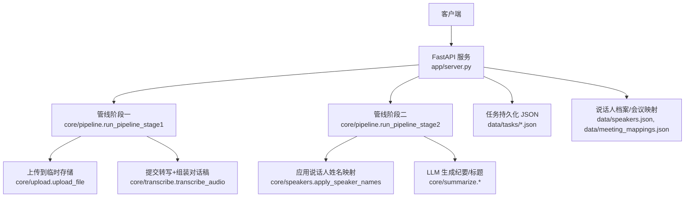
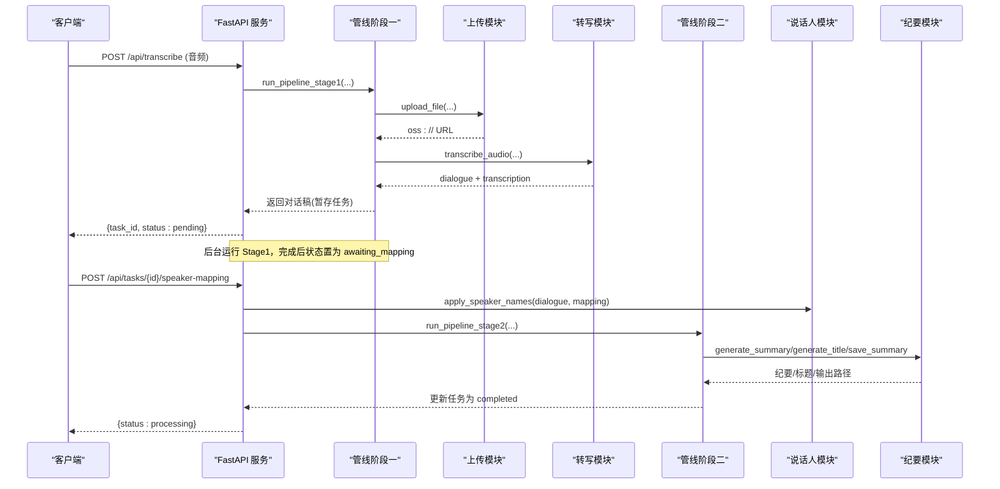
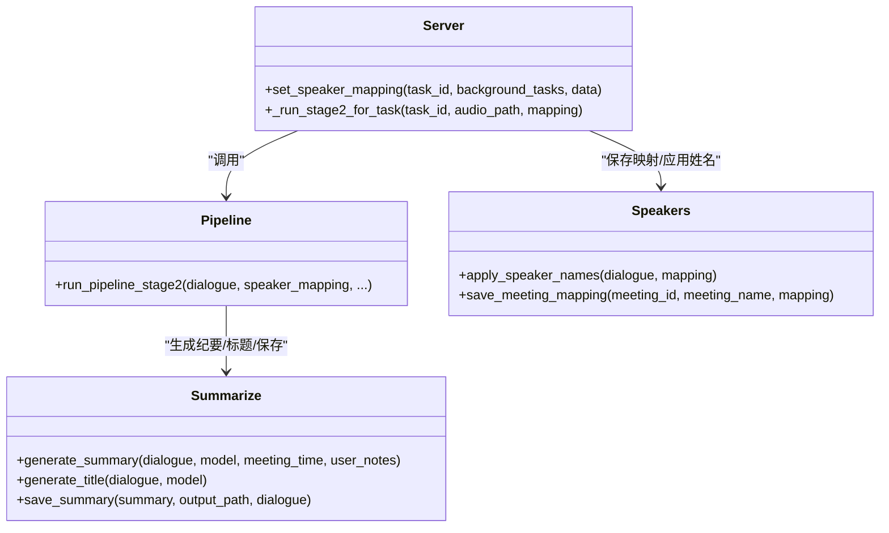
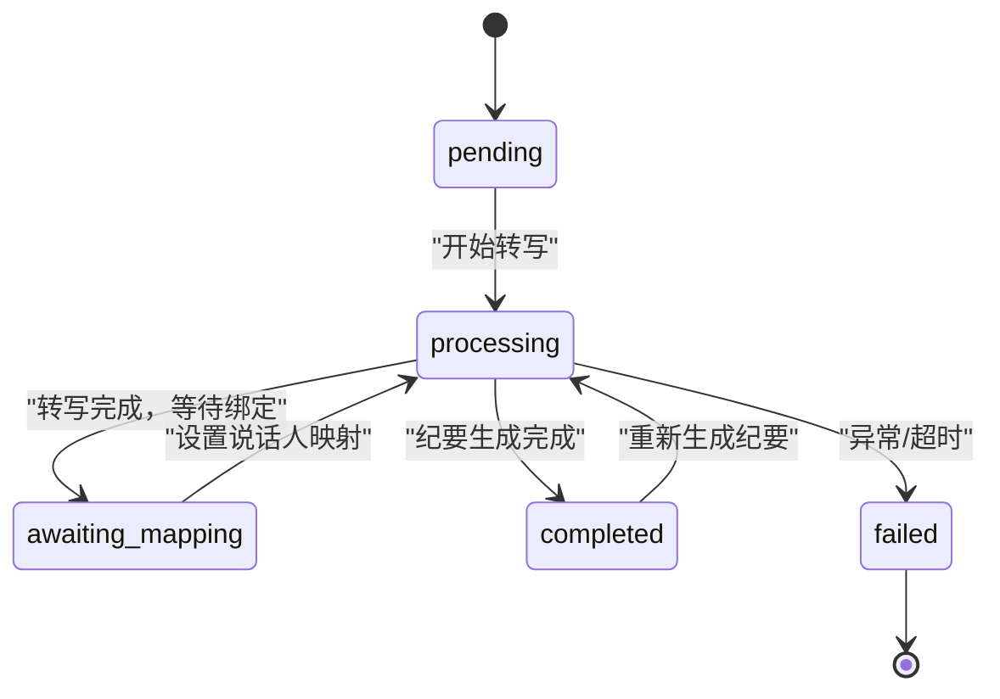
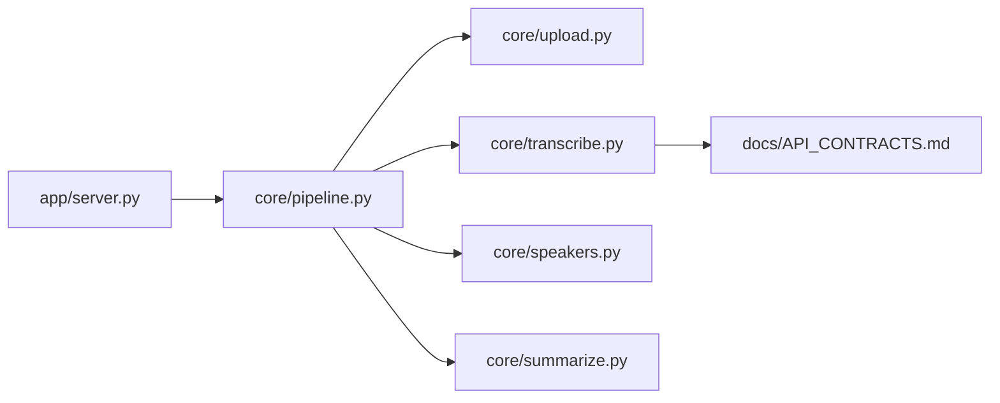

# 任务工作流 API

<cite>
**本文引用的文件**
- [app/server.py](file://app/server.py)
- [core/pipeline.py](file://core/pipeline.py)
- [core/speakers.py](file://core/speakers.py)
- [core/transcribe.py](file://core/transcribe.py)
- [core/summarize.py](file://core/summarize.py)
- [core/upload.py](file://core/upload.py)
- [docs/API_CONTRACTS.md](file://docs/API_CONTRACTS.md)
- [data/speakers.json](file://data/speakers.json)
- [data/meeting_mappings.json](file://data/meeting_mappings.json)
</cite>

## 目录
1. [简介](#简介)
2. [项目结构](#项目结构)
3. [核心组件](#核心组件)
4. [架构总览](#架构总览)
5. [详细组件分析](#详细组件分析)
6. [依赖关系分析](#依赖关系分析)
7. [性能与并发](#性能与并发)
8. [故障排查指南](#故障排查指南)
9. [结论](#结论)
10. [附录：请求响应示例](#附录请求响应示例)

## 简介
本文件聚焦于“任务工作流”的 RESTful API，重点文档化以下两个接口：
- POST /api/tasks/{task_id}/speaker-mapping：设置说话人映射并触发纪要生成
- POST /api/tasks/{task_id}/regenerate-summary：使用当前说话人映射重新生成纪要

同时说明工作流状态转换机制（转写→等待绑定→生成纪要）、批量说话人映射设置方法、UUID 映射处理逻辑、错误处理策略、进度跟踪机制，以及与后台任务系统的集成方式。

## 项目结构
- Web 服务层：FastAPI 应用，提供 REST 端点、WebSocket 实时转写、静态页面托管、后台任务编排
- 管线层：两阶段流水线（Stage1 音频→对话稿；Stage2 对话稿→纪要）
- 数据层：说话人档案与会话映射持久化（JSON）
- 外部集成：DashScope 转写与 LLM 纪要生成

图表来源
- [app/server.py:226-333](file://app/server.py#L226-L333)
- [core/pipeline.py:58-226](file://core/pipeline.py#L58-L226)
- [core/upload.py:59-115](file://core/upload.py#L59-L115)
- [core/transcribe.py:405-445](file://core/transcribe.py#L405-L445)
- [core/speakers.py:278-309](file://core/speakers.py#L278-L309)
- [core/summarize.py:157-229](file://core/summarize.py#L157-L229)

章节来源
- [app/server.py:1-220](file://app/server.py#L1-L220)
- [core/pipeline.py:1-135](file://core/pipeline.py#L1-L135)

## 核心组件
- 任务模型与状态机
  - 任务状态：pending → processing → awaiting_mapping → completed/failed
  - 进度字段 progress（百分比），消息 message，以及结果字段 summary/title/output_path/dialogue/speaker_mapping/speaker_uuid_mapping
- 后台任务
  - 使用 FastAPI BackgroundTasks 异步执行 Stage1/Stage2，避免阻塞请求线程
- 说话人管理
  - 全局说话人档案（speakers.json）
  - 会议级映射历史（meeting_mappings.json），支持复用建议
- 外部服务
  - DashScope 转写（paraformer-v2，异步任务，支持说话人分离）
  - 通义千问（qwen-plus）生成纪要与标题

章节来源
- [app/server.py:138-165](file://app/server.py#L138-L165)
- [app/server.py:226-333](file://app/server.py#L226-L333)
- [core/speakers.py:35-103](file://core/speakers.py#L35-L103)
- [docs/API_CONTRACTS.md:28-64](file://docs/API_CONTRACTS.md#L28-L64)

## 架构总览
任务工作流分为两阶段：
- 阶段一：音频归一化 → 上传至 DashScope 临时存储 → 提交异步转写 → 轮询完成 → 下载结果 → 碎片合并/说话人修正 → 按 speaker_id 归并为对话稿
- 阶段二：应用说话人姓名映射（UUID→姓名）→ 调用 LLM 生成纪要与标题 → 保存 Markdown 输出

图表来源
- [app/server.py:343-396](file://app/server.py#L343-L396)
- [app/server.py:630-671](file://app/server.py#L630-L671)
- [core/pipeline.py:58-135](file://core/pipeline.py#L58-L135)
- [core/pipeline.py:137-226](file://core/pipeline.py#L137-L226)
- [core/transcribe.py:405-445](file://core/transcribe.py#L405-L445)
- [core/speakers.py:278-309](file://core/speakers.py#L278-L309)
- [core/summarize.py:157-229](file://core/summarize.py#L157-L229)

## 详细组件分析

### 说话人绑定接口：POST /api/tasks/{task_id}/speaker-mapping
- 功能：将 ASR 输出的数字 speaker_id 绑定到具体说话人（UUID），并触发纪要生成
- 前置条件：任务存在且状态为 awaiting_mapping 或 completed
- 输入：
  - path: task_id
  - body: {"mapping": {"0": "uuid1", "1": "uuid2"}}
- 行为：
  - 校验任务状态
  - 将字符串 key 转为整数键
  - 保存会议映射（用于历史复用）
  - 更新任务状态为 processing，进度 75%，写入 speaker_uuid_mapping
  - 后台执行第二阶段（应用姓名映射→生成纪要→保存输出）
- 输出：{"status": "processing", "message": "正在生成纪要..."}
- 错误：
  - 404 任务不存在
  - 400 当前状态不允许设置说话人映射

章节来源
- [app/server.py:626-671](file://app/server.py#L626-L671)
- [core/speakers.py:229-252](file://core/speakers.py#L229-L252)
- [core/pipeline.py:137-226](file://core/pipeline.py#L137-L226)

#### 类与方法关系图（说话人绑定相关）

图表来源
- [app/server.py:630-671](file://app/server.py#L630-L671)
- [core/pipeline.py:137-226](file://core/pipeline.py#L137-L226)
- [core/speakers.py:278-309](file://core/speakers.py#L278-L309)
- [core/summarize.py:157-229](file://core/summarize.py#L157-L229)

### 纪要重新生成接口：POST /api/tasks/{task_id}/regenerate-summary
- 功能：使用当前说话人映射重新生成纪要（适用于用户修改绑定后重算）
- 前置条件：任务已完成（completed）
- 输入：path: task_id
- 行为：
  - 优先读取 UUID 映射（speaker_uuid_mapping）
  - 若无 UUID 映射，尝试从姓名映射反查 UUID
  - 更新任务状态为 processing，进度 75%
  - 后台执行第二阶段（同绑定流程）
- 输出：{"status": "processing", "message": "正在重新生成纪要..."}
- 错误：
  - 404 任务不存在
  - 400 任务尚未完成或未设置说话人映射

章节来源
- [app/server.py:674-714](file://app/server.py#L674-L714)
- [core/pipeline.py:137-226](file://core/pipeline.py#L137-L226)

### 工作流状态转换机制
- 创建任务：POST /api/transcribe
  - 状态：pending → processing
  - 后台执行 Stage1，完成后若未提供预设映射则状态变为 awaiting_mapping（进度约 70%）
- 绑定说话人：POST /api/tasks/{task_id}/speaker-mapping
  - 状态：awaiting_mapping/completed → processing（进度 75%）
  - 后台执行 Stage2，完成后状态变为 completed（进度 100%）
- 重新生成：POST /api/tasks/{task_id}/regenerate-summary
  - 状态：completed → processing（进度 75%）→ completed（进度 100%）
- 失败处理：任何阶段异常将状态置为 failed，并记录 error 与 message

图表来源
- [app/server.py:226-333](file://app/server.py#L226-L333)
- [app/server.py:630-714](file://app/server.py#L630-L714)

### 批量说话人映射设置方法与 UUID 映射处理逻辑
- 批量设置
  - 在上传音频时可通过参数 speaker_mapping 传入预设映射（JSON 字符串），格式 {"0":"uuid1","1":"uuid2"}
  - 服务器解析为 {int: str} 后直接触发 Stage2，跳过 awaiting_mapping
- UUID 映射处理
  - 绑定接口要求 mapping 值为 UUID（来自 speakers.json）
  - 系统内部维护 speaker_uuid_mapping（字符串键）以便前端刷新后不丢失绑定
  - 重新生成时优先使用 UUID 映射；如缺失则尝试从姓名映射反查 UUID
  - 应用姓名映射时通过 speakers.apply_speaker_names 将 UUID 转换为姓名，注入到对话稿中

章节来源
- [app/server.py:343-396](file://app/server.py#L343-L396)
- [app/server.py:630-714](file://app/server.py#L630-L714)
- [core/speakers.py:278-309](file://core/speakers.py#L278-L309)
- [data/speakers.json:1-30](file://data/speakers.json#L1-L30)
- [data/meeting_mappings.json:1-122](file://data/meeting_mappings.json#L1-L122)

### 进度跟踪与状态查询
- 进度字段
  - progress：百分比（0-100），由管线回调更新
  - message：人类可读的阶段描述
  - status：任务状态（pending/processing/awaiting_mapping/completed/failed）
- 查询接口
  - GET /api/tasks/{task_id}：返回任务完整状态与结果
- 后台任务
  - 使用 BackgroundTasks 异步执行，避免阻塞 HTTP 请求
  - 任务结果与进度通过内存字典 tasks 共享，并在关键节点持久化到磁盘

章节来源
- [app/server.py:138-165](file://app/server.py#L138-L165)
- [app/server.py:410-421](file://app/server.py#L410-L421)
- [core/pipeline.py:47-56](file://core/pipeline.py#L47-L56)

### 与后台任务系统的集成与异步模式
- 上传音频后，立即返回 task_id 与 pending 状态，后台执行 Stage1
- 绑定说话人或重新生成时，立即返回 processing，后台执行 Stage2
- 所有耗时操作（上传、转写、LLM 调用、文件保存）均在后台线程中执行
- 实时录音场景下，还包含 WebSocket 推送与增量总结器，但不在本次范围

章节来源
- [app/server.py:343-396](file://app/server.py#L343-L396)
- [app/server.py:630-714](file://app/server.py#L630-L714)

## 依赖关系分析
- 服务层依赖管线层进行两阶段处理
- 管线阶段一依赖上传模块与转写模块
- 管线阶段二依赖说话人模块与纪要模块
- 外部依赖：DashScope 转写与 LLM（遵循 API_CONTRACTS 约束）

图表来源
- [app/server.py:226-333](file://app/server.py#L226-L333)
- [core/pipeline.py:58-226](file://core/pipeline.py#L58-L226)
- [core/transcribe.py:405-445](file://core/transcribe.py#L405-L445)
- [docs/API_CONTRACTS.md:28-64](file://docs/API_CONTRACTS.md#L28-L64)

章节来源
- [core/pipeline.py:58-226](file://core/pipeline.py#L58-L226)
- [docs/API_CONTRACTS.md:28-64](file://docs/API_CONTRACTS.md#L28-L64)

## 性能与并发
- 后台任务：使用 BackgroundTasks 实现非阻塞处理，提高吞吐
- 转写轮询：内置超时与重试间隔，避免长时间占用资源
- 文件 I/O：关键节点持久化任务状态，降低重启影响
- 外部调用：上传与转写均为网络 IO，建议在部署时配置合理的超时与重试策略

[本节为通用指导，不直接分析具体文件]

## 故障排查指南
- 常见错误
  - 任务不存在：检查 task_id 是否正确
  - 状态不允许：确保任务处于 awaiting_mapping 或 completed 再绑定
  - 未设置说话人映射：重新生成前需先完成绑定
  - 外部服务失败：检查 DASHSCOPE_API_KEY、网络连通性与配额
- 日志定位
  - 服务层记录任务状态变更与异常
  - 管线层记录各阶段进度与错误信息
  - 转写模块记录任务状态变化与失败原因
- 恢复策略
  - 任务状态持久化到磁盘，重启后可恢复
  - 会议映射可复用，减少重复绑定工作量

章节来源
- [app/server.py:226-333](file://app/server.py#L226-L333)
- [core/transcribe.py:134-176](file://core/transcribe.py#L134-L176)

## 结论
本工作流通过两阶段管线实现了从音频到结构化纪要的自动化处理，结合说话人绑定与历史复用机制，提升了用户体验与准确性。RESTful API 设计清晰，状态机明确，配合后台任务与进度反馈，满足会议场景下的异步处理需求。

[本节为总结性内容，不直接分析具体文件]

## 附录：请求响应示例
以下为典型端到端流程的请求与响应示例（基于代码实现整理）：

- 上传音频并提交转写任务
  - 请求：POST /api/transcribe
    - 表单字段：file（音频文件）
    - 可选：speaker_mapping（JSON 字符串，如 {"0":"uuid1","1":"uuid2"}）
  - 响应：{"task_id": "...", "status": "pending"}

- 查询任务状态
  - 请求：GET /api/tasks/{task_id}
  - 响应：包含 status、progress、message、dialogue、speaker_count 等字段

- 设置说话人映射并触发纪要生成
  - 请求：POST /api/tasks/{task_id}/speaker-mapping
    - Body：{"mapping": {"0": "uuid1", "1": "uuid2"}}
  - 响应：{"status": "processing", "message": "正在生成纪要..."}

- 重新生成纪要
  - 请求：POST /api/tasks/{task_id}/regenerate-summary
  - 响应：{"status": "processing", "message": "正在重新生成纪要..."}

- 下载纪要文件
  - 请求：GET /api/download/{task_id}
  - 响应：Markdown 文件流

- 删除任务
  - 请求：DELETE /api/tasks/{task_id}
  - 响应：{"deleted": true}

章节来源
- [app/server.py:343-396](file://app/server.py#L343-L396)
- [app/server.py:410-421](file://app/server.py#L410-L421)
- [app/server.py:424-439](file://app/server.py#L424-L439)
- [app/server.py:475-497](file://app/server.py#L475-L497)
- [app/server.py:630-714](file://app/server.py#L630-L714)