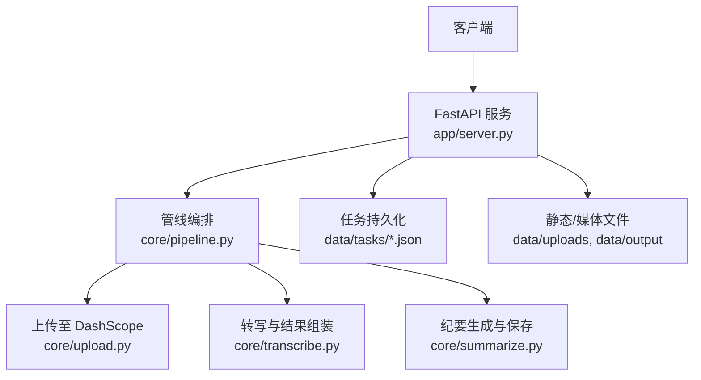
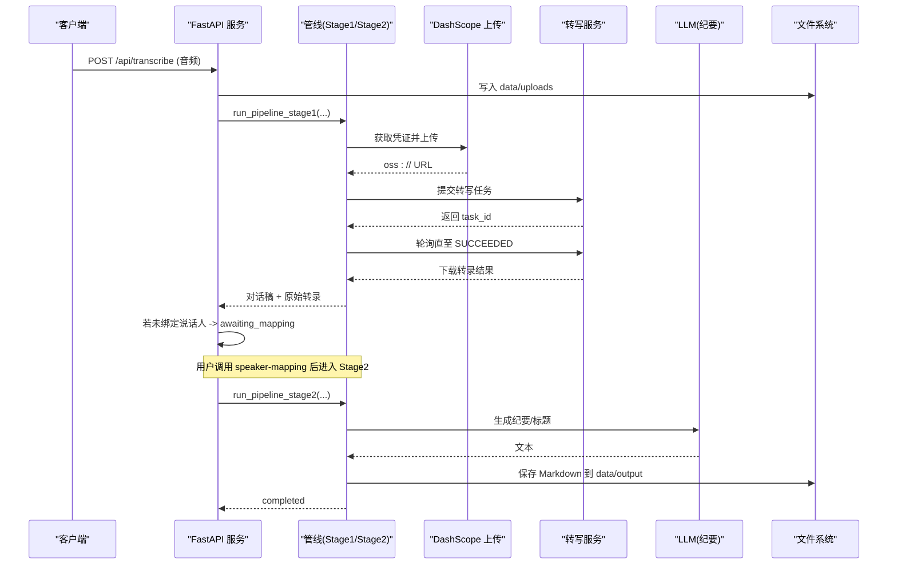
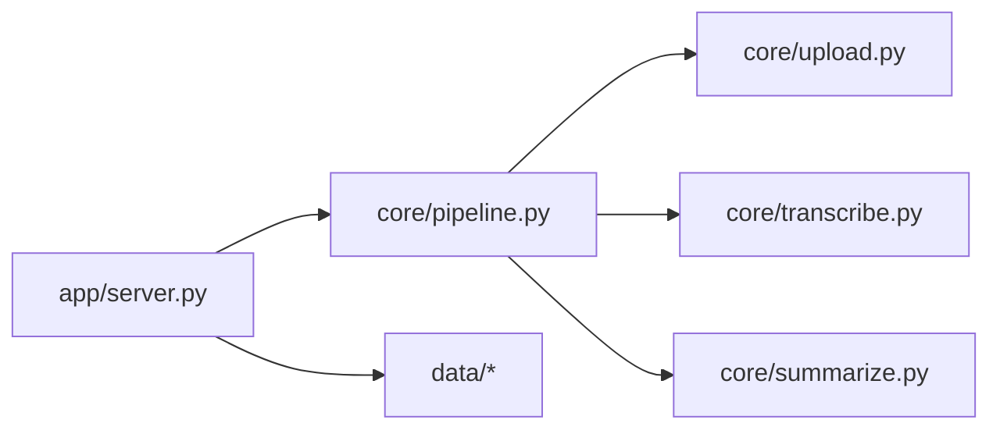

# 任务管理 API

<cite>
**本文引用的文件**
- [app/server.py](file://app/server.py)
- [core/pipeline.py](file://core/pipeline.py)
- [core/transcribe.py](file://core/transcribe.py)
- [core/upload.py](file://core/upload.py)
- [core/summarize.py](file://core/summarize.py)
- [docs/API_CONTRACTS.md](file://docs/API_CONTRACTS.md)
</cite>

## 目录
1. [简介](#简介)
2. [项目结构](#项目结构)
3. [核心组件](#核心组件)
4. [架构总览](#架构总览)
5. [详细接口文档](#详细接口文档)
6. [依赖关系分析](#依赖关系分析)
7. [性能与可靠性](#性能与可靠性)
8. [故障排查指南](#故障排查指南)
9. [结论](#结论)

## 简介
本文件面向使用“会议转写与纪要生成”服务的开发者，系统化文档化任务管理相关的 RESTful API，包括：
- 任务查询：GET /api/tasks/{id}、GET /api/tasks
- 任务删除：DELETE /api/tasks/{id}
- 任务更新：PATCH /api/tasks/{id}
- 文件下载：GET /api/download/{id}、GET /api/audio/{id}
同时说明任务状态机（pending、processing、awaiting_mapping、completed、failed）与进度跟踪机制，并提供常见场景的请求/响应示例。

## 项目结构
服务基于 FastAPI 提供 HTTP API，后台通过异步管线完成音频转写与纪要生成；任务数据在内存中维护并持久化到磁盘 JSON，支持启动恢复。

图表来源
- [app/server.py:65-89](file://app/server.py#L65-L89)
- [core/pipeline.py:1-12](file://core/pipeline.py#L1-L12)

章节来源
- [app/server.py:1-100](file://app/server.py#L1-L100)

## 核心组件
- 任务模型与存储
  - 任务对象包含 task_id、status、progress、message、audio_name、audio_duration、speaker_count、summary、output_path、created_at、error、dialogue、transcription、speaker_mapping 等字段。
  - 任务以字典形式驻留内存，并在关键节点落盘（避免重启丢失）。
- 管线阶段
  - Stage 1：音频归一化 → 上传 → 热词表检查 → 提交转写 → 轮询 → 下载结果 → 组装对话稿。
  - Stage 2：应用说话人姓名映射 → 生成纪要与标题 → 保存 Markdown 到 data/output。
- 进度回调
  - 通过 PipelineProgress 将百分比与消息回写到任务对象，供前端轮询展示。

章节来源
- [app/server.py:138-156](file://app/server.py#L138-L156)
- [core/pipeline.py:47-134](file://core/pipeline.py#L47-L134)
- [core/pipeline.py:137-226](file://core/pipeline.py#L137-L226)

## 架构总览
任务从创建到完成的典型流程如下：

图表来源
- [app/server.py:343-396](file://app/server.py#L343-L396)
- [core/pipeline.py:58-134](file://core/pipeline.py#L58-L134)
- [core/pipeline.py:137-226](file://core/pipeline.py#L137-L226)

## 详细接口文档

### 通用约定
- 基础路径：/api
- 认证：无（生产建议加鉴权）
- 内容类型：JSON（除文件下载/音频流）
- 错误格式：HTTPException(detail) 或业务字段 error/message

### 任务列表
- 方法：GET
- 路径：/api/tasks
- 请求参数：无
- 响应体：
  - tasks: 数组，元素为任务对象（见“任务对象”）
- 状态码：
  - 200：成功
- 示例
  - 请求：GET /api/tasks
  - 响应：{"tasks": [...]}

章节来源
- [app/server.py:399-407](file://app/server.py#L399-L407)

### 任务查询
- 方法：GET
- 路径：/api/tasks/{task_id}
- 路径参数：
  - task_id：字符串
- 响应体：任务对象
- 状态码：
  - 200：成功
  - 404：任务不存在
- 示例
  - 请求：GET /api/tasks/{task_id}
  - 响应：{...任务对象...}

章节来源
- [app/server.py:410-421](file://app/server.py#L410-L421)

### 任务删除
- 方法：DELETE
- 路径：/api/tasks/{task_id}
- 路径参数：
  - task_id：字符串
- 响应体：{"deleted": true}
- 状态码：
  - 200：成功
  - 404：任务不存在
- 行为：删除内存任务、清理录音与纪要文件、删除持久化 JSON
- 示例
  - 请求：DELETE /api/tasks/{task_id}
  - 响应：{"deleted": true}

章节来源
- [app/server.py:475-497](file://app/server.py#L475-L497)

### 任务更新
- 方法：PATCH
- 路径：/api/tasks/{task_id}
- 路径参数：
  - task_id：字符串
- 请求体：
  - title：可选字符串（会被去除首尾空白）
- 响应体：更新后的任务对象
- 状态码：
  - 200：成功
  - 404：任务不存在
- 示例
  - 请求：PATCH /api/tasks/{task_id}
  - 请求体：{"title": "Q3 预算评审"}
  - 响应：{...任务对象...}

章节来源
- [app/server.py:500-514](file://app/server.py#L500-L514)

### 下载纪要
- 方法：GET
- 路径：/api/download/{task_id}
- 路径参数：
  - task_id：字符串
- 响应：Markdown 文件流（Content-Type: text/markdown）
- 状态码：
  - 200：成功
  - 404：任务不存在或纪要文件不存在
- 示例
  - 请求：GET /api/download/{task_id}
  - 响应：二进制文件流

章节来源
- [app/server.py:424-439](file://app/server.py#L424-L439)

### 下载音频
- 方法：GET
- 路径：/api/audio/{task_id}
- 路径参数：
  - task_id：字符串
- 响应：音频文件流（根据扩展名设置 MIME）
- 状态码：
  - 200：成功
  - 404：任务不存在或录音文件不存在
- 示例
  - 请求：GET /api/audio/{task_id}
  - 响应：二进制文件流

章节来源
- [app/server.py:442-472](file://app/server.py#L442-L472)

### 任务对象
- 关键字段
  - task_id：任务 ID
  - status：任务状态（pending、processing、awaiting_mapping、completed、failed）
  - progress：进度百分比（0-100）
  - message：当前阶段描述
  - audio_name：原始文件名
  - audio_duration：音频时长（秒）
  - speaker_count：识别出的说话人数
  - summary：纪要文本
  - output_path：纪要文件路径
  - created_at：创建时间（ISO 字符串）
  - error：错误信息（失败时）
  - dialogue：对话稿（第一阶段输出）
  - transcription：原始转写结果（内部使用，落盘时会剔除）
  - speaker_mapping：说话人姓名映射（第二阶段输出）
- 备注
  - 当任务处于 recording 且正在录制时，查询会附加 elapsed（已录制时长）

章节来源
- [app/server.py:138-152](file://app/server.py#L138-L152)
- [app/server.py:416-421](file://app/server.py#L416-L421)

### 任务状态机与进度
- 状态定义
  - pending：等待处理
  - processing：处理中（含转写、纪要生成）
  - awaiting_mapping：转写完成，等待用户绑定说话人身份
  - completed：完成（纪要已生成）
  - failed：失败（记录 error 与 message）
- 进度推进
  - Stage 1：10%→20%（音频归一化），30%→40%（上传），45%→50%（热词表），55%→70%（转写）
  - awaiting_mapping：约 70%，提示“转写完成，请绑定说话人身份”
  - Stage 2：75%→80%（应用姓名映射），85%→90%（生成纪要），92%→95%（生成标题），98%→100%（保存）
- 进度来源
  - 由 PipelineProgress 回调写入 tasks[task_id]["progress"] 与 ["message"]

章节来源
- [core/pipeline.py:47-134](file://core/pipeline.py#L47-L134)
- [core/pipeline.py:137-226](file://core/pipeline.py#L137-L226)
- [app/server.py:226-332](file://app/server.py#L226-L332)

### 常见使用场景与示例

- 场景 A：上传音频并提交转写任务
  - 请求：POST /api/transcribe
  - 表单字段：file（音频文件）、speaker_mapping（可选，JSON 字符串 {"0":"uuid1","1":"uuid2"}）
  - 响应：{"task_id": "...", "status": "pending"}
  - 后续：轮询 GET /api/tasks/{task_id} 直到 status 变化

- 场景 B：查看任务状态与进度
  - 请求：GET /api/tasks/{task_id}
  - 响应：任务对象（含 status、progress、message）

- 场景 C：获取任务列表
  - 请求：GET /api/tasks
  - 响应：{"tasks": [...]}

- 场景 D：绑定说话人并生成纪要
  - 请求：POST /api/tasks/{task_id}/speaker-mapping
  - 请求体：{"mapping": {"0": "uuid1", "1": "uuid2"}}
  - 响应：{"status": "processing", "message": "正在生成纪要..."}
  - 后续：轮询 GET /api/tasks/{task_id} 直到 completed

- 场景 E：重新生成纪要
  - 请求：POST /api/tasks/{task_id}/regenerate-summary
  - 响应：{"status": "processing", "message": "正在重新生成纪要..."}

- 场景 F：下载纪要与音频
  - 请求：GET /api/download/{task_id}
  - 请求：GET /api/audio/{task_id}

- 场景 G：删除任务
  - 请求：DELETE /api/tasks/{task_id}
  - 响应：{"deleted": true}

章节来源
- [app/server.py:343-396](file://app/server.py#L343-L396)
- [app/server.py:630-671](file://app/server.py#L630-L671)
- [app/server.py:674-714](file://app/server.py#L674-L714)
- [app/server.py:424-472](file://app/server.py#L424-L472)
- [app/server.py:475-497](file://app/server.py#L475-L497)

## 依赖关系分析
- 服务层（FastAPI）
  - 路由与任务生命周期管理：app/server.py
  - 后台任务调度：BackgroundTasks
- 管线层
  - 阶段编排与进度：core/pipeline.py
  - 上传与临时 URL：core/upload.py
  - 转写与结果组装：core/transcribe.py
  - 纪要生成与保存：core/summarize.py
- 外部依赖
  - DashScope 上传与转写：docs/API_CONTRACTS.md

图表来源
- [app/server.py:41-57](file://app/server.py#L41-L57)
- [core/pipeline.py:22-27](file://core/pipeline.py#L22-L27)

章节来源
- [docs/API_CONTRACTS.md:1-176](file://docs/API_CONTRACTS.md#L1-L176)

## 性能与可靠性
- 并发与阻塞
  - 后台任务使用 BackgroundTasks 执行，避免阻塞请求线程。
- 超时与重试
  - 转写轮询默认间隔 3 秒，最大超时 600 秒；上传与转写均设置合理超时。
- 资源限制
  - 上传单文件上限 1GB；转写结果 URL 有效期 24 小时。
- 稳定性
  - 异常捕获与日志记录；任务失败时设置 status=failed 并记录 error。
- 优化建议
  - 长音频分段上传以降低失败概率。
  - 开启热词表提升专有名词识别率。
  - 对大文件下载启用 Range 请求（音频端点已支持）。

章节来源
- [core/transcribe.py:28-31](file://core/transcribe.py#L28-L31)
- [core/upload.py:81-115](file://core/upload.py#L81-L115)
- [app/server.py:442-472](file://app/server.py#L442-L472)

## 故障排查指南
- 常见问题
  - 404 任务不存在：检查 task_id 是否正确，或任务是否已被删除。
  - 404 文件不存在：确认纪要/音频是否已生成，或路径是否有效。
  - 上传失败：检查 DASHSCOPE_API_KEY 与环境变量配置；确认文件大小不超过 1GB。
  - 转写失败：检查网络连通性、URL 编码、oss:// 权限与 X-DashScope-OssResourceResolve 头。
- 定位步骤
  - 查看任务对象的 error 与 message 字段。
  - 检查服务器日志中的上传、转写、纪要生成阶段日志。
  - 验证 data/output 与 data/uploads 目录是否存在对应文件。
- 恢复策略
  - 对于 awaiting_mapping 的任务，重新调用 speaker-mapping 接口触发 Stage 2。
  - 对于 completed 的任务，可调用 regenerate-summary 重新生成。

章节来源
- [app/server.py:410-421](file://app/server.py#L410-L421)
- [app/server.py:424-472](file://app/server.py#L424-L472)
- [core/upload.py:25-30](file://core/upload.py#L25-L30)
- [core/transcribe.py:134-176](file://core/transcribe.py#L134-L176)

## 结论
本 API 提供了完整的任务管理能力：创建、查询、更新、删除、下载纪要与音频，并通过清晰的状态机与进度反馈支撑端到端的会议转写与纪要生成流程。结合后台管线与外部服务，系统具备较好的可扩展性与容错能力。建议在生产环境增加鉴权、限流与监控，以提升安全性与可观测性。