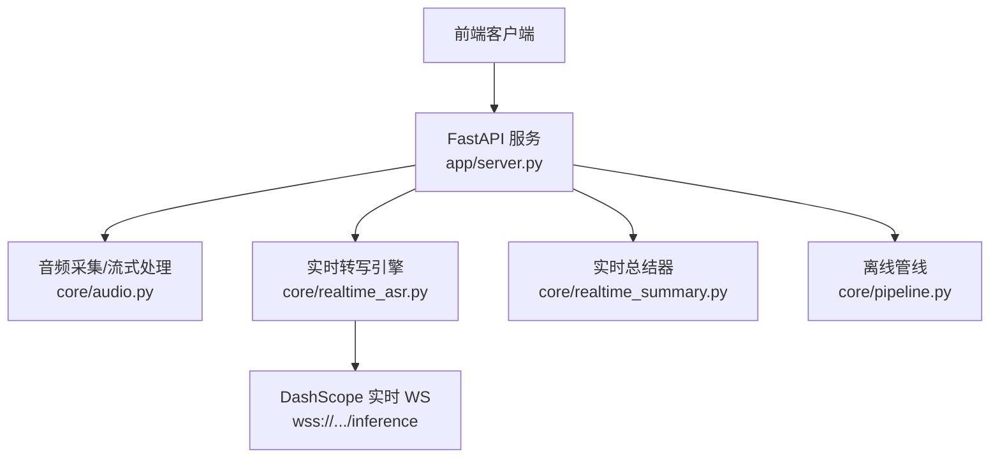
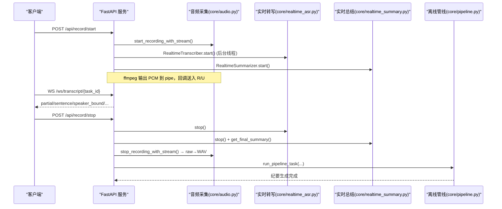
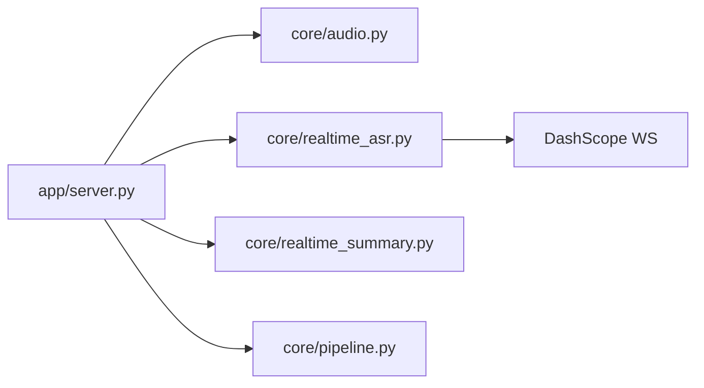

# 录制控制 API

<cite>
**本文引用的文件**
- [app/server.py](file://app/server.py)
- [core/audio.py](file://core/audio.py)
- [core/realtime_asr.py](file://core/realtime_asr.py)
- [core/realtime_summary.py](file://core/realtime_summary.py)
- [core/pipeline.py](file://core/pipeline.py)
- [docs/API_CONTRACTS.md](file://docs/API_CONTRACTS.md)
- [README.md](file://README.md)
</cite>

## 目录
1. [简介](#简介)
2. [项目结构](#项目结构)
3. [核心组件](#核心组件)
4. [架构总览](#架构总览)
5. [详细组件分析](#详细组件分析)
6. [依赖关系分析](#依赖关系分析)
7. [性能与质量优化](#性能与质量优化)
8. [故障处理与恢复](#故障处理与恢复)
9. [结论](#结论)
10. [附录：完整请求响应示例](#附录完整请求响应示例)

## 简介
本文件面向“录制控制”相关 RESTful API，重点覆盖以下能力：
- 流式录音控制接口：开始录制（POST /api/record/start）、停止录制（POST /api/record/stop）、查询录制状态（GET /api/record/status）
- 实时转写集成机制：WebSocket 连接建立、消息推送格式、事件类型定义
- 录制设备配置、音频格式设置与质量优化选项
- 完整的录制生命周期请求响应示例
- 错误处理策略、重试机制与故障恢复方案
- 与实时总结器的集成方式及增量摘要更新机制

该文档基于代码实现与契约文档进行整理，确保与实际行为一致。

## 项目结构
录制控制功能由 FastAPI 服务暴露 REST 端点，结合 ffmpeg 系统内录、实时 ASR 引擎与实时总结器协同工作。关键路径如下：
- app/server.py：REST 端点、WebSocket 推送、任务状态管理、录制流程编排
- core/audio.py：ffmpeg 采集、PCM 流读取、暂停/恢复、raw→WAV 转换
- core/realtime_asr.py：DashScope 实时语音识别 SDK 封装、连接重试、回调分发
- core/realtime_summary.py：按分钟窗口缓冲句子并触发 LLM 增量总结
- core/pipeline.py：离线管线（归一化→上传→转写→纪要），在停止录制后自动执行
- docs/API_CONTRACTS.md：外部接口契约（含实时 WebSocket 地址、参数约束）

**图表来源**
- [app/server.py:721-858](file://app/server.py#L721-L858)
- [core/audio.py:303-396](file://core/audio.py#L303-L396)
- [core/realtime_asr.py:150-327](file://core/realtime_asr.py#L150-L327)
- [core/realtime_summary.py:68-172](file://core/realtime_summary.py#L68-L172)
- [core/pipeline.py:58-134](file://core/pipeline.py#L58-L134)
- [docs/API_CONTRACTS.md:114-176](file://docs/API_CONTRACTS.md#L114-L176)

**章节来源**
- [app/server.py:1-21](file://app/server.py#L1-L21)
- [README.md:1-39](file://README.md#L1-L39)

## 核心组件
- 录制控制端点
  - POST /api/record/start：启动流式录音，创建任务、初始化队列、声纹聚类器、实时总结器，并在后台线程启动实时转写
  - POST /api/record/stop：停止实时转写与录音，将 raw PCM 转为 WAV，进入离线管线生成纪要
  - GET /api/record/status：返回是否正在录制、任务 ID、累计有效时长、暂停状态
  - 辅助：POST /api/record/pause、POST /api/record/resume；实时总结控制：POST /api/record/summary/pause、POST /api/record/summary/resume
- 实时转写 WebSocket
  - WS /ws/transcript/{task_id}：推送 partial/sentence/speaker_bound/error/ended/history/summary_update/summary_status 等消息
- 实时说话人绑定
  - POST /api/record/bind-speaker：录音期间将 ASR speaker_id 绑定到全局说话人档案
  - GET /api/record/speaker-bindings：获取当前录音的绑定状态
- 离线管线
  - 停止录制后自动调用 run_pipeline_task → run_pipeline_stage1 → run_pipeline_stage2，完成纪要生成与保存

**章节来源**
- [app/server.py:721-989](file://app/server.py#L721-L989)
- [app/server.py:996-1091](file://app/server.py#L996-L1091)
- [app/server.py:1760-1831](file://app/server.py#L1760-L1831)
- [core/pipeline.py:58-226](file://core/pipeline.py#L58-L226)

## 架构总览
录制控制的整体数据流如下：
- 开始录制：创建任务与队列，启动 ffmpeg 流式采集（16kHz/单声道/PCM），回调送入实时 ASR 与声纹聚类器，同时启动实时总结器
- 实时转写：SDK 通过 WebSocket 连接 DashScope，回调中推送 partial/sentence 等消息至前端
- 停止录制：关闭实时转写与总结器，raw→WAV 转换，进入离线管线（归一化→上传→转写→纪要）
- 状态查询：返回录制状态、有效时长、暂停标志

**图表来源**
- [app/server.py:721-858](file://app/server.py#L721-L858)
- [app/server.py:869-948](file://app/server.py#L869-L948)
- [core/audio.py:303-515](file://core/audio.py#L303-L515)
- [core/realtime_asr.py:150-327](file://core/realtime_asr.py#L150-L327)
- [core/realtime_summary.py:68-172](file://core/realtime_summary.py#L68-L172)
- [core/pipeline.py:58-226](file://core/pipeline.py#L58-L226)

## 详细组件分析

### 录制控制 REST 端点
- 开始录制（POST /api/record/start）
  - 校验是否已在录制中
  - 生成 task_id，创建 asyncio.Queue 用于 WebSocket 推送
  - 初始化声纹聚类器、实时说话人映射、实时总结器
  - 启动流式录音（ffmpeg 采集 → PCM pipe → 写 raw + 回调）
  - 后台线程启动实时转写（含重试逻辑）
  - 创建任务记录，状态为 recording
  - 返回 {task_id, status}
- 停止录制（POST /api/record/stop）
  - 停止实时转写与总结器，提取最终摘要
  - 停止录音，raw→WAV 转换
  - 发送 ended 消息，更新任务信息（名称、时长、用户笔记）
  - 后台执行离线管线（run_pipeline_task）
  - 清理实时状态
  - 返回 {task_id, status, duration}
- 查询状态（GET /api/record/status）
  - 若正在录制，返回 recording=true、task_id、elapsed、paused
  - 否则返回 recording=false
- 暂停/恢复（POST /api/record/pause、POST /api/record/resume）
  - 控制流式录制的数据写入与回调
- 实时总结控制（POST /api/record/summary/pause、POST /api/record/summary/resume）
  - 控制实时总结器的暂停/恢复

**章节来源**
- [app/server.py:721-858](file://app/server.py#L721-L858)
- [app/server.py:869-989](file://app/server.py#L869-L989)
- [app/server.py:996-1020](file://app/server.py#L996-L1020)

### 实时转写 WebSocket 集成
- 连接建立：WS /ws/transcript/{task_id}
- 历史回放：页面刷新时回放最近 N 条定稿句子与当前摘要内容/状态
- 消息类型（下行）：
  - partial：临时结果（包含 text、speaker_id、speaker_name）
  - sentence：定稿句子（包含 text、begin_time、end_time、speaker_id、speaker_name）
  - speaker_bound：说话人绑定更新（包含 speaker_id、speaker_uuid、speaker_name）
  - error：错误信息（包含 message）
  - ended：转写结束
  - history：历史回放（包含 text、speaker_id、speaker_name、begin_time、end_time）
  - summary_update：实时摘要更新（包含 content）
  - summary_status：总结状态变化（idle/paused/summarizing）
- 超时与断开：60 秒无新消息则关闭；捕获 WebSocketDisconnect

**章节来源**
- [app/server.py:1760-1831](file://app/server.py#L1760-L1831)
- [docs/API_CONTRACTS.md:114-176](file://docs/API_CONTRACTS.md#L114-L176)

### 实时转写引擎（RealtimeTranscriber）
- 启动：设置 WebSocket URL、API Key，构建识别参数（模型、格式、采样率、语言提示、语义断句、心跳等）
- 重试机制：遇到限流错误时指数退避重试（最多 3 次，延迟 2s/5s/10s）
- 回调分发：on_event 区分临时结果与定稿句子；on_error/on_complete 通知上层
- 音频送入：feed_audio 每次建议 ~100ms（6400 bytes @16kHz/16bit/mono）
- 停止：等待所有结果返回，清理状态

**章节来源**
- [core/realtime_asr.py:150-327](file://core/realtime_asr.py#L150-L327)
- [core/realtime_asr.py:329-368](file://core/realtime_asr.py#L329-L368)

### 实时总结器（RealtimeSummarizer）
- 缓冲策略：按分钟窗口收集定稿句子，每 60 秒触发一次 LLM 增量总结
- 增量模式：首次使用新增句子；后续使用「上次摘要」+「新增句子」，要求输出更新后的完整摘要
- 线程模型：定时器在独立线程执行，LLM 调用同步执行不阻塞主事件循环
- 回调：on_summary 推送 Markdown 摘要；on_status 推送状态变化（idle/paused/summarizing）
- 停止：保存最终摘要，统计次数

**章节来源**
- [core/realtime_summary.py:68-172](file://core/realtime_summary.py#L68-L172)
- [core/realtime_summary.py:196-270](file://core/realtime_summary.py#L196-L270)

### 音频采集与流式处理（core/audio.py）
- 流式录音：ffmpeg 通过 avfoundation 采集系统音频，输出 raw PCM 到 stdout pipe
- 后台读取：线程循环读取固定大小块（6400 bytes = 100ms），写入 raw 文件并调用 pcm_callback
- 暂停/恢复：暂停时丢弃数据但继续读取 pipe 防止阻塞；累计暂停时长以计算有效时长
- 停止：终止 ffmpeg，等待读取线程退出，raw→WAV 转换（加 WAV header），清理状态
- 设备列表：列出 macOS avfoundation 音频输入设备

**章节来源**
- [core/audio.py:303-515](file://core/audio.py#L303-L515)
- [core/audio.py:518-623](file://core/audio.py#L518-L623)
- [core/audio.py:625-663](file://core/audio.py#L625-L663)

### 离线管线（core/pipeline.py）
- 阶段一：音频归一化（16kHz/单声道/WAV）→ 上传 DashScope → 热词表检查 → 提交转写任务（paraformer-v2）→ 组装对话稿
- 阶段二：应用说话人姓名映射 → 生成纪要（qwen-plus/qwen-max）→ 生成标题 → 保存 Markdown 纪要
- 进度回调：PipelineProgress 提供阶段、消息、百分比

**章节来源**
- [core/pipeline.py:58-134](file://core/pipeline.py#L58-L134)
- [core/pipeline.py:137-226](file://core/pipeline.py#L137-L226)

## 依赖关系分析
- 录制控制端点依赖 audio 模块进行流式采集，依赖 realtime_asr 进行实时转写，依赖 realtime_summary 进行增量摘要
- 停止录制后触发 pipeline 完成离线处理
- WebSocket 通过 asyncio.Queue 与 SDK 回调解耦，保证线程安全的消息投递
- 外部依赖：DashScope 实时 WebSocket 地址、API Key、ffmpeg 工具链

**图表来源**
- [app/server.py:721-989](file://app/server.py#L721-L989)
- [core/audio.py:303-515](file://core/audio.py#L303-L515)
- [core/realtime_asr.py:150-327](file://core/realtime_asr.py#L150-L327)
- [core/realtime_summary.py:68-172](file://core/realtime_summary.py#L68-L172)
- [core/pipeline.py:58-226](file://core/pipeline.py#L58-L226)

**章节来源**
- [docs/API_CONTRACTS.md:114-176](file://docs/API_CONTRACTS.md#L114-L176)

## 性能与质量优化
- 音频格式与质量
  - 采样率：16kHz（实时与批管线均推荐）
  - 声道：单声道（说话人分离仅支持单声道）
  - 编码：PCM 16bit little-endian（实时），WAV（离线）
  - 包大小：~100ms（6400 bytes）以降低延迟与网络开销
- 实时转写优化
  - 语义断句开启（会议场景）
  - 即时热词（vocabulary）或预编译热词表（vocabulary_id）提升专有词汇识别率
  - 上下文增强（context）传入领域术语/对话历史，提高识别准确率
- 实时总结优化
  - 低延迟模型（qwen-turbo），温度 0.3 保证稳定性
  - 上次摘要截取长度限制（MAX_PREVIOUS_SUMMARY_CHARS=1500）控制 token 消耗
- 录制设备配置
  - 默认设备名可通过环境变量 RECORD_DEVICE 覆盖（如 BlackHole 2ch 用于系统内录）
  - 支持列出系统可用音频输入设备（macOS avfoundation）

**章节来源**
- [core/realtime_asr.py:235-248](file://core/realtime_asr.py#L235-L248)
- [core/realtime_summary.py:28-36](file://core/realtime_summary.py#L28-L36)
- [core/audio.py:355-363](file://core/audio.py#L355-L363)
- [app/server.py:130-132](file://app/server.py#L130-L132)
- [docs/API_CONTRACTS.md:90-105](file://docs/API_CONTRACTS.md#L90-L105)

## 故障处理与恢复
- 实时转写启动失败
  - 优雅降级：不影响录音继续进行，推送 error 消息告知前端
  - 重试机制：限流错误指数退避重试（最多 3 次）
- 实时总结失败
  - 单次失败不影响后续周期，记录警告日志并继续调度
- WebSocket 连接异常
  - 超时关闭（60 秒无消息）
  - 客户端断开正常处理
  - 页面刷新时回放历史句子与摘要内容/状态，避免丢失
- 录制过程异常
  - ffmpeg 启动失败、设备不可用等抛出运行时错误
  - 停止录制时强制终止进程并清理状态
- 离线管线失败
  - 任务状态标记为 failed，记录错误信息，持久化任务文件

**章节来源**
- [core/realtime_asr.py:254-327](file://core/realtime_asr.py#L254-L327)
- [core/realtime_summary.py:263-270](file://core/realtime_summary.py#L263-L270)
- [app/server.py:821-836](file://app/server.py#L821-L836)
- [app/server.py:1816-1831](file://app/server.py#L1816-L1831)
- [core/audio.py:468-515](file://core/audio.py#L468-L515)

## 结论
本录制控制 API 提供了从流式录音到实时转写、增量摘要再到离线纪要生成的完整闭环。通过模块化设计（audio、realtime_asr、realtime_summary、pipeline）与健壮的错误处理机制，系统在可用性、可维护性与扩展性方面具备良好基础。建议在生产环境中关注：
- 设备配置与环境变量（RECORD_DEVICE、DASHSCOPE_API_KEY）
- 网络与限流策略（实时转写重试）
- 资源监控（ffmpeg 进程、WebSocket 连接数）
- 数据持久化（任务状态、实时摘要）

## 附录：完整请求响应示例
以下为录制流程的典型交互序列（描述性示例，非具体代码片段）：

- 开始录制
  - 请求：POST /api/record/start
  - 响应：{task_id, status="recording"}
  - 说明：创建任务、启动流式录音、初始化实时转写与总结器

- 连接 WebSocket
  - 连接：WS /ws/transcript/{task_id}
  - 接收：history（历史句子）、summary_update（摘要）、partial（临时结果）、sentence（定稿句子）、speaker_bound（绑定更新）

- 查询状态
  - 请求：GET /api/record/status
  - 响应：{recording=true, task_id, elapsed, paused}

- 暂停/恢复录制
  - 请求：POST /api/record/pause → {status="paused"}
  - 请求：POST /api/record/resume → {status="recording"}

- 实时说话人绑定
  - 请求：POST /api/record/bind-speaker {speaker_id, speaker_uuid}
  - 响应：{speaker_id, speaker_name, speaker_uuid}
  - 推送：speaker_bound 消息

- 停止录制
  - 请求：POST /api/record/stop {notes?}
  - 响应：{task_id, status="processing", duration}
  - 说明：停止实时转写与总结器，raw→WAV，进入离线管线

- 查询任务状态
  - 请求：GET /api/tasks/{task_id}
  - 响应：任务详情（包含 progress、message、dialogue、summary 等）

- 下载纪要
  - 请求：GET /api/download/{task_id}
  - 响应：Markdown 纪要文件

**章节来源**
- [app/server.py:721-858](file://app/server.py#L721-L858)
- [app/server.py:869-989](file://app/server.py#L869-L989)
- [app/server.py:1760-1831](file://app/server.py#L1760-L1831)
- [core/pipeline.py:58-226](file://core/pipeline.py#L58-L226)