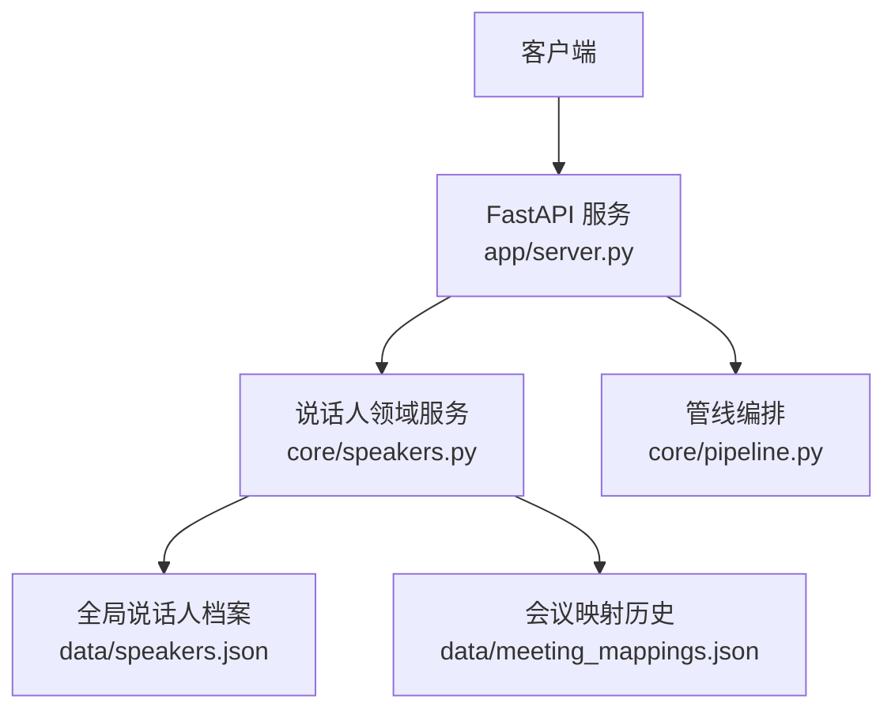
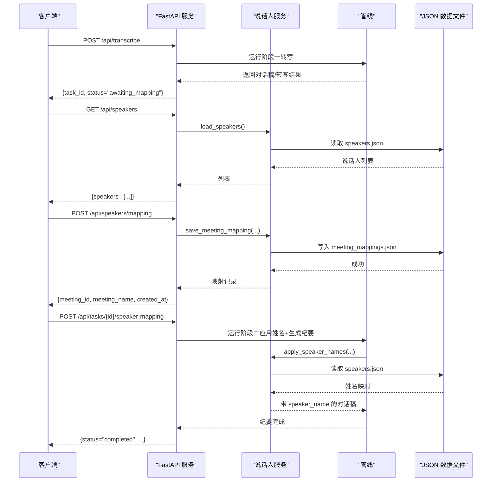
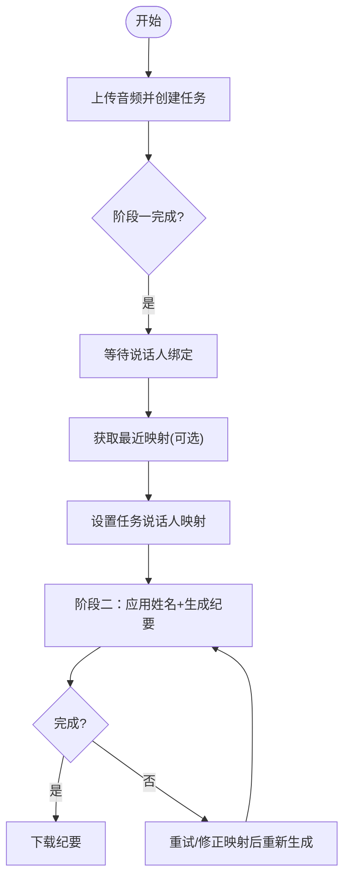
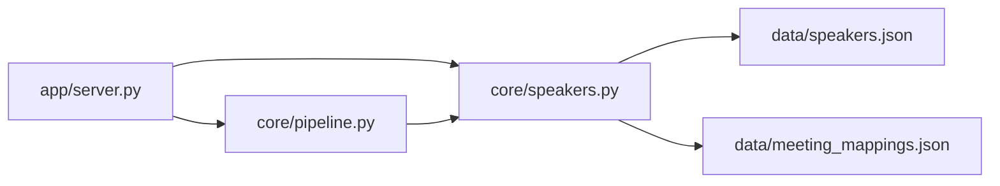

# 说话人管理 API

<cite>
**本文引用的文件**
- [core/speakers.py](file://core/speakers.py)
- [app/server.py](file://app/server.py)
- [data/speakers.json](file://data/speakers.json)
- [data/meeting_mappings.json](file://data/meeting_mappings.json)
- [core/pipeline.py](file://core/pipeline.py)
</cite>

## 目录
1. [简介](#简介)
2. [项目结构](#项目结构)
3. [核心组件](#核心组件)
4. [架构总览](#架构总览)
5. [详细组件分析](#详细组件分析)
6. [依赖关系分析](#依赖关系分析)
7. [性能与可靠性](#性能与可靠性)
8. [故障排查指南](#故障排查指南)
9. [结论](#结论)
10. [附录：请求/响应示例与最佳实践](#附录请求响应示例与最佳实践)

## 简介
本文件面向“说话人管理”相关 RESTful API，覆盖以下能力：
- 说话人档案的增删改查（GET /api/speakers、POST /api/speakers、PUT /api/speakers/{speaker_id}、DELETE /api/speakers/{speaker_id}）
- 会议映射管理（GET /api/speakers/mapping/latest、POST /api/speakers/mapping）
- 说话人数据模型定义、字段验证规则与业务约束
- 完整的请求/响应示例（以路径引用形式给出）
- 将说话人绑定到任务并生成纪要的流程说明与最佳实践

## 项目结构
说话人管理由服务层（FastAPI）与领域逻辑（speakers 模块）组成，数据持久化采用 JSON 文件。

图表来源
- [app/server.py:517-619](file://app/server.py#L517-L619)
- [core/speakers.py:31-103](file://core/speakers.py#L31-L103)
- [core/pipeline.py:137-200](file://core/pipeline.py#L137-L200)

章节来源
- [app/server.py:517-619](file://app/server.py#L517-L619)
- [core/speakers.py:31-103](file://core/speakers.py#L31-L103)

## 核心组件
- 说话人模型 Speaker：包含 speaker_id、name、role、note、created_at
- 会议映射模型 MeetingMapping：包含 meeting_id、meeting_name、mapping（数字说话人索引→UUID）、created_at
- 服务接口：加载/保存说话人列表、添加/更新/删除/查询、保存/获取最近映射、应用姓名到对话稿
- FastAPI 路由：提供 RESTful 端点，负责参数校验、错误处理、调用领域服务

章节来源
- [core/speakers.py:35-103](file://core/speakers.py#L35-L103)
- [core/speakers.py:109-199](file://core/speakers.py#L109-L199)
- [core/speakers.py:205-271](file://core/speakers.py#L205-L271)
- [app/server.py:521-619](file://app/server.py#L521-L619)

## 架构总览
说话人管理在系统中的位置与作用如下：
- 上传音频后进入管线第一阶段，产出对话稿与转写结果，状态为等待说话人绑定
- 用户通过 API 维护说话人档案与会议映射
- 用户将说话人映射保存到会议记录，或直接在任务上设置说话人映射触发第二阶段（纪要生成）
- 第二阶段会应用姓名映射，生成纪要并输出 Markdown

图表来源
- [app/server.py:343-396](file://app/server.py#L343-L396)
- [app/server.py:532-619](file://app/server.py#L532-L619)
- [app/server.py:630-671](file://app/server.py#L630-L671)
- [core/speakers.py:278-309](file://core/speakers.py#L278-L309)
- [core/pipeline.py:137-200](file://core/pipeline.py#L137-L200)

## 详细组件分析

### 说话人数据模型与约束
- Speaker
  - 字段
    - speaker_id: 字符串，唯一标识（UUID）
    - name: 字符串，必填
    - role: 字符串，可选
    - note: 字符串，可选
    - created_at: 时间字符串，自动生成
  - 约束
    - name 不能为空（服务端校验）
    - role、note 会被去除首尾空白
- MeetingMapping
  - 字段
    - meeting_id: 字符串，会议唯一标识
    - meeting_name: 字符串，会议名称
    - mapping: 字典，键为数字说话人索引（int），值为说话人 UUID（str）
    - created_at: 时间字符串，自动生成
  - 约束
    - mapping 的键必须可转换为 int
    - 同一 meeting_id 重复保存会更新映射与时间戳

章节来源
- [core/speakers.py:35-103](file://core/speakers.py#L35-L103)
- [app/server.py:521-530](file://app/server.py#L521-L530)
- [app/server.py:599-603](file://app/server.py#L599-L603)

### 说话人 CRUD 接口

- 获取说话人列表
  - 方法/路径: GET /api/speakers
  - 功能: 返回全局说话人档案列表
  - 响应: { speakers: [...] }
  - 数据来源: data/speakers.json

- 添加说话人
  - 方法/路径: POST /api/speakers
  - 请求体: { name: string, role?: string, note?: string }
  - 校验: name 非空；role/note 去空白
  - 响应: 新增说话人的完整对象（含 speaker_id、created_at）
  - 副作用: 写入 data/speakers.json

- 更新说话人
  - 方法/路径: PUT /api/speakers/{speaker_id}
  - 请求体: { name?: string, role?: string, note?: string }
  - 行为: 仅更新提供的字段；未提供则不变更
  - 响应: 更新后的说话人对象
  - 失败: 不存在时返回 404

- 删除说话人
  - 方法/路径: DELETE /api/speakers/{speaker_id}
  - 响应: { deleted: true }
  - 失败: 不存在时返回 404

章节来源
- [app/server.py:532-571](file://app/server.py#L532-L571)
- [core/speakers.py:109-199](file://core/speakers.py#L109-L199)

### 会议映射管理接口

- 获取最近映射
  - 方法/路径: GET /api/speakers/mapping/latest
  - 功能: 返回最近一次会议映射，附带每个数字索引对应的说话人 UUID 与姓名
  - 响应:
    - 存在映射: { mapping: { meeting_id, meeting_name, created_at, details: { "0": { speaker_uuid, name }, ... } } }
    - 无映射: { mapping: null }

- 保存映射
  - 方法/路径: POST /api/speakers/mapping
  - 请求体: { meeting_id: string, meeting_name: string, mapping: { "0": "uuid1", "1": "uuid2", ... } }
  - 行为: 若该 meeting_id 已存在则更新映射与时间戳；否则新增
  - 响应: { meeting_id, meeting_name, created_at }

章节来源
- [app/server.py:574-619](file://app/server.py#L574-L619)
- [core/speakers.py:205-271](file://core/speakers.py#L205-L271)

### 说话人绑定到任务的流程与最佳实践

- 典型流程
  1) 上传音频并提交转写任务，得到 task_id，状态为 awaiting_mapping
  2) 获取最近映射建议（可选）：GET /api/speakers/mapping/latest
  3) 维护说话人档案：按需增删改
  4) 将数字说话人索引绑定到具体说话人 UUID：
     - 方式A：先保存会议映射（POST /api/speakers/mapping），便于后续复用
     - 方式B：直接为任务设置映射（POST /api/tasks/{task_id}/speaker-mapping），同时触发纪要生成
  5) 查询任务状态，待 completed 后可下载纪要

- 关键注意事项
  - 映射键为数字索引（int），但 API 接收时为字符串键，服务端会转换为 int
  - 若任务已完成，可通过重新生成接口使用当前映射重新生成纪要
  - 实时录音场景下，说话人姓名解析优先使用实时绑定映射，其次回退到全局说话人列表

图表来源
- [app/server.py:343-396](file://app/server.py#L343-L396)
- [app/server.py:574-619](file://app/server.py#L574-L619)
- [app/server.py:630-671](file://app/server.py#L630-L671)
- [core/pipeline.py:137-200](file://core/pipeline.py#L137-L200)

章节来源
- [app/server.py:343-396](file://app/server.py#L343-L396)
- [app/server.py:574-619](file://app/server.py#L574-L619)
- [app/server.py:630-671](file://app/server.py#L630-L671)
- [core/pipeline.py:137-200](file://core/pipeline.py#L137-L200)

## 依赖关系分析
- 服务层 app/server.py 暴露 REST 端点，调用 core/speakers.py 的业务函数
- core/speakers.py 读写 data/speakers.json 与 data/meeting_mappings.json
- 管线 core/pipeline.py 在第二阶段调用 speakers.apply_speaker_names 进行姓名替换
- 实时场景下，服务层还维护任务级说话人绑定映射，用于即时显示说话人姓名

图表来源
- [app/server.py:517-619](file://app/server.py#L517-L619)
- [core/speakers.py:109-199](file://core/speakers.py#L109-L199)
- [core/pipeline.py:137-200](file://core/pipeline.py#L137-L200)

章节来源
- [app/server.py:517-619](file://app/server.py#L517-L619)
- [core/speakers.py:109-199](file://core/speakers.py#L109-L199)
- [core/pipeline.py:137-200](file://core/pipeline.py#L137-L200)

## 性能与可靠性
- 数据量较小（JSON 文件），读写开销低；适合单机部署
- 并发写入风险：多进程/多线程同时写入 speakers.json 或 meeting_mappings.json 可能导致竞争条件；生产环境建议使用数据库或加锁机制
- 错误处理：读写异常被捕获并记录日志，返回空集合或默认值，保证接口可用性
- 建议优化
  - 对频繁读写的 JSON 文件增加文件锁
  - 引入缓存层（内存或 Redis）减少磁盘 I/O
  - 对大文件操作增加超时与重试策略

[本节为通用指导，不直接分析具体文件]

## 故障排查指南
- 常见错误
  - 400 请求参数错误：如 name 为空、mapping 键无法转为 int
  - 404 资源不存在：说话人或任务 ID 不存在
  - 状态不允许：任务不在 awaiting_mapping/completed 状态时设置映射
- 定位步骤
  - 检查请求体字段是否符合模型定义
  - 确认 speakers.json 与 meeting_mappings.json 是否可读写
  - 查看服务器日志中的错误堆栈与提示
- 恢复建议
  - 修复请求体后重试
  - 若文件损坏，重建或从备份恢复
  - 对于任务状态异常，重新提交转写任务或重新生成纪要

章节来源
- [app/server.py:539-571](file://app/server.py#L539-L571)
- [app/server.py:630-671](file://app/server.py#L630-L671)
- [core/speakers.py:109-199](file://core/speakers.py#L109-L199)

## 结论
本 API 提供了完整的说话人管理与会议映射能力，并与转写/纪要管线无缝集成。通过规范的模型与校验、清晰的错误处理以及可复用的映射历史，能够高效支撑会议场景下的说话人身份识别与纪要生成。生产环境建议引入更健壮的存储与并发控制方案。

[本节为总结性内容，不直接分析具体文件]

## 附录：请求/响应示例与最佳实践

- 获取说话人列表
  - 请求: GET /api/speakers
  - 响应示例路径: [app/server.py:532-536](file://app/server.py#L532-L536)
  - 数据源参考: [data/speakers.json](file://data/speakers.json)

- 添加说话人
  - 请求: POST /api/speakers
  - 请求体示例路径: [app/server.py:521-525](file://app/server.py#L521-L525)
  - 响应示例路径: [app/server.py:539-549](file://app/server.py#L539-L549)

- 更新说话人
  - 请求: PUT /api/speakers/{speaker_id}
  - 请求体示例路径: [app/server.py:526-530](file://app/server.py#L526-L530)
  - 响应示例路径: [app/server.py:552-563](file://app/server.py#L552-L563)

- 删除说话人
  - 请求: DELETE /api/speakers/{speaker_id}
  - 响应示例路径: [app/server.py:566-571](file://app/server.py#L566-L571)

- 获取最近映射
  - 请求: GET /api/speakers/mapping/latest
  - 响应示例路径: [app/server.py:574-596](file://app/server.py#L574-L596)
  - 数据源参考: [data/meeting_mappings.json](file://data/meeting_mappings.json)

- 保存映射
  - 请求: POST /api/speakers/mapping
  - 请求体示例路径: [app/server.py:599-603](file://app/server.py#L599-L603)
  - 响应示例路径: [app/server.py:605-619](file://app/server.py#L605-L619)

- 将说话人绑定到任务并生成纪要
  - 请求: POST /api/tasks/{task_id}/speaker-mapping
  - 请求体示例路径: [app/server.py:626-628](file://app/server.py#L626-L628)
  - 响应示例路径: [app/server.py:630-671](file://app/server.py#L630-L671)

- 最佳实践
  - 在批量转写前，先建立或更新说话人档案，确保命名一致
  - 使用“最近映射”作为建议，减少重复劳动
  - 对重要会议保存映射，便于后续复用与审计
  - 任务完成后如需调整，使用“重新生成纪要”接口快速迭代
  - 生产环境考虑引入文件锁或数据库，避免并发写入冲突

章节来源
- [app/server.py:521-671](file://app/server.py#L521-L671)
- [data/speakers.json](file://data/speakers.json)
- [data/meeting_mappings.json](file://data/meeting_mappings.json)