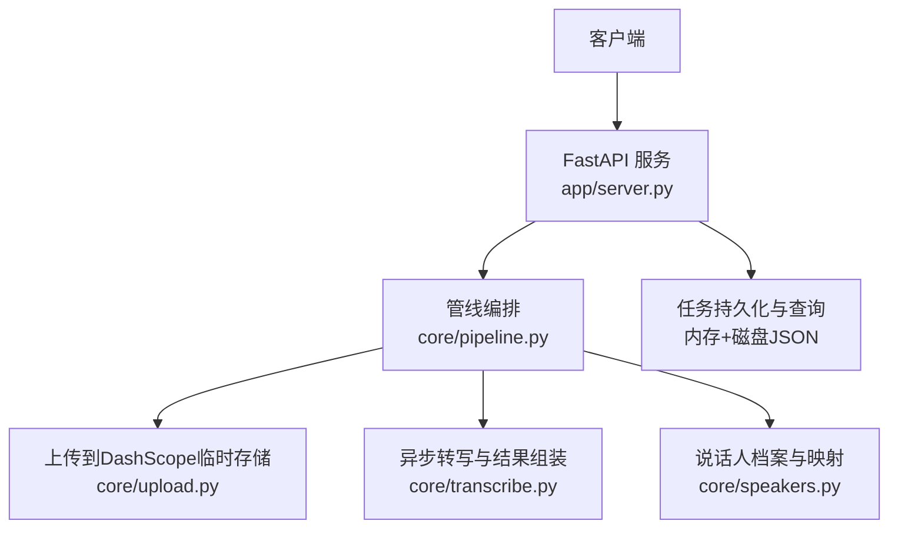
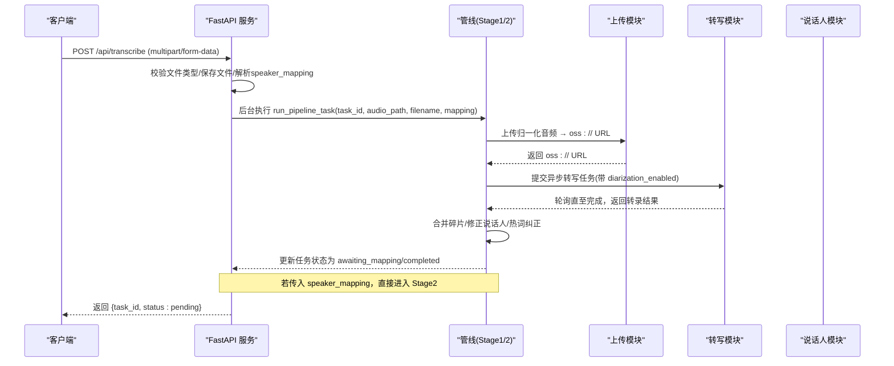
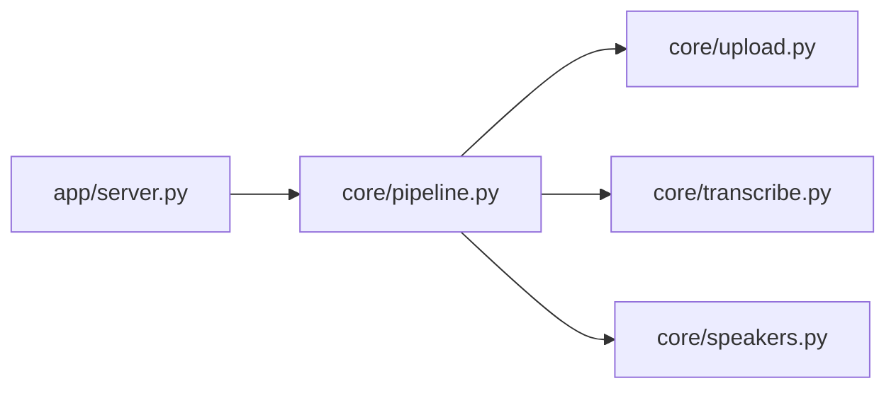

# 音频处理 API

<cite>
**本文引用的文件**
- [app/server.py](file://app/server.py)
- [core/pipeline.py](file://core/pipeline.py)
- [core/transcribe.py](file://core/transcribe.py)
- [core/upload.py](file://core/upload.py)
- [core/speakers.py](file://core/speakers.py)
- [docs/API_CONTRACTS.md](file://docs/API_CONTRACTS.md)
- [README.md](file://README.md)
</cite>

## 目录
1. [简介](#简介)
2. [项目结构](#项目结构)
3. [核心组件](#核心组件)
4. [架构总览](#架构总览)
5. [详细组件分析](#详细组件分析)
6. [依赖关系分析](#依赖关系分析)
7. [性能与限制](#性能与限制)
8. [故障排查指南](#故障排查指南)
9. [结论](#结论)
10. [附录：请求示例与最佳实践](#附录请求示例与最佳实践)

## 简介
本文件面向使用 Open Meeting Scribe 的开发者，聚焦于音频处理相关的 RESTful API，重点文档化音频上传接口 POST /api/transcribe，包括文件类型验证、参数说明、请求格式与响应结构；并详细说明支持的音频格式、文件大小限制、错误处理机制、说话人映射参数的使用方法与最佳实践，以及后台任务处理流程与状态管理机制。

## 项目结构
本项目采用 FastAPI 提供 Web 服务，核心业务逻辑位于 core/ 目录下，包含音频归一化、上传至 DashScope 临时存储、异步转写、对话稿组装、纪要生成等能力。服务端通过 app/server.py 暴露 REST 接口，并通过后台任务执行管线。

图表来源
- [app/server.py:65-89](file://app/server.py#L65-L89)
- [core/pipeline.py:58-134](file://core/pipeline.py#L58-L134)
- [core/upload.py:33-115](file://core/upload.py#L33-L115)
- [core/transcribe.py:61-131](file://core/transcribe.py#L61-L131)
- [core/speakers.py:278-309](file://core/speakers.py#L278-L309)

章节来源
- [app/server.py:1-21](file://app/server.py#L1-L21)
- [README.md:1-39](file://README.md#L1-L39)

## 核心组件
- 音频上传与任务创建：POST /api/transcribe
- 任务查询与管理：GET /api/tasks/{id}、GET /api/tasks、DELETE /api/tasks/{id}、PATCH /api/tasks/{id}
- 下载与播放：GET /api/download/{id}、GET /api/audio/{id}
- 说话人管理：GET/POST/PUT/DELETE /api/speakers/*
- 说话人绑定与纪要生成：POST /api/tasks/{id}/speaker-mapping、POST /api/tasks/{id}/regenerate-summary
- 流式录音与实时转写：POST /api/record/start、POST /api/record/stop、GET /api/record/status、WS /ws/transcript/{id}

章节来源
- [app/server.py:339-497](file://app/server.py#L339-L497)
- [app/server.py:521-715](file://app/server.py#L521-L715)
- [app/server.py:721-990](file://app/server.py#L721-L990)

## 架构总览
整体流程：客户端上传音频 → 服务器校验并保存 → 后台任务执行管线（音频归一化 → 上传至 DashScope → 异步转写 → 对话稿组装）→ 等待说话人映射（或自动进入第二阶段）→ 生成纪要并输出 Markdown。

图表来源
- [app/server.py:343-396](file://app/server.py#L343-L396)
- [core/pipeline.py:58-134](file://core/pipeline.py#L58-L134)
- [core/upload.py:59-115](file://core/upload.py#L59-L115)
- [core/transcribe.py:61-131](file://core/transcribe.py#L61-L131)

## 详细组件分析

### 音频上传接口 POST /api/transcribe
- 功能：接收音频文件，进行文件类型校验，保存到本地，创建任务记录，并在后台启动转写管线。
- 支持的文件类型：mp3、wav、m4a、aac、ogg、flac、mp4、webm。
- 参数：
  - file：multipart/form-data 中的音频文件字段（必填）。
  - speaker_mapping：可选，JSON 字符串，形如 {"0":"uuid1","1":"uuid2"}，用于在提交时直接绑定说话人身份，跳过“等待绑定”阶段。
- 成功响应：
  - { task_id: string, status: "pending" }
- 失败响应：
  - 不支持的文件类型：HTTP 400，消息包含具体扩展名。
  - 其他异常：HTTP 5xx（由框架或上游服务抛出）。
- 注意：
  - 当前实现未对文件大小做显式限制；但后端会调用上传模块将音频上传至 DashScope 临时存储，该存储单文件上限为 1GB，且有效期 48h。
  - 转写仅对单声道开启说话人分离有效；多声道需先下混为单声道。

章节来源
- [app/server.py:339-396](file://app/server.py#L339-L396)
- [core/upload.py:59-115](file://core/upload.py#L59-L115)
- [docs/API_CONTRACTS.md:12-24](file://docs/API_CONTRACTS.md#L12-L24)

### 任务状态与查询
- GET /api/tasks/{id}：查询单个任务的状态与结果。
- GET /api/tasks：获取所有任务列表（按创建时间倒序）。
- DELETE /api/tasks/{id}：删除任务及其关联文件。
- PATCH /api/tasks/{id}：更新任务信息（如标题）。
- 任务状态枚举：
  - pending：等待处理
  - processing：处理中
  - awaiting_mapping：转写完成，等待用户绑定说话人身份
  - completed：完成（已生成纪要）
  - failed：失败（含错误信息）
- 进度字段 progress：0-100 百分比，随管线阶段推进更新。
- 结果字段：
  - dialogue：对话稿（按 speaker_id 聚合的句子列表）
  - transcription：原始转写 JSON（体积较大，持久化时会剔除）
  - summary/title/output_path：纪要内容、标题与输出路径
  - speaker_mapping/speaker_uuid_mapping：姓名与 UUID 映射

章节来源
- [app/server.py:138-156](file://app/server.py#L138-L156)
- [app/server.py:399-514](file://app/server.py#L399-L514)
- [core/pipeline.py:137-226](file://core/pipeline.py#L137-L226)

### 说话人映射与纪要生成
- 设置映射并触发纪要生成：POST /api/tasks/{id}/speaker-mapping
  - 请求体：{ mapping: {"0":"uuid1","1":"uuid2"} }
  - 成功后任务状态变为 processing，进度约 75%，消息提示“正在生成纪要...”
  - 后台执行第二阶段：应用姓名映射 → 生成纪要 → 保存 Markdown
- 重新生成纪要：POST /api/tasks/{id}/regenerate-summary
  - 仅在任务已完成时可用，基于当前映射重新生成
- 历史复用建议：GET /api/speakers/mapping/latest
  - 返回最近一次会议的映射详情（含说话人姓名），便于快速复用

章节来源
- [app/server.py:626-715](file://app/server.py#L626-L715)
- [core/speakers.py:278-309](file://core/speakers.py#L278-L309)

### 后台任务处理流程与状态管理
- 第一阶段（转写）：
  - 音频归一化（采样率、声道数）
  - 上传至 DashScope 临时存储，获得 oss:// URL
  - 提交异步转写任务（paraformer-v2），开启说话人分离
  - 轮询任务状态，下载结果 JSON，合并碎片句子，修正说话人分离误差，热词纠正
  - 组装对话稿，更新任务状态为 awaiting_mapping 或 completed（若已传入 speaker_mapping）
- 第二阶段（纪要）：
  - 应用说话人姓名映射
  - 调用 LLM 生成纪要与标题
  - 保存 Markdown 到 data/output/
- 状态持久化：
  - 任务数据定期写入 data/tasks/{task_id}.json（排除 transcription 大字段）
  - 启动时从磁盘恢复任务到内存，并进行迁移清理

章节来源
- [app/server.py:226-333](file://app/server.py#L226-L333)
- [core/pipeline.py:58-226](file://core/pipeline.py#L58-L226)
- [core/transcribe.py:193-402](file://core/transcribe.py#L193-L402)

### 错误处理机制
- 文件类型不合法：HTTP 400，提示不支持的文件类型
- 任务不存在：HTTP 404
- 任务失败：status=failed，error 字段包含错误信息
- 外部服务异常：由 requests 抛出的异常被捕获并转换为 HTTP 5xx
- 实时录制相关：停止/暂停/恢复等操作失败返回 400 并附带原因

章节来源
- [app/server.py:343-396](file://app/server.py#L343-L396)
- [app/server.py:410-497](file://app/server.py#L410-L497)
- [app/server.py:950-990](file://app/server.py#L950-L990)

## 依赖关系分析
- FastAPI 路由层负责接收请求、参数校验、后台任务调度与状态管理
- 管线层串联音频归一化、上传、转写、摘要生成
- 上传模块对接 DashScope 临时存储，返回 oss:// URL
- 转写模块封装异步任务提交、轮询、结果下载与后处理
- 说话人模块维护全局档案与会话映射，支持历史复用

图表来源
- [app/server.py:339-396](file://app/server.py#L339-L396)
- [core/pipeline.py:58-134](file://core/pipeline.py#L58-L134)
- [core/upload.py:33-115](file://core/upload.py#L33-L115)
- [core/transcribe.py:61-131](file://core/transcribe.py#L61-L131)
- [core/speakers.py:278-309](file://core/speakers.py#L278-L309)

章节来源
- [core/pipeline.py:1-27](file://core/pipeline.py#L1-L27)

## 性能与限制
- 文件格式与规格：
  - 支持 mp3、wav、m4a、aac、ogg、flac、mp4、webm
  - 转写上限：单文件 ≤12 小时、≤2GB；上传接口 ≤1GB
- 说话人分离：
  - 仅单声道生效；多声道需先下混为单声道
- 超时与重试：
  - 轮询间隔 3 秒，最大超时 600 秒
- 计费：
  - 按语音内容时长计费；指定多音轨每轨独立计费
- 实时识别：
  - 实时预览使用 qwen-audio-3.0-asr-flash-streaming，无说话人分离；最终纪要走批处理 paraformer-v2

章节来源
- [docs/API_CONTRACTS.md:103-110](file://docs/API_CONTRACTS.md#L103-L110)
- [core/transcribe.py:28-31](file://core/transcribe.py#L28-L31)

## 故障排查指南
- 无法提交异步任务：检查是否携带 X-DashScope-Async: enable
- oss:// URL 报错：确保使用 RESTful 直调并添加 X-DashScope-OssResourceResolve: enable
- 无 speaker_id：确认音频为单声道；否则无法启用说话人分离
- URL 含空格/中文导致下载失败：提交前对 URL 进行编码
- 任务长时间 pending：检查网络与 DashScope 服务状态；查看任务 error 字段
- 实时录制异常：确认设备权限、PCM 格式（16bit/16kHz/mono）

章节来源
- [docs/API_CONTRACTS.md:90-102](file://docs/API_CONTRACTS.md#L90-L102)
- [app/server.py:721-990](file://app/server.py#L721-L990)

## 结论
POST /api/transcribe 提供了简洁的音频上传与转写任务提交能力，结合后台管线实现了从音频到结构化纪要的全流程自动化。通过说话人映射参数，可在提交时直接绑定身份，加速纪要生成。系统具备完善的错误处理与状态管理机制，适合会议场景下的批量与实时转写需求。

## 附录：请求示例与最佳实践

### 请求示例（cURL）
- 基本上传（无说话人映射）
  - 方法：POST
  - 路径：/api/transcribe
  - Content-Type：multipart/form-data
  - 表单字段：file（音频文件）
- 带说话人映射上传
  - 额外字段：speaker_mapping = '{"0":"uuid1","1":"uuid2"}'

章节来源
- [app/server.py:339-396](file://app/server.py#L339-L396)

### 最佳实践
- 文件准备
  - 尽量使用单声道音频以获得更好的说话人分离效果
  - 控制文件大小不超过 1GB（上传接口限制）
- 说话人映射
  - 建议在转写完成后根据对话稿中的 speaker_id 进行绑定；如需跳过等待阶段，可在上传时传入 speaker_mapping
  - 利用 GET /api/speakers/mapping/latest 复用历史映射，提高效率
- 任务监控
  - 使用 GET /api/tasks/{id} 轮询任务状态与进度
  - 关注 status 与 message 字段，及时处理失败任务
- 结果下载
  - 任务完成后通过 GET /api/download/{id} 获取 Markdown 纪要
  - 可通过 GET /api/audio/{id} 回放原始音频

章节来源
- [app/server.py:399-514](file://app/server.py#L399-L514)
- [core/speakers.py:255-271](file://core/speakers.py#L255-L271)