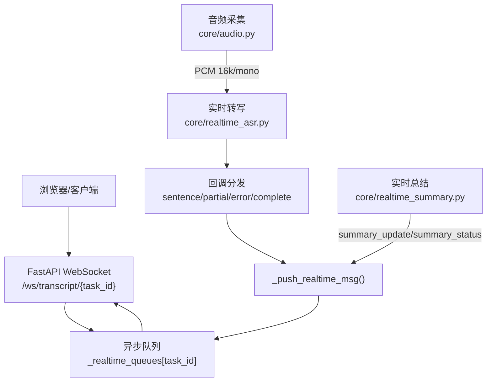
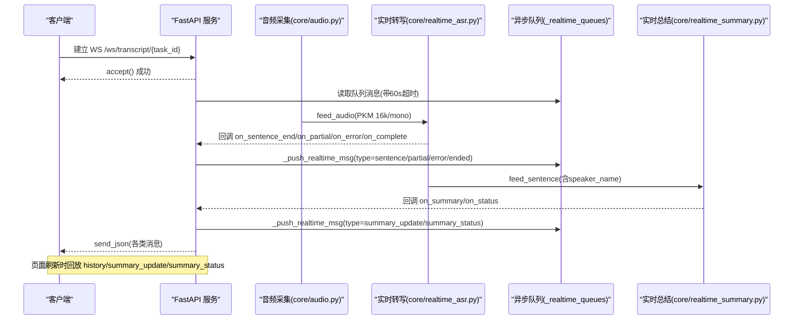
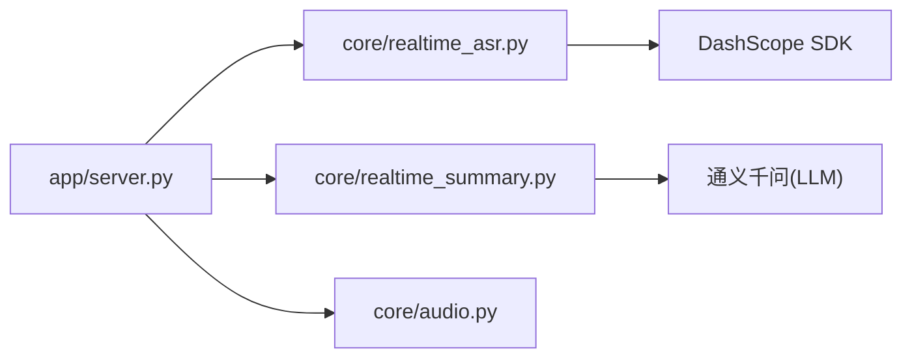
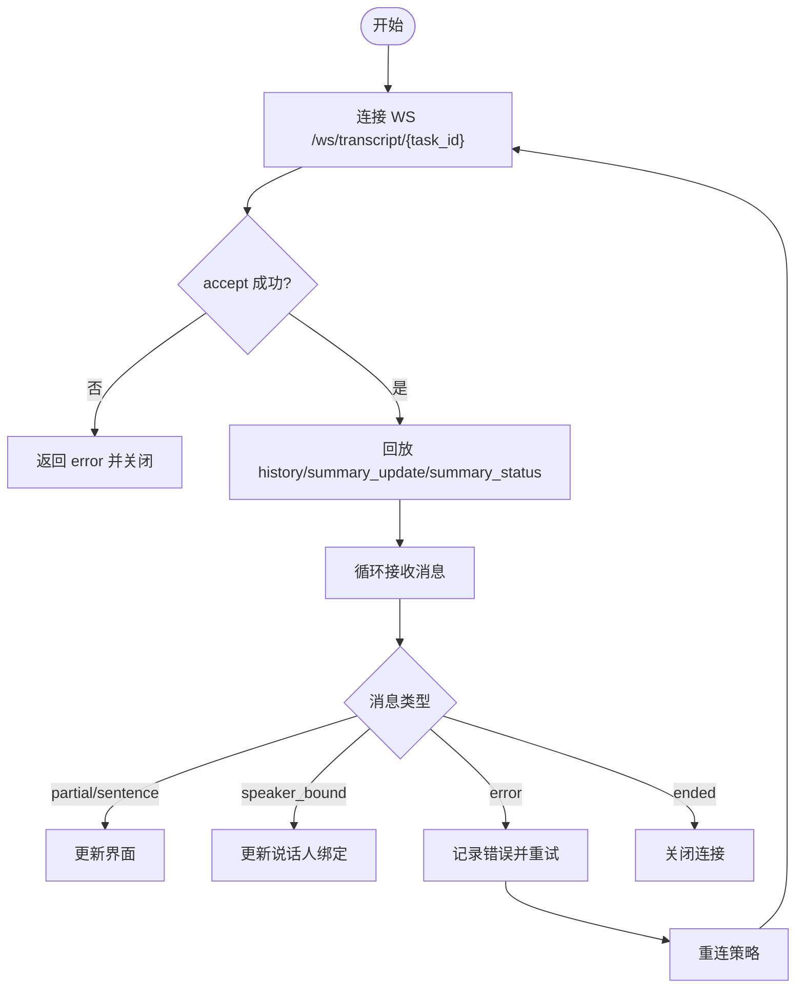

# WebSocket API 参考

<cite>
**本文引用的文件**
- [app/server.py](file://app/server.py)
- [core/realtime_asr.py](file://core/realtime_asr.py)
- [core/realtime_summary.py](file://core/realtime_summary.py)
- [core/audio.py](file://core/audio.py)
- [docs/API_CONTRACTS.md](file://docs/API_CONTRACTS.md)
- [docs/ARCHITECTURE.md](file://docs/ARCHITECTURE.md)
</cite>

## 目录
1. [简介](#简介)
2. [项目结构](#项目结构)
3. [核心组件](#核心组件)
4. [架构总览](#架构总览)
5. [详细组件分析](#详细组件分析)
6. [依赖关系分析](#依赖关系分析)
7. [性能考虑](#性能考虑)
8. [故障排查指南](#故障排查指南)
9. [结论](#结论)
10. [附录：客户端集成示例与最佳实践](#附录客户端集成示例与最佳实践)

## 简介
本参考文档聚焦于实时转写 WebSocket 连接（WS /ws/transcript/{task_id}）的建立过程、消息格式规范与事件类型，覆盖客户端连接流程、心跳机制、错误处理与重连策略，并详细说明各类消息的数据结构（句子转写、摘要更新、状态等）。同时提供完整的客户端集成步骤、性能优化建议与调试方法。

## 项目结构
- 服务层：FastAPI 应用负责 REST 接口与 WebSocket 端点，管理任务生命周期、录制控制、实时转写与总结推送。
- 实时引擎：封装 DashScope 实时语音识别 SDK，维护 WebSocket 长连接、音频帧送入、回调分发与重试。
- 实时总结：按分钟窗口收集定稿句子，调用 LLM 增量生成摘要，并通过回调推送到前端。
- 音频采集：通过 ffmpeg + BlackHole 实现系统内录，输出 PCM 流供实时 ASR 消费，同时落盘为 WAV。

图表来源
- [app/server.py:1760-1831](file://app/server.py#L1760-L1831)
- [core/realtime_asr.py:150-368](file://core/realtime_asr.py#L150-L368)
- [core/realtime_summary.py:68-270](file://core/realtime_summary.py#L68-L270)
- [core/audio.py:303-438](file://core/audio.py#L303-L438)

章节来源
- [docs/ARCHITECTURE.md:1-51](file://docs/ARCHITECTURE.md#L1-L51)

## 核心组件
- WebSocket 端点：/ws/transcript/{task_id}，负责接受连接、回放历史、转发队列消息、超时关闭。
- 实时转写器：RealtimeTranscriber，封装 DashScope 实时识别 SDK，支持语义断句、热词、上下文增强、心跳保活、限流重试。
- 实时总结器：RealtimeSummarizer，定时触发增量摘要，输出 summary_update 与 summary_status。
- 音频采集：start_recording_with_stream 将系统音频转为 PCM 流，回调送入实时 ASR 与声纹聚类。

章节来源
- [app/server.py:1760-1831](file://app/server.py#L1760-L1831)
- [core/realtime_asr.py:150-368](file://core/realtime_asr.py#L150-L368)
- [core/realtime_summary.py:68-270](file://core/realtime_summary.py#L68-L270)
- [core/audio.py:303-438](file://core/audio.py#L303-L438)

## 架构总览
实时转写数据流从音频采集到 WebSocket 推送的完整链路如下：

图表来源
- [app/server.py:757-836](file://app/server.py#L757-L836)
- [app/server.py:1760-1831](file://app/server.py#L1760-L1831)
- [core/realtime_asr.py:150-368](file://core/realtime_asr.py#L150-L368)
- [core/realtime_summary.py:155-270](file://core/realtime_summary.py#L155-L270)
- [core/audio.py:303-438](file://core/audio.py#L303-L438)

## 详细组件分析

### WebSocket 端点：/ws/transcript/{task_id}
- 连接建立：accept() 成功后，校验 task_id 对应的队列是否存在；不存在则返回 error 并关闭。
- 历史回放：连接后优先回放最近 N 条定稿句子（history），以及当前摘要内容与状态（summary_update/summary_status）。
- 消息转发：循环从队列取消息并发送；收到 ended 或超时（60s 无消息）则关闭连接。
- 错误处理：捕获 WebSocketDisconnect、TimeoutError 与通用异常，记录日志并安全退出。

章节来源
- [app/server.py:1760-1831](file://app/server.py#L1760-L1831)

### 实时转写：RealtimeTranscriber
- 启动与连接：设置 DashScope WebSocket URL、API Key、模型参数（语义断句、心跳保活、语言提示等），创建 Recognition 实例并 start()。
- 重试机制：遇到限流错误自动重试（指数退避 2s/5s/10s，最多 3 次），并在每次重试前清理失败实例。
- 音频送入：feed_audio() 将 PCM 数据送入 SDK；若未启动或实例为空则忽略并记录警告。
- 回调分发：on_event 区分临时结果与定稿句子；热词映射在回调中应用；on_error/on_complete 分别上报错误与完成。
- 停止：stop() 等待所有结果返回并重置状态。

章节来源
- [core/realtime_asr.py:150-368](file://core/realtime_asr.py#L150-L368)
- [docs/API_CONTRACTS.md:114-176](file://docs/API_CONTRACTS.md#L114-L176)

### 实时总结：RealtimeSummarizer
- 定时器：每 60 秒触发一次总结；若无新内容则跳过但继续调度。
- 增量策略：首次使用新增句子；后续以「上次摘要」+「新增句子」进行增量更新，限制上次摘要长度以控制 token 消耗。
- 回调：on_summary 推送 Markdown 摘要（summary_update），on_status 推送状态（summarizing/idle/paused）。
- 线程模型：定时器在独立线程执行，LLM 调用同步不阻塞主事件循环；回调通过事件循环投递到 asyncio 世界。

章节来源
- [core/realtime_summary.py:68-270](file://core/realtime_summary.py#L68-L270)

### 音频采集与 PCM 流
- 流式录音：ffmpeg 采集系统音频 → raw PCM stdout → 后台线程读取 pipe，写入 raw 文件并调用 pcm_callback。
- 规格：16kHz、单声道、16bit PCM；每块约 6400 bytes（100ms）。
- 暂停/恢复：暂停时仍读取 pipe 防止阻塞，丢弃数据且不送入实时 ASR；恢复时累计暂停时长用于准确计算录制时长。
- 结束：终止 ffmpeg，将 raw PCM 转为 WAV，清理状态并返回录制信息。

章节来源
- [core/audio.py:303-663](file://core/audio.py#L303-L663)

## 依赖关系分析
- FastAPI 服务依赖 core 模块中的实时转写、实时总结、音频采集能力。
- 实时转写依赖 DashScope Python SDK 的 Recognition 与 RecognitionCallback。
- 实时总结依赖 LLM 提供商（通义千问）进行增量摘要生成。
- WebSocket 通过异步队列桥接 SDK 回调与 FastAPI 事件循环，确保线程安全的消息投递。

图表来源
- [app/server.py:1760-1831](file://app/server.py#L1760-L1831)
- [core/realtime_asr.py:150-368](file://core/realtime_asr.py#L150-L368)
- [core/realtime_summary.py:68-270](file://core/realtime_summary.py#L68-L270)
- [core/audio.py:303-438](file://core/audio.py#L303-L438)

章节来源
- [docs/ARCHITECTURE.md:1-51](file://docs/ARCHITECTURE.md#L1-L51)

## 性能考虑
- 音频分片大小：建议每包 ~100ms（6400 bytes @16kHz/16bit/mono），平衡延迟与网络开销。
- 语义断句：开启 semantic_punctuation_enabled 提升会议场景断句质量。
- 心跳保活：heartbeat=True 保持长连接，避免静音断开。
- 热词与上下文：使用 vocabulary/vocabulary_id 与 context 提升专有词汇识别率。
- 总结频率：默认 60 秒一次，可根据会议节奏调整 SUMMARY_INTERVAL。
- 缓冲区限制：实时转写缓冲保留最近 N 条（_REALTIME_BUFFER_MAX=10），避免内存膨胀。
- 重试策略：限流错误指数退避重试，减少瞬时拥塞影响。

章节来源
- [core/realtime_asr.py:212-327](file://core/realtime_asr.py#L212-L327)
- [core/realtime_summary.py:28-36](file://core/realtime_summary.py#L28-L36)
- [app/server.py:158-168](file://app/server.py#L158-L168)
- [docs/API_CONTRACTS.md:155-170](file://docs/API_CONTRACTS.md#L155-L170)

## 故障排查指南
- 连接失败：检查 DASHSCOPE_API_KEY 是否配置；确认 WebSocket URL 可达；查看 on_error 回调返回的错误信息。
- 限流重试：关注“实时转写服务繁忙”提示；系统会自动重试；如持续失败，降低并发或稍后重试。
- 音频格式错误：确保 PCM 为 16kHz/16bit/单声道；否则识别失败。
- 无消息推送：确认 task_id 对应队列存在；检查 _push_realtime_msg 是否被调用；查看服务端日志。
- 超时关闭：WebSocket 60 秒无消息会正常关闭；客户端需实现重连逻辑。
- 总结失败：LLM 调用异常不影响后续周期；查看 summary_status 与日志定位问题。

章节来源
- [core/realtime_asr.py:226-327](file://core/realtime_asr.py#L226-L327)
- [core/realtime_summary.py:216-270](file://core/realtime_summary.py#L216-L270)
- [app/server.py:1760-1831](file://app/server.py#L1760-L1831)

## 结论
本 WebSocket API 提供了低延迟的实时转写与增量摘要能力，结合语义断句、热词与上下文增强，满足会议场景的即时预览需求。通过异步队列与线程安全的回调分发，确保高吞吐与稳定性。客户端应实现健壮的重连、错误处理与 UI 更新逻辑，以获得流畅的用户体验。

## 附录：客户端集成示例与最佳实践

### 连接建立流程
- 在录音开始后，客户端连接 WS /ws/transcript/{task_id}。
- 连接成功后，服务端会回放历史句子（history）、当前摘要（summary_update）与状态（summary_status）。
- 随后接收实时消息：partial（临时结果）、sentence（定稿句子）、speaker_bound（说话人绑定更新）、error（错误）、ended（结束）。

图表来源
- [app/server.py:1760-1831](file://app/server.py#L1760-L1831)

### 消息类型与数据结构
- partial：临时识别结果，字段包括 text、speaker_id、speaker_name。
- sentence：定稿句子，字段包括 text、begin_time、end_time、speaker_id、speaker_name。
- speaker_bound：说话人绑定更新，字段包括 speaker_id、speaker_uuid、speaker_name。
- error：错误信息，字段包括 message。
- ended：转写结束标志。
- history：历史回放，字段同 sentence。
- summary_update：摘要更新，字段包括 content（Markdown 字符串）。
- summary_status：总结状态，字段包括 status（idle/paused/summarizing）。

章节来源
- [app/server.py:1760-1831](file://app/server.py#L1760-L1831)
- [core/realtime_summary.py:155-270](file://core/realtime_summary.py#L155-L270)

### 心跳机制
- 服务端启用 heartbeat=True 保持长连接。
- 客户端侧实现 60 秒无消息超时检测，触发重连。

章节来源
- [core/realtime_asr.py:240-248](file://core/realtime_asr.py#L240-L248)
- [app/server.py:1816-1831](file://app/server.py#L1816-L1831)

### 错误处理与重连策略
- 错误类型：连接失败、限流、音频格式错误、LLM 调用异常。
- 重连策略：指数退避（初始 2s，最大 10s），最多重试 3 次；失败后降级为仅录音模式。
- 用户提示：显示“服务繁忙，X 秒后重试”等友好提示。

章节来源
- [core/realtime_asr.py:254-327](file://core/realtime_asr.py#L254-L327)
- [app/server.py:821-836](file://app/server.py#L821-L836)

### 客户端集成示例（伪代码）
- 建立连接：
  - 调用 POST /api/record/start 获取 task_id。
  - 连接 WS /ws/transcript/{task_id}。
- 处理消息：
  - partial：更新临时文本显示。
  - sentence：追加定稿句子到对话列表。
  - speaker_bound：更新说话人姓名映射。
  - error：记录错误并尝试重连。
  - ended：关闭连接并进入后续处理。
- 摘要更新：
  - summary_update：渲染 Markdown 摘要。
  - summary_status：显示总结状态（idle/paused/summarizing）。

章节来源
- [app/server.py:721-858](file://app/server.py#L721-L858)
- [app/server.py:1760-1831](file://app/server.py#L1760-L1831)

### 性能优化建议
- 控制消息频率：合并 partial 消息，避免频繁 UI 更新。
- 限制历史回放数量：使用 _REALTIME_BUFFER_MAX 控制内存占用。
- 合理设置总结间隔：根据会议节奏调整 SUMMARY_INTERVAL。
- 使用热词与上下文：提升识别准确率，减少重复修正。

章节来源
- [app/server.py:158-168](file://app/server.py#L158-L168)
- [core/realtime_summary.py:28-36](file://core/realtime_summary.py#L28-L36)
- [core/realtime_asr.py:235-253](file://core/realtime_asr.py#L235-L253)

### 调试工具使用方法
- 服务端日志：查看 [实时转写]、[实时总结]、[WebSocket] 相关日志，定位连接、回调、错误。
- 音频调试：检查 ffmpeg 进程状态、raw 文件大小、WAV 转换结果。
- 网络调试：使用浏览器开发者工具监控 WebSocket 消息收发。
- 指标统计：关注 pcm_callback 调用次数、总结次数、句子计数。

章节来源
- [core/realtime_asr.py:80-144](file://core/realtime_asr.py#L80-L144)
- [core/realtime_summary.py:116-184](file://core/realtime_summary.py#L116-L184)
- [core/audio.py:399-438](file://core/audio.py#L399-L438)
- [app/server.py:1760-1831](file://app/server.py#L1760-L1831)