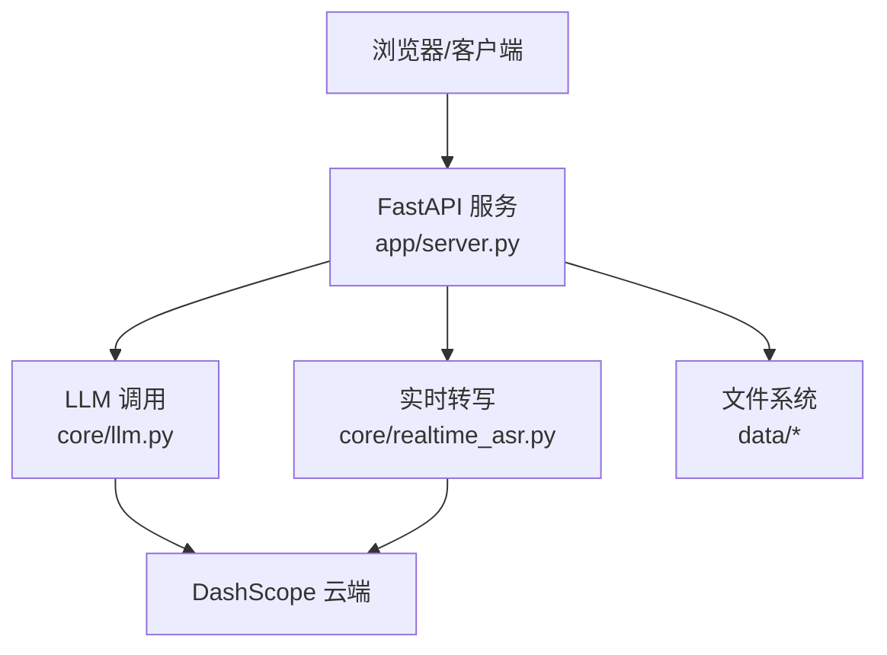
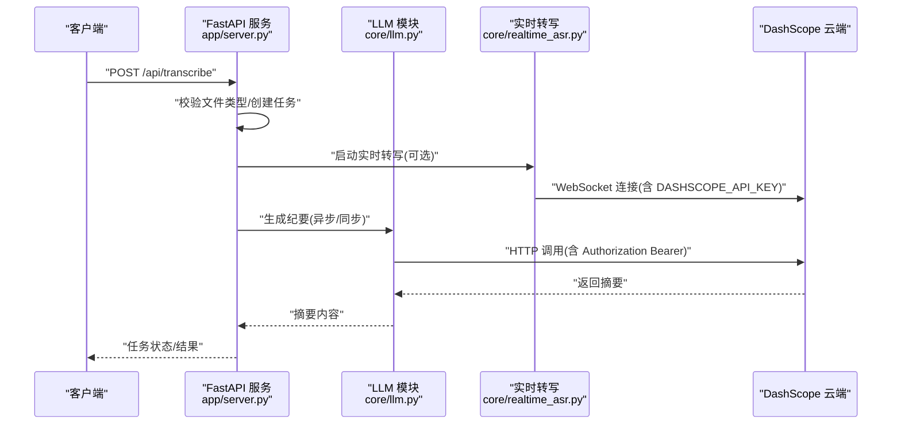
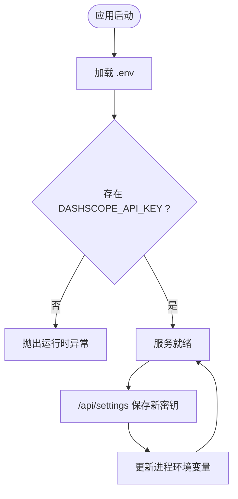
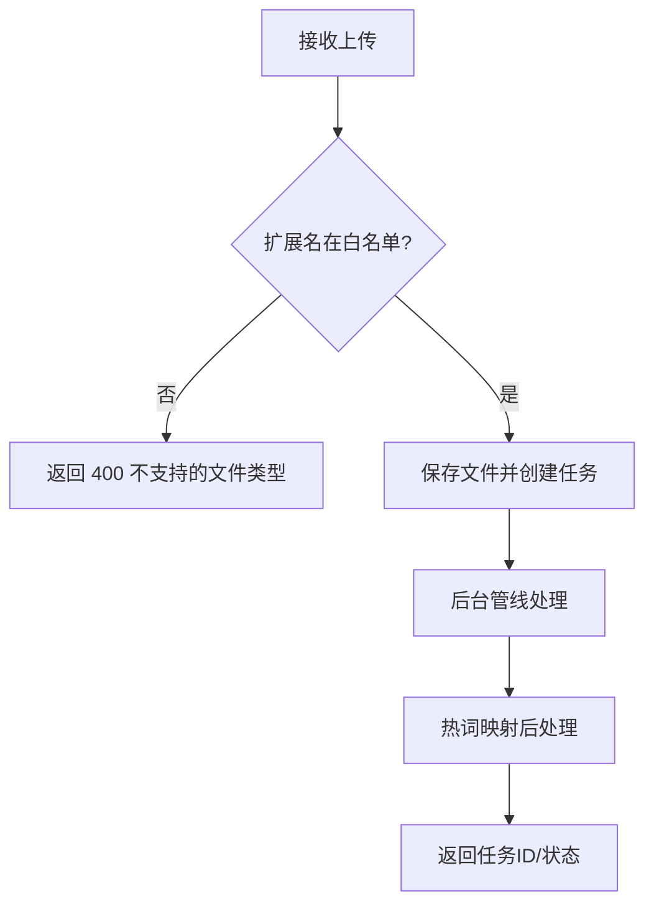
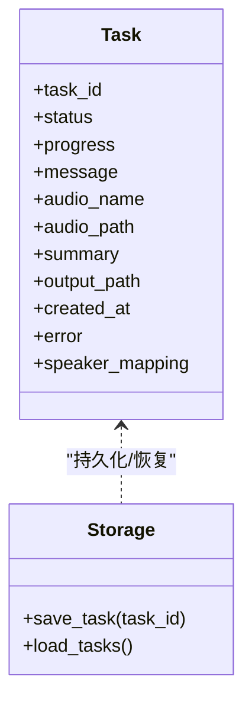
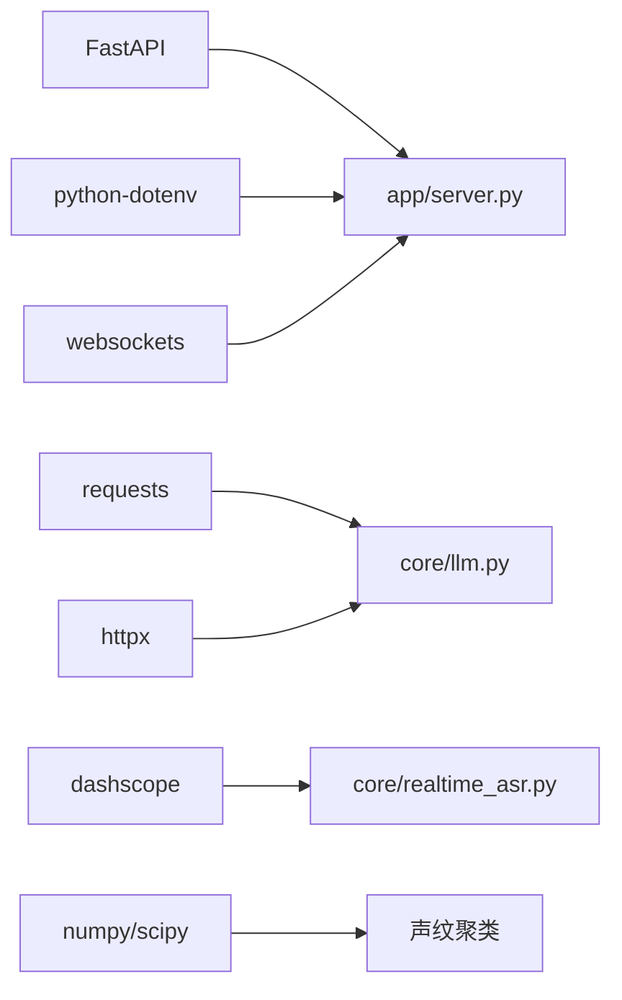

# 认证与安全

<cite>
**本文引用的文件**
- [app/server.py](file://app/server.py)
- [core/llm.py](file://core/llm.py)
- [core/realtime_asr.py](file://core/realtime_asr.py)
- [core/users.py](file://core/users.py)
- [requirements.txt](file://requirements.txt)
- [README.md](file://README.md)
- [MVP_PLAN.md](file://MVP_PLAN.md)
- [docs/API_CONTRACTS.md](file://docs/API_CONTRACTS.md)
</cite>

## 目录
1. [简介](#简介)
2. [项目结构（与安全相关）](#项目结构与安全相关)
3. [核心安全组件](#核心安全组件)
4. [架构总览](#架构总览)
5. [详细组件分析](#详细组件分析)
6. [依赖关系分析](#依赖关系分析)
7. [性能与可用性考量](#性能与可用性考量)
8. [故障排查指南](#故障排查指南)
9. [结论](#结论)
10. [附录：配置清单与最佳实践](#附录配置清单与最佳实践)

## 简介
本文件系统化梳理 Open Meeting Scribe 的认证与安全机制，覆盖环境变量配置、API 访问控制、数据安全与敏感信息管理（特别是 DashScope API 密钥）、跨域请求（CORS）现状、请求验证与数据过滤、日志脱敏与错误处理中的信息安全考虑，以及常见威胁防护与漏洞预防建议。目标是帮助开发者在本地与生产环境中正确部署并加固系统。

## 项目结构（与安全相关）
- Web 服务入口与端点定义位于 app/server.py，负责上传音频、任务管理、录制、设置等接口，并加载 .env 环境变量。
- 外部服务调用集中在 core/llm.py（通义千问 LLM）与 core/realtime_asr.py（实时转写），均通过环境变量读取 DashScope 凭据。
- 用户与会话状态以本地 JSON 文件持久化（data/users.json），用于“当前用户”和说话人绑定关系。
- 依赖声明在 requirements.txt，包含 FastAPI、httpx、requests、python-dotenv、dashscope 等。
- 文档与契约在 docs/API_CONTRACTS.md 与 MVP_PLAN.md 中约定了统一使用 DASHSCOPE_API_KEY 的环境变量策略。

图表来源
- [app/server.py:65-69](file://app/server.py#L65-L69)
- [core/llm.py:23-76](file://core/llm.py#L23-L76)
- [core/realtime_asr.py:47-51](file://core/realtime_asr.py#L47-L51)

章节来源
- [app/server.py:1-100](file://app/server.py#L1-L100)
- [requirements.txt:1-32](file://requirements.txt#L1-L32)
- [README.md:22-28](file://README.md#L22-L28)
- [MVP_PLAN.md:90-120](file://MVP_PLAN.md#L90-L120)
- [docs/API_CONTRACTS.md:6-10](file://docs/API_CONTRACTS.md#L6-L10)

## 核心安全组件
- 环境变量与密钥管理
  - 通过 python-dotenv 加载 .env，并在多处通过 os.getenv("DASHSCOPE_API_KEY") 获取密钥；未设置时抛出运行时异常，避免空密钥被使用。
  - 提供 /api/settings 接口可保存设置并同步更新进程内环境变量，便于前端配置。
- API 访问控制
  - 当前为本地开发用途，未实现鉴权中间件或令牌校验；所有接口默认开放给本机访问。
- 输入验证与数据过滤
  - 上传文件类型白名单校验（mp3/wav/m4a/aac/ogg/flac/mp4/webm）。
  - 任务参数解析采用 Pydantic 模型与显式转换，减少注入风险。
  - 热词映射对识别文本进行后处理替换，降低误识带来的内容污染。
- 数据安全与存储
  - 任务、录音、输出、用户信息均以本地文件形式落盘；任务持久化时剔除大字段 transcription，减小泄露面。
  - 用户信息 data/users.json 仅存储非敏感元数据（姓名、头像颜色、绑定关系）。
- 日志与错误处理
  - 关键流程记录日志；对外返回 HTTPException 错误码与消息，内部异常捕获并记录堆栈。
  - CLI 展示设置时隐藏 API Key 的明文显示。

章节来源
- [app/server.py:38-39](file://app/server.py#L38-L39)
- [app/server.py:343-396](file://app/server.py#L343-L396)
- [app/server.py:2092-2110](file://app/server.py#L2092-L2110)
- [core/llm.py:49-53](file://core/llm.py#L49-L53)
- [core/realtime_asr.py:230-235](file://core/realtime_asr.py#L230-L235)
- [core/users.py:22-52](file://core/users.py#L22-L52)
- [cli.py:451-468](file://cli.py#L451-L468)

## 架构总览
下图展示了从客户端到后端再到外部服务的调用链，以及密钥与环境变量的流向。

图表来源
- [app/server.py:343-396](file://app/server.py#L343-L396)
- [core/llm.py:89-121](file://core/llm.py#L89-L121)
- [core/realtime_asr.py:150-200](file://core/realtime_asr.py#L150-L200)

## 详细组件分析

### 环境变量与密钥管理
- 加载策略
  - 应用启动时加载 .env，确保 DASHSCOPE_API_KEY 可用。
  - 多处通过 os.getenv 读取密钥；缺失时立即抛出异常，阻断后续调用。
- 动态更新
  - /api/settings 支持保存 api_key，并同步写入进程环境变量，使后续调用生效。
- 前端配置
  - 前端设置页提供密码输入框用于填写 API Key，并通过 POST /api/settings 提交。

图表来源
- [app/server.py:38-39](file://app/server.py#L38-L39)
- [app/server.py:2092-2110](file://app/server.py#L2092-L2110)
- [core/llm.py:49-53](file://core/llm.py#L49-L53)
- [core/realtime_asr.py:230-235](file://core/realtime_asr.py#L230-L235)

章节来源
- [app/server.py:38-39](file://app/server.py#L38-L39)
- [app/server.py:2092-2110](file://app/server.py#L2092-L2110)
- [core/llm.py:49-53](file://core/llm.py#L49-L53)
- [core/realtime_asr.py:230-235](file://core/realtime_asr.py#L230-L235)
- [README.md:22-28](file://README.md#L22-L28)
- [MVP_PLAN.md:90-120](file://MVP_PLAN.md#L90-L120)
- [docs/API_CONTRACTS.md:6-10](file://docs/API_CONTRACTS.md#L6-L10)

### API 访问控制与鉴权
- 现状
  - 未实现全局鉴权中间件；所有端点默认允许本机访问。
  - 适合本地开发场景；若暴露到网络需额外加固。
- 建议
  - 在生产环境启用反向代理（如 Nginx/Caddy）限制来源 IP。
  - 增加基于 Token 的鉴权中间件（如 JWT），对敏感接口强制校验。
  - 将设置接口限制为管理员权限，防止任意用户修改 API Key。

章节来源
- [app/server.py:65-69](file://app/server.py#L65-L69)
- [app/server.py:2092-2110](file://app/server.py#L2092-L2110)

### 请求验证与数据过滤
- 上传文件类型白名单
  - 仅允许 mp3/wav/m4a/aac/ogg/flac/mp4/webm，拒绝其他类型。
- 结构化输入校验
  - 使用 Pydantic 模型约束请求体，避免非法字段进入业务逻辑。
- 热词映射
  - 对识别文本进行后处理替换，提升准确性并减少错误传播。

图表来源
- [app/server.py:343-396](file://app/server.py#L343-L396)
- [core/realtime_asr.py:126-128](file://core/realtime_asr.py#L126-L128)

章节来源
- [app/server.py:343-396](file://app/server.py#L343-L396)
- [core/realtime_asr.py:126-128](file://core/realtime_asr.py#L126-L128)

### 数据安全与存储
- 任务持久化
  - 任务数据落盘为 JSON，持久化时剔除 transcription 大字段，降低泄露风险。
- 用户信息
  - data/users.json 存储当前用户与说话人绑定关系，不包含敏感凭证。
- 文件路径与下载
  - 下载与音频流接口基于任务 ID 校验，不存在则返回 404，避免越权访问。

图表来源
- [app/server.py:92-128](file://app/server.py#L92-L128)
- [app/server.py:424-472](file://app/server.py#L424-L472)

章节来源
- [app/server.py:92-128](file://app/server.py#L92-L128)
- [app/server.py:424-472](file://app/server.py#L424-L472)
- [core/users.py:22-52](file://core/users.py#L22-L52)

### 跨域请求（CORS）配置
- 现状
  - 代码中未发现显式的 CORS 配置；默认行为取决于 FastAPI 与部署方式。
- 建议
  - 若前端与后端同源部署，无需额外配置。
  - 若跨域访问，应在网关层或应用层配置允许的 Origin、方法、头与凭据策略。

章节来源
- [app/server.py:65-69](file://app/server.py#L65-L69)

### 日志脱敏与错误处理中的信息安全
- 日志脱敏
  - 日志中不直接打印完整 API Key；CLI 展示设置时对 Key 做掩码处理。
  - 建议在日志框架中增加过滤器，自动屏蔽敏感字段（如 Authorization、API Key）。
- 错误处理
  - 对外返回 HTTPException 与明确的状态码；内部异常捕获并记录堆栈，避免泄露敏感细节。
  - 外部调用失败时抛出运行时异常，由上层统一处理。

章节来源
- [cli.py:451-468](file://cli.py#L451-L468)
- [core/llm.py:118-121](file://core/llm.py#L118-L121)
- [core/llm.py:157-160](file://core/llm.py#L157-L160)
- [core/realtime_asr.py:92-98](file://core/realtime_asr.py#L92-L98)

## 依赖关系分析
- 运行依赖
  - FastAPI、uvicorn、python-multipart 提供 Web 能力。
  - requests/httpx 用于 HTTP 调用；python-dotenv 管理环境变量。
  - dashscope 用于实时语音识别；websockets 用于 WebSocket 通信。
  - numpy/scipy 用于声纹特征提取与聚类。
  - python-docx/PyPDF2 用于文档文本提取。

图表来源
- [requirements.txt:1-32](file://requirements.txt#L1-L32)
- [app/server.py:33-57](file://app/server.py#L33-L57)
- [core/llm.py:15-21](file://core/llm.py#L15-L21)
- [core/realtime_asr.py:29-43](file://core/realtime_asr.py#L29-L43)

章节来源
- [requirements.txt:1-32](file://requirements.txt#L1-L32)

## 性能与可用性考量
- 连接池与超时
  - 异步 HTTP 客户端复用连接池，设置合理的超时与连接上限，避免资源耗尽。
- 线程与事件循环
  - 实时转写回调在 SDK 内部线程执行，通过 asyncio.Queue 安全投递消息，避免阻塞事件循环。
- 内存与磁盘
  - 任务持久化剔除大字段，降低磁盘占用与 I/O 压力。
  - 实时转写缓冲区限制最大条目数，防止内存无限增长。

章节来源
- [core/llm.py:26-38](file://core/llm.py#L26-L38)
- [app/server.py:171-199](file://app/server.py#L171-L199)
- [app/server.py:92-128](file://app/server.py#L92-L128)

## 故障排查指南
- 无法调用 LLM/ASR
  - 检查是否设置了 DASHSCOPE_API_KEY；未设置会抛出运行时异常。
  - 检查网络连接与 DashScope 服务状态。
- 实时转写无输出
  - 确认 PCM 格式与采样率符合要求；检查回调是否正确触发。
  - 查看日志中 WebSocket 连接与错误信息。
- 设置保存无效
  - 确认 /api/settings 已调用成功；检查进程环境变量是否更新。
- 文件下载失败
  - 确认任务存在且 output_path/audio_path 有效；否则返回 404。

章节来源
- [core/llm.py:49-53](file://core/llm.py#L49-L53)
- [core/realtime_asr.py:92-98](file://core/realtime_asr.py#L92-L98)
- [app/server.py:424-472](file://app/server.py#L424-L472)
- [app/server.py:2092-2110](file://app/server.py#L2092-L2110)

## 结论
当前系统围绕单一环境变量 DASHSCOPE_API_KEY 管理外部服务凭据，具备基础的输入验证与数据过滤能力，并在日志与错误处理中注意敏感信息保护。由于面向本地开发，未实现严格的鉴权与 CORS 控制；在生产环境应引入反向代理、鉴权中间件、最小权限原则与更严格的输入校验，以应对常见的安全威胁。

## 附录：配置清单与最佳实践
- 环境变量
  - DASHSCOPE_API_KEY：必需，用于 ASR 与 LLM 调用。
  - DASHSCOPE_WS_URL：可选，指定实时转写 WebSocket 地址。
  - RECORD_DEVICE：可选，指定录音设备名称。
- 配置文件
  - .env：存放 DASHSCOPE_API_KEY，禁止入库。
  - data/settings.json：可通过 /api/settings 维护，包含 api_key、model、output_dir。
  - data/users.json：用户信息与说话人绑定关系。
- 安全最佳实践
  - 生产环境部署
    - 使用反向代理限制来源 IP 与路径，仅暴露必要接口。
    - 启用 HTTPS，关闭调试模式与文档页面（如需要）。
    - 对 /api/settings 实施管理员鉴权与审计。
  - 日志脱敏
    - 在日志框架中屏蔽 Authorization、API Key、Token 等敏感字段。
    - 避免在日志中打印完整请求体与响应体。
  - 错误处理
    - 对外只返回必要的错误信息；内部记录详细堆栈。
    - 对第三方调用失败进行重试与熔断，避免雪崩。
  - 常见威胁防护
    - 注入与命令执行：严格校验输入，使用白名单与参数化查询。
    - 越权访问：对所有写操作进行身份与权限校验。
    - 数据泄露：最小化敏感数据存储，定期清理临时文件。
    - 资源耗尽：限制上传大小、并发连接与队列长度。
  - 漏洞预防
    - 定期更新依赖，关注安全公告。
    - 代码审查重点：输入校验、权限控制、敏感信息处理。
    - 渗透测试：模拟攻击面，验证防护措施有效性。

章节来源
- [app/server.py:38-39](file://app/server.py#L38-L39)
- [app/server.py:2092-2110](file://app/server.py#L2092-L2110)
- [core/realtime_asr.py:47-51](file://core/realtime_asr.py#L47-L51)
- [README.md:22-28](file://README.md#L22-L28)
- [MVP_PLAN.md:90-120](file://MVP_PLAN.md#L90-L120)
- [docs/API_CONTRACTS.md:6-10](file://docs/API_CONTRACTS.md#L6-L10)