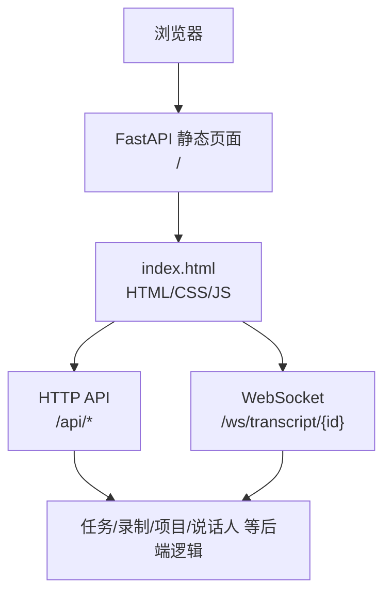
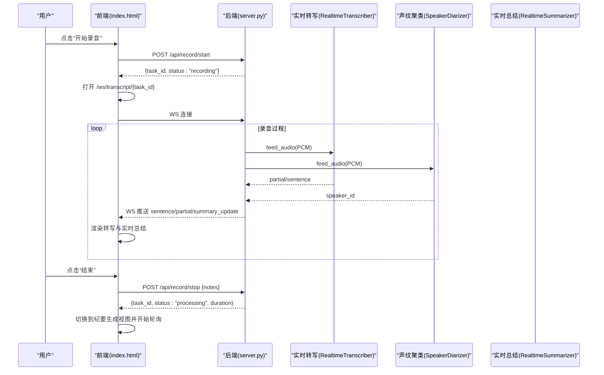
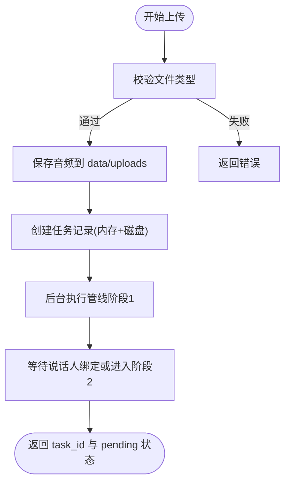
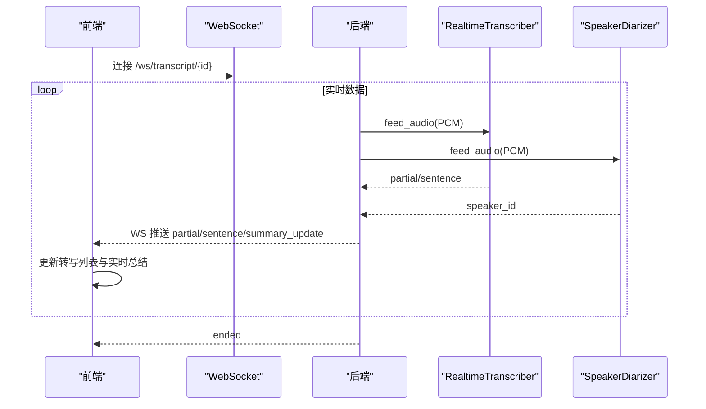
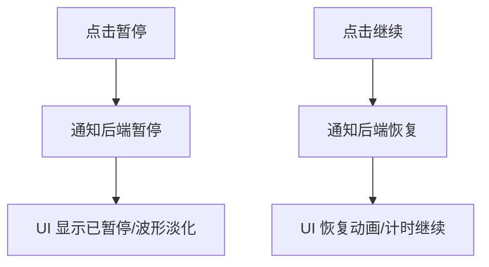
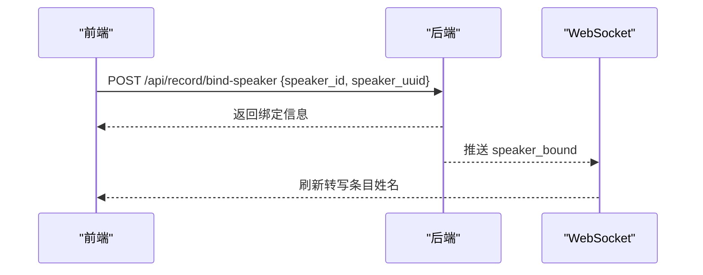
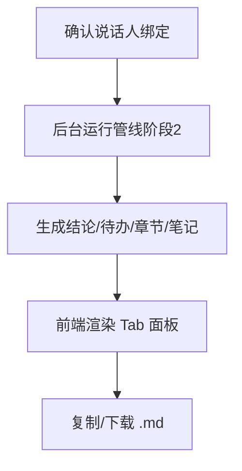
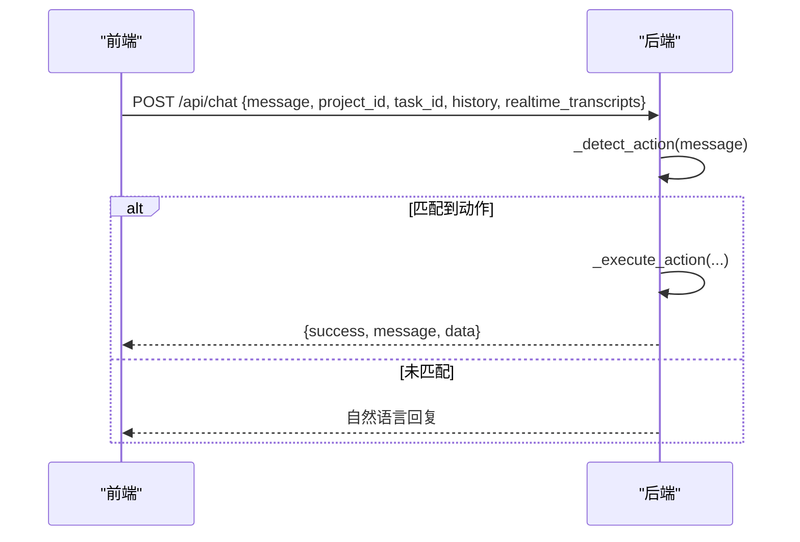
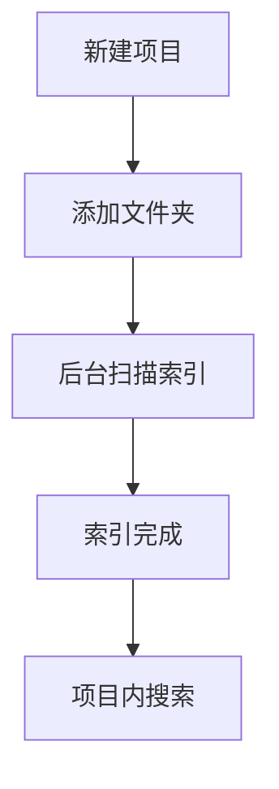
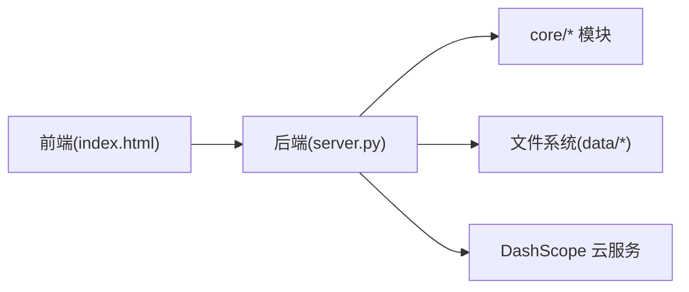

# Web 界面

<cite>
**本文引用的文件**
- [index.html](file://app/static/index.html)
- [server.py](file://app/server.py)
- [ui-spec.md](file://docs/design/ui-spec.md)
- [API_CONTRACTS.md](file://docs/API_CONTRACTS.md)
- [README.md](file://README.md)
</cite>

## 目录
1. [简介](#简介)
2. [项目结构](#项目结构)
3. [核心组件](#核心组件)
4. [架构总览](#架构总览)
5. [详细组件分析](#详细组件分析)
6. [依赖关系分析](#依赖关系分析)
7. [性能考虑](#性能考虑)
8. [故障排查指南](#故障排查指南)
9. [结论](#结论)
10. [附录](#附录)

## 简介
本文件面向 open-meeting-scribe 的 Web 界面，提供从用户操作到前端实现、再到与后端通信机制的完整说明。内容覆盖：
- 设计理念与交互流程：音频上传、实时转写显示、会议纪要查看、说话人绑定、AI 助手等
- 前端实现要点：HTML 结构、CSS 样式、JavaScript 交互逻辑
- 后端通信：HTTP 接口与 WebSocket 实时数据传输
- 界面定制与扩展：如何修改样式和功能
- 响应式设计与跨浏览器兼容性
- 用户操作流程与错误提示机制

## 项目结构
Web 界面以单页应用形式组织，采用“左栏导航 + 中栏主工作区 + 右栏 AI 助手”的三栏布局，支持面板折叠与拖拽调整宽度，并提供多视图（空闲、录音、处理中、纪要生成、完成态、项目管理、说话人管理、热词管理、设置、会议库）。

图表来源
- [server.py:1-21](file://app/server.py#L1-L21)
- [index.html:859-1541](file://app/static/index.html#L859-L1541)

章节来源
- [ui-spec.md:6-39](file://docs/design/ui-spec.md#L6-L39)
- [index.html:859-1541](file://app/static/index.html#L859-L1541)
- [server.py:1-21](file://app/server.py#L1-L21)

## 核心组件
- 视图与状态管理
  - 多视图切换：空闲、录音、处理中、纪要生成、完成态、说话人绑定、项目管理、说话人管理、热词管理、设置、会议库
  - 任务互斥：同一时间仅允许一个活跃任务（录音/整理/处理）
  - 面板折叠与拖拽：左右侧栏可折叠，分隔线可拖拽调整宽度并持久化到本地存储
- 音频与实时转写
  - 上传音频：拖拽或选择文件，调用 /api/transcribe
  - 系统内录：/api/record/start → /api/record/pause → /api/record/resume → /api/record/stop
  - 实时转写：WebSocket /ws/transcript/{id} 推送 partial/sentence/history/error/ended 等消息
  - 实时总结：通过后端 RealtimeSummarizer 增量更新摘要
- 说话人与绑定
  - 录音期间实时绑定说话人编号到全局说话人档案
  - 转写完成后进入“说话人绑定态”，在对话稿中内联绑定身份
- 纪要生成与展示
  - 管线第二阶段生成结构化纪要（结论/待办/章节/笔记），支持编辑、复制、导出
- AI 助手
  - 右侧聊天面板，支持快捷操作、任务控制条、会话上下文条、项目关联
  - 动作检测与执行：通过关键词匹配驱动录音、查询、设置等操作

章节来源
- [index.html:1751-2400](file://app/static/index.html#L1751-L2400)
- [server.py:721-1092](file://app/server.py#L721-L1092)
- [server.py:1290-1518](file://app/server.py#L1290-L1518)
- [ui-spec.md:161-176](file://docs/design/ui-spec.md#L161-L176)

## 架构总览
前端通过 HTTP 与 WebSocket 与后端交互；后端使用 FastAPI 暴露 REST 接口与 WebSocket 端点，负责任务调度、流式录音、实时转写、声纹聚类、实时总结与纪要生成。

图表来源
- [server.py:721-858](file://app/server.py#L721-L858)
- [server.py:869-948](file://app/server.py#L869-L948)
- [index.html:1981-2050](file://app/static/index.html#L1981-L2050)
- [index.html:2188-2227](file://app/static/index.html#L2188-L2227)

## 详细组件分析

### 上传与任务创建（HTTP）
- 前端：拖拽或选择文件后，构造 FormData 调用 /api/transcribe，进入“处理中”视图并轮询任务状态
- 后端：校验文件类型、保存上传文件、创建任务记录、后台执行管线第一阶段（转写），若存在预设映射则直接进入第二阶段

图表来源
- [server.py:343-396](file://app/server.py#L343-L396)
- [server.py:226-333](file://app/server.py#L226-L333)
- [index.html:1948-1976](file://app/static/index.html#L1948-L1976)

章节来源
- [server.py:343-396](file://app/server.py#L343-L396)
- [index.html:1948-1976](file://app/static/index.html#L1948-L1976)

### 实时转写（WebSocket）
- 前端：建立 ws:// 或 wss:// 连接到 /ws/transcript/{taskId}，根据消息类型渲染临时结果与定稿句子，维护最近 N 条缓冲供 AI 对话上下文
- 后端：PCM 回调送入实时转写与声纹聚类，按句末事件推送 sentence/partial/error/ended，同时注入实时总结

图表来源
- [server.py:757-836](file://app/server.py#L757-L836)
- [server.py:805-819](file://app/server.py#L805-L819)
- [index.html:2188-2227](file://app/static/index.html#L2188-L2227)
- [index.html:2253-2393](file://app/static/index.html#L2253-L2393)

章节来源
- [server.py:757-836](file://app/server.py#L757-L836)
- [index.html:2188-2227](file://app/static/index.html#L2188-L2227)
- [index.html:2253-2393](file://app/static/index.html#L2253-L2393)

### 录音控制与暂停/恢复
- 前端：计时器更新时长，暂停时 UI 反馈并通知后端暂停录制，恢复时继续
- 后端：暂停/恢复录制，保持实时转写与总结的状态一致

图表来源
- [index.html:2061-2087](file://app/static/index.html#L2061-L2087)
- [server.py:968-989](file://app/server.py#L968-L989)

章节来源
- [index.html:2061-2087](file://app/static/index.html#L2061-L2087)
- [server.py:968-989](file://app/server.py#L968-L989)

### 说话人绑定（录音期间与转写后）
- 录音期间：点击对话中的说话人标签弹出绑定菜单，选择全局说话人档案，立即通过 WebSocket 广播更新所有条目
- 转写后：进入“说话人绑定态”，在对话稿中内联绑定，确认后触发纪要生成

图表来源
- [server.py:1032-1069](file://app/server.py#L1032-L1069)
- [index.html:2237-2245](file://app/static/index.html#L2237-L2245)
- [index.html:2388-2391](file://app/static/index.html#L2388-L2391)

章节来源
- [server.py:1032-1069](file://app/server.py#L1032-L1069)
- [index.html:2237-2245](file://app/static/index.html#L2237-L2245)
- [index.html:2388-2391](file://app/static/index.html#L2388-L2391)

### 纪要生成与展示
- 前端：进入“纪要生成与加载页”，提供音频播放器、Tab 切换（转写/AI纪要/章节/笔记）、骨架屏与加载态
- 后端：第二阶段生成结构化纪要，支持重新生成；提供下载接口

图表来源
- [server.py:630-714](file://app/server.py#L630-L714)
- [server.py:424-472](file://app/server.py#L424-L472)
- [index.html:1081-1199](file://app/static/index.html#L1081-L1199)

章节来源
- [server.py:630-714](file://app/server.py#L630-L714)
- [server.py:424-472](file://app/server.py#L424-L472)
- [index.html:1081-1199](file://app/static/index.html#L1081-L1199)

### AI 助手与动作执行
- 前端：右侧聊天面板，支持更多菜单、任务控制条、会话上下文条、项目关联
- 后端：动作检测与执行，基于关键词匹配驱动录音、查询、设置等操作

图表来源
- [server.py:1290-1518](file://app/server.py#L1290-L1518)
- [index.html:1459-1527](file://app/static/index.html#L1459-L1527)

章节来源
- [server.py:1290-1518](file://app/server.py#L1290-L1518)
- [index.html:1459-1527](file://app/static/index.html#L1459-L1527)

### 项目管理与文件夹浏览
- 前端：项目管理视图，新建项目、添加/移除文件夹、重建索引、搜索
- 后端：文件系统浏览、项目 CRUD、索引构建与搜索

图表来源
- [server.py:1098-1287](file://app/server.py#L1098-L1287)
- [index.html:1301-1327](file://app/static/index.html#L1301-L1327)

章节来源
- [server.py:1098-1287](file://app/server.py#L1098-L1287)
- [index.html:1301-1327](file://app/static/index.html#L1301-L1327)

## 依赖关系分析
- 前端依赖
  - HTML/CSS：定义设计令牌、布局、组件样式与响应式断点
  - JavaScript：状态管理、视图切换、文件上传、录音控制、WebSocket 通信、AI 助手交互
- 后端依赖
  - FastAPI：路由、静态文件托管、WebSocket、后台任务
  - core 模块：音频采集、实时转写、声纹聚类、实时总结、管线执行、说话人/项目/热词管理
- 外部服务
  - DashScope：批转写（paraformer-v2）、实时转写（qwen-audio-3.0-asr-flash-streaming）、通义千问（纪要）

图表来源
- [server.py:1-58](file://app/server.py#L1-L58)
- [index.html:1-853](file://app/static/index.html#L1-L853)
- [API_CONTRACTS.md:1-176](file://docs/API_CONTRACTS.md#L1-L176)

章节来源
- [server.py:1-58](file://app/server.py#L1-L58)
- [index.html:1-853](file://app/static/index.html#L1-L853)
- [API_CONTRACTS.md:1-176](file://docs/API_CONTRACTS.md#L1-L176)

## 性能考虑
- 实时转写缓冲限制：前端维护最近 N 条转写条目，避免 DOM 过大导致卡顿
- 后端队列与线程安全：SDK 回调通过 asyncio.Queue 投递消息，确保事件循环安全
- 音频格式与规格：实时 PCM 16bit/16kHz/mono，批量转写支持主流格式，注意文件大小与时长限制
- 进度与状态：分阶段进度条与状态指示，减少用户等待焦虑
- 资源清理：停止录制时关闭实时转写、声纹聚类器与总结器，释放资源

章节来源
- [index.html:1769-1770](file://app/static/index.html#L1769-L1770)
- [server.py:171-199](file://app/server.py#L171-L199)
- [API_CONTRACTS.md:103-105](file://docs/API_CONTRACTS.md#L103-L105)
- [server.py:897-916](file://app/server.py#L897-L916)

## 故障排查指南
- 上传失败
  - 检查文件类型是否受支持
  - 查看后端日志与错误响应
- 录制启动失败
  - 检查麦克风权限与设备可用性
  - 查看后端错误信息
- 实时转写不可用
  - 检查网络与 WebSocket 连接
  - 查看错误消息与降级提示
- 说话人绑定异常
  - 确认说话人是否存在
  - 检查绑定 API 返回与 WebSocket 广播
- 纪要生成失败
  - 检查任务状态与错误字段
  - 尝试重新生成纪要

章节来源
- [server.py:343-396](file://app/server.py#L343-L396)
- [server.py:721-863](file://app/server.py#L721-L863)
- [server.py:869-952](file://app/server.py#L869-L952)
- [server.py:1032-1069](file://app/server.py#L1032-L1069)
- [server.py:674-714](file://app/server.py#L674-L714)

## 结论
本 Web 界面以清晰的三栏布局与多视图切换，提供了完整的会议录音、实时转写、说话人绑定与纪要生成功能。前端通过 HTTP 与 WebSocket 与后端紧密协作，实现了低延迟的实时体验与稳定的批处理流程。结合响应式设计、快捷键与无障碍特性，界面在不同设备上均能提供良好体验。后续可在此基础上扩展更多 AI 能力与自定义主题。

## 附录

### 用户操作流程
- 新建会议
  - 空闲态点击“麦克风录音”或“上传音频文件”，或通过向导配置标题与类型
- 录音与实时转写
  - 开始录音 → 实时转写与总结 → 暂停/恢复 → 结束录音 → 进入纪要生成
- 说话人绑定
  - 录音期间内联绑定 → 转写完成后再次确认 → 生成纪要
- 查看与管理
  - 会议库搜索与筛选 → 历史会议加载 → 项目管理与热词管理

章节来源
- [ui-spec.md:161-176](file://docs/design/ui-spec.md#L161-L176)
- [index.html:932-973](file://app/static/index.html#L932-L973)
- [index.html:1397-1451](file://app/static/index.html#L1397-L1451)

### 界面定制与扩展
- 样式定制
  - 通过 CSS 变量（设计令牌）统一调整颜色、字体、间距与圆角
  - 响应式断点控制面板可见性与 Tab 模式
- 功能扩展
  - 新增视图：在 HTML 中添加视图容器与 JS 切换逻辑
  - 新增动作：在后端 ACTION_REGISTRY 注册新动作与执行逻辑
  - 新增 API：在 server.py 中定义路由与业务逻辑

章节来源
- [index.html:7-31](file://app/static/index.html#L7-L31)
- [index.html:758-802](file://app/static/index.html#L758-L802)
- [server.py:1302-1316](file://app/server.py#L1302-L1316)

### 响应式设计与跨浏览器兼容
- 断点策略
  - ≤1200px：默认隐藏右侧 AI 面板，可通过按钮切换
  - ≤800px：默认隐藏左侧导航，录音视图转为 Tab 模式
- 兼容性
  - 使用现代 CSS 特性（如 oklch、backdrop-filter）与标准 API
  - 提供 focus-visible 与 reduced-motion 媒体查询提升可访问性

章节来源
- [index.html:758-802](file://app/static/index.html#L758-L802)
- [index.html:816-847](file://app/static/index.html#L816-L847)

### 错误提示机制
- Toast 提示：轻量级全局提示，用于任务互斥等场景
- 状态指示：顶部状态胶囊与底部状态栏显示当前状态
- 错误面板：转写错误与录制失败时显示具体原因与重试选项

章节来源
- [index.html:811-815](file://app/static/index.html#L811-L815)
- [index.html:861-870](file://app/static/index.html#L861-L870)
- [index.html:2149-2165](file://app/static/index.html#L2149-L2165)