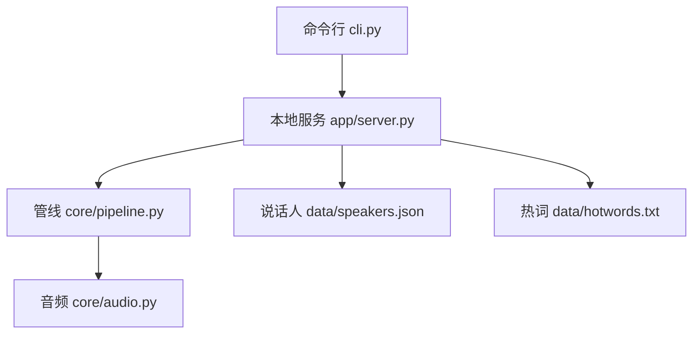
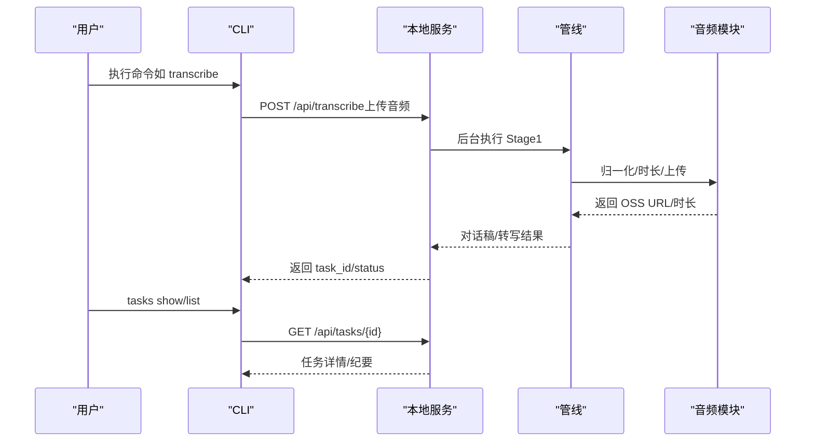

# 命令行工具

<cite>
**本文引用的文件**
- [cli.py](file://cli.py)
- [server.py](file://app/server.py)
- [pipeline.py](file://core/pipeline.py)
- [audio.py](file://core/audio.py)
- [requirements.txt](file://requirements.txt)
- [speakers.json](file://data/speakers.json)
- [hotwords.txt](file://data/hotwords.txt)
- [README.md](file://README.md)
</cite>

## 目录
1. [简介](#简介)
2. [项目结构](#项目结构)
3. [核心组件](#核心组件)
4. [架构总览](#架构总览)
5. [详细命令参考](#详细命令参考)
6. [依赖与配置](#依赖与配置)
7. [性能与最佳实践](#性能与最佳实践)
8. [故障排查](#故障排查)
9. [结论](#结论)
10. [附录：常用工作流示例](#附录常用工作流示例)

## 简介
本工具提供一套完整的命令行界面，用于音频转录、说话人分离、纪要生成、任务管理、录音控制、热词与说话人管理、设置管理与 AI 对话等。通过本地 Web 服务暴露 REST 接口，CLI 作为统一入口调用后端能力，支持批处理与自动化集成。

## 项目结构
- CLI 入口与命令路由：cli.py
- 本地 Web 服务（FastAPI）：app/server.py
- 管线编排（转写→纪要）：core/pipeline.py
- 音频归一化与系统内录：core/audio.py
- 运行依赖：requirements.txt
- 数据与配置：data/（说话人、热词等）

图表来源
- [cli.py:526-652](file://cli.py#L526-L652)
- [server.py:343-497](file://app/server.py#L343-L497)
- [pipeline.py:58-134](file://core/pipeline.py#L58-L134)
- [audio.py:31-98](file://core/audio.py#L31-L98)

章节来源
- [cli.py:1-657](file://cli.py#L1-L657)
- [server.py:1-220](file://app/server.py#L1-L220)
- [pipeline.py:1-200](file://core/pipeline.py#L1-L200)
- [audio.py:1-200](file://core/audio.py#L1-L200)

## 核心组件
- CLI 命令解析与分发：基于 argparse，提供多级子命令与参数校验。
- 本地服务：FastAPI 应用，提供上传、任务查询、下载、录制控制、WebSocket 实时转写等端点。
- 管线：分阶段执行（Stage1 音频→对话稿；Stage2 对话稿→纪要），支持进度回调。
- 音频模块：ffmpeg 归一化、时长获取、macOS 系统内录（BlackHole）。
- 数据持久化：任务 JSON 文件、说话人列表、热词表。

章节来源
- [cli.py:526-652](file://cli.py#L526-L652)
- [server.py:65-165](file://app/server.py#L65-L165)
- [pipeline.py:47-134](file://core/pipeline.py#L47-L134)
- [audio.py:26-126](file://core/audio.py#L26-L126)

## 架构总览
CLI 通过 HTTP 请求与本地 FastAPI 服务交互，服务在后台线程中调度管线任务，并持久化任务状态。录音功能通过系统内录采集 PCM 数据，结合实时 ASR 与声纹聚类，推送实时转写结果。

图表来源
- [cli.py:103-147](file://cli.py#L103-L147)
- [server.py:343-396](file://app/server.py#L343-L396)
- [pipeline.py:58-134](file://core/pipeline.py#L58-L134)
- [audio.py:31-98](file://core/audio.py#L31-L98)

## 详细命令参考

### 全局说明
- 默认服务地址：http://127.0.0.1:8000
- 日志级别：INFO（可通过 Python logging 配置扩展）
- 错误处理：HTTP 4xx/5xx 会抛出运行时异常，CLI 捕获并打印错误信息

章节来源
- [cli.py:64-97](file://cli.py#L64-L97)

### 转写与纪要
- 命令：transcribe
- 参数：
  - audio：音频文件路径（必填）
  - -o, --output：输出纪要路径（可选）
  - --show：显示纪要内容（可选）
- 行为：
  - 自动归一化音频（16kHz/单声道/WAV）
  - 上传到 DashScope 进行转写
  - 生成结构化纪要并保存为 Markdown
  - 支持进度回调与错误提示

使用示例
- 基本转写：python cli.py transcribe samples/会议.mp3
- 指定输出：python cli.py transcribe samples/会议.mp3 -o output/纪要.md
- 直接查看纪要：python cli.py transcribe samples/会议.mp3 --show

章节来源
- [cli.py:103-147](file://cli.py#L103-L147)
- [cli.py:534-539](file://cli.py#L534-L539)
- [pipeline.py:58-134](file://core/pipeline.py#L58-L134)

### 音频归一化
- 命令：normalize
- 参数：
  - audio：音频文件路径（必填）
- 行为：
  - 将任意格式音频转换为 16kHz/单声道/WAV
  - 输出同目录 _normalized.wav（或自定义输出路径）
  - 显示时长与文件大小

使用示例
- python cli.py normalize samples/会议.mp3

章节来源
- [cli.py:150-172](file://cli.py#L150-L172)
- [audio.py:31-98](file://core/audio.py#L31-L98)

### 上传测试
- 命令：upload
- 参数：
  - audio：音频文件路径（必填）
- 行为：
  - 先归一化，再上传至 DashScope（测试用途）

使用示例
- python cli.py upload samples/会议.mp3

章节来源
- [cli.py:175-198](file://cli.py#L175-L198)

### 启动 Web UI 服务
- 命令：server
- 参数：
  - --host：监听地址（默认 127.0.0.1）
  - --port：监听端口（默认 8000）
  - --reload：开发模式自动重载（可选）
- 行为：
  - 启动 FastAPI 服务，托管静态页面与 API

使用示例
- python cli.py server
- python cli.py server --host 0.0.0.0 --port 8080 --reload

章节来源
- [cli.py:201-219](file://cli.py#L201-L219)
- [cli.py:551-556](file://cli.py#L551-L556)

### 录音控制（需服务运行中）
- 命令组：record
- 子命令：
  - start：开始录音（创建任务 ID，进入录制状态）
  - stop：停止录音（结束录制，自动进入管线）
  - pause：暂停录音
  - resume：恢复录音
  - status：查看录制状态（设备、时长、任务 ID）
- 行为：
  - 通过 REST 接口控制系统内录（macOS BlackHole）
  - 支持实时转写与声纹聚类（由服务内部实现）

使用示例
- python cli.py record start
- python cli.py record status
- python cli.py record stop

章节来源
- [cli.py:226-291](file://cli.py#L226-L291)
- [cli.py:558-575](file://cli.py#L558-L575)
- [server.py:721-800](file://app/server.py#L721-L800)

### 任务管理
- 命令组：tasks
- 子命令：
  - list：列出所有任务（标题、ID、状态、时长、创建时间）
  - show <task_id>：查看任务详情（含纪要与待办）
  - delete <task_id>：删除任务（清理音频与纪要文件）
- 行为：
  - 通过 REST 接口查询/删除任务
  - 失败时返回错误信息

使用示例
- python cli.py tasks list
- python cli.py tasks show abc123
- python cli.py tasks delete abc123

章节来源
- [cli.py:298-366](file://cli.py#L298-L366)
- [cli.py:577-590](file://cli.py#L577-L590)
- [server.py:399-497](file://app/server.py#L399-L497)

### 说话人管理
- 命令组：speakers
- 子命令：
  - list：列出所有说话人（姓名、角色、备注）
  - add <姓名> [--role] [--note]：添加说话人
- 行为：
  - 读取/写入 data/speakers.json
  - 支持角色与备注字段

使用示例
- python cli.py speakers list
- python cli.py speakers add 张三 --role 产品经理 --note 负责需求评审

章节来源
- [cli.py:373-404](file://cli.py#L373-L404)
- [cli.py:592-603](file://cli.py#L592-L603)
- [speakers.json:1-30](file://data/speakers.json#L1-L30)

### 热词管理
- 命令组：hotwords
- 子命令：
  - list：列出热词
  - add <词> [<词>...]：添加多个热词（去重）
- 行为：
  - 读取/写入 data/hotwords.txt
  - 新增热词后参与转写词汇优化

使用示例
- python cli.py hotwords list
- python cli.py hotwords add EAS PMS 金蝶

章节来源
- [cli.py:411-444](file://cli.py#L411-L444)
- [cli.py:605-614](file://cli.py#L605-L614)
- [hotwords.txt:1-4](file://data/hotwords.txt#L1-L4)

### 设置管理
- 命令组：settings
- 子命令：
  - show：查看当前设置（隐藏敏感字段）
  - set <键> <值>：修改设置（覆盖当前配置）
- 行为：
  - 通过 REST 接口获取/更新设置
  - 对 API Key 等敏感信息进行掩码展示

使用示例
- python cli.py settings show
- python cli.py settings set api_key sk-xxxx

章节来源
- [cli.py:451-482](file://cli.py#L451-L482)
- [cli.py:616-626](file://cli.py#L616-L626)

### AI 对话
- 命令：chat
- 参数：
  - message：消息内容（必填）
  - --task-id：关联任务 ID（可选）
  - --project-id：关联项目 ID（可选）
- 行为：
  - 发送消息到 AI 助手，返回回复、动作执行结果与来源

使用示例
- python cli.py chat "提取待办事项" --task-id abc123

章节来源
- [cli.py:489-519](file://cli.py#L489-L519)
- [cli.py:628-633](file://cli.py#L628-L633)

## 依赖与配置
- 运行环境：Python 3.11+，建议使用独立虚拟环境
- 关键依赖：
  - requests/httpx：HTTP 客户端
  - fastapi/uvicorn：Web 服务
  - dashcope：实时语音识别 SDK
  - websockets：实时推送
  - numpy/scipy：声纹特征与聚类
  - python-docx/PyPDF2：文档文本提取
- 环境变量：
  - DASHSCOPE_API_KEY：转写与纪要所需密钥
  - RECORD_DEVICE：系统内录设备名（默认麦克风或 BlackHole 多输出设备）
- 外部工具：
  - ffmpeg：音频归一化与系统内录
  - BlackHole 2ch：macOS 系统内录虚拟声卡

章节来源
- [requirements.txt:1-32](file://requirements.txt#L1-L32)
- [README.md:22-28](file://README.md#L22-L28)
- [server.py:130-132](file://app/server.py#L130-L132)
- [audio.py:128-200](file://core/audio.py#L128-L200)

## 性能与最佳实践
- 音频预处理：优先使用 normalize 将音频转为 16kHz/单声道/WAV，提升转写稳定性与速度
- 热词优化：提前维护 data/hotwords.txt，减少专有名词误识
- 批量处理：通过 shell 脚本循环调用 CLI，避免重复初始化开销
- 并发限制：同一时刻仅允许一路录制，避免资源竞争
- 超时与重试：长耗时操作（上传、转写）注意网络超时与服务可用性
- 输出管理：定期清理 data/output 与 data/uploads，避免磁盘占用过高

[本节为通用指导，不直接分析具体文件]

## 故障排查
- 无法连接服务：确认已启动本地服务（python cli.py server），检查端口与防火墙
- 音频格式不支持：确保输入为支持的音频格式，或使用 normalize 转换
- ffmpeg 不可用：安装 ffmpeg 并确保 PATH 可访问
- 录制失败：检查 macOS 音频 MIDI 设置是否配置多输出设备，RECORD_DEVICE 是否正确
- 任务不存在：确认 task_id 正确，或服务未持久化导致重启丢失
- 热词未生效：确认热词文件路径与编码正确，且已加入词汇表

章节来源
- [cli.py:68-97](file://cli.py#L68-L97)
- [audio.py:26-98](file://core/audio.py#L26-L98)
- [server.py:343-396](file://app/server.py#L343-L396)

## 结论
本命令行工具提供了从音频录入到纪要产出的完整闭环，支持本地服务、实时转写、任务管理与 AI 对话。通过清晰的命令结构与参数设计，便于日常使用与自动化集成。建议结合热词与说话人管理，持续优化转写质量与纪要准确性。

[本节为总结性内容，不直接分析具体文件]

## 附录：常用工作流示例
- 单次转写与纪要
  - python cli.py transcribe samples/会议.mp3 -o output/纪要.md
- 批量转写
  - for f in samples/*.mp3; do python cli.py transcribe "$f"; done
- 录音流程
  - python cli.py record start
  - python cli.py record status
  - python cli.py record stop
  - python cli.py tasks list
- 说话人与热词维护
  - python cli.py speakers add 李四 --role 技术负责人
  - python cli.py hotwords add 云原生 DevOps
- 设置与环境
  - python cli.py settings show
  - python cli.py settings set api_key sk-xxxx

[本节为概念性示例，不直接映射到具体代码结构]