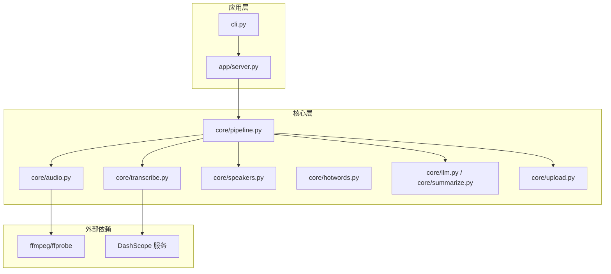
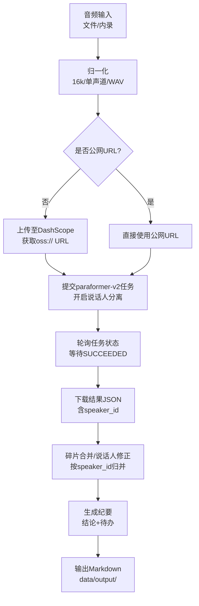
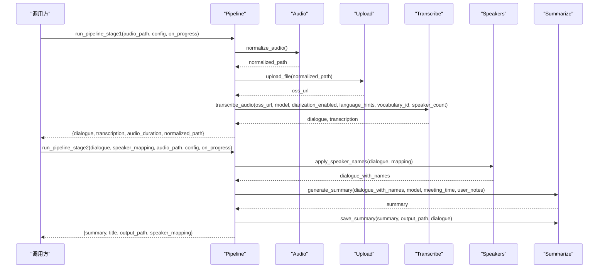
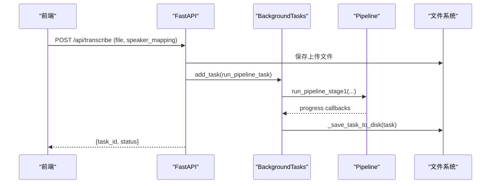
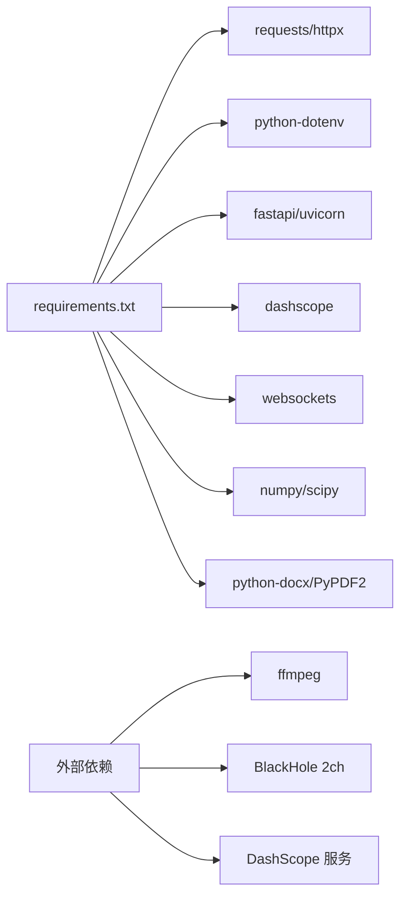

# 代码规范

<cite>
**本文引用的文件**
- [README.md](file://README.md)
- [AGENTS.md](file://AGENTS.md)
- [requirements.txt](file://requirements.txt)
- [ARCHITECTURE.md](file://docs/ARCHITECTURE.md)
- [pipeline.py](file://core/pipeline.py)
- [server.py](file://app/server.py)
- [cli.py](file://cli.py)
- [audio.py](file://core/audio.py)
- [transcribe.py](file://core/transcribe.py)
- [speakers.py](file://core/speakers.py)
</cite>

## 目录
1. [引言](#引言)
2. [项目结构](#项目结构)
3. [核心组件](#核心组件)
4. [架构总览](#架构总览)
5. [详细组件分析](#详细组件分析)
6. [依赖关系分析](#依赖关系分析)
7. [性能考虑](#性能考虑)
8. [故障排查指南](#故障排查指南)
9. [结论](#结论)
10. [附录](#附录)

## 引言
本规范面向 open-meeting-scribe 项目的开发与维护，目标是统一 Python 编码风格、模块组织、密钥管理、提交与分支策略，以及代码质量工具配置。文档基于仓库现有实现与约定进行提炼，确保可执行、可审查、可演进。

## 项目结构
- 分层职责清晰：
  - core/：管线与业务逻辑（音频处理、转写、热词、说话人、LLM、上传等）
  - app/：服务与前端（FastAPI 接口、静态页面、实时 WebSocket）
  - cli.py：命令行入口
  - data/：数据与资源（热词、说话人映射等）
  - docs/：架构、契约、决策记录与设计文档
  - tests/：测试（当前为空，后续补充）
- 关键约束来自架构文档：只认公网 URL；oss:// 走 RESTful；分离仅单声道；异步任务需体现排队/进度。

**图示来源**
- [ARCHITECTURE.md:5-16](file://docs/ARCHITECTURE.md#L5-L16)
- [pipeline.py:1-27](file://core/pipeline.py#L1-L27)
- [server.py:1-21](file://app/server.py#L1-L21)

**章节来源**
- [README.md:11-19](file://README.md#L11-L19)
- [ARCHITECTURE.md:5-16](file://docs/ARCHITECTURE.md#L5-L16)

## 核心组件
- 管线编排（core/pipeline.py）：串联“音频归一化 → 上传 → 转写 → 纪要”全流程，提供进度回调与两阶段接口。
- Web 服务（app/server.py）：FastAPI 提供 REST + WebSocket 接口，后台执行管线任务，持久化任务状态到磁盘。
- 命令行（cli.py）：封装常用操作（转写、录音控制、任务管理、说话人/热词/设置管理、AI 对话）。
- 音频处理（core/audio.py）：ffmpeg 归一化、macOS 系统内录、流式 PCM 读取与暂停/恢复。
- 转写（core/transcribe.py）：提交 paraformer-v2 任务、轮询、下载结果、碎片合并与说话人修正、组装对话稿。
- 说话人（core/speakers.py）：全局说话人档案与会话映射历史，支持姓名映射与提示词构造。

**章节来源**
- [pipeline.py:1-27](file://core/pipeline.py#L1-L27)
- [server.py:1-21](file://app/server.py#L1-L21)
- [cli.py:1-44](file://cli.py#L1-L44)
- [audio.py:1-10](file://core/audio.py#L1-L10)
- [transcribe.py:1-14](file://core/transcribe.py#L1-L14)
- [speakers.py:1-12](file://core/speakers.py#L1-L12)

## 架构总览
- 数据流遵循“采集 → 归一化 → 上云 → 转写 → 组装 → 纪要 → 输出”的流水线。
- 关键约束：
  - 只认公网 URL；本地/内录先上传 DashScope 临时存储换 oss:// URL。
  - oss:// 必须走 RESTful API 并携带特定请求头。
  - 说话人分离仅对单声道有效，归一化阶段强制下混。
  - 异步任务需体现排队与进度。

**图示来源**
- [ARCHITECTURE.md:18-40](file://docs/ARCHITECTURE.md#L18-L40)
- [transcribe.py:26-52](file://core/transcribe.py#L26-L52)
- [pipeline.py:35-44](file://core/pipeline.py#L35-L44)

**章节来源**
- [ARCHITECTURE.md:18-40](file://docs/ARCHITECTURE.md#L18-L40)

## 详细组件分析

### 管线编排（core/pipeline.py）
- 设计要点：
  - 两阶段接口：Stage1 产出对话稿，Stage2 应用姓名映射并生成纪要。
  - 进度回调 PipelineProgress，便于 UI 展示。
  - 默认配置集中管理（模型、语言提示、采样率、通道数、输出目录）。
- 复杂度与优化：
  - 线性流程，I/O 密集为主；可通过并发优化上传与转写等待。
  - 建议增加重试与退避策略，提升鲁棒性。

**图示来源**
- [pipeline.py:58-134](file://core/pipeline.py#L58-L134)
- [pipeline.py:137-226](file://core/pipeline.py#L137-L226)
- [transcribe.py:405-446](file://core/transcribe.py#L405-L446)
- [speakers.py:278-309](file://core/speakers.py#L278-L309)

**章节来源**
- [pipeline.py:35-44](file://core/pipeline.py#L35-L44)
- [pipeline.py:58-134](file://core/pipeline.py#L58-L134)
- [pipeline.py:137-226](file://core/pipeline.py#L137-L226)

### Web 服务（app/server.py）
- 设计要点：
  - FastAPI 提供 REST 与 WebSocket 接口，后台线程执行管线任务。
  - 任务持久化到磁盘（排除冗余字段），启动时恢复。
  - 实时转写通过 asyncio.Queue 跨线程推送消息。
- 安全与健壮性：
  - 文件类型白名单校验。
  - 异常捕获与日志记录，避免阻塞事件循环。
  - 录制设备名从环境变量读取，避免硬编码。

**图示来源**
- [server.py:343-396](file://app/server.py#L343-L396)
- [server.py:92-128](file://app/server.py#L92-L128)
- [server.py:226-268](file://app/server.py#L226-L268)

**章节来源**
- [server.py:1-21](file://app/server.py#L1-L21)
- [server.py:343-396](file://app/server.py#L343-L396)
- [server.py:226-268](file://app/server.py#L226-L268)

### 命令行（cli.py）
- 设计要点：
  - 子命令组织清晰（transcribe、record、tasks、speakers、hotwords、settings、chat）。
  - 通过 HTTP 请求与本地服务交互，统一错误处理。
  - 敏感信息（如 API Key）在显示时脱敏。
- 使用建议：
  - 开发调试优先使用 CLI，生产部署以服务为主。

**章节来源**
- [cli.py:1-44](file://cli.py#L1-L44)
- [cli.py:526-657](file://cli.py#L526-L657)

### 音频处理（core/audio.py）
- 设计要点：
  - ffmpeg 归一化为 16kHz/单声道/WAV，满足 ASR 要求。
  - macOS 系统内录通过 avfoundation，支持流式 PCM 读取与暂停/恢复。
  - raw PCM 转 WAV 时手动写入 WAV header，保证兼容性。
- 性能与可靠性：
  - 超时保护与进程终止策略，避免僵尸进程。
  - 后台线程读取 pipe，主线程不阻塞。

**章节来源**
- [audio.py:31-98](file://core/audio.py#L31-L98)
- [audio.py:303-396](file://core/audio.py#L303-L396)
- [audio.py:559-595](file://core/audio.py#L559-L595)

### 转写（core/transcribe.py）
- 设计要点：
  - 提交异步任务，轮询直到完成，下载结果 JSON。
  - 碎片合并与说话人修正，提高对话稿可读性。
  - 热词映射纠正识别结果。
- 复杂度与优化：
  - 轮询间隔与超时可调，避免频繁请求。
  - 合并算法 O(n)，适合长会议场景。

**章节来源**
- [transcribe.py:61-131](file://core/transcribe.py#L61-L131)
- [transcribe.py:222-304](file://core/transcribe.py#L222-L304)
- [transcribe.py:307-352](file://core/transcribe.py#L307-L352)
- [transcribe.py:355-402](file://core/transcribe.py#L355-L402)
- [transcribe.py:405-446](file://core/transcribe.py#L405-L446)

### 说话人（core/speakers.py）
- 设计要点：
  - Speaker 与 MeetingMapping 数据模型，支持序列化/反序列化。
  - 全局说话人档案与会话映射历史，支持最新映射复用。
  - 姓名映射应用到对话稿，构造提示词。
- 扩展性：
  - 可扩展为数据库存储，提升并发与一致性。

**章节来源**
- [speakers.py:35-102](file://core/speakers.py#L35-L102)
- [speakers.py:109-198](file://core/speakers.py#L109-L198)
- [speakers.py:205-271](file://core/speakers.py#L205-L271)
- [speakers.py:278-325](file://core/speakers.py#L278-L325)

## 依赖关系分析
- 运行依赖集中在 requirements.txt，涵盖 HTTP、环境变量、Web 框架、实时 ASR、WebSocket、声纹特征提取、文档解析等。
- 外部依赖：ffmpeg、BlackHole、DashScope 服务。

**图示来源**
- [requirements.txt:1-32](file://requirements.txt#L1-L32)
- [ARCHITECTURE.md:47-50](file://docs/ARCHITECTURE.md#L47-L50)

**章节来源**
- [requirements.txt:1-32](file://requirements.txt#L1-L32)
- [ARCHITECTURE.md:47-50](file://docs/ARCHITECTURE.md#L47-L50)

## 性能考虑
- I/O 密集型：上传、转写、下载均为网络 I/O，建议使用异步或后台任务，避免阻塞事件循环。
- 音频处理：ffmpeg 调用设置超时，防止长时间挂起；流式 PCM 分块读取，降低内存占用。
- 合并算法：碎片合并与说话人修正为线性扫描，适合长文本；可考虑并行化以提升吞吐。
- 缓存与复用：热词表、说话人映射可缓存，减少重复计算。

[本节为通用指导，不直接分析具体文件]

## 故障排查指南
- 常见问题：
  - ffmpeg 未安装或不可用：检查 PATH 与环境变量。
  - 设备未配置：确认 BlackHole 2ch 已正确设置。
  - 任务超时：调整轮询间隔与超时时间。
  - 权限问题：确保 data/ 目录可写。
- 日志与调试：
  - 使用 logging 输出关键步骤与异常堆栈。
  - 通过 CLI 查看任务详情与状态。

**章节来源**
- [audio.py:26-28](file://core/audio.py#L26-L28)
- [audio.py:167-171](file://core/audio.py#L167-L171)
- [transcribe.py:134-175](file://core/transcribe.py#L134-L175)
- [server.py:92-128](file://app/server.py#L92-L128)

## 结论
本规范基于现有代码与文档提炼，明确了 Python 编码风格、模块组织、密钥管理、提交与分支策略，以及代码质量工具配置。遵循本规范可提升代码一致性、安全性与可维护性，支撑项目从 v1 向更高版本演进。

[本节为总结，不直接分析具体文件]

## 附录

### Python 编码风格
- 命名约定：
  - 模块与包：小写下划线（如 core/pipeline.py）
  - 类：大驼峰（如 PipelineProgress、Speaker）
  - 函数与变量：小写下划线（如 run_pipeline_stage1、audio_path）
  - 常量：全大写下划线（如 DEFAULT_CONFIG、MERGE_GAP_MS）
- 文件结构：
  - core/ 放管线逻辑，app/ 放服务与前端，tests/ 放测试
  - 每个模块顶部包含 docstring，说明职责与依赖
- 注释规范：
  - 中文注释与文档字符串
  - 复杂逻辑添加行内注释，解释意图而非复述代码
  - 公共 API 提供完整参数与返回值说明

**章节来源**
- [AGENTS.md:26-30](file://AGENTS.md#L26-L30)
- [pipeline.py:1-27](file://core/pipeline.py#L1-L27)
- [transcribe.py:1-14](file://core/transcribe.py#L1-L14)

### 模块组织原则
- core/：业务逻辑与管线（音频、转写、热词、说话人、LLM、上传）
- app/：服务与前端（FastAPI 接口、静态页面、WebSocket）
- cli.py：命令行入口，封装常用操作
- data/：数据与资源（热词、说话人映射）
- docs/：架构、契约、决策记录与设计文档

**章节来源**
- [AGENTS.md:26-30](file://AGENTS.md#L26-L30)
- [ARCHITECTURE.md:5-16](file://docs/ARCHITECTURE.md#L5-L16)

### 密钥管理安全规范
- 严禁硬编码密钥与入库
- 仅从 .env 读取（如 DASHSCOPE_API_KEY）
- 显示敏感信息时脱敏（如 settings show）
- 环境变量加载在模块初始化时执行

**章节来源**
- [AGENTS.md:26-30](file://AGENTS.md#L26-L30)
- [transcribe.py:54-58](file://core/transcribe.py#L54-L58)
- [cli.py:451-468](file://cli.py#L451-L468)

### 代码审查检查清单
- 功能正确性：
  - 输入验证（文件类型、路径存在性）
  - 边界条件处理（空输入、异常返回）
  - 状态机一致性（任务状态流转）
- 性能考虑：
  - I/O 操作异步化
  - 超时与重试机制
  - 内存使用优化（流式处理）
- 安全性检查：
  - 密钥管理（环境变量、脱敏）
  - 输入校验（白名单、长度限制）
  - 权限控制（文件读写权限）

[本节为通用指导，不直接分析具体文件]

### 提交信息规范与分支管理策略
- 提交信息：
  - 简洁明了，描述变更内容与原因
  - 关联文档更新（如架构、契约、ADR）
- 分支策略：
  - 功能分支：feature/*
  - 修复分支：fix/*
  - 发布分支：release/*
  - 主干分支：main（受保护）

[本节为通用指导，不直接分析具体文件]

### 代码质量工具配置
- flake8：语法与风格检查
- black：代码格式化
- mypy：类型检查
- pytest：单元测试与集成测试
- pre-commit：提交前自动检查与格式化

[本节为通用指导，不直接分析具体文件]