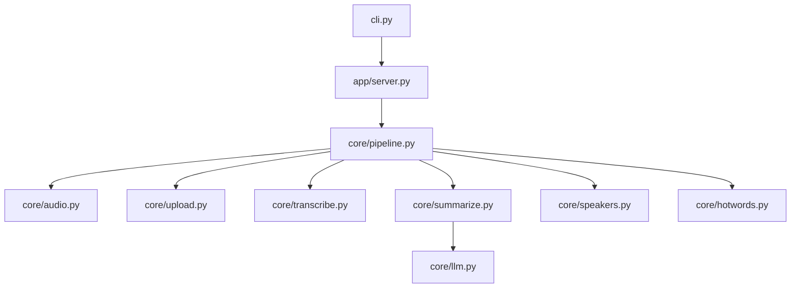
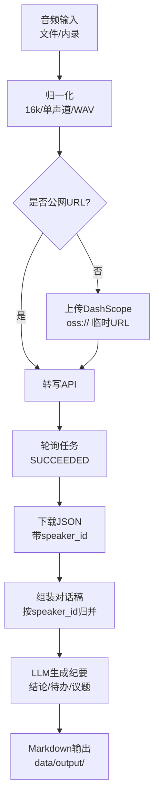
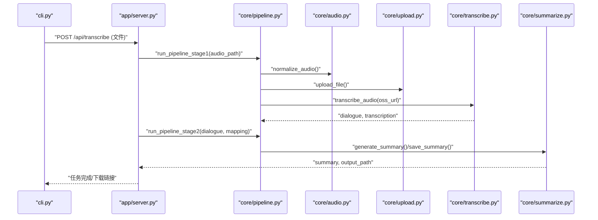
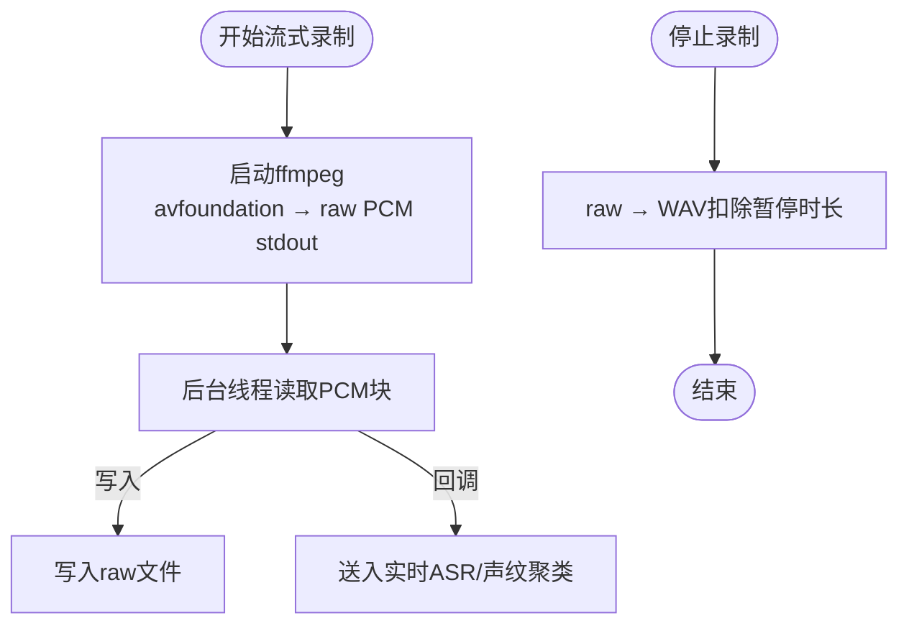
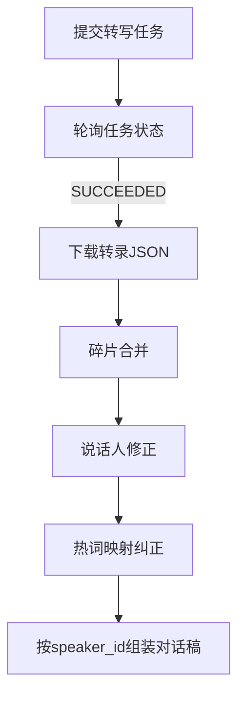
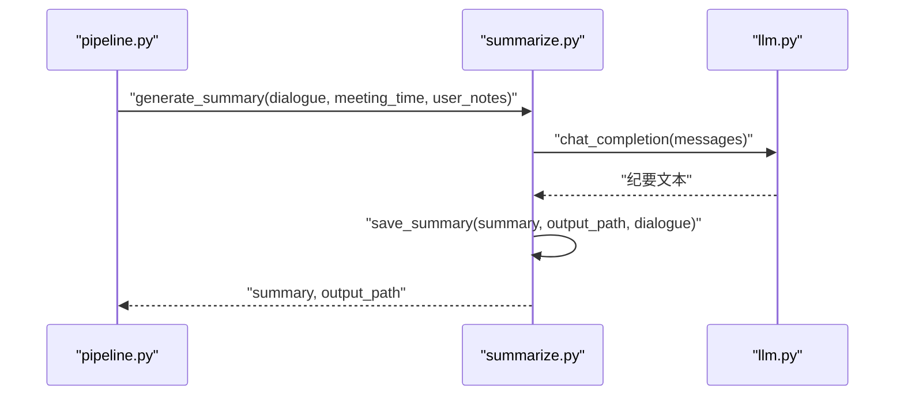
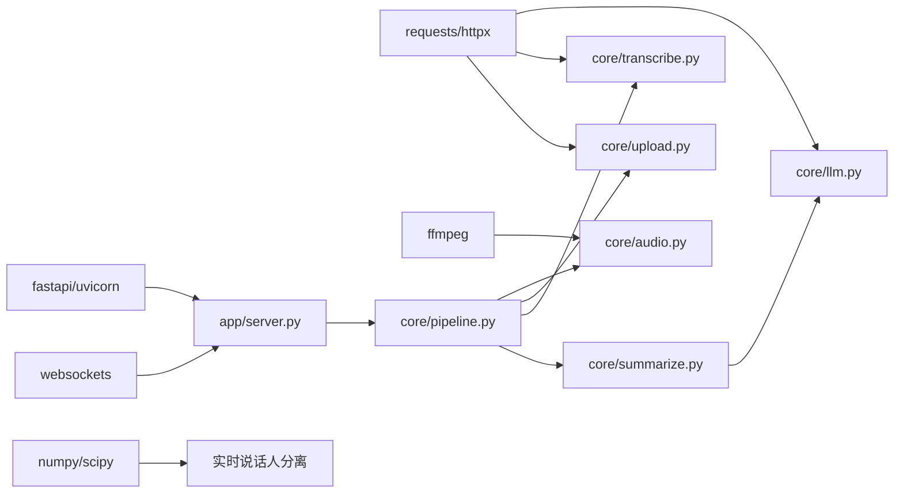

# 开发指南

<cite>
**本文引用的文件**
- [README.md](file://README.md)
- [requirements.txt](file://requirements.txt)
- [cli.py](file://cli.py)
- [app/server.py](file://app/server.py)
- [core/pipeline.py](file://core/pipeline.py)
- [core/audio.py](file://core/audio.py)
- [core/transcribe.py](file://core/transcribe.py)
- [core/upload.py](file://core/upload.py)
- [core/llm.py](file://core/llm.py)
- [core/summarize.py](file://core/summarize.py)
- [core/speakers.py](file://core/speakers.py)
- [core/hotwords.py](file://core/hotwords.py)
- [docs/ARCHITECTURE.md](file://docs/ARCHITECTURE.md)
- [AGENTS.md](file://AGENTS.md)
</cite>

## 目录
1. [简介](#简介)
2. [项目结构](#项目结构)
3. [核心组件](#核心组件)
4. [架构总览](#架构总览)
5. [详细组件分析](#详细组件分析)
6. [依赖关系分析](#依赖关系分析)
7. [性能与扩展性](#性能与扩展性)
8. [测试策略与用例编写](#测试策略与用例编写)
9. [代码审查与版本管理](#代码审查与版本管理)
10. [常见问题与排错](#常见问题与排错)
11. [结论](#结论)
12. [附录：插件与扩展开发指南](#附录插件与扩展开发指南)

## 简介
本指南面向新贡献者，帮助快速搭建开发环境、理解代码结构与模块职责、掌握调试技巧，并提供 ASR 模型、LLM 提供商与自定义处理器的扩展方法。同时给出测试策略、代码审查流程与版本管理最佳实践，以及常见问题的解决方案。

## 项目结构
- 顶层入口与文档
  - cli.py：命令行工具（转写、录音、任务管理、设置等）
  - README.md：项目概览、快速上手、协作约定
  - AGENTS.md：AI/新人开工规则与规范
  - requirements.txt：运行依赖清单
- 应用服务
  - app/server.py：FastAPI 本地 Web 服务（REST + WebSocket + 静态页面）
  - app/static/index.html：前端页面
- 核心逻辑
  - core/pipeline.py：全流程编排（两阶段管线）
  - core/audio.py：音频归一化与 macOS 系统内录（BlackHole）
  - core/upload.py：上传至 DashScope 临时存储并返回 oss:// URL
  - core/transcribe.py：提交转写任务、轮询、下载结果、组装对话稿
  - core/llm.py：通义千问 LLM Provider（同步/异步/流式）
  - core/summarize.py：纪要提示词与生成、标题生成、保存
  - core/speakers.py：说话人档案与会话映射管理
  - core/hotwords.py：热词表管理与后处理映射纠正
- 数据与文档
  - data/*：热词、说话人、会议映射等数据文件
  - docs/ARCHITECTURE.md：架构说明与数据流图
  - docs/adr/*：架构决策记录

**图示来源**
- [cli.py:1-657](file://cli.py#L1-L657)
- [app/server.py:1-800](file://app/server.py#L1-L800)
- [core/pipeline.py:1-271](file://core/pipeline.py#L1-L271)
- [core/audio.py:1-663](file://core/audio.py#L1-L663)
- [core/upload.py:1-134](file://core/upload.py#L1-L134)
- [core/transcribe.py:1-446](file://core/transcribe.py#L1-L446)
- [core/summarize.py:1-283](file://core/summarize.py#L1-L283)
- [core/llm.py:1-207](file://core/llm.py#L1-L207)
- [core/speakers.py:1-325](file://core/speakers.py#L1-L325)
- [core/hotwords.py:1-222](file://core/hotwords.py#L1-L222)

**章节来源**
- [README.md:1-39](file://README.md#L1-L39)
- [docs/ARCHITECTURE.md:1-51](file://docs/ARCHITECTURE.md#L1-L51)
- [AGENTS.md:1-41](file://AGENTS.md#L1-L41)

## 核心组件
- 命令行入口（cli.py）
  - 提供 transcribe、normalize、upload、server、record、tasks、speakers、hotwords、settings、chat 等子命令
  - 通过 HTTP 调用本地 FastAPI 服务，或直调核心管线
- Web 服务（app/server.py）
  - RESTful 接口：上传音频、任务管理、说话人管理、录制控制、实时转写 WebSocket
  - 后台任务：分阶段执行管线，持久化任务状态到磁盘
  - 实时能力：WebSocket 推送句子、摘要更新；声纹聚类与实时总结器
- 管线编排（core/pipeline.py）
  - 两阶段：Stage1 音频→对话稿；Stage2 对话稿→纪要（含标题、保存）
  - 进度回调 PipelineProgress，供 UI/CLI 展示
- 音频处理（core/audio.py）
  - ffmpeg 归一化为 16kHz/单声道/WAV
  - macOS BlackHole 系统内录（普通录制与流式 PCM 管道）
  - 暂停/恢复、时长计算、设备枚举
- 上云与转写（core/upload.py, core/transcribe.py）
  - 获取上传凭证 → POST 到 OSS → 返回 oss:// URL
  - 提交 paraformer-v2 任务（支持说话人分离、热词表、语言提示）
  - 轮询任务状态、下载 JSON、碎片合并、说话人修正、热词映射纠正、按 speaker_id 组装对话稿
- LLM 与纪要（core/llm.py, core/summarize.py）
  - 同步/异步/流式调用通义千问 OpenAI 兼容端点
  - 构造提示词生成纪要与标题，保存 Markdown 输出
- 说话人与热词（core/speakers.py, core/hotwords.py）
  - 全局说话人档案与会话映射历史，姓名化映射
  - 热词表创建与管理，文本后处理映射纠正

**章节来源**
- [cli.py:1-657](file://cli.py#L1-L657)
- [app/server.py:1-800](file://app/server.py#L1-L800)
- [core/pipeline.py:1-271](file://core/pipeline.py#L1-L271)
- [core/audio.py:1-663](file://core/audio.py#L1-L663)
- [core/upload.py:1-134](file://core/upload.py#L1-L134)
- [core/transcribe.py:1-446](file://core/transcribe.py#L1-L446)
- [core/llm.py:1-207](file://core/llm.py#L1-L207)
- [core/summarize.py:1-283](file://core/summarize.py#L1-L283)
- [core/speakers.py:1-325](file://core/speakers.py#L1-L325)
- [core/hotwords.py:1-222](file://core/hotwords.py#L1-L222)

## 架构总览
系统采用“采集 → 上云 → 转写 → 纪要”的流水线架构，Web 服务负责交互与任务调度，核心模块解耦清晰，便于扩展与替换。

**图示来源**
- [docs/ARCHITECTURE.md:18-33](file://docs/ARCHITECTURE.md#L18-L33)
- [core/pipeline.py:58-226](file://core/pipeline.py#L58-L226)
- [core/upload.py:59-115](file://core/upload.py#L59-L115)
- [core/transcribe.py:61-446](file://core/transcribe.py#L61-L446)
- [core/summarize.py:157-229](file://core/summarize.py#L157-L229)

## 详细组件分析

### 管线编排（core/pipeline.py）
- 两阶段设计
  - Stage1：音频归一化 → 上传 → 热词表 → 转写 → 组装对话稿
  - Stage2：应用说话人姓名 → 生成纪要 → 生成标题 → 保存 Markdown
- 进度回调 PipelineProgress，统一日志与 UI 展示
- 向后兼容 run_pipeline 封装两阶段

**图示来源**
- [app/server.py:343-396](file://app/server.py#L343-L396)
- [core/pipeline.py:58-226](file://core/pipeline.py#L58-L226)
- [core/upload.py:59-115](file://core/upload.py#L59-L115)
- [core/transcribe.py:405-446](file://core/transcribe.py#L405-L446)
- [core/summarize.py:157-229](file://core/summarize.py#L157-L229)

**章节来源**
- [core/pipeline.py:1-271](file://core/pipeline.py#L1-L271)

### 音频与内录（core/audio.py）
- 归一化：ffmpeg 将任意音频转为 16kHz/单声道/WAV，满足转写与说话人分离要求
- 内录：macOS BlackHole 系统内录，支持普通录制与流式 PCM 管道（用于实时 ASR）
- 暂停/恢复：保持 ffmpeg 进程运行，避免缓冲区阻塞；累计暂停时间以准确计算时长
- 设备枚举：列出 avfoundation 可用音频设备

**图示来源**
- [core/audio.py:303-396](file://core/audio.py#L303-L396)
- [core/audio.py:399-437](file://core/audio.py#L399-L437)
- [core/audio.py:440-515](file://core/audio.py#L440-L515)

**章节来源**
- [core/audio.py:1-663](file://core/audio.py#L1-L663)

### 转写与对话稿组装（core/transcribe.py）
- 提交任务：paraformer-v2，开启说话人分离，支持热词表、语言提示、说话人数提示
- 轮询与下载：等待 SUCCEEDED，下载转录 JSON
- 后处理：碎片合并、说话人修正、热词映射纠正、按 speaker_id 组装对话稿

**图示来源**
- [core/transcribe.py:61-131](file://core/transcribe.py#L61-L131)
- [core/transcribe.py:134-187](file://core/transcribe.py#L134-L187)
- [core/transcribe.py:222-352](file://core/transcribe.py#L222-L352)
- [core/transcribe.py:355-403](file://core/transcribe.py#L355-L403)
- [core/transcribe.py:405-446](file://core/transcribe.py#L405-L446)

**章节来源**
- [core/transcribe.py:1-446](file://core/transcribe.py#L1-L446)

### LLM 与纪要（core/llm.py, core/summarize.py）
- LLM Provider：同步/异步/流式调用通义千问 OpenAI 兼容端点，复用连接池
- 纪要生成：构造系统提示词与用户消息，生成结构化纪要（结论/待办/议题），附加原始对话稿
- 标题生成：根据对话内容生成简洁标题

**图示来源**
- [core/summarize.py:157-229](file://core/summarize.py#L157-L229)
- [core/llm.py:89-121](file://core/llm.py#L89-L121)
- [core/summarize.py:249-283](file://core/summarize.py#L249-L283)

**章节来源**
- [core/llm.py:1-207](file://core/llm.py#L1-L207)
- [core/summarize.py:1-283](file://core/summarize.py#L1-L283)

### 说话人与热词（core/speakers.py, core/hotwords.py）
- 说话人档案：增删改查、姓名映射、会话映射历史复用
- 热词表：从文件加载热词，创建 DashScope 热词表，返回 vocabulary_id
- 后处理映射：热词映射纠正（英文词边界匹配、中文直接替换）

**章节来源**
- [core/speakers.py:1-325](file://core/speakers.py#L1-L325)
- [core/hotwords.py:1-222](file://core/hotwords.py#L1-L222)

## 依赖关系分析
- 外部依赖
  - requests/httpx：HTTP 请求（同步/异步）
  - fastapi/uvicorn/websockets：Web 服务与实时推送
  - dashscope：实时语音识别 SDK（可选）
  - numpy/scipy：声纹特征与聚类（实时说话人分离）
  - python-docx/PyPDF2：文档文本提取（可选）
  - ffmpeg：音频处理与内录
- 内部依赖
  - app/server.py 依赖 core 各模块实现业务逻辑
  - pipeline.py 串联 audio/upload/transcribe/summarize/speakers/hotwords

**图示来源**
- [requirements.txt:1-32](file://requirements.txt#L1-L32)
- [app/server.py:1-800](file://app/server.py#L1-L800)
- [core/pipeline.py:1-271](file://core/pipeline.py#L1-L271)

**章节来源**
- [requirements.txt:1-32](file://requirements.txt#L1-L32)

## 性能与扩展性
- 性能要点
  - 使用 httpx.AsyncClient 复用连接，避免频繁建连开销
  - 后台任务执行管线，不阻塞事件循环
  - 流式 PCM 管道降低内存占用，支持实时 ASR
  - 热词表提升专有名词识别准确率
- 扩展点
  - ASR 模型：在 pipeline 配置中切换模型名（如 qwen-audio-3.0-asr-flash-streaming），并在热词目标模型保持一致
  - LLM 提供商：在 llm.py 中新增 provider 适配层，保持 chat_completion/async_chat_completion 接口一致
  - 处理器：在 pipeline 中插入自定义步骤（如降噪、去静音、翻译），通过 on_progress 反馈进度

[本节为通用指导，无需特定文件引用]

## 测试策略与用例编写
- 单元测试
  - 针对纯函数：audio.normalize_audio、transcribe.merge_fragments、hotwords.apply_hotword_mappings、speakers.apply_speaker_names
  - 断言：输入输出一致性、边界条件（空输入、超长文本、非法路径）
- 集成测试
  - 端到端：上传 → 转写 → 组装 → 纪要生成（可 mock 网络请求或使用沙箱环境）
  - 实时链路：start_recording_with_stream → pcm_callback → RealtimeTranscriber → WebSocket 推送
- 建议
  - 使用 pytest 组织用例，按模块划分目录
  - 对外部依赖（DashScope、LLM）使用 mock 或 fixture
  - 覆盖错误路径：超时、权限不足、文件不存在、设备不可用

[本节为通用指导，无需特定文件引用]

## 代码审查与版本管理
- 代码规范
  - Python 3.11+，独立 venv
  - 密钥仅从 .env 读取，禁止硬编码
  - 注释/文档/提交信息使用中文
  - 目录职责：core 放管线逻辑，app 放服务与前端，tests 放测试
- 审查流程
  - 先改文档再改代码（架构/契约变更）
  - 重大决策记录 ADR，新增一篇，不改旧文
  - 提交信息描述动机与影响范围
- 版本管理
  - 分支策略：feature/xxx、fix/xxx、release/vx.y.z
  - 变更日志：CHANGELOG.md 每次功能迭代追加一条
  - 标签与发布：语义化版本，附迁移说明

**章节来源**
- [AGENTS.md:26-41](file://AGENTS.md#L26-L41)

## 常见问题与排错
- ffmpeg 未安装或不可用
  - 现象：归一化/内录失败
  - 排查：检查 PATH 与权限，确认已安装 ffmpeg 8.x
  - 参考：[core/audio.py:26-28](file://core/audio.py#L26-L28), [core/audio.py:82-95](file://core/audio.py#L82-L95)
- 录制设备未配置或不可用
  - 现象：start_recording/start_recording_with_stream 报错
  - 排查：确认 BlackHole 2ch 已安装并设为多输出设备
  - 参考：[core/audio.py:167-171](file://core/audio.py#L167-L171), [core/audio.py:336-340](file://core/audio.py#L336-L340)
- 未设置 DASHSCOPE_API_KEY
  - 现象：上传/转写/LLM 调用失败
  - 排查：确保 .env 中存在 DASHSCOPE_API_KEY
  - 参考：[core/upload.py:25-30](file://core/upload.py#L25-L30), [core/transcribe.py:54-58](file://core/transcribe.py#L54-L58), [core/llm.py:49-53](file://core/llm.py#L49-L53)
- 任务超时或失败
  - 现象：轮询超时、任务 FAILED
  - 排查：检查网络、API Key、文件大小（≤1GB）、URL 编码
  - 参考：[core/transcribe.py:134-175](file://core/transcribe.py#L134-L175), [core/upload.py:81-83](file://core/upload.py#L81-L83)
- 说话人分离无效
  - 现象：无 speaker_id
  - 排查：确保音频为单声道，已在归一化阶段下混
  - 参考：[docs/ARCHITECTURE.md:35-39](file://docs/ARCHITECTURE.md#L35-L39), [core/audio.py:31-98](file://core/audio.py#L31-L98)

**章节来源**
- [core/audio.py:26-98](file://core/audio.py#L26-L98)
- [core/upload.py:25-83](file://core/upload.py#L25-L83)
- [core/transcribe.py:54-175](file://core/transcribe.py#L54-L175)
- [core/llm.py:49-53](file://core/llm.py#L49-L53)
- [docs/ARCHITECTURE.md:35-39](file://docs/ARCHITECTURE.md#L35-L39)

## 结论
本项目以清晰的模块化设计与两阶段管线实现了“音频 → 转写 → 纪要”的完整流程，配合 Web 服务与 CLI 提供便捷的开发与使用体验。遵循本文档的规范与实践，可高效扩展 ASR/LLM/处理器，保障质量与可维护性。

[本节为总结性内容，无需特定文件引用]

## 附录：插件与扩展开发指南

### 添加新的 ASR 模型
- 修改位置
  - pipeline 默认配置中的 asr_model
  - 热词目标模型需与 ASR 模型一致
- 步骤
  - 在 DEFAULT_CONFIG 中切换模型名（如 qwen-audio-3.0-asr-flash-streaming）
  - 若使用热词表，确保 target_model 与 ASR 模型匹配
  - 验证转写结果与说话人分离是否正常
- 参考
  - [core/pipeline.py:36-44](file://core/pipeline.py#L36-L44)
  - [core/hotwords.py:57-117](file://core/hotwords.py#L57-L117)

**章节来源**
- [core/pipeline.py:36-44](file://core/pipeline.py#L36-L44)
- [core/hotwords.py:57-117](file://core/hotwords.py#L57-L117)

### 添加新的 LLM 提供商
- 修改位置
  - core/llm.py：新增 provider 适配层，暴露 chat_completion/async_chat_completion
- 步骤
  - 定义新的客户端初始化与请求构建逻辑
  - 保持与现有接口一致的参数与返回值
  - 在 summarize 中通过 model 参数选择 provider
- 参考
  - [core/llm.py:89-160](file://core/llm.py#L89-L160)
  - [core/summarize.py:157-229](file://core/summarize.py#L157-L229)

**章节来源**
- [core/llm.py:89-160](file://core/llm.py#L89-L160)
- [core/summarize.py:157-229](file://core/summarize.py#L157-L229)

### 添加自定义处理器
- 修改位置
  - core/pipeline.py：在两阶段之间插入自定义步骤
- 步骤
  - 定义处理器函数（输入/输出明确）
  - 在 run_pipeline_stage1/stage2 中调用，并通过 on_progress 反馈进度
  - 增加单元测试覆盖异常路径
- 参考
  - [core/pipeline.py:58-226](file://core/pipeline.py#L58-L226)

**章节来源**
- [core/pipeline.py:58-226](file://core/pipeline.py#L58-L226)