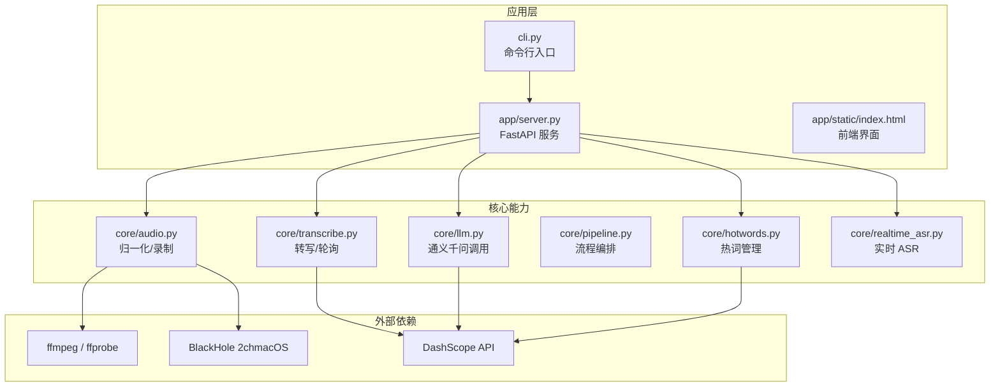
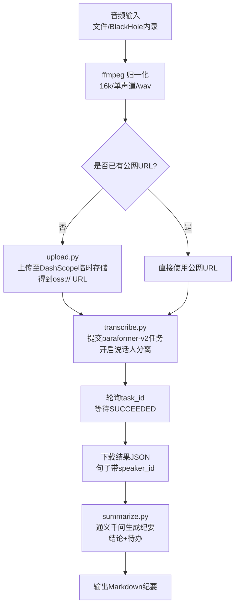
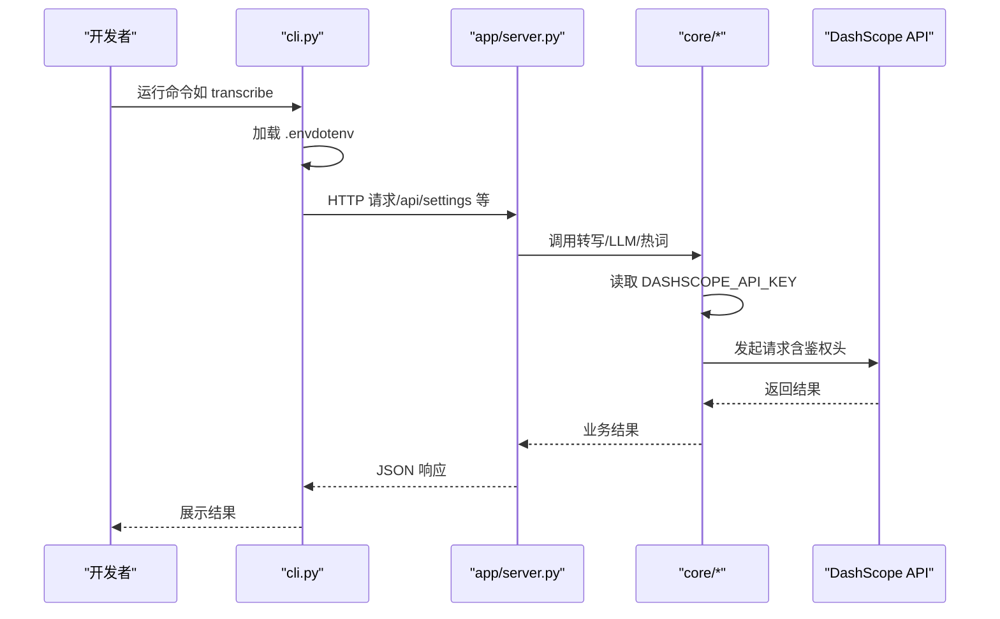
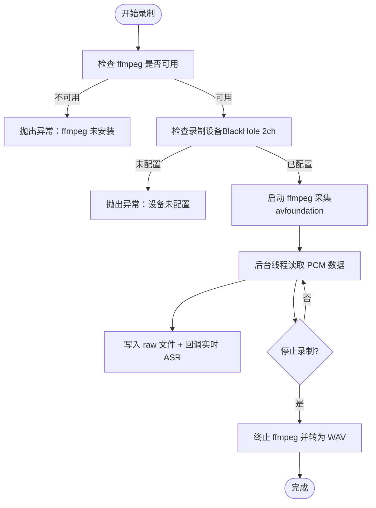
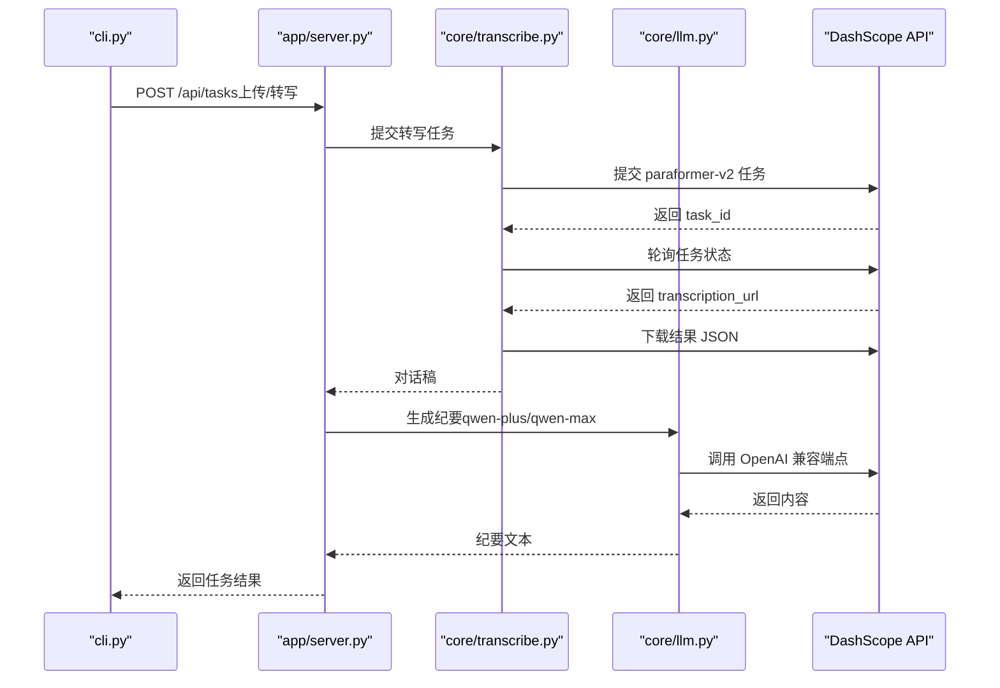
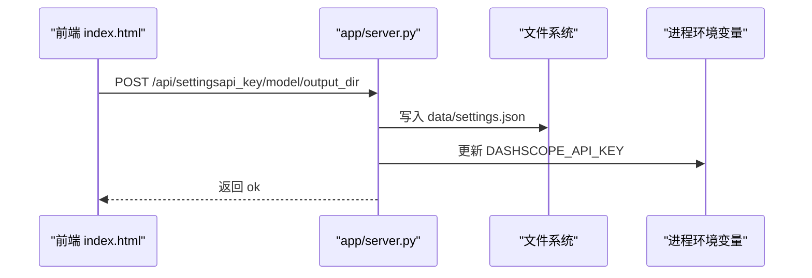
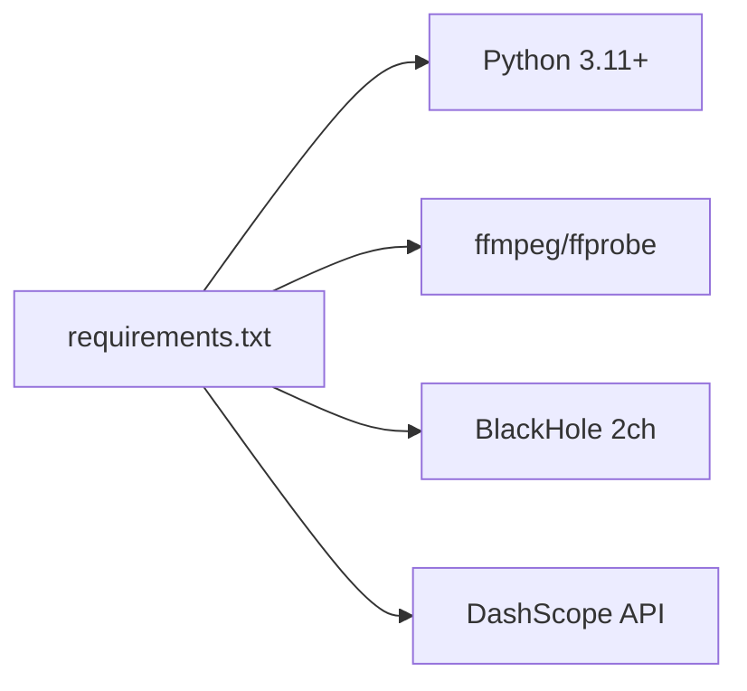

# 开发环境设置

<cite>
**本文引用的文件**
- [requirements.txt](file://requirements.txt)
- [README.md](file://README.md)
- [cli.py](file://cli.py)
- [app/server.py](file://app/server.py)
- [core/audio.py](file://core/audio.py)
- [core/transcribe.py](file://core/transcribe.py)
- [core/llm.py](file://core/llm.py)
- [core/hotwords.py](file://core/hotwords.py)
- [core/realtime_asr.py](file://core/realtime_asr.py)
- [docs/ARCHITECTURE.md](file://docs/ARCHITECTURE.md)
</cite>

## 目录
1. [简介](#简介)
2. [项目结构](#项目结构)
3. [核心组件](#核心组件)
4. [架构总览](#架构总览)
5. [详细组件分析](#详细组件分析)
6. [依赖关系分析](#依赖关系分析)
7. [性能考虑](#性能考虑)
8. [故障排查指南](#故障排查指南)
9. [结论](#结论)
10. [附录](#附录)

## 简介
本指南面向首次参与 open-meeting-scribe 的开发者，目标是帮助你在最短时间内搭建可运行的本地开发环境。内容涵盖：
- Python 3.11+ 虚拟环境与依赖安装
- IDE（VS Code、PyCharm）推荐配置（格式化、Linting、调试器）
- 环境变量配置（重点为 DashScope API 密钥）
- FFmpeg 与 BlackHole 的安装与配置（macOS 系统内录）
- 常见问题定位与解决
- 快速验证：启动 Web UI 并执行一次转写任务

## 项目结构
本项目采用分层组织：
- app：FastAPI 服务与静态前端页面
- core：音频处理、转写、说话人分离、热词、LLM 调用、管线编排等核心逻辑
- data：热词、说话人映射等数据文件
- docs：架构、产品与设计文档
- scripts：脚本（当前为空，后续可扩展）
- tests：测试（预留）
- cli.py：命令行入口，提供转写、录音控制、任务管理、设置管理等命令

图表来源
- [cli.py:1-657](file://cli.py#L1-L657)
- [app/server.py:2072-2110](file://app/server.py#L2072-L2110)
- [core/audio.py:1-663](file://core/audio.py#L1-L663)
- [core/transcribe.py:26-58](file://core/transcribe.py#L26-L58)
- [core/llm.py:1-207](file://core/llm.py#L1-L207)
- [core/hotwords.py:25-31](file://core/hotwords.py#L25-L31)
- [core/realtime_asr.py:48-49](file://core/realtime_asr.py#L48-L49)

章节来源
- [docs/ARCHITECTURE.md:1-51](file://docs/ARCHITECTURE.md#L1-L51)

## 核心组件
- 命令行工具（cli.py）：提供转写、录音控制、任务管理、设置管理、AI 对话等子命令；通过 HTTP 请求与本地 FastAPI 服务交互。
- Web 服务（app/server.py）：基于 FastAPI + Uvicorn，提供设置保存、热词映射保存等接口；保存设置时同步更新进程环境变量。
- 音频处理（core/audio.py）：使用 ffmpeg 进行音频归一化（16kHz/单声道/WAV），支持 macOS 系统内录（BlackHole + avfoundation）。
- 转写（core/transcribe.py）：调用 DashScope 录音文件识别（paraformer-v2），提交任务后轮询获取结果。
- LLM 调用（core/llm.py）：通过 OpenAI 兼容端点调用通义千问，提供同步、异步与流式三种方式。
- 热词（core/hotwords.py）：读取本地热词文件并上传至 DashScope 词汇表。
- 实时 ASR（core/realtime_asr.py）：基于 WebSocket 的实时语音识别，依赖 DashScope WebSocket 地址与 API Key。

章节来源
- [cli.py:1-657](file://cli.py#L1-L657)
- [app/server.py:2072-2110](file://app/server.py#L2072-L2110)
- [core/audio.py:1-663](file://core/audio.py#L1-L663)
- [core/transcribe.py:26-58](file://core/transcribe.py#L26-L58)
- [core/llm.py:1-207](file://core/llm.py#L1-L207)
- [core/hotwords.py:25-31](file://core/hotwords.py#L25-L31)
- [core/realtime_asr.py:48-49](file://core/realtime_asr.py#L48-L49)

## 架构总览
v1 云方案的数据流如下：
- 采集：通过 BlackHole 或文件输入，统一归一化为 16kHz/单声道/WAV
- 上云：将本地文件上传到 DashScope 临时存储，获得 oss:// URL
- 转写：提交 paraformer-v2 任务（开启说话人分离），轮询直至完成
- 纪要：使用通义千问生成结构化纪要（结论/待办）

图表来源
- [docs/ARCHITECTURE.md:18-41](file://docs/ARCHITECTURE.md#L18-L41)
- [core/transcribe.py:26-58](file://core/transcribe.py#L26-L58)
- [core/llm.py:23-24](file://core/llm.py#L23-L24)

## 详细组件分析

### 环境变量与密钥管理
- 关键变量：DASHSCOPE_API_KEY（转写与纪要共用）、可选 DASHSCOPE_WS_URL（实时 ASR）
- 加载位置：
  - 命令行入口在启动时加载 .env（dotenv）
  - 各模块在调用前从环境变量读取密钥
  - Web 服务保存设置时会同步更新进程环境变量
- 建议：
  - 在项目根目录创建 .env 文件，写入 DASHSCOPE_API_KEY
  - 不要将密钥提交到版本库（已在 .gitignore 中忽略 .env）

图表来源
- [cli.py:52-54](file://cli.py#L52-L54)
- [app/server.py:2092-2110](file://app/server.py#L2092-L2110)
- [core/transcribe.py:54-58](file://core/transcribe.py#L54-L58)
- [core/llm.py:49-53](file://core/llm.py#L49-L53)
- [core/hotwords.py:29-31](file://core/hotwords.py#L29-L31)
- [core/realtime_asr.py:48-49](file://core/realtime_asr.py#L48-L49)

章节来源
- [cli.py:52-54](file://cli.py#L52-L54)
- [app/server.py:2092-2110](file://app/server.py#L2092-L2110)
- [core/transcribe.py:54-58](file://core/transcribe.py#L54-L58)
- [core/llm.py:49-53](file://core/llm.py#L49-L53)
- [core/hotwords.py:29-31](file://core/hotwords.py#L29-L31)
- [core/realtime_asr.py:48-49](file://core/realtime_asr.py#L48-L49)

### FFmpeg 与 BlackHole（macOS 系统内录）
- FFmpeg：用于音频归一化与设备采集；需确保 ffmpeg/ffprobe 在 PATH 中可用
- BlackHole：macOS 虚拟声卡，配合 ffmpeg 的 avfoundation 采集系统音频输出
- 关键行为：
  - 归一化：强制 16kHz/单声道/WAV，满足转写与说话人分离要求
  - 录制：通过 avfoundation 从 BlackHole 设备采集，输出 WAV；支持暂停/恢复与流式 PCM 回调
  - 错误提示：未安装 ffmpeg、设备不可用、录制时间过短等均有明确异常信息

图表来源
- [core/audio.py:26-28](file://core/audio.py#L26-L28)
- [core/audio.py:139-217](file://core/audio.py#L139-L217)
- [core/audio.py:303-396](file://core/audio.py#L303-L396)
- [core/audio.py:440-515](file://core/audio.py#L440-L515)

章节来源
- [core/audio.py:26-28](file://core/audio.py#L26-L28)
- [core/audio.py:139-217](file://core/audio.py#L139-L217)
- [core/audio.py:303-396](file://core/audio.py#L303-L396)
- [core/audio.py:440-515](file://core/audio.py#L440-L515)

### 转写与 LLM 调用
- 转写：
  - 构建请求体并提交任务，轮询 task_id 直到状态为成功
  - 下载结果 JSON，按 speaker_id 组装对话稿
- LLM：
  - 同步/异步两种调用方式，避免阻塞事件循环
  - 流式模式用于逐步输出内容
  - 均依赖 DASHSCOPE_API_KEY

图表来源
- [core/transcribe.py:26-58](file://core/transcribe.py#L26-L58)
- [core/llm.py:23-24](file://core/llm.py#L23-L24)
- [core/llm.py:89-121](file://core/llm.py#L89-L121)
- [core/llm.py:129-160](file://core/llm.py#L129-L160)

章节来源
- [core/transcribe.py:26-58](file://core/transcribe.py#L26-L58)
- [core/llm.py:89-121](file://core/llm.py#L89-L121)
- [core/llm.py:129-160](file://core/llm.py#L129-L160)

### 设置与热词管理
- 设置：
  - 前端设置页可配置 API Key、模型、输出目录
  - 后端保存设置时写入 data/settings.json，并同步更新进程环境变量
- 热词：
  - 支持保存映射文件（错误识别→正确文本）
  - 热词列表与映射文件位于 data 目录

图表来源
- [app/server.py:2092-2110](file://app/server.py#L2092-L2110)
- [app/static/index.html:1362-1395](file://app/static/index.html#L1362-L1395)
- [app/static/index.html:4406-4423](file://app/static/index.html#L4406-L4423)

章节来源
- [app/server.py:2092-2110](file://app/server.py#L2092-L2110)
- [app/static/index.html:1362-1395](file://app/static/index.html#L1362-L1395)
- [app/static/index.html:4406-4423](file://app/static/index.html#L4406-L4423)

## 依赖关系分析
- Python 包依赖集中在 requirements.txt，包括 HTTP 客户端、Web 框架、实时 ASR、数值计算、文档解析等
- 外部依赖：
  - ffmpeg/ffprobe：音频处理与设备采集
  - BlackHole 2ch：macOS 系统内录
  - DashScope：转写与 LLM 服务

图表来源
- [requirements.txt:1-32](file://requirements.txt#L1-L32)
- [docs/ARCHITECTURE.md:47-50](file://docs/ARCHITECTURE.md#L47-L50)

章节来源
- [requirements.txt:1-32](file://requirements.txt#L1-L32)
- [docs/ARCHITECTURE.md:47-50](file://docs/ARCHITECTURE.md#L47-L50)

## 性能考虑
- 使用 httpx.AsyncClient 复用连接池，减少频繁建连开销
- 异步调用避免阻塞事件循环，提升并发处理能力
- 音频归一化阶段强制 16kHz/单声道，降低后续处理复杂度
- 长音频建议分段处理，避免单次任务过大导致超时或内存压力

[本节为通用指导，不直接分析具体文件]

## 故障排查指南
- 无法连接到服务：
  - 确认已启动本地服务（cli server）
  - 检查端口占用与防火墙
- 未设置 DASHSCOPE_API_KEY：
  - 在 .env 中设置，或通过前端设置页保存
  - 确认进程环境变量已更新
- ffmpeg 未安装或不可用：
  - 安装 ffmpeg 并确保 PATH 包含其路径
  - 使用 check_ffmpeg 检测可用性
- 录制失败（设备不可用）：
  - 确认 BlackHole 2ch 已安装并配置多输出设备
  - 检查系统输出是否指向多输出设备
- 转写超时或失败：
  - 检查网络连通性与 DashScope 服务状态
  - 查看轮询间隔与超时配置

章节来源
- [cli.py:68-96](file://cli.py#L68-L96)
- [core/transcribe.py:54-58](file://core/transcribe.py#L54-L58)
- [core/llm.py:49-53](file://core/llm.py#L49-L53)
- [core/audio.py:26-28](file://core/audio.py#L26-L28)
- [core/audio.py:167-171](file://core/audio.py#L167-L171)
- [core/audio.py:375-378](file://core/audio.py#L375-L378)

## 结论
按照本指南完成 Python 环境、依赖、IDE、环境变量与 FFmpeg/BlackHole 配置后，即可快速启动本地服务并进行转写与纪要生成。建议在首次运行时先执行一次最小化流程（上传/转写/生成纪要），以验证环境完整性。遇到问题时优先检查密钥、网络与外部工具可用性。

[本节为总结性内容，不直接分析具体文件]

## 附录

### 快速上手步骤
- 准备 Python 3.11+ 环境并创建虚拟环境
- 安装依赖：pip install -r requirements.txt
- 配置环境变量：复制 .env.example 为 .env，填入 DASHSCOPE_API_KEY
- 启动服务：python cli.py server
- 打开浏览器访问 http://127.0.0.1:8000，进行设置与任务操作

章节来源
- [README.md:22-28](file://README.md#L22-L28)
- [requirements.txt:1-32](file://requirements.txt#L1-L32)
- [cli.py:201-218](file://cli.py#L201-L218)

### IDE 推荐配置（VS Code、PyCharm）
- 解释器：选择项目虚拟环境中的 Python 3.11+
- 代码格式化：
  - 启用 PEP8 风格格式化（Black 或默认格式化器）
  - 保存时自动格式化
- Linting：
  - 启用 flake8/pylint，遵循项目约定
- 调试器：
  - 添加启动配置：目标为 cli.py，参数为 server 或具体命令（如 transcribe）
  - 设置断点于核心函数（如 run_pipeline、cmd_transcribe）
- 环境变量：
  - 在调试配置中加载 .env（VS Code 使用 dotenv 扩展，PyCharm 使用 .env 支持）

[本节为通用指导，不直接分析具体文件]