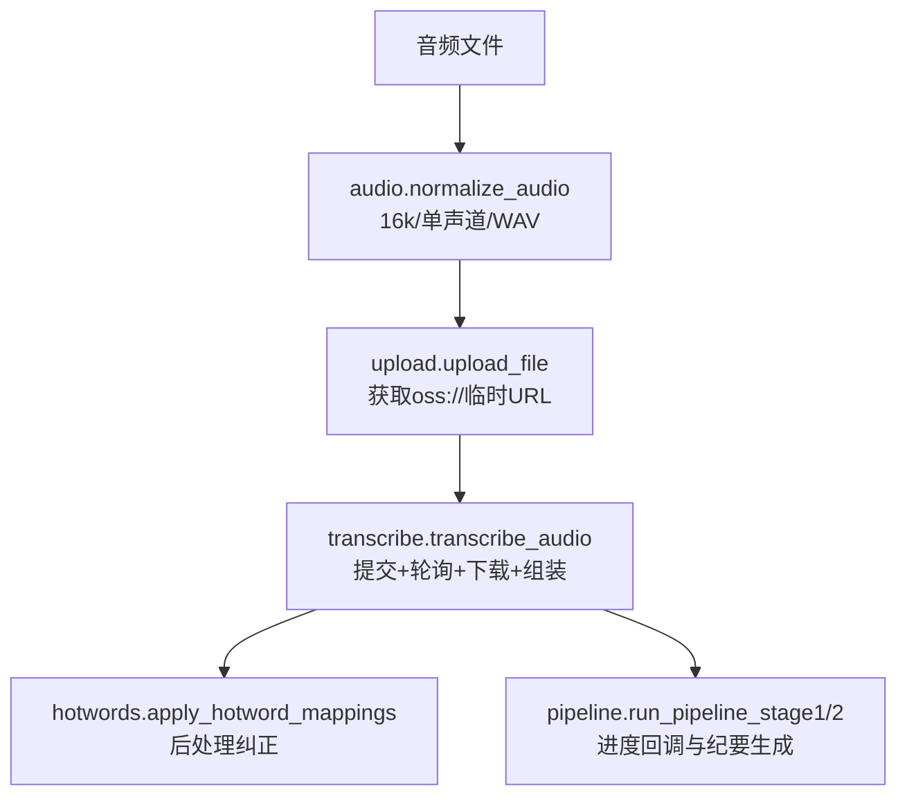
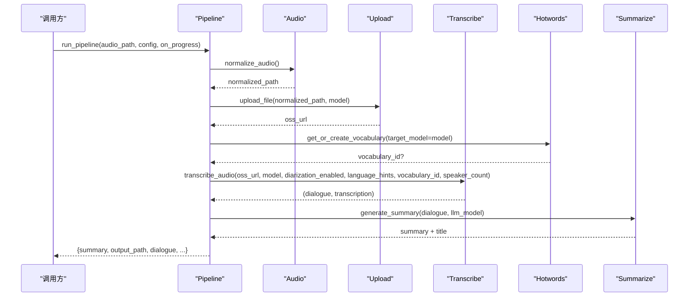
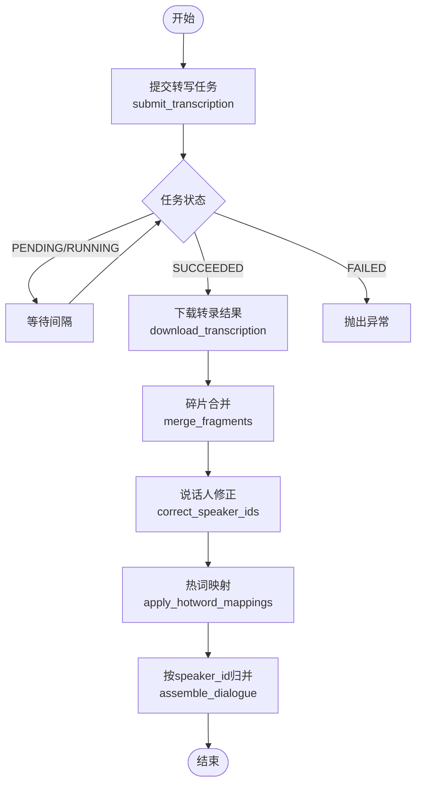
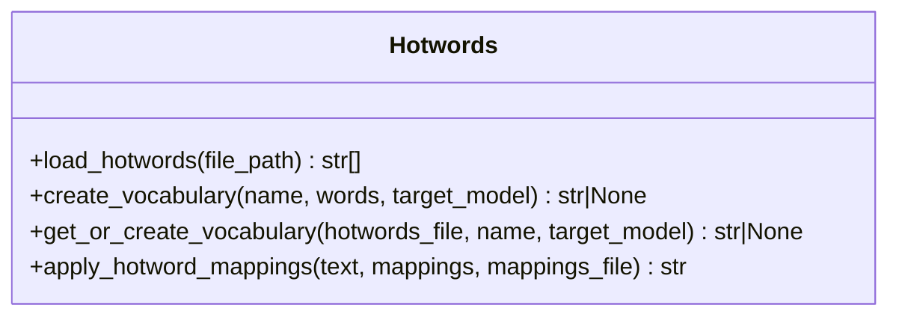
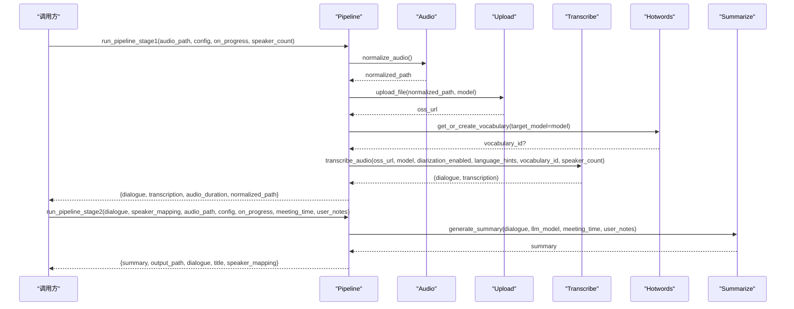
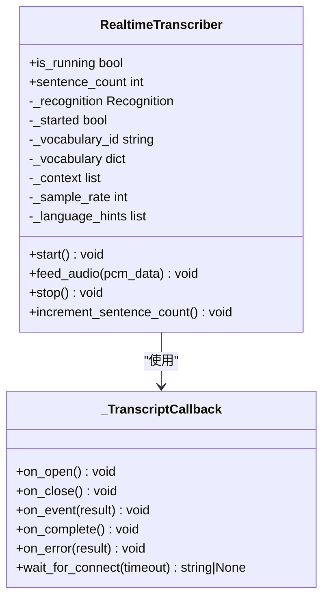
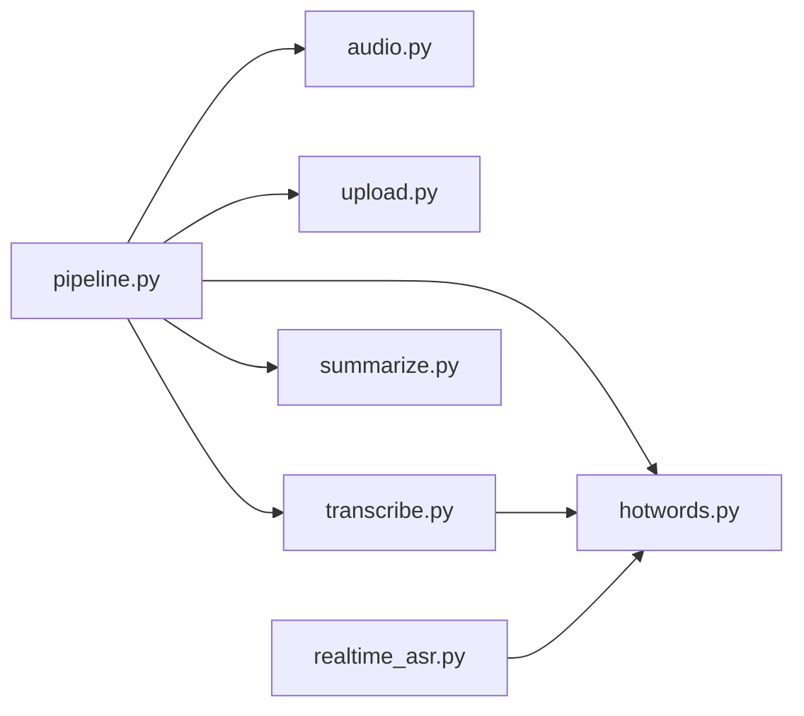

# ASR模型扩展

<cite>
**本文引用的文件**
- [core/transcribe.py](file://core/transcribe.py)
- [core/hotwords.py](file://core/hotwords.py)
- [core/pipeline.py](file://core/pipeline.py)
- [core/realtime_asr.py](file://core/realtime_asr.py)
- [core/audio.py](file://core/audio.py)
- [core/upload.py](file://core/upload.py)
- [data/hotwords.txt](file://data/hotwords.txt)
- [data/hotword_mappings.txt](file://data/hotword_mappings.txt)
- [docs/API_CONTRACTS.md](file://docs/API_CONTRACTS.md)
- [docs/ARCHITECTURE.md](file://docs/ARCHITECTURE.md)
</cite>

## 目录
1. [简介](#简介)
2. [项目结构](#项目结构)
3. [核心组件](#核心组件)
4. [架构总览](#架构总览)
5. [详细组件分析](#详细组件分析)
6. [依赖关系分析](#依赖关系分析)
7. [性能与扩展建议](#性能与扩展建议)
8. [故障排查指南](#故障排查指南)
9. [结论](#结论)
10. [附录：扩展示例与集成步骤](#附录扩展示例与集成步骤)

## 简介
本指南面向需要在 open-meeting-scribe 中扩展新的语音识别（ASR）模型适配器的开发者。文档围绕以下目标展开：
- 明确接口定义、实现要求与集成步骤，便于新增自定义 ASR 模型适配器
- 说明 transcribe_audio 的调用方式与参数规范，以及如何实现自定义模型的音频转写逻辑
- 介绍热词系统集成方法，包括词汇表管理与热词增强功能
- 提供完整的扩展示例代码路径与关键片段指引，涵盖错误处理、进度回调与结果格式化
- 说明与 pipeline 的集成方式与配置管理

## 项目结构
系统采用分层模块化设计，ASR 相关能力集中在 core 目录下，数据与文档在 data 与 docs 下：
- 采集与预处理：core/audio.py（归一化、录制）
- 上传与存储：core/upload.py（本地文件 → DashScope 临时存储 → oss:// URL）
- 批转写管线：core/transcribe.py（提交任务、轮询、下载、组装对话稿）
- 实时转写：core/realtime_asr.py（WebSocket 流式识别）
- 热词系统：core/hotwords.py（热词表创建与管理、后处理映射）
- 编排管线：core/pipeline.py（串联全流程，输出纪要，暴露进度回调）
- 外部契约与架构：docs/API_CONTRACTS.md、docs/ARCHITECTURE.md
- 热词数据：data/hotwords.txt、data/hotword_mappings.txt

图表来源
- [core/audio.py:31-98](file://core/audio.py#L31-L98)
- [core/upload.py:59-115](file://core/upload.py#L59-L115)
- [core/transcribe.py:405-446](file://core/transcribe.py#L405-L446)
- [core/hotwords.py:187-222](file://core/hotwords.py#L187-L222)
- [core/pipeline.py:58-134](file://core/pipeline.py#L58-L134)

章节来源
- [docs/ARCHITECTURE.md:5-16](file://docs/ARCHITECTURE.md#L5-L16)
- [docs/ARCHITECTURE.md:18-40](file://docs/ARCHITECTURE.md#L18-L40)

## 核心组件
- 转写入口与流程封装
  - transcribe_audio：一站式转写（提交→轮询→下载→组装），返回对话稿与原始转写结果
  - submit_transcription：提交异步转写任务，支持 diarization_enabled、language_hints、vocabulary_id、speaker_count 等参数
  - poll_task：轮询任务状态直至完成或失败
  - download_transcription：下载转写结果 JSON（有效期 24h）
  - assemble_dialogue：碎片合并、说话人修正、热词映射、按 speaker_id 归并
- 热词系统
  - load_hotwords / create_vocabulary / get_or_create_vocabulary：从文件加载热词并创建 DashScope 热词表，返回 vocabulary_id
  - apply_hotword_mappings：后处理文本替换，支持词边界匹配与中文直接替换
- 管线编排
  - run_pipeline_stage1：音频归一化→上传→热词表→转写→组装对话稿，提供 on_progress 进度回调
  - run_pipeline_stage2：姓名化→纪要生成→标题生成→保存 Markdown
  - run_pipeline：两阶段串联，向后兼容
- 实时转写
  - RealtimeTranscriber：基于 WebSocket 的流式识别，支持预编译热词表 ID 与即时热词、上下文增强、语义断句、心跳保活
  - _TranscriptCallback：SDK 回调封装，区分临时结果与定稿句子，应用热词映射

章节来源
- [core/transcribe.py:61-131](file://core/transcribe.py#L61-L131)
- [core/transcribe.py:134-187](file://core/transcribe.py#L134-L187)
- [core/transcribe.py:222-402](file://core/transcribe.py#L222-L402)
- [core/transcribe.py:405-446](file://core/transcribe.py#L405-L446)
- [core/hotwords.py:35-139](file://core/hotwords.py#L35-L139)
- [core/hotwords.py:145-222](file://core/hotwords.py#L145-L222)
- [core/pipeline.py:47-134](file://core/pipeline.py#L47-L134)
- [core/pipeline.py:137-227](file://core/pipeline.py#L137-L227)
- [core/pipeline.py:229-271](file://core/pipeline.py#L229-L271)
- [core/realtime_asr.py:57-147](file://core/realtime_asr.py#L57-L147)
- [core/realtime_asr.py:150-368](file://core/realtime_asr.py#L150-L368)

## 架构总览
系统以“采集→上云→转写→热词→纪要”为主线，通过 pipeline 编排，对外暴露统一接口与进度回调。

图表来源
- [core/pipeline.py:229-271](file://core/pipeline.py#L229-L271)
- [core/transcribe.py:405-446](file://core/transcribe.py#L405-L446)
- [core/hotwords.py:120-139](file://core/hotwords.py#L120-L139)
- [core/upload.py:59-115](file://core/upload.py#L59-L115)
- [core/audio.py:31-98](file://core/audio.py#L31-L98)

章节来源
- [docs/ARCHITECTURE.md:18-40](file://docs/ARCHITECTURE.md#L18-L40)
- [docs/API_CONTRACTS.md:12-101](file://docs/API_CONTRACTS.md#L12-L101)

## 详细组件分析

### 转写模块（transcribe.py）
- 提交任务：submit_transcription
  - 必须携带 X-DashScope-Async: enable；当使用 oss:// URL 时需加 X-DashScope-OssResourceResolve: enable
  - 支持参数：diarization_enabled、language_hints、speaker_count、vocabulary_id、disfluency_removal_enabled
- 轮询任务：poll_task
  - 超时与失败处理：TimeoutError、RuntimeError
- 下载结果：download_transcription
  - 注意 transcription_url 有效期 24h
- 后处理与组装：merge_fragments、correct_speaker_ids、assemble_dialogue
  - 碎片合并策略：跨句拆词检测、短句阈值、完整句末标点判断
  - 说话人修正：夹心修正与连续短句跟随前句说话人
  - 热词映射：apply_hotword_mappings 应用于每句文本
- 一站式接口：transcribe_audio
  - 参数：file_url、model、diarization_enabled、language_hints、vocabulary_id、speaker_count
  - 返回：(dialogue, raw_transcription)

图表来源
- [core/transcribe.py:61-131](file://core/transcribe.py#L61-L131)
- [core/transcribe.py:134-187](file://core/transcribe.py#L134-L187)
- [core/transcribe.py:222-402](file://core/transcribe.py#L222-L402)
- [core/transcribe.py:405-446](file://core/transcribe.py#L405-L446)

章节来源
- [core/transcribe.py:61-131](file://core/transcribe.py#L61-L131)
- [core/transcribe.py:134-187](file://core/transcribe.py#L134-L187)
- [core/transcribe.py:222-402](file://core/transcribe.py#L222-L402)
- [core/transcribe.py:405-446](file://core/transcribe.py#L405-L446)
- [docs/API_CONTRACTS.md:28-79](file://docs/API_CONTRACTS.md#L28-L79)

### 热词系统（hotwords.py）
- 词汇表管理
  - load_hotwords：从 data/hotwords.txt 读取热词（支持注释与空行）
  - create_vocabulary：创建 DashScope 热词表，target_model 需与实际识别模型一致
  - get_or_create_vocabulary：加载热词并创建热词表（如需要），返回 vocabulary_id
- 热词增强（后处理）
  - apply_hotword_mappings：对文本进行替换，英文词使用词边界匹配（大小写不敏感），中文直接子串替换
  - 映射文件：data/hotword_mappings.txt，支持“→”与“->”分隔符，长匹配优先

图表来源
- [core/hotwords.py:35-139](file://core/hotwords.py#L35-L139)
- [core/hotwords.py:145-222](file://core/hotwords.py#L145-L222)

章节来源
- [core/hotwords.py:35-139](file://core/hotwords.py#L35-L139)
- [core/hotwords.py:145-222](file://core/hotwords.py#L145-L222)
- [data/hotwords.txt:1-4](file://data/hotwords.txt#L1-L4)
- [data/hotword_mappings.txt:1-6](file://data/hotword_mappings.txt#L1-L6)

### 管线编排（pipeline.py）
- 默认配置：DEFAULT_CONFIG 包含 asr_model、llm_model、diarization_enabled、language_hints、sample_rate、channels、output_dir
- 进度回调：PipelineProgress 封装 stage/message/percent，on_progress 回调用于 UI 更新
- 第一阶段：run_pipeline_stage1
  - 音频归一化→上传→热词表→转写→组装对话稿
  - 支持传入 speaker_count（来自实时声纹聚类估算）辅助分离
- 第二阶段：run_pipeline_stage2
  - 姓名化→纪要生成→标题生成→保存 Markdown
- 完整管线：run_pipeline 串联两阶段，返回合并结果

图表来源
- [core/pipeline.py:58-134](file://core/pipeline.py#L58-L134)
- [core/pipeline.py:137-227](file://core/pipeline.py#L137-L227)
- [core/transcribe.py:405-446](file://core/transcribe.py#L405-L446)
- [core/hotwords.py:120-139](file://core/hotwords.py#L120-L139)

章节来源
- [core/pipeline.py:35-44](file://core/pipeline.py#L35-L44)
- [core/pipeline.py:47-134](file://core/pipeline.py#L47-L134)
- [core/pipeline.py:137-227](file://core/pipeline.py#L137-L227)
- [core/pipeline.py:229-271](file://core/pipeline.py#L229-L271)

### 实时转写（realtime_asr.py）
- RealtimeTranscriber：启动 WebSocket 连接，送入 PCM 数据，接收临时结果与定稿句子
- 支持特性：
  - 预编译热词表 ID（vocabulary_id）与即时热词（vocabulary）
  - 上下文增强（context）提升专有词汇识别率
  - 语义断句（semantic_punctuation_enabled）、心跳保活（heartbeat）
  - 自动重试应对限流（指数退避）
- 回调机制：_TranscriptCallback 封装 on_partial、on_sentence_end、on_error、on_complete

图表来源
- [core/realtime_asr.py:57-147](file://core/realtime_asr.py#L57-L147)
- [core/realtime_asr.py:150-368](file://core/realtime_asr.py#L150-L368)

章节来源
- [core/realtime_asr.py:57-147](file://core/realtime_asr.py#L57-L147)
- [core/realtime_asr.py:150-368](file://core/realtime_asr.py#L150-L368)
- [docs/API_CONTRACTS.md:114-176](file://docs/API_CONTRACTS.md#L114-L176)

## 依赖关系分析
- 模块耦合
  - pipeline 依赖 audio、upload、transcribe、hotwords、summarize、speakers
  - transcribe 依赖 hotwords（后处理映射）
  - realtime_asr 依赖 hotwords（后处理映射）
- 外部依赖
  - DashScope RESTful API（上传、转写、热词表）
  - DashScope WebSocket API（实时转写）
  - ffmpeg/ffprobe（音频归一化与时长查询）
- 约束与风险
  - 仅公网 URL（oss://）可被转写 API 消费
  - 说话人分离仅单声道有效
  - 实时转写不支持说话人分离，仅作预览

图表来源
- [core/pipeline.py:22-27](file://core/pipeline.py#L22-L27)
- [core/transcribe.py:190-190](file://core/transcribe.py#L190-L190)
- [core/realtime_asr.py:43-43](file://core/realtime_asr.py#L43-L43)

章节来源
- [docs/ARCHITECTURE.md:5-16](file://docs/ARCHITECTURE.md#L5-L16)
- [docs/API_CONTRACTS.md:6-101](file://docs/API_CONTRACTS.md#L6-L101)

## 性能与扩展建议
- 音频规格
  - 统一为 16kHz/单声道/WAV，确保说话人分离可用
  - 长会议建议分段处理，避免超时
- 热词优化
  - 预编译热词表（vocabulary_id）适合稳定术语；即时热词（vocabulary）适合动态场景
  - 权重设置：推荐起始值 4，超级热词权重 5（最多 50 个）
  - 后处理映射用于纠正识别偏差（如 ES→EAS系统）
- 实时转写
  - 每包音频建议 ~100ms（6400 bytes @16kHz/16bit/mono）
  - 开启语义断句与心跳保活，提升稳定性
  - 上下文增强（context）提升领域术语识别率
- 错误处理与重试
  - 轮询任务时处理超时与失败
  - 实时转写对限流进行指数退避重试

[本节为通用指导，无需特定文件引用]

## 故障排查指南
- 未设置 API Key
  - 现象：RuntimeError("未设置 DASHSCOPE_API_KEY")
  - 解决：在 .env 或环境变量中设置 DASHSCOPE_API_KEY
- 上传失败或文件过大
  - 现象：HTTP 错误或文件大小超过 1GB
  - 解决：检查文件大小与网络，必要时分段上传
- 转写结果为空或未获取到 transcription_url
  - 现象：RuntimeError("转写结果为空"/"未获取到 transcription_url")
  - 解决：检查任务状态与结果字段，确认 diarization_enabled 与语言提示
- 热词表不可用或创建失败
  - 现象：404 或异常
  - 解决：检查 target_model 是否与实际模型一致，或跳过热词功能
- 实时转写连接失败或限流
  - 现象：on_error 回调或启动异常
  - 解决：检查 WebSocket 地址与 API Key，启用自动重试

章节来源
- [core/transcribe.py:54-58](file://core/transcribe.py#L54-L58)
- [core/transcribe.py:134-173](file://core/transcribe.py#L134-L173)
- [core/transcribe.py:434-443](file://core/transcribe.py#L434-L443)
- [core/hotwords.py:28-32](file://core/hotwords.py#L28-L32)
- [core/hotwords.py:101-117](file://core/hotwords.py#L101-L117)
- [core/realtime_asr.py:226-327](file://core/realtime_asr.py#L226-L327)

## 结论
open-meeting-scribe 提供了清晰的 ASR 扩展点与完善的管线编排。通过 transcribe_audio 与 pipeline，开发者可以便捷地接入新的语音识别模型，并利用热词系统与后处理提升识别质量。实时转写模块为录音预览提供了低延迟能力，而批转写则保证最终纪要的高准确率与说话人分离。遵循 API 契约与架构约束，可实现稳定可扩展的语音转写服务。

[本节为总结性内容，无需特定文件引用]

## 附录：扩展示例与集成步骤

### 新增自定义 ASR 模型适配器的步骤
- 定义适配器接口
  - 参考现有 transcribe.py 中的 submit_transcription、poll_task、download_transcription、assemble_dialogue
  - 新增函数：custom_submit、custom_poll、custom_download、custom_assemble（保持输入输出结构与现有一致）
- 实现转写逻辑
  - 提交任务：构造请求体，包含 model、input.file_urls、parameters（diarization_enabled、language_hints、vocabulary_id、speaker_count 等）
  - 轮询任务：按 task_status 循环，直到 SUCCEEDED 或 FAILED
  - 下载结果：获取 transcription_url 并解析 JSON
  - 组装对话稿：执行 merge_fragments、correct_speaker_ids、apply_hotword_mappings、按 speaker_id 归并
- 集成到 pipeline
  - 在 run_pipeline_stage1 中替换 transcribe_audio 调用为 custom_transcribe_audio
  - 保持 on_progress 进度回调，传递 stage/message/percent
- 配置管理
  - 在 DEFAULT_CONFIG 中添加新模型名（如 new-asr-model）
  - 支持通过 config 覆盖默认参数（asr_model、diarization_enabled、language_hints 等）

章节来源
- [core/transcribe.py:61-131](file://core/transcribe.py#L61-L131)
- [core/transcribe.py:134-187](file://core/transcribe.py#L134-L187)
- [core/transcribe.py:222-402](file://core/transcribe.py#L222-L402)
- [core/transcribe.py:405-446](file://core/transcribe.py#L405-L446)
- [core/pipeline.py:35-44](file://core/pipeline.py#L35-L44)
- [core/pipeline.py:58-134](file://core/pipeline.py#L58-L134)

### transcribe_audio 调用方式与参数规范
- 参数
  - file_url：音频 URL（oss:// 或公网 URL）
  - model：模型名（如 paraformer-v2）
  - diarization_enabled：是否开启说话人分离（仅单声道生效）
  - language_hints：语言提示（如 ["zh", "en"]）
  - vocabulary_id：热词表 ID（可选）
  - speaker_count：说话人数量提示（2-100，可选）
- 返回值
  - (dialogue, raw_transcription)
  - dialogue：按 speaker_id 归并后的对话稿列表
  - raw_transcription：原始转写结果 JSON

章节来源
- [core/transcribe.py:405-446](file://core/transcribe.py#L405-L446)
- [docs/API_CONTRACTS.md:28-79](file://docs/API_CONTRACTS.md#L28-L79)

### 热词系统集成方法
- 词汇表管理
  - 编辑 data/hotwords.txt 添加热词（一行一个，支持注释）
  - 调用 get_or_create_vocabulary 创建热词表，返回 vocabulary_id
  - 将 vocabulary_id 传入 transcribe_audio 或 RealtimeTranscriber
- 热词增强（后处理）
  - 编辑 data/hotword_mappings.txt 添加映射规则（错误识别→正确文本）
  - 在 assemble_dialogue 或实时回调中调用 apply_hotword_mappings 进行文本替换

章节来源
- [core/hotwords.py:35-139](file://core/hotwords.py#L35-L139)
- [core/hotwords.py:145-222](file://core/hotwords.py#L145-L222)
- [data/hotwords.txt:1-4](file://data/hotwords.txt#L1-L4)
- [data/hotword_mappings.txt:1-6](file://data/hotword_mappings.txt#L1-L6)

### 完整扩展示例代码路径与关键点
- 错误处理
  - 轮询超时与失败：PollTask 抛出 TimeoutError/RuntimeError
  - 上传失败：Upload 抛出 FileNotFoundError/RuntimeError
  - 实时转写限流：RealtimeTranscriber 自动重试并回调错误信息
- 进度回调
  - PipelineProgress 封装 stage/message/percent
  - on_progress 回调用于 UI 更新，贯穿音频归一化、上传、热词、转写、纪要生成
- 结果格式化
  - assemble_dialogue 返回按 speaker_id 归并的对话稿
  - 实时转写回调区分临时结果与定稿句子，应用热词映射

章节来源
- [core/transcribe.py:134-173](file://core/transcribe.py#L134-L173)
- [core/upload.py:59-115](file://core/upload.py#L59-L115)
- [core/realtime_asr.py:226-327](file://core/realtime_asr.py#L226-L327)
- [core/pipeline.py:47-134](file://core/pipeline.py#L47-L134)
- [core/transcribe.py:355-402](file://core/transcribe.py#L355-L402)

### 与 pipeline 的集成方式与配置管理
- 集成方式
  - 在 run_pipeline_stage1 中调用 transcribe_audio，传入 oss_url、model、diarization_enabled、language_hints、vocabulary_id、speaker_count
  - 在 run_pipeline_stage2 中应用姓名化、生成纪要与标题、保存 Markdown
- 配置管理
  - DEFAULT_CONFIG 提供默认参数，可通过 config 覆盖
  - 支持动态切换 asr_model、llm_model、diarization_enabled、language_hints、sample_rate、channels、output_dir

章节来源
- [core/pipeline.py:35-44](file://core/pipeline.py#L35-L44)
- [core/pipeline.py:58-134](file://core/pipeline.py#L58-L134)
- [core/pipeline.py:137-227](file://core/pipeline.py#L137-L227)
- [core/pipeline.py:229-271](file://core/pipeline.py#L229-L271)