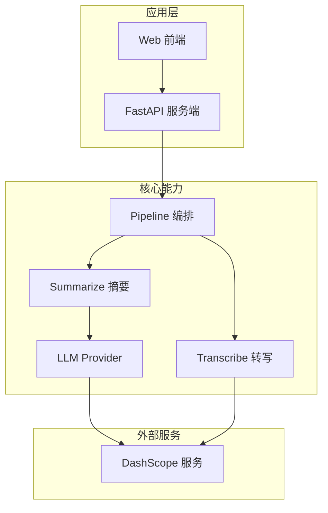
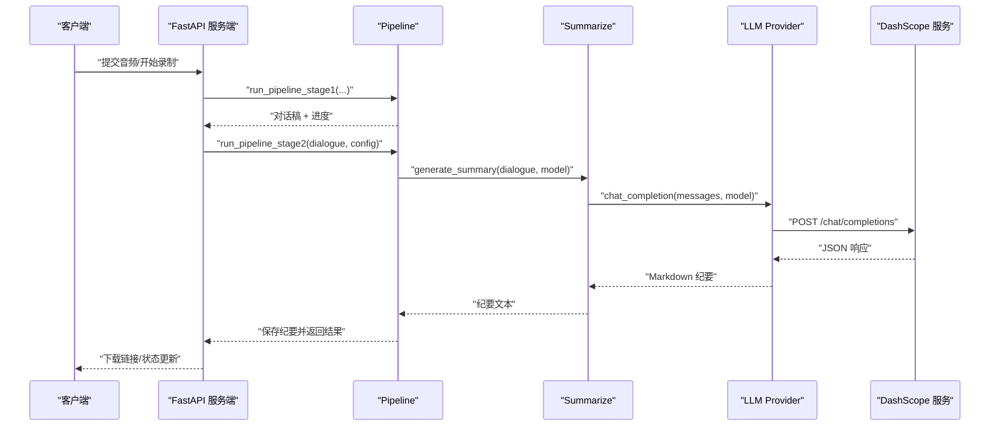
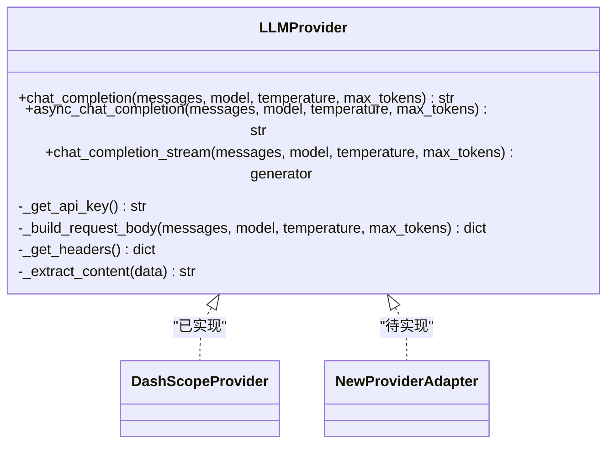
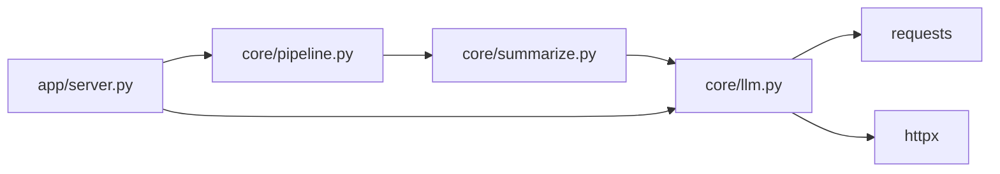

# LLM提供商扩展

<cite>
**本文引用的文件**
- [core/llm.py](file://core/llm.py)
- [core/summarize.py](file://core/summarize.py)
- [core/pipeline.py](file://core/pipeline.py)
- [app/server.py](file://app/server.py)
- [core/transcribe.py](file://core/transcribe.py)
- [requirements.txt](file://requirements.txt)
- [docs/ARCHITECTURE.md](file://docs/ARCHITECTURE.md)
- [README.md](file://README.md)
</cite>

## 目录
1. [简介](#简介)
2. [项目结构](#项目结构)
3. [核心组件](#核心组件)
4. [架构总览](#架构总览)
5. [详细组件分析](#详细组件分析)
6. [依赖关系分析](#依赖关系分析)
7. [性能与可靠性](#性能与可靠性)
8. [故障排查指南](#故障排查指南)
9. [结论](#结论)
10. [附录：扩展示例与最佳实践](#附录扩展示例与最佳实践)

## 简介
本指南面向希望在 open-meeting-scribe 中接入新的大语言模型（LLM）提供商的开发者。文档基于现有代码实现，说明如何扩展 LLM 提供商、统一认证方式、适配 API 调用格式与响应处理；解释 summarize 模块的调用接口与自定义摘要生成逻辑；提供提示词工程最佳实践（结构化输出、错误处理）；给出包含重试、超时与日志记录的扩展示例思路；并说明与 pipeline 的集成方式和配置管理（含模型选择策略）。

## 项目结构
- core/llm.py：当前实现通义千问（DashScope OpenAI 兼容端点）的同步、异步与流式调用封装，负责鉴权、请求体构建、响应解析与异常处理。
- core/summarize.py：纪要提示词构造、标题生成、纪要生成与保存；通过调用 llm.chat_completion 完成 LLM 调用。
- core/pipeline.py：编排“音频→转写→说话人姓名化→纪要”全流程；默认使用 qwen-plus 作为 LLM 模型名，支持配置覆盖。
- app/server.py：FastAPI Web 服务，集成实时转写、实时总结、任务管理与后台管线执行；在对话等场景中使用 async_chat_completion。
- core/transcribe.py：ASR 转写流程（非 LLM），但体现统一的鉴权、轮询、重试与错误处理模式，可作为 LLM 扩展参考。
- requirements.txt：HTTP 客户端（requests、httpx）、dotenv、fastapi 等依赖。
- docs/ARCHITECTURE.md：系统分层与数据流说明，明确“一个厂商一套 key”的设计约束。
- README.md：快速上手与环境变量说明（DASHSCOPE_API_KEY）。

图表来源
- [docs/ARCHITECTURE.md:18-33](file://docs/ARCHITECTURE.md#L18-L33)
- [core/pipeline.py:1-12](file://core/pipeline.py#L1-L12)
- [core/summarize.py:1-11](file://core/summarize.py#L1-L11)
- [core/llm.py:1-13](file://core/llm.py#L1-L13)

章节来源
- [docs/ARCHITECTURE.md:1-51](file://docs/ARCHITECTURE.md#L1-L51)
- [core/pipeline.py:1-45](file://core/pipeline.py#L1-L45)
- [core/summarize.py:1-16](file://core/summarize.py#L1-L16)
- [core/llm.py:1-27](file://core/llm.py#L1-L27)
- [requirements.txt:1-32](file://requirements.txt#L1-L32)
- [README.md:22-28](file://README.md#L22-L28)

## 核心组件
- LLM Provider（core/llm.py）
  - 同步调用 chat_completion：供后台线程与管线使用。
  - 异步调用 async_chat_completion：供 FastAPI 异步端点使用，避免阻塞事件循环。
  - 流式调用 chat_completion_stream：逐块返回内容，适合 CLI 或后台线程。
  - 统一鉴权：从环境变量读取 DASHSCOPE_API_KEY，构造 Authorization 头。
  - 统一请求体：model、messages、temperature、max_tokens。
  - 统一响应解析：提取 choices[0].message.content。
  - 超时与异常：捕获超时与通用异常，抛出 RuntimeError。
- Summarize（core/summarize.py）
  - generate_title：根据对话生成会议标题。
  - generate_summary：构造系统提示词与用户消息，调用 LLM 生成 Markdown 纪要，并进行后处理兜底。
  - save_summary：将纪要保存到 data/output。
- Pipeline（core/pipeline.py）
  - run_pipeline_stage1：音频归一化→上传→热词→转写→组装对话稿。
  - run_pipeline_stage2：说话人姓名化→生成纪要→生成标题→保存。
  - 默认配置 DEFAULT_CONFIG：asr_model、llm_model（qwen-plus）、diarization_enabled、language_hints、sample_rate、channels、output_dir。
- Server（app/server.py）
  - 后台任务执行管线阶段，持久化任务状态。
  - 实时总结与对话场景中调用 async_chat_completion。
  - 任务状态、进度回调、错误记录。

章节来源
- [core/llm.py:49-82](file://core/llm.py#L49-L82)
- [core/llm.py:89-122](file://core/llm.py#L89-L122)
- [core/llm.py:129-160](file://core/llm.py#L129-L160)
- [core/llm.py:168-207](file://core/llm.py#L168-L207)
- [core/summarize.py:19-84](file://core/summarize.py#L19-L84)
- [core/summarize.py:87-229](file://core/summarize.py#L87-L229)
- [core/pipeline.py:35-44](file://core/pipeline.py#L35-L44)
- [core/pipeline.py:137-226](file://core/pipeline.py#L137-L226)
- [app/server.py:226-332](file://app/server.py#L226-L332)
- [app/server.py:1696-1727](file://app/server.py#L1696-L1727)

## 架构总览
系统采用“采集→上云→转写→摘要→输出”的分层流水线。LLM 提供商抽象位于 core/llm.py，由 summarize 模块消费；pipeline 负责编排各阶段，并通过配置注入模型名。server 层在异步上下文中使用 async_chat_completion，保证高并发不阻塞。

图表来源
- [core/pipeline.py:137-226](file://core/pipeline.py#L137-L226)
- [core/summarize.py:157-229](file://core/summarize.py#L157-L229)
- [core/llm.py:89-122](file://core/llm.py#L89-L122)
- [core/llm.py:129-160](file://core/llm.py#L129-L160)

## 详细组件分析

### LLM Provider 扩展设计
目标：在不破坏现有调用方的前提下，接入新的 LLM 提供商（如其他 OpenAI 兼容端点或自有服务）。

建议方案
- 新增 provider 适配器：实现统一的函数签名 chat_completion、async_chat_completion、chat_completion_stream，保持与 core/llm.py 一致。
- 统一鉴权：从环境变量读取对应密钥（例如 NEW_LLM_API_KEY），构造 Authorization 头。
- 统一请求体：按目标 API 规范映射 model、messages、temperature、max_tokens。
- 统一响应解析：提取生成内容字段（通常为 choices[0].message.content 或等价结构）。
- 统一超时与异常：捕获网络/超时/业务异常，抛出 RuntimeError，便于上层统一处理。
- 复用连接池：异步版本使用 httpx.AsyncClient，设置合理的 timeout 与 limits。

图表来源
- [core/llm.py:49-82](file://core/llm.py#L49-L82)
- [core/llm.py:89-122](file://core/llm.py#L89-L122)
- [core/llm.py:129-160](file://core/llm.py#L129-L160)
- [core/llm.py:168-207](file://core/llm.py#L168-L207)

章节来源
- [core/llm.py:1-207](file://core/llm.py#L1-L207)

### Summarize 模块调用接口与自定义摘要逻辑
- generate_title(dialogue, model)：输入对话稿，输出简洁标题；内部构造 system/user 消息并调用 LLM。
- generate_summary(dialogue, model, meeting_time, user_notes)：构造系统提示词与用户消息，调用 LLM 生成 Markdown 纪要；对“未提供”等边界进行后处理替换。
- save_summary(summary, output_path, dialogue)：保存纪要到 data/output，可选择附加原始对话稿。

自定义摘要生成逻辑建议
- 在 generate_summary 中扩展 messages 构造，注入领域知识或模板（如企业术语表、会议议程）。
- 增加结构化输出校验：若 LLM 未按模板输出，可二次调用或回退到默认模板。
- 引入重试机制：对超时或限流错误进行指数退避重试，记录日志。
- 增加日志埋点：记录输入长度、模型名、耗时、输出长度，便于监控与调优。

章节来源
- [core/summarize.py:19-84](file://core/summarize.py#L19-L84)
- [core/summarize.py:87-229](file://core/summarize.py#L87-L229)
- [core/summarize.py:249-283](file://core/summarize.py#L249-L283)

### Pipeline 集成与配置管理（模型选择策略）
- 默认模型：DEFAULT_CONFIG.llm_model = "qwen-plus"。
- 覆盖策略：run_pipeline_stage2 接收 config 参数，合并覆盖默认配置。
- 调用链路：pipeline 调用 summarize.generate_summary(model=cfg["llm_model"])。
- 服务器侧：后台任务在执行第二阶段时传递 meeting_time 与 user_notes，增强上下文。

模型选择策略建议
- 环境级切换：通过环境变量或配置文件指定不同模型（如 qwen-max、第三方兼容模型）。
- 任务级切换：在 API 请求中传入 model 参数，覆盖默认值。
- 降级策略：主模型失败时自动切换到备用模型，并记录告警。

章节来源
- [core/pipeline.py:35-44](file://core/pipeline.py#L35-L44)
- [core/pipeline.py:137-226](file://core/pipeline.py#L137-L226)
- [app/server.py:271-332](file://app/server.py#L271-L332)

### 认证方式与 API 调用格式
- 认证：统一从环境变量读取 DASHSCOPE_API_KEY，构造 Authorization: Bearer <key>。
- 调用格式：OpenAI 兼容端点 POST /compatible-mode/v1/chat/completions，请求体包含 model、messages、temperature、max_tokens。
- 响应格式：choices[0].message.content 为生成内容。
- 流式：stream=true，逐行解析 data: JSON，遇到 [DONE] 结束。

章节来源
- [core/llm.py:49-82](file://core/llm.py#L49-L82)
- [core/llm.py:89-122](file://core/llm.py#L89-L122)
- [core/llm.py:129-160](file://core/llm.py#L129-L160)
- [core/llm.py:168-207](file://core/llm.py#L168-L207)

### 错误处理与重试机制
- 当前实现：捕获超时与通用异常，抛出 RuntimeError；异步版本同样处理超时与异常。
- 建议扩展：
  - 重试：对 429/5xx 等临时错误进行指数退避重试，限制最大次数。
  - 超时：区分连接超时与读取超时，合理设置 httpx.Timeout。
  - 日志：记录请求参数（脱敏）、响应状态码、错误堆栈。
  - 降级：当 LLM 不可用时，返回缓存或默认摘要，并通知用户。

参考模式（来自 transcribe 的轮询与重试）
- 轮询任务状态直到 SUCCEEDED，超时抛 TimeoutError。
- 限流时延迟重试，清理实例后继续。

章节来源
- [core/llm.py:106-122](file://core/llm.py#L106-L122)
- [core/llm.py:146-160](file://core/llm.py#L146-L160)
- [core/transcribe.py:134-176](file://core/transcribe.py#L134-L176)
- [core/transcribe.py:296-327](file://core/transcribe.py#L296-L327)

## 依赖关系分析
- HTTP 客户端：requests（同步）、httpx（异步）。
- 环境变量：python-dotenv。
- Web 框架：fastapi、uvicorn。
- 实时转写：dashscope SDK（WebSocket 流式）。
- 声纹聚类：numpy、scipy。
- 文档处理：python-docx、PyPDF2。

图表来源
- [requirements.txt:1-32](file://requirements.txt#L1-L32)
- [core/llm.py:15-21](file://core/llm.py#L15-L21)
- [core/summarize.py:13-16](file://core/summarize.py#L13-L16)
- [core/pipeline.py:14-27](file://core/pipeline.py#L14-L27)
- [app/server.py:23-57](file://app/server.py#L23-L57)

章节来源
- [requirements.txt:1-32](file://requirements.txt#L1-L32)

## 性能与可靠性
- 连接池复用：异步客户端使用 httpx.AsyncClient，设置 max_connections 与 keepalive，减少握手开销。
- 超时配置：同步 requests 超时 120s；异步 httpx 设置 connect 与 read 超时，避免长时间阻塞。
- 流式输出：chat_completion_stream 逐块返回，降低首字延迟，提升用户体验。
- 日志记录：关键路径记录模型名、消息数量、输出长度、耗时，便于性能分析与问题定位。
- 降级与容错：LLM 不可用或超时，返回兜底内容并记录错误；必要时切换备用模型。

章节来源
- [core/llm.py:30-38](file://core/llm.py#L30-L38)
- [core/llm.py:106-122](file://core/llm.py#L106-L122)
- [core/llm.py:146-160](file://core/llm.py#L146-L160)
- [core/llm.py:184-207](file://core/llm.py#L184-L207)

## 故障排查指南
- 未设置 API Key：检查环境变量 DASHSCOPE_API_KEY 是否配置正确。
- 调用超时：检查网络连通性与 DashScope 服务状态；适当调整超时时间。
- 响应解析失败：确认目标 API 返回结构与 choices[0].message.content 一致；必要时适配解析逻辑。
- 限流与重试：参考 transcribe 的重试策略，增加指数退避与最大重试次数。
- 日志与调试：开启详细日志，记录请求参数（脱敏）、响应状态码、错误堆栈。

章节来源
- [core/llm.py:49-53](file://core/llm.py#L49-L53)
- [core/llm.py:106-122](file://core/llm.py#L106-L122)
- [core/llm.py:146-160](file://core/llm.py#L146-L160)
- [core/transcribe.py:296-327](file://core/transcribe.py#L296-L327)

## 结论
本项目已提供稳定的 LLM Provider 抽象与 Summarize 模块，便于接入新的 LLM 服务。通过统一鉴权、请求体与响应解析，结合 pipeline 的配置覆盖机制，可实现灵活的模型选择与降级策略。建议在扩展时遵循现有模式，完善重试、超时与日志记录，确保系统的可靠性与可维护性。

## 附录：扩展示例与最佳实践

### 接入新 LLM 提供商的步骤
- 新建适配器：实现 chat_completion、async_chat_completion、chat_completion_stream，保持与 core/llm.py 一致的函数签名。
- 鉴权与请求体：从环境变量读取新密钥，构造 Authorization 头；按目标 API 规范映射 model、messages、temperature、max_tokens。
- 响应解析：提取生成内容字段，兼容不同返回结构。
- 超时与异常：捕获网络与业务异常，抛出 RuntimeError；异步版本使用 httpx 并设置合理超时。
- 集成测试：通过 summarize.generate_summary 验证端到端流程；检查日志与输出格式。

章节来源
- [core/llm.py:49-82](file://core/llm.py#L49-L82)
- [core/llm.py:89-122](file://core/llm.py#L89-L122)
- [core/llm.py:129-160](file://core/llm.py#L129-L160)
- [core/llm.py:168-207](file://core/llm.py#L168-L207)

### 提示词工程最佳实践
- 结构化输出：在系统提示词中明确输出格式（如 Markdown 模板），并要求严格按模板输出。
- 内容约束：禁止编造未提及信息；内容不足时如实说明；识别语音识别错误并标注。
- 语言风格：简洁专业，去除口语化表达；保留关键数据、人名、项目名。
- 后处理兜底：对“未提供”等边界值进行替换，确保输出完整性。

章节来源
- [core/summarize.py:87-154](file://core/summarize.py#L87-L154)
- [core/summarize.py:221-229](file://core/summarize.py#L221-L229)

### 重试、超时与日志记录示例思路
- 重试：对 429/5xx 等临时错误进行指数退避重试，限制最大次数；每次重试前清理资源并记录日志。
- 超时：区分连接超时与读取超时；同步与异步分别设置合理超时。
- 日志：记录请求参数（脱敏）、响应状态码、错误堆栈、耗时；在关键路径埋点。

章节来源
- [core/transcribe.py:134-176](file://core/transcribe.py#L134-L176)
- [core/transcribe.py:296-327](file://core/transcribe.py#L296-L327)
- [core/llm.py:106-122](file://core/llm.py#L106-L122)
- [core/llm.py:146-160](file://core/llm.py#L146-L160)

### 与 Pipeline 的集成与配置管理
- 默认模型：DEFAULT_CONFIG.llm_model = "qwen-plus"。
- 覆盖策略：在 run_pipeline_stage2 中通过 config 参数覆盖默认模型。
- 服务器侧：后台任务在执行第二阶段时传递 meeting_time 与 user_notes，增强上下文。
- 模型选择策略：支持环境级、任务级切换；失败时自动降级到备用模型。

章节来源
- [core/pipeline.py:35-44](file://core/pipeline.py#L35-L44)
- [core/pipeline.py:137-226](file://core/pipeline.py#L137-L226)
- [app/server.py:271-332](file://app/server.py#L271-L332)