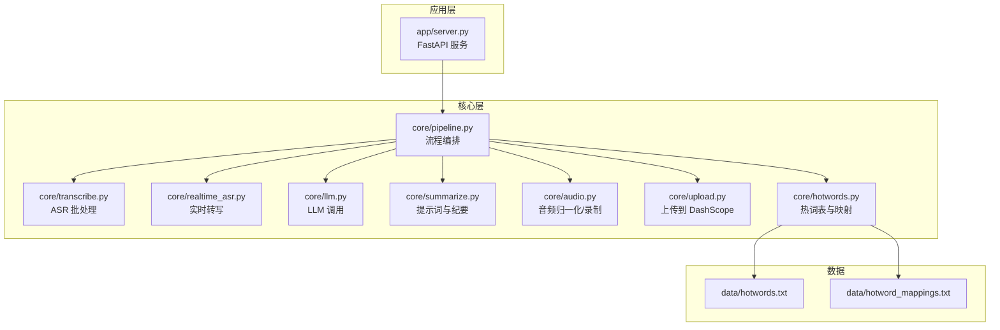
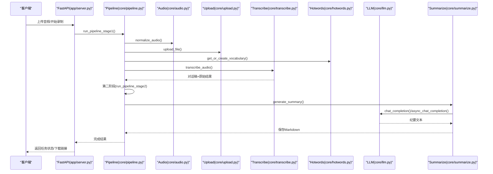
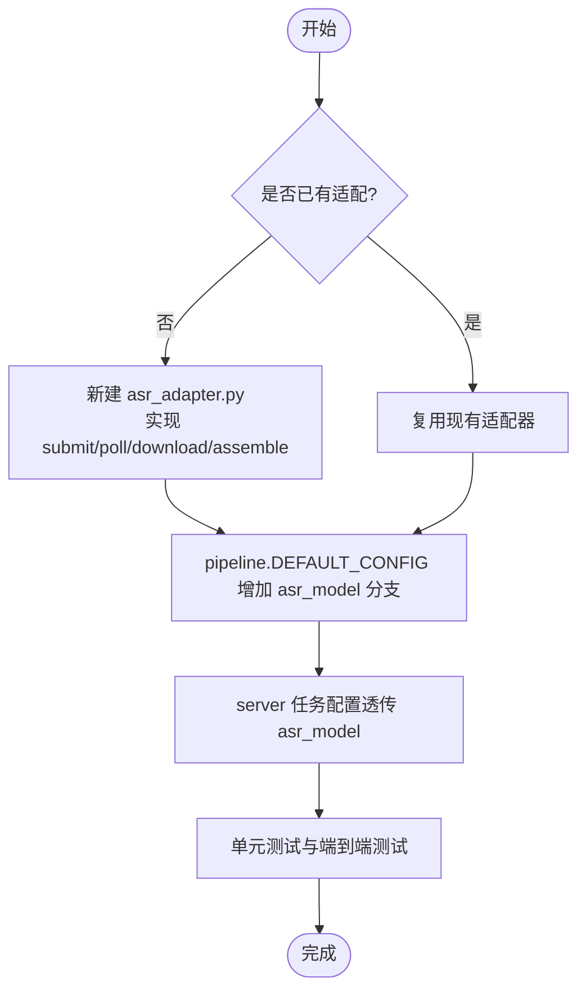
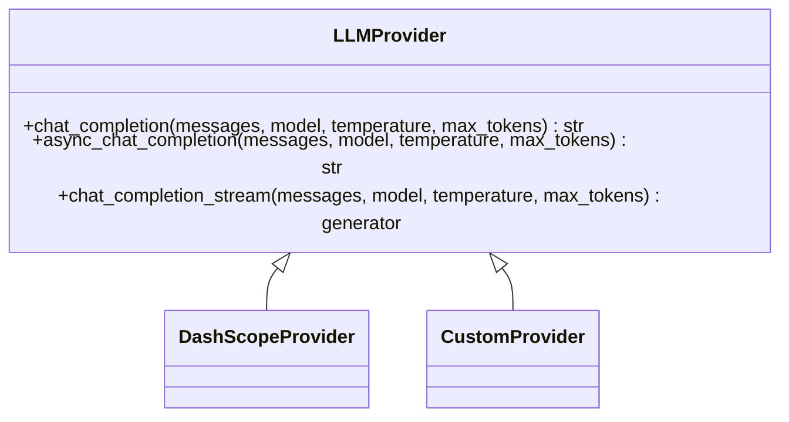
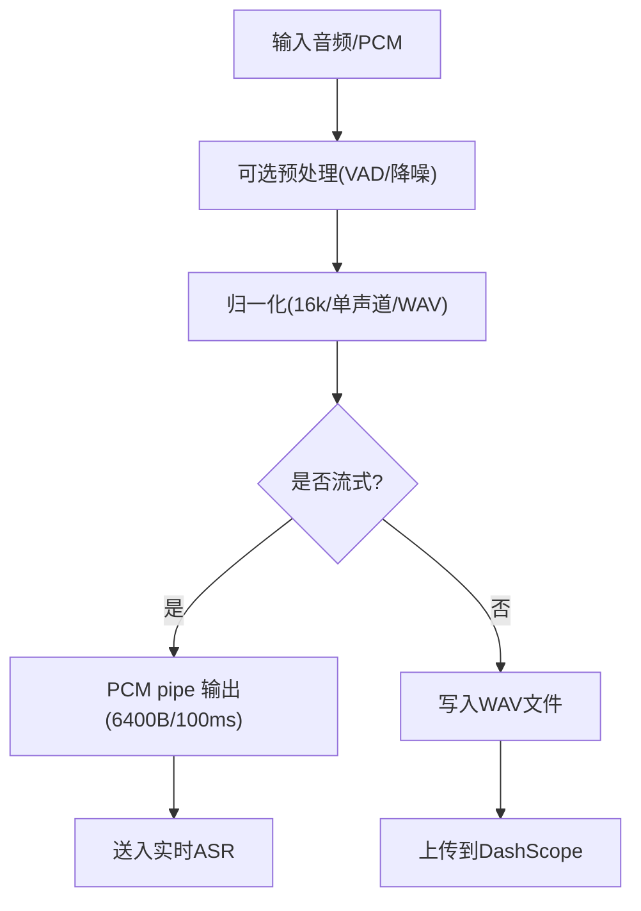
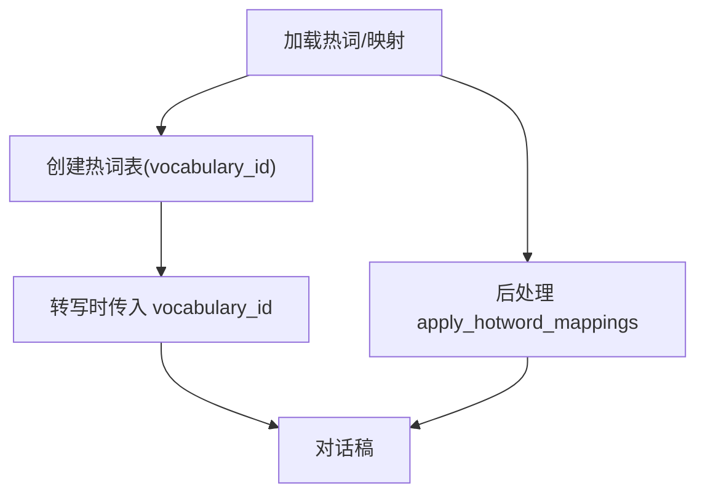
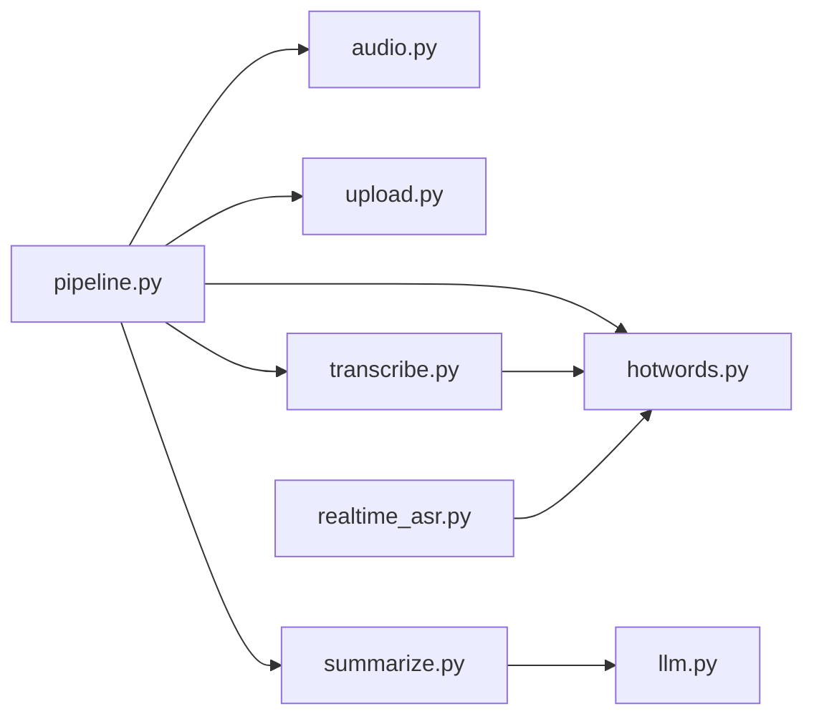

# 扩展开发

<cite>
**本文引用的文件**
- [core/transcribe.py](file://core/transcribe.py)
- [core/llm.py](file://core/llm.py)
- [core/audio.py](file://core/audio.py)
- [core/hotwords.py](file://core/hotwords.py)
- [core/pipeline.py](file://core/pipeline.py)
- [core/upload.py](file://core/upload.py)
- [core/realtime_asr.py](file://core/realtime_asr.py)
- [core/summarize.py](file://core/summarize.py)
- [app/server.py](file://app/server.py)
- [data/hotwords.txt](file://data/hotwords.txt)
- [data/hotword_mappings.txt](file://data/hotword_mappings.txt)
- [docs/ARCHITECTURE.md](file://docs/ARCHITECTURE.md)
</cite>

## 目录
1. [简介](#简介)
2. [项目结构](#项目结构)
3. [核心组件](#核心组件)
4. [架构总览](#架构总览)
5. [详细组件分析](#详细组件分析)
6. [依赖关系分析](#依赖关系分析)
7. [性能与扩展性建议](#性能与扩展性建议)
8. [故障排查指南](#故障排查指南)
9. [结论](#结论)
10. [附录：扩展示例与测试方法](#附录扩展示例与测试方法)

## 简介
本指南面向希望在 open-meeting-scribe 中做二次开发的工程师，聚焦以下目标：
- 新增 ASR 模型适配器（接口、实现、集成）
- 接入新的 LLM 提供商（认证、请求格式、响应处理）
- 自定义音频处理器（新格式或算法）
- 热词系统扩展（自定义映射）
- 插件化架构设计与最佳实践
- 提供完整扩展示例代码与测试方法

## 项目结构
当前仓库采用“核心能力 + Web 服务”的分层组织：
- core：转写、LLM、音频、热词、管线编排、实时转写等核心能力
- app：FastAPI 服务与前端静态资源
- data：热词表、说话人映射等数据文件
- docs：架构、API 契约、ADR 等设计文档

图表来源
- [app/server.py:1-80](file://app/server.py#L1-L80)
- [core/pipeline.py:1-45](file://core/pipeline.py#L1-L45)
- [core/transcribe.py:1-30](file://core/transcribe.py#L1-L30)
- [core/realtime_asr.py:1-27](file://core/realtime_asr.py#L1-L27)
- [core/llm.py:1-25](file://core/llm.py#L1-L25)
- [core/summarize.py:1-15](file://core/summarize.py#L1-L15)
- [core/audio.py:1-10](file://core/audio.py#L1-L10)
- [core/upload.py:1-13](file://core/upload.py#L1-L13)
- [core/hotwords.py:1-15](file://core/hotwords.py#L1-L15)

章节来源
- [docs/ARCHITECTURE.md:5-16](file://docs/ARCHITECTURE.md#L5-L16)

## 核心组件
- 音频处理：统一归一化为 16kHz/单声道/WAV，支持系统内录与流式 PCM 输出
- 上传模块：本地文件 → DashScope 临时存储 → oss:// URL
- 转写模块：提交异步任务、轮询状态、下载结果、组装对话稿（含碎片合并、说话人修正、热词映射）
- 实时转写：基于 SDK 的 WebSocket 流式识别，回调推送句子
- LLM 模块：同步/异步/流式调用通义千问 OpenAI 兼容端点
- 纪要生成：构造提示词、调用 LLM、保存 Markdown
- 热词系统：加载热词、创建热词表、后处理文本映射纠正
- 管线编排：串联上述步骤，输出纪要并暴露进度回调

章节来源
- [core/audio.py:31-98](file://core/audio.py#L31-L98)
- [core/upload.py:59-115](file://core/upload.py#L59-L115)
- [core/transcribe.py:61-131](file://core/transcribe.py#L61-L131)
- [core/realtime_asr.py:150-368](file://core/realtime_asr.py#L150-L368)
- [core/llm.py:89-160](file://core/llm.py#L89-L160)
- [core/summarize.py:157-229](file://core/summarize.py#L157-L229)
- [core/hotwords.py:35-139](file://core/hotwords.py#L35-L139)
- [core/pipeline.py:58-134](file://core/pipeline.py#L58-L134)

## 架构总览
系统遵循“采集→上云→转写→热词→LLM→纪要”的数据流，并通过 FastAPI 暴露 API。

图表来源
- [app/server.py:226-332](file://app/server.py#L226-L332)
- [core/pipeline.py:58-226](file://core/pipeline.py#L58-L226)
- [core/audio.py:31-98](file://core/audio.py#L31-L98)
- [core/upload.py:59-115](file://core/upload.py#L59-L115)
- [core/transcribe.py:405-446](file://core/transcribe.py#L405-L446)
- [core/hotwords.py:120-139](file://core/hotwords.py#L120-L139)
- [core/llm.py:89-160](file://core/llm.py#L89-L160)
- [core/summarize.py:157-229](file://core/summarize.py#L157-L229)

## 详细组件分析

### 新增 ASR 模型适配器
目标：在不破坏现有管线的前提下，接入新的 ASR 模型（例如本地模型或其他云端模型）。

- 接口定义建议
  - 统一函数签名：submit(model, file_url_or_path, params) -> task_id
  - 统一查询：poll(task_id, timeout) -> result
  - 统一下载：download(result) -> transcription_json
  - 统一组装：assemble(transcription_json) -> dialogue
- 关键约束
  - 若使用云端 REST，需遵循 OSS URL 与异步头要求（参考现有实现）
  - 若为本地模型，需提供文件路径输入与超时控制
  - 必须返回包含 speaker_id 的结果以支持后续说话人归并
- 集成步骤
  - 在 core 下新增 asr_adapter.py，实现上述四个函数
  - 在 pipeline.py 的配置中增加 asr_model 分支，根据 model 选择不同适配器
  - 在 server.py 的任务配置中透传 asr_model
- 错误处理
  - 网络/鉴权失败抛出明确异常
  - 超时与限流策略（重试退避）
  - 结果校验（缺失关键字段时抛错）

图表来源
- [core/pipeline.py:35-44](file://core/pipeline.py#L35-L44)
- [core/transcribe.py:61-131](file://core/transcribe.py#L61-L131)
- [app/server.py:226-332](file://app/server.py#L226-L332)

章节来源
- [core/transcribe.py:61-131](file://core/transcribe.py#L61-L131)
- [core/pipeline.py:35-44](file://core/pipeline.py#L35-L44)
- [app/server.py:226-332](file://app/server.py#L226-L332)

### 接入新的 LLM 提供商
目标：替换或新增 LLM 后端（如其他厂商的 OpenAI 兼容端点或自有 API）。

- 认证方式
  - 通过环境变量注入密钥（如 NEW_LLM_API_KEY），避免硬编码
- 请求格式
  - 保持 messages 结构与参数（model、temperature、max_tokens）一致
  - 如需流式，实现 SSE/Chunked 解析
- 响应处理
  - 统一提取 content 字段
  - 统一异常封装（超时、HTTP 错误）
- 集成位置
  - 在 core/llm.py 中新增 provider 类或函数
  - 在 summarize.py 中通过策略模式选择 provider
  - 在 pipeline 配置中允许切换 llm_model/provider

图表来源
- [core/llm.py:89-160](file://core/llm.py#L89-L160)
- [core/llm.py:168-207](file://core/llm.py#L168-L207)

章节来源
- [core/llm.py:49-76](file://core/llm.py#L49-L76)
- [core/llm.py:89-160](file://core/llm.py#L89-L160)
- [core/summarize.py:157-229](file://core/summarize.py#L157-L229)

### 自定义音频处理器
目标：支持新的音频格式或处理算法（如降噪、VAD、重采样策略调整）。

- 扩展点
  - normalize_audio：可插入预处理链（如 VAD 裁剪、降噪）
  - start_recording_with_stream：可替换采集源（非 BlackHole 设备）
  - _raw_to_wav：可调整 PCM 包装逻辑
- 注意事项
  - 保持 16kHz/单声道输出，确保说话人分离有效
  - 流式 PCM 块大小建议 6400 bytes（100ms @16kHz/16bit/mono）
- 集成步骤
  - 在 audio.py 中新增处理函数，并在 pipeline 阶段调用
  - 在 server.py 的录制入口传入新参数（如降噪开关）

图表来源
- [core/audio.py:31-98](file://core/audio.py#L31-L98)
- [core/audio.py:303-396](file://core/audio.py#L303-L396)
- [core/audio.py:559-595](file://core/audio.py#L559-L595)

章节来源
- [core/audio.py:31-98](file://core/audio.py#L31-L98)
- [core/audio.py:303-396](file://core/audio.py#L303-L396)
- [core/audio.py:559-595](file://core/audio.py#L559-L595)

### 热词系统扩展机制
目标：添加自定义热词映射，提升特定术语识别准确率。

- 热词表
  - 从 data/hotwords.txt 加载，创建 DashScope 热词表（vocabulary_id）
  - 权重范围与限制见实现注释
- 后处理映射
  - 从 data/hotword_mappings.txt 加载映射规则，对识别文本进行纠正
  - 英文词使用词边界匹配，中文直接替换
- 集成点
  - 在 transcribe.py 的 assemble_dialogue 中调用 apply_hotword_mappings
  - 在 realtime_asr.py 的回调中也应用映射

图表来源
- [core/hotwords.py:35-139](file://core/hotwords.py#L35-L139)
- [core/hotwords.py:145-222](file://core/hotwords.py#L145-L222)
- [core/transcribe.py:355-402](file://core/transcribe.py#L355-L402)
- [core/realtime_asr.py:111-144](file://core/realtime_asr.py#L111-L144)

章节来源
- [core/hotwords.py:35-139](file://core/hotwords.py#L35-L139)
- [core/hotwords.py:145-222](file://core/hotwords.py#L145-L222)
- [core/transcribe.py:355-402](file://core/transcribe.py#L355-L402)
- [core/realtime_asr.py:111-144](file://core/realtime_asr.py#L111-L144)

### 插件架构设计与最佳实践
- 设计原则
  - 单一职责：每个插件负责一个能力（ASR、LLM、音频处理）
  - 稳定接口：对外暴露稳定的函数签名，内部实现可替换
  - 配置驱动：通过 pipeline.DEFAULT_CONFIG 和 server 配置切换插件
  - 错误隔离：插件异常不影响整体流程，记录日志并降级
- 推荐结构
  - core/plugins/asr/：ASR 插件（submit/poll/download/assemble）
  - core/plugins/llm/：LLM 插件（chat/async/stream）
  - core/plugins/audio/：音频处理插件（normalize/preprocess）
- 集成方式
  - 在 pipeline.py 中根据配置选择插件
  - 在 server.py 中暴露配置项供运行时切换
- 最佳实践
  - 所有插件需支持超时与重试
  - 统一日志格式与错误码
  - 提供单元测试与集成测试用例

[本节为概念性内容，不直接分析具体文件]

## 依赖关系分析
- 模块耦合
  - pipeline 强依赖 audio、upload、transcribe、hotwords、summarize
  - transcribe 依赖 hotwords（后处理）
  - realtime_asr 依赖 hotwords（后处理）
  - summarize 依赖 llm
- 外部依赖
  - DashScope REST/WS（ASR、热词、LLM）
  - ffmpeg/ffprobe（音频处理）
  - httpx/requests（HTTP 客户端）

图表来源
- [core/pipeline.py:20-27](file://core/pipeline.py#L20-L27)
- [core/transcribe.py:190-190](file://core/transcribe.py#L190-L190)
- [core/realtime_asr.py:43-43](file://core/realtime_asr.py#L43-L43)
- [core/summarize.py:13-15](file://core/summarize.py#L13-L15)

章节来源
- [core/pipeline.py:20-27](file://core/pipeline.py#L20-L27)
- [core/transcribe.py:190-190](file://core/transcribe.py#L190-L190)
- [core/realtime_asr.py:43-43](file://core/realtime_asr.py#L43-L43)
- [core/summarize.py:13-15](file://core/summarize.py#L13-L15)

## 性能与扩展性建议
- 连接池与超时
  - 复用 httpx.AsyncClient，设置合理的连接数与超时
- 流式处理
  - 实时转写使用 100ms 包大小，降低延迟
- 热词优化
  - 合理设置权重，避免过多热词影响识别
- 并发控制
  - 后台任务与事件循环解耦，避免阻塞
- 可扩展性
  - 通过配置切换 ASR/LLM 提供商，便于多环境部署

[本节提供通用指导，不直接分析具体文件]

## 故障排查指南
- 常见问题
  - 未设置 API Key：检查环境变量
  - 上传失败：检查文件大小与凭证
  - 转写超时：检查网络与限流
  - 热词无效：确认 target_model 与实际模型一致
- 定位方法
  - 查看日志中的任务状态与错误信息
  - 检查转录结果 JSON 的关键字段
  - 验证热词映射文件格式与顺序

章节来源
- [core/upload.py:25-56](file://core/upload.py#L25-L56)
- [core/transcribe.py:134-175](file://core/transcribe.py#L134-L175)
- [core/hotwords.py:57-117](file://core/hotwords.py#L57-L117)

## 结论
通过明确的接口定义与配置驱动，open-meeting-scribe 能够灵活扩展 ASR、LLM、音频处理与热词系统。遵循插件化设计原则，可在不破坏现有流程的前提下引入新能力，并通过完善的错误处理与测试保障稳定性。

[本节为总结性内容，不直接分析具体文件]

## 附录：扩展示例与测试方法

### 扩展示例：新增 ASR 适配器
- 步骤
  - 在 core/asr_adapter.py 中实现 submit/poll/download/assemble
  - 在 pipeline.DEFAULT_CONFIG 中添加 asr_model 分支
  - 在 server.py 的任务配置中透传 asr_model
- 关键点
  - 保持与现有 transcribe.py 一致的返回结构
  - 处理网络异常与超时

章节来源
- [core/transcribe.py:61-131](file://core/transcribe.py#L61-L131)
- [core/pipeline.py:35-44](file://core/pipeline.py#L35-L44)
- [app/server.py:226-332](file://app/server.py#L226-L332)

### 扩展示例：新增 LLM 提供商
- 步骤
  - 在 core/llm.py 中新增 provider 函数
  - 在 summarize.py 中根据配置选择 provider
  - 在 server.py 中暴露配置项
- 关键点
  - 统一消息结构与参数
  - 支持同步/异步/流式调用

章节来源
- [core/llm.py:89-160](file://core/llm.py#L89-L160)
- [core/summarize.py:157-229](file://core/summarize.py#L157-L229)

### 扩展示例：自定义音频处理器
- 步骤
  - 在 core/audio.py 中新增预处理函数
  - 在 pipeline 阶段调用新函数
  - 在 server.py 的录制入口传入参数
- 关键点
  - 保持 16kHz/单声道输出
  - 流式 PCM 块大小保持一致

章节来源
- [core/audio.py:31-98](file://core/audio.py#L31-L98)
- [core/audio.py:303-396](file://core/audio.py#L303-L396)

### 扩展示例：热词映射
- 步骤
  - 在 data/hotword_mappings.txt 中添加映射规则
  - 在 core/hotwords.py 中验证加载逻辑
  - 在 transcribe.py 与 realtime_asr.py 中确认应用
- 关键点
  - 长匹配优先，避免短词误替换
  - 英文词使用词边界匹配

章节来源
- [data/hotword_mappings.txt:1-6](file://data/hotword_mappings.txt#L1-L6)
- [core/hotwords.py:145-222](file://core/hotwords.py#L145-L222)
- [core/transcribe.py:355-402](file://core/transcribe.py#L355-L402)
- [core/realtime_asr.py:111-144](file://core/realtime_asr.py#L111-L144)

### 测试方法
- 单元测试
  - 针对每个插件编写独立测试，模拟输入与期望输出
  - 覆盖异常路径（超时、网络错误、无效输入）
- 集成测试
  - 使用真实或 Mock 的外部服务（DashScope、ffmpeg）
  - 验证端到端流程（上传→转写→纪要）
- 性能测试
  - 压测实时转写与 LLM 调用，评估延迟与吞吐

[本节提供通用测试指导，不直接分析具体文件]