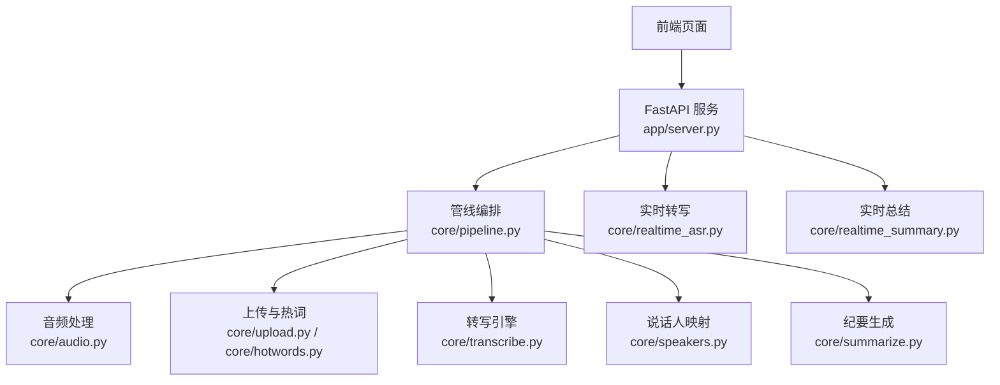
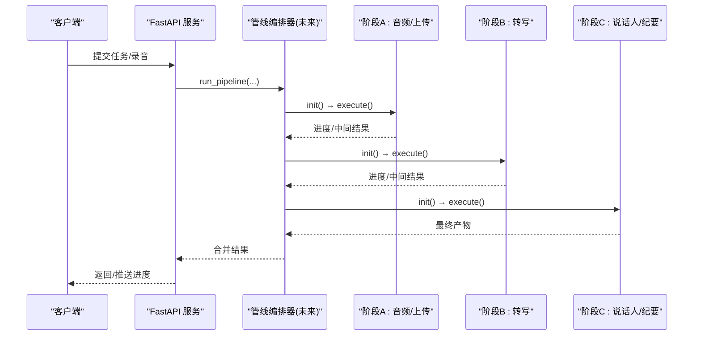
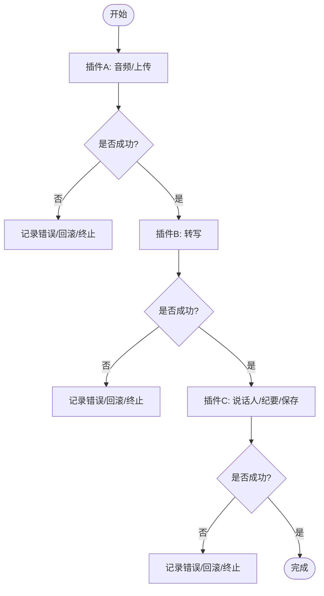
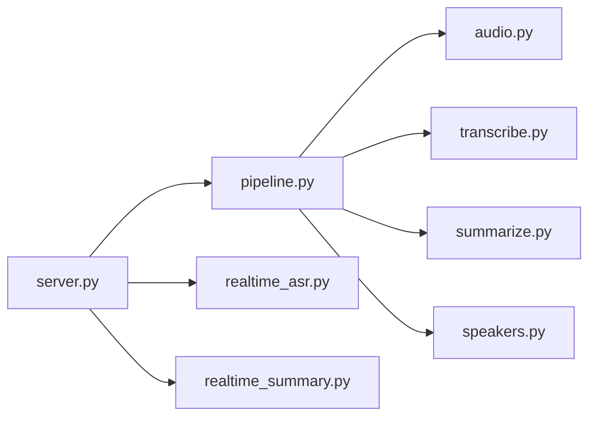
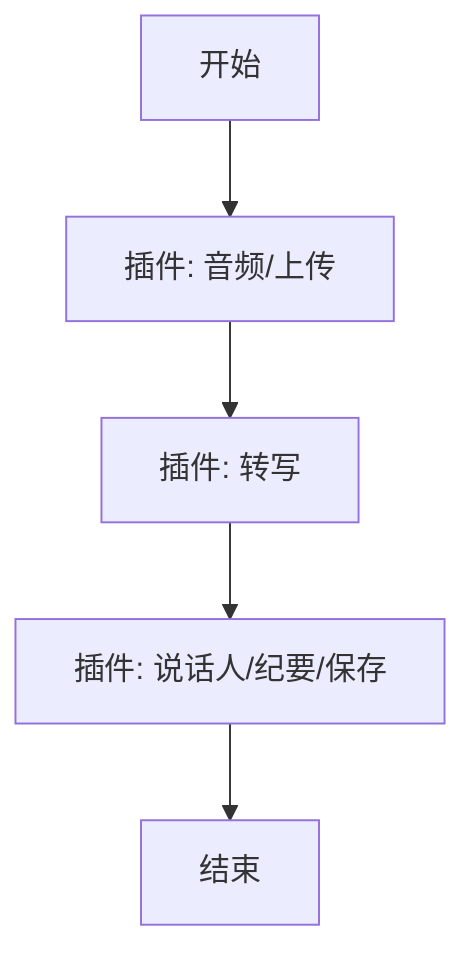

# 插件架构设计

<cite>
**本文引用的文件**
- [core/pipeline.py](file://core/pipeline.py)
- [app/server.py](file://app/server.py)
- [core/audio.py](file://core/audio.py)
- [core/transcribe.py](file://core/transcribe.py)
- [core/summarize.py](file://core/summarize.py)
- [core/speakers.py](file://core/speakers.py)
- [core/realtime_asr.py](file://core/realtime_asr.py)
- [core/realtime_summary.py](file://core/realtime_summary.py)
- [requirements.txt](file://requirements.txt)
- [docs/ARCHITECTURE.md](file://docs/ARCHITECTURE.md)
</cite>

## 目录
1. [引言](#引言)
2. [项目结构](#项目结构)
3. [核心组件](#核心组件)
4. [架构总览](#架构总览)
5. [详细组件分析](#详细组件分析)
6. [依赖关系分析](#依赖关系分析)
7. [性能考量](#性能考量)
8. [故障排查指南](#故障排查指南)
9. [结论](#结论)
10. [附录：插件开发规范与最佳实践](#附录：插件开发规范与最佳实践)

## 引言
本设计文档围绕 open-meeting-scribe 的“可插拔处理阶段”目标，提出一套面向未来的插件化架构方案。当前系统已具备清晰的管线编排（pipeline）和模块化能力，但尚未抽象出统一的插件接口、注册机制与生命周期管理。本文在尊重现有实现的基础上，给出可扩展的插件化设计蓝图，涵盖：
- 模块化原则、接口抽象与依赖管理
- Pipeline 的编排机制与可插拔阶段设计
- 插件生命周期（初始化、执行、销毁）
- 插件开发规范（命名、错误处理、日志）
- 插件注册与配置管理（含版本兼容性与热重载思路）

## 项目结构
项目采用分层职责清晰的结构：
- 采集与预处理：音频归一化、内录
- 上云与转写：上传至 DashScope、异步任务提交与轮询、结果下载与对话稿组装
- 说话人管理：全局说话人档案与会话映射
- 纪要生成：LLM 提示词构造与输出解析
- 实时能力：实时转写与增量总结
- 编排与对外服务：Pipeline 串联全流程；FastAPI 提供 REST/WS 接口

图表来源
- [app/server.py:1-80](file://app/server.py#L1-L80)
- [core/pipeline.py:1-45](file://core/pipeline.py#L1-L45)
- [docs/ARCHITECTURE.md:5-16](file://docs/ARCHITECTURE.md#L5-L16)

章节来源
- [docs/ARCHITECTURE.md:5-16](file://docs/ARCHITECTURE.md#L5-L16)
- [core/pipeline.py:1-45](file://core/pipeline.py#L1-L45)

## 核心组件
- 管线编排（Pipeline）：定义默认配置与两阶段流程（转写→纪要），提供进度回调与合并结果。
- 音频模块：统一格式转换、时长查询、系统内录。
- 转写模块：DashScope 异步任务提交、轮询、结果下载与对话稿组装。
- 说话人模块：全局说话人档案与会话映射持久化。
- 纪要模块：提示词工程与 LLM 调用，标题与纪要生成。
- 实时模块：实时转写与增量总结，支持回调推送。
- Web 服务：REST/WS 端点、后台任务调度、状态持久化。

章节来源
- [core/pipeline.py:47-271](file://core/pipeline.py#L47-L271)
- [core/audio.py:26-126](file://core/audio.py#L26-L126)
- [core/transcribe.py:61-187](file://core/transcribe.py#L61-L187)
- [core/speakers.py:35-103](file://core/speakers.py#L35-L103)
- [core/summarize.py:19-84](file://core/summarize.py#L19-L84)
- [core/realtime_asr.py:57-147](file://core/realtime_asr.py#L57-L147)
- [core/realtime_summary.py:68-184](file://core/realtime_summary.py#L68-L184)
- [app/server.py:226-332](file://app/server.py#L226-L332)

## 架构总览
当前系统的“阶段”以函数式顺序调用为主，耦合于 pipeline 内部。为支持插件化，建议将每个阶段抽象为“插件”，通过统一接口暴露生命周期方法，并由编排器按策略组合。

图表来源
- [core/pipeline.py:58-271](file://core/pipeline.py#L58-L271)
- [app/server.py:226-332](file://app/server.py#L226-L332)

## 详细组件分析

### 管线编排与阶段抽象
- 现状：run_pipeline_stage1/stage2 明确划分了“转写前”和“纪要后”两个阶段，并通过 on_progress 回调上报进度。
- 插件化建议：
  - 定义统一插件接口：init(config)、execute(context, progress_cb)、cleanup()
  - 将“音频归一化/上传/热词/转写/说话人姓名化/纪要生成/保存”等步骤分别封装为插件
  - 编排器负责插件发现、排序、依赖注入、错误传播与重试策略

图表来源
- [core/pipeline.py:58-271](file://core/pipeline.py#L58-L271)

章节来源
- [core/pipeline.py:58-271](file://core/pipeline.py#L58-L271)

### 音频与上传阶段（可插拔）
- 职责：格式归一化、时长获取、上传到云端并获取临时 URL、可选热词表加载。
- 关键约束：单声道、固定采样率；oss://URL 需特定请求头；超时与失败处理。
- 插件化要点：
  - 输入：原始音频路径或流
  - 输出：标准化后的文件路径/URL、时长、元数据
  - 错误：文件不存在、ffmpeg 不可用、上传失败、网络异常
  - 日志：阶段名、耗时、文件大小、错误堆栈摘要

章节来源
- [core/audio.py:26-126](file://core/audio.py#L26-L126)
- [core/transcribe.py:61-131](file://core/transcribe.py#L61-L131)

### 转写阶段（可插拔）
- 职责：提交异步任务、轮询直至完成、下载 JSON、句子碎片合并与说话人修正、组装对话稿。
- 关键约束：必须带异步标志、oss 资源解析头；超时与失败重试策略。
- 插件化要点：
  - 输入：标准化音频 URL、语言提示、热词 ID、说话人数提示
  - 输出：对话稿列表、原始转录结果
  - 错误：任务失败、超时、网络异常、JSON 解析失败
  - 日志：任务 ID、状态变化、耗时、错误信息

章节来源
- [core/transcribe.py:61-187](file://core/transcribe.py#L61-L187)

### 说话人与纪要阶段（可插拔）
- 职责：应用说话人姓名映射、生成会议标题与纪要、保存到 Markdown。
- 关键约束：忠实原文、内容不足时如实说明、用户笔记仅作为辅助。
- 插件化要点：
  - 输入：对话稿、说话人映射、会议时间、用户笔记
  - 输出：标题、纪要文本、输出文件路径、说话人映射快照
  - 错误：LLM 调用失败、模板渲染失败、IO 写入失败
  - 日志：模型名、token 估算、生成耗时、错误摘要

章节来源
- [core/speakers.py:35-103](file://core/speakers.py#L35-L103)
- [core/summarize.py:19-84](file://core/summarize.py#L19-L84)
- [core/pipeline.py:137-226](file://core/pipeline.py#L137-L226)

### 实时转写与总结（可插拔）
- 职责：WebSocket 流式识别、增量总结、回调推送。
- 关键约束：PCM 16k/16bit/单声道；每包约 100ms；失败不阻塞主流程。
- 插件化要点：
  - 输入：PCM 音频帧、上下文/热词
  - 输出：临时/定稿句子、增量摘要
  - 错误：连接失败、断线重连、回调异常
  - 日志：连接状态、包大小、句子数、摘要次数

章节来源
- [core/realtime_asr.py:57-147](file://core/realtime_asr.py#L57-L147)
- [core/realtime_summary.py:68-184](file://core/realtime_summary.py#L68-L184)

### Web 服务与任务调度
- 职责：REST/WS 端点、后台任务执行、状态持久化、录制控制。
- 插件化对接：
  - 将后台任务包装为“编排器调用”，统一进度上报
  - 对失败任务进行状态标记与错误信息持久化
  - 为后续“热重载”提供进程级隔离点（如子进程/线程池）

章节来源
- [app/server.py:226-332](file://app/server.py#L226-L332)
- [app/server.py:343-396](file://app/server.py#L343-L396)

## 依赖关系分析
- 外部依赖：requests/httpx、fastapi/uvicorn、dashscope、websockets、numpy/scipy、python-docx/PyPDF2
- 内部依赖：pipeline 依赖 audio/upload/transcribe/hotwords/summarize/speakers；server 依赖 pipeline 与各核心模块
- 潜在循环：当前未见循环导入；新增插件时应避免反向依赖编排器

图表来源
- [core/pipeline.py:14-28](file://core/pipeline.py#L14-L28)
- [app/server.py:41-57](file://app/server.py#L41-L57)

章节来源
- [requirements.txt:1-32](file://requirements.txt#L1-L32)
- [core/pipeline.py:14-28](file://core/pipeline.py#L14-L28)
- [app/server.py:41-57](file://app/server.py#L41-L57)

## 性能考量
- 批处理 vs 实时：批管线用于最终纪要，实时用于预览；两者解耦，互不影响
- I/O 与网络：上传/转写/LLM 调用均为外部 I/O，应设置合理超时与重试
- 内存与缓冲：实时总结使用分钟级窗口缓冲，限制历史长度，控制 token 消耗
- 并发：后台任务与 WebSocket 推送分离，避免阻塞事件循环

[本节为通用指导，无需具体文件引用]

## 故障排查指南
- 常见错误定位：
  - ffmpeg 不可用或未安装：检查环境变量与系统命令可用性
  - 转写任务失败/超时：查看任务状态、网络连通性、API Key 与配额
  - LLM 调用失败：检查模型名称、Token 限额、网络与重试策略
  - 文件 IO 失败：检查权限、磁盘空间、路径是否存在
- 日志与调试：
  - 各模块均使用 logging，建议在运行环境开启 INFO/DEBUG
  - 对关键阶段增加耗时统计与错误堆栈摘要
  - 对实时链路记录连接状态、包大小、回调触发次数

章节来源
- [core/audio.py:82-98](file://core/audio.py#L82-L98)
- [core/transcribe.py:134-187](file://core/transcribe.py#L134-L187)
- [core/realtime_asr.py:80-109](file://core/realtime_asr.py#L80-L109)
- [core/realtime_summary.py:119-153](file://core/realtime_summary.py#L119-L153)

## 结论
当前系统已具备良好的模块化基础与清晰的阶段划分，适合向“插件化”演进。通过统一接口、注册中心与生命周期管理，可实现阶段的动态替换、热重载与灵活编排，同时保持向后兼容与稳定运行。

[本节为总结性内容，无需具体文件引用]

## 附录：插件开发规范与最佳实践

### 插件接口与生命周期
- 统一接口建议：
  - init(config): 读取配置、准备资源
  - execute(context, progress_cb): 执行业务逻辑，持续上报进度
  - cleanup(): 释放资源、清理临时文件
- 上下文对象：
  - 包含中间结果、配置、日志句柄、错误收集器
- 进度回调：
  - 阶段名、消息、百分比，便于前端可视化

章节来源
- [core/pipeline.py:47-88](file://core/pipeline.py#L47-L88)

### 命名约定
- 插件类/模块：以功能域命名，如 AudioNormalizePlugin、TranscribePlugin、SummarizePlugin
- 配置文件键：使用小写下划线，如 asr_model、llm_model、diarization_enabled
- 日志标签：统一使用模块 logger，便于过滤

章节来源
- [core/pipeline.py:35-44](file://core/pipeline.py#L35-L44)
- [core/transcribe.py:26-31](file://core/transcribe.py#L26-L31)

### 错误处理
- 分类：输入校验错误、外部服务错误、I/O 错误、业务规则错误
- 策略：捕获异常、记录日志、上报进度为失败、必要时回滚中间结果
- 恢复：对网络/外部服务错误实施指数退避重试

章节来源
- [core/transcribe.py:134-187](file://core/transcribe.py#L134-L187)
- [core/audio.py:82-98](file://core/audio.py#L82-L98)

### 日志记录标准
- 级别：INFO 记录关键节点，DEBUG 记录详细过程，ERROR 记录异常
- 内容：阶段名、耗时、关键参数（脱敏）、错误摘要
- 一致性：所有模块使用 logging.getLogger(__name__)

章节来源
- [core/pipeline.py:29-29](file://core/pipeline.py#L29-L29)
- [core/transcribe.py:24-24](file://core/transcribe.py#L24-L24)
- [core/realtime_asr.py:45-45](file://core/realtime_asr.py#L45-L45)

### 插件注册机制与配置管理
- 注册中心：集中维护插件清单（名称、版本、依赖、入口类）
- 配置来源：环境变量、配置文件、运行时覆盖；提供默认值与校验
- 版本兼容：插件声明最小/最大兼容版本，启动时校验
- 热重载：通过进程隔离或模块重载机制，在不重启服务的情况下更新插件

章节来源
- [core/pipeline.py:35-44](file://core/pipeline.py#L35-L44)
- [app/server.py:65-69](file://app/server.py#L65-L69)

### 编排机制与阶段设计
- 阶段拆分：将“音频/上传/热词/转写/说话人/纪要/保存”拆分为独立插件
- 依赖注入：由编排器根据插件声明注入所需上下文与工具
- 错误传播：任一阶段失败立即中断并记录原因
- 进度上报：统一进度语义，便于前端展示

章节来源
- [core/pipeline.py:58-271](file://core/pipeline.py#L58-L271)

### 示例：阶段流程图（概念）

[此图为概念示意，不对应具体代码结构]