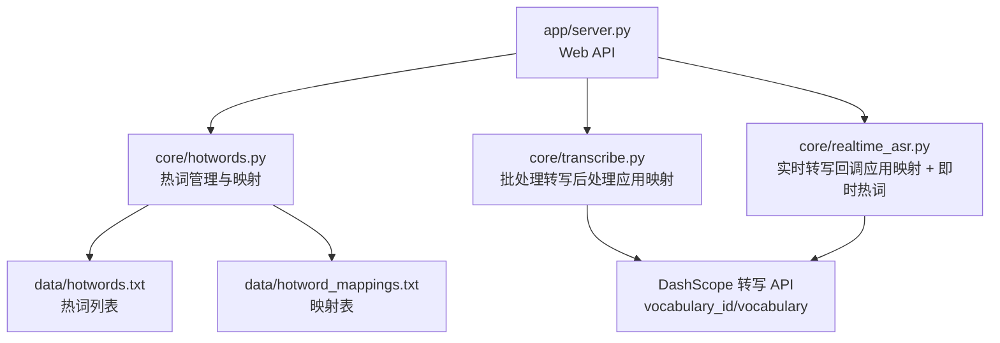
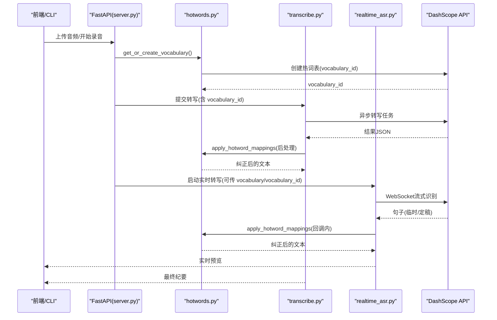
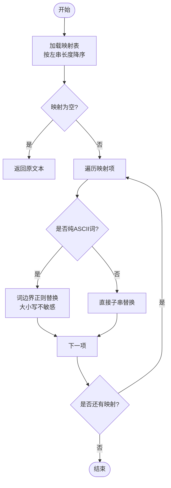
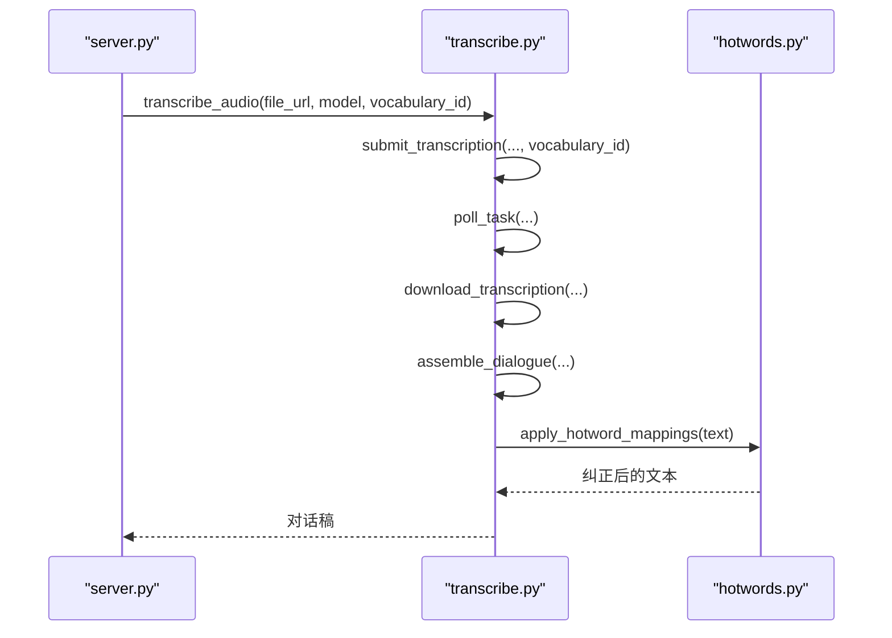
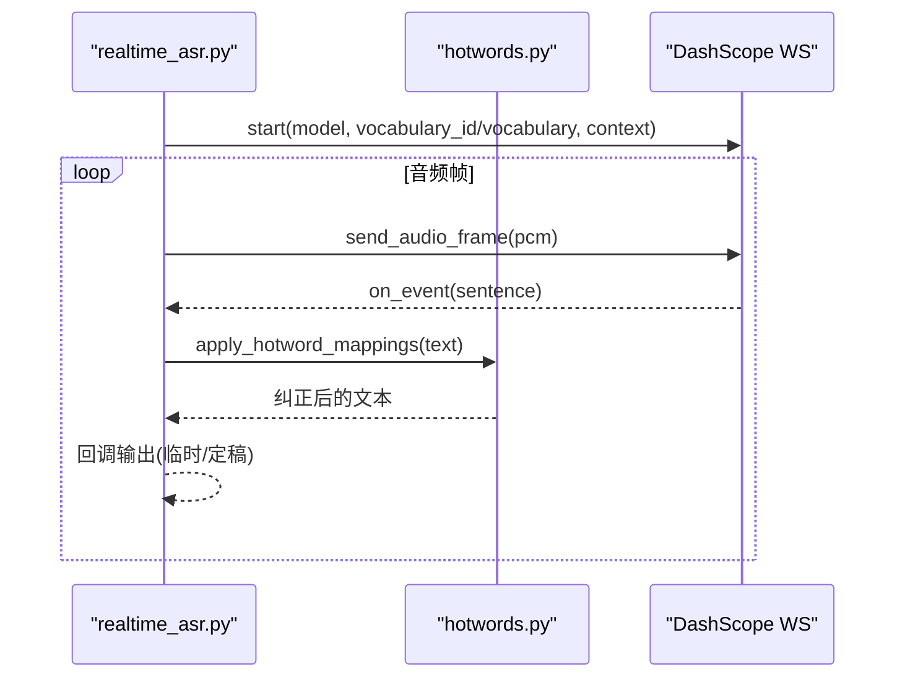
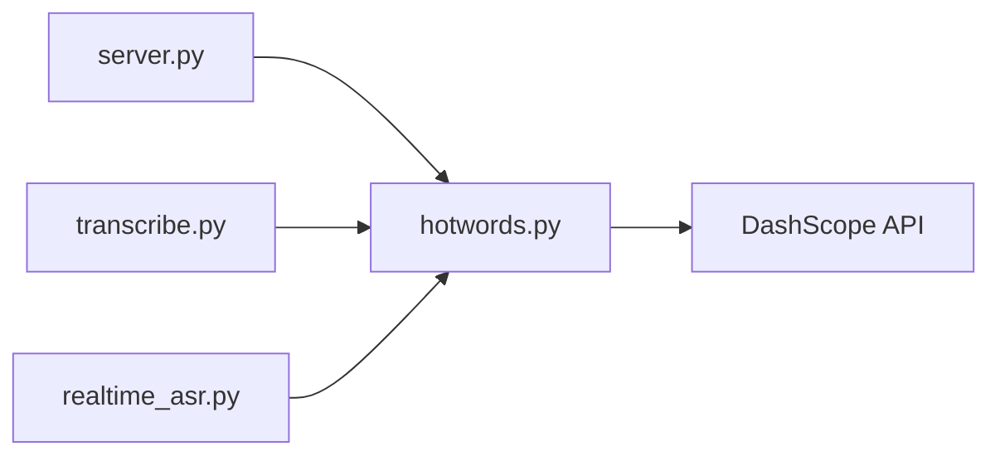

# 热词系统扩展

<cite>
**本文引用的文件**
- [core/hotwords.py](file://core/hotwords.py)
- [core/transcribe.py](file://core/transcribe.py)
- [core/realtime_asr.py](file://core/realtime_asr.py)
- [app/server.py](file://app/server.py)
- [data/hotwords.txt](file://data/hotwords.txt)
- [data/hotword_mappings.txt](file://data/hotword_mappings.txt)
- [docs/API_CONTRACTS.md](file://docs/API_CONTRACTS.md)
- [docs/ARCHITECTURE.md](file://docs/ARCHITECTURE.md)
- [docs/adr/0004-实时转写升级qwen-audio-3.0-asr-flash-streaming.md](file://docs/adr/0004-实时转写升级qwen-audio-3.0-asr-flash-streaming.md)
</cite>

## 目录
1. [简介](#简介)
2. [项目结构](#项目结构)
3. [核心组件](#核心组件)
4. [架构总览](#架构总览)
5. [详细组件分析](#详细组件分析)
6. [依赖关系分析](#依赖关系分析)
7. [性能与缓存优化](#性能与缓存优化)
8. [故障排查指南](#故障排查指南)
9. [结论](#结论)
10. [附录：扩展示例与最佳实践](#附录扩展示例与最佳实践)

## 简介
本指南面向希望在 open-meeting-scribe 中扩展“热词系统”的开发者，覆盖以下内容：
- 如何添加自定义热词映射（文件格式、规则与管理）
- hotwords 模块的实现原理与动态加载机制
- 热词优先级与冲突解决策略
- 批量导入与更新流程
- 与 ASR 模型（批处理与实时）的集成方式与配置管理
- 热词效果评估方法
- 可扩展的验证、缓存与性能优化建议

## 项目结构
热词相关能力集中在 core/hotwords.py，并在以下位置被使用或暴露：
- 批处理转写管线：core/transcribe.py（后处理阶段应用热词映射）
- 实时转写管线：core/realtime_asr.py（回调中应用热词映射；支持即时热词 vocabulary）
- Web API：app/server.py（提供热词与映射的读取/保存接口）
- 数据文件：data/hotwords.txt（热词表）、data/hotword_mappings.txt（映射表）
- 外部契约：docs/API_CONTRACTS.md（热词表创建、参数等）

图表来源
- [core/hotwords.py:35-139](file://core/hotwords.py#L35-L139)
- [core/transcribe.py:190-446](file://core/transcribe.py#L190-L446)
- [core/realtime_asr.py:43-368](file://core/realtime_asr.py#L43-L368)
- [app/server.py:2037-2069](file://app/server.py#L2037-L2069)

章节来源
- [docs/ARCHITECTURE.md:5-16](file://docs/ARCHITECTURE.md#L5-L16)
- [docs/API_CONTRACTS.md:28-49](file://docs/API_CONTRACTS.md#L28-L49)

## 核心组件
- 热词表管理（hotwords.py）
  - 从 data/hotwords.txt 加载热词
  - 调用 DashScope API 创建/获取 vocabulary_id（target_model 需匹配实际模型）
  - 提供 apply_hotword_mappings 对识别结果进行后处理纠正
- 批处理转写（transcribe.py）
  - 提交 paraformer-v2 任务时可选传入 vocabulary_id
  - 组装对话稿时对每句文本执行 apply_hotword_mappings
- 实时转写（realtime_asr.py）
  - 支持 vocabulary_id（预编译热词表）和 vocabulary（即时热词）
  - 在回调中对临时/定稿文本执行 apply_hotword_mappings
- Web API（server.py）
  - GET/POST /api/hotwords：读取/保存热词列表
  - GET/POST /api/hotword-mappings：读取/保存映射表

章节来源
- [core/hotwords.py:35-139](file://core/hotwords.py#L35-L139)
- [core/transcribe.py:61-131](file://core/transcribe.py#L61-L131)
- [core/transcribe.py:355-402](file://core/transcribe.py#L355-L402)
- [core/realtime_asr.py:172-253](file://core/realtime_asr.py#L172-L253)
- [app/server.py:2037-2069](file://app/server.py#L2037-L2069)

## 架构总览
热词系统在两条路径生效：
- 在线增强（ASR 侧）：通过 vocabulary_id 或 vocabulary 提升术语召回率
- 离线纠正（后处理）：通过映射表将常见误识别替换为正确写法

图表来源
- [core/hotwords.py:57-139](file://core/hotwords.py#L57-L139)
- [core/transcribe.py:61-131](file://core/transcribe.py#L61-L131)
- [core/transcribe.py:355-402](file://core/transcribe.py#L355-L402)
- [core/realtime_asr.py:172-253](file://core/realtime_asr.py#L172-L253)
- [core/realtime_asr.py:111-143](file://core/realtime_asr.py#L111-L143)

## 详细组件分析

### 热词表与映射（hotwords.py）
- 热词加载
  - 格式：一行一个词，# 开头注释，空行忽略
  - 返回纯字符串列表
- 热词表创建
  - 目标模型 target_model 必须与实际识别模型一致
  - 权重默认 4，Qwen-Audio-3.0-ASR 系列上限 2000
  - 失败时记录日志并返回 None，兼容降级
- 映射加载与应用
  - 格式：错误识别→正确文本（支持 → 与 -> 分隔符）
  - 长匹配优先：按左串长度降序排序，避免短词先替换导致长词失效
  - 匹配策略：
    - 纯 ASCII 字母/数字：词边界匹配，大小写不敏感
    - 其他（含中文）：直接子串替换

图表来源
- [core/hotwords.py:145-179](file://core/hotwords.py#L145-L179)
- [core/hotwords.py:187-221](file://core/hotwords.py#L187-L221)

章节来源
- [core/hotwords.py:35-54](file://core/hotwords.py#L35-L54)
- [core/hotwords.py:57-117](file://core/hotwords.py#L57-L117)
- [core/hotwords.py:145-179](file://core/hotwords.py#L145-L179)
- [core/hotwords.py:187-221](file://core/hotwords.py#L187-L221)

### 批处理转写集成（transcribe.py）
- 提交任务时可传入 vocabulary_id（与模型匹配）
- 组装对话稿阶段，逐句调用 apply_hotword_mappings 进行后处理纠正
- 合并碎片与说话人修正后再做热词映射，保证上下文更完整

图表来源
- [core/transcribe.py:61-131](file://core/transcribe.py#L61-L131)
- [core/transcribe.py:355-402](file://core/transcribe.py#L355-L402)
- [core/hotwords.py:187-221](file://core/hotwords.py#L187-L221)

章节来源
- [core/transcribe.py:61-131](file://core/transcribe.py#L61-L131)
- [core/transcribe.py:355-402](file://core/transcribe.py#L355-L402)

### 实时转写集成（realtime_asr.py）
- 支持 vocabulary_id（预编译热词表）与 vocabulary（即时热词）
- 回调 on_event 中对临时/定稿文本执行 apply_hotword_mappings
- 可通过 context 增强领域术语识别（与热词互补）

图表来源
- [core/realtime_asr.py:172-253](file://core/realtime_asr.py#L172-L253)
- [core/realtime_asr.py:111-143](file://core/realtime_asr.py#L111-L143)
- [core/hotwords.py:187-221](file://core/hotwords.py#L187-L221)

章节来源
- [core/realtime_asr.py:172-253](file://core/realtime_asr.py#L172-L253)
- [core/realtime_asr.py:111-143](file://core/realtime_asr.py#L111-L143)

### Web API 与数据文件
- 热词列表
  - GET /api/hotwords：返回当前热词及数量
  - POST /api/hotwords：保存热词（每行一个，过滤注释与空行）
- 热词映射
  - GET /api/hotword-mappings：返回映射列表
  - POST /api/hotword-mappings：保存映射（支持 → 与 -> 分隔符）
- 数据文件
  - data/hotwords.txt：热词清单
  - data/hotword_mappings.txt：映射规则

章节来源
- [app/server.py:2037-2069](file://app/server.py#L2037-L2069)
- [data/hotwords.txt:1-4](file://data/hotwords.txt#L1-L4)
- [data/hotword_mappings.txt:1-6](file://data/hotword_mappings.txt#L1-L6)

## 依赖关系分析
- hotwords.py 被 transcribe.py 与 realtime_asr.py 共同引用，实现“后处理纠正”的统一入口
- server.py 通过 hotwords.py 提供热词与映射的读写能力
- 外部依赖：DashScope API（REST 与 WebSocket），需要 DASHSCOPE_API_KEY

图表来源
- [core/hotwords.py:17-23](file://core/hotwords.py#L17-L23)
- [core/transcribe.py:190-190](file://core/transcribe.py#L190-L190)
- [core/realtime_asr.py:43-43](file://core/realtime_asr.py#L43-L43)
- [app/server.py:56-56](file://app/server.py#L56-L56)

章节来源
- [docs/API_CONTRACTS.md:5-8](file://docs/API_CONTRACTS.md#L5-L8)

## 性能与缓存优化
- 映射加载与排序
  - 每次调用 apply_hotword_mappings 若未传入 mappings，则从文件加载并按左串长度降序排序，适合小量映射场景
  - 高频调用建议在上层缓存 mappings，避免重复 I/O 与排序
- 正则编译
  - 纯 ASCII 词使用 re.compile 构建模式，减少重复开销
  - 可在上层维护 pattern 缓存（以 asr_text 为键）
- 热词表规模
  - Qwen-Audio-3.0-ASR 系列最多 2000 个热词；权重 50 为超级热词（最多 50 个）
  - 合理控制词汇量与权重，避免过度影响通用词识别
- 实时与批处理差异
  - 实时：支持 vocabulary（即时热词）与 context（上下文增强），适合会话级优化
  - 批处理：使用 vocabulary_id（预编译热词表），配合后处理映射

章节来源
- [core/hotwords.py:145-179](file://core/hotwords.py#L145-L179)
- [core/hotwords.py:187-221](file://core/hotwords.py#L187-L221)
- [docs/adr/0004-实时转写升级qwen-audio-3.0-asr-flash-streaming.md:27-48](file://docs/adr/0004-实时转写升级qwen-audio-3.0-asr-flash-streaming.md#L27-L48)

## 故障排查指南
- 环境变量缺失
  - 现象：创建热词表时报错未设置 DASHSCOPE_API_KEY
  - 处理：确保已设置 DASHSCOPE_API_KEY
- 热词表 API 不可用
  - 现象：HTTP 404 或请求异常
  - 处理：记录警告并跳过热词功能，不影响后续转写
- 实时连接限流
  - 现象：too many requests / throttling
  - 处理：自动重试（指数退避），必要时降低并发或等待
- 映射未生效
  - 检查映射文件格式（分隔符、空行、注释）
  - 确认长匹配优先排序是否正确
  - 对于英文词，确认词边界匹配是否符合预期

章节来源
- [core/hotwords.py:28-32](file://core/hotwords.py#L28-L32)
- [core/hotwords.py:101-117](file://core/hotwords.py#L101-L117)
- [core/realtime_asr.py:254-327](file://core/realtime_asr.py#L254-L327)
- [core/hotwords.py:145-179](file://core/hotwords.py#L145-L179)

## 结论
- 热词系统通过“在线增强（vocabulary_id/vocabulary）+ 离线纠正（映射表）”双通道提升识别质量
- 映射规则简单直观，支持中英文混合场景，长匹配优先避免冲突
- 实时与批处理各有优势：实时支持即时热词与上下文增强，批处理支持说话人分离与稳定长音频
- 建议在业务层增加缓存与校验，进一步提升性能与稳定性

## 附录：扩展示例与最佳实践

### 文件格式规范
- 热词列表（data/hotwords.txt）
  - 一行一个词，# 开头为注释，空行忽略
- 映射表（data/hotword_mappings.txt）
  - 每行一条映射：错误识别→正确文本
  - 支持 → 与 -> 两种分隔符
  - 长匹配优先：按左串长度降序排列

章节来源
- [core/hotwords.py:35-54](file://core/hotwords.py#L35-L54)
- [core/hotwords.py:145-179](file://core/hotwords.py#L145-L179)
- [data/hotwords.txt:1-4](file://data/hotwords.txt#L1-L4)
- [data/hotword_mappings.txt:1-6](file://data/hotword_mappings.txt#L1-L6)

### 映射规则与优先级
- 纯 ASCII 词：词边界匹配，大小写不敏感
- 含中文或其他字符：直接子串替换
- 长匹配优先：按左串长度降序，避免短词先替换导致长词失效

章节来源
- [core/hotwords.py:182-221](file://core/hotwords.py#L182-L221)

### 管理机制与 API
- 热词列表
  - GET /api/hotwords：获取当前热词
  - POST /api/hotwords：保存热词（每行一个）
- 热词映射
  - GET /api/hotword-mappings：获取映射列表
  - POST /api/hotword-mappings：保存映射（支持 → 与 ->）

章节来源
- [app/server.py:2037-2069](file://app/server.py#L2037-L2069)

### 与 ASR 模型的集成
- 批处理（paraformer-v2）
  - 提交任务时传入 vocabulary_id（需与模型匹配）
  - 后处理阶段应用映射纠正
- 实时（qwen-audio-3.0-asr-flash-streaming）
  - 支持 vocabulary_id（预编译）与 vocabulary（即时热词）
  - 支持 context（上下文增强）提升术语识别
  - 回调中对临时/定稿文本应用映射纠正

章节来源
- [docs/API_CONTRACTS.md:28-49](file://docs/API_CONTRACTS.md#L28-L49)
- [docs/API_CONTRACTS.md:114-176](file://docs/API_CONTRACTS.md#L114-L176)
- [core/transcribe.py:61-131](file://core/transcribe.py#L61-L131)
- [core/realtime_asr.py:172-253](file://core/realtime_asr.py#L172-L253)

### 批量导入与更新
- 批量导入热词
  - 通过 POST /api/hotwords 一次性写入多行热词
- 批量更新映射
  - 通过 POST /api/hotword-mappings 写入多条映射
- 注意事项
  - 保持映射顺序（长匹配优先）由加载逻辑保证
  - 热词表创建成功后再使用 vocabulary_id

章节来源
- [app/server.py:2047-2069](file://app/server.py#L2047-L2069)
- [core/hotwords.py:57-117](file://core/hotwords.py#L57-L117)

### 热词验证、缓存与性能优化
- 验证
  - 输入前过滤空行与注释行
  - 映射项需包含左右两侧非空内容
- 缓存
  - 在上层缓存 mappings 与 compiled patterns，避免重复 I/O 与正则编译
- 性能
  - 控制热词表规模（≤2000）与超级热词数量（≤50）
  - 合理使用权重（默认 4，关键术语可用 5）

章节来源
- [core/hotwords.py:145-179](file://core/hotwords.py#L145-L179)
- [core/hotwords.py:187-221](file://core/hotwords.py#L187-L221)

### 热词效果评估方法
- 指标建议
  - 术语召回率：对比开启/关闭热词前后，特定术语的命中比例
  - 误报率：观察映射是否误替换无关文本
  - 延迟影响：评估缓存与正则编译对端到端延迟的影响
- 评估步骤
  - 选取典型会议样本，分别运行开启/关闭热词的两版
  - 统计术语命中率与误报情况
  - 结合用户反馈调整权重与映射规则

[本节为概念性内容，不直接分析具体文件]