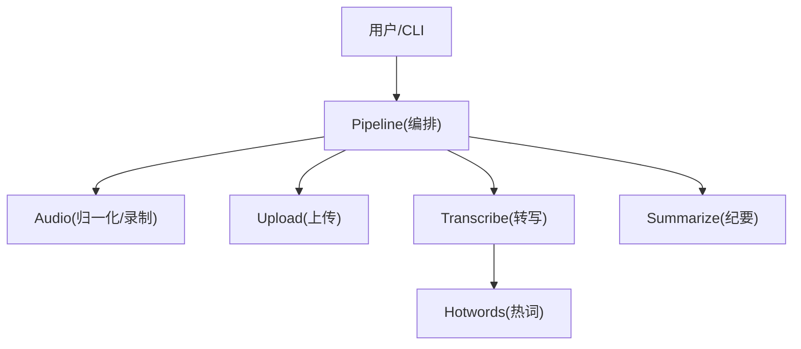
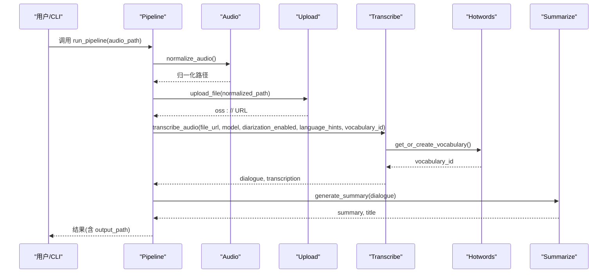
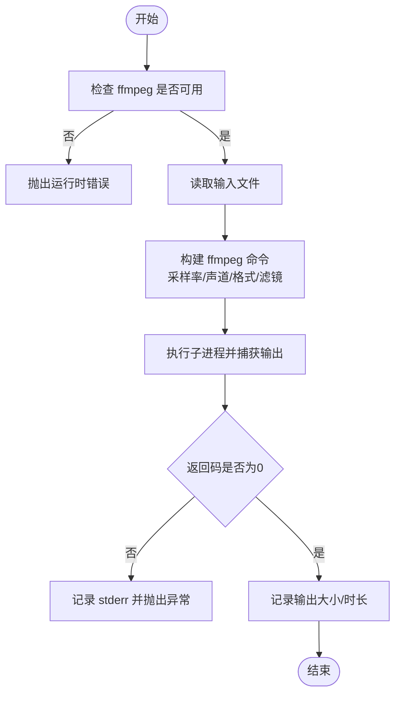
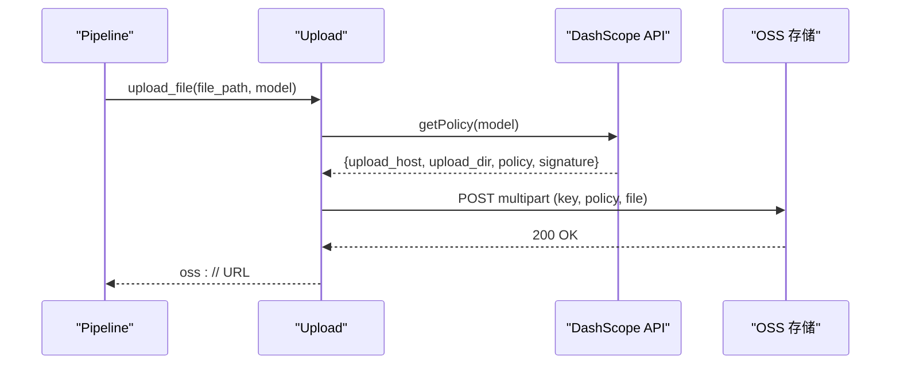
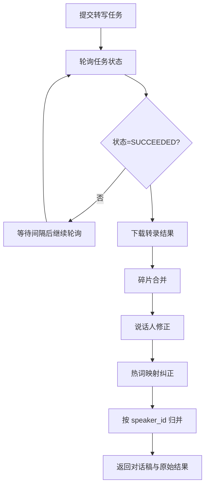
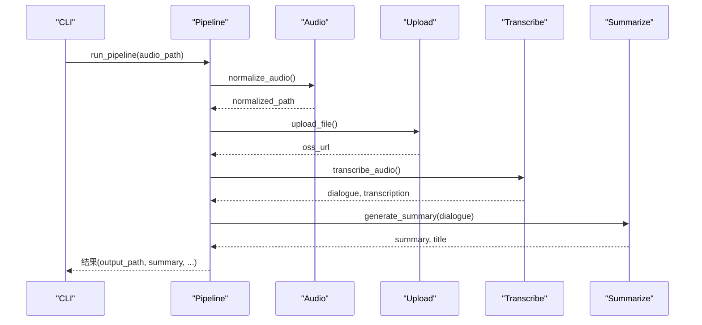
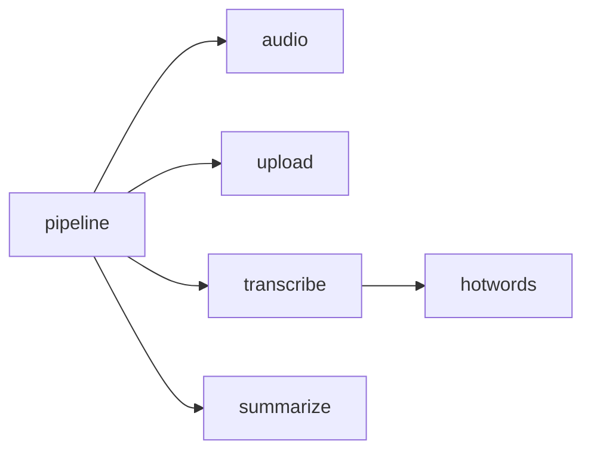

# 音频处理器扩展

<cite>
**本文引用的文件**
- [core/audio.py](file://core/audio.py)
- [core/pipeline.py](file://core/pipeline.py)
- [core/upload.py](file://core/upload.py)
- [core/transcribe.py](file://core/transcribe.py)
- [core/hotwords.py](file://core/hotwords.py)
- [core/summarize.py](file://core/summarize.py)
- [cli.py](file://cli.py)
- [README.md](file://README.md)
</cite>

## 目录
1. [简介](#简介)
2. [项目结构](#项目结构)
3. [核心组件](#核心组件)
4. [架构总览](#架构总览)
5. [详细组件分析](#详细组件分析)
6. [依赖关系分析](#依赖关系分析)
7. [性能与优化](#性能与优化)
8. [故障排查指南](#故障排查指南)
9. [结论](#结论)
10. [附录：扩展示例与配置](#附录扩展示例与配置)

## 简介
本指南面向希望在 open-meeting-scribe 中扩展音频处理能力的开发者，目标是说明如何新增音频格式支持、实现自定义处理算法（归一化、格式转换、质量优化），并集成到现有 pipeline。文档将解释 audio 模块的接口规范、上传机制扩展方法、错误处理与资源管理最佳实践，以及与 pipeline 的配置和参数调优方式。

## 项目结构
本项目采用分层模块化设计：
- core/audio.py：音频归一化、时长查询、系统内录（macOS BlackHole）、流式 PCM 采集与暂停/恢复控制。
- core/pipeline.py：编排“音频 → 上传 → 转写 → 纪要”全流程，提供进度回调与两阶段 API。
- core/upload.py：本地文件上传至 DashScope 临时存储，返回 oss:// URL。
- core/transcribe.py：提交异步转写任务、轮询结果、下载 JSON、碎片合并与说话人修正、组装对话稿。
- core/hotwords.py：热词表创建与管理、后处理文本映射纠正。
- core/summarize.py：基于 LLM 生成会议纪要与标题，保存 Markdown。
- cli.py：命令行入口，封装常用操作（转写、归一化、录音控制等）。
- README.md：快速上手与环境说明。

图表来源
- [core/pipeline.py:58-134](file://core/pipeline.py#L58-L134)
- [core/audio.py:31-98](file://core/audio.py#L31-L98)
- [core/upload.py:59-115](file://core/upload.py#L59-L115)
- [core/transcribe.py:405-446](file://core/transcribe.py#L405-L446)
- [core/hotwords.py:120-139](file://core/hotwords.py#L120-L139)
- [core/summarize.py:157-229](file://core/summarize.py#L157-L229)

章节来源
- [README.md:1-39](file://README.md#L1-L39)

## 核心组件
- 音频处理（audio）：提供 normalize_audio、get_audio_duration、start_recording、stop_recording、start_recording_with_stream、pause/resume 等能力；默认输出 16kHz/单声道/WAV，满足转写最优格式要求。
- 上传（upload）：获取凭证并 POST 到 OSS，返回 oss:// URL；限制文件大小与超时策略。
- 转写（transcribe）：提交异步任务、轮询状态、下载结果、合并碎片句、修正说话人、组装对话稿。
- 管线（pipeline）：串联上述步骤，提供 run_pipeline_stage1/stage2/run_pipeline 及进度回调。
- 热词（hotwords）：加载热词、创建词汇表、应用映射纠正识别结果。
- 纪要（summarize）：构造提示词调用 LLM，生成标题与纪要，保存到 Markdown。

章节来源
- [core/audio.py:31-98](file://core/audio.py#L31-L98)
- [core/upload.py:59-115](file://core/upload.py#L59-L115)
- [core/transcribe.py:405-446](file://core/transcribe.py#L405-L446)
- [core/pipeline.py:58-134](file://core/pipeline.py#L58-L134)
- [core/hotwords.py:120-139](file://core/hotwords.py#L120-L139)
- [core/summarize.py:157-229](file://core/summarize.py#L157-L229)

## 架构总览
整体数据流：
- 输入音频 → 归一化（统一采样率/声道/格式）→ 上传至 DashScope 临时存储 → 提交转写任务（可开启说话人分离）→ 轮询并下载结果 → 碎片合并与说话人修正 → 组装对话稿 → 生成纪要与标题 → 保存 Markdown。

图表来源
- [core/pipeline.py:58-134](file://core/pipeline.py#L58-L134)
- [core/upload.py:59-115](file://core/upload.py#L59-L115)
- [core/transcribe.py:405-446](file://core/transcribe.py#L405-L446)
- [core/hotwords.py:120-139](file://core/hotwords.py#L120-L139)
- [core/summarize.py:157-229](file://core/summarize.py#L157-L229)

## 详细组件分析

### 音频模块接口与扩展点（audio）
- 关键函数
  - normalize_audio：将任意音频转换为指定采样率/声道/格式（默认 16kHz/单声道/WAV），内部通过 ffmpeg 执行，具备超时与错误处理。
  - get_audio_duration：使用 ffprobe 查询时长。
  - start_recording/stop_recording：macOS 系统内录（BlackHole），直接输出 WAV。
  - start_recording_with_stream/stop_recording_with_stream：流式 PCM 采集，后台线程读取 pipe，支持暂停/恢复，最终转为 WAV。
  - list_audio_devices：列出可用音频设备。
- 扩展建议
  - 新增格式支持：在 normalize_audio 中根据后缀或 MIME 类型选择不同编码器/参数，保持输出为转写兼容格式（如 16kHz/单声道/WAV）。
  - 质量优化：增加降噪、增益、静音检测裁剪等预处理步骤，可在 ffmpeg 命令链中插入滤镜（如 highpass、lowpass、loudnorm、silenceremove）。
  - 多平台适配：对非 macOS 环境提供替代采集方案（如 ALSA/PulseAudio），复用相同接口。
- 错误处理与资源管理
  - 严格检查 ffmpeg 可用性、设备存在性、进程存活状态。
  - 设置合理超时（ffmpeg 子进程、读取线程退出等待）。
  - 清理临时 raw 文件，避免磁盘占用。

图表来源
- [core/audio.py:31-98](file://core/audio.py#L31-L98)
- [core/audio.py:101-126](file://core/audio.py#L101-L126)

章节来源
- [core/audio.py:31-98](file://core/audio.py#L31-L98)
- [core/audio.py:101-126](file://core/audio.py#L101-L126)
- [core/audio.py:139-266](file://core/audio.py#L139-L266)
- [core/audio.py:303-515](file://core/audio.py#L303-L515)
- [core/audio.py:559-622](file://core/audio.py#L559-L622)
- [core/audio.py:625-663](file://core/audio.py#L625-L663)

### 上传机制扩展（upload）
- 当前流程
  - 从环境变量读取 API Key。
  - 获取上传凭证（包含 host、dir、policy、signature 等）。
  - 构造 OSS key 并 multipart 上传，返回 oss:// URL。
- 扩展点
  - 多后端支持：抽象出 UploadBackend 接口，实现阿里云 OSS、AWS S3、MinIO 等；通过配置切换。
  - 分块上传与断点续传：针对大文件实现分片上传与重试。
  - 安全与限流：缓存凭证、指数退避重试、并发控制。
- 错误处理
  - 文件过大校验（>1GB 拒绝）。
  - HTTP 错误与网络异常捕获，抛出明确异常信息。

图表来源
- [core/upload.py:33-56](file://core/upload.py#L33-L56)
- [core/upload.py:59-115](file://core/upload.py#L59-L115)

章节来源
- [core/upload.py:25-30](file://core/upload.py#L25-L30)
- [core/upload.py:33-56](file://core/upload.py#L33-L56)
- [core/upload.py:59-115](file://core/upload.py#L59-L115)
- [core/upload.py:118-134](file://core/upload.py#L118-L134)

### 转写与后处理（transcribe）
- 关键流程
  - submit_transcription：提交异步任务，附带模型、分离开关、语言提示、热词 ID、说话人数等。
  - poll_task：轮询任务状态直至完成或失败。
  - download_transcription：下载结果 JSON。
  - assemble_dialogue：碎片合并、说话人修正、热词映射纠正、按 speaker_id 归并。
- 扩展点
  - 新模型接入：在 DEFAULT_CONFIG 或调用处替换 model 名，确保 API 兼容。
  - 后处理增强：调整 MERGE_GAP_MS、FRAGMENT_CHARS、SPEAKER_FIX_GAP_MS 等参数以适配不同场景。
  - 热词增强：动态更新 hotword_mappings.txt，提升专业术语识别准确率。
- 错误处理
  - 超时与失败状态抛出明确异常。
  - 空结果与缺失字段校验。

图表来源
- [core/transcribe.py:61-131](file://core/transcribe.py#L61-L131)
- [core/transcribe.py:134-187](file://core/transcribe.py#L134-L187)
- [core/transcribe.py:222-304](file://core/transcribe.py#L222-L304)
- [core/transcribe.py:307-352](file://core/transcribe.py#L307-L352)
- [core/transcribe.py:355-402](file://core/transcribe.py#L355-L402)
- [core/transcribe.py:405-446](file://core/transcribe.py#L405-L446)

章节来源
- [core/transcribe.py:61-131](file://core/transcribe.py#L61-L131)
- [core/transcribe.py:134-187](file://core/transcribe.py#L134-L187)
- [core/transcribe.py:222-304](file://core/transcribe.py#L222-L304)
- [core/transcribe.py:307-352](file://core/transcribe.py#L307-L352)
- [core/transcribe.py:355-402](file://core/transcribe.py#L355-L402)
- [core/transcribe.py:405-446](file://core/transcribe.py#L405-L446)

### 管线集成与配置（pipeline）
- 两阶段 API
  - run_pipeline_stage1：音频归一化 → 上传 → 热词准备 → 转写 → 组装对话稿。
  - run_pipeline_stage2：姓名映射 → 生成纪要与标题 → 保存 Markdown。
- 配置项（DEFAULT_CONFIG）
  - asr_model、llm_model、diarization_enabled、language_hints、sample_rate、channels、output_dir。
- 进度回调
  - PipelineProgress(stage, message, percent)，供 UI 显示处理进度。
- 扩展点
  - 新增处理阶段：在 stage1/stage2 中插入新的处理函数（如质量评估、静音裁剪）。
  - 参数调优：覆盖 sample_rate/channels/diarization_enabled/language_hints 等以适应不同场景。

图表来源
- [core/pipeline.py:58-134](file://core/pipeline.py#L58-L134)
- [core/pipeline.py:137-226](file://core/pipeline.py#L137-L226)
- [core/pipeline.py:229-271](file://core/pipeline.py#L229-L271)

章节来源
- [core/pipeline.py:35-44](file://core/pipeline.py#L35-L44)
- [core/pipeline.py:58-134](file://core/pipeline.py#L58-L134)
- [core/pipeline.py:137-226](file://core/pipeline.py#L137-L226)
- [core/pipeline.py:229-271](file://core/pipeline.py#L229-L271)

### 热词与文本纠正（hotwords）
- 功能
  - 加载热词列表、创建词汇表（与目标模型绑定）、应用映射纠正识别结果。
- 扩展
  - 动态热词：运行时更新 hotwords.txt 或映射文件，无需重启服务。
  - 权重策略：针对不同领域词设置更高权重以提升召回。
- 错误处理
  - API 不可用（404）时降级跳过热词功能。
  - 映射文件不存在或格式错误时安全忽略。

章节来源
- [core/hotwords.py:35-54](file://core/hotwords.py#L35-L54)
- [core/hotwords.py:57-117](file://core/hotwords.py#L57-L117)
- [core/hotwords.py:120-139](file://core/hotwords.py#L120-L139)
- [core/hotwords.py:145-222](file://core/hotwords.py#L145-L222)

### 纪要生成与保存（summarize）
- 功能
  - 构造系统提示词与用户消息，调用 LLM 生成标题与纪要。
  - 保存 Markdown 到 output_dir，可选附加对话稿。
- 扩展
  - 自定义模板：修改 SYSTEM_PROMPT/TITLE_SYSTEM_PROMPT 以适配不同会议风格。
  - 多模型支持：通过 llm_model 切换不同 LLM。
- 错误处理
  - 内容过短或无效时返回兜底文案。
  - 网络或 API 异常时记录日志并返回默认值。

章节来源
- [core/summarize.py:19-84](file://core/summarize.py#L19-L84)
- [core/summarize.py:87-229](file://core/summarize.py#L87-L229)
- [core/summarize.py:232-283](file://core/summarize.py#L232-L283)

## 依赖关系分析
- 模块耦合
  - pipeline 强依赖 audio、upload、transcribe、hotwords、summarize。
  - transcribe 依赖 hotwords（热词映射）。
  - audio 依赖外部工具 ffmpeg/ffprobe。
- 外部依赖
  - DashScope API（上传、转写、热词）。
  - LLM API（纪要生成）。
- 潜在循环依赖
  - 当前无循环依赖；如需新增跨模块回调，建议使用事件或回调接口解耦。

图表来源
- [core/pipeline.py:22-27](file://core/pipeline.py#L22-L27)
- [core/transcribe.py:190-190](file://core/transcribe.py#L190-L190)

章节来源
- [core/pipeline.py:22-27](file://core/pipeline.py#L22-L27)
- [core/transcribe.py:190-190](file://core/transcribe.py#L190-L190)

## 性能与优化
- 音频处理
  - 使用 ffmpeg 并行滤镜链减少多次转码开销。
  - 合理设置 chunk_size（流式读取）与超时，避免阻塞与内存泄漏。
- 上传
  - 缓存凭证、并发控制、重试与退避策略。
  - 大文件分块上传与断点续传。
- 转写
  - 调整 MERGE_GAP_MS、FRAGMENT_CHARS、SPEAKER_FIX_GAP_MS 平衡合并精度与速度。
  - 热词权重调优提升识别准确率。
- 管线
  - 进度回调及时刷新 UI，避免长时间无反馈。
  - 输出目录预创建与命名策略避免冲突。

[本节为通用指导，不直接分析具体文件]

## 故障排查指南
- ffmpeg 未安装或不可用
  - 现象：normalize_audio/start_recording 抛出运行时错误。
  - 处理：安装 ffmpeg，检查 PATH；在 start_recording 前调用 check_ffmpeg。
- 设备未配置或不可用
  - 现象：start_recording 报错“录制设备未配置”。
  - 处理：确认 macOS 音频 MIDI 设置已创建多输出设备并指向 BlackHole 2ch。
- 上传失败
  - 现象：HTTP 错误或文件过大。
  - 处理：检查 DASHSCOPE_API_KEY、文件大小（≤1GB）、网络连通性。
- 转写超时或失败
  - 现象：poll_task 超时或任务状态 FAILED。
  - 处理：检查网络、API 配额、模型兼容性；适当增大 POLL_TIMEOUT。
- 热词 API 不可用
  - 现象：创建词汇表返回 404。
  - 处理：降级跳过热词功能，不影响主流程。

章节来源
- [core/audio.py:26-28](file://core/audio.py#L26-L28)
- [core/audio.py:139-171](file://core/audio.py#L139-L171)
- [core/upload.py:25-30](file://core/upload.py#L25-L30)
- [core/upload.py:77-84](file://core/upload.py#L77-L84)
- [core/transcribe.py:134-175](file://core/transcribe.py#L134-L175)
- [core/hotwords.py:101-117](file://core/hotwords.py#L101-L117)

## 结论
open-meeting-scribe 的音频处理管线清晰、可扩展性强。通过标准化 audio 接口、抽象上传后端、完善转写后处理与热词机制，开发者可以便捷地新增音频格式支持、优化处理算法，并灵活集成到 pipeline。建议遵循本文档的扩展点与最佳实践，确保错误处理、性能与资源管理的健壮性。

[本节为总结，不直接分析具体文件]

## 附录：扩展示例与配置

### 新增音频格式支持的步骤
- 在 normalize_audio 中根据输入后缀判断格式，构建不同的 ffmpeg 命令参数（编码器、比特率、滤镜）。
- 保持输出为 16kHz/单声道/WAV，以满足转写要求。
- 添加日志与错误处理，记录转换前后元数据。

章节来源
- [core/audio.py:31-98](file://core/audio.py#L31-L98)

### 自定义音频处理函数（示例思路）
- 降噪：在 ffmpeg 滤镜链中加入 highpass/lowpass/loudnorm。
- 静音裁剪：使用 silenceremove 去除静音段，减少后续处理时间。
- 质量评估：计算信噪比、动态范围，作为质量指标用于后续决策。

章节来源
- [core/audio.py:31-98](file://core/audio.py#L31-L98)

### 上传后端扩展（示例思路）
- 定义 UploadBackend 接口：get_policy、upload、encode_url。
- 实现阿里云 OSS、AWS S3、MinIO 等后端。
- 在 pipeline 中通过配置选择后端。

章节来源
- [core/upload.py:59-115](file://core/upload.py#L59-L115)

### 与 pipeline 的集成与配置选项
- 在 DEFAULT_CONFIG 中添加新参数（如 quality_threshold、noise_reduction_enabled）。
- 在 run_pipeline_stage1/stage2 中调用新处理函数，并更新进度回调。
- 通过 on_progress 向 UI 反馈处理状态。

章节来源
- [core/pipeline.py:35-44](file://core/pipeline.py#L35-L44)
- [core/pipeline.py:58-134](file://core/pipeline.py#L58-L134)
- [core/pipeline.py:137-226](file://core/pipeline.py#L137-L226)

### 完整扩展示例（代码片段路径）
- 音频归一化与时长查询：[core/audio.py:31-98](file://core/audio.py#L31-L98)、[core/audio.py:101-126](file://core/audio.py#L101-L126)
- 系统内录与流式 PCM：[core/audio.py:139-266](file://core/audio.py#L139-L266)、[core/audio.py:303-515](file://core/audio.py#L303-L515)
- 上传至 DashScope：[core/upload.py:59-115](file://core/upload.py#L59-L115)
- 转写与后处理：[core/transcribe.py:405-446](file://core/transcribe.py#L405-L446)、[core/transcribe.py:222-304](file://core/transcribe.py#L222-L304)
- 热词管理与映射：[core/hotwords.py:120-139](file://core/hotwords.py#L120-L139)、[core/hotwords.py:187-222](file://core/hotwords.py#L187-L222)
- 纪要生成与保存：[core/summarize.py:157-229](file://core/summarize.py#L157-L229)、[core/summarize.py:249-283](file://core/summarize.py#L249-L283)
- CLI 调用示例：[cli.py:103-172](file://cli.py#L103-L172)

章节来源
- [core/audio.py:31-98](file://core/audio.py#L31-L98)
- [core/audio.py:101-126](file://core/audio.py#L101-L126)
- [core/audio.py:139-266](file://core/audio.py#L139-L266)
- [core/audio.py:303-515](file://core/audio.py#L303-L515)
- [core/upload.py:59-115](file://core/upload.py#L59-L115)
- [core/transcribe.py:222-304](file://core/transcribe.py#L222-L304)
- [core/transcribe.py:405-446](file://core/transcribe.py#L405-L446)
- [core/hotwords.py:120-139](file://core/hotwords.py#L120-L139)
- [core/hotwords.py:187-222](file://core/hotwords.py#L187-L222)
- [core/summarize.py:157-229](file://core/summarize.py#L157-L229)
- [core/summarize.py:249-283](file://core/summarize.py#L249-L283)
- [cli.py:103-172](file://cli.py#L103-L172)