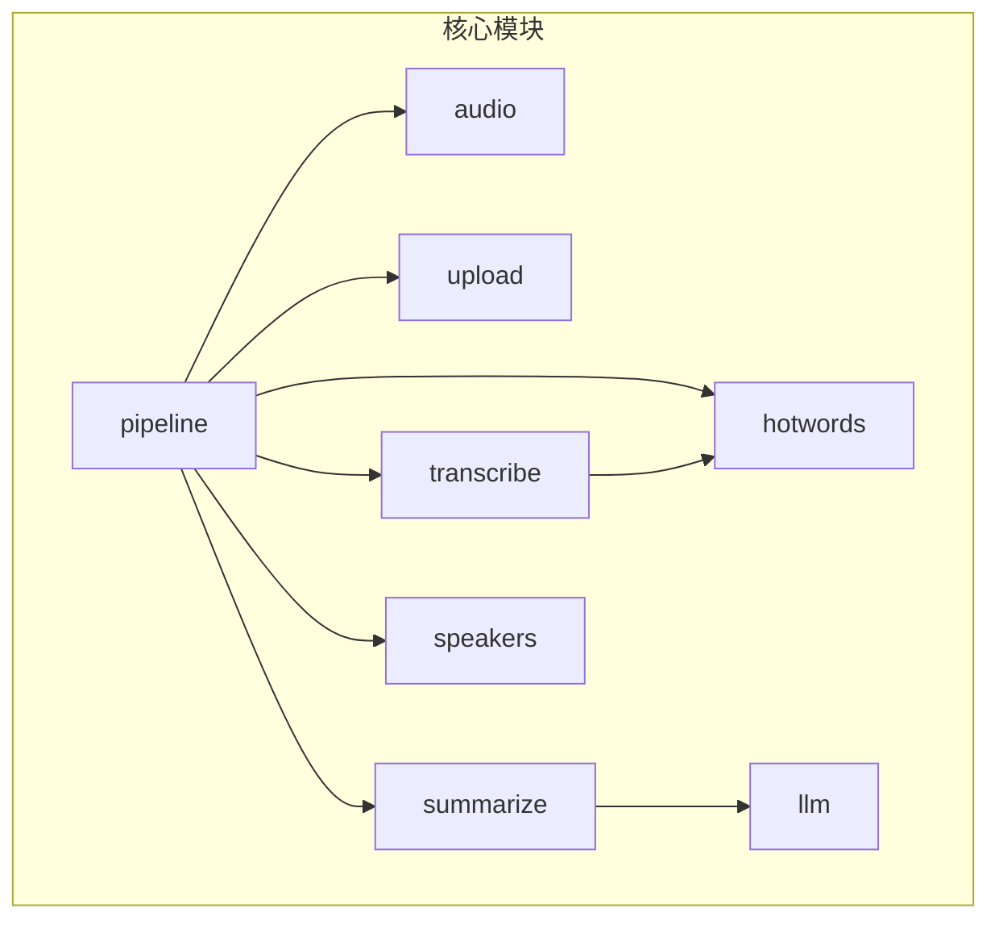
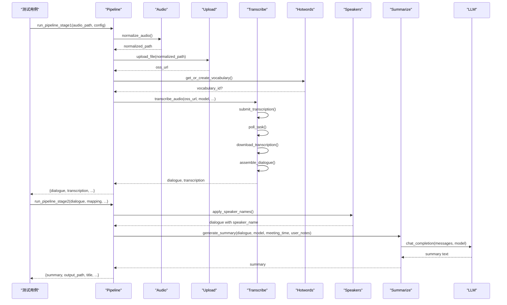
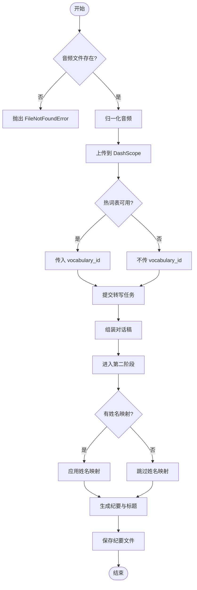
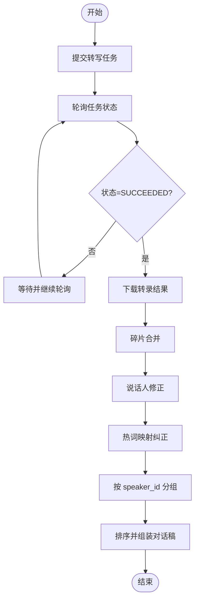

# 单元测试

<cite>
**本文引用的文件**
- [core/pipeline.py](file://core/pipeline.py)
- [core/transcribe.py](file://core/transcribe.py)
- [core/summarize.py](file://core/summarize.py)
- [core/audio.py](file://core/audio.py)
- [core/hotwords.py](file://core/hotwords.py)
- [core/llm.py](file://core/llm.py)
- [core/upload.py](file://core/upload.py)
- [core/speakers.py](file://core/speakers.py)
- [requirements.txt](file://requirements.txt)
- [README.md](file://README.md)
</cite>

## 目录
1. [简介](#简介)
2. [项目结构](#项目结构)
3. [核心组件](#核心组件)
4. [架构总览](#架构总览)
5. [详细组件测试指南](#详细组件测试指南)
6. [依赖分析](#依赖分析)
7. [性能与稳定性考虑](#性能与稳定性考虑)
8. [故障排查指南](#故障排查指南)
9. [结论](#结论)
10. [附录](#附录)

## 简介
本指南面向 open-meeting-scribe 项目的单元测试实践，聚焦以下模块：pipeline、transcribe、summarize、audio、hotwords。文档将说明如何设计测试用例、如何进行 Mock（特别是 DashScope API 和外部服务）、断言方法与测试数据准备的最佳实践、异步代码的测试方法（pytest-asyncio），以及覆盖率要求与命名规范，并提供具体测试示例的代码片段路径指引。

## 项目结构
本项目采用分层模块化组织，核心逻辑集中在 core 目录下：
- pipeline：编排音频归一化、上传、转写、纪要生成与保存
- transcribe：提交并轮询 DashScope 转写任务，组装对话稿
- summarize：构造提示词、调用 LLM 生成纪要与标题、保存输出
- audio：音频归一化、时长查询、系统内录与流式录音
- hotwords：热词表管理、热词映射后处理
- llm：通义千问同步/异步/流式调用封装
- upload：DashScope 临时存储上传与 URL 编码
- speakers：说话人档案与会话映射应用

图表来源
- [core/pipeline.py:1-271](file://core/pipeline.py#L1-L271)
- [core/transcribe.py:1-446](file://core/transcribe.py#L1-L446)
- [core/summarize.py:1-283](file://core/summarize.py#L1-L283)
- [core/audio.py:1-663](file://core/audio.py#L1-L663)
- [core/hotwords.py:1-222](file://core/hotwords.py#L1-L222)
- [core/llm.py:1-207](file://core/llm.py#L1-L207)
- [core/upload.py:1-134](file://core/upload.py#L1-L134)
- [core/speakers.py:1-325](file://core/speakers.py#L1-L325)

章节来源
- [README.md:1-39](file://README.md#L1-L39)
- [requirements.txt:1-32](file://requirements.txt#L1-L32)

## 核心组件
- Pipeline：两阶段管线（stage1 音频→对话稿；stage2 对话稿→纪要）+ 进度回调
- Transcribe：提交转写任务、轮询状态、下载结果、碎片合并、说话人修正、热词映射纠正、按 speaker_id 组装对话稿
- Summarize：构造提示词、调用 LLM 生成纪要/标题、格式化与保存
- Audio：ffmpeg 归一化、ffprobe 时长查询、macOS 系统内录、流式 PCM 读取与暂停恢复
- Hotwords：加载热词、创建词汇表、热词映射后处理
- LLM：同步/异步/流式调用 DashScope OpenAI 兼容端点
- Upload：获取上传凭证、POST 上传到 OSS、返回 oss:// URL
- Speakers：全局说话人档案、会议映射历史、姓名映射应用到对话稿

章节来源
- [core/pipeline.py:35-271](file://core/pipeline.py#L35-L271)
- [core/transcribe.py:54-446](file://core/transcribe.py#L54-L446)
- [core/summarize.py:19-283](file://core/summarize.py#L19-L283)
- [core/audio.py:26-663](file://core/audio.py#L26-L663)
- [core/hotwords.py:28-222](file://core/hotwords.py#L28-L222)
- [core/llm.py:23-207](file://core/llm.py#L23-L207)
- [core/upload.py:25-134](file://core/upload.py#L25-L134)
- [core/speakers.py:35-325](file://core/speakers.py#L35-L325)

## 架构总览
下图展示端到端数据流与关键依赖关系，便于理解测试边界与 Mock 点：

图表来源
- [core/pipeline.py:58-226](file://core/pipeline.py#L58-L226)
- [core/transcribe.py:61-446](file://core/transcribe.py#L61-L446)
- [core/summarize.py:37-229](file://core/summarize.py#L37-L229)
- [core/llm.py:89-160](file://core/llm.py#L89-L160)
- [core/upload.py:59-115](file://core/upload.py#L59-L115)
- [core/hotwords.py:120-139](file://core/hotwords.py#L120-L139)
- [core/speakers.py:278-309](file://core/speakers.py#L278-L309)

## 详细组件测试指南

### 通用测试策略与 Mock 原则
- 隔离外部依赖：所有网络请求（DashScope RESTful API、OSS 上传、LLM 调用）必须通过 Mock 替换，避免真实网络调用与费用。
- 环境变量注入：使用 pytest 的 monkeypatch 或 fixtures 设置 DASHSCOPE_API_KEY，确保函数在测试环境可执行。
- 文件系统隔离：使用 tmp_path 或 pytest 的 tempdir fixture 管理输入/输出文件，避免污染本地 data 目录。
- 时间控制：对超时、轮询等逻辑，使用 freezegun 或 time 模块 patch，保证测试快速稳定。
- 日志验证：必要时捕获 logger 输出，验证关键步骤是否被调用。

章节来源
- [core/transcribe.py:54-58](file://core/transcribe.py#L54-L58)
- [core/upload.py:25-30](file://core/upload.py#L25-L30)
- [core/llm.py:49-53](file://core/llm.py#L49-L53)
- [core/hotwords.py:28-32](file://core/hotwords.py#L28-L32)

### Pipeline 模块测试
- 目标：验证 stage1 与 stage2 的编排流程、进度回调、错误分支与输出格式。
- 关键点：
  - 模拟 normalize_audio、upload_file、get_or_create_vocabulary、transcribe_audio、apply_speaker_names、generate_summary、save_summary。
  - 验证 on_progress 回调的 stage/message/percent 字段是否符合预期。
  - 验证最终返回字典包含 dialogue、transcription、summary、output_path、title、speaker_mapping 等键。
- 建议用例：
  - 正常全流程：从音频到纪要，检查各阶段进度与输出。
  - 无热词场景：vocabulary_id 为 None，仍应成功。
  - 无姓名映射：跳过姓名应用，仍生成纪要。
  - 异常路径：文件不存在、上传失败、转写失败、LLM 超时等。

图表来源
- [core/pipeline.py:58-226](file://core/pipeline.py#L58-L226)

章节来源
- [core/pipeline.py:58-271](file://core/pipeline.py#L58-L271)

### Transcribe 模块测试
- 目标：验证提交任务、轮询、下载、合并、修正、热词映射与对话稿组装。
- 关键点：
  - 模拟 requests.post/get，分别覆盖提交成功、失败、超时、任务状态变化、结果下载。
  - 验证 merge_fragments 在不同边界条件下的行为（跨句拆词、碎片短句、截断句）。
  - 验证 correct_speaker_ids 的夹心修正与碎片跟随策略。
  - 验证 assemble_dialogue 的输出结构与排序。
- 建议用例：
  - 单 transcript 多句子：合并与修正后的句子数量与内容。
  - 多 transcript 合并：确保 all_sentences 聚合正确。
  - 热词映射：验证 apply_hotword_mappings 对中英文词的替换。
  - 异常：空转录、无 results、无 transcription_url。

图表来源
- [core/transcribe.py:61-446](file://core/transcribe.py#L61-L446)

章节来源
- [core/transcribe.py:61-446](file://core/transcribe.py#L61-L446)

### Summarize 模块测试
- 目标：验证提示词构造、LLM 调用、标题生成、纪要保存。
- 关键点：
  - 模拟 llm.chat_completion 与 llm.async_chat_completion，覆盖成功、超时、异常。
  - 验证 generate_title 对空对话、短对话的兜底行为。
  - 验证 generate_summary 对有效对话长度不足时的提示。
  - 验证 save_summary 的文件写入与附加对话稿。
- 建议用例：
  - 正常生成：检查返回字符串非空且包含必要结构。
  - 会议时间回填：若 LLM 未填充，应替换为实际值。
  - 标题限制长度：超过阈值时截断。
  - 保存路径：输出目录自动创建，文件名含时间戳。

章节来源
- [core/summarize.py:37-283](file://core/summarize.py#L37-L283)
- [core/llm.py:89-160](file://core/llm.py#L89-L160)

### Audio 模块测试
- 目标：验证 ffmpeg 归一化、时长查询、录制启动/停止、流式录音暂停恢复。
- 关键点：
  - 使用 subprocess 的 mock 或 side_effect 模拟 ffmpeg/ffprobe 命令，覆盖成功、失败、超时、未安装。
  - 验证 normalize_audio 输出路径与参数。
  - 验证 start_recording/start_recording_with_stream 的状态管理与进程生命周期。
  - 验证 pause/resume 累计暂停时长与 effective_elapsed 计算。
- 建议用例：
  - 归一化：不同采样率/声道数，输出 WAV 文件存在。
  - 时长查询：返回浮点数秒数。
  - 录制：启动后立即停止，校验输出文件非空。
  - 流式：暂停期间不写入文件且不回调，恢复后继续。

章节来源
- [core/audio.py:26-663](file://core/audio.py#L26-L663)

### Hotwords 模块测试
- 目标：验证热词加载、词汇表创建、热词映射后处理。
- 关键点：
  - 模拟 requests.post 创建词汇表，覆盖成功、404、其他异常。
  - 验证 load_hotwords 忽略注释与空行。
  - 验证 apply_hotword_mappings 对纯英文词使用词边界匹配，中文直接子串替换。
- 建议用例：
  - 空文件：返回空列表。
  - 映射文件：长匹配优先，顺序影响替换结果。
  - 创建失败：返回 None，不影响后续流程。

章节来源
- [core/hotwords.py:28-222](file://core/hotwords.py#L28-L222)

### LLM 模块测试
- 目标：验证同步/异步/流式调用 DashScope OpenAI 兼容端点。
- 关键点：
  - 模拟 requests.post 与 httpx.AsyncClient.post，覆盖成功、超时、异常。
  - 验证 _extract_content 提取消息内容。
  - 验证异步客户端连接池复用与关闭。
- 建议用例：
  - 同步调用：返回字符串内容。
  - 异步调用：协程中调用，不阻塞事件循环。
  - 流式调用：逐块 yield 内容，直到 [DONE]。

章节来源
- [core/llm.py:23-207](file://core/llm.py#L23-L207)

### Upload 模块测试
- 目标：验证上传凭证获取与文件上传。
- 关键点：
  - 模拟 requests.get/post，覆盖凭证获取成功、上传成功、失败、超大文件。
  - 验证 encode_oss_url 对特殊字符的编码。
- 建议用例：
  - 正常上传：返回 oss:// URL。
  - 文件过大：抛出 RuntimeError。
  - 编码：含空格/中文的路径正确编码。

章节来源
- [core/upload.py:25-134](file://core/upload.py#L25-L134)

### Speakers 模块测试
- 目标：验证说话人档案 CRUD、会议映射历史、姓名映射应用。
- 关键点：
  - 模拟 JSON 文件读写，覆盖文件不存在、解析异常。
  - 验证 apply_speaker_names 新增 speaker_name 字段。
  - 验证 build_speaker_prompt 拼接发言人说明。
- 建议用例：
  - 添加/更新/删除说话人：持久化到 speakers.json。
  - 会议映射：保存最新映射，支持按会议 ID 查询。
  - 姓名映射：未知 UUID 回退为“说话人X”。

章节来源
- [core/speakers.py:35-325](file://core/speakers.py#L35-L325)

## 依赖分析
- 外部依赖：requests、httpx、python-dotenv、fastapi、uvicorn、websockets、dashscope、numpy、scipy、python-docx、PyPDF2。
- 测试依赖建议：pytest、pytest-asyncio、freezegun、responses（用于 HTTP Mock）、pytest-mock。
- 环境变量：DASHSCOPE_API_KEY 必须在测试环境中设置。

章节来源
- [requirements.txt:1-32](file://requirements.txt#L1-L32)

## 性能与稳定性考虑
- 轮询与超时：transcribe 的 poll_task 需设置合理间隔与超时，测试中用 freezegun 加速时间推进。
- 文件 I/O：audio 与 summarize 涉及大量文件操作，测试中使用临时目录，避免磁盘压力。
- 网络重试：对外部 API 的调用应实现重试与退避，测试中覆盖网络抖动与限流场景。
- 资源清理：流式录音结束后确保进程与线程退出，测试中验证资源释放。

[本节提供一般性指导，无需特定文件引用]

## 故障排查指南
- 常见错误：
  - 未设置 DASHSCOPE_API_KEY：检查环境变量注入。
  - ffmpeg 未安装：audio 模块会抛出运行时错误，测试中需 mock 或安装依赖。
  - 上传失败：检查凭证接口与 OSS 表单字段。
  - LLM 超时：调整超时配置或增加重试。
- 调试技巧：
  - 启用详细日志，观察关键步骤。
  - 使用 pytest -s 打印 stdout/stderr。
  - 针对异步代码，使用 pytest-asyncio 的 @pytest.mark.asyncio 装饰器。

章节来源
- [core/transcribe.py:54-58](file://core/transcribe.py#L54-L58)
- [core/upload.py:25-30](file://core/upload.py#L25-L30)
- [core/llm.py:49-53](file://core/llm.py#L49-L53)
- [core/audio.py:82-98](file://core/audio.py#L82-L98)

## 结论
本指南提供了 open-meeting-scribe 核心模块的单元测试设计与实现要点，涵盖 Mock 策略、断言方法、测试数据准备、异步测试与覆盖率要求。通过严格的隔离与模拟，可确保测试的稳定性和可重复性，同时提升代码质量与可维护性。

[本节为总结性内容，无需特定文件引用]

## 附录

### 测试命名规范
- 文件名：test_<模块名>.py
- 测试类：Test<模块名>
- 测试方法：test_<功能>_<场景>
- 示例：test_pipeline_stage1_success、test_transcribe_merge_fragments_fragment、test_summarize_generate_title_empty

### 覆盖率要求
- 语句覆盖率 ≥ 80%
- 分支覆盖率 ≥ 70%
- 重点模块（pipeline、transcribe、summarize）覆盖率 ≥ 90%

### 异步测试方法
- 使用 pytest-asyncio：@pytest.mark.asyncio
- 使用 asyncio.run 或 await 调用协程
- 模拟异步 HTTP 客户端：mock httpx.AsyncClient

### 测试数据准备最佳实践
- 使用 pytest tmp_path 创建临时目录
- 预置最小化音频文件（如 1 秒静音 WAV）
- 构造最小化对话稿与转录结果 JSON
- 使用 fixtures 共享测试数据

### 具体测试示例代码片段路径
- Pipeline 正常流程：参考 [core/pipeline.py:58-226](file://core/pipeline.py#L58-L226)
- Transcribe 提交与轮询：参考 [core/transcribe.py:61-176](file://core/transcribe.py#L61-L176)
- Summarize 标题生成：参考 [core/summarize.py:37-84](file://core/summarize.py#L37-L84)
- Audio 归一化：参考 [core/audio.py:31-98](file://core/audio.py#L31-L98)
- Hotwords 映射应用：参考 [core/hotwords.py:187-221](file://core/hotwords.py#L187-L221)
- LLM 同步调用：参考 [core/llm.py:89-121](file://core/llm.py#L89-L121)
- Upload 上传流程：参考 [core/upload.py:59-115](file://core/upload.py#L59-L115)
- Speakers 姓名映射：参考 [core/speakers.py:278-309](file://core/speakers.py#L278-L309)