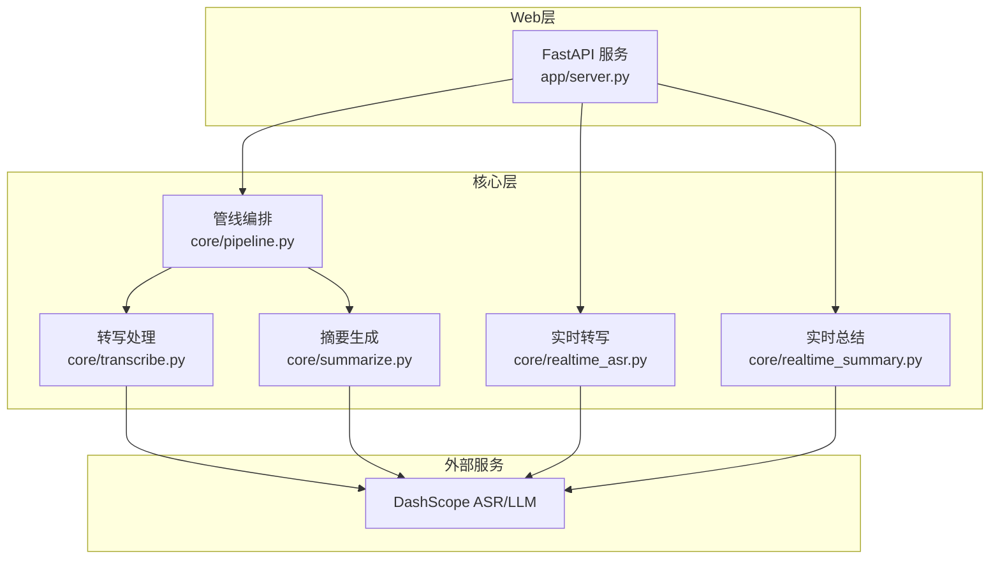
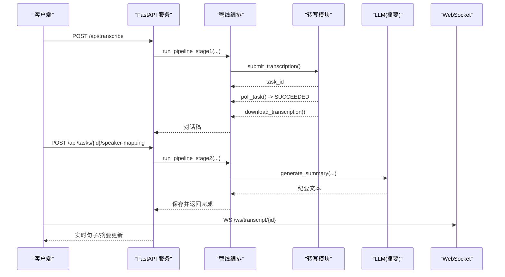
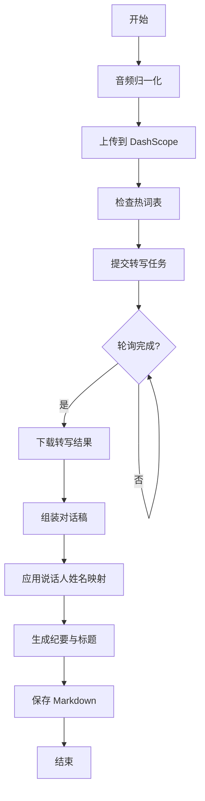
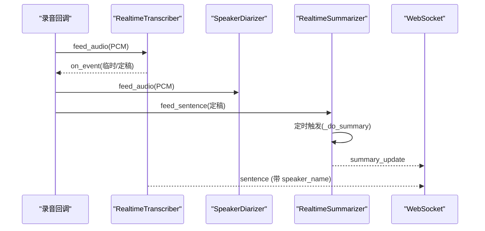
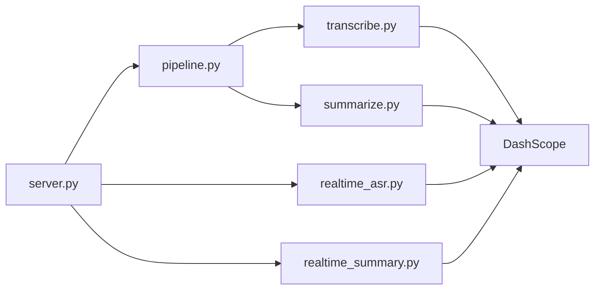

# 性能测试

<cite>
**本文引用的文件**
- [README.md](file://README.md)
- [ARCHITECTURE.md](file://docs/ARCHITECTURE.md)
- [server.py](file://app/server.py)
- [pipeline.py](file://core/pipeline.py)
- [transcribe.py](file://core/transcribe.py)
- [realtime_asr.py](file://core/realtime_asr.py)
- [summarize.py](file://core/summarize.py)
- [realtime_summary.py](file://core/realtime_summary.py)
- [cli.py](file://cli.py)
- [requirements.txt](file://requirements.txt)
</cite>

## 目录
1. [简介](#简介)
2. [项目结构](#项目结构)
3. [核心组件](#核心组件)
4. [架构总览](#架构总览)
5. [详细组件分析](#详细组件分析)
6. [依赖关系分析](#依赖关系分析)
7. [性能指标与监控](#性能指标与监控)
8. [基准测试方案](#基准测试方案)
9. [压力测试方案](#压力测试方案)
10. [工具与脚本](#工具与脚本)
11. [瓶颈识别与优化建议](#瓶颈识别与优化建议)
12. [性能回归自动化](#性能回归自动化)
13. [故障排查指南](#故障排查指南)
14. [结论](#结论)

## 简介
本指南面向 open-meeting-scribe 的性能测试，覆盖以下目标：
- 对核心功能进行基准测试：音频转写速度、实时转写延迟、摘要生成时间。
- 设计压力测试：模拟多用户并发上传、录制与纪要生成。
- 定义并采集关键性能指标：CPU、内存、响应时间、吞吐、错误率等。
- 提供基于 locust、pytest-benchmark 等的实施方案与示例。
- 给出瓶颈识别方法与优化建议，以及性能回归的自动化策略。

## 项目结构
系统采用分层架构：Web 服务（FastAPI）暴露 API 与 WebSocket；核心管线编排音频归一化、上传、转写、说话人分离、摘要生成与保存；实时链路包含流式录音、实时 ASR、声纹聚类与增量总结。

图表来源
- [server.py:1-800](file://app/server.py#L1-L800)
- [pipeline.py:1-271](file://core/pipeline.py#L1-L271)
- [transcribe.py:1-446](file://core/transcribe.py#L1-L446)
- [realtime_asr.py:1-368](file://core/realtime_asr.py#L1-L368)
- [realtime_summary.py:1-270](file://core/realtime_summary.py#L1-L270)
- [summarize.py:1-283](file://core/summarize.py#L1-L283)

章节来源
- [README.md:1-39](file://README.md#L1-L39)
- [ARCHITECTURE.md:1-51](file://docs/ARCHITECTURE.md#L1-L51)

## 核心组件
- Web 服务与任务编排：负责接收上传、启动后台任务、维护任务状态、WebSocket 推送实时结果。
- 批处理管线：音频归一化 → 上传 → 转写（含说话人分离）→ 对话稿组装 → 摘要生成 → 保存 Markdown。
- 实时链路：流式录音 → PCM 回调 → 实时 ASR → 声纹聚类 → 增量总结 → WebSocket 推送。
- LLM 调用：用于标题与纪要生成，支持上下文增强与热词。

章节来源
- [server.py:226-333](file://app/server.py#L226-L333)
- [pipeline.py:58-227](file://core/pipeline.py#L58-L227)
- [transcribe.py:61-131](file://core/transcribe.py#L61-L131)
- [realtime_asr.py:150-368](file://core/realtime_asr.py#L150-L368)
- [realtime_summary.py:68-270](file://core/realtime_summary.py#L68-L270)
- [summarize.py:37-85](file://core/summarize.py#L37-L85)

## 架构总览
端到端数据流与关键路径：
- 上传转写：POST /api/transcribe → 后台 run_pipeline_stage1 → transcribe_audio → 轮询 → 下载 → 组装对话稿 → 等待说话人映射 → run_pipeline_stage2 → summarize → 保存。
- 实时转写：POST /api/record/start → 启动 RealtimeTranscriber + SpeakerDiarizer + RealtimeSummarizer → PCM 回调 feed_audio → 定稿句子回调 → WebSocket 推送 → 增量总结定时触发。

图表来源
- [server.py:343-396](file://app/server.py#L343-L396)
- [server.py:630-671](file://app/server.py#L630-L671)
- [pipeline.py:58-227](file://core/pipeline.py#L58-L227)
- [transcribe.py:61-131](file://core/transcribe.py#L61-L131)
- [summarize.py:157-229](file://core/summarize.py#L157-L229)

## 详细组件分析

### 批处理管线（转写+摘要）
- 阶段1：音频归一化、上传、热词表检查、提交转写任务、轮询、下载结果、组装对话稿。
- 阶段2：应用说话人姓名映射、生成纪要与标题、保存 Markdown。
- 进度回调：PipelineProgress 提供阶段与百分比，便于前端展示与性能计时。

图表来源
- [pipeline.py:58-227](file://core/pipeline.py#L58-L227)

章节来源
- [pipeline.py:58-227](file://core/pipeline.py#L58-L227)

### 实时转写与增量总结
- 实时转写：建立 WebSocket 连接，按帧送入 PCM，回调中合并热词映射，区分临时结果与定稿句子。
- 增量总结：每 60 秒触发一次，首次使用当前缓冲，后续以“上次摘要+新增内容”增量更新，降低 token 消耗与延迟。
- 线程模型：SDK 内部线程管理连接，定时器在独立线程执行，通过事件循环投递消息，避免阻塞主事件循环。

图表来源
- [realtime_asr.py:150-368](file://core/realtime_asr.py#L150-L368)
- [realtime_summary.py:68-270](file://core/realtime_summary.py#L68-L270)
- [server.py:721-800](file://app/server.py#L721-L800)

章节来源
- [realtime_asr.py:150-368](file://core/realtime_asr.py#L150-L368)
- [realtime_summary.py:68-270](file://core/realtime_summary.py#L68-L270)
- [server.py:721-800](file://app/server.py#L721-L800)

### 摘要生成
- 标题生成：截取对话前若干字符构造 prompt，限制输出长度。
- 纪要生成：构建结构化提示词，注入说话人信息、会议时间、用户笔记，调用 LLM 生成 Markdown。
- 后处理：兜底替换“未提供”为实际值，确保输出一致性。

章节来源
- [summarize.py:37-85](file://core/summarize.py#L37-L85)
- [summarize.py:157-229](file://core/summarize.py#L157-L229)

## 依赖关系分析
- 外部依赖：DashScope RESTful/WS（ASR/LLM）、ffmpeg、BlackHole（内录）。
- Python 依赖：requests、httpx、fastapi、uvicorn、dashscope、websockets、numpy、scipy、python-docx、PyPDF2。
- 耦合点：
  - server.py 依赖 pipeline、audio、realtime_asr、realtime_summary、speakers、llm。
  - pipeline 依赖 audio、upload、transcribe、hotwords、summarize、speakers。
  - realtime_asr 依赖 dashscope SDK 与 hotwords。
  - realtime_summary 依赖 llm。

图表来源
- [server.py:1-800](file://app/server.py#L1-L800)
- [pipeline.py:1-271](file://core/pipeline.py#L1-L271)
- [transcribe.py:1-446](file://core/transcribe.py#L1-L446)
- [realtime_asr.py:1-368](file://core/realtime_asr.py#L1-L368)
- [realtime_summary.py:1-270](file://core/realtime_summary.py#L1-L270)
- [summarize.py:1-283](file://core/summarize.py#L1-L283)

章节来源
- [requirements.txt:1-32](file://requirements.txt#L1-L32)

## 性能指标与监控
- 关键指标
  - 转写速度：单位时间内处理的音频时长（分钟/小时），端到端耗时（提交→SUCCEEDED→下载→组装）。
  - 实时转写延迟：从 PCM 输入到收到定稿句子的时延（ms），以及临时结果的刷新频率。
  - 摘要生成时间：从对话稿输入到 Markdown 输出的耗时（s）。
  - 吞吐：QPS（上传/查询/下载）、并发会话数（WebSocket 连接数）。
  - 资源占用：CPU 使用率、内存峰值、磁盘 I/O（上传/下载/写入）。
  - 可靠性：错误率、超时率、重试次数、限流次数。
- 采集方法
  - 服务端日志：PipelineProgress、转写轮询状态、实时转写回调计数、总结周期统计。
  - 系统级监控：top/htop、vmstat、iostat、netstat、lsof、perf、eBPF（可选）。
  - 应用埋点：在关键函数入口/出口记录时间戳，计算阶段耗时；统计失败与重试。
  - 网络观测：抓包或代理记录 DashScope 请求耗时与大小。

章节来源
- [pipeline.py:47-56](file://core/pipeline.py#L47-L56)
- [transcribe.py:134-176](file://core/transcribe.py#L134-L176)
- [realtime_asr.py:216-327](file://core/realtime_asr.py#L216-L327)
- [realtime_summary.py:188-270](file://core/realtime_summary.py#L188-L270)

## 基准测试方案
- 目标
  - 转写速度：测量不同时长音频的端到端耗时与吞吐。
  - 实时转写延迟：测量 PCM 输入到定稿句子的平均/分位延迟。
  - 摘要生成时间：测量不同对话长度的摘要生成耗时。
- 场景设计
  - 单文件基准：选取短/中/长音频各若干，重复多次取均值与分位。
  - 实时延迟：固定采样率与帧大小，连续送入 PCM，记录回调时间差。
  - 摘要规模：控制对话句数与字符数，观察线性增长趋势。
- 数据采集
  - 在 pipeline 各阶段打点（归一化、上传、转写、汇总、保存）。
  - 在 realtime_asr 回调中记录 begin_time/end_time 与处理时间。
  - 在 summarize 前后记录耗时。
- 结果呈现
  - 表格：场景、文件大小、时长、端到端耗时、P95/P99、吞吐。
  - 曲线：实时延迟分布、摘要耗时随对话长度变化。

章节来源
- [pipeline.py:58-227](file://core/pipeline.py#L58-L227)
- [realtime_asr.py:111-144](file://core/realtime_asr.py#L111-L144)
- [summarize.py:157-229](file://core/summarize.py#L157-L229)

## 压力测试方案
- 目标
  - 验证多用户并发上传、录制与纪要生成的稳定性与性能。
  - 评估服务在高峰期的 CPU/内存/网络瓶颈与错误率。
- 场景
  - 并发上传：N 个客户端同时 POST /api/transcribe，持续 M 分钟。
  - 并发录制：K 个 WebSocket 连接同时 /api/record/start，持续 N 分钟。
  - 混合负载：上传+查询+下载+WebSocket 推送的组合。
- 参数
  - 并发度：根据服务器规格设定（如 10/50/100）。
  - 持续时间：至少 10 分钟，包含预热与冷却。
  - 速率：逐步提升 QPS，观察拐点。
- 指标
  - 响应时间（P50/P90/P95/P99）、错误率、吞吐、资源利用率、队列积压。
- 风险控制
  - 限流保护：服务端对实时连接与上传速率做上限控制。
  - 降级策略：当 LLM/ASR 限流时，自动重试与退避，记录失败原因。

章节来源
- [server.py:343-396](file://app/server.py#L343-L396)
- [server.py:721-800](file://app/server.py#L721-L800)
- [transcribe.py:134-176](file://core/transcribe.py#L134-L176)
- [realtime_asr.py:216-327](file://core/realtime_asr.py#L216-L327)

## 工具与脚本
- locust（HTTP/WebSocket 压测）
  - 编写 TaskSet：
    - upload_task：POST /api/transcribe，携带音频文件。
    - record_start/stop：POST /api/record/start、/api/record/stop。
    - ws_client：连接 /ws/transcript/{id}，订阅句子与摘要更新。
  - 配置用户数、速率、持续时间，收集报告。
- pytest-benchmark（函数级基准）
  - 针对 transcribe_audio、generate_summary、merge_fragments、correct_speaker_ids 等热点函数编写基准用例。
  - 使用不同数据集（短句/长句、多说话人）对比性能。
- 命令行辅助
  - 使用 cli.py 的 transcribe/normalize/upload 命令快速准备样本与验证流程。
  - 结合 time 命令与系统监控采集整体耗时与资源。

章节来源
- [cli.py:103-148](file://cli.py#L103-L148)
- [cli.py:175-198](file://cli.py#L175-L198)
- [transcribe.py:222-352](file://core/transcribe.py#L222-L352)
- [summarize.py:157-229](file://core/summarize.py#L157-L229)

## 瓶颈识别与优化建议
- 常见瓶颈
  - 网络：上传/下载大文件、DashScope 接口延迟与限流。
  - 外部服务：ASR/LLM 排队与配额限制。
  - 本地处理：音频归一化、句子合并与说话人修正的计算开销。
  - 实时链路：PCM 回调频率、WebSocket 推送拥塞。
- 优化方向
  - 异步与并发：使用 httpx 异步客户端减少阻塞；合理设置后台任务数量。
  - 重试与退避：对限流错误实施指数退避，避免雪崩。
  - 数据裁剪：摘要生成时截断对话文本，控制 token 消耗。
  - 缓存与复用：热词表、最近映射复用，减少重复计算。
  - 资源隔离：将重型任务放入独立进程/容器，避免影响 Web 服务。
  - 监控告警：对关键指标设置阈值，异常时自动告警与降级。

章节来源
- [requirements.txt:1-32](file://requirements.txt#L1-L32)
- [transcribe.py:134-176](file://core/transcribe.py#L134-L176)
- [realtime_asr.py:216-327](file://core/realtime_asr.py#L216-L327)
- [summarize.py:51-85](file://core/summarize.py#L51-L85)

## 性能回归自动化
- CI 集成
  - 在 PR 合并前运行 pytest-benchmark 基准集，比较基线结果，超阈失败。
  - 运行 locust 轻量压测（低并发、短时间），检查错误率与 P95 是否退化。
- 基线管理
  - 维护基准数据集（短/中/长音频、不同对话规模）。
  - 记录每次运行的环境（Python、依赖版本、硬件）。
- 报告与告警
  - 生成 HTML 报告，归档至制品库。
  - 对关键指标（P95、错误率、CPU/内存）设置告警规则。

章节来源
- [cli.py:103-148](file://cli.py#L103-L148)
- [pipeline.py:58-227](file://core/pipeline.py#L58-L227)
- [transcribe.py:222-352](file://core/transcribe.py#L222-L352)
- [summarize.py:157-229](file://core/summarize.py#L157-L229)

## 故障排查指南
- 常见问题
  - 未设置 API Key：检查环境变量 DASHSCOPE_API_KEY。
  - 限流错误：查看实时转写重试日志，调整并发与退避策略。
  - 超时：检查轮询超时与网络状况，必要时延长超时或重试。
  - 空结果：确认上传 URL 有效、转写结果为空时的处理逻辑。
- 定位方法
  - 启用详细日志，关注 PipelineProgress、任务状态变化、回调计数。
  - 使用系统工具定位 CPU/内存/IO 热点。
  - 抓包分析 DashScope 请求与响应。

章节来源
- [transcribe.py:54-58](file://core/transcribe.py#L54-L58)
- [transcribe.py:134-176](file://core/transcribe.py#L134-L176)
- [realtime_asr.py:216-327](file://core/realtime_asr.py#L216-L327)
- [server.py:92-129](file://app/server.py#L92-L129)

## 结论
通过系统的基准与压力测试，结合完善的监控与自动化回归，可全面掌握 open-meeting-scribe 的性能表现与瓶颈，指导优化与容量规划。建议在开发过程中持续运行性能测试，确保新功能不引入性能退化，并在生产环境保持稳定的用户体验。