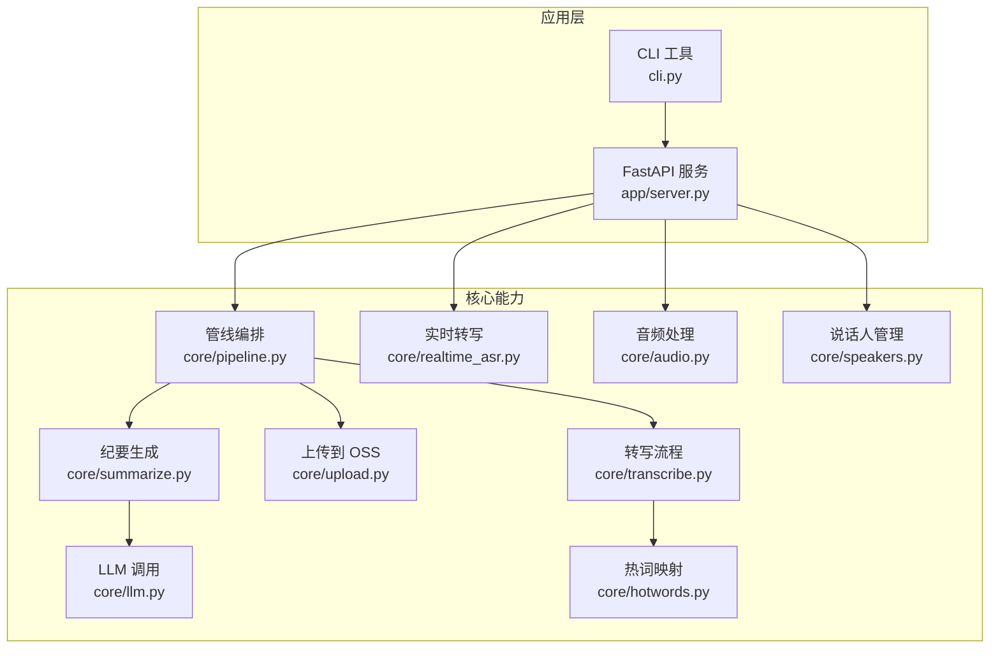
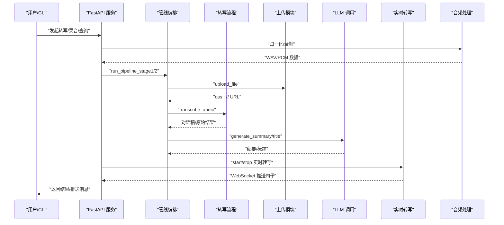
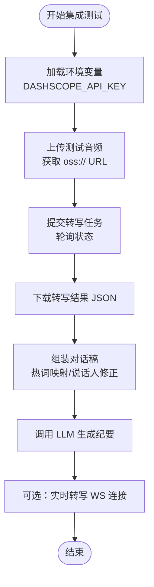
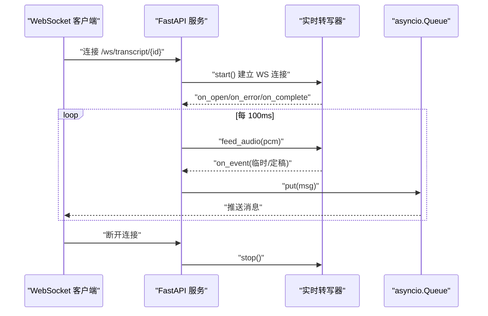
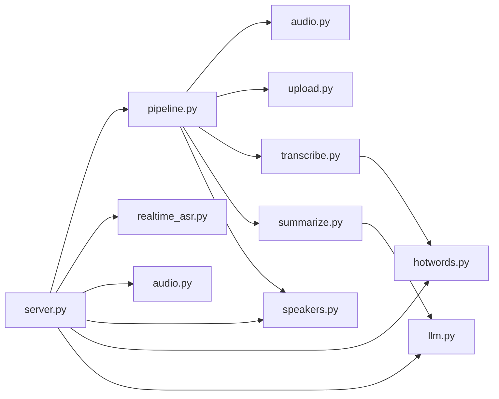

# 测试指南

<cite>
**本文引用的文件**
- [README.md](file://README.md)
- [requirements.txt](file://requirements.txt)
- [app/server.py](file://app/server.py)
- [core/pipeline.py](file://core/pipeline.py)
- [core/transcribe.py](file://core/transcribe.py)
- [core/upload.py](file://core/upload.py)
- [core/llm.py](file://core/llm.py)
- [core/realtime_asr.py](file://core/realtime_asr.py)
- [core/audio.py](file://core/audio.py)
- [core/summarize.py](file://core/summarize.py)
- [core/hotwords.py](file://core/hotwords.py)
- [core/speakers.py](file://core/speakers.py)
- [cli.py](file://cli.py)
</cite>

## 目录
1. [简介](#简介)
2. [项目结构](#项目结构)
3. [核心组件](#核心组件)
4. [架构总览](#架构总览)
5. [详细组件分析](#详细组件分析)
6. [依赖关系分析](#依赖关系分析)
7. [性能考虑](#性能考虑)
8. [故障排查指南](#故障排查指南)
9. [结论](#结论)
10. [附录](#附录)

## 简介
本测试指南面向 open-meeting-scribe 项目的开发与维护，目标是建立一套可落地的测试体系，覆盖单元测试、集成测试（特别是与 DashScope API 的交互）、异步代码（WebSocket 连接与流式处理）测试、测试数据管理、性能与压力测试，以及覆盖率要求与持续集成配置。文档基于仓库现有代码结构与实现细节，提供循序渐进的说明与可视化图示，帮助不同技术背景的读者快速上手并高质量落地测试。

## 项目结构
- 应用层：FastAPI Web 服务与 WebSocket 端点，负责任务编排、实时转写推送、录音控制等。
- 核心能力：音频归一化与录制、上传至 DashScope OSS、转写任务提交与轮询、对话稿组装、LLM 纪要生成、热词映射、说话人档案管理等。
- 命令行工具：提供便捷入口用于本地调试与端到端验证。

**图表来源**
- [app/server.py:1-200](file://app/server.py#L1-L200)
- [core/pipeline.py:1-271](file://core/pipeline.py#L1-L271)
- [core/transcribe.py:1-446](file://core/transcribe.py#L1-L446)
- [core/upload.py:1-134](file://core/upload.py#L1-L134)
- [core/llm.py:1-207](file://core/llm.py#L1-L207)
- [core/realtime_asr.py:1-368](file://core/realtime_asr.py#L1-L368)
- [core/audio.py:1-663](file://core/audio.py#L1-L663)
- [core/hotwords.py:1-222](file://core/hotwords.py#L1-L222)
- [core/speakers.py:1-325](file://core/speakers.py#L1-L325)
- [core/summarize.py:1-283](file://core/summarize.py#L1-L283)
- [cli.py:1-657](file://cli.py#L1-L657)

**章节来源**
- [README.md:1-39](file://README.md#L1-L39)
- [requirements.txt:1-32](file://requirements.txt#L1-L32)

## 核心组件
- 管线编排：串联音频归一化、上传、转写、说话人姓名化、纪要生成与保存，并提供进度回调。
- 转写流程：提交异步转写任务、轮询状态、下载结果、碎片合并与说话人修正、热词映射纠正、按说话人归并。
- 上传模块：获取上传凭证、POST 上传到 OSS、返回 oss:// URL。
- LLM 调用：同步/异步/流式三种方式调用通义千问 OpenAI 兼容端点。
- 实时转写：封装 DashScope SDK 的 WebSocket 流式识别，支持重试与上下文增强。
- 音频处理：ffmpeg 归一化、时长查询、系统内录与流式 PCM 管道。
- 热词映射：加载映射表并对文本进行后处理纠正。
- 说话人管理：全局档案与会话映射，应用姓名到对话稿。
- 纪要生成：构造提示词、调用 LLM、输出 Markdown 并保存。

**章节来源**
- [core/pipeline.py:35-271](file://core/pipeline.py#L35-L271)
- [core/transcribe.py:54-446](file://core/transcribe.py#L54-L446)
- [core/upload.py:25-134](file://core/upload.py#L25-L134)
- [core/llm.py:23-207](file://core/llm.py#L23-L207)
- [core/realtime_asr.py:29-368](file://core/realtime_asr.py#L29-L368)
- [core/audio.py:26-663](file://core/audio.py#L26-L663)
- [core/hotwords.py:28-222](file://core/hotwords.py#L28-L222)
- [core/speakers.py:35-325](file://core/speakers.py#L35-L325)
- [core/summarize.py:19-283](file://core/summarize.py#L19-L283)

## 架构总览
整体架构围绕“音频输入 → 转写 → 纪要”的主路径展开，同时提供实时预览与 WebSocket 推送。Web 服务作为入口，协调各核心模块；CLI 提供便捷操作；外部依赖包括 DashScope REST/WS 接口与 ffmpeg。

**图表来源**
- [app/server.py:1-200](file://app/server.py#L1-L200)
- [core/pipeline.py:58-271](file://core/pipeline.py#L58-L271)
- [core/transcribe.py:61-446](file://core/transcribe.py#L61-L446)
- [core/upload.py:59-134](file://core/upload.py#L59-L134)
- [core/llm.py:89-207](file://core/llm.py#L89-L207)
- [core/realtime_asr.py:150-368](file://core/realtime_asr.py#L150-L368)
- [core/audio.py:303-663](file://core/audio.py#L303-L663)

## 详细组件分析

### 单元测试编写规范
- 目标：对纯函数与无副作用逻辑进行隔离测试，确保边界条件、异常分支与数据转换正确。
- 建议用例设计：
  - 音频归一化：输入不存在、ffmpeg 不可用、超时、输出路径创建、时长查询失败等。
  - 转写后处理：碎片合并策略（跨句拆词、短句阈值、截断判断）、说话人修正（夹心模式、连续短句跟随）、热词映射替换（ASCII 词边界匹配、中文子串替换）。
  - 说话人管理：添加/更新/删除/查找、会议映射历史保存与读取、姓名应用到对话稿。
  - 上传模块：凭证获取失败、文件过大、OSS POST 失败、URL 编码。
  - LLM 调用：同步/异步/流式调用的超时与异常处理、响应解析。
  - 实时转写：启动重试（限流错误检测）、回调线程安全、停止清理。
- Mock 策略：
  - 使用 unittest.mock 或 pytest-mock 对外部依赖（requests、httpx、dashscope SDK、subprocess）进行打桩。
  - 对网络请求使用 responses/httpx_mock 模拟 HTTP 响应；对 WebSocket 使用 websockets-server 或 mock 回调。
  - 对文件系统与进程调用（ffmpeg/ffprobe）使用临时目录与假命令输出。
- 断言方法：
  - 断言返回值类型与结构（如对话稿列表字段完整性）。
  - 断言异常类型与消息片段（如未设置 API Key、文件不存在、超时）。
  - 断言日志输出（捕获 logging 输出验证关键信息）。
  - 断言回调触发次数与参数（实时转写回调、进度回调）。

**章节来源**
- [core/audio.py:26-126](file://core/audio.py#L26-L126)
- [core/transcribe.py:193-403](file://core/transcribe.py#L193-L403)
- [core/hotwords.py:145-222](file://core/hotwords.py#L145-L222)
- [core/speakers.py:109-325](file://core/speakers.py#L109-L325)
- [core/upload.py:25-134](file://core/upload.py#L25-L134)
- [core/llm.py:89-207](file://core/llm.py#L89-L207)
- [core/realtime_asr.py:150-368](file://core/realtime_asr.py#L150-L368)

### 集成测试方案（DashScope API 交互）
- 目标：在受控环境下验证与 DashScope REST/WS 接口的交互，包括上传凭证、转写任务提交与轮询、LLM 调用、实时转写连接。
- 实施要点：
  - 使用 .env 配置 DASHSCOPE_API_KEY，并通过环境变量注入测试环境。
  - 针对上传与转写：准备小体积测试音频，校验 oss:// URL 返回与任务状态流转（pending → processing → succeeded/failed）。
  - 针对 LLM：构造最小 messages 请求，校验响应内容与长度限制。
  - 针对实时转写：建立 WebSocket 连接，发送 PCM 帧，验证回调事件（on_partial/on_sentence_end/on_error/on_complete）。
- 风险与降级：
  - 网络波动或限流：增加重试与退避策略测试，验证错误消息与恢复行为。
  - 鉴权失败：校验未设置 API Key 时的异常抛出。
  - 资源限制：文件大小上限、并发请求数限制。

**图表来源**
- [core/upload.py:59-134](file://core/upload.py#L59-L134)
- [core/transcribe.py:61-446](file://core/transcribe.py#L61-L446)
- [core/llm.py:89-207](file://core/llm.py#L89-L207)
- [core/realtime_asr.py:150-368](file://core/realtime_asr.py#L150-L368)

**章节来源**
- [core/upload.py:25-134](file://core/upload.py#L25-L134)
- [core/transcribe.py:54-446](file://core/transcribe.py#L54-L446)
- [core/llm.py:23-207](file://core/llm.py#L23-L207)
- [core/realtime_asr.py:29-368](file://core/realtime_asr.py#L29-L368)

### 异步代码测试方法（WebSocket 与流式处理）
- 目标：验证 FastAPI 异步端点与 WebSocket 推送的正确性，确保不阻塞事件循环且回调线程安全。
- 实施要点：
  - 使用 httpx.AsyncClient 与 websockets 客户端进行异步测试。
  - 对 _push_realtime_msg 等线程间消息投递进行队列消费测试，验证消息顺序与内容。
  - 对 RealtimeTranscriber 的 start/stop/feed_audio 进行生命周期测试，验证重试与错误回调。
  - 对音频流式读取线程（_stream_reader_loop）进行并发与暂停/恢复场景测试。
- 断言重点：
  - 事件循环中协程执行顺序与超时处理。
  - 回调触发时机与参数完整性（临时结果与定稿句子）。
  - 资源清理（WebSocket 关闭、进程终止、线程退出）。

**图表来源**
- [app/server.py:171-200](file://app/server.py#L171-L200)
- [core/realtime_asr.py:150-368](file://core/realtime_asr.py#L150-L368)

**章节来源**
- [app/server.py:1-200](file://app/server.py#L1-L200)
- [core/realtime_asr.py:150-368](file://core/realtime_asr.py#L150-L368)
- [core/audio.py:389-438](file://core/audio.py#L389-L438)

### 测试数据准备与管理策略
- 音频数据：准备多种格式与时长的小样本（MP3/WAV/FLAC），包含静音段、多人对话、噪声场景。
- 热词与映射：维护 data/hotwords.txt 与 data/hotword_mappings.txt，覆盖常见误识别与术语。
- 说话人档案：data/speakers.json 预置常用人员，meeting_mappings.json 记录历史映射以便复用。
- 任务持久化：data/tasks/*.json 用于恢复与验证任务状态。
- 环境变量：通过 .env 管理 DASHSCOPE_API_KEY、RECORD_DEVICE 等敏感配置。
- 隔离策略：测试时切换工作目录或使用临时目录，避免污染生产数据。

**章节来源**
- [core/hotwords.py:35-54](file://core/hotwords.py#L35-L54)
- [core/hotwords.py:145-179](file://core/hotwords.py#L145-L179)
- [core/speakers.py:109-131](file://core/speakers.py#L109-L131)
- [core/speakers.py:205-252](file://core/speakers.py#L205-L252)
- [app/server.py:92-129](file://app/server.py#L92-L129)

### 性能测试与压力测试
- 目标：评估高并发上传、转写任务轮询、LLM 调用与实时转写的吞吐与延迟。
- 实施方法：
  - 使用 locust/k6 对 FastAPI 端点进行压测，模拟多用户同时上传与查询。
  - 对转写任务批量提交与轮询进行并发测试，观察超时与失败率。
  - 对 LLM 调用进行流式与非流式对比，测量首字延迟与总耗时。
  - 对实时转写进行长时间运行测试，验证内存占用与回调稳定性。
- 指标关注：
  - 响应时间（P50/P95/P99）、错误率、CPU/内存使用、网络带宽。
  - 重试成功率、限流处理效果、资源释放及时性。

[本节为通用指导，无需具体文件引用]

### 测试覆盖率要求与持续集成配置
- 覆盖率要求：
  - 核心逻辑模块（pipeline、transcribe、audio、hotwords、speakers、llm、realtime_asr、upload、summarize）行覆盖率 ≥ 80%。
  - 关键分支（异常路径、边界条件）需覆盖，尤其是网络超时、文件不存在、权限不足等。
- 持续集成：
  - 在 CI 中安装依赖（requirements.txt），设置 .env 环境变量。
  - 执行单元测试与集成测试（可分阶段：单元→集成→端到端）。
  - 生成覆盖率报告（pytest-cov），并在 PR 中展示差异。
  - 缓存依赖与构建产物，缩短流水线时间。

**章节来源**
- [requirements.txt:1-32](file://requirements.txt#L1-L32)

## 依赖关系分析
- 模块耦合：
  - pipeline 依赖 audio、upload、transcribe、hotwords、summarize、speakers。
  - server 依赖 pipeline、audio、realtime_asr、realtime_summary、diarization、speakers、projects、users、hotwords、llm。
  - transcribe 依赖 hotwords 进行后处理。
  - summarize 依赖 llm。
- 外部依赖：
  - requests/httpx 用于 HTTP 请求。
  - dashscope SDK 用于实时转写。
  - websockets 用于 FastAPI WebSocket。
  - ffmpeg/ffprobe 用于音频处理。
- 潜在循环依赖：当前未见明显循环导入，但需注意在测试中避免初始化真实服务。

**图表来源**
- [core/pipeline.py:1-271](file://core/pipeline.py#L1-L271)
- [core/transcribe.py:1-446](file://core/transcribe.py#L1-L446)
- [core/summarize.py:1-283](file://core/summarize.py#L1-L283)
- [core/llm.py:1-207](file://core/llm.py#L1-L207)
- [core/hotwords.py:1-222](file://core/hotwords.py#L1-L222)
- [core/speakers.py:1-325](file://core/speakers.py#L1-L325)
- [core/upload.py:1-134](file://core/upload.py#L1-L134)
- [core/audio.py:1-663](file://core/audio.py#L1-L663)
- [core/realtime_asr.py:1-368](file://core/realtime_asr.py#L1-L368)
- [app/server.py:1-200](file://app/server.py#L1-L200)

**章节来源**
- [core/pipeline.py:1-271](file://core/pipeline.py#L1-L271)
- [app/server.py:1-200](file://app/server.py#L1-L200)

## 性能考虑
- 网络请求：复用 httpx.AsyncClient 连接池，减少握手开销。
- 音频处理：合理设置 chunk_size 与超时，避免阻塞与内存峰值。
- 实时转写：指数退避重试，降低限流影响；保持心跳防止连接中断。
- 任务轮询：调整 POLL_INTERVAL 与 TIMEOUT，平衡响应速度与资源消耗。
- 文件 IO：写入大文件时使用缓冲与异步 I/O，避免阻塞事件循环。

[本节为通用指导，无需具体文件引用]

## 故障排查指南
- 常见问题：
  - 未设置 DASHSCOPE_API_KEY：检查 .env 与环境变量注入。
  - ffmpeg 不可用：确认系统安装与 PATH 配置。
  - 上传失败：核对凭证有效期与文件大小限制。
  - 转写超时：检查网络与任务状态，适当调整轮询间隔。
  - 实时转写连接失败：验证 WebSocket 地址与限流策略。
- 定位方法：
  - 启用详细日志，捕获关键步骤输出。
  - 使用 CLI 工具逐步验证（normalize/upload/transcribe）。
  - 对异步回调与队列进行断点与打印调试。

**章节来源**
- [core/upload.py:25-57](file://core/upload.py#L25-L57)
- [core/transcribe.py:54-176](file://core/transcribe.py#L54-L176)
- [core/realtime_asr.py:216-328](file://core/realtime_asr.py#L216-L328)
- [core/audio.py:26-126](file://core/audio.py#L26-L126)
- [cli.py:68-97](file://cli.py#L68-L97)

## 结论
本测试指南基于项目现有代码结构，提供了从单元到集成、从异步到性能的全面测试策略。通过合理的 Mock、数据管理与 CI 配置，可有效保障 open-meeting-scribe 的质量与稳定性。建议在迭代过程中持续完善测试用例与覆盖率，并结合实际业务场景优化测试效率与可靠性。

[本节为总结，无需具体文件引用]

## 附录
- 常见测试场景示例（以路径引用代替代码内容）：
  - 音频归一化失败：参考 [core/audio.py:31-98](file://core/audio.py#L31-L98)
  - 转写任务提交与轮询：参考 [core/transcribe.py:61-176](file://core/transcribe.py#L61-L176)
  - 对话稿组装与热词映射：参考 [core/transcribe.py:355-403](file://core/transcribe.py#L355-L403)、[core/hotwords.py:187-222](file://core/hotwords.py#L187-L222)
  - LLM 同步/异步调用：参考 [core/llm.py:89-161](file://core/llm.py#L89-L161)
  - 实时转写启动与回调：参考 [core/realtime_asr.py:216-328](file://core/realtime_asr.py#L216-L328)
  - 流式录音与 PCM 回调：参考 [core/audio.py:303-438](file://core/audio.py#L303-L438)
  - 说话人姓名应用：参考 [core/speakers.py:278-309](file://core/speakers.py#L278-L309)
  - 纪要生成与保存：参考 [core/summarize.py:157-283](file://core/summarize.py#L157-L283)

[本节为附录，无需具体文件引用]