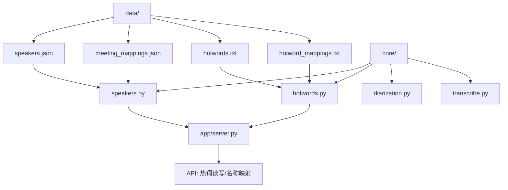
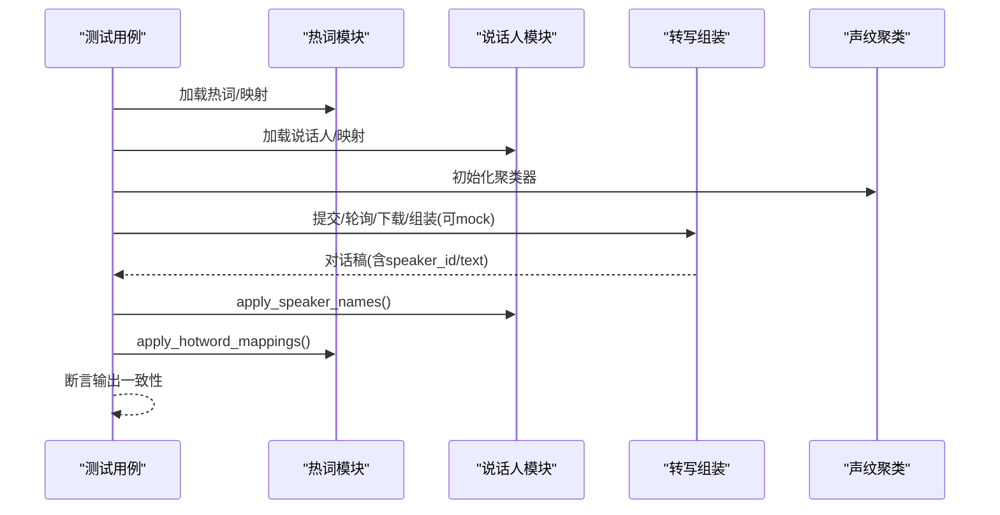
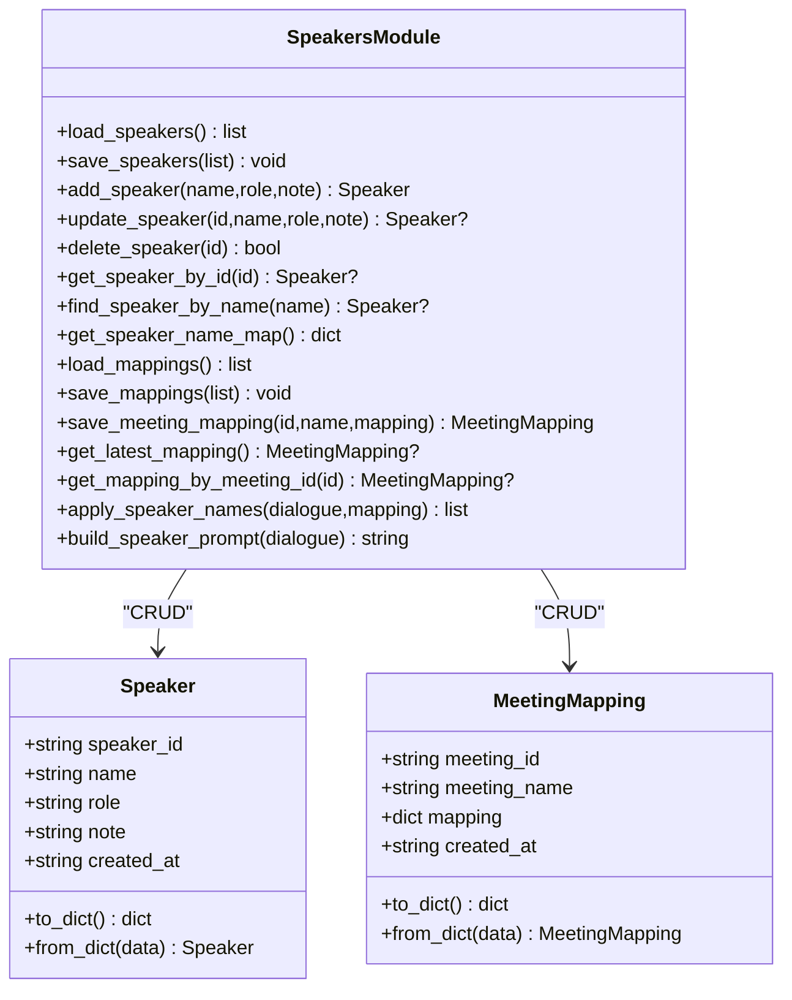
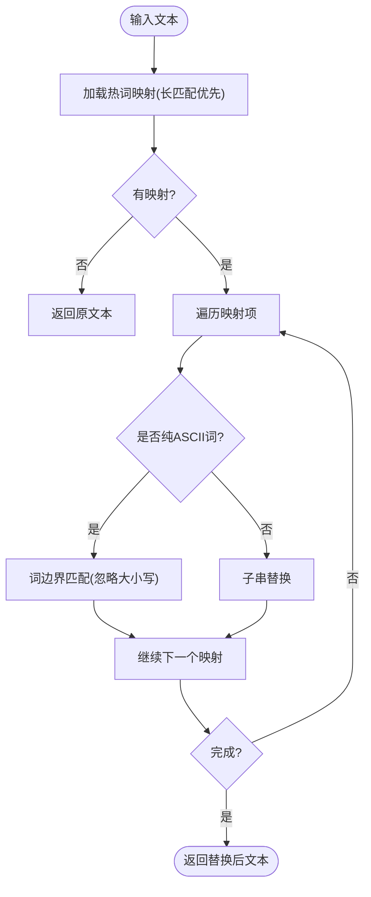
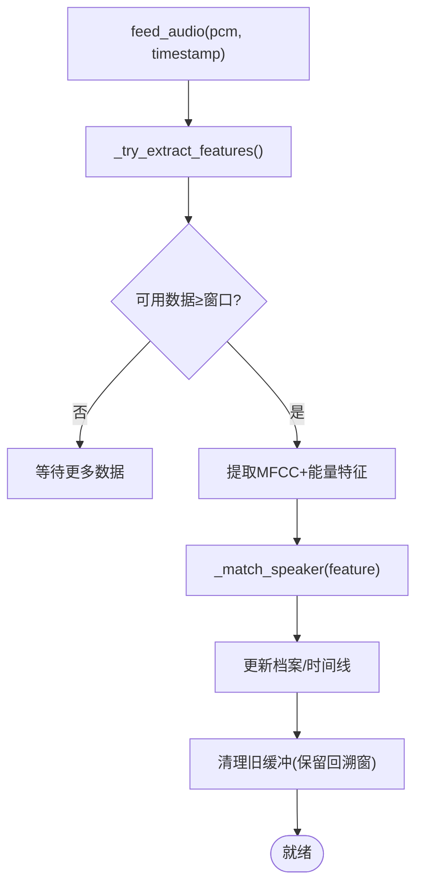
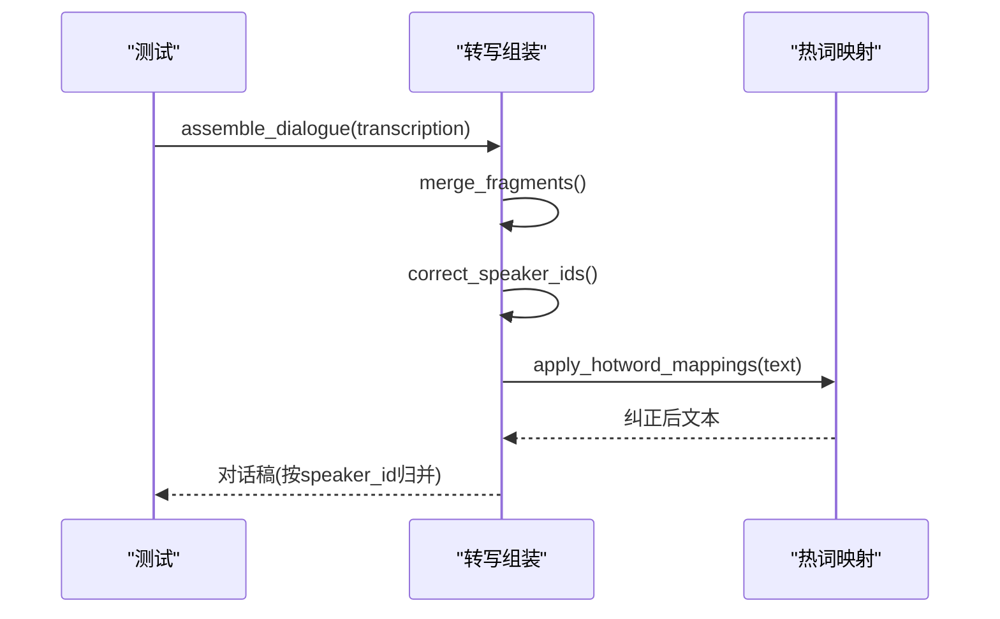
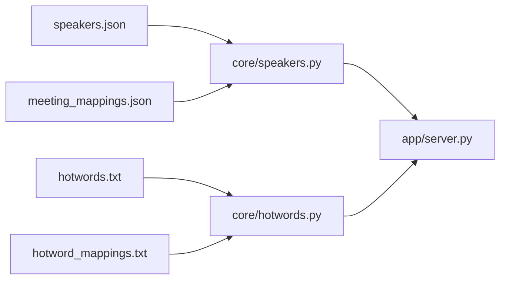

# 测试数据管理

<cite>
**本文引用的文件**
- [speakers.json](file://data/speakers.json)
- [meeting_mappings.json](file://data/meeting_mappings.json)
- [hotwords.txt](file://data/hotwords.txt)
- [hotword_mappings.txt](file://data/hotword_mappings.txt)
- [core/speakers.py](file://core/speakers.py)
- [core/hotwords.py](file://core/hotwords.py)
- [core/diarization.py](file://core/diarization.py)
- [core/transcribe.py](file://core/transcribe.py)
- [app/server.py](file://app/server.py)
</cite>

## 目录
1. [简介](#简介)
2. [项目结构](#项目结构)
3. [核心组件](#核心组件)
4. [架构总览](#架构总览)
5. [详细组件分析](#详细组件分析)
6. [依赖关系分析](#依赖关系分析)
7. [性能考量](#性能考量)
8. [故障排查指南](#故障排查指南)
9. [结论](#结论)
10. [附录](#附录)

## 简介
本策略面向 open-meeting-scribe 的测试数据管理，覆盖音频样本、说话人映射、热词表等数据的版本化组织、分类命名、生成与模拟、清理维护、敏感信息脱敏、配置隔离、迁移备份以及工具脚本示例。目标是确保单元测试、集成测试、性能测试的数据稳定、可重复、可追溯，并降低对真实外部服务与敏感数据的依赖。

## 项目结构
当前仓库已具备测试数据的基础目录与核心模块：
- data/：存放说话人档案、会议映射、热词表与热词映射
- core/：包含说话人管理、热词处理、声纹聚类、转写组装等核心逻辑
- app/server.py：提供热词读写 API 及说话人名称映射构建
- tests/、samples/：预留测试与样例目录（当前为空）

图表来源
- [core/speakers.py:22-28](file://core/speakers.py#L22-L28)
- [core/hotwords.py:35-54](file://core/hotwords.py#L35-L54)
- [app/server.py:2037-2069](file://app/server.py#L2037-L2069)

章节来源
- [core/speakers.py:22-28](file://core/speakers.py#L22-L28)
- [core/hotwords.py:35-54](file://core/hotwords.py#L35-L54)
- [app/server.py:2037-2069](file://app/server.py#L2037-L2069)

## 核心组件
- 说话人档案与会话映射：负责加载/保存全局说话人与会议映射，支持姓名应用与提示词构造
- 热词表与映射：从文本文件加载热词与映射，创建云端热词表，并对识别结果进行后处理纠正
- 声纹聚类：本地提取 MFCC+能量特征，实时聚类说话人，为 ASR 句子标注 speaker_id
- 转写组装：提交异步任务、轮询下载、碎片合并、说话人修正、热词映射纠正、按说话人归并对话稿

章节来源
- [core/speakers.py:35-103](file://core/speakers.py#L35-L103)
- [core/speakers.py:278-325](file://core/speakers.py#L278-L325)
- [core/hotwords.py:35-54](file://core/hotwords.py#L35-L54)
- [core/hotwords.py:145-179](file://core/hotwords.py#L145-L179)
- [core/hotwords.py:187-222](file://core/hotwords.py#L187-L222)
- [core/diarization.py:238-275](file://core/diarization.py#L238-L275)
- [core/diarization.py:282-525](file://core/diarization.py#L282-L525)
- [core/transcribe.py:222-403](file://core/transcribe.py#L222-L403)

## 架构总览
测试数据在系统中的流转路径如下：
- 单元测试：使用最小数据集验证热词映射、说话人姓名应用、碎片合并、说话人修正等纯函数逻辑
- 集成测试：通过 mock 或沙箱环境调用转写流程（提交任务、轮询、下载、组装），使用固定音频样本与预设热词/映射
- 性能测试：批量运行转写与声纹聚类，统计吞吐与延迟，使用多份不同长度/噪声的音频样本

图表来源
- [core/hotwords.py:187-222](file://core/hotwords.py#L187-L222)
- [core/speakers.py:278-325](file://core/speakers.py#L278-L325)
- [core/transcribe.py:355-403](file://core/transcribe.py#L355-L403)
- [core/diarization.py:282-525](file://core/diarization.py#L282-L525)

## 详细组件分析

### 说话人档案与会议映射
- 数据结构：Speaker 与 MeetingMapping，分别持久化为 speakers.json 与 meeting_mappings.json
- 关键能力：
  - 加载/保存全局说话人与会议映射历史
  - 将 speaker_id 映射为真实姓名，用于展示与提示词
  - 复用最近一次会议映射建议
- 测试关注点：
  - 空数据、缺失字段、非法 UUID、时间戳格式
  - 映射键类型转换（JSON 中 key 为字符串需转回 int）
  - 姓名应用与提示词构造的正确性

图表来源
- [core/speakers.py:35-103](file://core/speakers.py#L35-L103)
- [core/speakers.py:109-199](file://core/speakers.py#L109-L199)
- [core/speakers.py:205-272](file://core/speakers.py#L205-L272)
- [core/speakers.py:278-325](file://core/speakers.py#L278-L325)

章节来源
- [core/speakers.py:35-103](file://core/speakers.py#L35-L103)
- [core/speakers.py:109-199](file://core/speakers.py#L109-L199)
- [core/speakers.py:205-272](file://core/speakers.py#L205-L272)
- [core/speakers.py:278-325](file://core/speakers.py#L278-L325)

### 热词表与映射
- 数据来源：
  - hotwords.txt：每行一个热词，支持注释与空行
  - hotword_mappings.txt：错误识别→正确文本映射，支持“→”和“->”，长匹配优先
- 关键能力：
  - 加载热词与映射
  - 创建云端热词表（需目标模型匹配）
  - 后处理替换：英文词边界匹配（大小写不敏感），中文直接子串替换
- 测试关注点：
  - 空文件、注释行、非法分隔符
  - 英文词边界匹配避免误替换
  - 长匹配优先策略生效
  - 热词表创建失败降级（如 404）

图表来源
- [core/hotwords.py:145-179](file://core/hotwords.py#L145-L179)
- [core/hotwords.py:187-222](file://core/hotwords.py#L187-L222)

章节来源
- [core/hotwords.py:35-54](file://core/hotwords.py#L35-L54)
- [core/hotwords.py:145-179](file://core/hotwords.py#L145-L179)
- [core/hotwords.py:187-222](file://core/hotwords.py#L187-L222)

### 声纹聚类与说话人分离
- 原理：从 PCM 提取 MFCC+能量特征，基于余弦相似度聚类，为 ASR 句子标注 speaker_id
- 关键能力：
  - 实时缓冲与特征提取窗口/步长控制
  - 说话人档案管理与重置
  - 根据时间段查询最可能说话人
- 测试关注点：
  - 极短音频、静音、噪声、时间戳跳跃
  - 阈值与最少特征数对准确率的影响
  - 线程安全与状态重置

图表来源
- [core/diarization.py:339-425](file://core/diarization.py#L339-L425)
- [core/diarization.py:421-504](file://core/diarization.py#L421-L504)

章节来源
- [core/diarization.py:238-275](file://core/diarization.py#L238-L275)
- [core/diarization.py:282-525](file://core/diarization.py#L282-L525)

### 转写组装与后处理管线
- 流程：提交任务 → 轮询 → 下载结果 → 碎片合并 → 说话人修正 → 热词映射纠正 → 按说话人归并
- 关键参数：
  - MERGE_GAP_MS、FRAGMENT_CHARS、SPEAKER_FIX_GAP_MS
  - 常见双字词检测跨句拆词
- 测试关注点：
  - 碎片合并条件与停止条件
  - 夹心修正与短句跟随前句说话人
  - 热词映射在最终文本中的生效顺序

图表来源
- [core/transcribe.py:222-403](file://core/transcribe.py#L222-L403)
- [core/hotwords.py:187-222](file://core/hotwords.py#L187-L222)

章节来源
- [core/transcribe.py:222-403](file://core/transcribe.py#L222-L403)

## 依赖关系分析
- 数据到代码的耦合：
  - core/speakers.py 依赖 data/speakers.json 与 data/meeting_mappings.json
  - core/hotwords.py 依赖 data/hotwords.txt 与 data/hotword_mappings.txt
  - app/server.py 暴露热词读写 API，并构建说话人名称映射
- 外部依赖：
  - 热词表创建依赖 DashScope API（需环境变量 DASHSCOPE_API_KEY）
  - 转写任务依赖 DashScope 异步转写接口

图表来源
- [core/speakers.py:22-28](file://core/speakers.py#L22-L28)
- [core/hotwords.py:35-54](file://core/hotwords.py#L35-L54)
- [app/server.py:2037-2069](file://app/server.py#L2037-L2069)

章节来源
- [core/speakers.py:22-28](file://core/speakers.py#L22-L28)
- [core/hotwords.py:35-54](file://core/hotwords.py#L35-L54)
- [app/server.py:2037-2069](file://app/server.py#L2037-L2069)

## 性能考量
- 热词映射：长匹配优先减少多次替换开销；英文词边界匹配避免全量扫描
- 声纹聚类：窗口/步长影响特征提取频率与内存占用；合理设置保留窗口以平衡回溯与内存
- 转写组装：碎片合并与说话人修正为线性扫描，注意大文档时的内存与 CPU 占用
- 测试优化：
  - 单元测试尽量无 IO，使用内存数据
  - 集成测试 mock 外部 API，仅验证本地逻辑
  - 性能测试分批执行，记录指标并对比基线

[本节为通用指导，无需具体文件引用]

## 故障排查指南
- 热词相关：
  - 未设置 DASHSCOPE_API_KEY 导致创建热词表失败
  - 热词表 API 不可用（404）时自动降级
- 说话人相关：
  - JSON 解析异常或字段缺失时返回空列表
  - 映射键类型转换错误（字符串键需转 int）
- 转写相关：
  - 任务超时或结果为空时抛出明确错误
  - transcription_url 缺失时中断流程

章节来源
- [core/hotwords.py:28-32](file://core/hotwords.py#L28-L32)
- [core/hotwords.py:109-117](file://core/hotwords.py#L109-L117)
- [core/speakers.py:111-119](file://core/speakers.py#L111-L119)
- [core/speakers.py:207-215](file://core/speakers.py#L207-L215)
- [core/transcribe.py:134-176](file://core/transcribe.py#L134-L176)
- [core/transcribe.py:433-443](file://core/transcribe.py#L433-L443)

## 结论
通过分层测试数据管理策略，结合明确的分类命名、版本控制、生成模拟、清理维护与脱敏隔离，可显著提升 open-meeting-scribe 的测试稳定性与可重复性。建议在 CI 中固化数据校验与快照比对，确保变更可控、回归可测。

[本节为总结，无需具体文件引用]

## 附录

### 测试数据分类与命名规范
- 单元测试数据
  - 位置：tests/fixtures/unit/
  - 命名：{模块}_{场景}.json|txt|wav
  - 示例：hotwords_minimal.txt、speakers_empty.json、mapping_invalid_uuid.json
- 集成测试数据
  - 位置：tests/fixtures/integration/
  - 命名：{流程}_{版本}.json|wav
  - 示例：transcribe_asr_v1.wav、dialogue_assembled_v1.json
- 性能测试数据
  - 位置：tests/fixtures/perf/
  - 命名：perf_{时长}_{噪声}.wav
  - 示例：perf_60s_clean.wav、perf_300s_noise.wav

### 版本管理策略
- 数据文件纳入版本控制（git），使用语义化标签标记数据快照
- 重大变更（热词表、说话人档案）需附带变更说明与影响范围
- 对外部资源（云端热词表 ID）采用配置文件隔离，不在代码中硬编码

### 生成与模拟方法
- 合成音频：
  - 使用 ffmpeg 生成正弦波/白噪声/静音片段，覆盖边界情况（极短、超长、静音、噪声）
  - 示例命令（概念性）：ffmpeg -f lavfi -i sine=frequency=440:duration=1 -c:a pcm_s16le samples/unit/silence_1s.wav
- 边界数据：
  - 热词映射：空映射、重复映射、非法分隔符、超长映射
  - 说话人映射：空映射、非法 UUID、时间戳异常
  - 转写结果：空 transcripts、无 sentences、极端碎片

### 清理与维护策略
- 每次测试前初始化数据目录，确保干净环境
- 测试后清理临时文件与缓存（如声纹聚类的缓冲区）
- 定期归档历史数据，保留近 N 个版本快照

### 敏感数据脱敏与配置管理
- 脱敏：
  - 说话人姓名可使用假名或占位符（如“张三”“李四”）
  - 会议名称与备注不含真实业务信息
- 配置隔离：
  - 使用 .env.test 管理测试密钥，禁止提交至仓库
  - 热词表创建在测试中默认跳过或 mock

### 迁移与备份最佳实践
- 数据迁移：
  - 提供迁移脚本，兼容新旧 schema（如 mapping key 类型转换）
  - 迁移前后执行校验（字段完整性、唯一性）
- 备份：
  - 定期备份 data/ 目录，保留增量与全量快照
  - 恢复流程文档化并演练

### 工具与脚本示例
- 数据校验脚本：
  - 校验 speakers.json 字段完整性与 UUID 格式
  - 校验 hotword_mappings.txt 分隔符与映射有效性
- 数据生成脚本：
  - 批量生成不同时长/噪声的音频样本
  - 随机生成说话人档案与会议映射
- 测试夹具加载器：
  - 统一加载 fixtures 目录下的数据，支持按需选择场景

[本节为操作指南，无需具体文件引用]