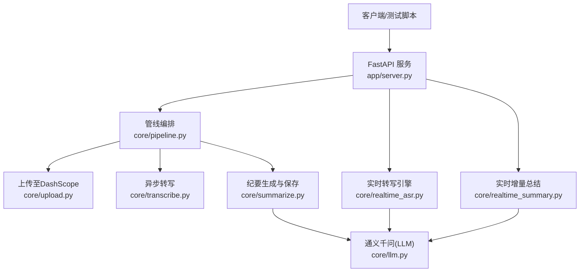
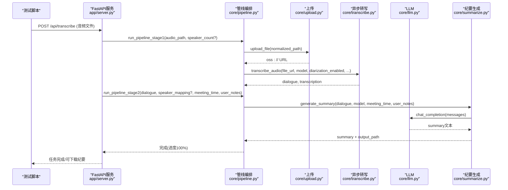
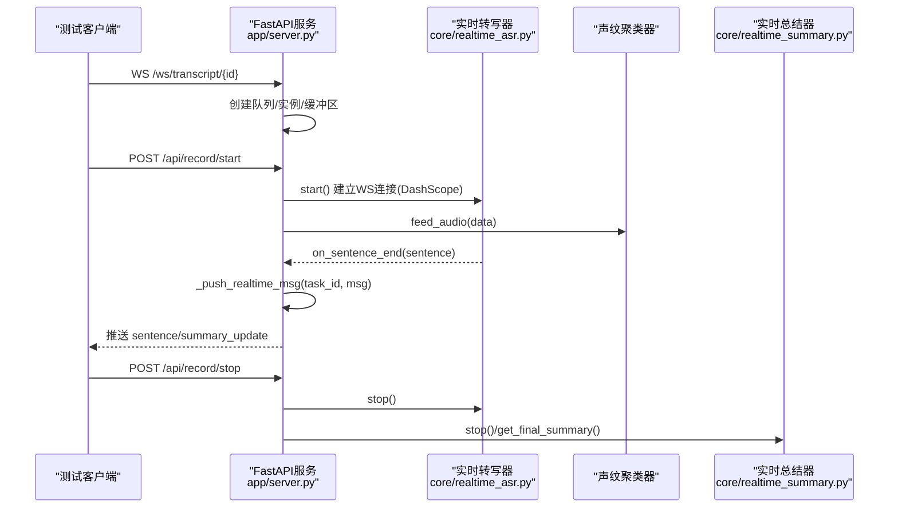
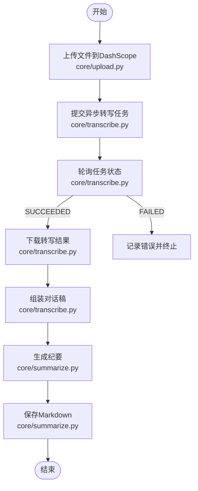
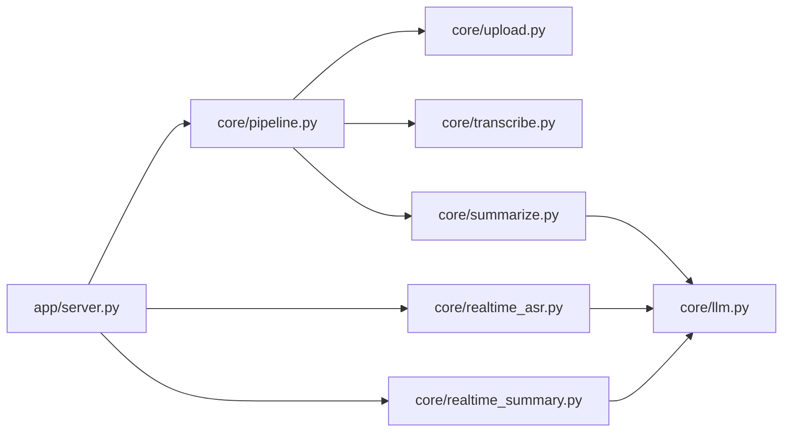

# 集成测试

<cite>
**本文引用的文件**
- [app/server.py](file://app/server.py)
- [core/pipeline.py](file://core/pipeline.py)
- [core/upload.py](file://core/upload.py)
- [core/transcribe.py](file://core/transcribe.py)
- [core/realtime_asr.py](file://core/realtime_asr.py)
- [core/llm.py](file://core/llm.py)
- [core/summarize.py](file://core/summarize.py)
- [core/realtime_summary.py](file://core/realtime_summary.py)
- [requirements.txt](file://requirements.txt)
</cite>

## 目录
1. [简介](#简介)
2. [项目结构](#项目结构)
3. [核心组件](#核心组件)
4. [架构总览](#架构总览)
5. [详细组件分析](#详细组件分析)
6. [依赖关系分析](#依赖关系分析)
7. [性能考虑](#性能考虑)
8. [故障排查指南](#故障排查指南)
9. [结论](#结论)
10. [附录](#附录)

## 简介
本方案为 open-meeting-scribe 提供一套完整的集成测试策略，覆盖：
- FastAPI Web 服务的 RESTful API 与 WebSocket 接口
- 与 DashScope 的端到端交互（音频上传、异步转写、实时转写、摘要生成）
- 测试环境搭建与数据准备
- 异步 WebSocket 连接测试（建立、发送、接收）
- 错误处理与异常场景
- 性能基准与负载测试方法
- 完整测试脚本示例与最佳实践

目标是在不侵入业务代码的前提下，通过外部调用与必要的内部模块复用，验证系统从“音频输入”到“纪要输出”的全链路正确性与稳定性。

## 项目结构
- Web 服务入口与路由定义位于 app/server.py，包含 REST 与 WebSocket 端点
- 核心管线编排位于 core/pipeline.py，串联音频归一化、上传、转写、纪要生成
- 与 DashScope 的交互分布在 upload.py（上传）、transcribe.py（异步转写）、realtime_asr.py（实时转写）、llm.py（LLM 调用）、summarize.py（提示词与保存）、realtime_summary.py（增量总结）
- 依赖声明在 requirements.txt

图表来源
- [app/server.py:33-57](file://app/server.py#L33-L57)
- [core/pipeline.py:58-134](file://core/pipeline.py#L58-L134)
- [core/upload.py:59-115](file://core/upload.py#L59-L115)
- [core/transcribe.py:61-131](file://core/transcribe.py#L61-L131)
- [core/summarize.py:157-229](file://core/summarize.py#L157-L229)
- [core/realtime_asr.py:150-327](file://core/realtime_asr.py#L150-L327)
- [core/realtime_summary.py:68-184](file://core/realtime_summary.py#L68-L184)
- [core/llm.py:89-160](file://core/llm.py#L89-L160)

章节来源
- [app/server.py:1-21](file://app/server.py#L1-L21)
- [core/pipeline.py:1-12](file://core/pipeline.py#L1-L12)
- [requirements.txt:1-32](file://requirements.txt#L1-L32)

## 核心组件
- FastAPI 服务层
  - REST 端点：上传音频、任务查询/列表/删除、下载纪要、说话人管理、录制控制等
  - WebSocket：/ws/transcript/{id} 推送实时转写结果
- 管线编排
  - 阶段1：音频归一化 → 上传 → 热词表 → 转写 → 对话稿组装
  - 阶段2：应用说话人姓名映射 → 生成纪要 → 生成标题 → 保存 Markdown
- DashScope 集成
  - 上传：获取凭证并 POST 到 OSS，返回 oss:// URL
  - 异步转写：提交任务、轮询状态、下载结果、合并碎片与修正说话人
  - 实时转写：WebSocket 流式 PCM 输入，回调收集临时/定稿句子
  - LLM：同步/异步/流式调用通义千问（OpenAI 兼容端点）
- 实时总结
  - 定时触发增量总结，维护上次摘要与新内容，回调推送前端

章节来源
- [app/server.py:339-715](file://app/server.py#L339-L715)
- [core/pipeline.py:58-226](file://core/pipeline.py#L58-L226)
- [core/upload.py:59-115](file://core/upload.py#L59-L115)
- [core/transcribe.py:61-446](file://core/transcribe.py#L61-L446)
- [core/realtime_asr.py:150-368](file://core/realtime_asr.py#L150-L368)
- [core/llm.py:89-207](file://core/llm.py#L89-L207)
- [core/realtime_summary.py:68-270](file://core/realtime_summary.py#L68-L270)

## 架构总览
下图展示从请求进入 FastAPI 到最终纪要输出的关键路径，以及实时转写与总结的并行通道。

图表来源
- [app/server.py:343-396](file://app/server.py#L343-L396)
- [core/pipeline.py:58-134](file://core/pipeline.py#L58-L134)
- [core/upload.py:59-115](file://core/upload.py#L59-L115)
- [core/transcribe.py:405-446](file://core/transcribe.py#L405-L446)
- [core/summarize.py:157-229](file://core/summarize.py#L157-L229)
- [core/llm.py:89-121](file://core/llm.py#L89-L121)

## 详细组件分析

### RESTful API 集成测试
- 上传音频并提交转写任务
  - 端点：POST /api/transcribe
  - 输入：multipart/form-data，字段 file；可选 speaker_mapping JSON 字符串
  - 行为：校验扩展名、保存上传、创建任务记录、后台执行阶段1
  - 断言：返回 task_id 与 status=pending；后续轮询 GET /api/tasks/{task_id} 直至 completed/failed
- 任务查询与列表
  - GET /api/tasks：按 created_at 倒序返回任务列表
  - GET /api/tasks/{task_id}：返回任务详情；若处于 recording 状态，附带 elapsed
- 下载纪要
  - GET /api/download/{task_id}：当 output_path 存在时返回 Markdown 文件
- 删除任务
  - DELETE /api/tasks/{task_id}：清理内存任务、音频与纪要文件、持久化 JSON
- 更新任务信息
  - PATCH /api/tasks/{task_id}：支持更新 title
- 说话人管理
  - GET/POST/PUT/DELETE /api/speakers/*
  - 最近一次会议映射：GET /api/speakers/mapping/latest
  - 保存会议映射：POST /api/speakers/mapping
- 说话人绑定与纪要生成
  - POST /api/tasks/{task_id}/speaker-mapping：设置映射并触发阶段2
  - POST /api/tasks/{task_id}/regenerate-summary：重新生成纪要

建议用例
- 正向流程：上传 → 等待完成 → 下载纪要 → 删除任务
- 边界条件：不支持的文件类型、任务不存在、纪要文件缺失
- 并发：多任务同时上传与查询

章节来源
- [app/server.py:339-715](file://app/server.py#L339-L715)

### WebSocket 实时转写集成测试
- 端点：WS /ws/transcript/{id}
- 启动录制：POST /api/record/start
  - 创建队列、声纹聚类器、实时总结器，启动录音与实时转写
  - 回调将 PCM 送入实时 ASR 与声纹聚类，定稿句子经 _push_realtime_msg 投递到 asyncio.Queue
- 停止录制：POST /api/record/stop
- 状态查询：GET /api/record/status
- 消息类型
  - sentence：含 text、begin_time、end_time、speaker_id、speaker_name
  - summary_update：实时摘要更新
  - summary_status：总结状态变化

建议用例
- 连接建立：客户端连接 WS，确认收到初始消息或心跳
- 消息收发：模拟 PCM 流（或真实录音），验证 sentence 与 summary_update 到达
- 断开重连：网络抖动下恢复连接与缓冲消费
- 超时与限流：服务端重试机制（实时转写 start 指数退避）

图表来源
- [app/server.py:721-800](file://app/server.py#L721-L800)
- [core/realtime_asr.py:150-327](file://core/realtime_asr.py#L150-L327)
- [core/realtime_summary.py:119-184](file://core/realtime_summary.py#L119-L184)

章节来源
- [app/server.py:717-800](file://app/server.py#L717-L800)
- [core/realtime_asr.py:150-368](file://core/realtime_asr.py#L150-L368)
- [core/realtime_summary.py:68-270](file://core/realtime_summary.py#L68-L270)

### 与 DashScope 的端到端测试
- 上传与异步转写
  - 上传：upload_file 获取凭证并 POST 到 OSS，返回 oss:// URL
  - 转写：submit_transcription 提交任务，poll_task 轮询直到 SUCCEEDED，download_transcription 下载结果，assemble_dialogue 组装对话稿
  - 建议用例：正常上传、大文件、无效 URL、任务失败、超时
- 实时转写
  - RealtimeTranscriber.start 建立 WebSocket，feed_audio 送入 PCM，on_event 回调收集临时/定稿句子
  - 建议用例：限流重试、空句过滤、时间戳有效性
- 摘要生成
  - summarize.generate_summary 构造提示词，调用 llm.chat_completion 生成 Markdown
  - 建议用例：短对话、无有效内容、用户笔记注入、会议时间填充

图表来源
- [core/upload.py:59-115](file://core/upload.py#L59-L115)
- [core/transcribe.py:61-446](file://core/transcribe.py#L61-L446)
- [core/summarize.py:157-283](file://core/summarize.py#L157-L283)

章节来源
- [core/upload.py:1-134](file://core/upload.py#L1-L134)
- [core/transcribe.py:1-446](file://core/transcribe.py#L1-L446)
- [core/summarize.py:1-283](file://core/summarize.py#L1-L283)
- [core/realtime_asr.py:1-368](file://core/realtime_asr.py#L1-L368)

### 错误处理与异常场景测试
- 环境变量缺失：未设置 DASHSCOPE_API_KEY 时应抛出运行时错误
- 文件类型不支持：上传时校验扩展名，返回 400
- 任务不存在：查询/下载/删除时返回 404
- 转写失败：轮询到 FAILED 状态抛出错误
- 实时转写限流：start 自动重试（指数退避），前端应显示友好提示
- 网络超时：LLM 调用超时抛出运行时错误
- 空句过滤：实时转写跳过空文本，避免无用消息

章节来源
- [core/upload.py:25-30](file://core/upload.py#L25-L30)
- [core/transcribe.py:134-176](file://core/transcribe.py#L134-L176)
- [core/realtime_asr.py:216-327](file://core/realtime_asr.py#L216-L327)
- [core/llm.py:49-53](file://core/llm.py#L49-L53)
- [app/server.py:343-396](file://app/server.py#L343-L396)

### 性能基准与负载测试
- 指标
  - 端到端耗时：上传+转写+摘要生成全流程时间
  - 吞吐：单位时间内成功完成的任务数
  - 资源占用：CPU、内存、网络带宽
- 方法
  - 使用 httpx 或 requests 并发发起上传与查询
  - 对 WebSocket 进行多连接压测，验证消息延迟与丢包率
  - 监控 DashScope 限流与重试次数
- 工具建议
  - Locust/k6 进行 HTTP 压测
  - websockets 库进行 WS 压测
  - Prometheus/Grafana 采集指标（可扩展）

[本节为通用指导，不直接分析具体文件]

## 依赖关系分析
- FastAPI 服务依赖 core 各模块，形成清晰分层
- 外部依赖：DashScope SDK、httpx、requests、websockets、numpy/scipy
- 关键耦合点
  - server.py 与 pipeline.py：任务编排与状态推进
  - pipeline.py 与 upload/transcribe/summarize：外部服务调用
  - realtime_asr.py 与 server.py：线程安全的消息投递
  - llm.py 与 summarize/realtime_summary：LLM 调用封装

图表来源
- [app/server.py:33-57](file://app/server.py#L33-L57)
- [core/pipeline.py:58-226](file://core/pipeline.py#L58-L226)
- [core/upload.py:59-115](file://core/upload.py#L59-L115)
- [core/transcribe.py:61-446](file://core/transcribe.py#L61-L446)
- [core/summarize.py:157-283](file://core/summarize.py#L157-L283)
- [core/realtime_asr.py:150-368](file://core/realtime_asr.py#L150-L368)
- [core/realtime_summary.py:68-270](file://core/realtime_summary.py#L68-L270)
- [core/llm.py:89-207](file://core/llm.py#L89-L207)

章节来源
- [requirements.txt:1-32](file://requirements.txt#L1-L32)

## 性能考虑
- 上传与转写为 I/O 密集操作，建议使用异步客户端与连接池
- 实时转写需控制 PCM 包大小与频率，避免阻塞事件循环
- 增量总结周期与 token 限制平衡，减少 LLM 调用成本
- 缓存与复用：复用 httpx.AsyncClient，避免频繁建连

[本节为通用指导，不直接分析具体文件]

## 故障排查指南
- 检查环境变量：确保 DASHSCOPE_API_KEY 已配置
- 查看日志：关注上传、转写、LLM 调用的错误与重试信息
- 任务状态：通过 /api/tasks/{task_id} 获取 status、message、error
- 实时转写：确认 WebSocket 连接建立、PCM 数据送达、回调触发
- 纪要文件：确认 output_path 存在且可下载

章节来源
- [core/upload.py:25-30](file://core/upload.py#L25-L30)
- [core/transcribe.py:134-176](file://core/transcribe.py#L134-L176)
- [core/realtime_asr.py:216-327](file://core/realtime_asr.py#L216-L327)
- [core/llm.py:49-53](file://core/llm.py#L49-L53)
- [app/server.py:399-421](file://app/server.py#L399-L421)

## 结论
本集成测试方案覆盖了 FastAPI 的 REST 与 WebSocket 接口、DashScope 的上传/转写/LLM 调用、以及端到端的音频到纪要流程。通过合理的用例设计、错误场景覆盖与性能压测，可确保系统在真实环境下的可靠性与可观测性。建议在 CI 中引入冒烟测试与定期回归，持续验证关键路径。

[本节为总结，不直接分析具体文件]

## 附录

### 测试环境搭建
- 安装依赖：pip install -r requirements.txt
- 配置环境变量：复制 .env.example 并填写 DASHSCOPE_API_KEY
- 启动服务：uvicorn app.server:app --reload
- 数据目录：data/uploads、data/output、data/recordings、data/tasks 由服务自动创建

章节来源
- [requirements.txt:1-32](file://requirements.txt#L1-L32)
- [README.md:22-28](file://README.md#L22-L28)

### 数据准备策略
- 准备多种格式音频（mp3/wav/m4a/aac/ogg/flac/mp4/webm）以覆盖上传校验
- 准备不同时长与说话人数量的样本，验证转写与分离效果
- 准备含噪声、混音、静音片段的音频，评估鲁棒性
- 准备短对话与长会议，验证摘要质量与增量更新

[本节为通用指导，不直接分析具体文件]

### 异步 WebSocket 连接测试方法
- 连接建立：使用 websockets 库连接 /ws/transcript/{id}，捕获连接事件
- 消息发送：通过 /api/record/start 启动录制，模拟 PCM 流或真实录音
- 消息接收：订阅 sentence 与 summary_update，断言字段完整性与时序
- 断开与重连：模拟网络中断，验证重连后消息连续性
- 超时处理：设置合理超时，捕获异常并记录

章节来源
- [app/server.py:721-800](file://app/server.py#L721-L800)
- [core/realtime_asr.py:150-327](file://core/realtime_asr.py#L150-L327)

### 完整测试脚本示例（步骤说明）
- 初始化：加载环境变量，启动本地服务（或使用 TestClient）
- 上传与任务轮询：
  - POST /api/transcribe 上传音频
  - 轮询 GET /api/tasks/{task_id} 直到 completed/failed
  - 断言状态、进度、消息、错误字段
- 下载与验证：
  - GET /api/download/{task_id} 获取 Markdown
  - 断言文件存在与基本结构（标题、结论、待办）
- 说话人绑定与再生成：
  - POST /api/tasks/{task_id}/speaker-mapping 设置映射
  - 等待阶段2完成，断言摘要更新
- 实时转写：
  - WS 连接 /ws/transcript/{id}
  - POST /api/record/start，发送 PCM，接收 sentence/summary_update
  - POST /api/record/stop，验证最终摘要
- 错误场景：
  - 无效文件类型、任务不存在、LLM 超时、转写失败
  - 断言 HTTP 状态码与错误消息

[本节为步骤说明，不直接引用代码片段]

### 最佳实践
- 使用 TestClient 进行快速单元测试，结合外部服务进行集成测试
- 隔离测试数据：每个用例独立上传与清理，避免污染
- 重试与退避：对网络不稳定场景实现重试逻辑
- 日志与指标：记录关键步骤耗时与错误，便于定位问题
- 契约优先：遵循 docs/API_CONTRACTS.md 的约束，确保接口稳定

[本节为通用指导，不直接分析具体文件]