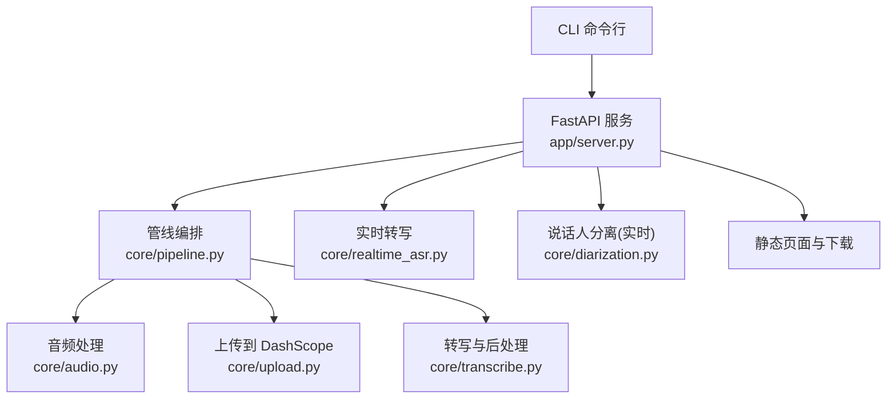
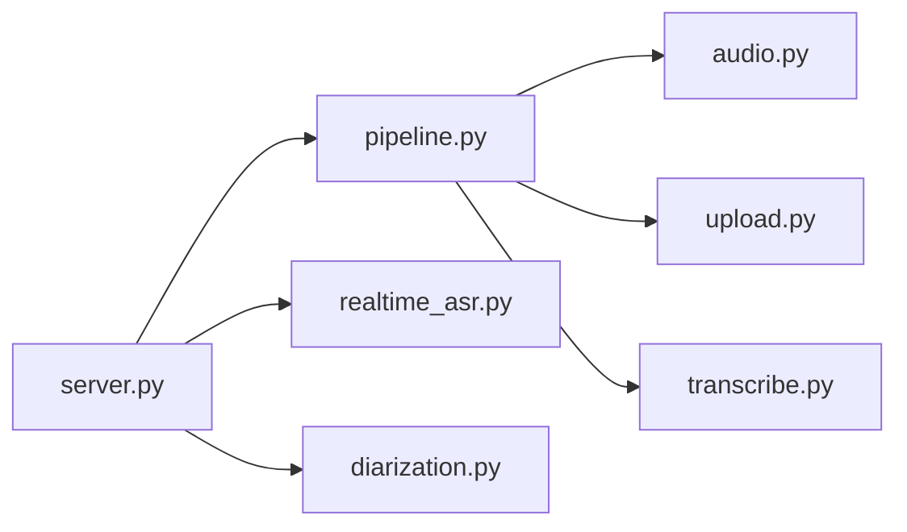

# 调试与故障排除

<cite>
**本文引用的文件**
- [README.md](file://README.md)
- [app/server.py](file://app/server.py)
- [core/pipeline.py](file://core/pipeline.py)
- [core/audio.py](file://core/audio.py)
- [core/transcribe.py](file://core/transcribe.py)
- [core/upload.py](file://core/upload.py)
- [core/realtime_asr.py](file://core/realtime_asr.py)
- [core/diarization.py](file://core/diarization.py)
- [cli.py](file://cli.py)
- [requirements.txt](file://requirements.txt)
</cite>

## 目录
1. [简介](#简介)
2. [项目结构](#项目结构)
3. [核心组件](#核心组件)
4. [架构总览](#架构总览)
5. [详细组件分析](#详细组件分析)
6. [依赖关系分析](#依赖关系分析)
7. [性能考量](#性能考量)
8. [故障排除指南](#故障排除指南)
9. [结论](#结论)
10. [附录：调试工具与命令参考](#附录：调试工具与命令参考)

## 简介
本指南面向 open-meeting-scribe 的开发与运维人员，聚焦以下目标：
- 开发环境调试技巧：Python 调试器使用、日志配置、错误追踪
- 常见问题诊断：API 调用失败、音频处理错误、实时转写问题、内存泄漏等
- 性能分析与优化建议：CPU 使用率、内存占用、网络请求分析
- 生产监控与告警：日志收集与分析策略、关键指标
- 常见问题解答与解决方案库
- 调试工具与命令速查

## 项目结构
本项目采用分层组织：
- app：Web 服务（FastAPI），提供 REST 与 WebSocket 接口，编排后台任务
- core：业务管线（音频归一化、上传、转写、说话人分离、纪要生成）
- data：数据与输出（录音、任务持久化、热词、说话人档案）
- cli：命令行工具，便于本地测试与快速验证



图表来源
- [app/server.py:1-21](file://app/server.py#L1-L21)
- [core/pipeline.py:1-12](file://core/pipeline.py#L1-L12)
- [core/audio.py:1-10](file://core/audio.py#L1-L10)
- [core/upload.py:1-12](file://core/upload.py#L1-L12)
- [core/transcribe.py:1-14](file://core/transcribe.py#L1-L14)
- [core/realtime_asr.py:1-27](file://core/realtime_asr.py#L1-L27)
- [core/diarization.py:1-21](file://core/diarization.py#L1-L21)

章节来源
- [README.md:1-39](file://README.md#L1-L39)

## 核心组件
- FastAPI 服务：负责 API 路由、任务状态管理、WebSocket 实时推送、后台任务调度
- 管线模块：串联“音频归一化 → 上传 → 转写 → 说话人姓名化 → 纪要生成”
- 音频模块：ffmpeg 归一化、系统内录（BlackHole）、流式 PCM 读取与 WAV 封装
- 转写模块：DashScope 异步转写任务提交、轮询、结果下载与对话稿组装
- 实时转写：基于 DashScope WebSocket 的流式识别，支持重试与上下文增强
- 说话人分离：本地声纹聚类（MFCC + 能量），为句子标注 speaker_id
- CLI：提供便捷命令用于转写、录音控制、任务管理等

章节来源
- [app/server.py:1-21](file://app/server.py#L1-L21)
- [core/pipeline.py:1-12](file://core/pipeline.py#L1-L12)
- [core/audio.py:1-10](file://core/audio.py#L1-L10)
- [core/transcribe.py:1-14](file://core/transcribe.py#L1-L14)
- [core/realtime_asr.py:1-27](file://core/realtime_asr.py#L1-L27)
- [core/diarization.py:1-21](file://core/diarization.py#L1-L21)
- [cli.py:1-44](file://cli.py#L1-L44)

## 架构总览
下图展示从用户操作到最终纪要生成的端到端流程，包括批处理与实时两条路径。

```mermaid
sequenceDiagram
participant U as "用户"
participant S as "FastAPI 服务"
participant P as "管线编排"
participant A as "音频处理"
participant UPL as "上传(DashScope)"
participant T as "转写与后处理"
participant R as "实时转写"
participant D as "说话人分离(实时)"
participant L as "日志/存储"
U->>S : 上传音频 / 开始录制
S->>P : 启动后台任务
P->>A : 归一化音频
A-->>P : 归一化完成
P->>UPL : 上传到 DashScope
UPL-->>P : oss : // URL
P->>T : 提交转写任务
T-->>P : 对话稿 + 原始结果
P->>L : 保存任务状态/结果
U-->>S : 查询任务状态
S-->>U : 返回进度/结果
Note over S,R,D : 实时路径
U->>S : 开始流式录音
S->>R : 启动实时转写
S->>D : 初始化声纹聚类
S->>A : 流式PCM回调
A-->>R : 送入PCM
R-->>S : 定稿句子(临时/最终)
S->>D : 根据时间戳匹配说话人
S-->>U : WebSocket推送转写结果
```

图表来源
- [app/server.py:226-333](file://app/server.py#L226-L333)
- [core/pipeline.py:58-134](file://core/pipeline.py#L58-L134)
- [core/audio.py:303-396](file://core/audio.py#L303-L396)
- [core/transcribe.py:61-131](file://core/transcribe.py#L61-L131)
- [core/realtime_asr.py:150-327](file://core/realtime_asr.py#L150-L327)
- [core/diarization.py:282-525](file://core/diarization.py#L282-L525)

## 详细组件分析

### 管线编排（core/pipeline.py）
- 职责：编排阶段、进度回调、输出 Markdown 纪要
- 关键点：
  - 阶段1：音频归一化 → 上传 → 热词表检查 → 转写 → 对话稿组装
  - 阶段2：说话人姓名化 → 生成标题与摘要 → 保存输出
  - 进度对象 PipelineProgress 统一上报 UI
- 调试要点：
  - 关注 on_progress 回调中的 stage/message/percent
  - 若阶段卡住，优先检查 ffmpeg、上传凭证、转写任务状态

章节来源
- [core/pipeline.py:35-44](file://core/pipeline.py#L35-L44)
- [core/pipeline.py:58-134](file://core/pipeline.py#L58-L134)
- [core/pipeline.py:137-226](file://core/pipeline.py#L137-L226)

### 音频处理（core/audio.py）
- 职责：ffmpeg 归一化、时长获取、系统内录（BlackHole）、流式 PCM 读取与 WAV 封装
- 关键点：
  - normalize_audio 强制 16kHz/单声道/WAV，适配 ASR 最优格式
  - start_recording_with_stream 通过 ffmpeg avfoundation 采集系统音频，输出 raw PCM 到 stdout，并回调送入实时 ASR
  - stop_recording_with_stream 将 raw PCM 转为 WAV，扣除暂停时长
- 调试要点：
  - 设备名可通过环境变量 RECORD_DEVICE 覆盖；默认麦克风或 BlackHole 2ch
  - 常见错误：ffmpeg 未安装、设备不可用、管道阻塞、raw 文件为空
  - 流式读取线程异常会记录日志，注意查看回调次数与块数

章节来源
- [core/audio.py:26-98](file://core/audio.py#L26-L98)
- [core/audio.py:139-217](file://core/audio.py#L139-L217)
- [core/audio.py:303-396](file://core/audio.py#L303-L396)
- [core/audio.py:440-515](file://core/audio.py#L440-L515)
- [core/audio.py:518-557](file://core/audio.py#L518-L557)
- [core/audio.py:559-595](file://core/audio.py#L559-L595)
- [core/audio.py:597-622](file://core/audio.py#L597-L622)
- [core/audio.py:625-663](file://core/audio.py#L625-L663)

### 转写与后处理（core/transcribe.py）
- 职责：提交异步转写任务、轮询、下载结果、碎片合并、说话人修正、热词映射纠正、组装对话稿
- 关键点：
  - submit_transcription 必须带 X-DashScope-Async: enable，oss:// 需加 X-DashScope-OssResourceResolve: enable
  - poll_task 轮询直到 SUCCEEDED/FAILED，超时抛出 TimeoutError
  - merge_fragments 合并碎片句，correct_speaker_ids 修正过度切分
  - assemble_dialogue 按 speaker_id 归并句子，应用热词映射
- 调试要点：
  - 检查 DASHSCOPE_API_KEY 是否设置
  - 关注任务状态变化日志，定位卡在哪个阶段
  - 若对话稿为空，检查 transcripts/sentences 是否为空

章节来源
- [core/transcribe.py:26-52](file://core/transcribe.py#L26-L52)
- [core/transcribe.py:61-131](file://core/transcribe.py#L61-L131)
- [core/transcribe.py:134-187](file://core/transcribe.py#L134-L187)
- [core/transcribe.py:222-304](file://core/transcribe.py#L222-L304)
- [core/transcribe.py:307-352](file://core/transcribe.py#L307-L352)
- [core/transcribe.py:355-402](file://core/transcribe.py#L355-L402)
- [core/transcribe.py:405-446](file://core/transcribe.py#L405-L446)

### 上传模块（core/upload.py）
- 职责：获取上传凭证、POST 到 OSS、返回 oss:// URL
- 关键点：
  - get_upload_policy 限流 100 QPS，注意并发控制
  - upload_file 校验文件大小（≤1GB），multipart 上传
  - encode_oss_url 对特殊字符进行 URL 编码
- 调试要点：
  - 凭证获取失败或上传 HTTP 非 200 时，记录响应体
  - 文件名含空格/中文时需编码

章节来源
- [core/upload.py:25-56](file://core/upload.py#L25-L56)
- [core/upload.py:59-115](file://core/upload.py#L59-L115)
- [core/upload.py:118-134](file://core/upload.py#L118-L134)

### 实时转写（core/realtime_asr.py）
- 职责：封装 DashScope 实时语音识别 SDK，建立 WebSocket 连接，接收 PCM 并回调结果
- 关键点：
  - RealtimeTranscriber.start() 自动重试应对限流（指数退避）
  - feed_audio 每次建议 6400 bytes（100ms @16kHz/16bit）
  - 支持 vocabulary/vocabulary_id/context 增强识别
- 调试要点：
  - 连接失败或限流错误会触发 on_error 回调
  - 注意 is_running 状态，避免在停止后继续送入音频

章节来源
- [core/realtime_asr.py:47-54](file://core/realtime_asr.py#L47-L54)
- [core/realtime_asr.py:57-144](file://core/realtime_asr.py#L57-L144)
- [core/realtime_asr.py:150-327](file://core/realtime_asr.py#L150-L327)
- [core/realtime_asr.py:329-368](file://core/realtime_asr.py#L329-L368)

### 说话人分离（core/diarization.py）
- 职责：从 PCM 提取 MFCC+能量特征，实时聚类区分说话人，按时间段查询 speaker_id
- 关键点：
  - 每 2 秒窗口提取特征，步长 1 秒，余弦相似度阈值 0.70
  - SpeakerDiarizer.feed_audio 缓冲累积，get_speaker 按时间匹配最近特征
- 调试要点：
  - 每人至少说 2 秒才能建立可靠档案
  - 人数过多或音色相近可能误判，可调整阈值或窗口参数

章节来源
- [core/diarization.py:34-55](file://core/diarization.py#L34-L55)
- [core/diarization.py:87-166](file://core/diarization.py#L87-L166)
- [core/diarization.py:238-275](file://core/diarization.py#L238-L275)
- [core/diarization.py:282-525](file://core/diarization.py#L282-L525)

### Web 服务与任务管理（app/server.py）
- 职责：REST API、WebSocket 实时推送、后台任务执行、任务持久化
- 关键点：
  - 任务状态机：pending → processing → awaiting_mapping → completed/failed
  - 后台任务使用 BackgroundTasks 执行阶段1/阶段2
  - 实时路径：pcm_callback 送入实时 ASR 与声纹聚类，WebSocket 推送句子与摘要更新
  - 任务持久化到 data/tasks/*.json，启动时恢复
- 调试要点：
  - 检查 _save_task_to_disk/_load_tasks_from_disk 日志
  - 实时消息推送失败会记录错误，关注 asyncio.Queue 与事件循环状态
  - 删除任务时会清理音频与纪要文件

章节来源
- [app/server.py:61-168](file://app/server.py#L61-L168)
- [app/server.py:226-333](file://app/server.py#L226-L333)
- [app/server.py:343-396](file://app/server.py#L343-L396)
- [app/server.py:630-714](file://app/server.py#L630-L714)
- [app/server.py:721-800](file://app/server.py#L721-L800)

## 依赖关系分析
- 外部依赖：
  - requests/httpx：HTTP 请求（同步/异步）
  - dashscope：实时与批转写 SDK
  - fastapi/uvicorn/websockets：Web 服务与实时推送
  - numpy/scipy：声纹特征提取
  - python-dotenv：环境变量加载
- 内部耦合：
  - server.py 依赖 pipeline/audio/transcribe/upload/realtime_asr/diarization
  - pipeline 依赖 audio/upload/transcribe/hotwords/summarize
  - 实时路径中 server 协调 audio 的 pcm_callback 与 realtime_asr/diarization



图表来源
- [app/server.py:41-57](file://app/server.py#L41-L57)
- [core/pipeline.py:22-27](file://core/pipeline.py#L22-L27)

章节来源
- [requirements.txt:1-32](file://requirements.txt#L1-L32)

## 性能考量
- CPU 使用率：
  - 声纹特征提取（MFCC/DCT）在 diarization.py 中计算密集，建议合理设置窗口与步长
  - 实时 PCM 回调频率高，注意避免在回调中进行重计算
- 内存占用：
  - 实时转写缓冲区 _realtime_transcript_buffers 限制最大条目数，防止无限增长
  - 会话级状态字典（tasks、_realtime_queues 等）需关注生命周期
- 网络请求：
  - 上传与转写轮询存在超时与重试逻辑，建议监控 QPS 与延迟
  - 实时 WebSocket 连接具备限流重试机制，观察 on_error 回调频率

[本节为通用指导，不直接分析具体文件]

## 故障排除指南

### 开发环境调试技巧
- Python 调试器
  - 使用 pdb 或 IDE 断点：在关键函数入口（如 run_pipeline_stage1、submit_transcription、feed_audio）设置断点
  - 结合日志：logging.basicConfig 已在 cli.py 中配置 INFO 级别，可在 server.py 中按需提高级别
- 日志配置
  - 各模块均使用 logging.getLogger(__name__)，便于按模块过滤
  - 关注关键日志：任务状态变化、ffmpeg 执行结果、WebSocket 连接状态、声纹聚类统计
- 错误追踪
  - 捕获异常并记录堆栈：server.py 中后台任务使用 logger.exception
  - 检查任务持久化文件 data/tasks/*.json，确认状态与错误字段

章节来源
- [cli.py:56-62](file://cli.py#L56-L62)
- [app/server.py:226-333](file://app/server.py#L226-L333)
- [core/transcribe.py:134-187](file://core/transcribe.py#L134-L187)

### 常见问题诊断

#### API 调用失败（上传/转写）
- 现象：上传失败、转写任务超时或结果为空
- 排查步骤：
  - 检查 DASHSCOPE_API_KEY 是否设置
  - 查看上传凭证获取与 HTTP 响应码
  - 轮询任务状态，确认是否 SUCCEEDED/FAILED
  - 若结果为空，检查 transcription_url 是否存在
- 相关代码位置
  - 上传凭证与上传：core/upload.py
  - 转写提交与轮询：core/transcribe.py

章节来源
- [core/upload.py:25-56](file://core/upload.py#L25-L56)
- [core/upload.py:59-115](file://core/upload.py#L59-L115)
- [core/transcribe.py:61-131](file://core/transcribe.py#L61-L131)
- [core/transcribe.py:134-187](file://core/transcribe.py#L134-L187)

#### 音频处理错误（ffmpeg/设备）
- 现象：归一化失败、无法录制、流式读取中断
- 排查步骤：
  - 确认 ffmpeg 已安装且可用
  - 检查 RECORD_DEVICE 是否正确（macOS 下通常为 BlackHole 2ch）
  - 查看流式读取线程日志，确认回调次数与块数
  - 停止录制后检查 raw 文件是否为空
- 相关代码位置
  - 归一化与时长：core/audio.py
  - 系统内录与流式：core/audio.py

章节来源
- [core/audio.py:26-98](file://core/audio.py#L26-L98)
- [core/audio.py:139-217](file://core/audio.py#L139-L217)
- [core/audio.py:303-396](file://core/audio.py#L303-L396)
- [core/audio.py:440-515](file://core/audio.py#L440-L515)

#### 实时转写问题（WebSocket/限流）
- 现象：连接失败、无句子输出、频繁限流
- 排查步骤：
  - 检查 DASHSCOPE_WS_URL 与 DASHSCOPE_API_KEY
  - 观察 on_error 回调与重试日志
  - 确认 PCM 数据格式（16kHz/16bit/单声道）与包大小（~6400 bytes）
  - 若长时间无输出，检查 is_running 状态
- 相关代码位置
  - 实时转写器：core/realtime_asr.py

章节来源
- [core/realtime_asr.py:47-54](file://core/realtime_asr.py#L47-L54)
- [core/realtime_asr.py:150-327](file://core/realtime_asr.py#L150-L327)
- [core/realtime_asr.py:329-368](file://core/realtime_asr.py#L329-L368)

#### 说话人分离不准确
- 现象：speaker_id 不稳定、多人混淆
- 排查步骤：
  - 确保每人至少说 2 秒以建立档案
  - 调整相似度阈值或窗口/步长参数
  - 检查时间戳连续性，避免跳跃导致缓冲重置
- 相关代码位置
  - 声纹聚类：core/diarization.py

章节来源
- [core/diarization.py:34-55](file://core/diarization.py#L34-L55)
- [core/diarization.py:282-525](file://core/diarization.py#L282-L525)

#### 内存泄漏与资源清理
- 现象：长期运行后内存持续增长
- 排查步骤：
  - 检查实时缓冲区 _realtime_transcript_buffers 是否受上限控制
  - 确认任务结束后清理 _realtime_queues/_realtime_transcribers/_realtime_diarizers/_realtime_summarizers
  - 删除任务时清理音频与纪要文件
- 相关代码位置
  - 实时状态管理：app/server.py
  - 任务删除：app/server.py

章节来源
- [app/server.py:158-168](file://app/server.py#L158-L168)
- [app/server.py:475-497](file://app/server.py#L475-L497)

### 生产监控与告警
- 日志收集
  - 集中收集 FastAPI 与 core 模块日志，按模块与级别分类
  - 关键指标：任务状态变更、错误率、转写耗时、上传耗时、WebSocket 连接数
- 告警规则
  - 任务失败率超过阈值
  - 上传/转写超时比例升高
  - 实时转写连接失败频率异常
  - 内存/CPU 使用率持续高位

[本节为通用指导，不直接分析具体文件]

## 结论
open-meeting-scribe 提供了完整的会议转写与纪要生成能力，涵盖批处理与实时两条路径。通过合理的日志配置、错误追踪与性能调优，可有效提升稳定性与用户体验。建议在开发与生产环境中重点关注 ffmpeg 可用性、DashScope API 限流与重试、实时 PCM 流稳定性以及内存与资源清理。

[本节为总结性内容，不直接分析具体文件]

## 附录：调试工具与命令参考

### 常用命令
- 启动服务：python cli.py server --host 127.0.0.1 --port 8000 --reload
- 转写音频：python cli.py transcribe samples/xxx.wav
- 仅归一化：python cli.py normalize samples/xxx.wav
- 上传测试：python cli.py upload samples/xxx.wav
- 录音控制：python cli.py record start/stop/pause/resume/status
- 任务管理：python cli.py tasks list/show/delete
- 说话人管理：python cli.py speakers list/add
- 热词管理：python cli.py hotwords list/add
- 设置查看/修改：python cli.py settings show/set

章节来源
- [cli.py:1-44](file://cli.py#L1-L44)
- [cli.py:103-219](file://cli.py#L103-L219)
- [cli.py:226-291](file://cli.py#L226-L291)
- [cli.py:298-366](file://cli.py#L298-L366)
- [cli.py:373-444](file://cli.py#L373-L444)
- [cli.py:451-482](file://cli.py#L451-L482)

### 调试技巧
- 使用 pdb 在关键函数打断点，逐步执行
- 提高日志级别至 DEBUG，观察详细过程
- 检查 data/tasks/*.json 与 data/output/*.md 确认中间结果
- 使用 curl 或 Postman 测试 API 端点，验证状态与响应

章节来源
- [cli.py:56-62](file://cli.py#L56-L62)
- [app/server.py:92-128](file://app/server.py#L92-L128)