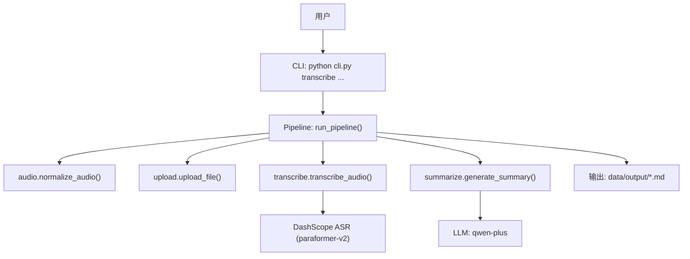
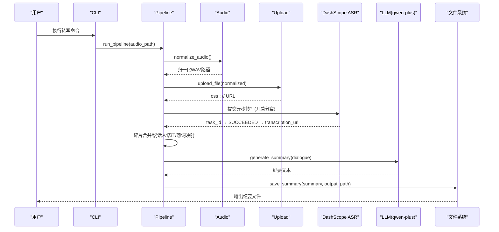
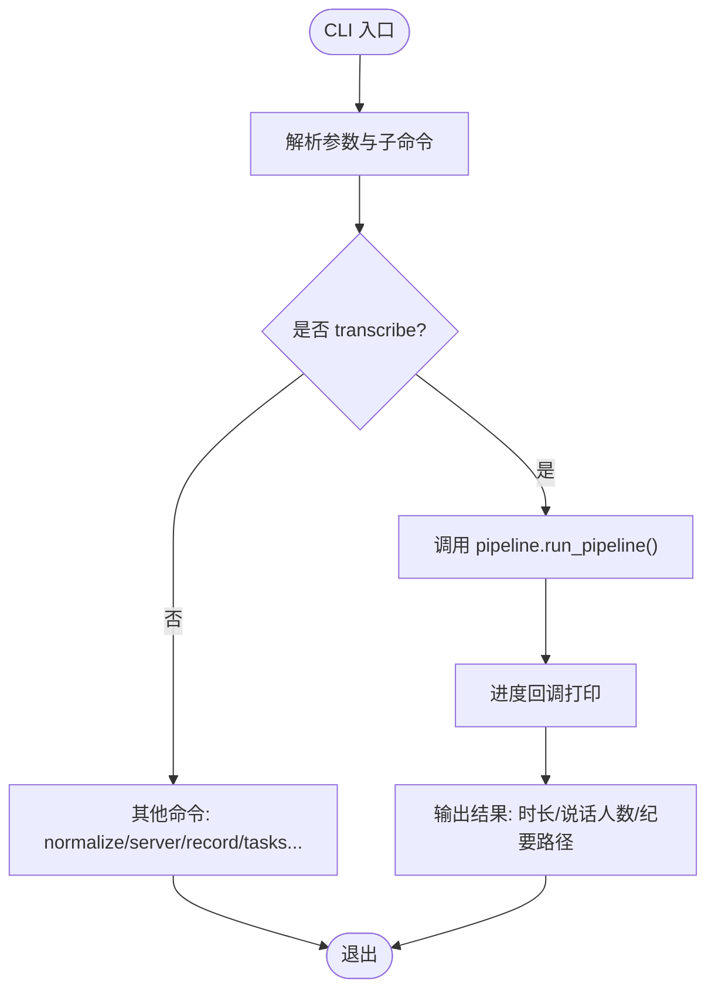
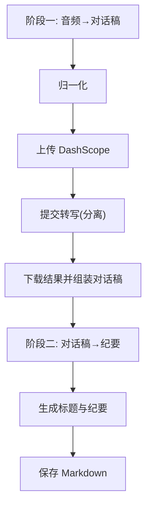
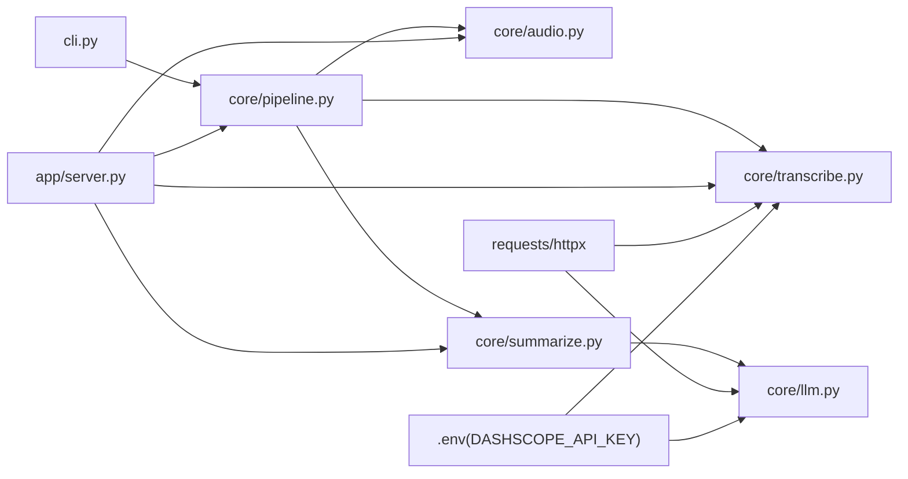

# 快速开始

<cite>
**本文引用的文件**
- [README.md](file://README.md)
- [requirements.txt](file://requirements.txt)
- [cli.py](file://cli.py)
- [app/server.py](file://app/server.py)
- [core/pipeline.py](file://core/pipeline.py)
- [core/audio.py](file://core/audio.py)
- [core/transcribe.py](file://core/transcribe.py)
- [core/llm.py](file://core/llm.py)
- [core/summarize.py](file://core/summarize.py)
- [MVP_PLAN.md](file://MVP_PLAN.md)
</cite>

## 目录
1. [简介](#简介)
2. [项目结构](#项目结构)
3. [核心组件](#核心组件)
4. [架构总览](#架构总览)
5. [详细组件分析](#详细组件分析)
6. [依赖关系分析](#依赖关系分析)
7. [性能注意事项](#性能注意事项)
8. [故障排查指南](#故障排查指南)
9. [结论](#结论)
10. [附录：最小化使用示例](#附录最小化使用示例)

## 简介
本指南面向首次使用者，帮助你在最短时间内完成环境搭建、安装依赖、配置环境变量，并通过命令行完成“音频转写 + 说话人分离 + 生成会议纪要”的完整流程。本项目基于 Python 与 DashScope（通义）云服务，提供本地 Web UI 与 CLI 工具，支持上传音频或系统内录，自动产出结构化纪要（结论/待办）。

## 项目结构
- 顶层入口与文档
  - README.md：项目说明与快速上手指引
  - requirements.txt：运行依赖清单
  - cli.py：命令行工具（转写、录音、任务管理、设置等）
- 核心逻辑
  - core/pipeline.py：编排全流程（归一化 → 上传 → 转写 → 纪要）
  - core/audio.py：音频归一化（ffmpeg）、系统内录（BlackHole）
  - core/transcribe.py：DashScope 异步转写（paraformer-v2），结果组装
  - core/llm.py：通义千问 LLM 调用（OpenAI 兼容端点）
  - core/summarize.py：提示词与纪要生成、保存
- Web 服务
  - app/server.py：FastAPI 服务（REST + WebSocket + 静态页面）

图表来源
- [core/pipeline.py:58-134](file://core/pipeline.py#L58-L134)
- [core/pipeline.py:137-226](file://core/pipeline.py#L137-L226)
- [core/audio.py:31-98](file://core/audio.py#L31-L98)
- [core/transcribe.py:61-131](file://core/transcribe.py#L61-L131)
- [core/llm.py:89-121](file://core/llm.py#L89-L121)
- [core/summarize.py:157-229](file://core/summarize.py#L157-L229)

章节来源
- [README.md:22-28](file://README.md#L22-L28)
- [requirements.txt:1-32](file://requirements.txt#L1-L32)

## 核心组件
- 命令行工具（cli.py）
  - 提供 transcribe、normalize、server、record、tasks、speakers、hotwords、settings、chat 等子命令
  - 通过 HTTP 请求与本地 FastAPI 服务交互，或直接调用核心管线
- 管线（pipeline.py）
  - 两阶段执行：第一阶段“音频→对话稿”，第二阶段“对话稿→纪要”
  - 进度回调、错误处理、输出路径管理
- 音频处理（audio.py）
  - ffmpeg 归一化为 16kHz/单声道/WAV（满足 DashScope 要求）
  - macOS BlackHole 系统内录（avfoundation）
- 转写（transcribe.py）
  - 提交异步任务、轮询状态、下载结果、碎片合并、说话人修正、热词映射
- LLM（llm.py）
  - 同步/异步/流式调用通义千问 OpenAI 兼容端点
- 纪要（summarize.py）
  - 构造提示词、生成标题与纪要、保存 Markdown

章节来源
- [cli.py:1-657](file://cli.py#L1-L657)
- [core/pipeline.py:1-271](file://core/pipeline.py#L1-L271)
- [core/audio.py:1-663](file://core/audio.py#L1-L663)
- [core/transcribe.py:1-446](file://core/transcribe.py#L1-L446)
- [core/llm.py:1-207](file://core/llm.py#L1-L207)
- [core/summarize.py:1-283](file://core/summarize.py#L1-L283)

## 架构总览
整体数据流：
- 输入：本地音频文件或系统内录
- 预处理：ffmpeg 归一化（16kHz/单声道/WAV）
- 上传：DashScope 临时存储获取 oss:// URL
- 转写：paraformer-v2 异步任务，返回带 speaker_id 的句子
- 后处理：碎片合并、说话人修正、热词映射
- 纪要：qwen-plus 生成结构化纪要（结论/待办/议题）
- 输出：Markdown 纪要文件（data/output/）

图表来源
- [core/pipeline.py:58-134](file://core/pipeline.py#L58-L134)
- [core/pipeline.py:137-226](file://core/pipeline.py#L137-L226)
- [core/transcribe.py:405-446](file://core/transcribe.py#L405-L446)
- [core/summarize.py:157-229](file://core/summarize.py#L157-L229)

## 详细组件分析

### 命令行工具（cli.py）
- 主要命令
  - transcribe：转写并生成纪要，支持输出路径与显示内容
  - normalize：仅归一化音频
  - server：启动本地 Web UI
  - record：录音控制（start/stop/pause/resume/status）
  - tasks：任务管理（list/show/delete）
  - speakers/hotwords/settings/chat：辅助功能
- 与服务交互
  - 默认服务地址 http://127.0.0.1:8000
  - 统一封装 _api_request，处理 HTTP 响应与错误

图表来源
- [cli.py:526-657](file://cli.py#L526-L657)
- [cli.py:103-147](file://cli.py#L103-L147)

章节来源
- [cli.py:1-657](file://cli.py#L1-L657)

### 管线（pipeline.py）
- 阶段一（run_pipeline_stage1）
  - 归一化音频、上传到 DashScope、热词表检查、提交转写任务
  - 返回对话稿与原始转写结果
- 阶段二（run_pipeline_stage2）
  - 应用说话人姓名映射、生成纪要与标题、保存 Markdown
- 完整执行（run_pipeline）
  - 串联两阶段，合并结果

图表来源
- [core/pipeline.py:58-134](file://core/pipeline.py#L58-L134)
- [core/pipeline.py:137-226](file://core/pipeline.py#L137-L226)

章节来源
- [core/pipeline.py:1-271](file://core/pipeline.py#L1-L271)

### 音频处理（audio.py）
- 归一化：ffmpeg 将任意格式转为 16kHz/单声道/WAV
- 时长查询：ffprobe 获取音频时长
- 系统内录：macOS avfoundation 从 BlackHole 采集系统音频
- 流式录制：PCM pipe 输出，供实时 ASR 消费

章节来源
- [core/audio.py:26-126](file://core/audio.py#L26-L126)
- [core/audio.py:139-267](file://core/audio.py#L139-L267)
- [core/audio.py:303-516](file://core/audio.py#L303-L516)

### 转写（transcribe.py）
- 提交任务：带 X-DashScope-Async 与可选 X-DashScope-OssResourceResolve
- 轮询：每 3 秒查询一次，超时 600 秒
- 结果处理：下载 JSON、碎片合并、说话人修正、热词映射、按 speaker_id 归并

章节来源
- [core/transcribe.py:54-131](file://core/transcribe.py#L54-L131)
- [core/transcribe.py:134-187](file://core/transcribe.py#L134-L187)
- [core/transcribe.py:222-403](file://core/transcribe.py#L222-L403)
- [core/transcribe.py:405-446](file://core/transcribe.py#L405-L446)

### LLM（llm.py）
- 同步/异步/流式三种调用方式
- 使用 OpenAI 兼容端点，无需额外 SDK
- 连接池复用（httpx.AsyncClient）

章节来源
- [core/llm.py:23-77](file://core/llm.py#L23-L77)
- [core/llm.py:89-121](file://core/llm.py#L89-L121)
- [core/llm.py:129-160](file://core/llm.py#L129-L160)
- [core/llm.py:168-207](file://core/llm.py#L168-L207)

### 纪要（summarize.py）
- 标题生成：简洁概括会议主题
- 纪要生成：严格遵循结构化模板（概要/结论/待办/议题）
- 保存：写入 Markdown，可附加对话稿

章节来源
- [core/summarize.py:19-84](file://core/summarize.py#L19-L84)
- [core/summarize.py:87-229](file://core/summarize.py#L87-L229)
- [core/summarize.py:249-283](file://core/summarize.py#L249-L283)

## 依赖关系分析
- 运行时依赖
  - requests/httpx：HTTP 客户端
  - python-dotenv：环境变量管理
  - fastapi/uvicorn/python-multipart：Web 服务
  - dashscope：实时语音识别（可选）
  - websockets：WebSocket 实时推送
  - numpy/scipy：声纹特征提取（可选）
  - python-docx/PyPDF2：文档文本提取（可选）
- 外部工具
  - ffmpeg：音频归一化与系统内录
  - DashScope API：转写与会话模型

图表来源
- [cli.py:1-657](file://cli.py#L1-L657)
- [core/pipeline.py:1-271](file://core/pipeline.py#L1-L271)
- [core/audio.py:1-663](file://core/audio.py#L1-L663)
- [core/transcribe.py:1-446](file://core/transcribe.py#L1-L446)
- [core/llm.py:1-207](file://core/llm.py#L1-L207)
- [core/summarize.py:1-283](file://core/summarize.py#L1-L283)
- [app/server.py:1-800](file://app/server.py#L1-L800)

章节来源
- [requirements.txt:1-32](file://requirements.txt#L1-L32)

## 性能注意事项
- 音频格式：必须为 16kHz/单声道/WAV，否则说话人分离不生效
- 文件大小：DashScope 临时存储单文件 ≤1GB；常规会议远小于限制
- 网络：仅需访问 dashscope.aliyuncs.com；确保网络可达
- 并发：异步转写存在排队延迟；短音频可考虑 Flash 同步模型（按需）
- 资源：避免同时多路系统内录；同一时刻只允许一路录制

[本节为通用指导，不直接分析具体文件]

## 故障排查指南
- FFmpeg 未安装或不可用
  - 现象：归一化失败、内录失败
  - 解决：安装 FFmpeg 并确保在 PATH 中可用
  - 参考：[core/audio.py:26-28](file://core/audio.py#L26-L28)、[core/audio.py:82-95](file://core/audio.py#L82-L95)
- API Key 未设置或无效
  - 现象：转写/LLM 调用报错“未设置 DASHSCOPE_API_KEY”
  - 解决：在项目根目录创建 .env，填入 DASHSCOPE_API_KEY
  - 参考：[core/transcribe.py:54-58](file://core/transcribe.py#L54-L58)、[core/llm.py:49-53](file://core/llm.py#L49-L53)
- 服务无法连接
  - 现象：CLI 报“无法连接到服务”
  - 解决：先启动本地服务 python cli.py server，再执行其他命令
  - 参考：[cli.py:68-97](file://cli.py#L68-L97)
- 设备未配置或不可用
  - 现象：内录失败，提示设备未配置或 ffmpeg 启动失败
  - 解决：确认 BlackHole 2ch 已安装并在「音频 MIDI 设置」中正确路由
  - 参考：[core/audio.py:167-172](file://core/audio.py#L167-L172)、[core/audio.py:336-341](file://core/audio.py#L336-L341)
- 转写结果为空或超时
  - 现象：轮询超时或结果为空
  - 解决：检查网络、API Key、音频 URL 有效性；重试或缩短音频时长
  - 参考：[core/transcribe.py:134-187](file://core/transcribe.py#L134-L187)

章节来源
- [core/audio.py:26-95](file://core/audio.py#L26-L95)
- [core/transcribe.py:54-58](file://core/transcribe.py#L54-L58)
- [core/llm.py:49-53](file://core/llm.py#L49-L53)
- [cli.py:68-97](file://cli.py#L68-L97)

## 结论
通过本指南，你可以在最短时间内完成 open-meeting-scribe 的环境搭建与核心功能体验。推荐使用 CLI 进行端到端测试：准备一段音频，配置好 DASHSCOPE_API_KEY，执行转写命令即可获得结构化纪要。若需实时内录与 Web UI，可启动本地服务并使用浏览器操作。

[本节为总结性内容，不直接分析具体文件]

## 附录：最小化使用示例
以下命令可直接复制粘贴，用于快速体验核心功能。请确保已在项目根目录执行。

- 环境准备
  - 创建并激活虚拟环境（建议使用 Python 3.11+）
  - 安装依赖：pip install -r requirements.txt
  - 安装 FFmpeg（系统级工具）
  - 配置环境变量：在项目根目录创建 .env，填入 DASHSCOPE_API_KEY

- 最小化转写（CLI）
  - 转写并生成纪要：python cli.py transcribe samples/会议.wav
  - 指定输出路径：python cli.py transcribe samples/会议.wav -o output/纪要.md
  - 显示纪要内容：python cli.py transcribe samples/会议.wav --show

- 仅归一化音频
  - python cli.py normalize samples/会议.wav

- 启动本地 Web UI
  - 启动服务：python cli.py server
  - 浏览器访问：http://127.0.0.1:8000

- 查看任务与结果
  - 列出任务：python cli.py tasks list
  - 查看任务详情：python cli.py tasks show <task_id>
  - 删除任务：python cli.py tasks delete <task_id>

- 常见问题速查
  - FFmpeg 未找到：安装 FFmpeg 并确保 PATH 包含其路径
  - API Key 错误：检查 .env 中的 DASHSCOPE_API_KEY 是否正确
  - 服务未启动：先运行 python cli.py server 再执行相关命令

章节来源
- [README.md:22-28](file://README.md#L22-L28)
- [cli.py:103-147](file://cli.py#L103-L147)
- [cli.py:150-172](file://cli.py#L150-L172)
- [cli.py:201-219](file://cli.py#L201-L219)
- [cli.py:298-366](file://cli.py#L298-L366)
- [MVP_PLAN.md:117-138](file://MVP_PLAN.md#L117-L138)