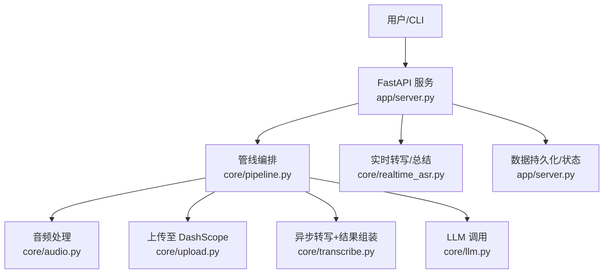
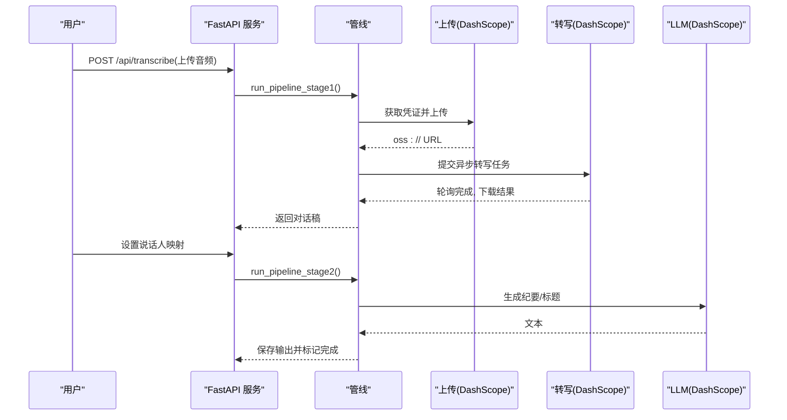
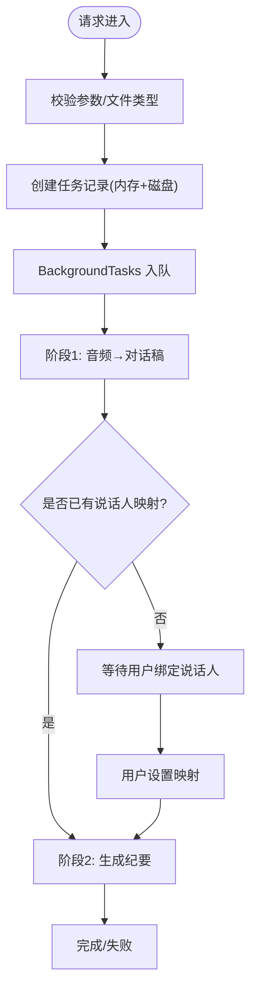
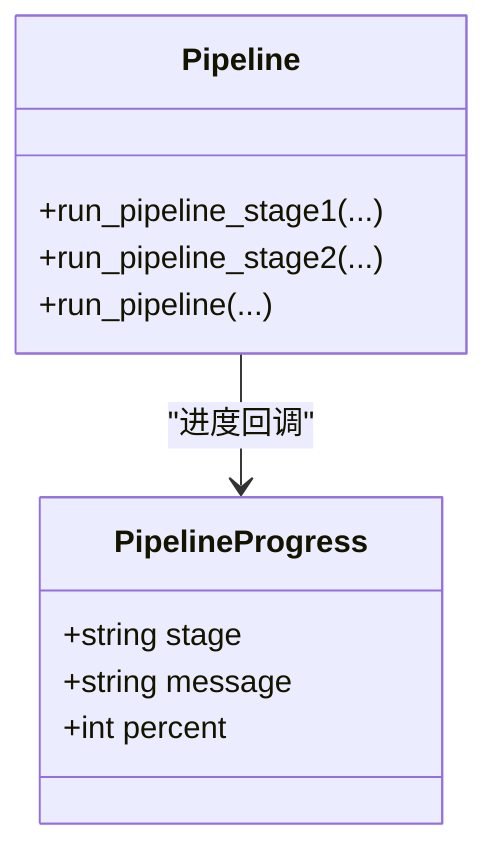
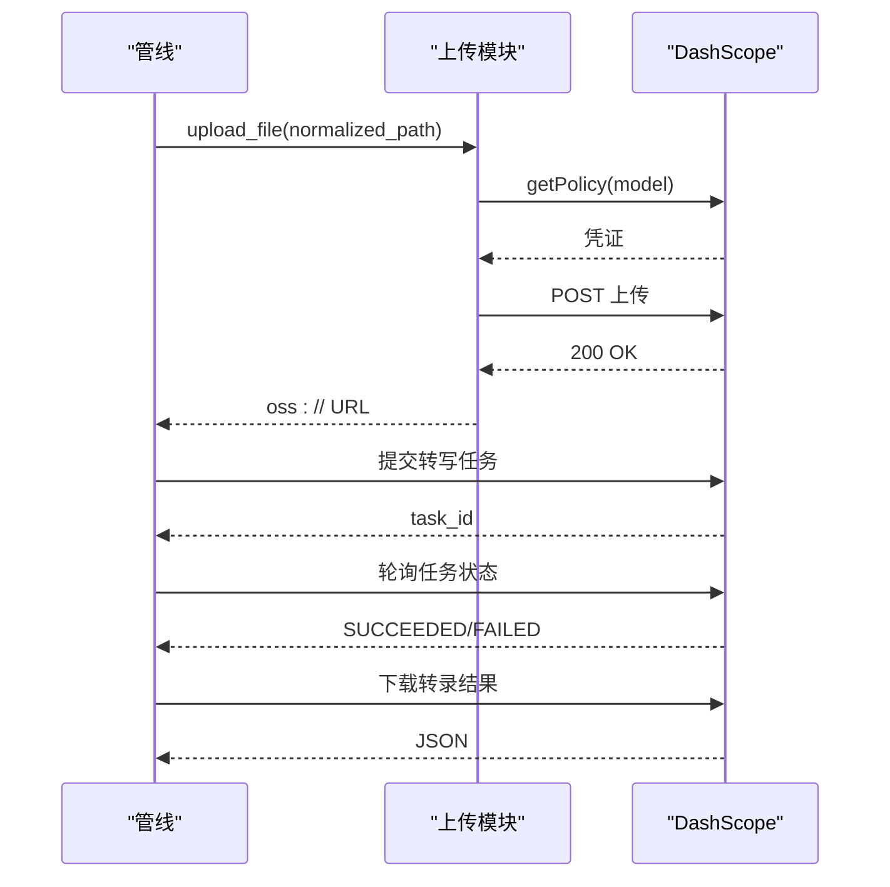
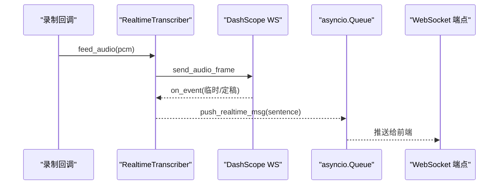
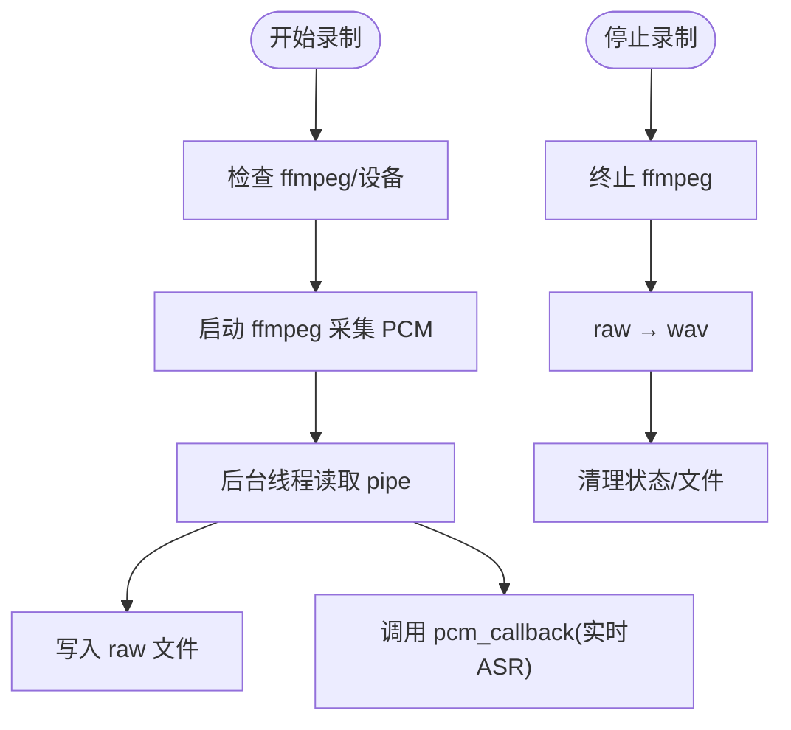
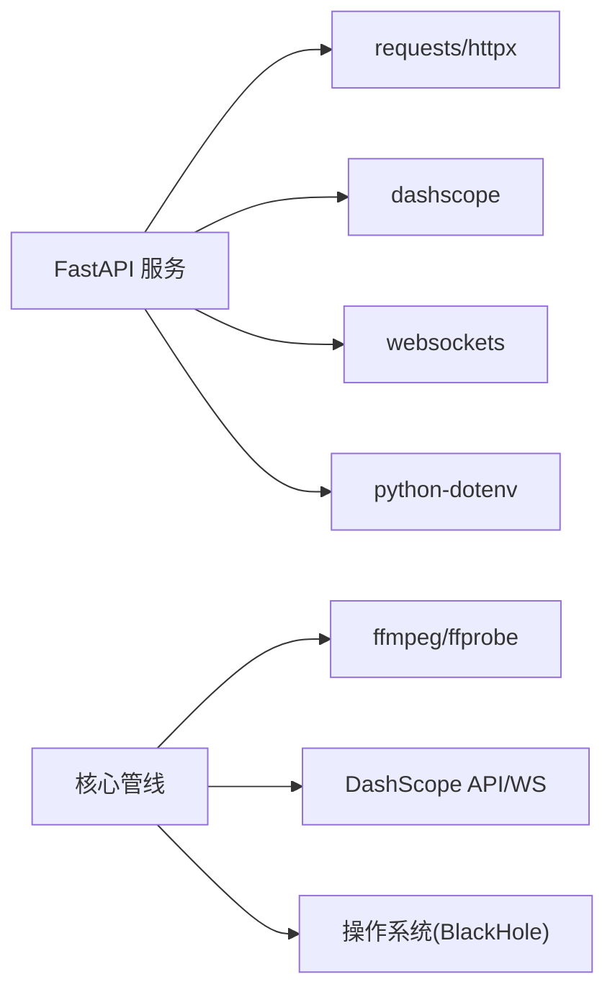

# 故障排除

<cite>
**本文引用的文件**
- [README.md](file://README.md)
- [requirements.txt](file://requirements.txt)
- [app/server.py](file://app/server.py)
- [core/pipeline.py](file://core/pipeline.py)
- [core/upload.py](file://core/upload.py)
- [core/transcribe.py](file://core/transcribe.py)
- [core/realtime_asr.py](file://core/realtime_asr.py)
- [core/audio.py](file://core/audio.py)
- [core/llm.py](file://core/llm.py)
- [cli.py](file://cli.py)
</cite>

## 目录
1. [简介](#简介)
2. [项目结构](#项目结构)
3. [核心组件](#核心组件)
4. [架构总览](#架构总览)
5. [详细组件分析](#详细组件分析)
6. [依赖关系分析](#依赖关系分析)
7. [性能注意事项](#性能注意事项)
8. [故障排除指南](#故障排除指南)
9. [结论](#结论)
10. [附录](#附录)

## 简介
本指南面向 open-meeting-scribe 的使用者与开发者，聚焦安装、配置、运行时异常、网络问题（尤其是与 DashScope 的连接）、性能问题（内存泄漏、CPU 占用过高）的排查与优化，并提供日志分析方法、调试技巧与社区支持渠道。目标是帮助你快速定位并解决问题，稳定运行“音频 → 转写 + 说话人分离 → 结构化纪要”的全流程。

## 项目结构
- Web 服务：FastAPI 应用，提供上传、任务管理、实时录音与 WebSocket 推送等能力。
- 核心管线：音频归一化、上传到 DashScope、异步转写、对话稿组装、LLM 生成纪要与标题、输出 Markdown。
- 实时模块：基于 DashScope SDK 的流式识别、声纹聚类与增量摘要。
- 工具与 CLI：命令行入口，便于本地测试与服务启动。

图表来源
- [app/server.py:1-80](file://app/server.py#L1-L80)
- [core/pipeline.py:1-45](file://core/pipeline.py#L1-L45)
- [core/upload.py:1-30](file://core/upload.py#L1-L30)
- [core/transcribe.py:1-30](file://core/transcribe.py#L1-L30)
- [core/llm.py:1-30](file://core/llm.py#L1-L30)
- [core/realtime_asr.py:1-30](file://core/realtime_asr.py#L1-L30)

章节来源
- [README.md:1-39](file://README.md#L1-L39)
- [requirements.txt:1-32](file://requirements.txt#L1-L32)

## 核心组件
- 服务层（FastAPI）：负责 API、WebSocket、后台任务调度、任务状态持久化、录制控制。
- 管线层：串联音频归一化、上传、转写、对话稿组装、LLM 生成纪要与标题、保存输出。
- 实时层：流式 PCM 采集、DashScope 实时 ASR、声纹聚类、增量摘要。
- 外部依赖：DashScope REST/WS、ffmpeg/ffprobe、BlackHole（macOS）。

章节来源
- [app/server.py:1-165](file://app/server.py#L1-L165)
- [core/pipeline.py:47-134](file://core/pipeline.py#L47-L134)
- [core/realtime_asr.py:150-368](file://core/realtime_asr.py#L150-L368)
- [core/audio.py:1-126](file://core/audio.py#L1-L126)

## 架构总览
系统采用“Web 服务 + 管线编排 + 外部服务”的分层架构：
- Web 服务暴露 REST 与 WS 接口，接收音频或开始录制，触发后台任务。
- 管线按阶段执行，每个阶段通过进度回调更新任务状态。
- 外部服务包括 DashScope（上传、转写、LLM）与本地工具链（ffmpeg/BlackHole）。

图表来源
- [app/server.py:343-396](file://app/server.py#L343-L396)
- [core/pipeline.py:58-134](file://core/pipeline.py#L58-L134)
- [core/upload.py:59-115](file://core/upload.py#L59-L115)
- [core/transcribe.py:61-131](file://core/transcribe.py#L61-L131)
- [core/llm.py:89-121](file://core/llm.py#L89-L121)

## 详细组件分析

### 服务层（FastAPI）
- 职责：REST/WS 端点、后台任务、任务状态持久化、录制控制、错误上报。
- 关键点：
  - 任务状态机：pending → processing → awaiting_mapping → completed/failed。
  - 后台任务使用 BackgroundTasks 执行管线阶段，避免阻塞事件循环。
  - 实时转写通过 asyncio.Queue 将 SDK 线程消息安全推送到 WebSocket。
  - 磁盘持久化任务 JSON，启动时恢复，剔除冗余字段。

图表来源
- [app/server.py:343-396](file://app/server.py#L343-L396)
- [app/server.py:630-671](file://app/server.py#L630-L671)
- [app/server.py:92-128](file://app/server.py#L92-L128)

章节来源
- [app/server.py:1-165](file://app/server.py#L1-L165)
- [app/server.py:343-396](file://app/server.py#L343-L396)
- [app/server.py:630-671](file://app/server.py#L630-L671)

### 管线层
- 阶段1：音频归一化 → 上传 → 热词表检查 → 异步转写 → 对话稿组装。
- 阶段2：应用说话人姓名 → 生成纪要与标题 → 保存 Markdown。
- 进度回调：PipelineProgress 用于 UI 展示与状态同步。

图表来源
- [core/pipeline.py:47-56](file://core/pipeline.py#L47-L56)
- [core/pipeline.py:58-134](file://core/pipeline.py#L58-L134)
- [core/pipeline.py:137-227](file://core/pipeline.py#L137-L227)

章节来源
- [core/pipeline.py:58-227](file://core/pipeline.py#L58-L227)

### 上传与转写
- 上传：获取凭证 → multipart 上传 → 返回 oss:// URL。
- 转写：提交异步任务 → 轮询状态 → 下载结果 → 合并碎片与修正说话人 → 组装对话稿。

图表来源
- [core/upload.py:33-115](file://core/upload.py#L33-L115)
- [core/transcribe.py:61-131](file://core/transcribe.py#L61-L131)
- [core/transcribe.py:134-187](file://core/transcribe.py#L134-L187)

章节来源
- [core/upload.py:33-115](file://core/upload.py#L33-L115)
- [core/transcribe.py:61-187](file://core/transcribe.py#L61-L187)

### 实时转写与总结
- 实时转写：建立 WebSocket 连接，PCM 分片送入，回调收集临时/定稿句子，自动重试限流。
- 声纹聚类：在录制过程中对 PCM 进行聚类，估算说话人数并辅助后续批处理。
- 增量摘要：根据定稿句子持续更新摘要，并通过 WebSocket 推送。

图表来源
- [core/realtime_asr.py:150-368](file://core/realtime_asr.py#L150-L368)
- [app/server.py:171-219](file://app/server.py#L171-L219)

章节来源
- [core/realtime_asr.py:150-368](file://core/realtime_asr.py#L150-L368)
- [app/server.py:171-219](file://app/server.py#L171-L219)

### 音频处理与录制
- 归一化：ffmpeg 将任意格式转为 16kHz/单声道/WAV。
- 录制：macOS 通过 BlackHole 采集系统音频；流式模式输出 raw PCM 到 pipe，同时写入文件并回调实时 ASR。
- 停止：终止 ffmpeg，raw 转 WAV，计算有效时长（扣除暂停时间）。

图表来源
- [core/audio.py:31-98](file://core/audio.py#L31-L98)
- [core/audio.py:303-396](file://core/audio.py#L303-L396)
- [core/audio.py:440-515](file://core/audio.py#L440-L515)

章节来源
- [core/audio.py:31-98](file://core/audio.py#L31-L98)
- [core/audio.py:303-396](file://core/audio.py#L303-L396)
- [core/audio.py:440-515](file://core/audio.py#L440-L515)

### LLM 调用
- 同步/异步两种调用方式，均通过 DashScope OpenAI 兼容端点。
- 超时与异常统一转换为 RuntimeError，便于上层捕获。
- 异步客户端复用连接池，减少握手开销。

章节来源
- [core/llm.py:89-121](file://core/llm.py#L89-L121)
- [core/llm.py:129-160](file://core/llm.py#L129-L160)

## 依赖关系分析
- 外部依赖：
  - DashScope：上传、转写、LLM、实时 ASR。
  - ffmpeg/ffprobe：音频归一化、时长查询、录制。
  - BlackHole（macOS）：系统内录虚拟声卡。
- Python 依赖：requests、httpx、python-dotenv、fastapi、uvicorn、websockets、dashscope、numpy/scipy、python-docx/PyPDF2。

图表来源
- [requirements.txt:1-32](file://requirements.txt#L1-L32)
- [core/upload.py:22-30](file://core/upload.py#L22-L30)
- [core/transcribe.py:26-31](file://core/transcribe.py#L26-L31)
- [core/realtime_asr.py:47-54](file://core/realtime_asr.py#L47-L54)

章节来源
- [requirements.txt:1-32](file://requirements.txt#L1-L32)

## 性能注意事项
- 连接池与超时：
  - 异步 HTTP 客户端复用连接池，设置合理超时与连接限制，避免频繁握手与资源耗尽。
- 实时流式处理：
  - PCM 分片大小建议约 100ms（6400 bytes），降低延迟与内存压力。
  - 回调中避免重计算，仅做必要的数据转发与轻量处理。
- 文件与 IO：
  - 上传前归一化为最优格式，减少服务端处理负担。
  - 大文件上传注意超时与带宽，必要时分段或提升网络质量。
- 进程与线程：
  - ffmpeg 子进程需正确终止与资源回收，避免僵尸进程。
  - 后台任务与事件循环解耦，防止阻塞。

[本节为通用指导，不直接分析具体文件]

## 故障排除指南

### 安装与环境问题
- 症状：
  - 无法导入模块或版本冲突。
  - ffmpeg/ffprobe 未找到。
  - macOS 下 BlackHole 设备不可用。
- 诊断步骤：
  - 检查 Python 版本与依赖安装：确保 Python 3.11+，已安装 requirements.txt 所列依赖。
  - 验证 ffmpeg/ffprobe 是否在 PATH 中，可通过命令检测可用性。
  - 确认 BlackHole 2ch 已安装并在系统中可用。
- 解决方案：
  - 重新创建虚拟环境并安装依赖。
  - 安装或修复 ffmpeg 安装路径。
  - 在 macOS 上配置多输出设备并将系统输出切换到包含 BlackHole 的组合设备。

章节来源
- [requirements.txt:1-32](file://requirements.txt#L1-L32)
- [core/audio.py:26-28](file://core/audio.py#L26-L28)
- [core/audio.py:101-126](file://core/audio.py#L101-L126)

### 环境变量与配置错误
- 症状：
  - 启动时报“未设置 DASHSCOPE_API_KEY”。
  - 上传或转写失败，提示鉴权错误。
- 诊断步骤：
  - 检查 .env 是否存在且包含 DASHSCOPE_API_KEY。
  - 确认服务启动时已加载环境变量。
- 解决方案：
  - 复制示例环境文件并填入正确的 API Key。
  - 重启服务以重新加载环境变量。

章节来源
- [core/upload.py:25-30](file://core/upload.py#L25-L30)
- [core/transcribe.py:54-58](file://core/transcribe.py#L54-L58)
- [core/llm.py:49-53](file://core/llm.py#L49-L53)
- [core/realtime_asr.py:229-233](file://core/realtime_asr.py#L229-L233)

### 上传失败
- 症状：
  - 上传返回非 200 状态码或凭证获取失败。
  - 文件过大报错。
- 诊断步骤：
  - 检查文件大小是否超过 1GB。
  - 查看上传凭证接口响应与错误信息。
- 解决方案：
  - 压缩或拆分大文件。
  - 检查网络与鉴权，重试上传。

章节来源
- [core/upload.py:59-115](file://core/upload.py#L59-L115)

### 转写任务失败或超时
- 症状：
  - 轮询超时或任务状态为 FAILED。
  - 结果为空或未获取到 transcription_url。
- 诊断步骤：
  - 查看任务状态轮询日志与错误消息。
  - 检查网络连接与 DashScope 服务状态。
- 解决方案：
  - 增加轮询间隔或超时时间（如需要）。
  - 重试任务，检查输入音频格式与内容。

章节来源
- [core/transcribe.py:134-187](file://core/transcribe.py#L134-L187)
- [core/transcribe.py:405-446](file://core/transcribe.py#L405-L446)

### 实时转写连接问题
- 症状：
  - WebSocket 连接失败或频繁断开。
  - 出现限流错误并自动重试。
- 诊断步骤：
  - 检查 DASHSCOPE_WS_URL 与 API Key。
  - 观察限流重试日志与错误回调。
- 解决方案：
  - 调整重试策略与退避时间。
  - 降低并发或错峰使用，避免触发限流。

章节来源
- [core/realtime_asr.py:216-327](file://core/realtime_asr.py#L216-L327)

### LLM 调用失败或超时
- 症状：
  - 生成纪要失败或超时。
  - 异步调用抛出异常。
- 诊断步骤：
  - 检查网络与鉴权。
  - 查看超时与连接池配置。
- 解决方案：
  - 调整超时与连接限制。
  - 重试或降级到非流式调用。

章节来源
- [core/llm.py:89-121](file://core/llm.py#L89-L121)
- [core/llm.py:129-160](file://core/llm.py#L129-L160)

### 录制与音频问题
- 症状：
  - 无法开始录制或设备不可用。
  - 录制文件为空或时长异常。
- 诊断步骤：
  - 检查 ffmpeg 与 BlackHole 设备配置。
  - 查看流式读取线程日志与回调次数。
- 解决方案：
  - 重新配置系统输出设备。
  - 确保录制期间有音频输入，避免过短录制导致无效文件。

章节来源
- [core/audio.py:139-217](file://core/audio.py#L139-L217)
- [core/audio.py:303-396](file://core/audio.py#L303-L396)
- [core/audio.py:440-515](file://core/audio.py#L440-L515)

### 任务状态与持久化问题
- 症状：
  - 任务状态不更新或丢失。
  - 重启后任务未恢复。
- 诊断步骤：
  - 检查 data/tasks 目录下的 JSON 文件。
  - 查看服务启动时的恢复日志。
- 解决方案：
  - 确保任务持久化函数正常执行。
  - 修复损坏的任务文件或删除后重试。

章节来源
- [app/server.py:92-128](file://app/server.py#L92-L128)

### 日志分析与调试技巧
- 日志位置与级别：
  - 各模块使用 logging.getLogger(__name__) 输出日志，级别 INFO/ERROR 为主。
  - CLI 默认 INFO 级别，便于观察进度与错误。
- 关键日志点：
  - 上传凭证与上传过程。
  - 转写任务提交、轮询状态变化。
  - 实时转写连接建立、回调事件、限流重试。
  - 音频归一化与录制进程状态。
- 调试建议：
  - 使用 CLI 逐步验证各阶段（normalize/upload/transcribe）。
  - 在服务端启用 uvicorn 的 reload 模式以便开发调试。
  - 关注异常堆栈与错误消息，定位具体模块。

章节来源
- [cli.py:57-62](file://cli.py#L57-L62)
- [core/upload.py:48-56](file://core/upload.py#L48-L56)
- [core/transcribe.py:164-175](file://core/transcribe.py#L164-L175)
- [core/realtime_asr.py:80-99](file://core/realtime_asr.py#L80-L99)
- [core/audio.py:79-98](file://core/audio.py#L79-L98)

### 性能问题诊断与优化
- CPU 占用过高：
  - 检查实时回调中的重计算逻辑，避免重复处理。
  - 降低 PCM 分片频率或批量处理。
- 内存泄漏：
  - 确保异步客户端在应用关闭时正确释放。
  - 避免在回调中持有大对象引用。
- 网络瓶颈：
  - 调整连接池大小与超时。
  - 使用 CDN 或就近地域的 DashScope 端点（如可配置）。

章节来源
- [core/llm.py:30-46](file://core/llm.py#L30-L46)
- [core/realtime_asr.py:329-343](file://core/realtime_asr.py#L329-L343)

### 网络问题（DashScope 连接）
- 症状：
  - 上传/转写/LLM 调用失败或超时。
  - WebSocket 连接不稳定。
- 诊断步骤：
  - 检查 DNS 解析与防火墙规则。
  - 查看错误码与消息，判断是否为鉴权或限流。
- 解决方案：
  - 切换网络或使用代理。
  - 降低并发与重试频率，遵循限流策略。

章节来源
- [core/upload.py:43-56](file://core/upload.py#L43-L56)
- [core/transcribe.py:85-131](file://core/transcribe.py#L85-L131)
- [core/llm.py:101-121](file://core/llm.py#L101-L121)
- [core/realtime_asr.py:254-327](file://core/realtime_asr.py#L254-L327)

### 社区支持与反馈渠道
- 文档与决策记录：
  - 阅读 docs/adr 了解技术选型与变更原因。
  - 参考 README 与架构文档理解整体设计。
- 问题反馈：
  - 通过项目仓库 Issues 提交问题，附上日志与复现步骤。
  - 在社区讨论区提问，描述环境与期望行为。

章节来源
- [README.md:11-19](file://README.md#L11-L19)

## 结论
通过分层排查（环境 → 配置 → 网络 → 服务 → 外部依赖）与系统化日志分析，可以快速定位 open-meeting-scribe 的安装、配置与运行问题。结合性能优化建议与调试技巧，能够显著提升稳定性与效率。遇到问题时，优先检查环境变量、ffmpeg/BlackHole 配置、DashScope 连接与限流策略，并利用 CLI 与日志逐步缩小范围。

## 附录
- 常用命令：
  - 启动服务：python cli.py server
  - 上传测试：python cli.py upload <音频文件>
  - 转写测试：python cli.py transcribe <音频文件>
- 目录说明：
  - data/uploads：上传音频暂存。
  - data/recordings：录制文件与 raw PCM。
  - data/output：生成的纪要 Markdown。
  - data/tasks：任务持久化 JSON。

章节来源
- [cli.py:201-218](file://cli.py#L201-L218)
- [app/server.py:75-89](file://app/server.py#L75-L89)