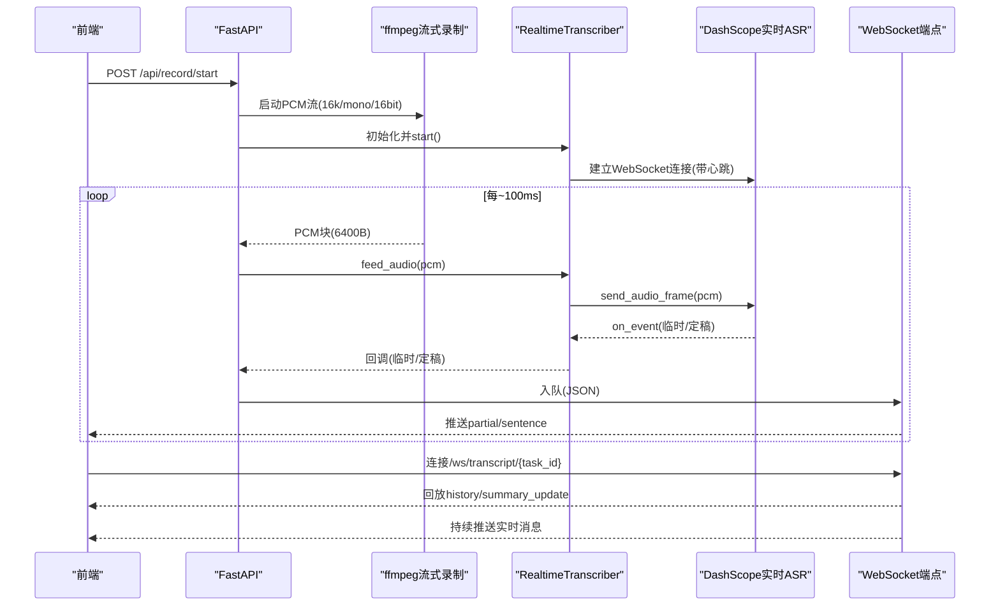
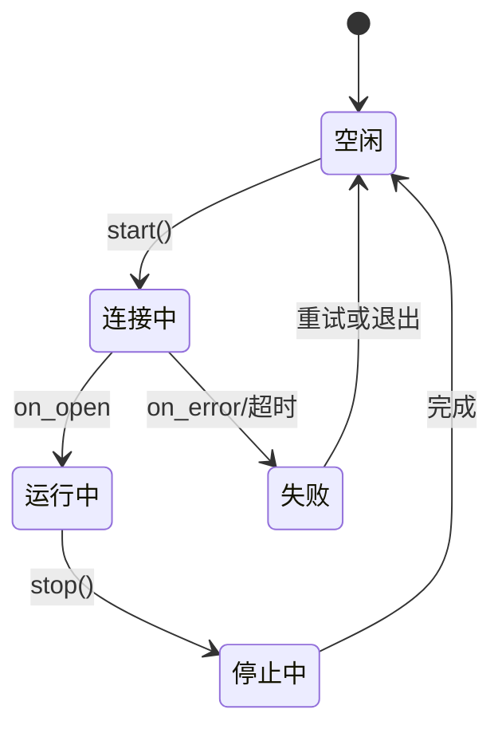
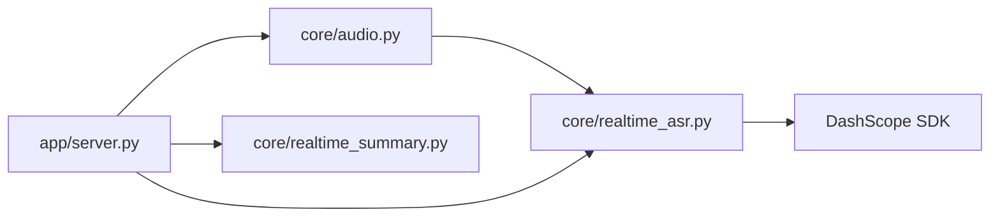

# WebSocket通信

<cite>
**本文引用的文件**
- [core/realtime_asr.py](file://core/realtime_asr.py)
- [app/server.py](file://app/server.py)
- [core/audio.py](file://core/audio.py)
- [docs/API_CONTRACTS.md](file://docs/API_CONTRACTS.md)
</cite>

## 目录
1. [简介](#简介)
2. [项目结构](#项目结构)
3. [核心组件](#核心组件)
4. [架构总览](#架构总览)
5. [详细组件分析](#详细组件分析)
6. [依赖关系分析](#依赖关系分析)
7. [性能与生产特性](#性能与生产特性)
8. [故障排查指南](#故障排查指南)
9. [结论](#结论)
10. [附录：客户端集成与调试](#附录客户端集成与调试)

## 简介
本技术文档聚焦实时转写引擎中的WebSocket通信，覆盖从连接建立、认证、消息协议到生命周期管理的全链路说明。系统通过DashScope的流式语音识别服务（qwen-audio-3.0-asr-flash-streaming）提供低延迟的实时转写能力；后端FastAPI服务负责采集音频、封装PCM帧、维护WebSocket会话并向前端推送结果。文档同时给出网络异常处理、超时控制、性能监控、前端交互优化等生产环境实践建议。

## 项目结构
- 实时转写核心：core/realtime_asr.py 封装DashScope SDK，负责WebSocket连接、参数配置、回调处理、重试机制。
- 服务端网关：app/server.py 暴露REST与WebSocket接口，协调录音、ASR、说话人分离、总结器，并将结果推送到前端。
- 音频采集与流式管道：core/audio.py 使用ffmpeg将系统内录输出为PCM流，按固定块大小读取并回调给ASR。
- 外部契约：docs/API_CONTRACTS.md 定义DashScope鉴权、实时WebSocket地址、参数与约束。

```mermaid
graph TB
FE["前端页面"] --> WS["FastAPI WebSocket<br/>/ws/transcript/{task_id}"]
WS --> Q["异步队列 asyncio.Queue"]
Q --> RT["RealtimeTranscriber<br/>DashScope SDK"]
RT --> DS["DashScope 实时ASR<br/>wss://.../inference"]
FE <-- WS "JSON消息"
REC["ffmpeg 流式录制"] --> PCM["PCM 16bit/16kHz/单声道"]
PCM --> RT
```

图表来源
- [app/server.py:1760-1831](file://app/server.py#L1760-L1831)
- [core/realtime_asr.py:150-368](file://core/realtime_asr.py#L150-L368)
- [core/audio.py:303-437](file://core/audio.py#L303-L437)
- [docs/API_CONTRACTS.md:114-176](file://docs/API_CONTRACTS.md#L114-L176)

章节来源
- [app/server.py:1-2152](file://app/server.py#L1-L2152)
- [core/realtime_asr.py:1-368](file://core/realtime_asr.py#L1-L368)
- [core/audio.py:1-663](file://core/audio.py#L1-L663)
- [docs/API_CONTRACTS.md:1-176](file://docs/API_CONTRACTS.md#L1-L176)

## 核心组件
- RealtimeTranscriber：封装DashScope实时识别SDK，管理WebSocket连接、参数、回调、重试与停止流程。
- _TranscriptCallback：SDK回调实现，区分临时结果与定稿句子，并通过事件循环安全投递消息。
- FastAPI WebSocket端点：维护任务级队列，回放历史与摘要，超时关闭与异常处理。
- 流式录音管道：ffmpeg输出raw PCM，后台线程按固定块读取并回调至ASR与声纹聚类。

章节来源
- [core/realtime_asr.py:57-368](file://core/realtime_asr.py#L57-L368)
- [app/server.py:1760-1831](file://app/server.py#L1760-L1831)
- [core/audio.py:303-437](file://core/audio.py#L303-L437)

## 架构总览
实时转写的端到端流程如下：
- 前端调用 /api/record/start 启动流式录音，创建任务ID、队列、声纹聚类器、实时总结器。
- ffmpeg以16kHz/单声道/16bit输出PCM到stdout，后台线程每6400字节（约100ms）回调一次。
- 回调将PCM送入RealtimeTranscriber，后者通过DashScope SDK建立WebSocket长连接，发送音频帧。
- SDK回调返回临时结果与定稿句子，服务端将其包装为JSON消息放入队列，由WebSocket协程推送给前端。
- 前端在 /ws/transcript/{task_id} 接收 partial/sentence/history/summary_update/ended/error 等消息。



图表来源
- [app/server.py:721-800](file://app/server.py#L721-L800)
- [core/audio.py:303-437](file://core/audio.py#L303-L437)
- [core/realtime_asr.py:216-368](file://core/realtime_asr.py#L216-L368)
- [app/server.py:1760-1831](file://app/server.py#L1760-L1831)

## 详细组件分析

### DashScope WebSocket连接建立与认证
- 地址配置：通过环境变量或默认值设置 base_websocket_api_url，指向 wss://dashscope.aliyuncs.com/api-ws/v1/inference。
- 认证机制：设置 DASHSCOPE_API_KEY 环境变量，SDK内部用于鉴权。
- 关键参数：
  - model: qwen-audio-3.0-asr-flash-streaming
  - format: pcm
  - sample_rate: 16000
  - language_hints: ["zh","en"]
  - semantic_punctuation_enabled: True（会议场景语义断句）
  - heartbeat: True（保持长连接）
  - vocabulary_id/vocabulary/context：可选热词与上下文增强
- 连接等待：通过回调事件同步等待on_open或on_error，超时检测连接状态。

章节来源
- [core/realtime_asr.py:47-55](file://core/realtime_asr.py#L47-L55)
- [core/realtime_asr.py:216-287](file://core/realtime_asr.py#L216-L287)
- [docs/API_CONTRACTS.md:114-176](file://docs/API_CONTRACTS.md#L114-L176)

### 消息协议格式
- 下行消息类型（服务端→前端）：
  - partial：临时结果，包含text、speaker_id、speaker_name
  - sentence：定稿句子，包含text、begin_time、end_time、speaker_id、speaker_name
  - history：连接时回放的历史句子（刷新恢复）
  - summary_update：实时总结内容更新
  - summary_status：总结器状态（idle/paused）
  - error：错误信息
  - ended：转写结束信号
- 上行消息：当前实现未定义前端向服务端发送的消息（仅消费）。

章节来源
- [app/server.py:1760-1831](file://app/server.py#L1760-L1831)

### PCM音频数据帧与心跳机制
- 音频格式：PCM 16bit、16kHz、单声道（s16le），每包建议6400字节（约100ms）。
- 心跳机制：SDK参数heartbeat=True，用于静音时保持长连接。
- 流式读取：后台线程从ffmpeg stdout读取固定块，写入raw文件并回调至ASR。

章节来源
- [core/audio.py:354-437](file://core/audio.py#L354-L437)
- [core/realtime_asr.py:235-248](file://core/realtime_asr.py#L235-L248)
- [docs/API_CONTRACTS.md:114-176](file://docs/API_CONTRACTS.md#L114-L176)

### 连接生命周期管理
- 建立：start()配置参数并创建Recognition实例，等待on_open/on_error确认。
- 数据传输：feed_audio()逐块发送PCM帧。
- 优雅关闭：stop()调用SDK stop，清理状态。
- 断线重连：start()内置限流重试（指数退避2s/5s/10s，最多3次），非限流错误直接抛出。
- 前端超时：WebSocket协程60秒无消息则关闭连接。



图表来源
- [core/realtime_asr.py:216-327](file://core/realtime_asr.py#L216-L327)
- [app/server.py:1816-1831](file://app/server.py#L1816-L1831)

### 错误处理协议
- SDK层：on_error回调捕获错误信息，wait_for_connect返回错误消息。
- 服务端层：_push_realtime_msg将错误消息入队，WebSocket推送error类型消息。
- 前端层：根据type字段处理错误提示。

章节来源
- [core/realtime_asr.py:92-109](file://core/realtime_asr.py#L92-L109)
- [app/server.py:171-199](file://app/server.py#L171-L199)
- [app/server.py:1760-1831](file://app/server.py#L1760-L1831)

### 与前端界面的实时交互模式
- 连接后回放：WebSocket连接建立时回放历史句子与当前总结内容，确保页面刷新不丢失。
- 实时更新：partial/sentence消息驱动界面滚动显示，sentence作为定稿追加。
- 总结器状态：summary_status通知前端暂停/空闲状态，便于UI反馈。
- 超时关闭：60秒无新消息自动关闭，前端可提示重连。

章节来源
- [app/server.py:1781-1815](file://app/server.py#L1781-L1815)
- [app/server.py:1816-1831](file://app/server.py#L1816-L1831)

## 依赖关系分析
- RealtimeTranscriber依赖DashScope SDK，通过环境变量获取API Key与WebSocket地址。
- 服务端依赖audio模块进行PCM流采集，依赖realtime_asr进行ASR，依赖realtime_summary进行增量总结。
- WebSocket端点依赖asyncio.Queue进行线程安全消息投递。



图表来源
- [app/server.py:41-57](file://app/server.py#L41-L57)
- [core/realtime_asr.py:29-45](file://core/realtime_asr.py#L29-L45)
- [core/audio.py:1-23](file://core/audio.py#L1-L23)

章节来源
- [app/server.py:1-2152](file://app/server.py#L1-L2152)
- [core/realtime_asr.py:1-368](file://core/realtime_asr.py#L1-L368)
- [core/audio.py:1-663](file://core/audio.py#L1-L663)

## 性能与生产特性
- 音频分块：6400字节/100ms，平衡延迟与带宽。
- 重试策略：限流错误指数退避，避免雪崩。
- 超时控制：WebSocket 60秒无消息关闭，防止僵尸连接。
- 资源清理：stop()与finally块确保SDK与进程释放。
- 监控日志：关键节点记录日志，便于问题定位。

[本节为通用指导，无需特定文件引用]

## 故障排查指南
- 连接失败：检查DASHSCOPE_API_KEY与网络可达性，查看on_error回调消息。
- 音频格式错误：确认ffmpeg输出s16le、16kHz、单声道，块大小6400字节。
- 限流重试：观察重试日志，调整业务侧请求频率。
- 前端无消息：检查WebSocket连接是否建立，队列是否有消息入队。

章节来源
- [core/realtime_asr.py:289-327](file://core/realtime_asr.py#L289-L327)
- [core/audio.py:354-437](file://core/audio.py#L354-L437)
- [app/server.py:1816-1831](file://app/server.py#L1816-L1831)

## 结论
本系统通过DashScope实时ASR与FastAPI WebSocket实现了低延迟的会议转写能力。核心在于严格的音频格式控制、可靠的连接管理与重试机制、以及友好的前端交互设计。生产环境中需关注网络稳定性、限流策略与资源清理，以确保高可用性与用户体验。

[本节为总结，无需特定文件引用]

## 附录：客户端集成与调试
- 前端集成步骤：
  1. 调用POST /api/record/start启动录音，获取task_id。
  2. 连接WebSocket ws://localhost:8000/ws/transcript/{task_id}。
  3. 监听partial/sentence/history/summary_update/ended/error消息。
  4. 页面刷新时利用history回放恢复显示。
- 调试方法：
  - 浏览器开发者工具Network面板查看WebSocket帧。
  - 服务端日志查看连接状态与错误信息。
  - 检查ffmpeg进程与设备可用性。

章节来源
- [app/server.py:721-800](file://app/server.py#L721-L800)
- [app/server.py:1760-1831](file://app/server.py#L1760-L1831)
- [core/audio.py:303-437](file://core/audio.py#L303-L437)