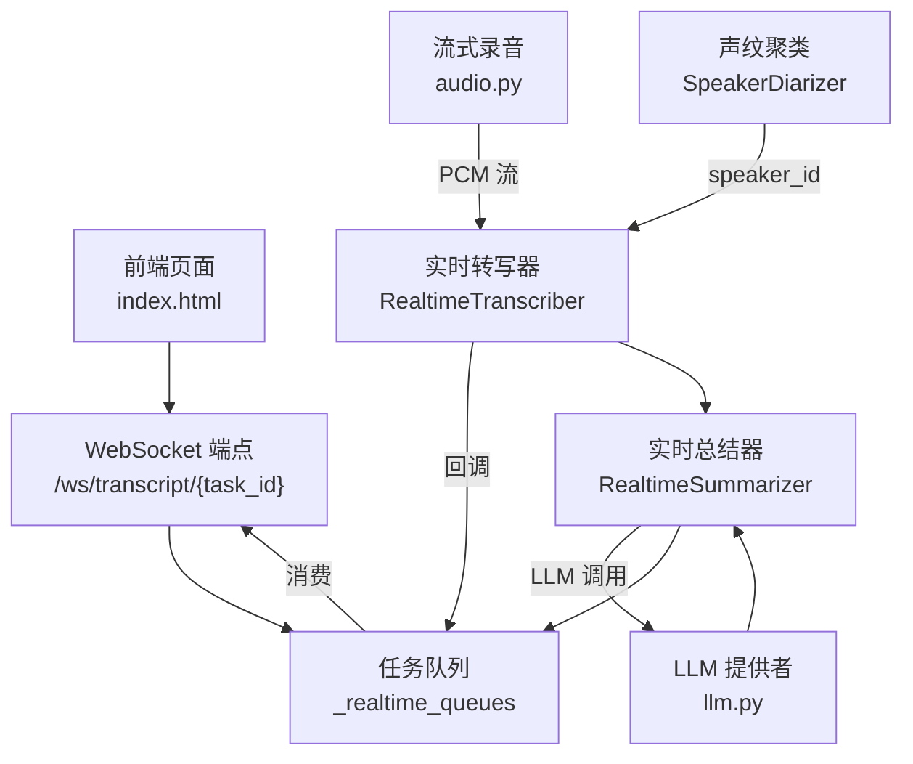
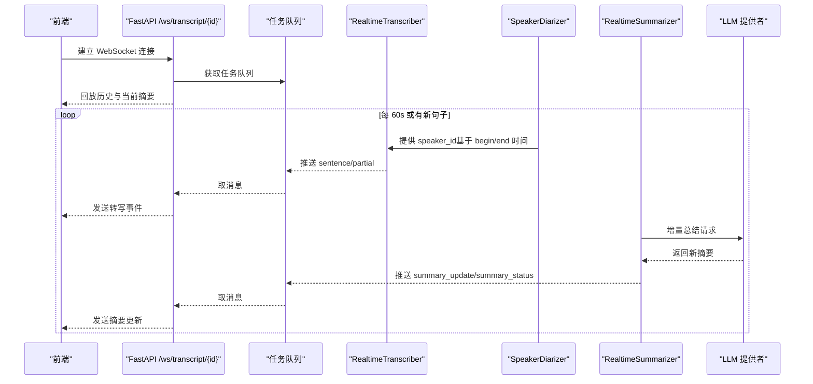
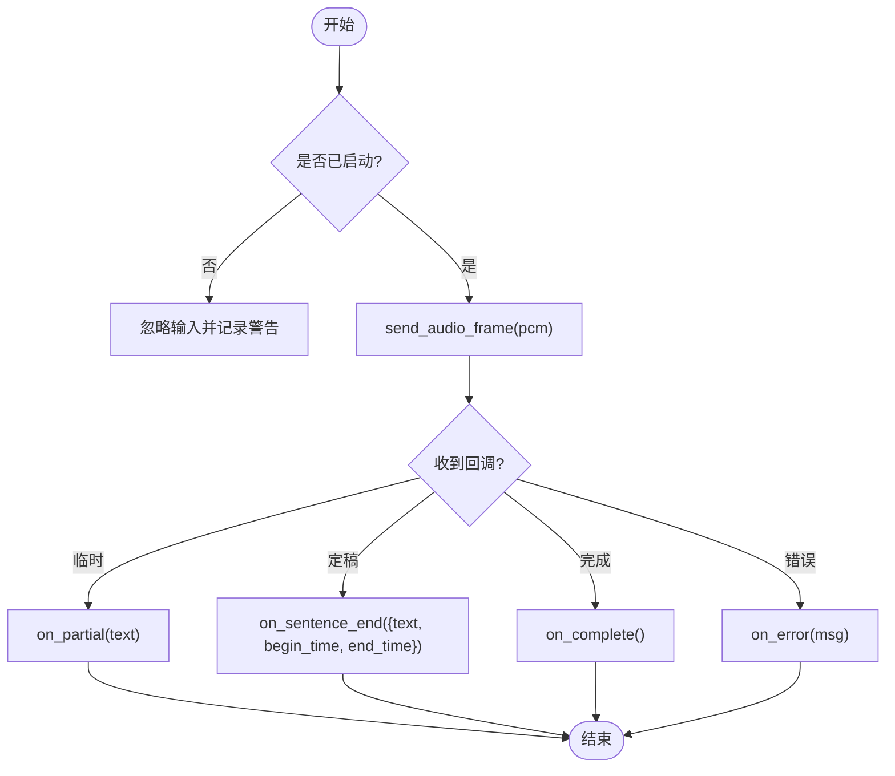
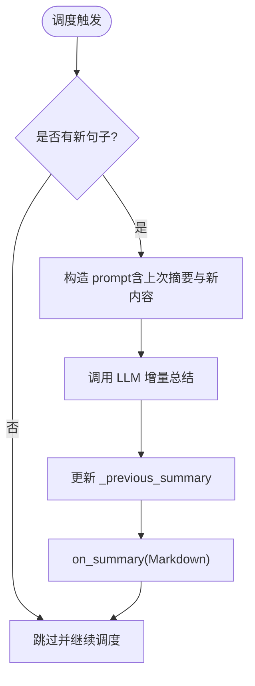
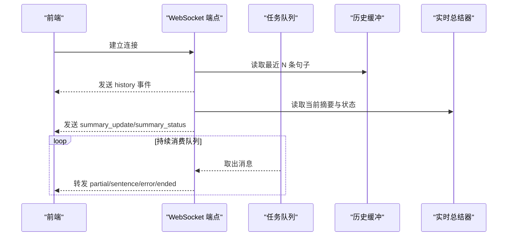
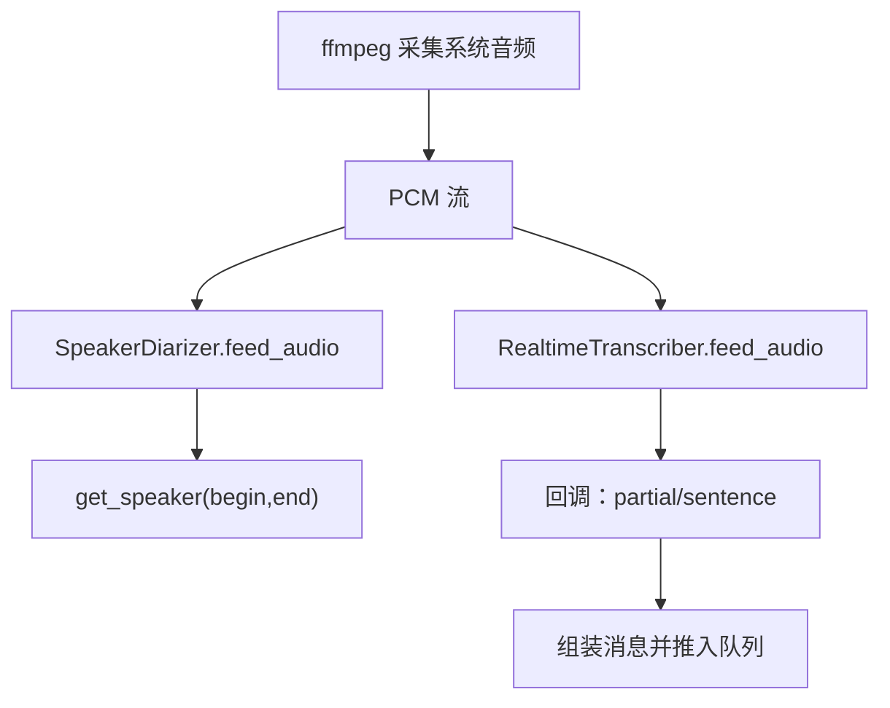
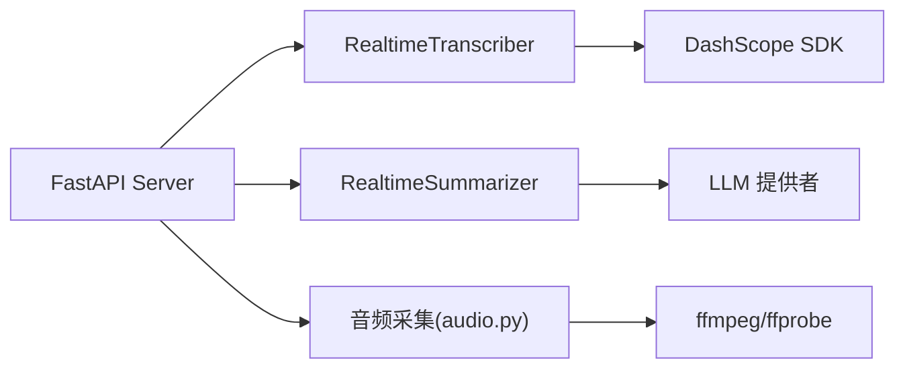

# 实时处理

<cite>
**本文引用的文件**
- [core/realtime_asr.py](file://core/realtime_asr.py)
- [core/realtime_summary.py](file://core/realtime_summary.py)
- [app/server.py](file://app/server.py)
- [core/pipeline.py](file://core/pipeline.py)
- [core/audio.py](file://core/audio.py)
- [core/llm.py](file://core/llm.py)
- [docs/API_CONTRACTS.md](file://docs/API_CONTRACTS.md)
- [app/static/index.html](file://app/static/index.html)
</cite>

## 目录
1. [简介](#简介)
2. [项目结构](#项目结构)
3. [核心组件](#核心组件)
4. [架构总览](#架构总览)
5. [详细组件分析](#详细组件分析)
6. [依赖关系分析](#依赖关系分析)
7. [性能与生产特性](#性能与生产特性)
8. [故障排查指南](#故障排查指南)
9. [结论](#结论)
10. [附录：WebSocket 客户端集成与消息规范](#附录websocket-客户端集成与消息规范)

## 简介
本技术文档聚焦“实时处理模块”，覆盖以下关键能力：
- WebSocket 通信机制：连接建立、消息协议、事件推送（转写结果、摘要更新、状态同步）。
- 流式音频处理流程：PCM 数据接收、增量转写、实时反馈。
- 实时摘要更新：增量内容处理、摘要合并策略、冲突处理。
- 前端交互与体验优化：页面刷新恢复、历史回放、低延迟展示。
- 生产环境特性：连接管理、错误恢复、限流重试、性能监控。

## 项目结构
实时处理相关代码主要分布在以下模块：
- app/server.py：FastAPI 服务，提供 REST API 与 WebSocket 端点，编排录音、ASR、说话人分离、实时总结等。
- core/realtime_asr.py：封装 DashScope 实时 ASR SDK，负责 PCM 流送入、回调分发、限流重试。
- core/realtime_summary.py：定时触发 LLM 增量总结，维护上次摘要并输出 Markdown。
- core/audio.py：系统内录（BlackHole）与 PCM 管道，将音频流同时送入 ASR 与声纹聚类。
- core/llm.py：通义千问 LLM 调用（同步/异步），用于实时总结与纪要生成。
- core/pipeline.py：批处理管线（非实时），用于最终纪要生成。
- docs/API_CONTRACTS.md：外部接口契约（DashScope 实时/批量、上传、参数约束）。
- app/static/index.html：前端页面，包含 WebSocket 客户端实现与 UI 交互逻辑。

图表来源
- [app/server.py:1760-1832](file://app/server.py#L1760-L1832)
- [core/realtime_asr.py:150-368](file://core/realtime_asr.py#L150-L368)
- [core/realtime_summary.py:68-270](file://core/realtime_summary.py#L68-L270)
- [core/audio.py:139-200](file://core/audio.py#L139-L200)
- [core/llm.py:89-160](file://core/llm.py#L89-L160)

章节来源
- [app/server.py:1-220](file://app/server.py#L1-L220)
- [core/realtime_asr.py:1-150](file://core/realtime_asr.py#L1-L150)
- [core/realtime_summary.py:1-120](file://core/realtime_summary.py#L1-L120)
- [core/audio.py:1-120](file://core/audio.py#L1-L120)
- [core/llm.py:1-80](file://core/llm.py#L1-L80)
- [docs/API_CONTRACTS.md:114-176](file://docs/API_CONTRACTS.md#L114-L176)

## 核心组件
- 实时转写器 RealtimeTranscriber：封装 DashScope 实时 ASR，支持上下文增强、即时热词、语义断句、心跳保活；具备限流重试与线程安全回调。
- 实时总结器 RealtimeSummarizer：按分钟窗口缓冲定稿句子，周期性触发 LLM 增量总结，维护上次摘要并输出 Markdown。
- FastAPI WebSocket 端点：维护任务级队列，回放历史与当前摘要，转发 ASR 与总结事件到前端。
- 流式录音与声纹聚类：通过 ffmpeg 采集系统音频，PCM 流同时送入 ASR 与 SpeakerDiarizer，得到 speaker_id。
- LLM 提供者：提供同步/异步 chat_completion，供实时总结与纪要生成使用。

章节来源
- [core/realtime_asr.py:150-368](file://core/realtime_asr.py#L150-L368)
- [core/realtime_summary.py:68-270](file://core/realtime_summary.py#L68-L270)
- [app/server.py:1760-1832](file://app/server.py#L1760-L1832)
- [core/audio.py:139-200](file://core/audio.py#L139-L200)
- [core/llm.py:89-160](file://core/llm.py#L89-L160)

## 架构总览
实时处理由“流式录音 → 实时 ASR → 声纹聚类 → 实时总结 → WebSocket 推送”构成闭环。前端通过 WebSocket 订阅事件，获得临时/定稿转写、摘要更新、状态变化等消息。

图表来源
- [app/server.py:1760-1832](file://app/server.py#L1760-L1832)
- [core/realtime_asr.py:216-327](file://core/realtime_asr.py#L216-L327)
- [core/realtime_summary.py:196-270](file://core/realtime_summary.py#L196-L270)
- [core/llm.py:89-160](file://core/llm.py#L89-L160)

## 详细组件分析

### 实时转写引擎（RealtimeTranscriber）
- 职责：启动 DashScope 实时 ASR 的 WebSocket 连接，接收 PCM 音频流，回调分发临时/定稿句子，限流重试。
- 关键行为：
  - start()：配置模型、格式、语言提示、语义断句、心跳；带指数退避重试应对限流。
  - feed_audio()：按建议包大小（约 100ms）送入 PCM。
  - 回调：on_event 区分临时与定稿；on_error/on_complete 上报状态。
- 线程模型：SDK 内部独立线程执行回调，通过 asyncio.run_coroutine_threadsafe 投递到事件循环队列。

图表来源
- [core/realtime_asr.py:216-327](file://core/realtime_asr.py#L216-L327)
- [core/realtime_asr.py:329-368](file://core/realtime_asr.py#L329-L368)

章节来源
- [core/realtime_asr.py:57-148](file://core/realtime_asr.py#L57-L148)
- [core/realtime_asr.py:150-368](file://core/realtime_asr.py#L150-L368)

### 实时增量总结（RealtimeSummarizer）
- 职责：收集定稿句子，按 60 秒周期触发 LLM 增量总结，维护上次摘要，输出 Markdown。
- 增量策略：
  - 首次总结：仅传入当前缓冲区的新句子。
  - 后续总结：传入「上次摘要」+「新增句子」，要求模型输出更新后的完整摘要。
  - 控制 token 消耗：截取上次摘要长度上限。
- 线程模型：定时器在独立线程执行，LLM 调用同步进行，不阻塞主事件循环；通过回调将摘要推送到 WebSocket。

图表来源
- [core/realtime_summary.py:196-270](file://core/realtime_summary.py#L196-L270)

章节来源
- [core/realtime_summary.py:68-185](file://core/realtime_summary.py#L68-L185)
- [core/realtime_summary.py:186-270](file://core/realtime_summary.py#L186-L270)

### WebSocket 通信与消息协议
- 端点：/ws/transcript/{task_id}
- 上行：无（纯下行推送）
- 下行消息类型：
  - partial：临时识别结果（句子未完成）
  - sentence：定稿句子（含 begin_time/end_time/speaker_id/speaker_name）
  - history：页面刷新时回放的历史句子
  - summary_update：实时摘要更新（Markdown）
  - summary_status：总结状态（idle/paused/summarizing）
  - error：错误信息
  - ended：转写结束
- 连接生命周期：
  - accept 后回放历史与当前摘要
  - 从任务队列取消息并转发给前端
  - 超时或断开时清理日志

图表来源
- [app/server.py:1760-1832](file://app/server.py#L1760-L1832)
- [app/server.py:171-199](file://app/server.py#L171-L199)

章节来源
- [app/server.py:1760-1832](file://app/server.py#L1760-L1832)
- [app/server.py:171-199](file://app/server.py#L171-L199)

### 流式音频处理流程
- 录音采集：通过 ffmpeg avfoundation 从 BlackHole 设备采集系统音频，输出 PCM 流。
- PCM 回调：每帧 PCM 同时送入 RealtimeTranscriber 与 SpeakerDiarizer。
- 说话人绑定：根据 begin/end 时间查询 diarizer 得到的 speaker_id，并在实时总结中保留发言人标注。
- 音频规格：遵循 API_CONTRACTS 的硬约束（PCM 16bit/16kHz/mono）。

图表来源
- [core/audio.py:139-200](file://core/audio.py#L139-L200)
- [core/realtime_asr.py:329-368](file://core/realtime_asr.py#L329-L368)
- [app/server.py:757-800](file://app/server.py#L757-L800)

章节来源
- [core/audio.py:139-200](file://core/audio.py#L139-L200)
- [app/server.py:757-800](file://app/server.py#L757-L800)
- [docs/API_CONTRACTS.md:90-105](file://docs/API_CONTRACTS.md#L90-L105)

### 与前端界面的交互模式与体验优化
- 页面刷新恢复：WebSocket 连接建立后立即回放历史句子与当前摘要，避免丢失。
- 低延迟展示：临时结果（partial）立即显示，定稿（sentence）替换或追加，提升流畅度。
- 状态同步：总结状态（idle/paused/summarizing）实时更新，便于用户感知进度。
- 说话人姓名解析：优先使用实时绑定映射，兜底为“发言人N”，保证可读性。

章节来源
- [app/server.py:1783-1815](file://app/server.py#L1783-L1815)
- [app/server.py:201-219](file://app/server.py#L201-L219)
- [app/static/index.html:2127-2180](file://app/static/index.html#L2127-L2180)

## 依赖关系分析
- 实时转写依赖 DashScope SDK（Recognition、RecognitionCallback、RecognitionResult）。
- 实时总结依赖 LLM 提供者（chat_completion），使用 qwen-turbo 低延迟模型。
- 服务器层依赖 FastAPI WebSocket、asyncio Queue、后台线程与定时器。
- 音频层依赖 ffmpeg/ffprobe，平台特定采集（macOS BlackHole）。

图表来源
- [core/realtime_asr.py:36-44](file://core/realtime_asr.py#L36-L44)
- [core/realtime_summary.py:24-33](file://core/realtime_summary.py#L24-L33)
- [core/llm.py:23-38](file://core/llm.py#L23-L38)
- [core/audio.py:26-98](file://core/audio.py#L26-L98)

章节来源
- [core/realtime_asr.py:36-44](file://core/realtime_asr.py#L36-L44)
- [core/realtime_summary.py:24-33](file://core/realtime_summary.py#L24-L33)
- [core/llm.py:23-38](file://core/llm.py#L23-L38)
- [core/audio.py:26-98](file://core/audio.py#L26-L98)

## 性能与生产特性
- 限流重试：实时转写启动阶段对“too many requests/throttling”进行指数退避重试（最多 3 次）。
- 连接保活：启用 heartbeat，防止静音时连接断开。
- 线程安全：SDK 回调在独立线程，通过 asyncio.run_coroutine_threadsafe 投递到事件循环队列。
- 资源控制：历史缓冲限制最近 N 条（默认 10），避免内存膨胀。
- 超时关闭：WebSocket 60 秒无消息则正常关闭，释放资源。
- 日志与可观测性：关键节点记录日志（连接、错误、统计计数），便于问题定位。

章节来源
- [core/realtime_asr.py:212-327](file://core/realtime_asr.py#L212-L327)
- [app/server.py:171-199](file://app/server.py#L171-L199)
- [app/server.py:1816-1832](file://app/server.py#L1816-L1832)

## 故障排查指南
- 未设置 API Key：检查环境变量 DASHSCOPE_API_KEY。
- 限流错误：观察重试日志，确认后端繁忙；必要时降低并发或调整重试间隔。
- 音频格式不匹配：确保 PCM 16bit/16kHz/mono；检查 ffmpeg 参数。
- WebSocket 断开：查看超时日志；确认前端重连逻辑与历史回放。
- 总结失败：捕获异常并继续调度；检查 LLM 调用超时与网络状况。

章节来源
- [core/realtime_asr.py:229-327](file://core/realtime_asr.py#L229-L327)
- [core/realtime_summary.py:263-270](file://core/realtime_summary.py#L263-L270)
- [app/server.py:1816-1832](file://app/server.py#L1816-L1832)
- [docs/API_CONTRACTS.md:90-105](file://docs/API_CONTRACTS.md#L90-L105)

## 结论
实时处理模块通过“流式录音 + 实时 ASR + 增量总结 + WebSocket 推送”的架构，实现了低延迟的会议转写与摘要预览。其设计兼顾了可靠性（限流重试、超时关闭）、可扩展性（模块化组件）与用户体验（历史回放、状态同步）。在生产环境中，建议结合监控与告警，关注限流、网络与资源占用指标，确保稳定运行。

## 附录：WebSocket 客户端集成与消息规范

### 客户端集成要点
- 连接建立：前端在录音期间连接 /ws/transcript/{task_id}。
- 消息订阅：监听 partial、sentence、history、summary_update、summary_status、error、ended。
- 页面恢复：连接建立后立即回放历史与当前摘要，保持界面一致性。
- 重连策略：检测到断开或错误时自动重连，并重新回放历史。

章节来源
- [app/static/index.html:2127-2180](file://app/static/index.html#L2127-L2180)
- [app/static/index.html:2269-2282](file://app/static/index.html#L2269-L2282)
- [app/server.py:1783-1815](file://app/server.py#L1783-L1815)

### 消息格式规范（下行）
- partial
  - type: "partial"
  - text: string
  - speaker_id: number（可选）
  - speaker_name: string（可选）
- sentence
  - type: "sentence"
  - text: string
  - begin_time: number（毫秒）
  - end_time: number（毫秒）
  - speaker_id: number
  - speaker_name: string
- history
  - type: "history"
  - text: string
  - begin_time: number
  - end_time: number
  - speaker_id: number
  - speaker_name: string
- summary_update
  - type: "summary_update"
  - content: string（Markdown）
- summary_status
  - type: "summary_status"
  - status: "idle" | "paused" | "summarizing"
- error
  - type: "error"
  - message: string
- ended
  - type: "ended"

章节来源
- [app/server.py:1760-1832](file://app/server.py#L1760-L1832)
- [app/server.py:171-199](file://app/server.py#L171-L199)