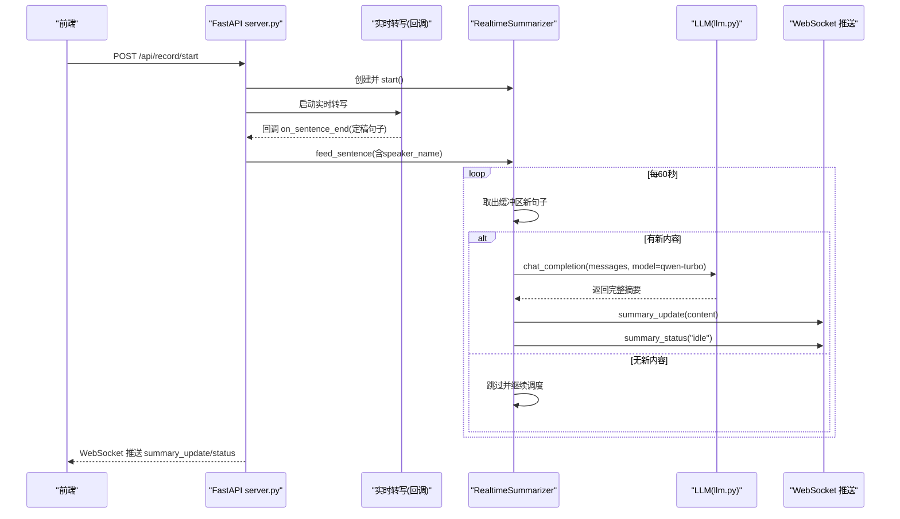
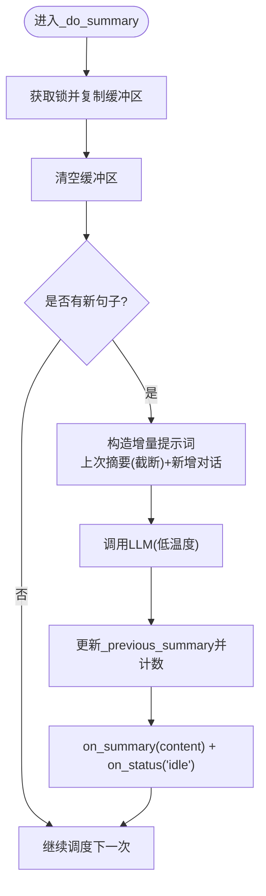
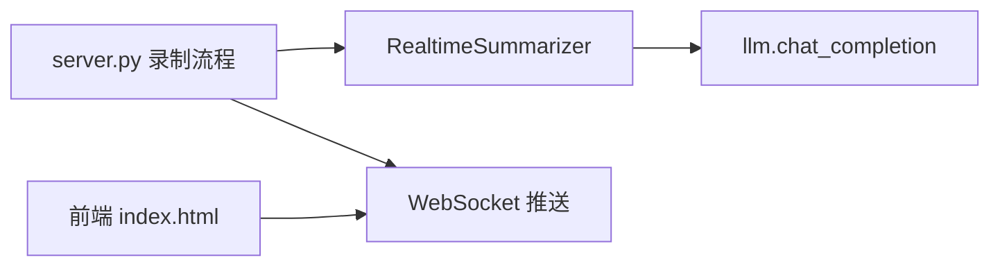

# 实时摘要更新

<cite>
**本文引用的文件**
- [core/realtime_summary.py](file://core/realtime_summary.py)
- [core/llm.py](file://core/llm.py)
- [core/summarize.py](file://core/summarize.py)
- [core/pipeline.py](file://core/pipeline.py)
- [app/server.py](file://app/server.py)
- [app/static/index.html](file://app/static/index.html)
</cite>

## 目录
1. [简介](#简介)
2. [项目结构](#项目结构)
3. [核心组件](#核心组件)
4. [架构总览](#架构总览)
5. [详细组件分析](#详细组件分析)
6. [依赖关系分析](#依赖关系分析)
7. [性能考虑](#性能考虑)
8. [故障排查指南](#故障排查指南)
9. [结论](#结论)
10. [附录：API与使用示例](#附录api与使用示例)

## 简介
本技术文档聚焦“实时摘要更新”能力，覆盖增量内容处理机制、冲突解决策略、摘要版本管理、触发时机、LLM调用时机与结果缓存、实时更新的数据结构（摘要增量、变更通知、状态同步）、前端实时同步与用户反馈设计，以及批量处理、异步更新、内存优化等性能策略。目标是帮助开发者快速理解并扩展该功能。

## 项目结构
实时摘要更新由后端服务、实时转写管线、LLM 抽象层、前端 WebSocket 推送与 UI 渲染共同构成：
- 后端服务负责启动录制、创建实时总结器、维护任务上下文并通过 WebSocket 推送消息
- 实时转写引擎将定稿句子回调给服务，再喂入实时总结器
- 实时总结器按分钟窗口缓冲新句子，定时触发 LLM 增量总结，并将结果通过回调推送到前端
- 前端通过 WebSocket 接收 summary_update 与 summary_status 消息，渲染到界面

```mermaid
graph TB
A["浏览器前端<br/>index.html"] --> B["FastAPI 服务<br/>server.py"]
B --> C["实时转写引擎<br/>realtime_asr.py"]
B --> D["实时总结器<br/>realtime_summary.py"]
D --> E["LLM 抽象层<br/>llm.py"]
B --> F["WebSocket 推送<br/>summary_update/status"]
A <-- F
```

图表来源
- [app/server.py:721-800](file://app/server.py#L721-L800)
- [core/realtime_summary.py:68-270](file://core/realtime_summary.py#L68-L270)
- [core/llm.py:89-121](file://core/llm.py#L89-L121)
- [app/static/index.html:2544-2611](file://app/static/index.html#L2544-L2611)

章节来源
- [app/server.py:721-800](file://app/server.py#L721-L800)
- [core/realtime_summary.py:68-270](file://core/realtime_summary.py#L68-L270)
- [core/llm.py:89-121](file://core/llm.py#L89-L121)
- [app/static/index.html:2544-2611](file://app/static/index.html#L2544-L2611)

## 核心组件
- RealtimeSummarizer：实现增量摘要的核心类，维护缓冲区、上次摘要、定时器与线程安全锁，负责构造提示词、调用 LLM、更新状态与回调
- LLM 抽象层：提供同步/异步/流式调用通义千问的封装，统一错误处理与超时控制
- 服务集成：在录音流程中创建 RealtimeSummarizer，绑定 on_summary/on_status 回调，通过 WebSocket 推送
- 前端处理：解析 summary_update 与 summary_status，渲染 Markdown 片段并更新状态指示

章节来源
- [core/realtime_summary.py:68-270](file://core/realtime_summary.py#L68-L270)
- [core/llm.py:89-121](file://core/llm.py#L89-L121)
- [app/server.py:741-800](file://app/server.py#L741-L800)
- [app/static/index.html:2544-2611](file://app/static/index.html#L2544-L2611)

## 架构总览
实时摘要更新的端到端时序如下：



图表来源
- [app/server.py:721-800](file://app/server.py#L721-L800)
- [core/realtime_summary.py:188-270](file://core/realtime_summary.py#L188-L270)
- [core/llm.py:89-121](file://core/llm.py#L89-L121)
- [app/static/index.html:2544-2611](file://app/static/index.html#L2544-L2611)

## 详细组件分析

### 实时增量摘要引擎（RealtimeSummarizer）
- 增量策略
  - 首次总结：仅传入当前缓冲区的句子
  - 后续总结：传入「上次摘要」+「新增句子」，要求模型输出更新后的完整摘要
  - 上次摘要截取长度限制以控制 token 消耗
- 数据缓冲与并发
  - 使用线程锁保护缓冲区写入
  - 定时器在独立线程执行，避免阻塞主事件循环
  - 回调通过 asyncio.run_coroutine_threadsafe 投递到事件循环
- 触发条件
  - 每 60 秒触发一次；若无新内容则跳过但继续调度
- 冲突解决与版本管理
  - 采用“全量替换”策略：每次成功生成后直接覆盖 _previous_summary
  - 失败不中断后续周期，保证鲁棒性
- 状态与统计
  - 支持暂停/恢复，状态通过 on_status 回调上报
  - 记录总结次数便于监控



图表来源
- [core/realtime_summary.py:196-270](file://core/realtime_summary.py#L196-L270)

章节来源
- [core/realtime_summary.py:68-270](file://core/realtime_summary.py#L68-L270)

### LLM 抽象层
- 同步调用用于后台线程（实时总结），异步调用用于 FastAPI 端点
- 统一构建请求体与头部，集中处理超时与异常
- 连接池复用（httpx.AsyncClient）提升吞吐

章节来源
- [core/llm.py:89-121](file://core/llm.py#L89-L121)
- [core/llm.py:129-160](file://core/llm.py#L129-L160)

### 服务集成与 WebSocket 推送
- 在开始录制时创建 RealtimeSummarizer，绑定 on_summary 与 on_status 回调
- 回调通过 _push_realtime_msg 将 summary_update 与 summary_status 推送到对应任务的队列
- WebSocket 连接建立时回放历史转写与当前摘要状态，确保页面刷新不丢失信息

章节来源
- [app/server.py:741-800](file://app/server.py#L741-L800)
- [app/server.py:171-199](file://app/server.py#L171-L199)
- [app/server.py:1781-1831](file://app/server.py#L1781-L1831)

### 前端实时同步与用户反馈
- 接收 summary_update：转换为 HTML 并渲染到面板，滚动到顶部
- 接收 summary_status：更新状态文案与高亮样式
- 支持暂停/恢复摘要：调用后端接口切换状态，按钮图标与标题相应变化
- 折叠面板：可收起 AI 面板节省空间

章节来源
- [app/static/index.html:2544-2611](file://app/static/index.html#L2544-L2611)

## 依赖关系分析
- RealtimeSummarizer 依赖 llm.chat_completion 进行文本生成
- 服务层依赖 RealtimeTranscriber 的回调来注入句子
- 前端依赖 WebSocket 消息协议（summary_update、summary_status）



图表来源
- [core/realtime_summary.py:24-27](file://core/realtime_summary.py#L24-L27)
- [core/llm.py:89-121](file://core/llm.py#L89-L121)
- [app/server.py:741-800](file://app/server.py#L741-L800)
- [app/static/index.html:2544-2611](file://app/static/index.html#L2544-L2611)

章节来源
- [core/realtime_summary.py:24-27](file://core/realtime_summary.py#L24-L27)
- [core/llm.py:89-121](file://core/llm.py#L89-L121)
- [app/server.py:741-800](file://app/server.py#L741-L800)
- [app/static/index.html:2544-2611](file://app/static/index.html#L2544-L2611)

## 性能考虑
- 批量处理
  - 按 60 秒窗口聚合新句子，减少 LLM 调用频率
  - 无新内容时跳过调用，降低无效开销
- 异步更新
  - 定时器在独立线程执行，不阻塞主事件循环
  - LLM 同步调用仅在后台线程中进行；FastAPI 端点使用异步客户端
- 内存优化
  - 上次摘要截取固定字符数，控制 prompt 大小
  - 实时转写缓冲区限制最近 N 条，防止无限增长
- 连接复用
  - 异步 HTTP 客户端全局单例，复用连接池
- 稳定性
  - 单次总结失败不影响后续周期，异常被捕获并记录日志

[本节为通用性能建议，不直接分析具体文件]

## 故障排查指南
- LLM 调用失败或超时
  - 检查环境变量 DASHSCOPE_API_KEY 是否设置
  - 查看日志中的超时与异常信息
  - 确认网络连通性与速率限制
- 无摘要更新
  - 确认有足够的新句子进入缓冲区（过滤空文本）
  - 检查定时器是否仍在运行（未 pause）
  - 查看 WebSocket 是否收到 summary_status 为 idle
- 前端未显示更新
  - 检查 WebSocket 连接是否正常
  - 确认 summary_update 消息已到达并正确渲染
  - 若页面刷新，确认服务端会回放当前摘要与状态

章节来源
- [core/llm.py:106-121](file://core/llm.py#L106-L121)
- [core/realtime_summary.py:263-270](file://core/realtime_summary.py#L263-L270)
- [app/server.py:1781-1831](file://app/server.py#L1781-L1831)
- [app/static/index.html:2544-2611](file://app/static/index.html#L2544-L2611)

## 结论
实时摘要更新通过“分钟级增量 + 全量替换”的策略，在保证低延迟的同时维持摘要连贯性。系统采用线程隔离与回调机制，避免阻塞主事件循环；通过 WebSocket 将摘要与状态实时推送至前端，提供即时反馈。结合缓冲区限制、上次摘要截断与失败容错，整体具备较好的可扩展性与鲁棒性。

[本节为总结性内容，不直接分析具体文件]

## 附录：API与使用示例

### 数据结构定义
- 实时转写句子（送入总结器的输入）
  - text: 字符串
  - begin_time/end_time: 毫秒时间戳
  - speaker_id/speaker_name: 可选，用于标注发言人
- 摘要更新消息（WebSocket）
  - type: "summary_update"
  - content: Markdown 字符串（完整摘要）
- 摘要状态消息（WebSocket）
  - type: "summary_status"
  - status: "summarizing" | "idle" | "paused"

章节来源
- [app/server.py:171-199](file://app/server.py#L171-L199)
- [app/server.py:1781-1831](file://app/server.py#L1781-L1831)
- [core/realtime_summary.py:155-172](file://core/realtime_summary.py#L155-L172)

### 典型流程示例
- 开始录制并启用实时摘要
  - 调用 POST /api/record/start
  - 服务创建 RealtimeSummarizer 并启动定时器
  - 实时转写回调将定稿句子喂入 summarizer.feed_sentence
- 每分钟自动触发增量总结
  - 若有新句子，构造提示词并调用 LLM
  - 成功后通过 WebSocket 推送 summary_update 与 summary_status
- 前端处理
  - 收到 summary_update：渲染 Markdown 片段
  - 收到 summary_status：更新状态文案与样式
  - 支持暂停/恢复摘要

章节来源
- [app/server.py:721-800](file://app/server.py#L721-L800)
- [core/realtime_summary.py:188-270](file://core/realtime_summary.py#L188-L270)
- [app/static/index.html:2544-2611](file://app/static/index.html#L2544-L2611)

### 与批管线的关系
- 实时摘要定位为“预览”，最终纪要仍走批管线（第二阶段）
- 批管线在说话人绑定完成后生成完整纪要并保存文件

章节来源
- [core/pipeline.py:137-226](file://core/pipeline.py#L137-L226)
- [core/summarize.py:157-229](file://core/summarize.py#L157-L229)