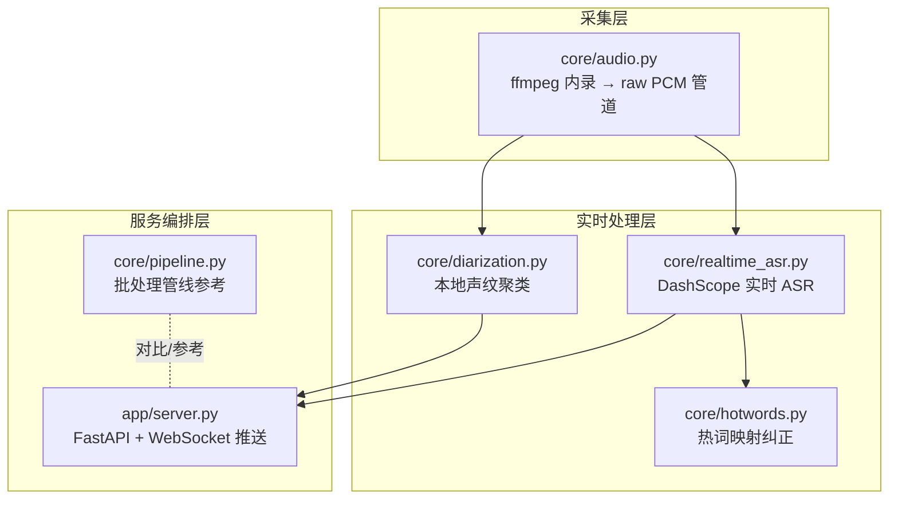
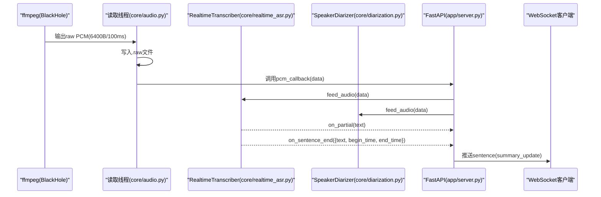
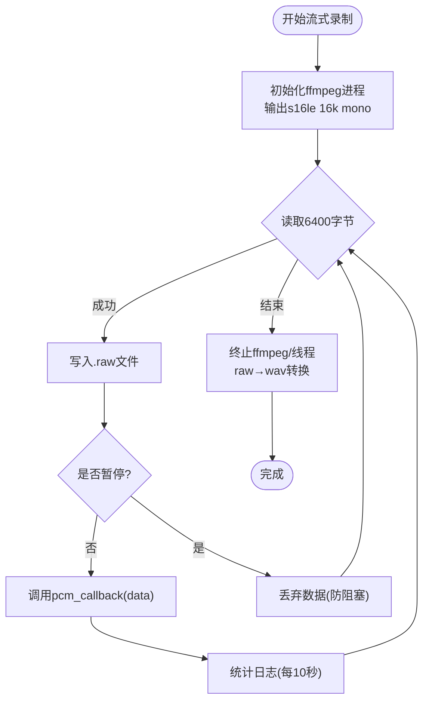
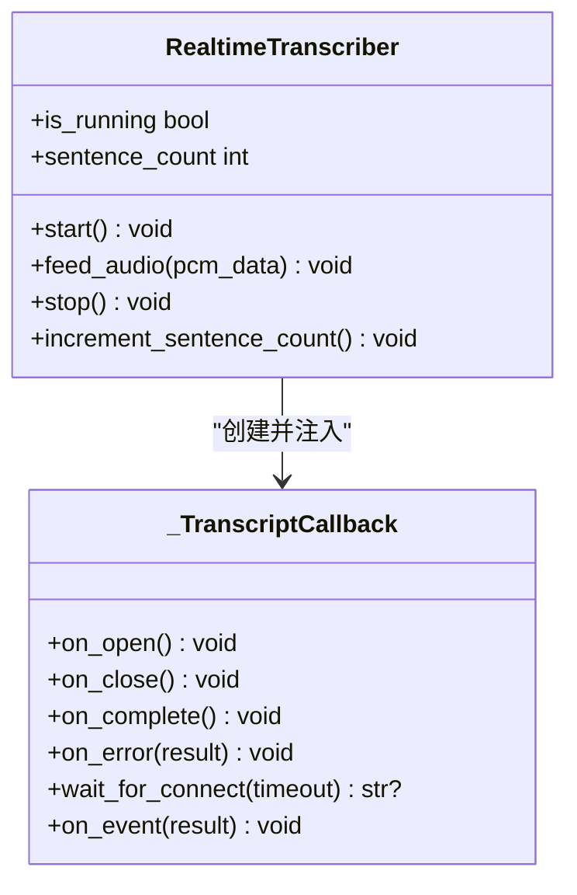
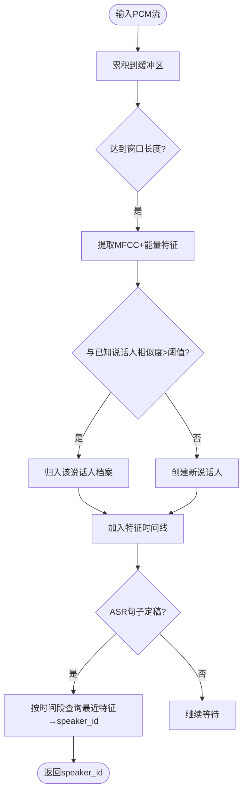
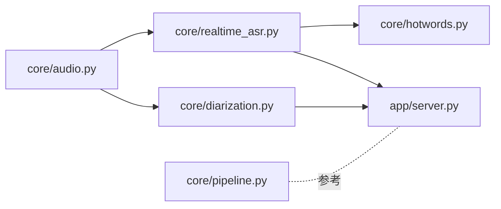

# 流式音频处理

<cite>
**本文引用的文件**
- [core/audio.py](file://core/audio.py)
- [core/realtime_asr.py](file://core/realtime_asr.py)
- [core/diarization.py](file://core/diarization.py)
- [core/hotwords.py](file://core/hotwords.py)
- [core/transcribe.py](file://core/transcribe.py)
- [core/pipeline.py](file://core/pipeline.py)
- [app/server.py](file://app/server.py)
- [docs/ARCHITECTURE.md](file://docs/ARCHITECTURE.md)
</cite>

## 目录
1. [简介](#简介)
2. [项目结构](#项目结构)
3. [核心组件](#核心组件)
4. [架构总览](#架构总览)
5. [详细组件分析](#详细组件分析)
6. [依赖关系分析](#依赖关系分析)
7. [性能与内存优化](#性能与内存优化)
8. [故障排查指南](#故障排查指南)
9. [结论](#结论)
10. [附录：示例与调试](#附录示例与调试)

## 简介
本技术文档聚焦“流式音频处理模块”，围绕 PCM 音频数据的接收、缓冲、格式校验与增量转写机制展开，覆盖以下关键点：
- 音频帧大小控制：固定 6400 字节（100ms @16kHz/16bit/单声道）
- 采样率适配与格式验证：统一为 16kHz、单声道、PCM 16bit
- 增量转写：临时结果回调 on_partial 与定稿句子回调 on_sentence_end 的处理逻辑
- 数据缓冲策略与内存管理：管道读取、暂停/恢复、WAV 封装、缓冲区清理
- 性能优化技巧：线程模型、批量写入、事件循环安全投递
- 增强能力：热词映射纠正、说话人分离（本地声纹聚类）、静音/噪声的间接处理思路
- ASR 集成与数据处理管道：DashScope 实时识别 + 本地声纹聚类 + WebSocket 推送

## 项目结构
本项目采用分层模块化设计，流式音频处理涉及采集、实时转写、说话人分离、热词纠正与服务编排等模块。

图表来源
- [core/audio.py:303-437](file://core/audio.py#L303-L437)
- [core/realtime_asr.py:150-367](file://core/realtime_asr.py#L150-L367)
- [core/diarization.py:282-525](file://core/diarization.py#L282-L525)
- [core/hotwords.py:187-222](file://core/hotwords.py#L187-L222)
- [app/server.py:721-800](file://app/server.py#L721-L800)
- [core/pipeline.py:58-134](file://core/pipeline.py#L58-L134)

章节来源
- [docs/ARCHITECTURE.md:5-16](file://docs/ARCHITECTURE.md#L5-L16)

## 核心组件
- 音频采集与流式输出：通过 ffmpeg 从 BlackHole 设备采集系统音频，输出 raw PCM 到 stdout 管道；后台线程按固定块大小读取并回调给上层。
- 实时转写引擎：基于 DashScope SDK 建立 WebSocket 连接，持续送入 PCM 帧，触发临时结果与定稿句子的回调。
- 说话人分离：本地声纹聚类器对 PCM 流提取 MFCC+能量特征，进行余弦相似度匹配，为每段 ASR 句子标注 speaker_id。
- 热词纠正：在实时与批处理路径中应用热词映射，修正常见识别错误。
- 服务编排：FastAPI 暴露录制/停止/状态查询接口，并通过 WebSocket 推送实时转写结果与摘要更新。

章节来源
- [core/audio.py:303-437](file://core/audio.py#L303-L437)
- [core/realtime_asr.py:150-367](file://core/realtime_asr.py#L150-L367)
- [core/diarization.py:282-525](file://core/diarization.py#L282-L525)
- [core/hotwords.py:187-222](file://core/hotwords.py#L187-L222)
- [app/server.py:721-800](file://app/server.py#L721-L800)

## 架构总览
下图展示从采集到实时转写、说话人分离、WebSocket 推送的整体流程。

图表来源
- [core/audio.py:399-437](file://core/audio.py#L399-L437)
- [core/realtime_asr.py:111-144](file://core/realtime_asr.py#L111-L144)
- [core/diarization.py:339-420](file://core/diarization.py#L339-L420)
- [app/server.py:757-800](file://app/server.py#L757-L800)

## 详细组件分析

### 音频采集与流式输出（core/audio.py）
- 流式录音启动：使用 ffmpeg avfoundation 采集系统音频，输出 s16le（16bit little-endian），采样率 16kHz，单声道。
- 固定帧大小：每次读取 6400 字节，对应 100ms 音频（3200 samples × 2 bytes）。
- 后台读取线程：从 stdout pipe 循环读取，写入临时 raw 文件，同时调用 pcm_callback 将数据送入实时 ASR 与声纹聚类。
- 暂停/恢复：暂停时仍读取 pipe 防止阻塞，但丢弃数据不写入文件与回调；累计暂停时长用于最终时长计算。
- 停止与封装：终止 ffmpeg，等待读取线程退出，将 raw PCM 转为 WAV（添加 44 字节 header），清理临时文件。

图表来源
- [core/audio.py:303-396](file://core/audio.py#L303-L396)
- [core/audio.py:399-437](file://core/audio.py#L399-L437)
- [core/audio.py:440-515](file://core/audio.py#L440-L515)
- [core/audio.py:559-594](file://core/audio.py#L559-L594)

章节来源
- [core/audio.py:303-437](file://core/audio.py#L303-L437)
- [core/audio.py:440-515](file://core/audio.py#L440-L515)
- [core/audio.py:559-594](file://core/audio.py#L559-L594)

### 实时转写引擎（core/realtime_asr.py）
- 模型与约束：使用 qwen-audio-3.0-asr-flash-streaming，要求 PCM 16bit/16kHz/单声道，建议每包 ~100ms（6400 字节）。
- 连接与重试：start() 设置 WebSocket URL、API Key，构建参数（语义断句、心跳保持等），遇到限流自动指数退避重试。
- 回调处理：
  - on_partial：临时结果（句子未完成），直接透传文本。
  - on_sentence_end：定稿句子，包含 begin_time/end_time，供说话人分离与 UI 展示。
- 热词纠正：在回调中对文本应用热词映射，提升专有名词识别准确率。
- 音频送入：feed_audio() 将 PCM 帧送入 SDK，异常记录日志。

图表来源
- [core/realtime_asr.py:57-144](file://core/realtime_asr.py#L57-L144)
- [core/realtime_asr.py:150-367](file://core/realtime_asr.py#L150-L367)

章节来源
- [core/realtime_asr.py:57-144](file://core/realtime_asr.py#L57-L144)
- [core/realtime_asr.py:150-367](file://core/realtime_asr.py#L150-L367)

### 说话人分离（core/diarization.py）
- 特征提取：对 PCM 流按 2 秒窗口、1 秒步长提取 MFCC（13维）+ 能量（1维）+ 标准差（1维），共 14 维向量，L2 归一化。
- 实时聚类：维护每个说话人的特征历史，计算平均特征；新特征与已知说话人余弦相似度高于阈值则归入，否则新建说话人。
- 时间对齐：ASR 句子定稿时，根据 begin_time/end_time 在特征时间线中查找最近特征，返回说话人 ID。
- 线程安全：所有操作加锁，支持多线程并发调用。

图表来源
- [core/diarization.py:87-275](file://core/diarization.py#L87-L275)
- [core/diarization.py:282-525](file://core/diarization.py#L282-L525)

章节来源
- [core/diarization.py:87-275](file://core/diarization.py#L87-L275)
- [core/diarization.py:282-525](file://core/diarization.py#L282-L525)

### 热词纠正（core/hotwords.py）
- 热词表创建：从 data/hotwords.txt 加载词表，调用 DashScope API 创建 vocabulary_id，目标模型需与识别模型一致。
- 后处理映射：从 data/hotword_mappings.txt 加载映射规则，对识别文本进行替换（英文词边界匹配，中文直接子串替换）。
- 应用场景：实时转写回调与批处理组装阶段均会应用，提升专有名词识别准确率。

章节来源
- [core/hotwords.py:35-139](file://core/hotwords.py#L35-L139)
- [core/hotwords.py:187-222](file://core/hotwords.py#L187-L222)

### 服务编排与WebSocket推送（app/server.py）
- 录制入口：POST /api/record/start 启动流式录音，创建队列、声纹聚类器、实时总结器，注册 pcm_callback。
- 回调处理：pcm_callback 将 PCM 数据送入实时 ASR 与声纹聚类；on_sentence_end 过滤空文本，解析说话人姓名，推送 sentence 消息。
- 实时总结：RealtimeSummarizer 增量生成摘要，通过 summary_update 推送。
- 任务持久化：任务状态与结果落盘，避免重启丢失。

章节来源
- [app/server.py:721-800](file://app/server.py#L721-L800)

## 依赖关系分析
- 采集层依赖 ffmpeg 与 BlackHole 虚拟声卡，输出标准化 PCM 流。
- 实时转写依赖 DashScope SDK 与网络可达性，具备限流重试机制。
- 说话人分离依赖 numpy/scipy，轻量级本地计算，无需大模型。
- 热词纠正依赖外部 API 与配置文件，提供离线映射与在线热词表两种增强手段。
- 服务编排依赖 FastAPI 与 asyncio，实现高并发 I/O 与线程安全消息投递。

图表来源
- [core/audio.py:303-437](file://core/audio.py#L303-L437)
- [core/realtime_asr.py:150-367](file://core/realtime_asr.py#L150-L367)
- [core/diarization.py:282-525](file://core/diarization.py#L282-L525)
- [core/hotwords.py:187-222](file://core/hotwords.py#L187-L222)
- [core/pipeline.py:58-134](file://core/pipeline.py#L58-L134)
- [app/server.py:721-800](file://app/server.py#L721-L800)

章节来源
- [docs/ARCHITECTURE.md:5-16](file://docs/ARCHITECTURE.md#L5-L16)

## 性能与内存优化
- 固定帧大小：6400 字节/100ms，平衡延迟与吞吐，避免过小导致频繁网络调用，过大增加端到端延迟。
- 管道读取与暂停：暂停时仍读 pipe 防止 ffmpeg 阻塞；累计暂停时长确保时长计算准确。
- 缓冲区管理：声纹聚类器保留最近 10 秒音频用于回溯，及时清理已读数据，控制内存增长。
- 线程模型：SDK 回调在独立线程执行，通过 asyncio.run_coroutine_threadsafe 安全投递到事件循环，避免阻塞主线程。
- 批量写入：raw 文件以固定块写入，减少 I/O 次数；WAV 封装时分块复制数据。
- 热词映射：长匹配优先排序，减少正则编译与替换开销。

[本节为通用性能指导，不直接分析具体代码文件]

## 故障排查指南
- ffmpeg 不可用或设备未配置：检查环境变量 RECORD_DEVICE 与系统 BlackHole 设置；确认 ffmpeg 已安装且可执行。
- 流式录制无回调：确认 pcm_callback 已正确注册；检查读取线程是否运行（is_stream_recording）。
- 实时转写连接失败：检查 DASHSCOPE_API_KEY 与网络；关注限流重试日志；必要时降低并发或延长超时。
- 说话人分离不准确：确保每人至少说 2 秒建立可靠档案；调整相似度阈值或特征窗口参数。
- 热词不生效：核对 target_model 与识别模型一致；检查热词表创建状态与映射文件格式。

章节来源
- [core/audio.py:139-217](file://core/audio.py#L139-L217)
- [core/realtime_asr.py:216-327](file://core/realtime_asr.py#L216-L327)
- [core/diarization.py:300-337](file://core/diarization.py#L300-L337)
- [core/hotwords.py:57-117](file://core/hotwords.py#L57-L117)

## 结论
本模块通过 ffmpeg 流式采集、固定帧大小的 PCM 传输、DashScope 实时 ASR 与本地声纹聚类，实现了低延迟、可扩展的会议录音与转写能力。结合热词纠正与增量摘要，提升了识别质量与用户体验。未来可探索云端流式说话人分离 API 与更精细的噪声/静音检测算法，进一步优化效果。

[本节为总结性内容，不直接分析具体代码文件]

## 附录：示例与调试

### 音频流处理示例
- 启动流式录音：调用 POST /api/record/start，传入设备名（如 BlackHole 2ch），系统将启动 ffmpeg 采集并注册 pcm_callback。
- 实时转写：pcm_callback 将 6400 字节 PCM 帧送入 RealtimeTranscriber.feed_audio()，触发 on_partial/on_sentence_end。
- 说话人分离：SpeakerDiarizer.feed_audio() 同步处理 PCM，on_sentence_end 时根据 begin_time/end_time 查询 speaker_id。
- 停止录制：调用 POST /api/record/stop，系统将终止 ffmpeg，转换 raw 为 WAV，并进入后续批处理管线（可选）。

章节来源
- [app/server.py:721-800](file://app/server.py#L721-L800)
- [core/audio.py:303-437](file://core/audio.py#L303-L437)
- [core/realtime_asr.py:150-367](file://core/realtime_asr.py#L150-L367)
- [core/diarization.py:282-525](file://core/diarization.py#L282-L525)

### 调试工具使用方法
- 查看流式录制信息：GET /api/record/status，返回 elapsed、paused 等状态。
- 监听 WebSocket：连接 /ws/transcript/{task_id}，接收 sentence、summary_update、summary_status 等消息。
- 日志定位：关注 “[stream]”、“[实时转写]”、“[声纹聚类]” 等日志前缀，定位卡顿、丢帧或回调异常。
- 热词映射验证：检查 data/hotword_mappings.txt 格式与匹配顺序，必要时调整权重或新增映射。

章节来源
- [app/server.py:721-800](file://app/server.py#L721-L800)
- [core/audio.py:597-622](file://core/audio.py#L597-L622)
- [core/hotwords.py:187-222](file://core/hotwords.py#L187-L222)