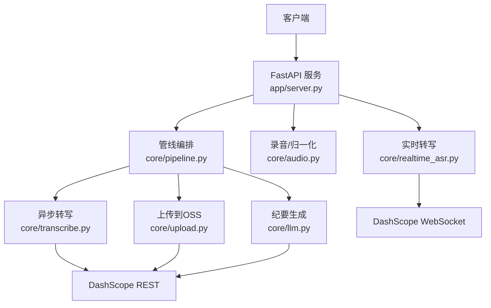
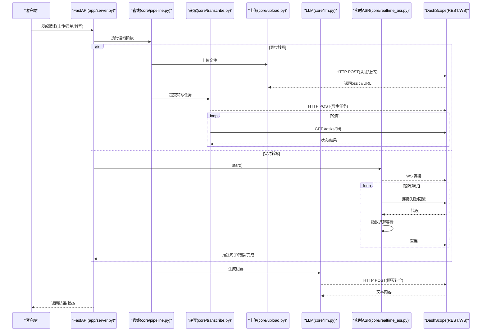
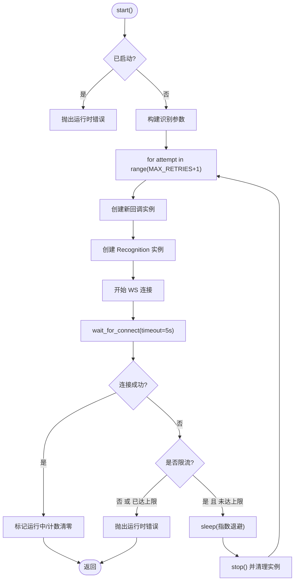
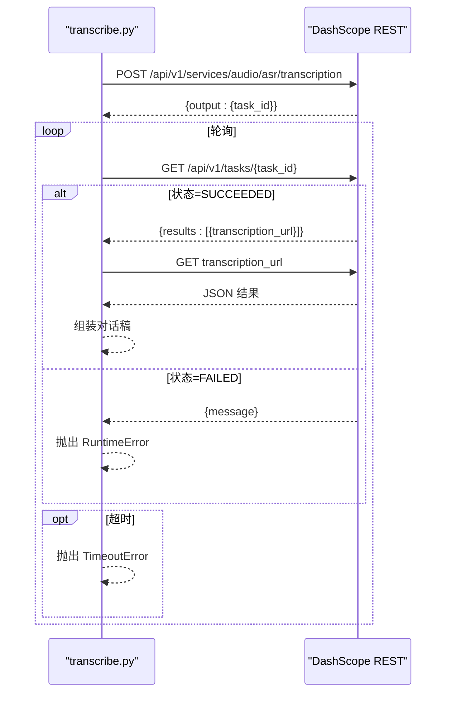
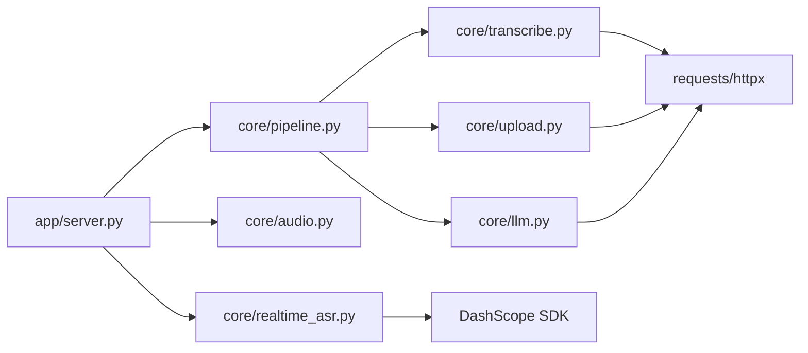

# 错误处理与恢复

<cite>
**本文引用的文件**
- [core/realtime_asr.py](file://core/realtime_asr.py)
- [core/transcribe.py](file://core/transcribe.py)
- [core/upload.py](file://core/upload.py)
- [core/llm.py](file://core/llm.py)
- [core/audio.py](file://core/audio.py)
- [core/pipeline.py](file://core/pipeline.py)
- [app/server.py](file://app/server.py)
</cite>

## 目录
1. [简介](#简介)
2. [项目结构](#项目结构)
3. [核心组件](#核心组件)
4. [架构总览](#架构总览)
5. [详细组件分析](#详细组件分析)
6. [依赖关系分析](#依赖关系分析)
7. [性能考量](#性能考量)
8. [故障诊断指南](#故障诊断指南)
9. [结论](#结论)
10. [附录](#附录)

## 简介
本文件聚焦于“实时转写”及相关管线中的错误处理与恢复机制，覆盖以下主题：
- 错误类型：网络连接错误、API 限流错误、音频格式错误、服务不可用等
- 自动重试：指数退避算法、最大重试次数、重试间隔配置
- 错误恢复策略：连接重建、数据补偿、状态同步
- 示例与诊断：常见错误的定位与修复步骤
- 监控告警：错误统计、性能指标、健康检查
- 用户体验：友好提示与降级方案

## 项目结构
本项目采用分层模块化设计，错误处理贯穿各层：
- 接入层（FastAPI）：统一异常转换、任务状态持久化、WebSocket 推送
- 业务层（Pipeline/Transcribe/Upload/LLM/Audio）：外部调用封装、超时与重试、结果校验
- 实时层（Realtime ASR）：WebSocket 连接管理、回调线程安全、限流重试
- 基础设施：日志记录、环境变量校验、资源清理

图表来源
- [app/server.py:1-800](file://app/server.py#L1-L800)
- [core/pipeline.py:1-271](file://core/pipeline.py#L1-L271)
- [core/transcribe.py:1-446](file://core/transcribe.py#L1-L446)
- [core/upload.py:1-134](file://core/upload.py#L1-L134)
- [core/llm.py:1-207](file://core/llm.py#L1-L207)
- [core/audio.py:1-663](file://core/audio.py#L1-L663)
- [core/realtime_asr.py:1-368](file://core/realtime_asr.py#L1-L368)

章节来源
- [app/server.py:1-800](file://app/server.py#L1-L800)
- [core/pipeline.py:1-271](file://core/pipeline.py#L1-L271)

## 核心组件
- 实时转写器（RealtimeTranscriber）：负责建立 WebSocket 连接、发送 PCM 帧、接收临时/定稿句子、限流重试与优雅停止
- 异步转写（transcribe_audio）：提交任务、轮询状态、下载结果、组装对话稿
- 上传模块（upload_file）：获取凭证、上传至 OSS、返回 oss:// URL
- LLM 调用（chat_completion/async_chat_completion）：同步/异步调用通义千问，支持超时与异常转换
- 音频处理（normalize_audio/start_recording_with_stream）：ffmpeg 归一化、系统内录、PCM 流式读取
- 管线编排（run_pipeline_stage1/stage2）：串联各阶段并上报进度

章节来源
- [core/realtime_asr.py:150-368](file://core/realtime_asr.py#L150-L368)
- [core/transcribe.py:61-446](file://core/transcribe.py#L61-L446)
- [core/upload.py:33-134](file://core/upload.py#L33-L134)
- [core/llm.py:89-207](file://core/llm.py#L89-L207)
- [core/audio.py:31-663](file://core/audio.py#L31-L663)
- [core/pipeline.py:58-271](file://core/pipeline.py#L58-L271)

## 架构总览
下图展示从请求进入 FastAPI 到外部服务调用的完整链路，以及关键错误点与恢复策略。

图表来源
- [app/server.py:226-333](file://app/server.py#L226-L333)
- [core/pipeline.py:58-227](file://core/pipeline.py#L58-L227)
- [core/transcribe.py:61-188](file://core/transcribe.py#L61-L188)
- [core/upload.py:59-115](file://core/upload.py#L59-L115)
- [core/llm.py:89-160](file://core/llm.py#L89-L160)
- [core/realtime_asr.py:216-327](file://core/realtime_asr.py#L216-L327)

## 详细组件分析

### 实时转写错误处理与恢复（RealtimeTranscriber）
- 错误类型
  - 连接错误：WebSocket 握手失败、认证失败、网络抖动
  - 限流错误：服务端返回“too many requests/throttling”
  - 音频格式错误：非 PCM/采样率不匹配导致 SDK 内部错误
  - 服务不可用：SDK 回调 on_error 返回错误消息
- 自动重试机制
  - 指数退避：固定延迟序列 [2, 5, 10] 秒，按尝试次数索引
  - 最大重试次数：MAX_RETRIES = 3
  - 触发条件：捕获异常或回调错误中包含限流关键词
  - 用户提示：通过 on_error 回调推送“服务繁忙，X秒后重试”的友好信息
- 连接重建与清理
  - 每次重试创建新的 Recognition 实例与回调
  - 失败时调用 stop() 释放资源，避免泄漏
- 线程安全
  - SDK 回调在独立线程执行，通过事件对象 wait_for_connect 同步连接结果
  - 通过 _push_realtime_msg 将消息投递到 asyncio.Queue，供 WebSocket 协程消费

图表来源
- [core/realtime_asr.py:216-327](file://core/realtime_asr.py#L216-L327)

章节来源
- [core/realtime_asr.py:57-144](file://core/realtime_asr.py#L57-L144)
- [core/realtime_asr.py:216-327](file://core/realtime_asr.py#L216-L327)
- [app/server.py:777-832](file://app/server.py#L777-L832)

### 异步转写错误处理（transcribe_audio）
- 错误类型
  - 任务提交失败：响应缺少 output/task_id
  - 轮询超时：超过 POLL_TIMEOUT 仍未完成
  - 任务失败：状态为 FAILED，携带错误消息
  - 结果下载失败：HTTP 错误或空结果
- 恢复策略
  - 明确抛出 TimeoutError/RuntimeError，由上层捕获并更新任务状态
  - 对空结果进行防御性检查，避免后续处理崩溃
- 进度与日志
  - 状态变化时记录日志，便于追踪问题

图表来源
- [core/transcribe.py:61-188](file://core/transcribe.py#L61-L188)
- [core/transcribe.py:134-188](file://core/transcribe.py#L134-L188)

章节来源
- [core/transcribe.py:61-188](file://core/transcribe.py#L61-L188)
- [core/transcribe.py:134-188](file://core/transcribe.py#L134-L188)

### 上传与网络错误（upload_file）
- 错误类型
  - 凭证获取失败：HTTP 错误或响应结构不符
  - 上传失败：HTTP 非 200
  - 文件过大：超过 1GB 限制
- 恢复策略
  - 明确抛出 FileNotFoundError/RuntimeError，由上层决定重试或终止
  - 提供 oss:// URL 编码工具，避免因特殊字符导致下载失败

章节来源
- [core/upload.py:33-134](file://core/upload.py#L33-L134)

### LLM 调用错误（chat_completion/async_chat_completion）
- 错误类型
  - 超时：requests/httpx 超时
  - 其他异常：网络或服务端错误
- 恢复策略
  - 转换为统一的 RuntimeError，便于上层统一处理
  - 异步版本使用连接池复用，降低连接开销

章节来源
- [core/llm.py:89-160](file://core/llm.py#L89-L160)

### 音频处理错误（normalize_audio/start_recording_with_stream）
- 错误类型
  - ffmpeg 未安装或不可用
  - 设备不可用/权限不足
  - 进程超时或退出码非零
- 恢复策略
  - 明确抛出 RuntimeError/FileNotFoundError，附带错误上下文
  - 流式录制中捕获回调异常并记录，防止中断主流程

章节来源
- [core/audio.py:31-98](file://core/audio.py#L31-L98)
- [core/audio.py:139-217](file://core/audio.py#L139-L217)
- [core/audio.py:303-396](file://core/audio.py#L303-L396)
- [core/audio.py:399-438](file://core/audio.py#L399-L438)

### 管线与服务器层错误处理
- 任务状态持久化
  - 后台任务执行失败时，记录 error 字段并保存磁盘，便于查询与恢复
- WebSocket 错误
  - 60 秒无消息超时关闭，记录断开原因
  - 历史回放与状态恢复，提升用户体验
- 降级方案
  - 实时转写启动失败不影响录音继续，仅回退到离线模式

章节来源
- [app/server.py:226-333](file://app/server.py#L226-L333)
- [app/server.py:1781-1831](file://app/server.py#L1781-L1831)
- [app/server.py:777-832](file://app/server.py#L777-L832)

## 依赖关系分析
- 耦合度
  - RealtimeTranscriber 依赖 DashScope SDK 回调模型，需严格遵循线程安全约定
  - transcribe_audio 依赖 HTTP 客户端，需关注超时与重试边界
  - upload_file 依赖凭证接口与 OSS，需处理大文件与网络波动
  - LLM 调用使用 httpx/requests，需注意连接池与超时配置
- 直接/间接依赖
  - server.py 作为入口，聚合 pipeline、audio、realtime_asr、llm 等模块
  - pipeline 串联 upload、transcribe、summarize，形成端到端流程
- 潜在循环依赖
  - 当前模块间为单向依赖，未发现循环引用
- 外部集成点
  - DashScope REST/WS、ffmpeg、httpx/requests

图表来源
- [app/server.py:1-800](file://app/server.py#L1-L800)
- [core/pipeline.py:1-271](file://core/pipeline.py#L1-L271)
- [core/realtime_asr.py:1-368](file://core/realtime_asr.py#L1-L368)
- [core/transcribe.py:1-446](file://core/transcribe.py#L1-L446)
- [core/upload.py:1-134](file://core/upload.py#L1-L134)
- [core/llm.py:1-207](file://core/llm.py#L1-L207)
- [core/audio.py:1-663](file://core/audio.py#L1-L663)

章节来源
- [app/server.py:1-800](file://app/server.py#L1-L800)
- [core/pipeline.py:1-271](file://core/pipeline.py#L1-L271)

## 性能考量
- 连接池与超时
  - LLM 异步客户端使用 httpx.AsyncClient 连接池，设置连接与读超时，减少握手开销
- 重试与退避
  - 实时转写采用固定指数退避，避免雪崩；建议根据实际 QPS 调整 RETRY_DELAYS
- I/O 阻塞
  - 同步 LLM 调用仅在后台线程使用，避免阻塞事件循环
- 资源清理
  - 每次重试前调用 stop() 释放 SDK 资源，防止内存泄漏
- 缓冲区大小
  - 实时转写缓冲保留最近 N 条句子，平衡内存与回放需求

[本节为通用指导，不直接分析具体文件]

## 故障诊断指南
- 常见问题与定位
  - 实时转写启动失败：检查 DASHSCOPE_API_KEY、网络连通性、限流情况；查看 on_error 回调消息
  - 任务轮询超时：确认任务状态是否为 FAILED；检查网络与 API 可用性
  - 上传失败：验证文件大小、凭证有效期、OSS 访问权限
  - LLM 调用超时：检查网络与服务端负载；适当增大超时或重试
  - 音频格式错误：确保 PCM 16bit/16kHz/单声道；检查 ffmpeg 安装与设备权限
- 日志关键字
  - “实时转写错误”、“任务状态”、“上传失败”、“LLM 调用超时”、“ffmpeg 失败”
- 恢复步骤
  - 限流：等待指数退避后重试；必要时降低并发
  - 服务不可用：切换地域或备用模型；启用降级（仅录音）
  - 数据补偿：回放历史句子与总结，确保前端状态一致

章节来源
- [core/realtime_asr.py:92-109](file://core/realtime_asr.py#L92-L109)
- [core/transcribe.py:134-188](file://core/transcribe.py#L134-L188)
- [core/upload.py:59-115](file://core/upload.py#L59-L115)
- [core/llm.py:118-160](file://core/llm.py#L118-L160)
- [core/audio.py:82-98](file://core/audio.py#L82-L98)
- [app/server.py:1781-1831](file://app/server.py#L1781-L1831)

## 结论
本项目在实时转写与异步管线中实现了较为完善的错误处理与恢复机制：
- 明确的错误分类与异常转换
- 针对限流的指数退避重试与最大重试次数控制
- 连接重建与资源清理，避免泄漏
- 用户友好的提示与降级方案（仅录音模式）
- 通过日志与状态字段支撑故障诊断与监控

建议在生产环境中进一步引入：
- 结构化日志与指标采集（错误率、重试次数、耗时分布）
- 健康检查端点（服务可用性、依赖服务状态）
- 可配置的退避策略与熔断机制

[本节为总结，不直接分析具体文件]

## 附录
- 配置项参考
  - 实时转写：MAX_RETRIES、RETRY_DELAYS、AUDIO_FRAME_SIZE、DASHSCOPE_WS_URL
  - 异步转写：POLL_INTERVAL、POLL_TIMEOUT
  - LLM：超时与连接池限制
- 最佳实践
  - 始终校验环境变量与依赖（ffmpeg、API Key）
  - 对外部调用设置合理超时与重试
  - 保持回调函数幂等与线程安全
  - 记录关键路径的错误与状态，便于回溯

[本节为补充信息，不直接分析具体文件]