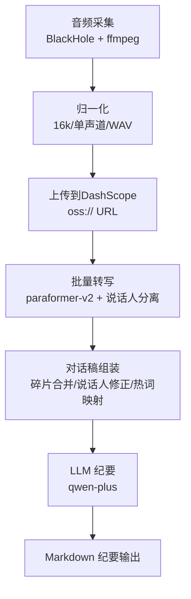
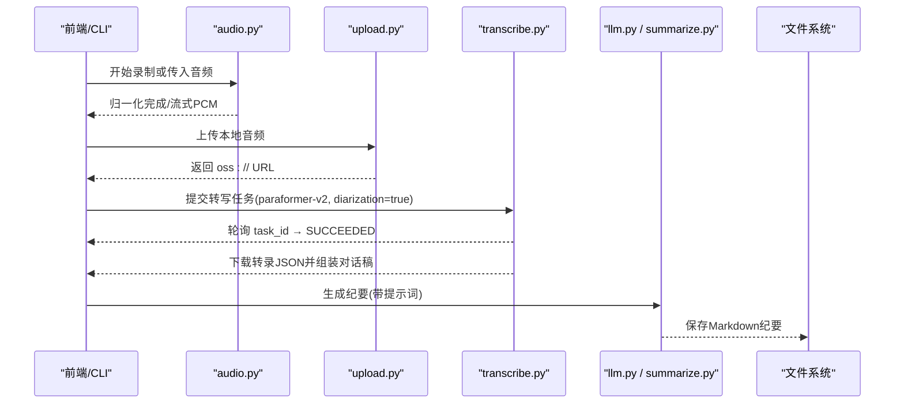
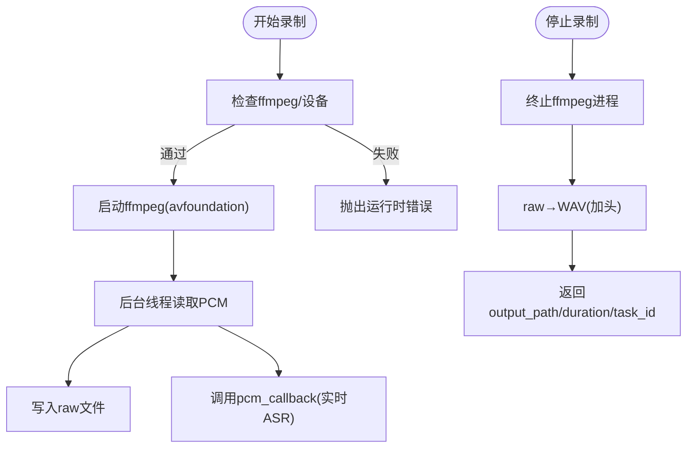
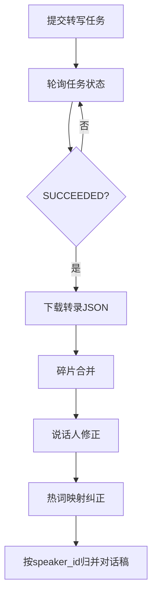
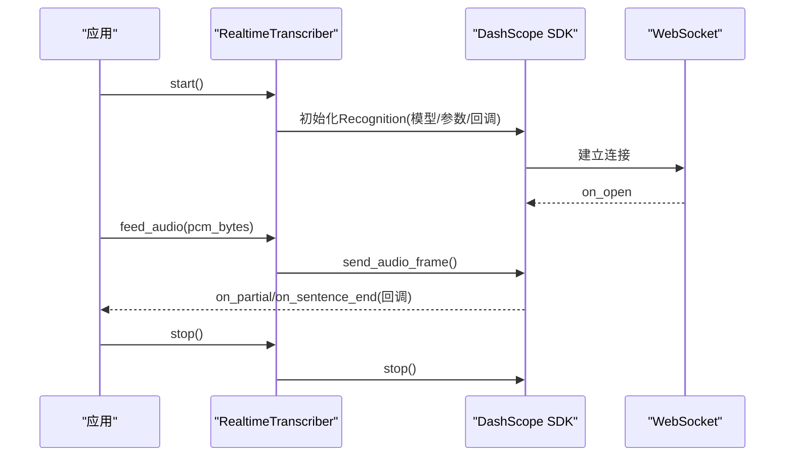
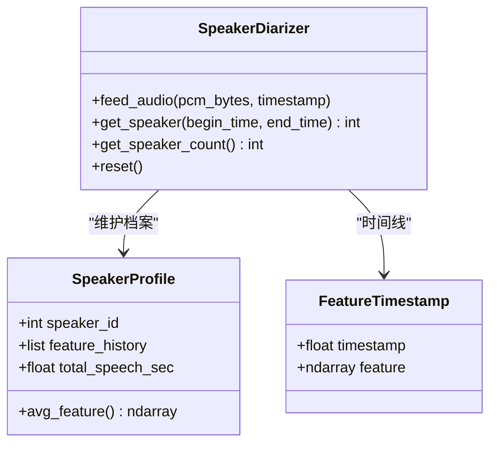
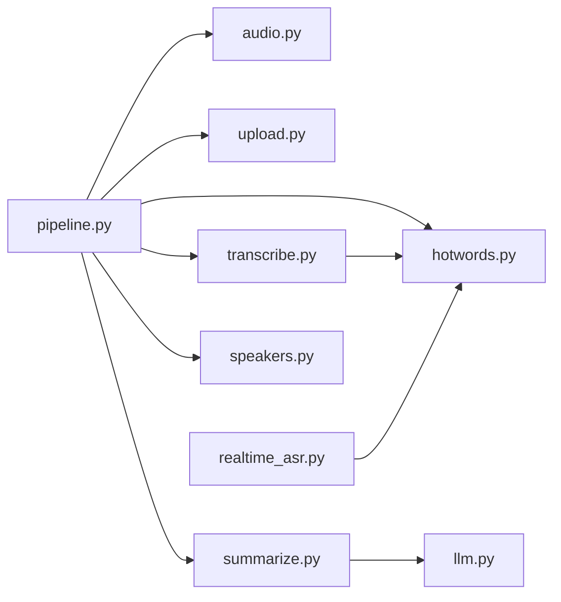

# 核心模块

<cite>
**本文引用的文件**
- [core/audio.py](file://core/audio.py)
- [core/upload.py](file://core/upload.py)
- [core/transcribe.py](file://core/transcribe.py)
- [core/hotwords.py](file://core/hotwords.py)
- [core/realtime_asr.py](file://core/realtime_asr.py)
- [core/diarization.py](file://core/diarization.py)
- [core/speakers.py](file://core/speakers.py)
- [core/llm.py](file://core/llm.py)
- [core/summarize.py](file://core/summarize.py)
- [core/realtime_summary.py](file://core/realtime_summary.py)
- [core/pipeline.py](file://core/pipeline.py)
- [core/projects.py](file://core/projects.py)
- [core/users.py](file://core/users.py)
- [data/hotwords.txt](file://data/hotwords.txt)
- [data/hotword_mappings.txt](file://data/hotword_mappings.txt)
- [docs/ARCHITECTURE.md](file://docs/ARCHITECTURE.md)
</cite>

## 目录
1. [简介](#简介)
2. [项目结构](#项目结构)
3. [核心组件](#核心组件)
4. [架构总览](#架构总览)
5. [详细组件分析](#详细组件分析)
6. [依赖关系分析](#依赖关系分析)
7. [性能考量](#性能考量)
8. [故障排查指南](#故障排查指南)
9. [结论](#结论)
10. [附录](#附录)

## 简介
本技术文档聚焦 open-meeting-scribe 的核心模块，系统阐述音频处理、转写引擎（批量与实时）、说话人分离、热词增强、纪要生成（LLM 集成与提示词工程）等关键能力，并说明各模块间的依赖与协作方式。文档同时给出配置项、参数说明、返回值格式、典型调用模式与错误处理策略，帮助在实际项目中正确集成与扩展。

## 项目结构
核心代码位于 core/ 目录，按职责分层组织：
- 采集与预处理：audio.py（ffmpeg 归一化、macOS BlackHole 内录、流式 PCM 输出）
- 上云：upload.py（获取上传凭证、上传至 DashScope 临时存储，返回 oss:// URL）
- 转写：transcribe.py（提交 paraformer-v2 任务、轮询、下载结果、组装对话稿）
- 热词：hotwords.py（热词表创建与管理、后处理映射纠正）
- 实时转写：realtime_asr.py（WebSocket 实时识别，qwen-audio-3.0-asr-flash-streaming）
- 说话人分离：diarization.py（本地声纹聚类，MFCC+能量特征，余弦相似度匹配）
- 说话人档案：speakers.py（全局说话人管理、会议映射、姓名应用）
- LLM 提供：llm.py（通义千问同步/异步/流式调用）
- 纪要生成：summarize.py（提示词工程、标题与纪要生成、Markdown 保存）
- 实时总结：realtime_summary.py（增量总结，定时触发 LLM）
- 管线编排：pipeline.py（串联全流程，进度回调，输出 Markdown）
- 辅助：projects.py（项目索引与检索）、users.py（用户与说话人绑定）

图表来源
- [docs/ARCHITECTURE.md:18-33](file://docs/ARCHITECTURE.md#L18-L33)
- [core/pipeline.py:95-134](file://core/pipeline.py#L95-L134)

章节来源
- [docs/ARCHITECTURE.md:5-17](file://docs/ARCHITECTURE.md#L5-L17)
- [core/pipeline.py:35-44](file://core/pipeline.py#L35-L44)

## 核心组件
- 音频处理模块：负责任意音频归一化为 16kHz/单声道/WAV；macOS 系统内录（BlackHole）；流式 PCM 输出供实时 ASR 消费。
- 转写引擎：批量转写通过 DashScope 异步任务（paraformer-v2），支持说话人分离、语言提示、热词表；实时转写通过 WebSocket 流式识别（qwen-audio-3.0-asr-flash-streaming）。
- 说话人分离：本地基于 MFCC+能量的声纹聚类，实时为 ASR 句子标注说话人 ID。
- 热词增强：热词表创建与使用（vocabulary_id），以及后处理文本映射纠正（如 ES→EAS系统）。
- 纪要生成：构造结构化提示词，调用通义千问生成会议纪要与标题，保存 Markdown。
- 实时总结：按分钟窗口缓冲定稿句子，周期性增量总结，输出预览摘要。
- 管线编排：将上述模块串联，提供进度回调与最终输出。

章节来源
- [core/audio.py:1-10](file://core/audio.py#L1-L10)
- [core/transcribe.py:1-14](file://core/transcribe.py#L1-L14)
- [core/diarization.py:1-21](file://core/diarization.py#L1-L21)
- [core/hotwords.py:1-15](file://core/hotwords.py#L1-L15)
- [core/summarize.py:1-11](file://core/summarize.py#L1-L11)
- [core/realtime_summary.py:1-17](file://core/realtime_summary.py#L1-L17)
- [core/pipeline.py:1-12](file://core/pipeline.py#L1-L12)

## 架构总览
系统采用“采集 → 上云 → 转写 → 纪要”的分层流水线，结合实时链路（WebSocket）提供预览能力。关键约束包括：只认公网 URL、oss:// 走 RESTful、分离仅单声道生效、异步任务轮询。

图表来源
- [core/pipeline.py:95-134](file://core/pipeline.py#L95-L134)
- [core/upload.py:59-115](file://core/upload.py#L59-L115)
- [core/transcribe.py:61-131](file://core/transcribe.py#L61-L131)
- [core/summarize.py:157-229](file://core/summarize.py#L157-L229)

章节来源
- [docs/ARCHITECTURE.md:18-40](file://docs/ARCHITECTURE.md#L18-L40)

## 详细组件分析

### 音频处理模块（audio.py）
- 功能要点
  - 音频归一化：调用 ffmpeg 将输入转为 16kHz/单声道/WAV，确保后续转写与说话人分离的最优输入格式。
  - macOS 系统内录：通过 avfoundation 从 BlackHole 2ch 采集系统音频，支持普通录制与流式 PCM 输出。
  - 流式录音：后台线程读取 ffmpeg stdout 的 raw PCM，写入临时 raw 文件并回调给实时 ASR；支持暂停/恢复，统计有效时长。
  - 工具函数：检查 ffmpeg、查询时长、列出设备。
- 关键接口与参数
  - normalize_audio(input_path, output_path=None, sample_rate=16000, channels=1) → Path
  - start_recording(device="BlackHole 2ch", output_dir="data/recordings", task_id=None) → dict
  - stop_recording() → dict
  - start_recording_with_stream(device, output_dir, task_id, pcm_callback) → dict
  - stop_recording_with_stream() → dict
  - pause_recording_with_stream()/resume_recording_with_stream()
  - get_audio_duration(input_path) → float
  - list_audio_devices() → list[dict]
- 返回值示例
  - 录制结果包含 output_path、duration、task_id
  - 流式录制信息包含 elapsed、paused 状态
- 错误处理
  - 未安装 ffmpeg、设备不可用、已在录制中、超时等异常均有明确抛出与日志记录

图表来源
- [core/audio.py:139-217](file://core/audio.py#L139-L217)
- [core/audio.py:303-396](file://core/audio.py#L303-L396)
- [core/audio.py:440-515](file://core/audio.py#L440-L515)
- [core/audio.py:559-594](file://core/audio.py#L559-L594)

章节来源
- [core/audio.py:26-98](file://core/audio.py#L26-L98)
- [core/audio.py:101-126](file://core/audio.py#L101-L126)
- [core/audio.py:139-217](file://core/audio.py#L139-L217)
- [core/audio.py:303-396](file://core/audio.py#L303-L396)
- [core/audio.py:440-515](file://core/audio.py#L440-L515)
- [core/audio.py:518-557](file://core/audio.py#L518-L557)
- [core/audio.py:559-594](file://core/audio.py#L559-L594)
- [core/audio.py:597-663](file://core/audio.py#L597-L663)

### 转写引擎（transcribe.py）
- 功能要点
  - 提交异步转写任务（paraformer-v2），开启说话人分离，支持语言提示、热词表、语气词过滤。
  - 轮询任务状态直至成功，下载转录 JSON，执行碎片合并、说话人修正、热词映射，按 speaker_id 归并为对话稿。
- 关键接口与参数
  - submit_transcription(file_url, model="paraformer-v2", diarization_enabled=True, language_hints=None, speaker_count=None, vocabulary_id=None, disfluency_removal_enabled=False) → str(task_id)
  - poll_task(task_id, interval=3, timeout=600) → dict
  - download_transcription(transcription_url) → dict
  - merge_fragments(sentences) → list[dict]
  - correct_speaker_ids(sentences) → list[dict]
  - assemble_dialogue(transcription) → list[dict]
  - transcribe_audio(file_url, model="paraformer-v2", diarization_enabled=True, language_hints=None, vocabulary_id=None, speaker_count=None) → (dialogue, transcription)
- 返回值格式
  - dialogue: 列表，每项含 speaker_id、text、sentences
  - transcription: 原始 JSON（含 transcripts、sentences、words 等）
- 算法细节
  - 碎片合并：跨句拆词检测、短句阈值、句末标点判断、时间间隔阈值
  - 说话人修正：夹心修正（A-B-A）、连续短句跟随前句说话人
  - 热词映射：后处理替换（英文词边界匹配、中文直接替换）

图表来源
- [core/transcribe.py:61-131](file://core/transcribe.py#L61-L131)
- [core/transcribe.py:134-187](file://core/transcribe.py#L134-L187)
- [core/transcribe.py:222-304](file://core/transcribe.py#L222-L304)
- [core/transcribe.py:307-352](file://core/transcribe.py#L307-L352)
- [core/transcribe.py:355-402](file://core/transcribe.py#L355-L402)
- [core/transcribe.py:405-446](file://core/transcribe.py#L405-L446)

章节来源
- [core/transcribe.py:54-58](file://core/transcribe.py#L54-L58)
- [core/transcribe.py:61-131](file://core/transcribe.py#L61-L131)
- [core/transcribe.py:134-187](file://core/transcribe.py#L134-L187)
- [core/transcribe.py:193-219](file://core/transcribe.py#L193-L219)
- [core/transcribe.py:222-304](file://core/transcribe.py#L222-L304)
- [core/transcribe.py:307-352](file://core/transcribe.py#L307-L352)
- [core/transcribe.py:355-402](file://core/transcribe.py#L355-L402)
- [core/transcribe.py:405-446](file://core/transcribe.py#L405-L446)

### 实时转写（realtime_asr.py）
- 功能要点
  - 封装 DashScope 实时语音识别 SDK，建立 WebSocket 连接，接收 PCM 数据并送入识别。
  - 回调收集临时结果与定稿句子，支持上下文增强、即时热词、预编译热词表。
  - 自动重试应对限流，保持长连接心跳。
- 关键接口与参数
  - RealtimeTranscriber(on_partial, on_sentence_end, on_error, on_complete, vocabulary_id=None, vocabulary=None, context=None, sample_rate=16000, language_hints=["zh","en"])
  - start()、feed_audio(pcm_data)、stop()、is_running、sentence_count
- 协议与限制
  - 音频格式：PCM 16bit/16kHz/单声道，建议每包 ~100ms（6400 bytes）
  - WebSocket 地址：wss://dashscope.aliyuncs.com/api-ws/v1/inference
  - 实时 API 不支持说话人分离（无 speaker_id）

图表来源
- [core/realtime_asr.py:57-144](file://core/realtime_asr.py#L57-L144)
- [core/realtime_asr.py:150-327](file://core/realtime_asr.py#L150-L327)
- [core/realtime_asr.py:329-368](file://core/realtime_asr.py#L329-L368)

章节来源
- [core/realtime_asr.py:1-27](file://core/realtime_asr.py#L1-L27)
- [core/realtime_asr.py:57-144](file://core/realtime_asr.py#L57-L144)
- [core/realtime_asr.py:150-327](file://core/realtime_asr.py#L150-L327)
- [core/realtime_asr.py:329-368](file://core/realtime_asr.py#L329-L368)

### 说话人分离（diarization.py）
- 功能要点
  - 从 PCM 提取声纹特征（MFCC+能量），基于余弦相似度实时聚类区分不同说话人。
  - 为 ASR 句子根据时间戳匹配最近特征，获得说话人标签。
- 关键接口与参数
  - extract_speaker_feature(pcm_bytes, sample_rate=16000) → ndarray|None
  - SpeakerDiarizer(feature_window_sec=2.0, feature_step_sec=1.0, similarity_threshold=0.70, min_features=2)
  - feed_audio(pcm_bytes, timestamp=None)、get_speaker(begin_time, end_time)、get_speaker_count()、reset()
- 算法复杂度
  - 特征提取：O(N)（N 为采样点数）
  - 匹配：O(M)（M 为已知说话人数）
  - 内存：保留最近 10 秒音频缓冲，控制内存占用

图表来源
- [core/diarization.py:61-82](file://core/diarization.py#L61-L82)
- [core/diarization.py:238-275](file://core/diarization.py#L238-L275)
- [core/diarization.py:282-525](file://core/diarization.py#L282-L525)

章节来源
- [core/diarization.py:34-55](file://core/diarization.py#L34-L55)
- [core/diarization.py:87-166](file://core/diarization.py#L87-L166)
- [core/diarization.py:169-229](file://core/diarization.py#L169-L229)
- [core/diarization.py:231-275](file://core/diarization.py#L231-L275)
- [core/diarization.py:282-525](file://core/diarization.py#L282-L525)

### 热词增强（hotwords.py）
- 功能要点
  - 从 data/hotwords.txt 加载热词，创建 DashScope 热词表（vocabulary_id），用于提升识别准确率。
  - 后处理映射纠正：从 data/hotword_mappings.txt 加载映射规则，对识别文本进行替换（英文词边界匹配、中文直接替换）。
- 关键接口与参数
  - load_hotwords(file_path="data/hotwords.txt") → list[str]
  - create_vocabulary(name, words, target_model="qwen-audio-3.0-asr-flash-streaming") → str|None
  - get_or_create_vocabulary(hotwords_file="data/hotwords.txt", name="oms-hotwords", target_model="...") → str|None
  - apply_hotword_mappings(text, mappings=None, mappings_file="data/hotword_mappings.txt") → str
- 配置与限制
  - 热词表为账号级资源（最多 10 个），兼容模型共享
  - Qwen-Audio-3.0-ASR 系列最多 2000 个热词，权重范围 1-5，推荐 4

章节来源
- [core/hotwords.py:1-15](file://core/hotwords.py#L1-L15)
- [core/hotwords.py:35-54](file://core/hotwords.py#L35-L54)
- [core/hotwords.py:57-117](file://core/hotwords.py#L57-L117)
- [core/hotwords.py:120-139](file://core/hotwords.py#L120-L139)
- [core/hotwords.py:145-179](file://core/hotwords.py#L145-L179)
- [core/hotwords.py:182-222](file://core/hotwords.py#L182-L222)
- [data/hotwords.txt:1-4](file://data/hotwords.txt#L1-L4)
- [data/hotword_mappings.txt:1-6](file://data/hotword_mappings.txt#L1-L6)

### 纪要生成（summarize.py + llm.py）
- 功能要点
  - 构造结构化提示词，调用通义千问生成会议纪要与标题，支持用户笔记注入。
  - 提供同步/异步/流式 LLM 调用，适配后台线程与 FastAPI 场景。
- 关键接口与参数
  - generate_title(dialogue, model="qwen-plus") → str
  - generate_summary(dialogue, model="qwen-plus", meeting_time=None, user_notes=None) → str
  - save_summary(summary, output_path, dialogue=None) → str
  - chat_completion(messages, model="qwen-plus", temperature=0.7, max_tokens=4096) → str
  - async_chat_completion(...)、chat_completion_stream(...)
- 提示词工程
  - 标题提示词：简洁概括主题，正式书面语
  - 纪要提示词：严格结构（概要/结论/待办/议题归类），禁止编造，内容不足时如实说明

章节来源
- [core/summarize.py:19-84](file://core/summarize.py#L19-L84)
- [core/summarize.py:87-229](file://core/summarize.py#L87-L229)
- [core/summarize.py:232-283](file://core/summarize.py#L232-L283)
- [core/llm.py:23-76](file://core/llm.py#L23-L76)
- [core/llm.py:89-121](file://core/llm.py#L89-L121)
- [core/llm.py:129-160](file://core/llm.py#L129-L160)
- [core/llm.py:168-207](file://core/llm.py#L168-L207)

### 实时总结（realtime_summary.py）
- 功能要点
  - 收集录音期间的定稿句子，按分钟窗口缓冲，每 60 秒触发一次 LLM 增量总结。
  - 首次总结仅传当前缓冲区；后续传入「上次摘要 + 新增句子」，要求输出更新后的完整摘要。
- 关键接口与参数
  - RealtimeSummarizer(on_summary=None, on_status=None)
  - start()、stop()、pause()、resume()、feed_sentence(sentence)、get_final_summary()
- 配置
  - SUMMARY_INTERVAL=60、SUMMARY_MODEL="qwen-turbo"、MAX_PREVIOUS_SUMMARY_CHARS=1500

章节来源
- [core/realtime_summary.py:1-17](file://core/realtime_summary.py#L1-L17)
- [core/realtime_summary.py:37-65](file://core/realtime_summary.py#L37-L65)
- [core/realtime_summary.py:68-184](file://core/realtime_summary.py#L68-L184)
- [core/realtime_summary.py:186-270](file://core/realtime_summary.py#L186-L270)

### 管线编排（pipeline.py）
- 功能要点
  - 串联全流程：音频归一化 → 上传 → 转写 → 纪要，输出 Markdown。
  - 提供两阶段接口：stage1（音频→对话稿）、stage2（对话稿→纪要），支持进度回调。
- 关键接口与参数
  - run_pipeline_stage1(audio_path, config=None, on_progress=None, speaker_count=None) → dict
  - run_pipeline_stage2(dialogue, speaker_mapping=None, audio_path=None, config=None, on_progress=None, meeting_time=None, user_notes=None) → dict
  - run_pipeline(audio_path, output_path=None, config=None, on_progress=None, speaker_mapping=None, meeting_time=None) → dict
  - run_pipeline_simple(audio_path) → str
- 默认配置
  - asr_model="paraformer-v2"、llm_model="qwen-plus"、diarization_enabled=True、language_hints=["zh","en"]、sample_rate=16000、channels=1、output_dir="data/output"

章节来源
- [core/pipeline.py:1-12](file://core/pipeline.py#L1-L12)
- [core/pipeline.py:35-44](file://core/pipeline.py#L35-L44)
- [core/pipeline.py:58-134](file://core/pipeline.py#L58-L134)
- [core/pipeline.py:137-226](file://core/pipeline.py#L137-L226)
- [core/pipeline.py:229-271](file://core/pipeline.py#L229-L271)

### 说话人档案与用户绑定（speakers.py + users.py）
- 功能要点
  - speakers.py：管理全局说话人列表（姓名、角色、备注），会议级 speaker_id 映射历史，应用姓名到对话稿。
  - users.py：用户信息持久化，说话人与用户的绑定关系管理。
- 关键接口与参数
  - add_speaker(name, role="", note="") → Speaker
  - apply_speaker_names(dialogue, mapping) → list[dict]
  - build_speaker_prompt(dialogue) → str
  - bind_current_user_to_speaker(task_id, speaker_id) → str|None

章节来源
- [core/speakers.py:35-102](file://core/speakers.py#L35-L102)
- [core/speakers.py:109-198](file://core/speakers.py#L109-L198)
- [core/speakers.py:205-271](file://core/speakers.py#L205-L271)
- [core/speakers.py:278-325](file://core/speakers.py#L278-L325)
- [core/users.py:22-78](file://core/users.py#L22-L78)
- [core/users.py:83-157](file://core/users.py#L83-L157)

## 依赖关系分析
- 模块耦合
  - pipeline.py 强依赖 audio.py、upload.py、transcribe.py、hotwords.py、summarize.py、speakers.py
  - transcribe.py 依赖 hotwords.py（后处理映射）
  - realtime_asr.py 依赖 hotwords.py（后处理映射）
  - summarize.py 依赖 llm.py
  - diarization.py 独立实现，可与 realtime_asr.py 组合使用
- 外部依赖
  - ffmpeg（系统命令）、DashScope API（REST/WS）、通义千问（OpenAI 兼容端点）
- 潜在循环依赖
  - 无明显循环依赖；模块间通过函数调用与数据传递解耦

图表来源
- [core/pipeline.py:22-27](file://core/pipeline.py#L22-L27)
- [core/transcribe.py:190-190](file://core/transcribe.py#L190-L190)
- [core/realtime_asr.py:43-43](file://core/realtime_asr.py#L43-L43)
- [core/summarize.py:14-14](file://core/summarize.py#L14-L14)

章节来源
- [core/pipeline.py:22-27](file://core/pipeline.py#L22-L27)
- [core/transcribe.py:190-190](file://core/transcribe.py#L190-L190)
- [core/realtime_asr.py:43-43](file://core/realtime_asr.py#L43-L43)
- [core/summarize.py:14-14](file://core/summarize.py#L14-L14)

## 性能考量
- 音频处理
  - ffmpeg 归一化与流式 PCM 读取采用子进程与后台线程，避免阻塞主流程；合理 chunk_size（6400 bytes）降低延迟。
- 转写引擎
  - 异步任务轮询间隔与超时可调；碎片合并与说话人修正为 O(N) 线性扫描，适合会议规模。
- 实时转写
  - WebSocket 长连接心跳保持；限流自动重试（指数退避）；每包 100ms 平衡延迟与带宽。
- 说话人分离
  - 特征提取窗口 2 秒、步长 1 秒，兼顾精度与实时性；内存保留最近 10 秒缓冲。
- LLM 调用
  - 同步/异步客户端复用连接池；流式输出降低首字延迟；增量总结减少 token 消耗。

## 故障排查指南
- 常见错误与处理
  - ffmpeg 未安装或设备不可用：检查环境变量与系统设置，确认 BlackHole 2ch 已配置
  - 上传失败：检查文件大小（≤1GB）、网络连通性与凭证有效性
  - 转写任务失败：查看任务状态与错误消息，调整语言提示或热词表
  - 实时转写限流：自动重试机制会提示并等待；若持续失败，检查 API Key 与配额
  - LLM 调用超时：增加超时时间或切换模型；检查网络与配额
- 调试建议
  - 启用日志级别 DEBUG，关注各模块日志输出
  - 使用 list_audio_devices() 验证设备枚举
  - 通过 get_stream_recording_info() 检查流式录制状态与有效时长

章节来源
- [core/audio.py:26-98](file://core/audio.py#L26-L98)
- [core/upload.py:25-56](file://core/upload.py#L25-L56)
- [core/transcribe.py:134-187](file://core/transcribe.py#L134-L187)
- [core/realtime_asr.py:216-327](file://core/realtime_asr.py#L216-L327)
- [core/llm.py:89-121](file://core/llm.py#L89-L121)

## 结论
open-meeting-scribe 的核心模块以清晰的分层与职责划分，实现了从音频采集到纪要生成的完整闭环。通过 ffmpeg 归一化、DashScope 异步转写、本地声纹聚类、热词增强与 LLM 提示词工程，系统在准确性与实时性之间取得平衡。管线编排提供了易用的接口与进度反馈，便于集成到实际项目中。未来可考虑本地 ASR/分离与更精细的姓名化方案，进一步提升隐私与可控性。

## 附录
- 配置选项与环境变量
  - DASHSCOPE_API_KEY：必需，用于转写与 LLM 调用
  - DASHSCOPE_WS_URL：可选，覆盖实时 WebSocket 地址
  - pipeline 默认配置：asr_model、llm_model、diarization_enabled、language_hints、sample_rate、channels、output_dir
- 典型调用模式
  - 批量转写：run_pipeline_stage1 → 说话人绑定 → run_pipeline_stage2
  - 实时转写：RealtimeTranscriber.start() → feed_audio() → stop()
  - 实时总结：RealtimeSummarizer.start() → feed_sentence() → stop() → get_final_summary()
- 返回值格式
  - 对话稿：[{speaker_id, text, sentences}, ...]
  - 原始转录：{transcripts: [{sentences: [...]}], ...}
  - 纪要：Markdown 字符串
  - 录制结果：{output_path, duration, task_id}