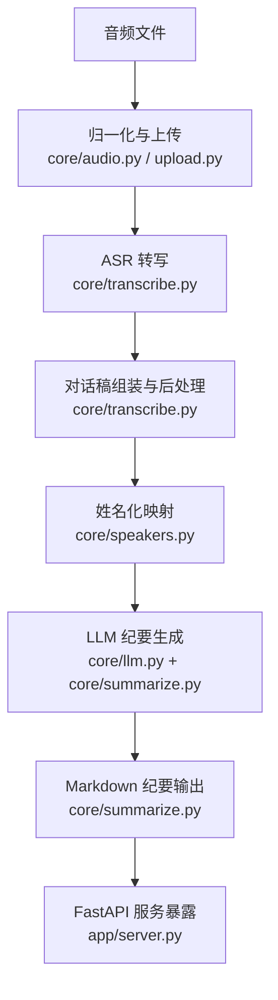
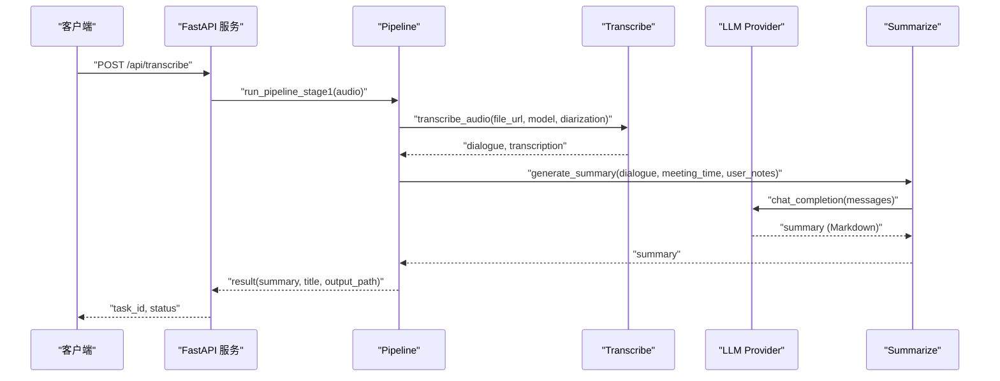
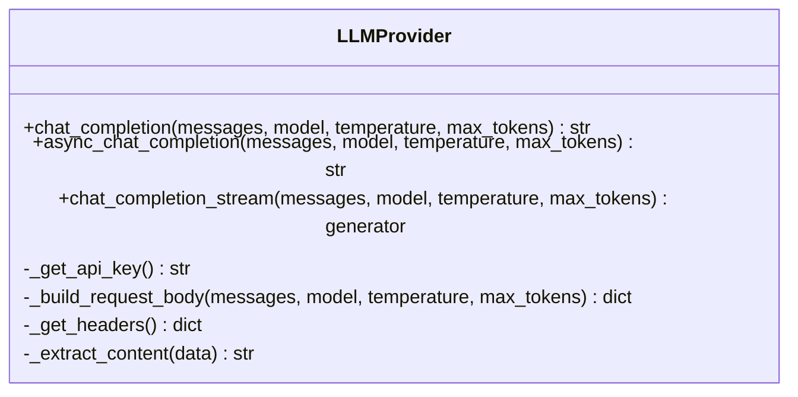
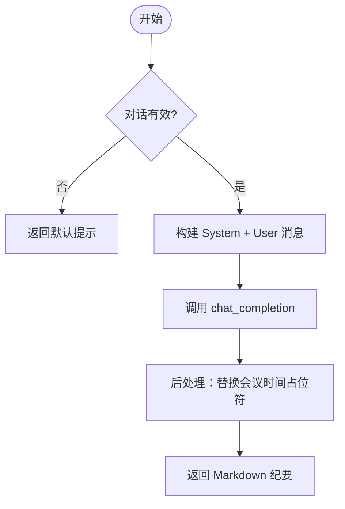
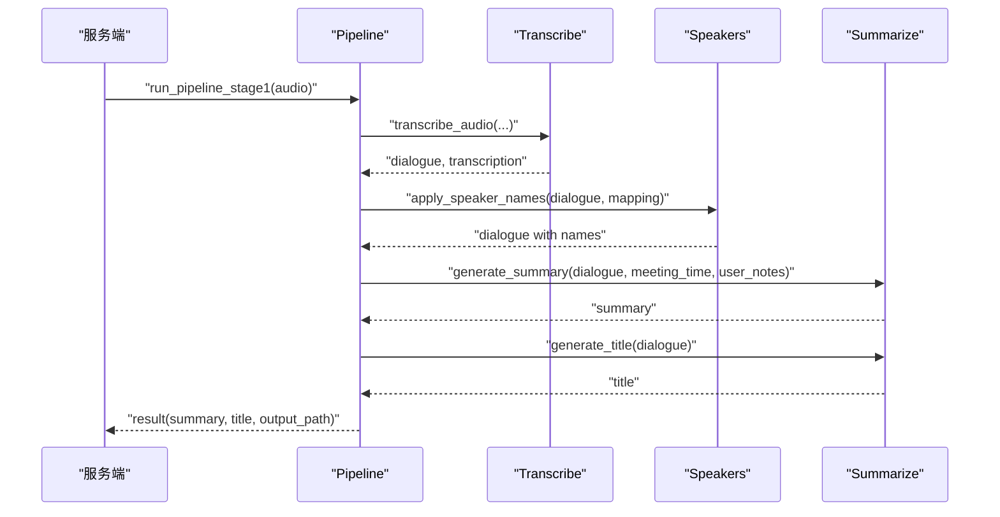
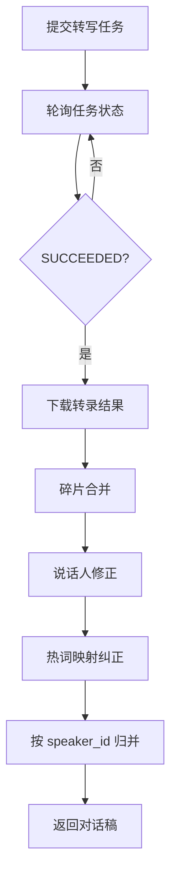
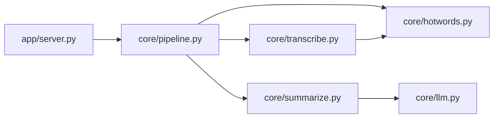

# 纪要生成

<cite>
**本文引用的文件**
- [core/llm.py](file://core/llm.py)
- [core/summarize.py](file://core/summarize.py)
- [core/pipeline.py](file://core/pipeline.py)
- [core/transcribe.py](file://core/transcribe.py)
- [core/hotwords.py](file://core/hotwords.py)
- [app/server.py](file://app/server.py)
- [data/meeting_mappings.json](file://data/meeting_mappings.json)
- [docs/ARCHITECTURE.md](file://docs/ARCHITECTURE.md)
- [README.md](file://README.md)
</cite>

## 目录
1. [简介](#简介)
2. [项目结构](#项目结构)
3. [核心组件](#核心组件)
4. [架构总览](#架构总览)
5. [详细组件分析](#详细组件分析)
6. [依赖关系分析](#依赖关系分析)
7. [性能与可靠性](#性能与可靠性)
8. [故障排查指南](#故障排查指南)
9. [结论](#结论)
10. [附录：提示词模板与配置项](#附录提示词模板与配置项)

## 简介
本模块负责将会议音频自动转写为结构化会议纪要，并自动生成标题、待办事项与议题归类。系统通过通义千问（DashScope OpenAI 兼容端点）进行大语言模型调用，结合精心设计的提示词工程，输出符合规范的 Markdown 纪要。整体流程包括：音频归一化与上传、ASR 异步转写与说话人分离、对话稿组装与后处理、LLM 请求构建与结果解析、纪要保存与展示。

## 项目结构
纪要生成相关代码主要分布在 core 层与 app 层：
- core/llm.py：通义千问 LLM Provider（同步/异步/流式）
- core/summarize.py：纪要提示词、标题生成、Markdown 输出与保存
- core/pipeline.py：全流程编排（转写→姓名化→纪要→保存）
- core/transcribe.py：ASR 任务提交、轮询、下载、对话稿组装与后处理
- core/hotwords.py：热词表管理与文本映射纠正
- app/server.py：FastAPI 服务，封装管线调用、任务状态、实时转写与总结
- data/meeting_mappings.json：历史会议说话人映射数据
- docs/ARCHITECTURE.md：系统架构与数据流说明
- README.md：项目概览与快速上手

图表来源
- [docs/ARCHITECTURE.md:18-33](file://docs/ARCHITECTURE.md#L18-L33)
- [core/pipeline.py:58-134](file://core/pipeline.py#L58-L134)
- [core/transcribe.py:405-446](file://core/transcribe.py#L405-L446)
- [core/summarize.py:157-229](file://core/summarize.py#L157-L229)

章节来源
- [docs/ARCHITECTURE.md:5-16](file://docs/ARCHITECTURE.md#L5-L16)
- [README.md:1-39](file://README.md#L1-L39)

## 核心组件
- 通义千问 LLM Provider：提供同步、异步与流式三种调用方式，统一构造请求体与响应提取，支持连接池复用与超时控制。
- 纪要生成器：定义系统提示词与用户消息模板，按规范输出 Markdown，包含会议概要、结论、待办、议题归类等结构化内容；同时支持标题自动生成。
- 管线编排：串联音频归一化、上传、ASR 转写、对话稿组装、姓名化、LLM 纪要生成与保存，并提供进度回调。
- ASR 转写与后处理：提交异步任务、轮询状态、下载结果、合并碎片句子、修正说话人、热词映射纠正，最终按 speaker_id 归并为对话稿。
- 热词管理：从本地文件加载热词，创建 DashScope 热词表，并在转写后对识别文本进行映射纠正。
- Web 服务：FastAPI 接口封装管线调用、任务持久化、实时转写与总结、说话人绑定与纪要重新生成。

章节来源
- [core/llm.py:23-207](file://core/llm.py#L23-L207)
- [core/summarize.py:19-229](file://core/summarize.py#L19-L229)
- [core/pipeline.py:35-226](file://core/pipeline.py#L35-L226)
- [core/transcribe.py:61-446](file://core/transcribe.py#L61-L446)
- [core/hotwords.py:35-222](file://core/hotwords.py#L35-L222)
- [app/server.py:226-332](file://app/server.py#L226-L332)

## 架构总览
系统采用分层设计，职责清晰：
- 采集与上云：音频归一化与临时存储，确保仅公网 URL 进入 ASR。
- 转写与后处理：异步任务提交与轮询，句子级结果合并与说话人修正。
- 纪要生成：基于通义千问的提示词工程，输出结构化 Markdown。
- 编排与服务：Pipeline 编排全流程，FastAPI 提供 RESTful API 与 WebSocket 实时能力。

图表来源
- [app/server.py:343-396](file://app/server.py#L343-L396)
- [core/pipeline.py:58-134](file://core/pipeline.py#L58-L134)
- [core/transcribe.py:405-446](file://core/transcribe.py#L405-L446)
- [core/summarize.py:157-229](file://core/summarize.py#L157-L229)
- [core/llm.py:89-122](file://core/llm.py#L89-L122)

## 详细组件分析

### 通义千问 LLM Provider
- 同步调用：使用 requests.post 调用 DashScope OpenAI 兼容端点，构造 Authorization 头与 JSON 请求体，提取 choices[0].message.content。
- 异步调用：使用 httpx.AsyncClient 连接池复用，避免阻塞事件循环，适用于 FastAPI async 端点。
- 流式调用：设置 stream=True，逐行解析 SSE data: 块，yield delta.content。
- 错误处理：捕获超时与异常，抛出 RuntimeError 便于上层重试或降级。

图表来源
- [core/llm.py:23-207](file://core/llm.py#L23-L207)

章节来源
- [core/llm.py:23-207](file://core/llm.py#L23-L207)

### 纪要生成器（提示词工程与结构化输出）
- 标题生成：系统提示词要求简洁概括、正式书面语，限制长度，失败时回退到“会议记录”。
- 纪要生成：系统提示词严格约束忠于原文、禁止编造、标注识别错误、区分发言人观点；输出固定 Markdown 结构（会议时间、参会人数、概要、结论、待办、议题）。
- 用户消息构建：注入说话人数量、发言人对应关系、对话句数、会议时间、用户笔记等上下文；拼接对话内容为可读格式。
- 后处理兜底：若 LLM 未填充会议时间，用实际值替换占位符。

图表来源
- [core/summarize.py:157-229](file://core/summarize.py#L157-L229)

章节来源
- [core/summarize.py:19-229](file://core/summarize.py#L19-L229)

### 管线编排（全流程串联）
- 第一阶段：音频归一化 → 上传 → 热词检查 → ASR 转写 → 组装对话稿。
- 第二阶段：应用说话人姓名映射 → 生成纪要 → 生成标题 → 保存 Markdown。
- 进度回调：每个阶段更新百分比与消息，供 UI 显示。
- 配置覆盖：DEFAULT_CONFIG 可被传入 config 覆盖，如模型名、是否开启分离、语言提示等。

图表来源
- [core/pipeline.py:58-226](file://core/pipeline.py#L58-L226)
- [core/transcribe.py:405-446](file://core/transcribe.py#L405-L446)
- [core/summarize.py:157-229](file://core/summarize.py#L157-L229)

章节来源
- [core/pipeline.py:35-226](file://core/pipeline.py#L35-L226)

### ASR 转写与后处理
- 任务提交：带 X-DashScope-Async: enable，oss:// URL 需加 X-DashScope-OssResourceResolve: enable。
- 轮询：每 3 秒查询一次，最多等待 600 秒，状态变化记录日志。
- 结果下载：transcription_url 有效期 24h，下载 JSON。
- 后处理：
  - 碎片合并：检测跨句拆词、短句、不完整句末标点，按时间间隔阈值合并。
  - 说话人修正：夹心模式（A-B-A）与连续短句跟随前句说话人。
  - 热词映射：按长匹配优先策略替换识别错误。
  - 归并：按 speaker_id 聚合为对话稿。

图表来源
- [core/transcribe.py:61-446](file://core/transcribe.py#L61-L446)

章节来源
- [core/transcribe.py:61-446](file://core/transcribe.py#L61-L446)

### 热词管理
- 热词表创建：读取 data/hotwords.txt，构造词汇列表（权重默认 4），调用 DashScope API 创建 vocabulary_id。
- 映射纠正：加载 data/hotword_mappings.txt，按左串长度降序匹配，纯英文词使用词边界匹配，中文直接子串替换。
- 集成点：在转写后对每句文本应用映射纠正，提升识别准确性。

章节来源
- [core/hotwords.py:35-222](file://core/hotwords.py#L35-L222)

### Web 服务与任务管理
- 任务生命周期：pending → processing → awaiting_mapping → completed/failed。
- 后台执行：使用 BackgroundTasks 运行管线，避免阻塞事件循环。
- 说话人绑定：支持设置映射并触发第二阶段；支持重新生成纪要。
- 实时能力：WebSocket 推送实时转写与增量总结，缓冲最近 N 条句子用于上下文注入。
- 持久化：任务数据落盘（剔除冗余 transcription 字段），启动时恢复。

章节来源
- [app/server.py:226-332](file://app/server.py#L226-L332)
- [app/server.py:343-714](file://app/server.py#L343-L714)
- [data/meeting_mappings.json:1-122](file://data/meeting_mappings.json#L1-L122)

## 依赖关系分析
- 模块耦合：
  - pipeline 依赖 audio、upload、transcribe、hotwords、summarize、speakers。
  - summarize 依赖 llm。
  - transcribe 依赖 hotwords（后处理映射）。
  - server 依赖 pipeline、audio、realtime_asr、realtime_summary、diarization、speakers、projects、users、hotwords、llm。
- 外部依赖：
  - DashScope ASR（paraformer-v2）与 LLM（qwen-plus）。
  - ffmpeg 与 BlackHole（采集与归一化）。
- 潜在循环：无直接循环依赖；server 作为顶层编排，不反向被 core 依赖。

图表来源
- [core/pipeline.py:22-27](file://core/pipeline.py#L22-L27)
- [core/summarize.py:13-14](file://core/summarize.py#L13-L14)
- [core/transcribe.py:190-190](file://core/transcribe.py#L190-L190)
- [app/server.py:41-57](file://app/server.py#L41-L57)

章节来源
- [core/pipeline.py:22-27](file://core/pipeline.py#L22-L27)
- [core/summarize.py:13-14](file://core/summarize.py#L13-L14)
- [core/transcribe.py:190-190](file://core/transcribe.py#L190-L190)
- [app/server.py:41-57](file://app/server.py#L41-L57)

## 性能与可靠性
- 性能优化：
  - 异步 HTTP 客户端连接池复用，减少握手开销。
  - 流式调用降低首字节延迟，适合 CLI 或后台线程。
  - 片段合并与说话人修正减少无效碎片，提高 LLM 输入质量。
  - 热词映射纠正提升识别准确率，间接提升纪要质量。
- 可靠性保障：
  - 超时与异常捕获：LLM 与 ASR 均设置超时，失败抛错以便上层重试或降级。
  - 轮询机制：ASR 任务轮询直至完成或失败，避免长时间挂起。
  - 缓存策略：当前实现未引入显式缓存；可通过任务持久化与历史映射复用提升效率。
  - 降级策略：对话过短或无法提取信息时，返回明确提示而非硬凑内容。
- 扩展点：
  - 不同会议类型适配：可通过调整提示词中的议题归类规则与待办提取策略，或在用户消息中注入领域术语与背景。
  - 自定义扩展：新增热词映射、说话人姓名库、用户笔记字段，均可无缝接入。

[本节为通用指导，不直接分析具体文件]

## 故障排查指南
- LLM 调用失败：
  - 检查环境变量 DASHSCOPE_API_KEY 是否设置。
  - 查看网络连通性与速率限制；必要时增加重试与退避。
- ASR 任务失败：
  - 确认音频已上传并获得 oss:// URL。
  - 检查 X-DashScope-Async 与 X-DashScope-OssResourceResolve 头是否正确。
  - 查看轮询日志中的任务状态变化。
- 纪要为空或过短：
  - 检查对话稿是否有效（至少 3 句有效内容）。
  - 确认说话人姓名映射是否应用成功。
- 热词不生效：
  - 核对 target_model 与实际 ASR 模型一致。
  - 检查热词映射文件格式与匹配顺序（长匹配优先）。

章节来源
- [core/llm.py:49-53](file://core/llm.py#L49-L53)
- [core/transcribe.py:88-131](file://core/transcribe.py#L88-L131)
- [core/transcribe.py:134-176](file://core/transcribe.py#L134-L176)
- [core/summarize.py:176-182](file://core/summarize.py#L176-L182)
- [core/hotwords.py:57-117](file://core/hotwords.py#L57-L117)

## 结论
纪要生成模块以清晰的模块化设计与稳健的异常处理为基础，结合通义千问的强大语义理解能力，实现了从音频到结构化纪要的端到端自动化。通过提示词工程与后处理策略，系统在标题生成、待办提取、议题归类等方面具备良好效果。未来可在缓存、重试、多模型切换与领域定制方面进一步增强可靠性与灵活性。

[本节为总结性内容，不直接分析具体文件]

## 附录：提示词模板与配置项
- 标题生成系统提示词：
  - 要求简洁概括、正式书面语、长度限制、失败回退。
  - 参考路径：[core/summarize.py:19-34](file://core/summarize.py#L19-L34)
- 纪要生成系统提示词：
  - 核心原则：忠于原文、内容不足如实说明、标注识别错误、用户笔记辅助。
  - 输出结构：会议时间、参会人数、概要、结论、待办、议题归类。
  - 禁止行为：不编造、不推测、不使用模糊词语、不虚构截止日期或负责人。
  - 参考路径：[core/summarize.py:87-154](file://core/summarize.py#L87-L154)
- 配置选项（DEFAULT_CONFIG）：
  - asr_model、llm_model、diarization_enabled、language_hints、sample_rate、channels、output_dir。
  - 参考路径：[core/pipeline.py:35-44](file://core/pipeline.py#L35-L44)
- 热词映射文件：
  - 格式：错误识别→正确文本，支持注释与空行。
  - 参考路径：[core/hotwords.py:145-179](file://core/hotwords.py#L145-L179)
- 会议映射数据：
  - 存储历史会议的说话人映射，支持复用建议。
  - 参考路径：[data/meeting_mappings.json:1-122](file://data/meeting_mappings.json#L1-L122)

章节来源
- [core/summarize.py:19-154](file://core/summarize.py#L19-L154)
- [core/pipeline.py:35-44](file://core/pipeline.py#L35-L44)
- [core/hotwords.py:145-179](file://core/hotwords.py#L145-L179)
- [data/meeting_mappings.json:1-122](file://data/meeting_mappings.json#L1-L122)