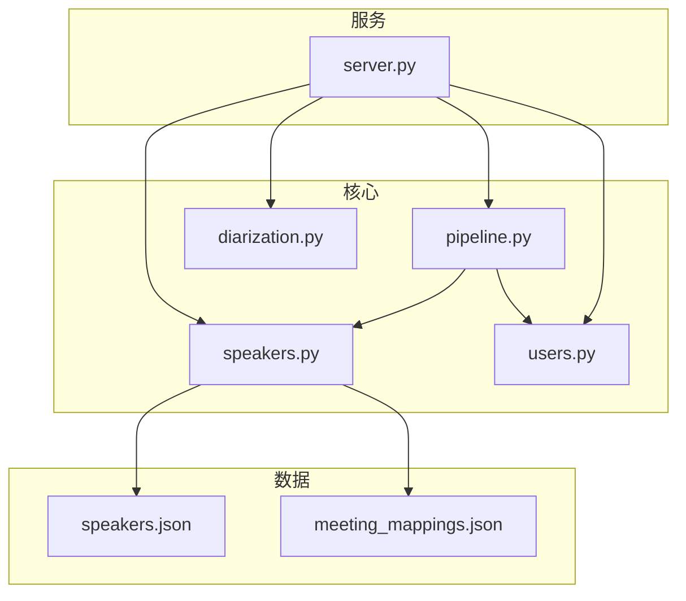
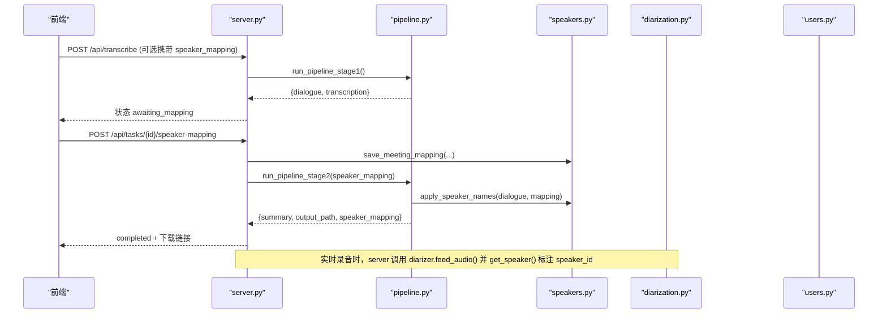
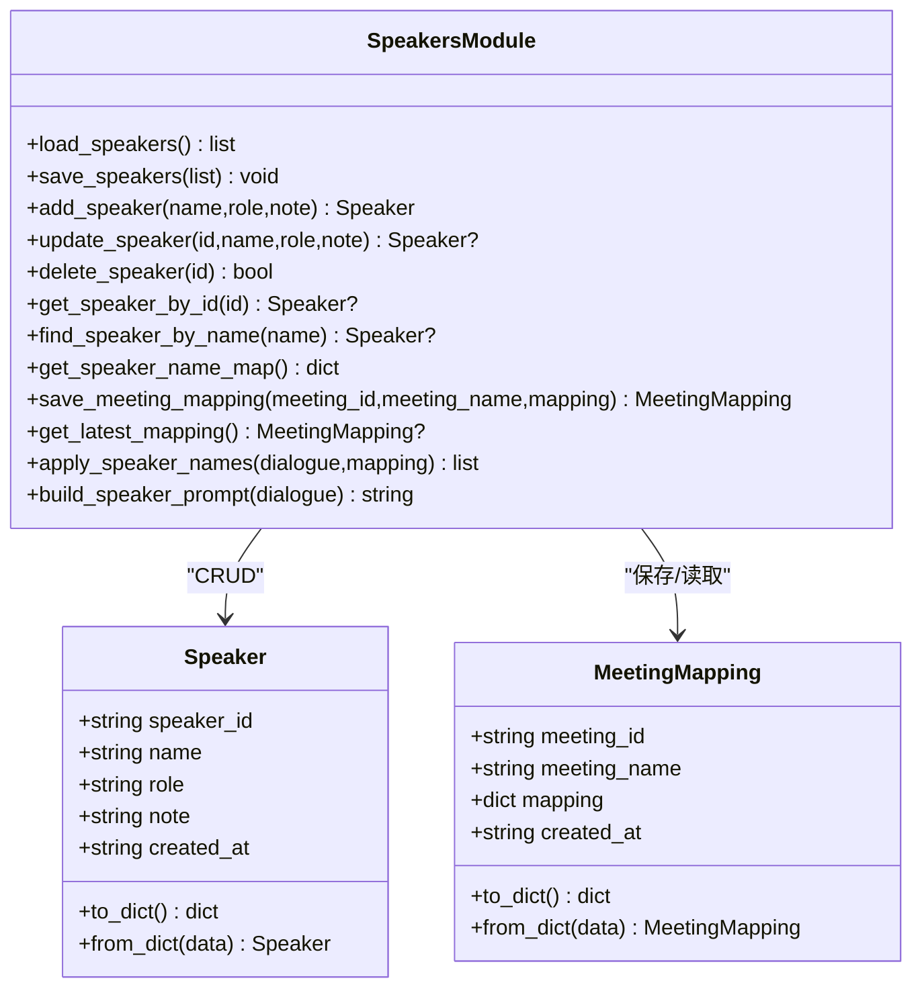
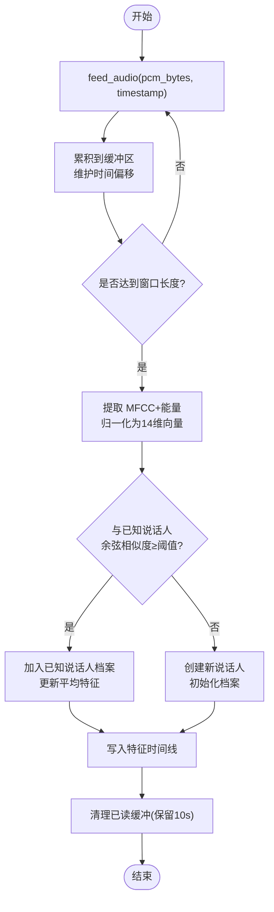
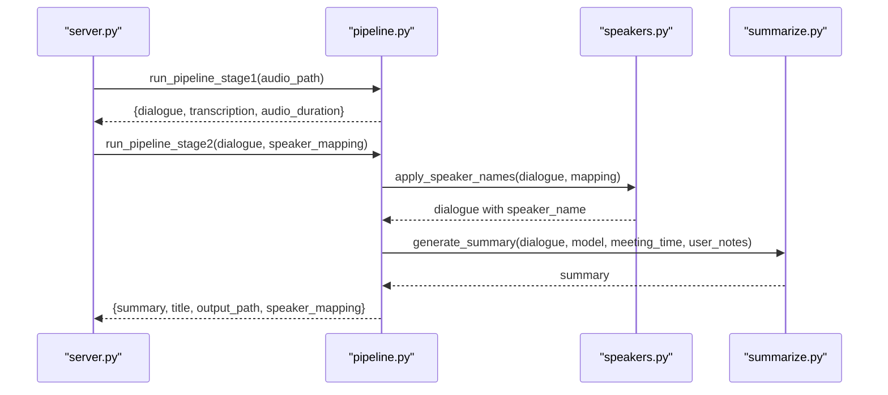
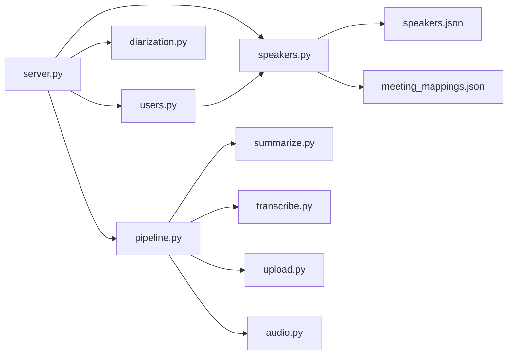

# 说话人管理

<cite>
**本文引用的文件**
- [core/speakers.py](file://core/speakers.py)
- [core/diarization.py](file://core/diarization.py)
- [core/pipeline.py](file://core/pipeline.py)
- [app/server.py](file://app/server.py)
- [core/users.py](file://core/users.py)
- [data/speakers.json](file://data/speakers.json)
- [data/meeting_mappings.json](file://data/meeting_mappings.json)
- [docs/ADR/0005-说话人姓名化方案选型.md](file://docs/ADR/0005-说话人姓名化方案选型.md)
- [docs/ADR/0006-实时说话人分离方案选型.md](file://docs/ADR/0006-实时说话人分离方案选型.md)
- [docs/ARCHITECTURE.md](file://docs/ARCHITECTURE.md)
</cite>

## 目录
1. [简介](#简介)
2. [项目结构](#项目结构)
3. [核心组件](#核心组件)
4. [架构总览](#架构总览)
5. [详细组件分析](#详细组件分析)
6. [依赖关系分析](#依赖关系分析)
7. [性能与扩展性](#性能与扩展性)
8. [故障排查指南](#故障排查指南)
9. [结论](#结论)
10. [附录：API 与配置示例](#附录api-与配置示例)

## 简介
本模块围绕“说话人身份绑定”与“说话人识别”两大目标展开，提供：
- 说话人档案管理与会议映射（speaker_id 到真实姓名的映射）
- 离线与实时的说话人分离（声纹特征提取、聚类、时间对齐）
- 与转写管线的集成（姓名化、纪要生成、数据同步）
- 持久化存储与版本化历史（speakers.json、meeting_mappings.json）
- 面向前端的 REST API（CRUD、批量操作接口预留、冲突检测与数据校验）

该设计遵循 v1 纯云方案定位：云端 ASR 仅返回 speaker_id，系统通过人工映射+历史复用实现姓名化；实时场景采用本地轻量声纹聚类（MFCC+能量）进行说话人分离。

## 项目结构
- 核心逻辑
  - core/speakers.py：说话人档案与会话映射的 CRUD、姓名应用、提示词构造
  - core/diarization.py：实时声纹特征提取与说话人聚类器
  - core/pipeline.py：两阶段管线（转写→姓名化→纪要），串联说话人姓名化
  - core/users.py：用户信息与任务级说话人绑定关系
- 服务层
  - app/server.py：FastAPI 端点，暴露说话人管理、任务绑定、录制与实时转写等接口
- 数据层
  - data/speakers.json：全局说话人档案
  - data/meeting_mappings.json：会议映射历史（用于复用建议）
- 文档
  - docs/ADR/0005、0006：命名化与实时分离方案决策
  - docs/ARCHITECTURE.md：整体架构与数据流

图表来源
- [core/speakers.py:1-325](file://core/speakers.py#L1-L325)
- [core/diarization.py:1-525](file://core/diarization.py#L1-L525)
- [core/pipeline.py:1-271](file://core/pipeline.py#L1-L271)
- [app/server.py:517-715](file://app/server.py#L517-L715)
- [core/users.py:1-157](file://core/users.py#L1-L157)

章节来源
- [docs/ARCHITECTURE.md:1-51](file://docs/ARCHITECTURE.md#L1-L51)

## 核心组件
- 说话人档案与会话映射（core/speakers.py）
  - Speaker、MeetingMapping 数据模型
  - 加载/保存/查询/更新/删除
  - apply_speaker_names 将对话稿中的 speaker_id 替换为真实姓名
  - build_speaker_prompt 为纪要提示词注入发言人说明
- 实时说话人分离（core/diarization.py）
  - MFCC+能量特征提取
  - 基于余弦相似度的实时聚类
  - 时间对齐：ASR 句子根据时间戳匹配最近特征，获得 speaker_id
- 管线集成（core/pipeline.py）
  - 第一阶段：音频→转写→对话稿
  - 第二阶段：应用姓名映射→生成纪要→输出 Markdown
- 用户与绑定（core/users.py）
  - 当前用户信息
  - 任务级说话人绑定（task_id → {speaker_id: speaker_uuid}）
- 服务接口（app/server.py）
  - 说话人 CRUD、会议映射保存/获取、任务绑定触发纪要生成、实时录制与说话人分离

章节来源
- [core/speakers.py:35-325](file://core/speakers.py#L35-L325)
- [core/diarization.py:61-525](file://core/diarization.py#L61-L525)
- [core/pipeline.py:58-271](file://core/pipeline.py#L58-L271)
- [core/users.py:54-157](file://core/users.py#L54-L157)
- [app/server.py:517-715](file://app/server.py#L517-L715)

## 架构总览
说话人管理在系统中的位置与职责：
- 离线流程：上传音频→云端转写（paraformer-v2）→得到带 speaker_id 的对话稿→用户绑定 speaker_id 到 speakers.json 中的 UUID→应用姓名化→LLM 生成纪要并输出 Markdown
- 实时流程：内录 PCM→本地声纹聚类→为每句标注 speaker_id→实时显示姓名（优先使用实时绑定映射）→结束后进入离线流程或增量摘要

图表来源
- [app/server.py:343-396](file://app/server.py#L343-L396)
- [app/server.py:630-671](file://app/server.py#L630-L671)
- [core/pipeline.py:58-226](file://core/pipeline.py#L58-L226)
- [core/speakers.py:278-309](file://core/speakers.py#L278-L309)
- [core/diarization.py:339-503](file://core/diarization.py#L339-L503)

## 详细组件分析

### 说话人档案与会话映射（core/speakers.py）
- 数据模型
  - Speaker：speaker_id、name、role、note、created_at
  - MeetingMapping：meeting_id、meeting_name、mapping{int:speaker_uuid}、created_at
- 核心能力
  - 加载/保存全局说话人列表（JSON 持久化）
  - 添加/更新/删除/按 ID 或姓名查询
  - 构建 speaker_id→name 映射表
  - 保存会议映射（覆盖式更新，记录创建时间）
  - 应用姓名映射到对话稿（新增 speaker_name 字段）
  - 构建提示词中“说话人X = 姓名”的片段
- 复杂度与健壮性
  - 读写 JSON 为 O(n)，n 为说话人数/映射数
  - 异常捕获与日志记录，保证失败不中断主流程
  - 会议映射按 created_at 倒序取最新，便于复用建议

图表来源
- [core/speakers.py:35-103](file://core/speakers.py#L35-L103)
- [core/speakers.py:109-325](file://core/speakers.py#L109-L325)

章节来源
- [core/speakers.py:35-325](file://core/speakers.py#L35-L325)

### 实时说话人分离（core/diarization.py）
- 特征提取
  - 预加重、分帧加窗、FFT→功率谱、Mel 滤波器组、对数+DCT→MFCC
  - 能量（RMS）、MFCC std，拼接为 14 维向量并进行 L2 归一化
- 实时聚类
  - 每 2 秒窗口提取一次特征，步长 1 秒
  - 与已知说话人平均特征计算余弦相似度，阈值 0.70
  - 超过阈值归入已知说话人，否则创建新说话人
  - 每个说话人维护 feature_history 与累计时长
- 时间对齐
  - 维护特征时间线（timestamp, feature）
  - 给定 begin_time/end_time，取中间时刻最近特征，匹配说话人
- 线程安全
  - feed_audio/get_speaker 均使用锁保护，支持多线程回调

图表来源
- [core/diarization.py:87-276](file://core/diarization.py#L87-L276)
- [core/diarization.py:339-420](file://core/diarization.py#L339-L420)
- [core/diarization.py:421-503](file://core/diarization.py#L421-L503)

章节来源
- [core/diarization.py:1-525](file://core/diarization.py#L1-L525)

### 管线集成与姓名化（core/pipeline.py）
- 第一阶段：音频归一化→上传→热词检查→转写（开启分离）→组装对话稿
- 第二阶段：应用说话人姓名映射→生成纪要→生成标题→保存 Markdown
- 关键交互
  - 若传入 speaker_mapping，则调用 speakers.apply_speaker_names 将对话稿中的 speaker_id 替换为真实姓名
  - 结果包含 speaker_mapping（speaker_id→name）与 speaker_uuid_mapping（speaker_id→UUID）
  - 支持传入会议时间与用户笔记，增强纪要上下文

图表来源
- [core/pipeline.py:58-226](file://core/pipeline.py#L58-L226)
- [core/speakers.py:278-309](file://core/speakers.py#L278-L309)

章节来源
- [core/pipeline.py:58-226](file://core/pipeline.py#L58-L226)

### 用户与任务级绑定（core/users.py）
- 当前用户信息（name、avatar_color）
- 任务级说话人绑定：task_id → {speaker_id: speaker_uuid}
- 便捷方法：将当前用户自动绑定到某任务的说话人（不存在则在 speakers.json 中创建同名条目）

章节来源
- [core/users.py:54-157](file://core/users.py#L54-L157)

### 服务接口（app/server.py）
- 说话人管理
  - GET /api/speakers：列出所有说话人
  - POST /api/speakers：新增说话人（含角色、备注）
  - PUT /api/speakers/{speaker_id}：更新说话人
  - DELETE /api/speakers/{speaker_id}：删除说话人
- 会议映射
  - GET /api/speakers/mapping/latest：获取最近一次会议映射（附带姓名）
  - POST /api/speakers/mapping：保存会议映射（用于历史复用）
- 任务绑定与纪要再生成
  - POST /api/tasks/{task_id}/speaker-mapping：设置映射并后台生成纪要
  - POST /api/tasks/{task_id}/regenerate-summary：用当前映射重新生成纪要
- 实时录制与说话人分离
  - POST /api/record/start：启动内录+实时转写+声纹聚类
  - 实时回调中将 PCM 送入 diarizer，并为每句标注 speaker_id 与 speaker_name

章节来源
- [app/server.py:517-715](file://app/server.py#L517-L715)
- [app/server.py:721-800](file://app/server.py#L721-L800)

## 依赖关系分析
- 模块耦合
  - server.py 依赖 pipeline、speakers、diarization、users
  - pipeline.py 依赖 speakers、summarize、transcribe、upload、audio
  - users.py 可反向调用 speakers 以自动创建同名说话人
- 外部依赖
  - numpy、scipy（声纹特征与聚类）
  - FastAPI、uvicorn（Web 服务）
  - ffmpeg（音频归一化）
  - DashScope（云端转写与临时存储）
- 数据文件
  - speakers.json：全局说话人档案
  - meeting_mappings.json：会议映射历史
  - users.json：用户信息与任务级绑定

图表来源
- [app/server.py:41-57](file://app/server.py#L41-L57)
- [core/pipeline.py:22-27](file://core/pipeline.py#L22-L27)
- [core/users.py:1-157](file://core/users.py#L1-L157)
- [core/speakers.py:22-28](file://core/speakers.py#L22-L28)

章节来源
- [docs/ARCHITECTURE.md:1-51](file://docs/ARCHITECTURE.md#L1-L51)

## 性能与扩展性
- 实时分离性能
  - 每 2 秒窗口提取特征，步长 1 秒，适合 2-4 人会议
  - 余弦相似度阈值 0.70，需每人至少说 2 秒建立可靠档案
  - 内存占用：特征时间线与说话人档案较小，适合长时间运行
- 离线姓名化
  - JSON 读写 O(n)，n 为说话人数/映射数，常规规模下无瓶颈
- 扩展方向
  - v2 考虑引入神经声纹模型（WeSpeaker/resemblyzer）提升准确率
  - 云端流式说话人分离 API 可用后切换
  - 增加批量导入导出、冲突检测、数据验证等高级特性（见附录）

[本节为通用指导，无需具体文件引用]

## 故障排查指南
- 无法加载说话人档案
  - 检查 data/speakers.json 是否存在且格式正确
  - 查看日志错误信息（加载失败会记录并返回空列表）
- 会议映射未生效
  - 确认保存映射时 meeting_id 唯一且 mapping 键为整数
  - 使用 /api/speakers/mapping/latest 验证最新映射
- 实时说话人分离不准确
  - 确保每人有足够发言时长（≥2 秒）
  - 调整相似度阈值或窗口参数（代码中提供常量）
  - 检查 PCM 采样率与单声道要求
- 纪要未包含姓名
  - 确认第二阶段传入了 speaker_mapping
  - 检查 apply_speaker_names 是否成功执行

章节来源
- [core/speakers.py:109-131](file://core/speakers.py#L109-L131)
- [core/speakers.py:205-227](file://core/speakers.py#L205-L227)
- [core/diarization.py:339-503](file://core/diarization.py#L339-L503)
- [core/pipeline.py:178-226](file://core/pipeline.py#L178-L226)

## 结论
本模块以“人工映射+历史复用”为核心策略，结合轻量级本地声纹聚类，实现了从离线到实时的完整说话人管理能力。通过清晰的模块划分与稳健的数据持久化，系统在 v1 纯云方案下提供了高可用、易扩展的说话人管理基础。后续可在 v2 引入更先进的声纹模型与云端 API，进一步提升准确率与自动化程度。

[本节为总结，无需具体文件引用]

## 附录：API 与配置示例

### 说话人管理 API
- 获取说话人列表
  - GET /api/speakers
  - 响应：{speakers: [...]}
- 新增说话人
  - POST /api/speakers
  - 请求体：{name, role?, note?}
- 更新说话人
  - PUT /api/speakers/{speaker_id}
  - 请求体：{name?, role?, note?}
- 删除说话人
  - DELETE /api/speakers/{speaker_id}
- 获取最近会议映射
  - GET /api/speakers/mapping/latest
  - 响应：{mapping: {meeting_id, meeting_name, created_at, details}}
- 保存会议映射
  - POST /api/speakers/mapping
  - 请求体：{meeting_id, meeting_name, mapping: {"0": "uuid1", "1": "uuid2"}}

章节来源
- [app/server.py:532-619](file://app/server.py#L532-L619)

### 任务绑定与纪要再生成
- 设置说话人映射并生成纪要
  - POST /api/tasks/{task_id}/speaker-mapping
  - 请求体：{mapping: {"0": "uuid1", "1": "uuid2"}}
- 重新生成纪要
  - POST /api/tasks/{task_id}/regenerate-summary

章节来源
- [app/server.py:630-715](file://app/server.py#L630-L715)

### 实时录制与说话人分离
- 开始录制
  - POST /api/record/start
  - 内部启动 diarizer，PCM 回调中 feed_audio，并为每句标注 speaker_id 与 speaker_name
- 停止录制
  - POST /api/record/stop
  - 自动进入管线第二阶段（如需）

章节来源
- [app/server.py:721-800](file://app/server.py#L721-L800)

### 数据模型与持久化
- 说话人档案（speakers.json）
  - 字段：speaker_id、name、role、note、created_at
- 会议映射（meeting_mappings.json）
  - 字段：meeting_id、meeting_name、mapping{int:speaker_uuid}、created_at
- 用户绑定（users.json）
  - 字段：current_user、speaker_bindings{task_id:{speaker_id:speaker_uuid}}

章节来源
- [data/speakers.json:1-30](file://data/speakers.json#L1-L30)
- [data/meeting_mappings.json:1-122](file://data/meeting_mappings.json#L1-L122)
- [core/users.py:22-49](file://core/users.py#L22-L49)

### 配置与算法参数
- 实时分离参数（diarization.py）
  - FEATURE_WINDOW_SEC=2.0
  - FEATURE_STEP_SEC=1.0
  - SIMILARITY_THRESHOLD=0.70
  - MIN_FEATURES_PER_SPEAKER=2
  - N_MFCC=13
  - SAMPLE_RATE=16000
- 管线默认配置（pipeline.py）
  - asr_model="paraformer-v2"
  - llm_model="qwen-plus"
  - diarization_enabled=True
  - language_hints=["zh","en"]
  - sample_rate=16000
  - channels=1
  - output_dir="data/output"

章节来源
- [core/diarization.py:38-55](file://core/diarization.py#L38-L55)
- [core/pipeline.py:35-44](file://core/pipeline.py#L35-L44)

### 批量导入导出、冲突检测、数据验证（规划）
- 批量导入导出
  - 可通过 CSV/JSON 批量导入说话人档案与会议映射
  - 导出当前 speakers.json 与 meeting_mappings.json 供备份与迁移
- 冲突检测
  - 新增说话人时检测同名冲突（可提示合并或重命名）
  - 保存会议映射时检测无效 UUID（不在 speakers.json 中）并拒绝
- 数据验证
  - 必填字段校验（如 name、meeting_id）
  - 类型校验（mapping 键为整数，值为 UUID 字符串）
  - 一致性校验（映射中的 speaker_uuid 必须存在于 speakers.json）

[本节为功能规划，尚未在代码中实现，故无具体文件引用]