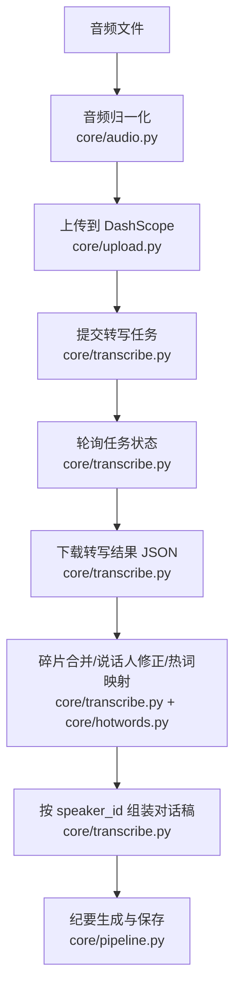
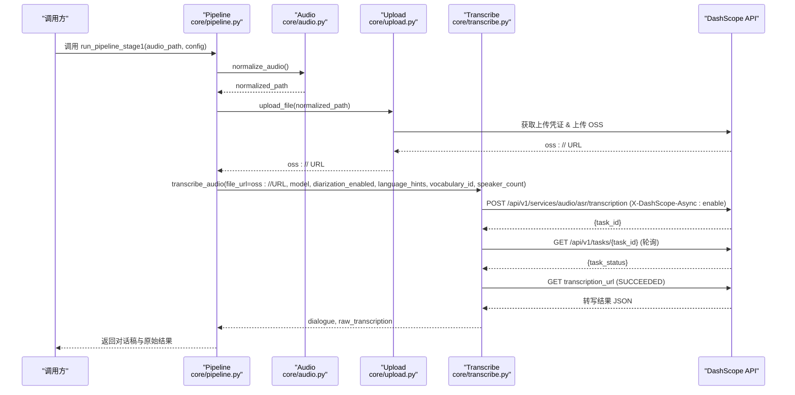
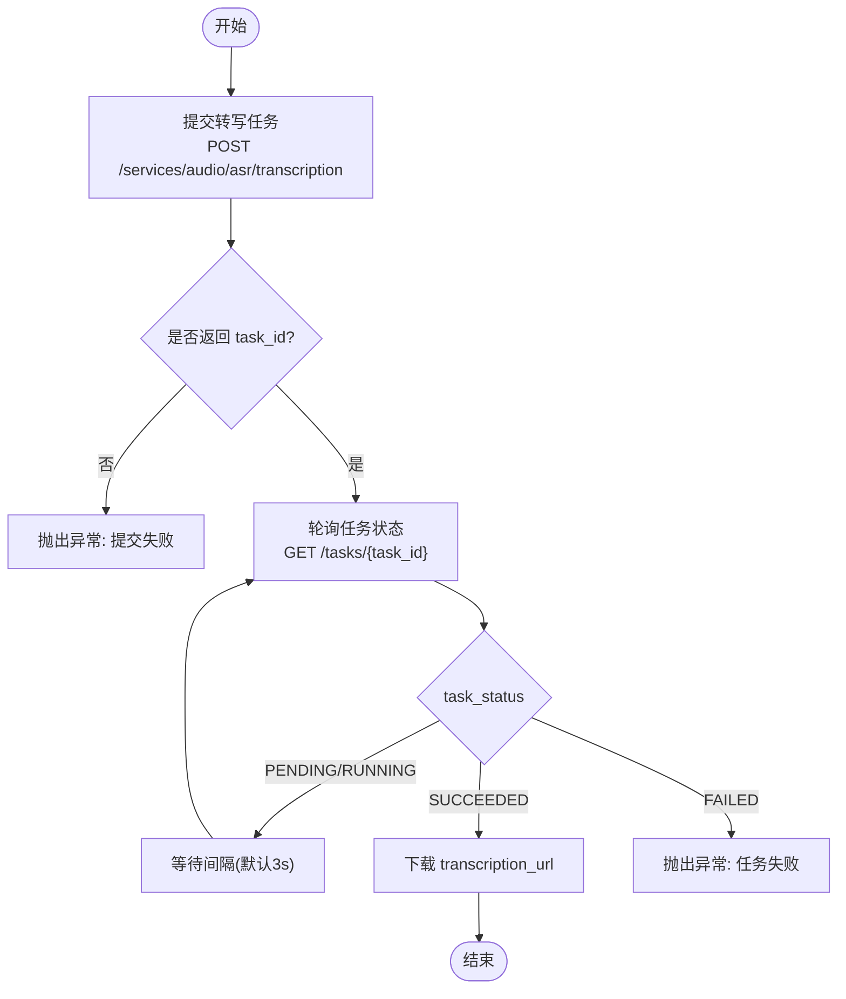
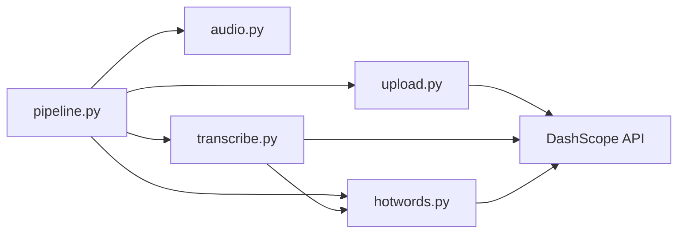

# 批量转写流程

<cite>
**本文引用的文件**
- [core/transcribe.py](file://core/transcribe.py)
- [core/pipeline.py](file://core/pipeline.py)
- [core/upload.py](file://core/upload.py)
- [core/hotwords.py](file://core/hotwords.py)
- [core/audio.py](file://core/audio.py)
- [docs/API_CONTRACTS.md](file://docs/API_CONTRACTS.md)
- [data/hotwords.txt](file://data/hotwords.txt)
- [data/hotword_mappings.txt](file://data/hotword_mappings.txt)
</cite>

## 目录
1. [简介](#简介)
2. [项目结构](#项目结构)
3. [核心组件](#核心组件)
4. [架构总览](#架构总览)
5. [详细组件分析](#详细组件分析)
6. [依赖关系分析](#依赖关系分析)
7. [性能考量](#性能考量)
8. [故障排查指南](#故障排查指南)
9. [结论](#结论)
10. [附录：调用示例与参数说明](#附录调用示例与参数说明)

## 简介
本技术文档聚焦“批量转写流程”，围绕异步转写任务的提交流程、DashScope API 调用、paraformer-v2 模型配置、任务状态轮询机制进行系统化说明。重点覆盖：
- 文件 URL 处理（oss:// 与公网 URL）
- API 密钥管理与请求头设置
- 任务提交参数配置（说话人分离、语言提示、热词表 ID、语气词过滤等）
- 完整的错误处理机制（超时控制、重试策略、异常捕获）
- 如何调用 submit_transcription 函数，并正确处理返回的任务 ID 与结果数据

## 项目结构
本项目将批量转写能力拆分为多个职责清晰的模块：
- 音频归一化与录制：core/audio.py
- 上传至 DashScope 临时存储：core/upload.py
- 批转写任务提交、轮询、结果下载与对话稿组装：core/transcribe.py
- 热词表管理（创建/查询与后处理映射）：core/hotwords.py
- 全流程编排（两阶段管线）：core/pipeline.py
- 外部接口契约与约束：docs/API_CONTRACTS.md
- 热词与映射数据：data/hotwords.txt、data/hotword_mappings.txt

图表来源
- [core/audio.py:31-98](file://core/audio.py#L31-L98)
- [core/upload.py:59-115](file://core/upload.py#L59-L115)
- [core/transcribe.py:61-131](file://core/transcribe.py#L61-L131)
- [core/transcribe.py:134-187](file://core/transcribe.py#L134-L187)
- [core/transcribe.py:222-402](file://core/transcribe.py#L222-L402)
- [core/pipeline.py:58-134](file://core/pipeline.py#L58-L134)

章节来源
- [core/pipeline.py:1-12](file://core/pipeline.py#L1-L12)
- [docs/API_CONTRACTS.md:12-64](file://docs/API_CONTRACTS.md#L12-L64)

## 核心组件
- 音频归一化：确保输入为 16kHz、单声道 WAV，满足说话人分离要求。
- 上传模块：通过 DashScope 获取上传凭证并上传本地文件，得到 oss:// 临时 URL。
- 转写模块：提交 paraformer-v2 异步转写任务，轮询直至完成，下载结果并组装对话稿。
- 热词模块：创建/查询热词表，并在后处理阶段对识别文本进行映射纠正。
- 管线编排：串联音频归一化、上传、转写、热词应用、纪要生成与保存。

章节来源
- [core/audio.py:31-98](file://core/audio.py#L31-L98)
- [core/upload.py:59-115](file://core/upload.py#L59-L115)
- [core/transcribe.py:61-131](file://core/transcribe.py#L61-L131)
- [core/hotwords.py:57-139](file://core/hotwords.py#L57-L139)
- [core/pipeline.py:58-134](file://core/pipeline.py#L58-L134)

## 架构总览
批量转写的端到端流程如下：
1. 音频归一化为 16kHz 单声道 WAV（必要步骤）。
2. 上传至 DashScope 临时存储，获得 oss:// URL。
3. 提交 paraformer-v2 异步转写任务，附带说话人分离、语言提示、热词表 ID、语气词过滤等参数。
4. 轮询任务状态直到 SUCCEEDED，期间记录状态变化日志。
5. 下载 transcription_url 对应的结果 JSON。
6. 执行后处理：碎片句子合并、说话人修正、热词映射纠正。
7. 按 speaker_id 归并句子，输出对话稿；后续可进入纪要生成阶段。

图表来源
- [core/pipeline.py:58-134](file://core/pipeline.py#L58-L134)
- [core/upload.py:59-115](file://core/upload.py#L59-L115)
- [core/transcribe.py:61-131](file://core/transcribe.py#L61-L131)
- [core/transcribe.py:134-187](file://core/transcribe.py#L134-L187)
- [docs/API_CONTRACTS.md:28-64](file://docs/API_CONTRACTS.md#L28-L64)

## 详细组件分析

### 转写任务提交与轮询（submit_transcription / poll_task）
- 提交转写任务：
  - 使用 requests.post 调用 DashScope 转写接口，必须携带 Authorization、Content-Type、X-DashScope-Async: enable。
  - 当 file_url 以 oss:// 开头时，需额外添加 X-DashScope-OssResourceResolve: enable。
  - 构造 parameters 包含可选的 diarization_enabled、language_hints、speaker_count、vocabulary_id、disfluency_removal_enabled。
  - 响应体中取 output.task_id 作为任务标识。
- 轮询任务状态：
  - 定时 GET /api/v1/tasks/{task_id}，检查 output.task_status。
  - 支持超时控制（默认 600 秒），超过则抛出 TimeoutError。
  - 若 task_status 为 FAILED，抛出 RuntimeError 并携带错误信息。
  - 成功时返回 output，其中包含 results[].transcription_url。

图表来源
- [core/transcribe.py:61-131](file://core/transcribe.py#L61-L131)
- [core/transcribe.py:134-187](file://core/transcribe.py#L134-L187)
- [docs/API_CONTRACTS.md:28-64](file://docs/API_CONTRACTS.md#L28-L64)

章节来源
- [core/transcribe.py:61-131](file://core/transcribe.py#L61-L131)
- [core/transcribe.py:134-187](file://core/transcribe.py#L134-L187)
- [docs/API_CONTRACTS.md:28-64](file://docs/API_CONTRACTS.md#L28-L64)

### 文件 URL 处理（oss:// 与公网 URL）
- 上传流程：
  - 通过 get_upload_policy 获取上传凭证（upload_host、upload_dir、签名等）。
  - 使用 multipart 表单上传至 OSS，成功后拼接 oss://{key} 返回。
  - 提供 encode_oss_url 对路径部分进行 URL 编码，避免空格/中文导致下载失败。
- 转写接口：
  - 仅接受公网 URL；本地文件必须先上传为 oss:// URL。
  - 当使用 oss:// URL 时，必须添加 X-DashScope-OssResourceResolve: enable。
  - 若 URL 含特殊字符未编码，会触发 InvalidFile.DownloadFailed。

章节来源
- [core/upload.py:33-115](file://core/upload.py#L33-L115)
- [core/upload.py:118-134](file://core/upload.py#L118-L134)
- [docs/API_CONTRACTS.md:12-24](file://docs/API_CONTRACTS.md#L12-L24)
- [docs/API_CONTRACTS.md:90-100](file://docs/API_CONTRACTS.md#L90-L100)

### API 密钥管理与请求头设置
- API 密钥：
  - 统一从环境变量 DASHSCOPE_API_KEY 读取，缺失时抛出运行时异常。
- 请求头：
  - Authorization: Bearer {api_key}
  - Content-Type: application/json
  - X-DashScope-Async: enable（提交异步任务必需）
  - X-DashScope-OssResourceResolve: enable（使用 oss:// URL 时必需）

章节来源
- [core/transcribe.py:54-97](file://core/transcribe.py#L54-L97)
- [core/upload.py:25-56](file://core/upload.py#L25-L56)
- [core/hotwords.py:28-32](file://core/hotwords.py#L28-L32)
- [docs/API_CONTRACTS.md:5-8](file://docs/API_CONTRACTS.md#L5-L8)

### 任务提交参数配置
- diarization_enabled：开启说话人分离（仅单声道生效）。
- language_hints：语言提示，如 ["zh", "en"]。
- speaker_count：说话人数目提示（2–100），辅助分离但不保证。
- vocabulary_id：热词表 ID，提升专有词汇识别率。
- disfluency_removal_enabled：过滤语气词。
- timestamp_alignment_enabled：时间戳校准开关（按需启用）。

章节来源
- [core/transcribe.py:61-117](file://core/transcribe.py#L61-L117)
- [docs/API_CONTRACTS.md:28-52](file://docs/API_CONTRACTS.md#L28-L52)

### 热词表与后处理映射
- 热词表创建/查询：
  - 从 data/hotwords.txt 加载热词列表，调用 DashScope 创建 vocabulary，返回 vocabulary_id。
  - target_model 需与实际识别模型匹配（批转写使用 paraformer-v2）。
- 后处理映射：
  - 从 data/hotword_mappings.txt 加载映射规则（ASR 识别结果→正确文本）。
  - 纯英文/数字词使用词边界匹配（大小写不敏感），含中文直接替换。
  - 在 assemble_dialogue 中对每句文本应用映射纠正。

章节来源
- [core/hotwords.py:35-139](file://core/hotwords.py#L35-L139)
- [core/hotwords.py:145-222](file://core/hotwords.py#L145-L222)
- [core/transcribe.py:355-402](file://core/transcribe.py#L355-L402)
- [data/hotwords.txt:1-4](file://data/hotwords.txt#L1-L4)
- [data/hotword_mappings.txt:1-6](file://data/hotword_mappings.txt#L1-L6)

### 音频规格与说话人分离限制
- 音频归一化强制为 16kHz、单声道 WAV，以满足说话人分离要求。
- 说话人分离仅在单声道下有效；多声道需先下混。
- 长音频（>2h）可能超时或失败，建议分段处理。

章节来源
- [core/audio.py:31-98](file://core/audio.py#L31-L98)
- [docs/API_CONTRACTS.md:90-100](file://docs/API_CONTRACTS.md#L90-L100)

### 错误处理机制
- 超时控制：
  - 轮询任务状态默认 600 秒超时，超过抛出 TimeoutError。
  - 上传与转写请求均设置合理 timeout（30–600 秒）。
- 重试策略：
  - 当前实现未内置自动重试；可在调用层根据异常类型（网络错误、HTTP 错误）实现指数退避重试。
- 异常捕获：
  - 提交失败：缺少 output 或 task_id 时抛出运行时异常。
  - 任务失败：task_status 为 FAILED 时抛出运行时异常并携带错误信息。
  - 上传失败：HTTP 非 200 时抛出运行时异常。
  - 热词表 API 不可用：捕获 404 并降级跳过热词功能。

章节来源
- [core/transcribe.py:122-131](file://core/transcribe.py#L122-L131)
- [core/transcribe.py:134-175](file://core/transcribe.py#L134-L175)
- [core/upload.py:106-115](file://core/upload.py#L106-L115)
- [core/hotwords.py:101-117](file://core/hotwords.py#L101-L117)

## 依赖关系分析
- 模块耦合：
  - pipeline 依赖 audio、upload、transcribe、hotwords、summarize、speakers。
  - transcribe 依赖 hotwords（后处理映射）。
  - upload 与 transcribe 均依赖 DashScope API 鉴权与接口契约。
- 外部依赖：
  - DashScope RESTful API（转写、上传、热词表）。
  - ffmpeg/ffprobe（音频归一化与时长查询）。
- 潜在循环依赖：
  - 当前模块间为单向依赖，未发现循环引用。

图表来源
- [core/pipeline.py:20-27](file://core/pipeline.py#L20-L27)
- [core/transcribe.py:190-190](file://core/transcribe.py#L190-L190)
- [core/upload.py:22-22](file://core/upload.py#L22-L22)
- [core/hotwords.py:25-25](file://core/hotwords.py#L25-L25)

章节来源
- [core/pipeline.py:20-27](file://core/pipeline.py#L20-L27)
- [core/transcribe.py:190-190](file://core/transcribe.py#L190-L190)

## 性能考量
- 轮询间隔与超时：
  - 默认 3 秒间隔、600 秒超时，适合大多数会议音频；超长音频建议分段以降低单次轮询耗时。
- 音频格式优化：
  - 16kHz 单声道 WAV 能减少带宽与计算开销，同时满足说话人分离要求。
- 热词表效果：
  - 预编译热词表可显著提升专有词汇识别率，但创建与编译需要数秒，建议在任务前完成。
- 并发与限流：
  - 上传凭证接口限流 100 QPS，批量场景需控制并发度，避免触发限流。

[本节为通用指导，无需具体文件分析]

## 故障排查指南
- 无法提交异步任务：
  - 检查是否携带 X-DashScope-Async: enable。
  - 确认 Authorization 与 Content-Type 正确。
- oss:// URL 无效：
  - 确认已添加 X-DashScope-OssResourceResolve: enable。
  - 检查 URL 是否包含空格/中文且已正确编码。
- 无说话人分离结果：
  - 确认音频已归一化为单声道。
  - 检查 diarization_enabled 是否开启。
- 任务超时或失败：
  - 查看轮询日志中的 task_status 变化。
  - 对于 FAILED，提取错误消息定位原因（如文件格式、时长超限）。
- 热词不生效：
  - 确认 vocabulary_id 对应 target_model 与识别模型一致。
  - 检查热词表创建是否成功（API 404 时降级跳过）。

章节来源
- [core/transcribe.py:88-97](file://core/transcribe.py#L88-L97)
- [core/transcribe.py:134-175](file://core/transcribe.py#L134-L175)
- [core/upload.py:118-134](file://core/upload.py#L118-L134)
- [core/hotwords.py:101-117](file://core/hotwords.py#L101-L117)
- [docs/API_CONTRACTS.md:90-100](file://docs/API_CONTRACTS.md#L90-L100)

## 结论
本批量转写流程通过标准化音频归一化、DashScope 临时存储上传、异步转写任务提交与轮询、以及完善的结果后处理（碎片合并、说话人修正、热词映射），实现了高可用、可扩展的会议录音转写与对话稿组装能力。遵循 API 契约与硬约束，可有效避免常见失败场景；结合合理的超时与错误处理策略，保障系统稳定性。

[本节为总结性内容，无需具体文件分析]

## 附录：调用示例与参数说明

### 调用 submit_transcription 的基本流程
- 准备音频 URL：
  - 若为本地文件，先通过 upload_file 上传至 DashScope，获得 oss:// URL。
  - 若为公网 URL，可直接传入。
- 设置参数：
  - model：通常为 "paraformer-v2"。
  - diarization_enabled：True 开启说话人分离（需单声道）。
  - language_hints：如 ["zh", "en"]。
  - speaker_count：可选，用于辅助分离。
  - vocabulary_id：可选，热词表 ID。
  - disfluency_removal_enabled：可选，过滤语气词。
- 获取任务 ID：
  - 提交成功后返回 task_id，可用于后续轮询或直接调用 transcribe_audio 一站式流程。

章节来源
- [core/transcribe.py:61-131](file://core/transcribe.py#L61-L131)
- [core/upload.py:59-115](file://core/upload.py#L59-L115)

### 处理返回的任务 ID 与结果数据
- 轮询任务状态：
  - 使用 poll_task(task_id) 持续查询，直到 task_status 为 SUCCEEDED 或 FAILED。
  - 超时或失败时分别抛出 TimeoutError 或 RuntimeError。
- 下载结果：
  - 成功时从 output.results[0].transcription_url 下载 JSON。
  - 解析 transcripts[].sentences[]，按 speaker_id 归并生成对话稿。
- 后处理：
  - 执行碎片合并、说话人修正、热词映射纠正。
  - 最终输出按 speaker_id 排序的对话稿列表。

章节来源
- [core/transcribe.py:134-187](file://core/transcribe.py#L134-L187)
- [core/transcribe.py:222-402](file://core/transcribe.py#L222-L402)

### 完整一站式调用（transcribe_audio）
- 调用 transcribe_audio(file_url, model, diarization_enabled, language_hints, vocabulary_id, speaker_count)。
- 内部自动执行：提交任务 → 轮询 → 下载结果 → 组装对话稿。
- 返回：
  - dialogue：按 speaker_id 归并后的对话稿。
  - raw_transcription：原始转写结果 JSON。

章节来源
- [core/transcribe.py:405-446](file://core/transcribe.py#L405-L446)

### 参数说明表
- diarization_enabled：布尔值，是否开启说话人分离（仅单声道生效）。
- language_hints：字符串数组，如 ["zh", "en"]，声明语种。
- speaker_count：整数，2–100，辅助说话人数估计。
- vocabulary_id：字符串，热词表 ID，提升专有词汇识别率。
- disfluency_removal_enabled：布尔值，是否过滤语气词。
- timestamp_alignment_enabled：布尔值，是否启用时间戳校准。

章节来源
- [core/transcribe.py:61-117](file://core/transcribe.py#L61-L117)
- [docs/API_CONTRACTS.md:28-52](file://docs/API_CONTRACTS.md#L28-L52)