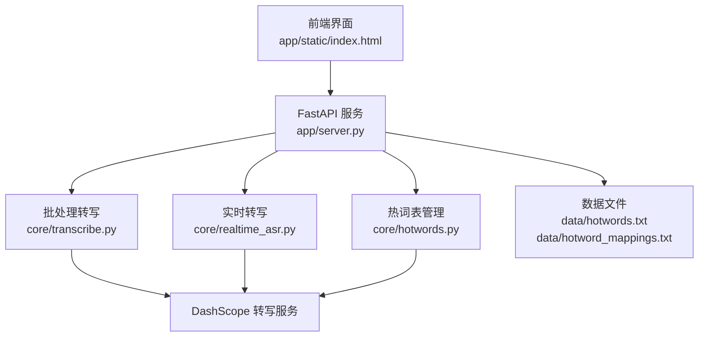
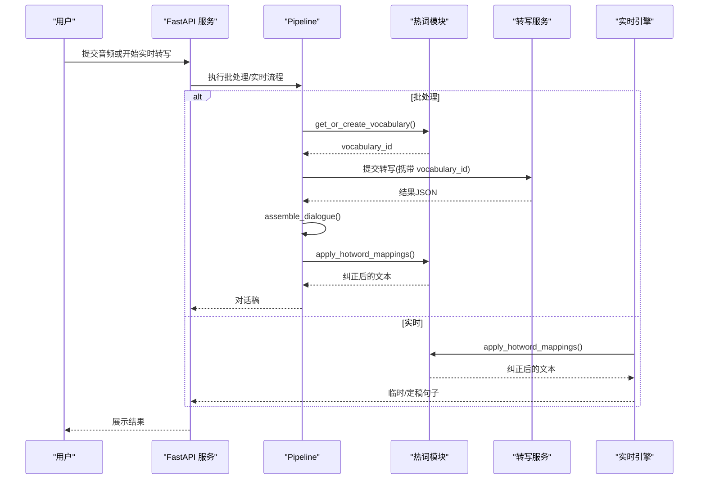
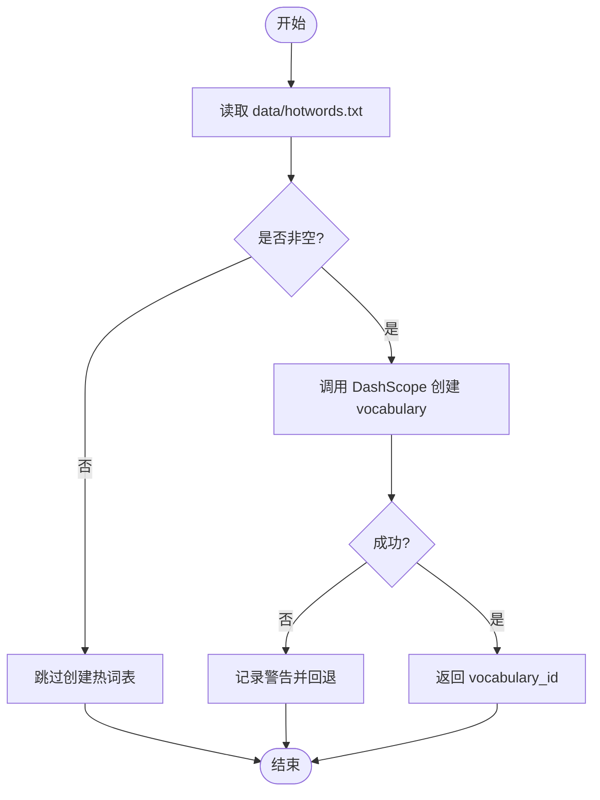
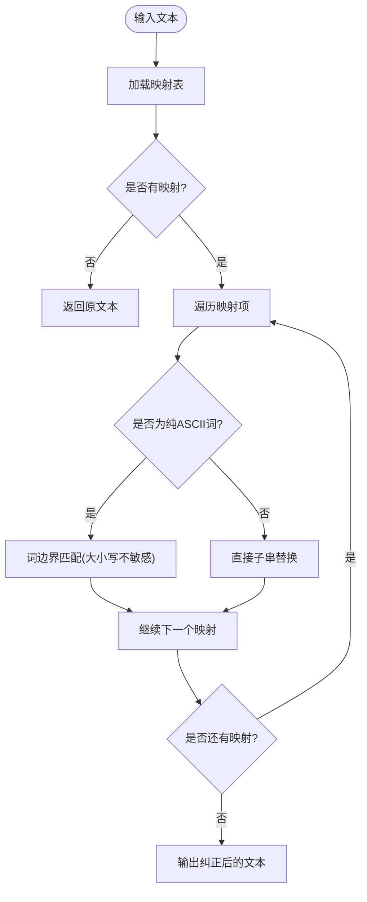
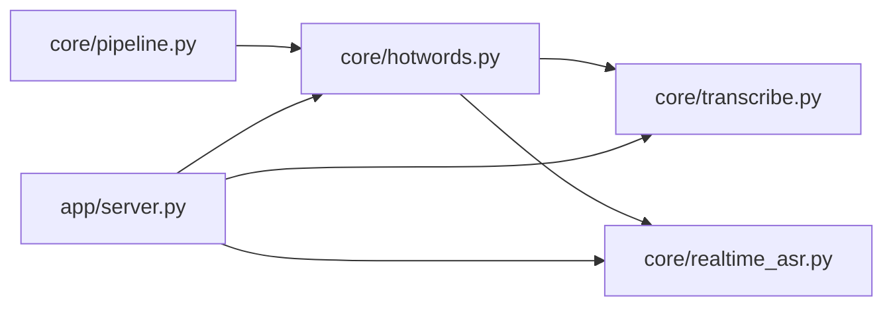

# 热词增强功能

<cite>
**本文引用的文件**
- [core/hotwords.py](file://core/hotwords.py)
- [data/hotwords.txt](file://data/hotwords.txt)
- [data/hotword_mappings.txt](file://data/hotword_mappings.txt)
- [core/transcribe.py](file://core/transcribe.py)
- [core/realtime_asr.py](file://core/realtime_asr.py)
- [core/pipeline.py](file://core/pipeline.py)
- [app/server.py](file://app/server.py)
</cite>

## 目录
1. [简介](#简介)
2. [项目结构](#项目结构)
3. [核心组件](#核心组件)
4. [架构总览](#架构总览)
5. [详细组件分析](#详细组件分析)
6. [依赖关系分析](#依赖关系分析)
7. [性能考量](#性能考量)
8. [故障排查指南](#故障排查指南)
9. [结论](#结论)
10. [附录：配置示例与维护流程](#附录：配置示例与维护流程)

## 简介
本技术文档围绕“热词增强”能力，系统阐述热词表与热词映射的工作原理、匹配策略、优先级排序、冲突解决机制，以及在不同转写阶段的应用时机与实现细节。重点包括：
- 热词表（词汇增强）：通过 DashScope 热词表提升专有名词识别召回率
- 热词映射（后处理纠正）：对 ASR 输出进行文本替换，保持时间戳一致性
- 配置格式：hotwords.txt 与 hotword_mappings.txt 的结构与语法规范
- 应用策略：在对话稿组装阶段进行文本替换、实时流式结果中即时纠正
- 维护指南：新增词汇、更新映射、测试验证的操作流程

## 项目结构
热词增强涉及的核心位置如下：
- 热词表管理：core/hotwords.py
- 批处理转写管线：core/transcribe.py（对话稿组装阶段调用映射）
- 实时转写引擎：core/realtime_asr.py（回调中即时应用映射）
- 端到端编排：core/pipeline.py（获取 vocabulary_id 并传入转写）
- Web API 管理：app/server.py（提供热词与映射的读写接口）
- 数据文件：data/hotwords.txt、data/hotword_mappings.txt

图表来源
- [core/hotwords.py:35-139](file://core/hotwords.py#L35-L139)
- [core/transcribe.py:355-402](file://core/transcribe.py#L355-L402)
- [core/realtime_asr.py:111-143](file://core/realtime_asr.py#L111-L143)
- [core/pipeline.py:112-131](file://core/pipeline.py#L112-L131)
- [app/server.py:2037-2082](file://app/server.py#L2037-L2082)

章节来源
- [core/hotwords.py:1-222](file://core/hotwords.py#L1-L222)
- [core/transcribe.py:355-402](file://core/transcribe.py#L355-L402)
- [core/realtime_asr.py:111-143](file://core/realtime_asr.py#L111-L143)
- [core/pipeline.py:112-131](file://core/pipeline.py#L112-L131)
- [app/server.py:2037-2082](file://app/server.py#L2037-L2082)

## 核心组件
- 热词表加载与创建：从 data/hotwords.txt 读取词表，创建 DashScope 热词表并返回 vocabulary_id
- 热词映射加载与应用：从 data/hotword_mappings.txt 读取映射规则，按长匹配优先策略进行文本替换
- 批处理转写集成：在 assemble_dialogue 阶段对每句文本应用映射，保持句子时间戳不变
- 实时转写集成：在回调中对临时/定稿文本即时应用映射，保证用户侧预览准确性
- Web API：提供热词与映射的读取与保存接口，便于前端编辑与管理

章节来源
- [core/hotwords.py:35-139](file://core/hotwords.py#L35-L139)
- [core/hotwords.py:145-221](file://core/hotwords.py#L145-L221)
- [core/transcribe.py:355-402](file://core/transcribe.py#L355-L402)
- [core/realtime_asr.py:111-143](file://core/realtime_asr.py#L111-L143)
- [app/server.py:2037-2082](file://app/server.py#L2037-L2082)

## 架构总览
热词增强的整体流程分为两条路径：
- 批处理路径：上传音频 → 提交 paraformer-v2 任务 → 轮询完成 → 下载结果 → 组装对话稿 → 应用热词映射纠正
- 实时路径：建立 WebSocket → 流式送入 PCM → 回调接收临时/定稿句子 → 应用热词映射纠正 → 推送结果

图表来源
- [core/pipeline.py:112-131](file://core/pipeline.py#L112-L131)
- [core/transcribe.py:355-402](file://core/transcribe.py#L355-L402)
- [core/realtime_asr.py:111-143](file://core/realtime_asr.py#L111-L143)
- [core/hotwords.py:120-139](file://core/hotwords.py#L120-L139)
- [core/hotwords.py:187-221](file://core/hotwords.py#L187-L221)

## 详细组件分析

### 热词表工作原理（词汇增强）
- 词表加载：从 data/hotwords.txt 逐行读取，忽略空行与注释行（以 # 开头），得到待增强词汇列表
- 热词表创建：调用 DashScope API 创建 vocabulary，目标模型需与实际转写模型一致；默认权重为推荐值；支持最多 2000 个热词
- 使用方式：在批处理转写时，将 vocabulary_id 作为参数传入，以提升专有名词识别召回率
- 错误处理：API 不可用或异常时记录日志并回退到无热词模式

图表来源
- [core/hotwords.py:35-54](file://core/hotwords.py#L35-L54)
- [core/hotwords.py:57-117](file://core/hotwords.py#L57-L117)
- [core/hotwords.py:120-139](file://core/hotwords.py#L120-L139)

章节来源
- [core/hotwords.py:35-139](file://core/hotwords.py#L35-L139)

### 热词映射工作原理（后处理纠正）
- 映射加载：从 data/hotword_mappings.txt 读取映射规则，支持 “→” 和 “->” 两种分隔符；自动过滤注释与空行
- 匹配策略：
  - 纯 ASCII 字母/数字词：使用词边界匹配（\b），大小写不敏感，避免误替换子串
  - 含中文或其他字符：直接子串替换
- 优先级与冲突解决：
  - 长匹配优先：按左串长度降序排列，确保更长、更具体的匹配先被应用
  - 多匹配选择：遍历映射表依次替换，若存在重叠，长匹配优先减少冲突
  - 回退策略：若无映射或映射为空，直接返回原文本
- 时间戳一致性：仅替换文本字段，不改变 begin_time/end_time，保证时间轴稳定

图表来源
- [core/hotwords.py:145-179](file://core/hotwords.py#L145-L179)
- [core/hotwords.py:182-221](file://core/hotwords.py#L182-L221)

章节来源
- [core/hotwords.py:145-221](file://core/hotwords.py#L145-L221)

### 应用时机与策略
- 批处理转写（paraformer-v2）：
  - 在 assemble_dialogue 阶段，对每个句子的 text 字段应用 apply_hotword_mappings
  - 合并碎片与说话人修正后再进行映射纠正，保证语义连贯性
  - 时间戳保持不变，仅修正文本内容
- 实时转写（qwen-audio-3.0-asr-flash-streaming）：
  - 在回调 on_event 中，对临时结果与定稿句子均应用映射纠正
  - 保证用户侧预览的准确性与一致性
- 热词表与映射的组合：
  - 热词表用于提升识别阶段的召回率（词汇增强）
  - 映射用于纠正识别后的文本（后处理纠正）
  - 两者互补，可显著提升最终输出质量

章节来源
- [core/transcribe.py:355-402](file://core/transcribe.py#L355-L402)
- [core/realtime_asr.py:111-143](file://core/realtime_asr.py#L111-L143)
- [core/pipeline.py:112-131](file://core/pipeline.py#L112-L131)

### 配置格式与语法规范
- hotwords.txt：
  - 每行一个词，支持注释（# 开头），空行忽略
  - 示例文件包含企业术语、人名、部门名等
- hotword_mappings.txt：
  - 每行一条映射，格式为 “错误识别→正确文本”
  - 支持 “→” 和 “->” 两种分隔符
  - 注释行与空行会被忽略
  - 长匹配优先：建议将较长、更具体的映射放在前面

章节来源
- [data/hotwords.txt:1-4](file://data/hotwords.txt#L1-L4)
- [data/hotword_mappings.txt:1-6](file://data/hotword_mappings.txt#L1-L6)
- [core/hotwords.py:35-54](file://core/hotwords.py#L35-L54)
- [core/hotwords.py:145-179](file://core/hotwords.py#L145-L179)

### 冲突解决机制
- 长词优先：映射表按左串长度降序排列，确保更长匹配先应用
- 多匹配选择：遍历映射表依次替换，若存在重叠，长匹配优先减少冲突
- 词边界保护：纯 ASCII 词使用 \b 匹配，避免误替换子串（如 ES 不会替换进 EAS）
- 回退策略：若无映射或映射为空，直接返回原文本，保证鲁棒性

章节来源
- [core/hotwords.py:176-179](file://core/hotwords.py#L176-L179)
- [core/hotwords.py:182-221](file://core/hotwords.py#L182-L221)

## 依赖关系分析
热词增强模块与其他组件的依赖关系如下：
- core/hotwords.py 被 core/transcribe.py 与 core/realtime_asr.py 引用
- core/pipeline.py 调用 core/hotwords.py 获取 vocabulary_id
- app/server.py 提供 Web API 管理热词与映射文件

图表来源
- [core/transcribe.py:190-190](file://core/transcribe.py#L190-L190)
- [core/realtime_asr.py:43-43](file://core/realtime_asr.py#L43-L43)
- [core/pipeline.py:25-25](file://core/pipeline.py#L25-L25)
- [app/server.py:2037-2082](file://app/server.py#L2037-L2082)

章节来源
- [core/transcribe.py:190-190](file://core/transcribe.py#L190-L190)
- [core/realtime_asr.py:43-43](file://core/realtime_asr.py#L43-L43)
- [core/pipeline.py:25-25](file://core/pipeline.py#L25-L25)
- [app/server.py:2037-2082](file://app/server.py#L2037-L2082)

## 性能考量
- 热词表大小限制：Qwen-Audio-3.0-ASR 系列最多 2000 个热词，建议精简高频词
- 映射表规模：映射条数影响替换性能，建议控制规模并按长匹配优先排序
- 实时场景：映射应用在回调中，需保证低延迟；当前实现为顺序遍历，适合中小规模映射
- 批处理场景：映射应用在组装阶段，对整体耗时影响较小

[本节为通用性能讨论，不直接分析具体文件]

## 故障排查指南
- 未设置 API Key：
  - 现象：创建热词表时报错
  - 处理：确保环境变量 DASHSCOPE_API_KEY 已设置
- 热词表 API 不可用：
  - 现象：返回 404 或异常
  - 处理：记录日志并回退到无热词模式，不影响后续转写
- 映射文件不存在：
  - 现象：加载映射返回空列表
  - 处理：创建 data/hotword_mappings.txt 并添加必要映射
- 映射无效：
  - 现象：文本未被替换
  - 处理：检查分隔符（→ 或 ->）、空格、大小写、词边界匹配规则

章节来源
- [core/hotwords.py:28-32](file://core/hotwords.py#L28-L32)
- [core/hotwords.py:109-117](file://core/hotwords.py#L109-L117)
- [core/hotwords.py:156-159](file://core/hotwords.py#L156-L159)

## 结论
热词增强功能通过“词汇增强 + 后处理纠正”双轨策略，显著提升会议转写的准确性与可读性：
- 热词表在识别阶段提升专有名词召回率
- 热词映射在输出阶段纠正常见识别错误
- 长匹配优先、词边界保护、回退策略保障鲁棒性
- 批处理与实时场景均支持，时间戳一致性得到保证
- Web API 提供便捷的热词与映射管理能力

[本节为总结性内容，不直接分析具体文件]

## 附录：配置示例与维护流程

### 配置示例
- hotwords.txt 示例：
  - 每行一个词，如企业缩写、人名、部门名
  - 支持注释行（# 开头）
- hotword_mappings.txt 示例：
  - 每行一条映射，如 “ES→EAS系统”
  - 支持 “→” 和 “->” 分隔符
  - 注释行与空行会被忽略

章节来源
- [data/hotwords.txt:1-4](file://data/hotwords.txt#L1-L4)
- [data/hotword_mappings.txt:1-6](file://data/hotword_mappings.txt#L1-L6)

### 维护流程
- 新增词汇：
  - 编辑 data/hotwords.txt，添加新词
  - 下次转写时将自动创建或更新热词表
- 更新映射：
  - 编辑 data/hotword_mappings.txt，添加或修改映射规则
  - 建议使用长匹配优先，避免短词误替换
- 测试验证：
  - 使用 Web API 读取与保存热词与映射
  - 在批处理与实时场景中验证效果
  - 检查时间戳一致性，确保仅文本被替换

章节来源
- [app/server.py:2037-2082](file://app/server.py#L2037-L2082)
- [core/hotwords.py:35-54](file://core/hotwords.py#L35-L54)
- [core/hotwords.py:145-179](file://core/hotwords.py#L145-L179)