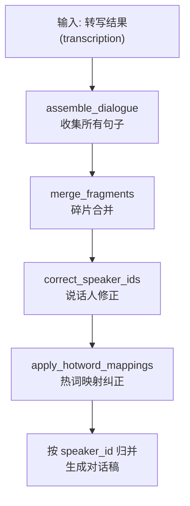
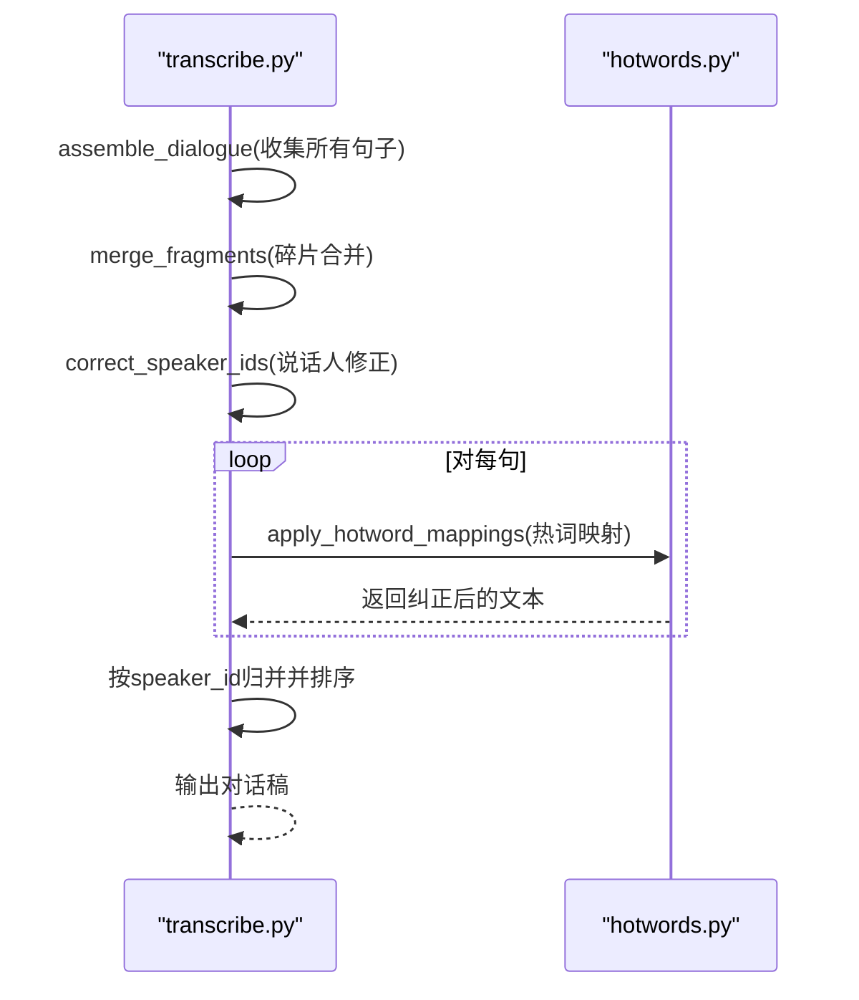
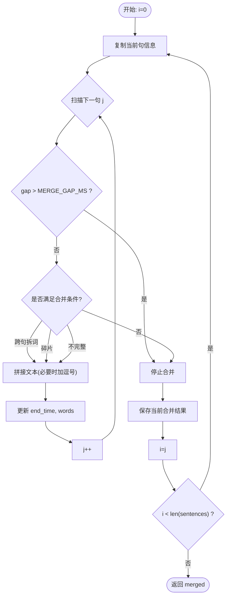
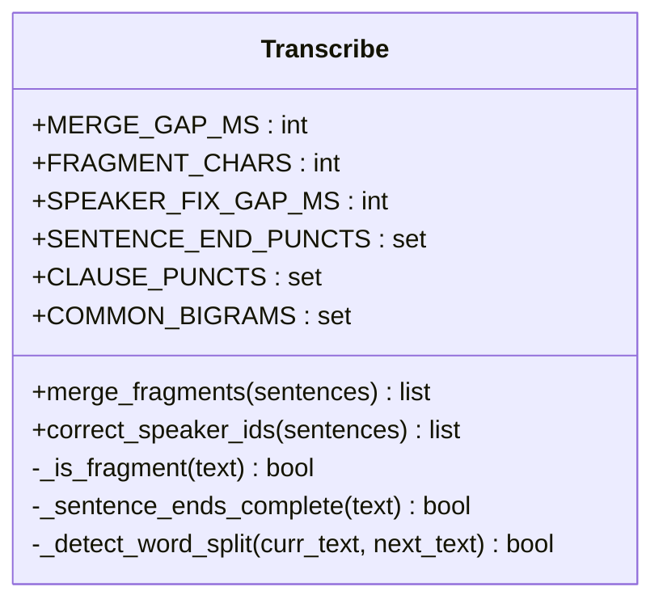
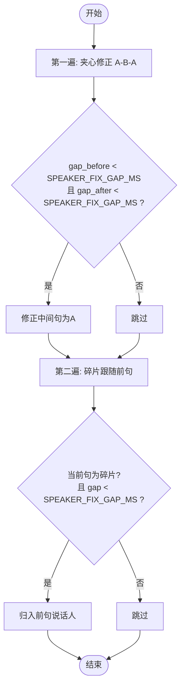
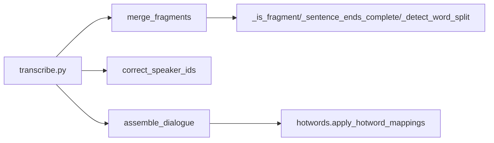

# 碎片句子合并

<cite>
**本文引用的文件**
- [core/transcribe.py](file://core/transcribe.py)
- [core/hotwords.py](file://core/hotwords.py)
</cite>

## 目录
1. [简介](#简介)
2. [项目结构](#项目结构)
3. [核心组件](#核心组件)
4. [架构总览](#架构总览)
5. [详细组件分析](#详细组件分析)
6. [依赖关系分析](#依赖关系分析)
7. [性能考虑](#性能考虑)
8. [故障排查指南](#故障排查指南)
9. [结论](#结论)
10. [附录](#附录)

## 简介
本技术文档聚焦“碎片句子合并”功能，面向 ASR（语音识别）后处理阶段。ASR 在真实会议场景中常产生碎片句：由于语音中断、识别精度限制、标点误判等原因，原本应属于同一语义单元的句子被错误切分。该功能通过跨句拆词检测、碎片识别与完整性判断等策略，将相邻且语义连贯的碎片句合并为完整句，并配合说话人修正与热词映射，输出更可读、可检索的对话稿。

## 项目结构
与碎片合并直接相关的代码位于 core 模块：
- core/transcribe.py：实现碎片合并、说话人修正、对话组装等后处理逻辑
- core/hotwords.py：提供热词映射的后处理纠正能力（用于术语/缩写纠错）

图表来源
- [core/transcribe.py:355-402](file://core/transcribe.py#L355-L402)
- [core/hotwords.py:187-221](file://core/hotwords.py#L187-L221)

章节来源
- [core/transcribe.py:1-446](file://core/transcribe.py#L1-L446)
- [core/hotwords.py:1-222](file://core/hotwords.py#L1-L222)

## 核心组件
- merge_fragments：核心合并函数，依据时间间隔阈值、碎片长度阈值、句末完整性与跨句拆词信号进行合并
- correct_speaker_ids：修复说话人分离过度切分导致的短句归属问题
- assemble_dialogue：串联合并、修正、热词映射，并按说话人聚合输出
- 辅助工具：_is_fragment、_sentence_ends_complete、_detect_word_split；中文标点集合 SENTENCE_END_PUNCTS、CLAUSE_PUNCTS；配置项 MERGE_GAP_MS、FRAGMENT_CHARS、SPEAKER_FIX_GAP_MS、COMMON_BIGRAMS

章节来源
- [core/transcribe.py:193-304](file://core/transcribe.py#L193-L304)
- [core/transcribe.py:307-352](file://core/transcribe.py#L307-L352)
- [core/transcribe.py:355-402](file://core/transcribe.py#L355-L402)
- [core/transcribe.py:32-51](file://core/transcribe.py#L32-L51)

## 架构总览
下图展示了从原始转写到最终对话稿的关键步骤，以及各步骤之间的数据流向。

图表来源
- [core/transcribe.py:355-402](file://core/transcribe.py#L355-L402)
- [core/hotwords.py:187-221](file://core/hotwords.py#L187-L221)

## 详细组件分析

### 碎片合并算法（merge_fragments）
- 目标：将因 ASR 切分过细而形成的碎片句合并为完整句
- 输入：句子列表，每个元素包含 text、begin_time、end_time、words、sentence_id 等字段
- 输出：合并后的句子列表（结构与输入一致）

合并条件（满足任一即尝试合并）：
1. 跨句拆词：当前句末字 + 下句首字构成常见双字词（强信号）
2. 当前句为碎片：去标点后字符数小于 FRAGMENT_CHARS
3. 当前句不完整：不以句末标点结尾

停止条件：
- 时间间隔超过 MERGE_GAP_MS
- 当前句完整（有句末标点且非碎片）且无拆词信号

连接标点策略：
- 若前句末尾既不是句末标点也不是句中停顿标点，则在拼接时插入逗号作为连接符

图表来源
- [core/transcribe.py:222-304](file://core/transcribe.py#L222-L304)

章节来源
- [core/transcribe.py:222-304](file://core/transcribe.py#L222-L304)

### 关键子函数与判定规则
- _is_fragment：去除标点与空白后统计字符数，低于 FRAGMENT_CHARS 视为碎片
- _sentence_ends_complete：检查是否以句末标点结尾（。！？…）
- _detect_word_split：剥离前后标点后再取首尾字，判断是否构成 COMMON_BIGRAMS 中的双字词

图表来源
- [core/transcribe.py:32-51](file://core/transcribe.py#L32-L51)
- [core/transcribe.py:193-219](file://core/transcribe.py#L193-L219)
- [core/transcribe.py:222-304](file://core/transcribe.py#L222-L304)

章节来源
- [core/transcribe.py:193-219](file://core/transcribe.py#L193-L219)
- [core/transcribe.py:222-304](file://core/transcribe.py#L222-L304)

### 说话人修正（correct_speaker_ids）
- 夹心修正：当出现 A-B-A 模式且前后间隔均小于 SPEAKER_FIX_GAP_MS，将中间 B 修正为 A
- 碎片跟随：相邻碎片短句若与前句说话人不同且间隔小于 SPEAKER_FIX_GAP_MS，则归入前句说话人

图表来源
- [core/transcribe.py:307-352](file://core/transcribe.py#L307-L352)

章节来源
- [core/transcribe.py:307-352](file://core/transcribe.py#L307-L352)

### 热词映射（apply_hotword_mappings）
- 作用：对合并后的文本进行术语/缩写纠正（如 ES→EAS系统）
- 匹配策略：纯英文/数字词使用词边界匹配（大小写不敏感），含中文串直接子串替换
- 数据来源：data/hotword_mappings.txt，支持 → 或 -> 分隔符

章节来源
- [core/hotwords.py:145-179](file://core/hotwords.py#L145-L179)
- [core/hotwords.py:187-221](file://core/hotwords.py#L187-L221)

## 依赖关系分析
- merge_fragments 依赖：
  - 配置常量：MERGE_GAP_MS、FRAGMENT_CHARS、SPEAKER_FIX_GAP_MS、SENTENCE_END_PUNCTS、CLAUSE_PUNCTS、COMMON_BIGRAMS
  - 辅助函数：_is_fragment、_sentence_ends_complete、_detect_word_split
- assemble_dialogue 依赖：
  - merge_fragments、correct_speaker_ids
  - hotwords.apply_hotword_mappings
- 数据流：
  - 输入转录结果 → 收集所有句子 → 碎片合并 → 说话人修正 → 热词映射 → 按说话人聚合

图表来源
- [core/transcribe.py:355-402](file://core/transcribe.py#L355-L402)
- [core/transcribe.py:193-219](file://core/transcribe.py#L193-L219)
- [core/hotwords.py:187-221](file://core/hotwords.py#L187-L221)

章节来源
- [core/transcribe.py:355-402](file://core/transcribe.py#L355-L402)
- [core/transcribe.py:193-219](file://core/transcribe.py#L193-L219)
- [core/hotwords.py:187-221](file://core/hotwords.py#L187-L221)

## 性能考虑
- 时间复杂度：merge_fragments 采用双层循环，最坏 O(N^2)，但实际中受 MERGE_GAP_MS 限制，窗口较小，平均接近 O(N)
- 内存占用：仅维护当前合并块与少量临时变量，空间复杂度 O(N) 用于输出
- 优化建议：
  - 合理设置 MERGE_GAP_MS，避免过长窗口导致不必要的比较
  - 控制 COMMON_BIGRAMS 规模，减少哈希查找开销
  - 批量处理时复用正则与集合，避免重复构造

[本节为通用性能讨论，不直接分析具体文件]

## 故障排查指南
常见问题与定位方法：
- 碎片未合并
  - 检查 MERGE_GAP_MS 是否过小，导致相邻句时间间隔被判定为“过大”
  - 检查 FRAGMENT_CHARS 是否过大，导致碎片未被识别
  - 检查句末标点是否正确（如省略号、问号等），确保 _sentence_ends_complete 能正确识别
- 过度合并
  - 检查 COMMON_BIGRAMS 是否过于宽泛，导致正常断句被误合并
  - 调整 MERGE_GAP_MS 增大阈值，减少跨段合并
- 说话人归属错误
  - 检查 SPEAKER_FIX_GAP_MS 是否过小/过大，影响夹心修正与碎片跟随
  - 确认 ASR 输出的 begin_time/end_time 是否准确
- 热词映射未生效
  - 检查 data/hotword_mappings.txt 是否存在且格式正确（→ 或 ->）
  - 确认 apply_hotword_mappings 是否被调用（assemble_dialogue 中已集成）

章节来源
- [core/transcribe.py:222-304](file://core/transcribe.py#L222-L304)
- [core/transcribe.py:307-352](file://core/transcribe.py#L307-L352)
- [core/hotwords.py:145-179](file://core/hotwords.py#L145-L179)
- [core/hotwords.py:187-221](file://core/hotwords.py#L187-L221)

## 结论
该碎片合并方案通过“时间间隔+碎片长度+句末完整性+跨句拆词”的多维信号，有效缓解 ASR 切分过细带来的碎片句问题，并结合说话人修正与热词映射，显著提升对话稿的可读性与可用性。参数可根据实际场景调优，兼顾召回率与准确率。

[本节为总结性内容，不直接分析具体文件]

## 附录

### ASR 碎片句产生的原因
- 语音中断：说话人短暂停顿、环境噪声、设备丢帧导致识别结果被切分为多段
- 识别精度限制：同音词、连读、语速过快造成词边界误判，进而触发句级切分
- 标点符号误判：模型对句末/句中停顿标点识别不稳定，导致不该断句处被断句

[本节为概念性说明，不直接分析具体文件]

### 合并算法核心逻辑要点
- 跨句拆词检测：利用 COMMON_BIGRAMS 双字词库，检测“末字+首字”是否构成常见词，作为最强合并信号
- 碎片识别：基于 FRAGMENT_CHARS 阈值，过滤掉明显过短的片段
- 完整性判断：依据 SENTENCE_END_PUNCTS 判断句末是否完整，避免截断句被当作完整句
- 连接标点：在前句末尾既非句末也非句中停顿时，自动插入逗号保证语句通顺

章节来源
- [core/transcribe.py:193-219](file://core/transcribe.py#L193-L219)
- [core/transcribe.py:222-304](file://core/transcribe.py#L222-L304)

### 合并条件配置与调优
- MERGE_GAP_MS（毫秒）：相邻两句最大允许间隔，超过则停止合并。建议根据会议节奏与停顿习惯调整
- FRAGMENT_CHARS：碎片短句阈值（去标点后字符数）。过大会漏合并，过小会过度合并
- SPEAKER_FIX_GAP_MS（毫秒）：说话人修正的时间间隔阈值，影响夹心修正与碎片跟随效果
- COMMON_BIGRAMS：双字词库，建议结合业务领域扩展，提升跨句拆词检测准确性
- 中文标点集合：
  - 句末标点：。！？…
  - 句中停顿标点：，、；：

章节来源
- [core/transcribe.py:32-51](file://core/transcribe.py#L32-L51)
- [core/transcribe.py:193-219](file://core/transcribe.py#L193-L219)
- [core/transcribe.py:222-304](file://core/transcribe.py#L222-L304)

### 中文标点处理规则
- 句末标点：。！？… 表示语义完结，通常不应再合并
- 句中停顿标点：，、；： 表示内部停顿，不影响完整性判断
- 连接策略：若前句末尾既非句末也非句中停顿标点，则在拼接时插入逗号，保持语句通顺

章节来源
- [core/transcribe.py:32-51](file://core/transcribe.py#L32-L51)
- [core/transcribe.py:282-290](file://core/transcribe.py#L282-L290)

### COMMON_BIGRAMS 双字词库扩展方法
- 扩展方式：在 COMMON_BIGRAMS 中添加领域高频双字词，提升跨句拆词检测命中率
- 建议流程：
  - 采集业务语料，统计高频双字词
  - 去重并校验语义合理性，避免引入歧义词
  - 小范围验证合并效果，逐步扩大词库规模
- 注意事项：
  - 避免加入过于通用的词（如“一个”“我们”），以免误合并
  - 定期复盘合并日志，剔除低效或误判的词

章节来源
- [core/transcribe.py:44-51](file://core/transcribe.py#L44-L51)

### 使用示例与效果对比（路径引用）
- 入口函数：assemble_dialogue
  - 作用：收集所有句子，执行碎片合并、说话人修正、热词映射，并按说话人聚合
  - 参考路径：[core/transcribe.py:355-402](file://core/transcribe.py#L355-L402)
- 核心合并：merge_fragments
  - 作用：依据时间间隔、碎片长度、完整性与跨句拆词信号进行合并
  - 参考路径：[core/transcribe.py:222-304](file://core/transcribe.py#L222-L304)
- 说话人修正：correct_speaker_ids
  - 作用：修复说话人分离过度切分导致的归属问题
  - 参考路径：[core/transcribe.py:307-352](file://core/transcribe.py#L307-L352)
- 热词映射：apply_hotword_mappings
  - 作用：对文本进行术语/缩写纠正
  - 参考路径：[core/hotwords.py:187-221](file://core/hotwords.py#L187-L221)

[本节为使用指引，不直接展示代码内容]