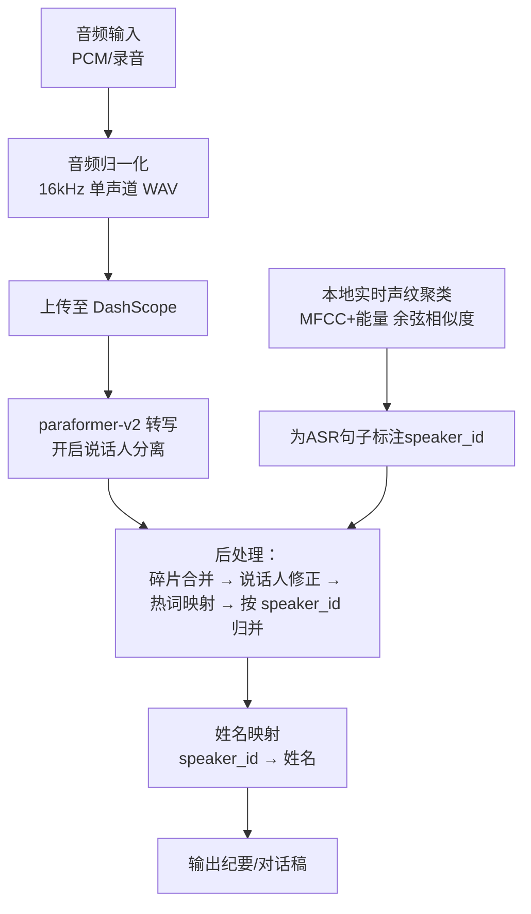
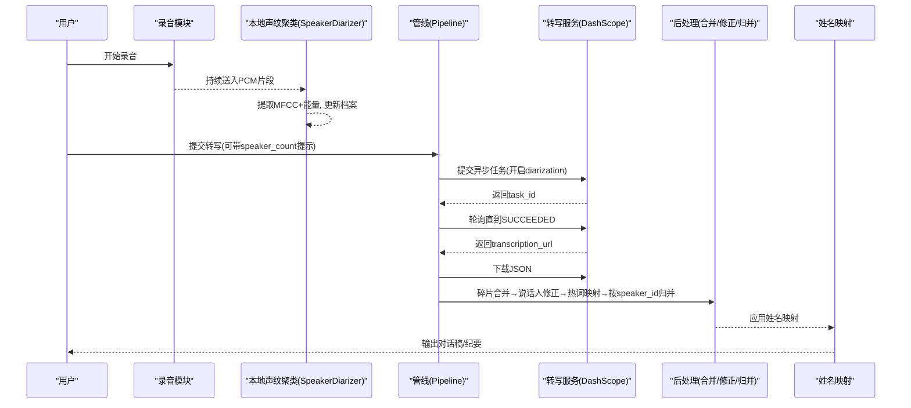
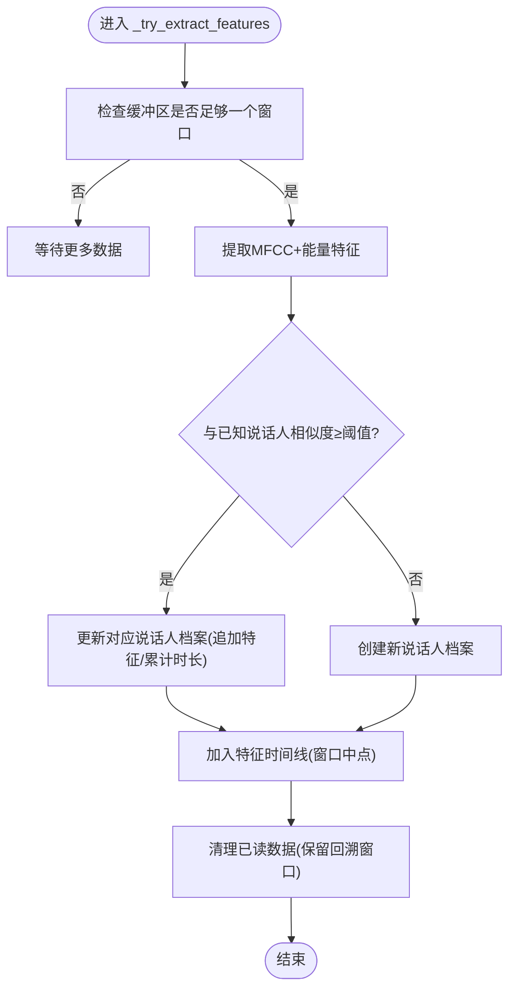
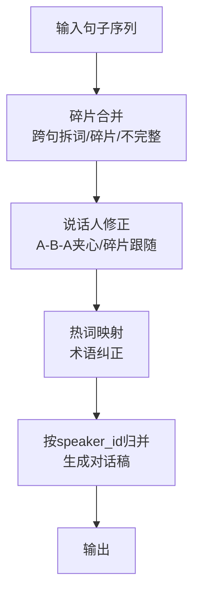
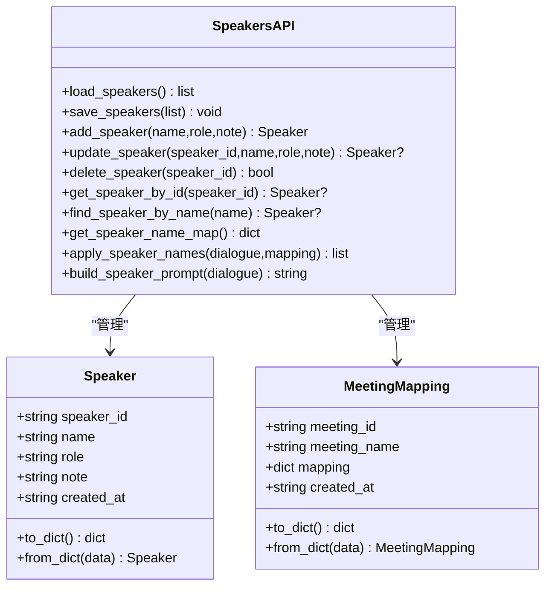
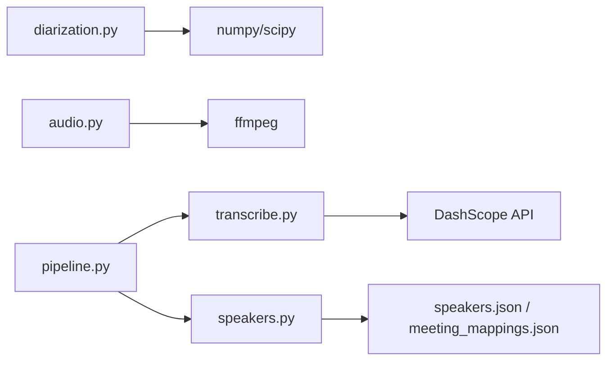

# 说话人分离技术

<cite>
**本文引用的文件**
- [core/diarization.py](file://core/diarization.py)
- [core/transcribe.py](file://core/transcribe.py)
- [core/pipeline.py](file://core/pipeline.py)
- [core/speakers.py](file://core/speakers.py)
- [core/audio.py](file://core/audio.py)
- [data/speakers.json](file://data/speakers.json)
- [docs/adr/0006-实时说话人分离方案选型.md](file://docs/adr/0006-实时说话人分离方案选型.md)
</cite>

## 目录
1. [简介](#简介)
2. [项目结构](#项目结构)
3. [核心组件](#核心组件)
4. [架构总览](#架构总览)
5. [详细组件分析](#详细组件分析)
6. [依赖关系分析](#依赖关系分析)
7. [性能考虑](#性能考虑)
8. [故障排查指南](#故障排查指南)
9. [结论](#结论)
10. [附录：配置参数说明](#附录：配置参数说明)

## 简介
本技术文档围绕“说话人分离（Diarization）”展开，系统阐述本地声纹聚类与云端转写后处理的完整链路。内容涵盖：
- 音频特征提取（MFCC + 能量）、声纹聚类、说话人切换检测
- speaker_id 标注机制（初始分配、修正策略、时间戳对齐）
- 后处理逻辑（夹心修正 A-B-A、碎片短句跟随、连续短句统一）
- 说话人数量的估算方法（实时声纹聚类与预设参数的使用场景）
- 配置参数说明（如 speaker_count 的作用与影响范围）
- 性能优化建议与常见问题解决方案

## 项目结构
本项目将说话人分离能力拆分为“本地实时声纹聚类”和“云端转写后处理”两部分，并通过管线串联：
- 本地实时：从 PCM 流中按固定窗口提取 MFCC+能量特征，基于余弦相似度进行在线聚类，为后续 ASR 句子提供说话人标签
- 云端转写：调用 paraformer-v2 异步转写，开启说话人分离；对结果执行碎片合并、说话人修正、热词映射、按 speaker_id 归并
- 姓名化：将数字 speaker_id 映射到真实姓名，支持历史复用

图表来源
- [core/audio.py:31-98](file://core/audio.py#L31-L98)
- [core/transcribe.py:61-131](file://core/transcribe.py#L61-L131)
- [core/transcribe.py:222-352](file://core/transcribe.py#L222-L352)
- [core/speakers.py:278-309](file://core/speakers.py#L278-L309)
- [core/diarization.py:238-275](file://core/diarization.py#L238-L275)

章节来源
- [core/audio.py:31-98](file://core/audio.py#L31-L98)
- [core/transcribe.py:61-131](file://core/transcribe.py#L61-L131)
- [core/speakers.py:278-309](file://core/speakers.py#L278-L309)
- [core/diarization.py:238-275](file://core/diarization.py#L238-L275)

## 核心组件
- 本地实时声纹聚类器：SpeakerDiarizer，负责从 PCM 流中提取特征、维护说话人档案、在线匹配与查询
- 云端转写与后处理：提交任务、轮询、下载结果，执行碎片合并、说话人修正、热词映射、按 speaker_id 归并
- 说话人档案管理：全局说话人列表、会议映射历史、姓名应用
- 音频处理：归一化、录制、流式读取

章节来源
- [core/diarization.py:282-524](file://core/diarization.py#L282-L524)
- [core/transcribe.py:222-402](file://core/transcribe.py#L222-L402)
- [core/speakers.py:35-103](file://core/speakers.py#L35-L103)
- [core/audio.py:31-98](file://core/audio.py#L31-L98)

## 架构总览
整体流程由“本地实时声纹聚类 + 云端转写后处理”双通道协作完成：
- 本地通道：在录音过程中持续抽取 MFCC+能量特征，构建说话人档案，实时估计说话人数，并为即将定稿的 ASR 句子提供 speaker_id
- 云端通道：以 paraformer-v2 模型进行异步转写，开启说话人分离；对返回的句子序列执行后处理，提升可读性与一致性
- 姓名化通道：将数字 speaker_id 映射到真实姓名，支持历史复用

图表来源
- [core/diarization.py:339-420](file://core/diarization.py#L339-L420)
- [core/transcribe.py:61-131](file://core/transcribe.py#L61-L131)
- [core/transcribe.py:222-402](file://core/transcribe.py#L222-L402)
- [core/speakers.py:278-309](file://core/speakers.py#L278-L309)
- [core/pipeline.py:58-134](file://core/pipeline.py#L58-L134)

## 详细组件分析

### 本地实时声纹聚类（MFCC + 能量 + 余弦相似度）
- 特征提取
  - 预加重、分帧加窗、FFT、Mel 滤波器组、对数、DCT-II，得到 MFCC 矩阵
  - 取 MFCC 均值（去除第0维，主要反映能量），拼接 RMS 能量与 MFCC std，形成 14 维特征向量
  - L2 归一化，便于余弦相似度计算
- 在线聚类
  - 每 2 秒窗口、步长 1 秒（50% 重叠）提取一次特征
  - 与已有说话人档案的平均特征计算余弦相似度，超过阈值则归入该说话人，否则创建新说话人
  - 渐进式档案：每个说话人的特征向量累积平均，提高匹配稳定性
- 时间对齐与查询
  - 记录特征时间线（窗口中点时间戳）
  - 根据 ASR 句子的 begin/end 时间，找到最近特征，再匹配到说话人 ID

图表来源
- [core/diarization.py:377-420](file://core/diarization.py#L377-L420)
- [core/diarization.py:421-456](file://core/diarization.py#L421-L456)
- [core/diarization.py:238-275](file://core/diarization.py#L238-L275)

章节来源
- [core/diarization.py:104-166](file://core/diarization.py#L104-L166)
- [core/diarization.py:169-228](file://core/diarization.py#L169-L228)
- [core/diarization.py:231-275](file://core/diarization.py#L231-L275)
- [core/diarization.py:339-420](file://core/diarization.py#L339-L420)
- [core/diarization.py:421-456](file://core/diarization.py#L421-L456)
- [core/diarization.py:458-503](file://core/diarization.py#L458-L503)

### 云端转写与后处理（碎片合并、说话人修正、热词映射、归并）
- 碎片合并
  - 判断条件：跨句拆词（常见双字词）、当前句为碎片（去标点字符过少）、当前句无句末标点（明显截断）
  - 停止条件：相邻句时间间隔过大、当前句完整且无拆词信号
- 说话人修正
  - 夹心修正（A-B-A 模式）：若一句被前后相同 speaker_id 包围，且前后间隔较小，将该句修正为同一说话人
  - 碎片短句跟随：相邻碎片短句若与前句说话人不同，且间隔很小，归入前句说话人
- 热词映射：纠正识别结果（如缩写/专有名词）
- 按 speaker_id 归并：将修正后的句子按说话人聚合，生成对话稿

图表来源
- [core/transcribe.py:222-304](file://core/transcribe.py#L222-L304)
- [core/transcribe.py:307-352](file://core/transcribe.py#L307-L352)
- [core/transcribe.py:355-402](file://core/transcribe.py#L355-L402)

章节来源
- [core/transcribe.py:222-304](file://core/transcribe.py#L222-L304)
- [core/transcribe.py:307-352](file://core/transcribe.py#L307-L352)
- [core/transcribe.py:355-402](file://core/transcribe.py#L355-L402)

### 说话人姓名映射与历史复用
- 全局说话人档案：存储 speaker_id（UUID）、姓名、角色、备注、创建时间
- 会议映射历史：保存每次会议的 speaker_id（数字）→ UUID 映射，用于快速复用
- 姓名应用：将对话稿中的数字 speaker_id 替换为真实姓名，缺失时回退为“说话人N”

图表来源
- [core/speakers.py:35-103](file://core/speakers.py#L35-L103)
- [core/speakers.py:109-198](file://core/speakers.py#L109-L198)
- [core/speakers.py:205-271](file://core/speakers.py#L205-L271)
- [core/speakers.py:278-325](file://core/speakers.py#L278-L325)

章节来源
- [core/speakers.py:35-103](file://core/speakers.py#L35-L103)
- [core/speakers.py:109-198](file://core/speakers.py#L109-L198)
- [core/speakers.py:205-271](file://core/speakers.py#L205-L271)
- [core/speakers.py:278-325](file://core/speakers.py#L278-L325)

### 说话人数量的估算方法
- 实时估算：通过本地声纹聚类的 get_speaker_count() 获取当前识别到的说话人数量
- 预设参数：在提交转写任务时可传入 speaker_count（2-100），作为辅助信息给云端模型参考
- 使用场景
  - 实时估算：适合在录音过程中动态估计人数，并在转写阶段作为提示参数传递
  - 预设参数：当已知会议规模或需要约束分离结果时使用

章节来源
- [core/diarization.py:505-508](file://core/diarization.py#L505-L508)
- [core/transcribe.py:61-131](file://core/transcribe.py#L61-L131)
- [core/pipeline.py:58-134](file://core/pipeline.py#L58-L134)

### 时间戳对齐与 speaker_id 标注机制
- 初始分配：本地聚类器为每个窗口特征匹配或创建说话人，记录时间线
- 时间对齐：ASR 句子定稿时，根据 begin/end 时间找到最近特征，再匹配到说话人 ID
- 修正策略：云端后处理对过度切分进行修正（A-B-A 夹心、碎片跟随）
- 时间戳对齐细节：窗口中点作为特征时间戳；查询时取句子中间时间或 begin 时间

章节来源
- [core/diarization.py:377-420](file://core/diarization.py#L377-L420)
- [core/diarization.py:458-503](file://core/diarization.py#L458-L503)
- [core/transcribe.py:307-352](file://core/transcribe.py#L307-L352)

## 依赖关系分析
- 本地模块依赖 numpy、scipy 进行信号处理与数值计算
- 云端转写依赖 DashScope API（异步任务、轮询、下载）
- 音频模块依赖 ffmpeg 进行归一化与录制
- 姓名映射依赖 JSON 文件持久化

图表来源
- [core/diarization.py:23-29](file://core/diarization.py#L23-L29)
- [core/transcribe.py:16-24](file://core/transcribe.py#L16-L24)
- [core/audio.py:12-23](file://core/audio.py#L12-L23)
- [core/speakers.py:14-28](file://core/speakers.py#L14-L28)
- [core/pipeline.py:20-27](file://core/pipeline.py#L20-L27)

章节来源
- [core/diarization.py:23-29](file://core/diarization.py#L23-L29)
- [core/transcribe.py:16-24](file://core/transcribe.py#L16-L24)
- [core/audio.py:12-23](file://core/audio.py#L12-L23)
- [core/speakers.py:14-28](file://core/speakers.py#L14-L28)
- [core/pipeline.py:20-27](file://core/pipeline.py#L20-L27)

## 性能考虑
- 特征提取窗口与步长
  - 窗口 2 秒、步长 1 秒（50% 重叠）平衡了特征稳定性与时间分辨率
  - 建议保持默认值；如需更高时间分辨率可适当减小窗口，但可能降低稳定性
- 相似度阈值
  - 默认 0.70；过高易误判为新说话人，过低易将不同说话人合并
  - 可根据实际场景调优（如多人会议适当提高阈值）
- 最小特征数
  - 每个说话人至少积累若干特征才用于匹配，避免早期不稳定
- 内存与缓存
  - 保留最近 10 秒用于回溯，避免过长缓冲导致内存占用
- 线程安全
  - 使用锁保护 feed_audio 与 get_speaker，确保多线程并发安全
- 云端任务
  - 轮询间隔与超时合理设置，避免频繁请求或长时间阻塞

[本节为通用指导，不直接分析具体代码文件]

## 故障排查指南
- 音频格式问题
  - 确认输入已归一化为 16kHz 单声道 WAV；多声道会导致说话人分离失效
  - 检查 ffmpeg 是否可用，路径是否正确
- 设备与录制
  - macOS 内录需配置 BlackHole 2ch 多输出设备；确认设备名正确
  - 流式录制时注意暂停/恢复状态，避免数据丢失
- 转写任务
  - 检查 DASHSCOPE_API_KEY 环境变量是否设置
  - oss:// URL 需添加 X-DashScope-OssResourceResolve: enable 头
  - 轮询超时或失败时查看错误消息，必要时重试
- 说话人分离效果
  - 若出现过多碎片或误判，调整相似度阈值或启用后处理修正
  - 对于音色相近或人数较多的场景，考虑引入更先进的声纹模型（v2 规划）

章节来源
- [core/audio.py:31-98](file://core/audio.py#L31-L98)
- [core/audio.py:139-217](file://core/audio.py#L139-L217)
- [core/transcribe.py:54-58](file://core/transcribe.py#L54-L58)
- [core/transcribe.py:94-97](file://core/transcribe.py#L94-L97)
- [core/transcribe.py:134-175](file://core/transcribe.py#L134-L175)

## 结论
本项目采用“本地实时声纹聚类 + 云端转写后处理”的组合方案，在轻量级实现下提供了可用的说话人分离能力。通过 MFCC+能量的特征提取、余弦相似度在线聚类、以及碎片合并与说话人修正等后处理，能够在 2-4 人会议场景中取得较好效果。未来可探索引入神经声纹模型或云端流式分离 API 以提升准确率。

[本节为总结性内容，不直接分析具体代码文件]

## 附录：配置参数说明
- 本地声纹聚类
  - FEATURE_WINDOW_SEC：特征提取窗口（秒），默认 2.0
  - FEATURE_STEP_SEC：特征提取步长（秒），默认 1.0
  - SIMILARITY_THRESHOLD：余弦相似度阈值，默认 0.70
  - MIN_FEATURES_PER_SPEAKER：每个说话人最少特征数，默认 2
  - N_MFCC：MFCC 系数数量，默认 13
  - SAMPLE_RATE：采样率，默认 16000
- 云端转写
  - diarization_enabled：是否开启说话人分离，默认 True
  - language_hints：语言提示，如 ["zh", "en"]
  - speaker_count：说话人数量（2-100），仅作为辅助提示
  - vocabulary_id：热词表 ID
  - disfluency_removal_enabled：是否过滤语气词
- 后处理
  - MERGE_GAP_MS：碎片合并的时间间隔阈值（毫秒），默认 2000
  - FRAGMENT_CHARS：碎片短句阈值（去标点后字符数），默认 12
  - SPEAKER_FIX_GAP_MS：说话人修正的时间间隔阈值（毫秒），默认 2000

章节来源
- [core/diarization.py:38-54](file://core/diarization.py#L38-L54)
- [core/transcribe.py:32-43](file://core/transcribe.py#L32-L43)
- [core/transcribe.py:61-131](file://core/transcribe.py#L61-L131)
- [docs/adr/0006-实时说话人分离方案选型.md:69-91](file://docs/adr/0006-实时说话人分离方案选型.md#L69-L91)