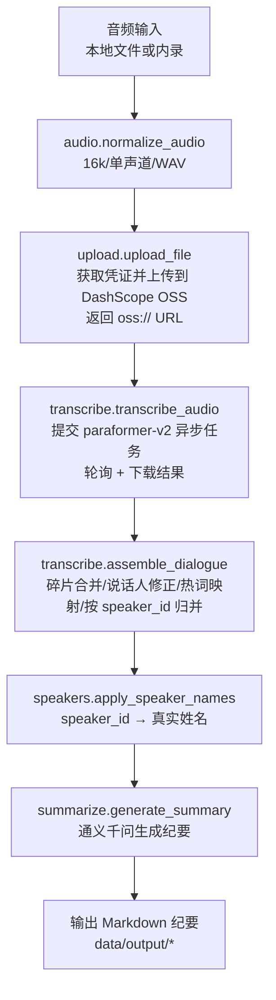
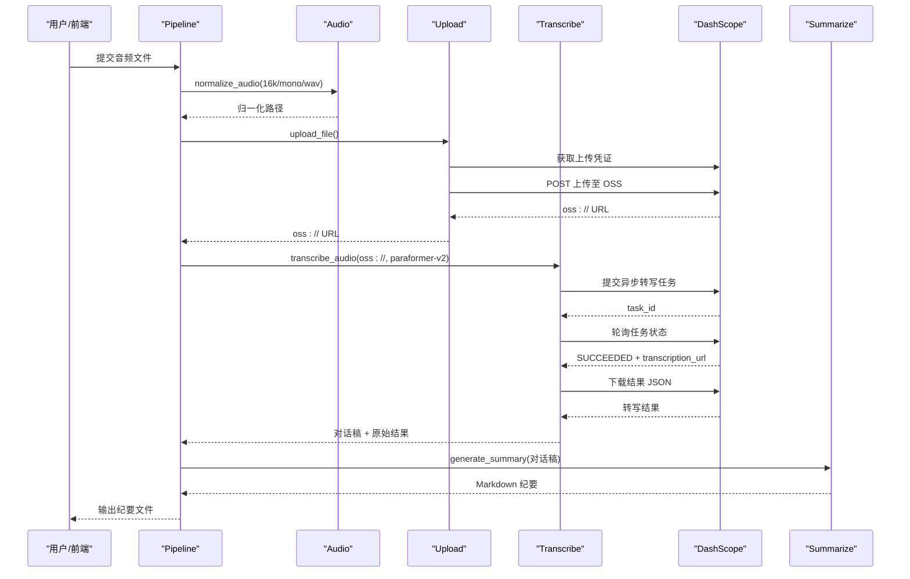
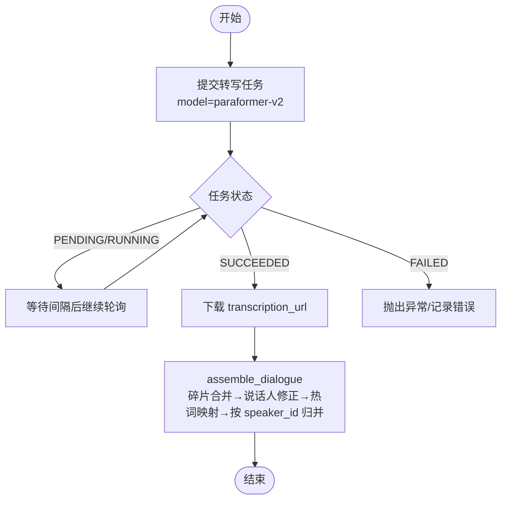
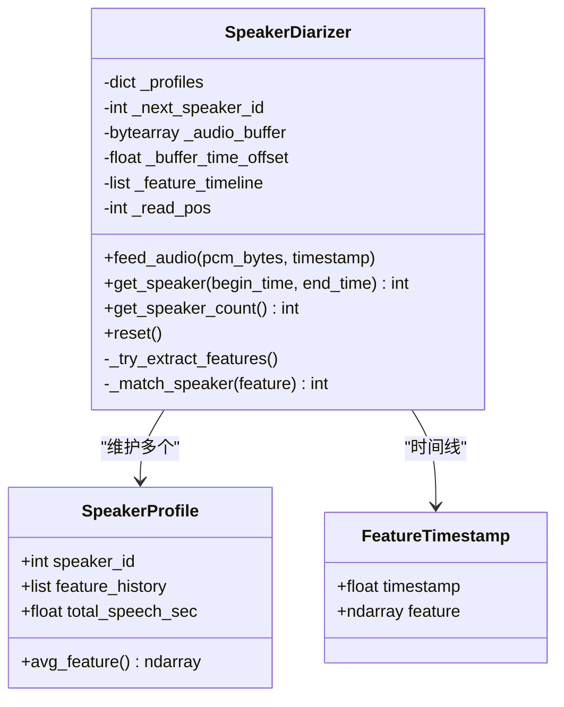
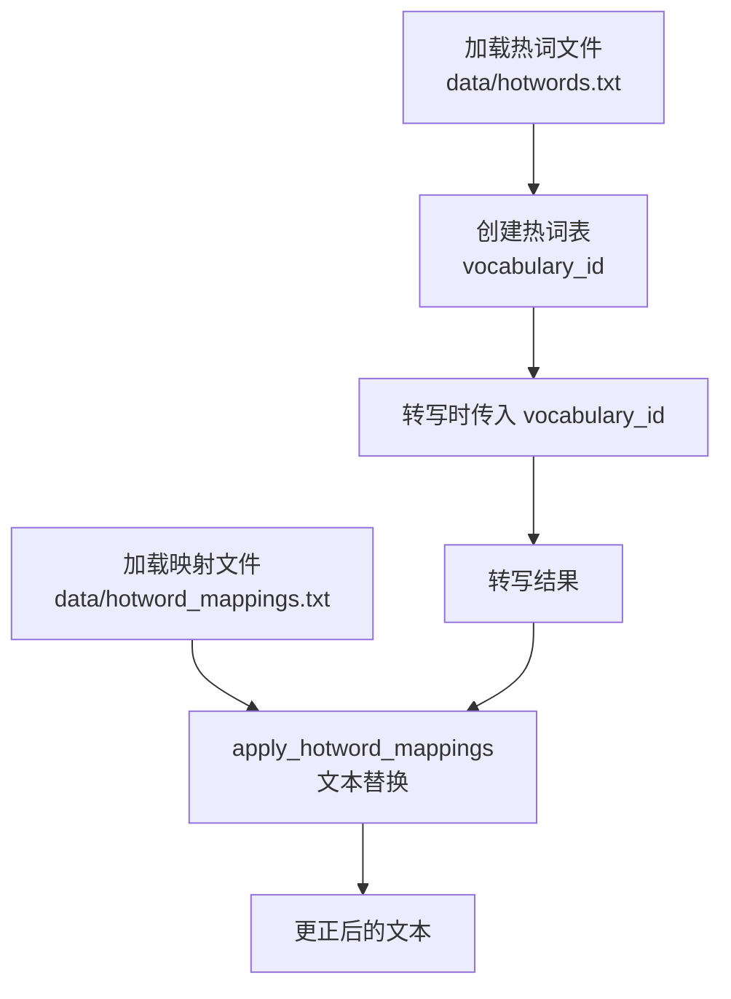
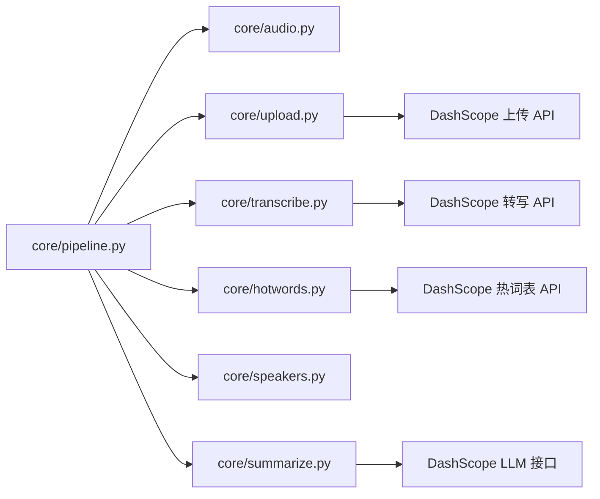

# 转写引擎

<cite>
**本文引用的文件**
- [core/transcribe.py](file://core/transcribe.py)
- [core/diarization.py](file://core/diarization.py)
- [core/hotwords.py](file://core/hotwords.py)
- [core/pipeline.py](file://core/pipeline.py)
- [core/upload.py](file://core/upload.py)
- [core/audio.py](file://core/audio.py)
- [core/summarize.py](file://core/summarize.py)
- [core/speakers.py](file://core/speakers.py)
- [data/hotwords.txt](file://data/hotwords.txt)
- [data/hotword_mappings.txt](file://data/hotword_mappings.txt)
- [data/speakers.json](file://data/speakers.json)
- [docs/ARCHITECTURE.md](file://docs/ARCHITECTURE.md)
- [docs/API_CONTRACTS.md](file://docs/API_CONTRACTS.md)
- [requirements.txt](file://requirements.txt)
</cite>

## 目录
1. [简介](#简介)
2. [项目结构](#项目结构)
3. [核心组件](#核心组件)
4. [架构总览](#架构总览)
5. [详细组件分析](#详细组件分析)
6. [依赖关系分析](#依赖关系分析)
7. [性能与并发](#性能与并发)
8. [故障排查指南](#故障排查指南)
9. [结论](#结论)
10. [附录：API 调用示例与参数说明](#附录api-调用示例与参数说明)

## 简介
本技术文档聚焦“转写引擎模块”，系统性阐述批量转写流程、说话人分离、热词增强、错误重试与超时处理、并发控制，以及与外部服务（DashScope）的集成和数据流转。目标读者既包括需要快速上手的工程师，也包括希望理解系统设计与实现细节的技术人员。

## 项目结构
转写引擎位于 core 目录下，围绕“音频归一化 → 上传 → 转写 → 对话稿组装 → 纪要生成”的主管线组织代码；同时提供实时说话人分离能力与热词管理。

图表来源
- [core/pipeline.py:58-134](file://core/pipeline.py#L58-L134)
- [core/upload.py:59-115](file://core/upload.py#L59-L115)
- [core/transcribe.py:405-446](file://core/transcribe.py#L405-L446)
- [core/speakers.py:278-309](file://core/speakers.py#L278-L309)
- [core/summarize.py:157-229](file://core/summarize.py#L157-L229)

章节来源
- [docs/ARCHITECTURE.md:5-16](file://docs/ARCHITECTURE.md#L5-L16)
- [core/pipeline.py:1-27](file://core/pipeline.py#L1-L27)

## 核心组件
- 音频处理：统一采样率、声道数与格式，确保后续识别与说话人分离稳定。
- 文件上传：通过 DashScope 临时存储换取 oss:// 公网 URL，满足转写 API 要求。
- 转写编排：提交 paraformer-v2 异步任务，轮询直至完成，下载 JSON 并组装对话稿。
- 说话人分离：本地声纹聚类（MFCC+能量），为 ASR 句子标注 speaker_id。
- 热词增强：热词表创建与管理，后处理文本映射纠正，提升专有词识别准确率。
- 纪要生成：基于 LLM 的结构化纪要输出，支持标题与附件对话稿。
- 管线编排：串联上述步骤，提供进度回调与两阶段接口。

章节来源
- [core/audio.py:31-98](file://core/audio.py#L31-L98)
- [core/upload.py:33-115](file://core/upload.py#L33-L115)
- [core/transcribe.py:61-131](file://core/transcribe.py#L61-L131)
- [core/diarization.py:282-525](file://core/diarization.py#L282-L525)
- [core/hotwords.py:35-139](file://core/hotwords.py#L35-L139)
- [core/summarize.py:157-229](file://core/summarize.py#L157-L229)
- [core/pipeline.py:58-271](file://core/pipeline.py#L58-L271)

## 架构总览
系统采用分层设计：采集层（ffmpeg）、上云层（OSS 临时存储）、转写层（DashScope 批处理）、后处理层（对话稿组装、热词映射、姓名化）、摘要层（LLM）。数据流严格遵循“只认公网 URL”“oss:// 需 RESTful 头”“分离仅单声道”等约束。

图表来源
- [core/pipeline.py:58-271](file://core/pipeline.py#L58-L271)
- [core/upload.py:59-115](file://core/upload.py#L59-L115)
- [core/transcribe.py:405-446](file://core/transcribe.py#L405-L446)
- [docs/API_CONTRACTS.md:28-64](file://docs/API_CONTRACTS.md#L28-L64)

## 详细组件分析

### 批量转写流程（paraformer-v2）
- 提交任务：构造请求体，设置 X-DashScope-Async 与可选的 X-DashScope-OssResourceResolve（当使用 oss:// 时）。
- 轮询任务：周期性查询任务状态，直到 SUCCEEDED 或 FAILED，支持超时保护。
- 下载结果：从 transcription_url 获取 JSON，包含 sentences、words、speaker_id 等字段。
- 组装对话稿：碎片合并、说话人修正、热词映射、按 speaker_id 归并为发言人文本。

图表来源
- [core/transcribe.py:61-131](file://core/transcribe.py#L61-L131)
- [core/transcribe.py:134-187](file://core/transcribe.py#L134-L187)
- [core/transcribe.py:355-402](file://core/transcribe.py#L355-L402)

章节来源
- [core/transcribe.py:61-131](file://core/transcribe.py#L61-L131)
- [core/transcribe.py:134-187](file://core/transcribe.py#L134-L187)
- [core/transcribe.py:355-402](file://core/transcribe.py#L355-L402)
- [docs/API_CONTRACTS.md:28-78](file://docs/API_CONTRACTS.md#L28-L78)

### 说话人分离（diarization）
- 原理：每 2 秒提取 MFCC+能量特征，构建说话人档案；新片段与已知档案计算余弦相似度，超过阈值则归属同一说话人，否则新建说话人。
- 时间戳对齐：ASR 句子根据 begin_time/end_time 匹配最近特征，获得 speaker_id。
- 线程安全：内部使用锁保护 feed_audio 与 get_speaker。
- 适用场景：2-4 人会议；人数过多或音色相近时可能误判。

图表来源
- [core/diarization.py:61-81](file://core/diarization.py#L61-L81)
- [core/diarization.py:282-525](file://core/diarization.py#L282-L525)

章节来源
- [core/diarization.py:282-525](file://core/diarization.py#L282-L525)

### 热词增强
- 热词表配置：从 data/hotwords.txt 读取热词列表，创建 DashScope 热词表（target_model 需与识别模型一致），返回 vocabulary_id。
- 词义映射：data/hotword_mappings.txt 定义“错误识别→正确文本”，后处理时对文本进行替换（英文词边界匹配，中文直接替换）。
- 准确率提升机制：热词表提高专有词召回；后处理映射纠正识别偏差。

图表来源
- [core/hotwords.py:35-139](file://core/hotwords.py#L35-L139)
- [core/hotwords.py:145-222](file://core/hotwords.py#L145-L222)
- [data/hotwords.txt:1-4](file://data/hotwords.txt#L1-L4)
- [data/hotword_mappings.txt:1-6](file://data/hotword_mappings.txt#L1-L6)

章节来源
- [core/hotwords.py:35-139](file://core/hotwords.py#L35-L139)
- [core/hotwords.py:145-222](file://core/hotwords.py#L145-L222)
- [data/hotwords.txt:1-4](file://data/hotwords.txt#L1-L4)
- [data/hotword_mappings.txt:1-6](file://data/hotword_mappings.txt#L1-L6)

### 音频归一化与上传
- 归一化：ffmpeg 将任意音频转为 16kHz、单声道、WAV，确保说话人分离可用。
- 上传：获取上传凭证，POST 到 OSS，返回 oss:// URL（48h 有效，≤1GB）。
- URL 编码：对 oss:// 路径中的特殊字符进行编码，避免下载失败。

章节来源
- [core/audio.py:31-98](file://core/audio.py#L31-L98)
- [core/upload.py:33-134](file://core/upload.py#L33-L134)
- [docs/API_CONTRACTS.md:12-24](file://docs/API_CONTRACTS.md#L12-L24)

### 管线编排与进度回调
- 两阶段接口：Stage1 完成音频→对话稿；Stage2 应用姓名映射、生成纪要并保存。
- 进度回调：PipelineProgress 封装 stage/message/percent，供 UI 展示。
- 完整管线：run_pipeline 串联 Stage1 与 Stage2，返回合并结果。

章节来源
- [core/pipeline.py:47-271](file://core/pipeline.py#L47-L271)

### 姓名映射与会话历史复用
- 全局说话人档案：data/speakers.json 存储 UUID 与姓名、角色、备注。
- 会议映射：data/meeting_mappings.json 记录每次会议的 speaker_id → UUID 映射，便于复用建议。
- 应用姓名：将数字 speaker_id 替换为真实姓名，用于展示与纪要。

章节来源
- [core/speakers.py:35-103](file://core/speakers.py#L35-L103)
- [core/speakers.py:278-309](file://core/speakers.py#L278-L309)
- [data/speakers.json:1-30](file://data/speakers.json#L1-L30)

## 依赖关系分析
- 外部服务：DashScope（上传、转写、热词表、LLM）。
- 工具链：ffmpeg（音频处理）、requests/httpx（HTTP 请求）、numpy/scipy（声纹特征）。
- 运行时：Python 3.11+，依赖见 requirements.txt。

图表来源
- [core/pipeline.py:1-27](file://core/pipeline.py#L1-L27)
- [core/transcribe.py:16-24](file://core/transcribe.py#L16-L24)
- [core/upload.py:14-22](file://core/upload.py#L14-L22)
- [core/hotwords.py:17-25](file://core/hotwords.py#L17-L25)
- [core/summarize.py:13-15](file://core/summarize.py#L13-L15)

章节来源
- [requirements.txt:1-32](file://requirements.txt#L1-L32)
- [docs/ARCHITECTURE.md:47-51](file://docs/ARCHITECTURE.md#L47-L51)

## 性能与并发
- 轮询策略：固定间隔（默认 3s），最大超时（默认 600s），降低无效请求频率。
- 超时与重试：上传与转写均设置合理 timeout；失败时抛出明确异常，上层可捕获并重试。
- 并发控制：当前实现以同步为主；如需高并发，可在 pipeline 层引入线程池或异步客户端（httpx）。
- 内存与缓冲：声纹聚类保留最近 10 秒缓冲区，避免无限增长。
- 长音频处理：超过 2 小时可能超时/失败，建议分段处理。

[本节为通用指导，不直接分析具体文件]

## 故障排查指南
- 未设置 API Key：检查环境变量 DASHSCOPE_API_KEY。
- 上传失败：确认文件大小 ≤1GB，URL 已编码，凭证获取成功。
- 转写失败：检查是否开启 diarization_enabled 且音频为单声道；确认 X-DashScope-Async 与 X-DashScope-OssResourceResolve 头。
- 热词表不可用：若 API 返回 404，跳过热词功能；检查 target_model 是否与识别模型一致。
- 实时录音问题：确认 BlackHole 设备存在，ffmpeg 可用，设备权限正确。

章节来源
- [core/upload.py:25-56](file://core/upload.py#L25-L56)
- [core/transcribe.py:54-58](file://core/transcribe.py#L54-L58)
- [core/hotwords.py:101-117](file://core/hotwords.py#L101-L117)
- [core/audio.py:139-217](file://core/audio.py#L139-L217)

## 结论
本转写引擎以 DashScope 为核心，结合 ffmpeg 音频归一化、本地声纹聚类与热词增强，形成完整的“音频→对话稿→纪要”流水线。系统严格遵循外部 API 契约，具备清晰的错误处理与可扩展性。对于大规模生产环境，建议在管线层引入异步与并发控制，并对长音频进行分段处理。

[本节为总结性内容，不直接分析具体文件]

## 附录：API 调用示例与参数说明

### 上传凭证与上传
- 获取凭证：GET /api/v1/uploads?action=getPolicy&model=paraformer-v2，Header: Authorization: Bearer {api_key}
- 上传：POST 到 upload_host，表单字段包含 key、OSSAccessKeyId、policy、Signature、x-oss-object-acl、x-oss-forbid-overwrite、success_action_status=200、file
- 返回：oss://{key}，有效期 48h，≤1GB

章节来源
- [docs/API_CONTRACTS.md:12-24](file://docs/API_CONTRACTS.md#L12-L24)
- [core/upload.py:33-115](file://core/upload.py#L33-L115)

### 提交转写任务（paraformer-v2）
- 端点：POST /api/v1/services/audio/asr/transcription
- Header：Authorization、Content-Type、X-DashScope-Async、X-DashScope-OssResourceResolve（oss:// 时）
- Body：model、input.file_urls、parameters（diarization_enabled、language_hints、speaker_count、vocabulary_id、disfluency_removal_enabled）
- 返回：output.task_id

章节来源
- [docs/API_CONTRACTS.md:28-52](file://docs/API_CONTRACTS.md#L28-L52)
- [core/transcribe.py:61-131](file://core/transcribe.py#L61-L131)

### 轮询任务状态
- 端点：POST /api/v1/tasks/{task_id}
- 返回：output.task_status、output.results[].transcription_url（SUCCEEDED 时）

章节来源
- [docs/API_CONTRACTS.md:56-64](file://docs/API_CONTRACTS.md#L56-L64)
- [core/transcribe.py:134-187](file://core/transcribe.py#L134-L187)

### 热词表创建
- 端点：POST /api/v1/vocabularies
- Body：target_model、prefix、vocabulary（text、weight）
- 返回：vocabulary_id

章节来源
- [core/hotwords.py:57-117](file://core/hotwords.py#L57-L117)
- [docs/API_CONTRACTS.md:114-176](file://docs/API_CONTRACTS.md#L114-L176)

### 实时语音识别（qwen-audio-3.0-asr-flash-streaming）
- WebSocket：wss://dashscope.aliuncs.com/api-ws/v1/inference
- 参数：format=pcm、sample_rate=16000、language_hints、semantic_punctuation_enabled、heartbeat、vocabulary_id/vocabulary
- 回调：on_event、on_complete、on_error

章节来源
- [docs/API_CONTRACTS.md:114-176](file://docs/API_CONTRACTS.md#L114-L176)