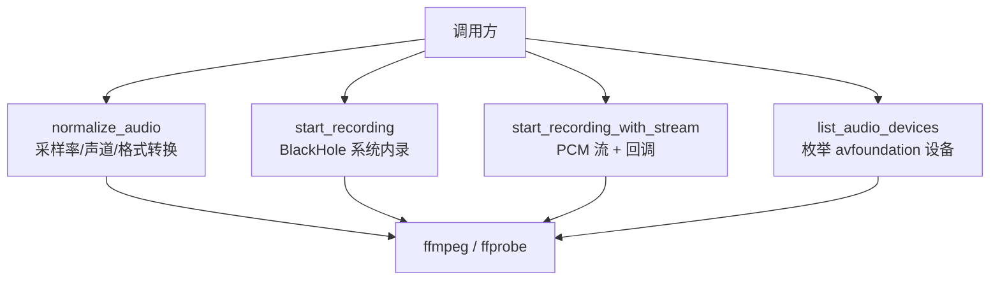
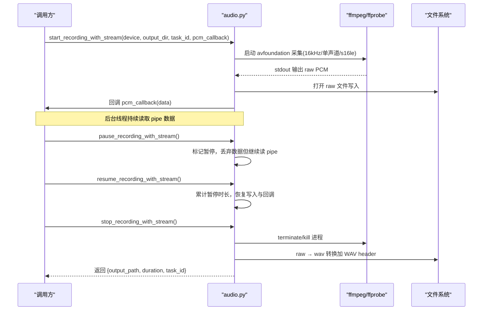
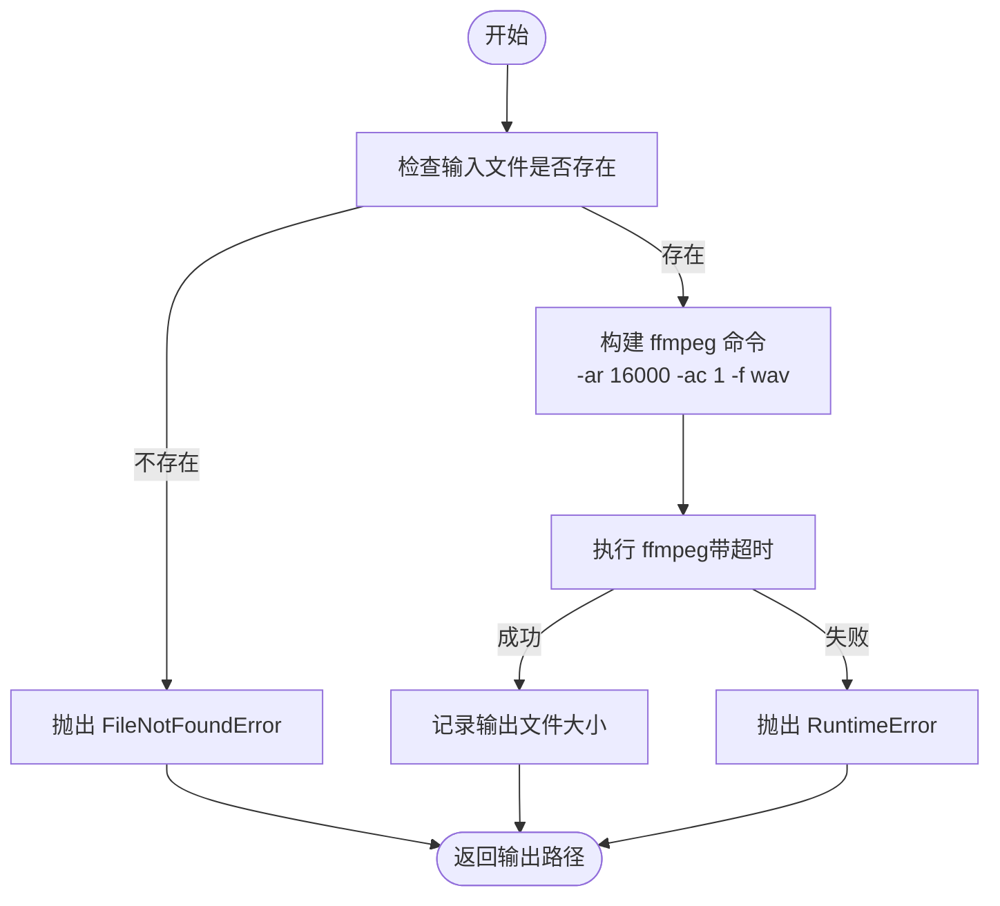
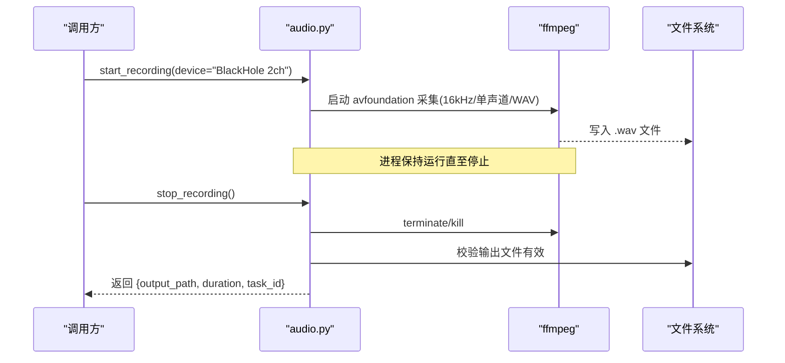
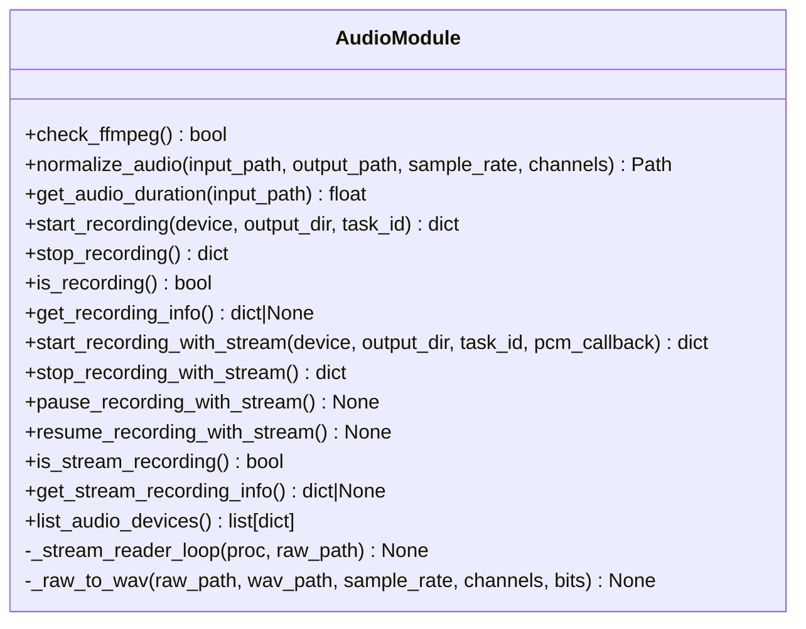
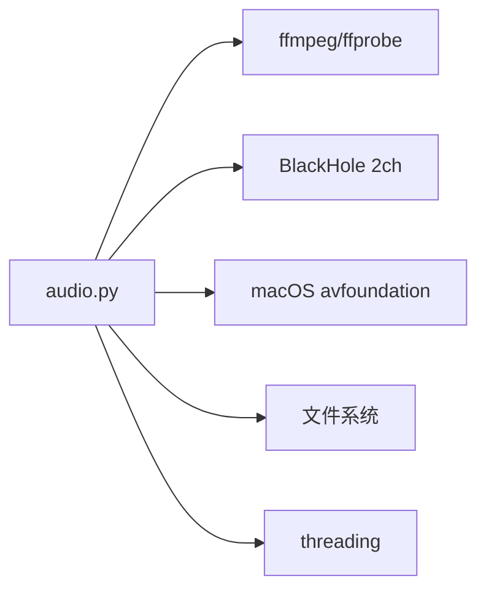

# 音频处理模块

<cite>
**本文引用的文件**
- [core/audio.py](file://core/audio.py)
- [README.md](file://README.md)
</cite>

## 目录
1. [简介](#简介)
2. [项目结构](#项目结构)
3. [核心组件](#核心组件)
4. [架构总览](#架构总览)
5. [详细组件分析](#详细组件分析)
6. [依赖关系分析](#依赖关系分析)
7. [性能考量](#性能考量)
8. [故障排查指南](#故障排查指南)
9. [结论](#结论)
10. [附录：使用示例与最佳实践](#附录使用示例与最佳实践)

## 简介
本模块提供面向 macOS 的音频处理能力，包括：
- 音频归一化：将任意格式音频统一转换为 16kHz、单声道、WAV（适合转写与说话人分离）。
- macOS 系统内录：通过 BlackHole 虚拟声卡 + ffmpeg avfoundation 采集系统输出。
- 流式录音：以 raw PCM 流形式输出，支持暂停/恢复，并可将数据回调给实时 ASR。
- 设备管理：枚举可用音频输入设备，辅助选择 BlackHole 等目标设备。
- 录制状态控制：开始/停止/查询录制状态，以及流式录制的暂停与恢复。

该模块依赖系统级工具 ffmpeg（含 ffprobe）与 BlackHole 2ch 虚拟声卡，确保在 macOS 环境下稳定工作。

**章节来源**
- [README.md:1-39](file://README.md#L1-L39)

## 项目结构
- 音频核心逻辑集中在 core/audio.py，包含：
  - 音频归一化与时长查询
  - 系统内录（非流式）
  - 流式录音（raw PCM 管道 + 后台线程读取）
  - 设备枚举与状态查询
- 前端静态页面位于 app/static/index.html，用于展示 UI 样式与交互元素（本技术文档聚焦后端音频能力）。

**图表来源**
- [core/audio.py:31-98](file://core/audio.py#L31-L98)
- [core/audio.py:139-217](file://core/audio.py#L139-L217)
- [core/audio.py:303-396](file://core/audio.py#L303-L396)
- [core/audio.py:625-662](file://core/audio.py#L625-L662)

**章节来源**
- [core/audio.py:1-663](file://core/audio.py#L1-L663)

## 核心组件
- 音频归一化：将任意输入音频转为 16kHz/单声道/WAV，便于后续转写与说话人分离。
- 系统内录：从 BlackHole 2ch 采集系统音频，直接写入 WAV。
- 流式录音：以 raw PCM 流输出到 stdout，后台线程读取并写入临时 raw 文件，同时可回调给实时 ASR；停止时自动将 raw 转为 WAV。
- 设备管理：列出 avfoundation 可用的音频输入设备，便于选择 BlackHole。
- 状态控制：is_recording/get_recording_info、is_stream_recording/get_stream_recording_info、pause/resume 流式录制。

**章节来源**
- [core/audio.py:31-98](file://core/audio.py#L31-L98)
- [core/audio.py:139-217](file://core/audio.py#L139-L217)
- [core/audio.py:303-396](file://core/audio.py#L303-L396)
- [core/audio.py:518-556](file://core/audio.py#L518-L556)
- [core/audio.py:597-622](file://core/audio.py#L597-L622)
- [core/audio.py:625-662](file://core/audio.py#L625-L662)

## 架构总览
模块围绕 ffmpeg 构建，所有音频操作均通过命令行调用完成：
- 归一化：ffmpeg 读取任意格式 → 重采样至 16kHz → 下混为单声道 → 输出 WAV。
- 系统内录：ffmpeg 通过 avfoundation 从 BlackHole 采集 → 直接写入 WAV。
- 流式录音：ffmpeg 通过 avfoundation 采集 → 输出 raw PCM 到 stdout → Python 后台线程读取 → 写入 raw 文件 + 回调 → 停止时转为 WAV。
- 设备枚举：ffmpeg 列出 avfoundation 音频设备，解析出索引与名称。

**图表来源**
- [core/audio.py:303-396](file://core/audio.py#L303-L396)
- [core/audio.py:399-437](file://core/audio.py#L399-L437)
- [core/audio.py:440-515](file://core/audio.py#L440-L515)
- [core/audio.py:518-556](file://core/audio.py#L518-L556)
- [core/audio.py:559-594](file://core/audio.py#L559-L594)

## 详细组件分析

### 音频归一化（normalize_audio）
- 功能：将任意音频文件转换为 16kHz/单声道/WAV。
- 关键参数：sample_rate=16000，channels=1，输出默认在同目录生成 _normalized.wav。
- 实现要点：
  - 使用 ffmpeg 进行重采样与下混。
  - 超时保护（300s），失败时抛出异常。
  - 日志记录文件大小与路径。
- 复杂度：I/O 密集型，时间复杂度近似 O(N)，N 为音频样本数。
- 优化建议：批量处理时可复用 ffmpeg 进程或合并任务以减少启动开销。

**图表来源**
- [core/audio.py:31-98](file://core/audio.py#L31-L98)

**章节来源**
- [core/audio.py:31-98](file://core/audio.py#L31-L98)

### macOS 系统内录（start_recording / stop_recording）
- 功能：从 BlackHole 2ch 采集系统音频，直接写入 WAV。
- 前提：macOS 音频 MIDI 设置中创建多输出设备（BlackHole 2ch + 扬声器），并将系统输出切换到多输出设备。
- 实现要点：
  - 使用 ffmpeg avfoundation 采集，直接输出 WAV。
  - 启动后短暂等待确认进程未立即退出。
  - 停止时发送 SIGTERM，若超时则强制 kill。
  - 校验输出文件有效性（大小 > 0）。
- 错误处理：ffmpeg 不可用、设备未配置、已在录制中等情况抛出异常。

**图表来源**
- [core/audio.py:139-217](file://core/audio.py#L139-L217)
- [core/audio.py:220-266](file://core/audio.py#L220-L266)

**章节来源**
- [core/audio.py:139-217](file://core/audio.py#L139-L217)
- [core/audio.py:220-266](file://core/audio.py#L220-L266)

### 流式录音（start_recording_with_stream / pause / resume / stop）
- 功能：以 raw PCM 流形式输出，支持回调给实时 ASR，并可暂停/恢复。
- 实现要点：
  - ffmpeg 输出 s16le 到 stdout，Python 后台线程读取固定块大小（6400 字节，约 100ms @16kHz/16bit/mono）。
  - 每块数据写入临时 raw 文件，并调用 pcm_callback。
  - 暂停时仍读取 pipe 防止阻塞，但不写入文件与回调。
  - 停止时将 raw 转为 WAV（添加 44 字节 WAV header），并清理临时文件。
  - 计算有效录制时长扣除暂停累计时间。
- 复杂度：I/O 密集，线程安全由全局状态与锁（此处使用全局标志）保证。
- 优化建议：根据 CPU 与磁盘性能调整 chunk_size；回调函数应异步处理以避免阻塞读取线程。

**图表来源**
- [core/audio.py:26-28](file://core/audio.py#L26-L28)
- [core/audio.py:31-98](file://core/audio.py#L31-L98)
- [core/audio.py:101-125](file://core/audio.py#L101-L125)
- [core/audio.py:139-217](file://core/audio.py#L139-L217)
- [core/audio.py:220-266](file://core/audio.py#L220-L266)
- [core/audio.py:303-396](file://core/audio.py#L303-L396)
- [core/audio.py:399-437](file://core/audio.py#L399-L437)
- [core/audio.py:440-515](file://core/audio.py#L440-L515)
- [core/audio.py:518-556](file://core/audio.py#L518-L556)
- [core/audio.py:559-594](file://core/audio.py#L559-L594)
- [core/audio.py:597-622](file://core/audio.py#L597-L622)
- [core/audio.py:625-662](file://core/audio.py#L625-L662)

**章节来源**
- [core/audio.py:303-396](file://core/audio.py#L303-L396)
- [core/audio.py:399-437](file://core/audio.py#L399-L437)
- [core/audio.py:440-515](file://core/audio.py#L440-L515)
- [core/audio.py:518-556](file://core/audio.py#L518-L556)
- [core/audio.py:559-594](file://core/audio.py#L559-L594)
- [core/audio.py:597-622](file://core/audio.py#L597-L622)

### 设备管理（list_audio_devices）
- 功能：列出 macOS avfoundation 可用的音频输入设备。
- 实现要点：
  - 通过 ffmpeg -list_devices 获取设备列表，解析 stderr 输出。
  - 提取索引与设备名，过滤音频设备。
- 用途：帮助用户选择 BlackHole 2ch 或其他虚拟声卡作为录制源。

**章节来源**
- [core/audio.py:625-662](file://core/audio.py#L625-L662)

## 依赖关系分析
- 外部依赖：
  - ffmpeg/ffprobe：用于音频格式转换、时长查询、设备枚举与采集。
  - BlackHole 2ch：macOS 虚拟声卡，用于系统内录。
- 内部依赖：
  - subprocess：调用 ffmpeg/ffprobe。
  - threading：后台线程读取 PCM 流。
  - struct：构造 WAV header。
  - pathlib/datetime/uuid：路径与时间戳管理。

**图表来源**
- [core/audio.py:12-23](file://core/audio.py#L12-L23)
- [core/audio.py:303-396](file://core/audio.py#L303-L396)
- [core/audio.py:625-662](file://core/audio.py#L625-L662)

**章节来源**
- [core/audio.py:12-23](file://core/audio.py#L12-L23)
- [core/audio.py:303-396](file://core/audio.py#L303-L396)
- [core/audio.py:625-662](file://core/audio.py#L625-L662)

## 性能考量
- 块大小与延迟：流式读取采用 6400 字节块（约 100ms @16kHz/16bit/mono），平衡了延迟与 I/O 开销。可根据实时 ASR 需求调整。
- 回调阻塞风险：pcm_callback 应在独立线程或异步环境中执行，避免阻塞读取线程导致 pipe 满而阻塞 ffmpeg。
- 文件 I/O：raw 文件写入采用顺序写入，减少碎片；停止时一次性转为 WAV，降低频繁小文件写入开销。
- 进程生命周期：录制停止时先优雅终止（terminate），再超时强制 kill，确保资源释放。
- 超时保护：归一化与时长查询设置合理超时，避免长时间阻塞。

[本节为通用性能指导，不直接分析具体文件]

## 故障排查指南
- ffmpeg 未安装或不可用：
  - 现象：start_recording/start_recording_with_stream 抛出“ffmpeg 不可用”或“ffmpeg 未安装”。
  - 处理：安装 ffmpeg 并确保 PATH 正确。
- 设备未配置或不可用：
  - 现象：start_recording 抛出“录制设备未配置”，或流式录制启动失败。
  - 处理：确认 BlackHole 2ch 已安装并在“音频 MIDI 设置”中配置为多输出设备；使用 list_audio_devices 验证设备名。
- 已在录制中：
  - 现象：重复调用 start_* 抛出“已在录制中”。
  - 处理：先调用 stop_* 结束当前录制，或使用 is_recording/is_stream_recording 检查状态。
- 录制文件无效：
  - 现象：stop_recording 抛出“录制文件无效，可能录制时间过短”。
  - 处理：延长录制时间，检查输出目录权限。
- 流式回调异常：
  - 现象：后台线程记录“PCM 回调异常”。
  - 处理：检查 pcm_callback 实现，确保异常捕获与异步处理。

**章节来源**
- [core/audio.py:167-171](file://core/audio.py#L167-L171)
- [core/audio.py:209-210](file://core/audio.py#L209-L210)
- [core/audio.py:255-256](file://core/audio.py#L255-L256)
- [core/audio.py:333-340](file://core/audio.py#L333-L340)
- [core/audio.py:425-430](file://core/audio.py#L425-L430)

## 结论
本模块以 ffmpeg 为核心，提供了完整的音频归一化、系统内录与流式录音能力，适配 macOS 环境下的 BlackHole 虚拟声卡。通过合理的错误处理、超时保护与状态管理，确保了录制过程的稳定性与可维护性。结合流式回调机制，可无缝对接实时 ASR 服务，满足会议转录与纪要生成的业务需求。

[本节为总结性内容，不直接分析具体文件]

## 附录：使用示例与最佳实践
以下示例仅描述调用方式与返回值结构，不包含代码内容。请根据实际项目上下文替换路径与参数。

- 音频归一化
  - 调用 normalize_audio(input_path, output_path=None, sample_rate=16000, channels=1)
  - 返回：归一化后的 WAV 文件路径
  - 参考实现位置：[core/audio.py:31-98](file://core/audio.py#L31-L98)

- 系统内录
  - 调用 start_recording(device="BlackHole 2ch", output_dir="data/recordings", task_id=None)
  - 返回：{"output_path": 录制文件路径, "task_id": 任务 ID}
  - 调用 stop_recording()
  - 返回：{"output_path": 录制文件路径, "duration": 时长秒, "task_id": 任务 ID}
  - 参考实现位置：[core/audio.py:139-217](file://core/audio.py#L139-L217), [core/audio.py:220-266](file://core/audio.py#L220-L266)

- 流式录音
  - 调用 start_recording_with_stream(device="BlackHole 2ch", output_dir="data/recordings", task_id=None, pcm_callback=None)
  - 返回：{"output_path": 最终 WAV 文件路径, "task_id": 任务 ID}
  - 可选：pause_recording_with_stream() 与 resume_recording_with_stream()
  - 调用 stop_recording_with_stream()
  - 返回：{"output_path": WAV 文件路径, "duration": 时长秒, "task_id": 任务 ID}
  - 参考实现位置：[core/audio.py:303-396](file://core/audio.py#L303-L396), [core/audio.py:440-515](file://core/audio.py#L440-L515), [core/audio.py:518-556](file://core/audio.py#L518-L556)

- 设备管理
  - 调用 list_audio_devices()
  - 返回：[{"index": 设备索引, "name": "设备名", "type": "audio"}, ...]
  - 参考实现位置：[core/audio.py:625-662](file://core/audio.py#L625-L662)

- 最佳实践
  - 在调用前使用 check_ffmpeg() 验证 ffmpeg 可用性。
  - 使用 get_audio_duration() 预先获取音频时长，便于进度展示与超时控制。
  - 流式回调中避免阻塞，建议使用队列或异步任务处理。
  - 录制前确认 BlackHole 2ch 已正确配置，并使用 list_audio_devices() 验证设备名。

**章节来源**
- [core/audio.py:26-28](file://core/audio.py#L26-L28)
- [core/audio.py:101-125](file://core/audio.py#L101-L125)
- [core/audio.py:303-396](file://core/audio.py#L303-L396)
- [core/audio.py:440-515](file://core/audio.py#L440-L515)
- [core/audio.py:518-556](file://core/audio.py#L518-L556)
- [core/audio.py:625-662](file://core/audio.py#L625-L662)