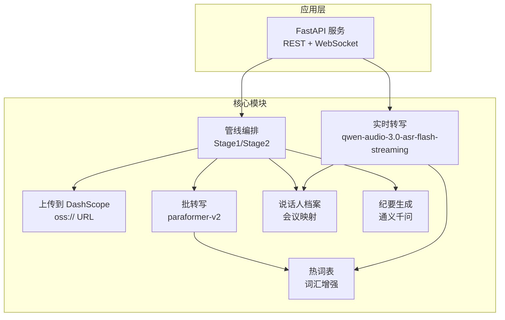
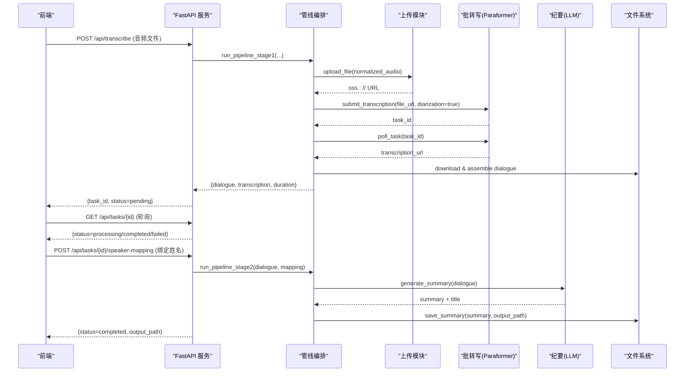
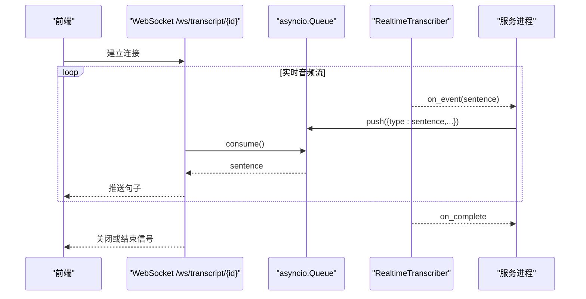
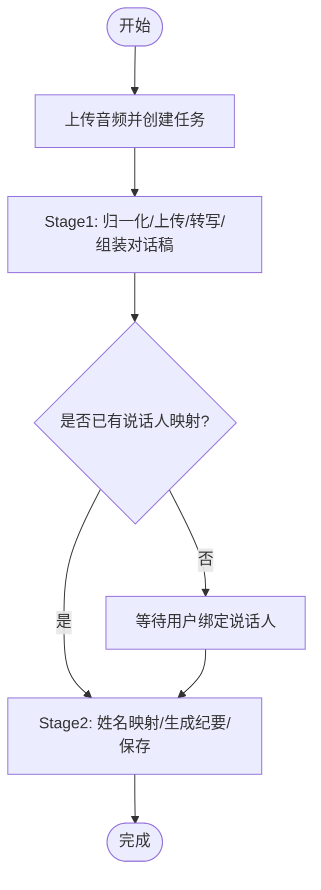
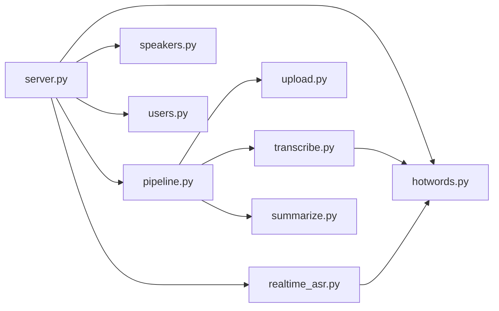

# API 架构设计

<cite>
**本文引用的文件**
- [app/server.py](file://app/server.py)
- [core/upload.py](file://core/upload.py)
- [core/transcribe.py](file://core/transcribe.py)
- [core/pipeline.py](file://core/pipeline.py)
- [core/realtime_asr.py](file://core/realtime_asr.py)
- [core/speakers.py](file://core/speakers.py)
- [core/users.py](file://core/users.py)
- [core/hotwords.py](file://core/hotwords.py)
- [core/summarize.py](file://core/summarize.py)
- [docs/API_CONTRACTS.md](file://docs/API_CONTRACTS.md)
- [docs/ARCHITECTURE.md](file://docs/ARCHITECTURE.md)
</cite>

## 目录
1. [简介](#简介)
2. [项目结构](#项目结构)
3. [核心组件](#核心组件)
4. [架构总览](#架构总览)
5. [详细组件分析](#详细组件分析)
6. [依赖关系分析](#依赖关系分析)
7. [性能与扩展性](#性能与扩展性)
8. [故障排查指南](#故障排查指南)
9. [结论](#结论)
10. [附录：API 端点清单与调用示例](#附录api-端点清单与调用示例)

## 简介
本文件面向 open-meeting-scribe 的 API 架构，系统性说明 RESTful 接口设计与组织方式、WebSocket 实时通信机制、版本控制策略、认证授权与安全、错误处理规范，以及最佳实践与调用示例。系统基于 FastAPI 提供本地 Web 服务，封装音频上传、任务管理、结果查询、流式录音与实时转写等能力，并通过云端 ASR 与 LLM 完成纪要生成。

## 项目结构
- 应用层（FastAPI）：统一暴露 REST 与 WebSocket 接口，负责请求路由、参数校验、后台任务编排与前端静态资源托管。
- 核心模块：
  - 音频采集与归一化：ffmpeg 标准化 PCM/WAV，支持内录设备。
  - 上传与转写：将本地文件上传至 DashScope 临时存储，提交异步转写任务并轮询结果。
  - 管线编排：串联“音频→转写→姓名映射→纪要”全流程，输出 Markdown 纪要。
  - 实时转写：通过 DashScope 实时语音识别 SDK 建立 WebSocket 连接，推送 PCM 数据并接收句子级结果。
  - 说话人档案与会话映射：维护全局说话人列表与会议映射历史，支持复用建议。
  - 热词表：读取本地热词文件，创建或复用云端热词表，并在后处理阶段进行文本纠正。
  - 用户信息：持久化当前用户与说话人绑定关系。
- 文档：架构决策、API 契约与路线图。

图表来源
- [app/server.py:1-21](file://app/server.py#L1-L21)
- [docs/ARCHITECTURE.md:18-40](file://docs/ARCHITECTURE.md#L18-L40)

章节来源
- [app/server.py:1-21](file://app/server.py#L1-L21)
- [docs/ARCHITECTURE.md:1-51](file://docs/ARCHITECTURE.md#L1-L51)

## 核心组件
- REST 接口：
  - 音频上传与任务创建：POST /api/transcribe
  - 任务查询与列表：GET /api/tasks/{id}、GET /api/tasks
  - 结果下载与音频播放：GET /api/download/{id}、GET /api/audio/{id}
  - 任务更新与删除：PATCH /api/tasks/{id}、DELETE /api/tasks/{id}
  - 说话人管理：CRUD /api/speakers/*
  - 会议映射保存与获取：/api/speakers/mapping/*
  - 说话人绑定触发纪要：POST /api/tasks/{task_id}/speaker-mapping
  - 重新生成纪要：POST /api/tasks/{task_id}/regenerate-summary
  - 录制控制：/api/record/start、/api/record/stop、/api/record/status
- WebSocket 接口：
  - WS /ws/transcript/{id}：实时转写消息推送（句子、摘要状态等）
- 管线与外部集成：
  - 上传至 DashScope 临时存储，获得 oss:// URL
  - 提交 paraformer-v2 异步转写任务，轮询直至完成
  - 组装对话稿，应用说话人姓名映射，调用通义千问生成纪要
  - 实时转写使用 qwen-audio-3.0-asr-flash-streaming，PCM 流式输入

章节来源
- [app/server.py:339-715](file://app/server.py#L339-L715)
- [core/pipeline.py:58-226](file://core/pipeline.py#L58-L226)
- [core/transcribe.py:61-187](file://core/transcribe.py#L61-L187)
- [core/upload.py:33-134](file://core/upload.py#L33-L134)
- [core/realtime_asr.py:150-368](file://core/realtime_asr.py#L150-L368)
- [core/speakers.py:109-325](file://core/speakers.py#L109-L325)
- [core/summarize.py:37-283](file://core/summarize.py#L37-L283)

## 架构总览
系统采用分层与职责清晰的设计：
- 采集层：ffmpeg 归一化为 16kHz/单声道/wav，支持 BlackHole 内录。
- 上云层：本地文件 → DashScope 临时存储 → oss:// 临时 URL（48h 有效）。
- 转写层：提交 paraformer-v2 异步任务，开启说话人分离；实时预览走 qwen-audio-3.0-asr-flash-streaming。
- 纪要层：通义千问根据对话稿生成结构化纪要（结论/待办/议题），并输出 Markdown。
- 界面层：FastAPI 托管前端，提供拖拽上传、录制、进度展示与纪要查看。

图表来源
- [app/server.py:343-497](file://app/server.py#L343-L497)
- [core/pipeline.py:58-226](file://core/pipeline.py#L58-L226)
- [core/upload.py:59-134](file://core/upload.py#L59-L134)
- [core/transcribe.py:61-187](file://core/transcribe.py#L61-L187)
- [core/summarize.py:157-283](file://core/summarize.py#L157-L283)

## 详细组件分析

### REST 接口设计与端点组织
- 设计原则
  - 资源导向：以“任务”“说话人”“会议映射”为核心资源，遵循 REST 动词语义。
  - 幂等与一致性：查询类接口幂等；更新/删除需校验状态与存在性。
  - 错误可观测：统一返回 HTTP 状态码与结构化错误信息。
  - 向后兼容：新增可选字段与兼容旧键名，避免破坏既有客户端。
- 端点分组
  - 任务管理：/api/transcribe、/api/tasks、/api/tasks/{id}、/api/download/{id}、/api/audio/{id}、/api/tasks/{id}（PATCH/DELETE）
  - 说话人与映射：/api/speakers/*、/api/speakers/mapping/*
  - 纪要生成触发：/api/tasks/{id}/speaker-mapping、/api/tasks/{id}/regenerate-summary
  - 录制控制：/api/record/start、/api/record/stop、/api/record/status
- 版本控制策略
  - 当前版本在应用元数据中声明为 v0.1.0；URL 未强制带版本号，但可通过响应头或文档约定保持兼容性。
  - 新增字段优先采用可选参数与默认值；废弃字段保留一段时间并提供迁移提示。
  - 对外部依赖（DashScope）变更通过内部适配层隔离，降低对上层 API 的影响。

章节来源
- [app/server.py:65-69](file://app/server.py#L65-L69)
- [app/server.py:339-715](file://app/server.py#L339-L715)

### WebSocket 实时通信机制
- 连接建立
  - 路径：WS /ws/transcript/{id}
  - 服务端维护每个任务的 asyncio.Queue，用于跨线程安全投递消息。
- 消息格式
  - 句子事件：type=sentence，包含 text、begin_time、end_time、speaker_id、speaker_name
  - 摘要状态：type=summary_status，包含 status
  - 摘要更新：type=summary_update，包含 content
- 事件处理
  - 实时转写回调在 SDK 线程执行，通过 _push_realtime_msg 将消息放入队列，由 WebSocket 协程消费。
  - 实时总结器增量生成摘要，通过回调推送摘要状态与内容。
  - 说话人姓名解析优先级：实时绑定映射 > 全局说话人列表 > 兜底“发言人N”。

图表来源
- [app/server.py:171-219](file://app/server.py#L171-L219)
- [core/realtime_asr.py:57-144](file://core/realtime_asr.py#L57-L144)
- [core/realtime_asr.py:216-327](file://core/realtime_asr.py#L216-L327)

章节来源
- [app/server.py:171-219](file://app/server.py#L171-L219)
- [core/realtime_asr.py:57-144](file://core/realtime_asr.py#L57-L144)
- [core/realtime_asr.py:216-327](file://core/realtime_asr.py#L216-L327)

### 音频上传与任务管理
- 音频上传
  - 支持常见音频格式，限制类型白名单。
  - 后台执行管线第一阶段：音频归一化、上传至 DashScope 临时存储、提交转写任务、组装对话稿。
  - 任务状态流转：pending → processing → awaiting_mapping → completed/failed。
- 任务管理
  - 列表与详情：按创建时间倒序；录音中任务附带已录制时长。
  - 下载与播放：支持 Range 请求，按扩展名设置 MIME。
  - 更新与删除：允许更新标题；删除时清理音频、纪要与持久化文件。
- 说话人绑定与纪要生成
  - 绑定后进入第二阶段：应用姓名映射、生成纪要与标题、保存 Markdown。
  - 支持重新生成纪要，自动从 UUID 映射或姓名映射反查。

图表来源
- [app/server.py:343-497](file://app/server.py#L343-L497)
- [core/pipeline.py:58-226](file://core/pipeline.py#L58-L226)

章节来源
- [app/server.py:343-497](file://app/server.py#L343-L497)
- [core/pipeline.py:58-226](file://core/pipeline.py#L58-L226)

### 错误处理与状态码定义
- 通用规则
  - 400：参数校验失败（如不支持的文件类型、空姓名、非法状态）。
  - 404：资源不存在（任务、音频文件、说话人）。
  - 5xx：服务端异常（外部服务超时、IO 错误、JSON 解析失败）。
- 具体场景
  - 上传类型校验：非白名单直接返回 400。
  - 任务不存在：查询/下载/删除均返回 404。
  - 转录失败：轮询检测到 FAILED 状态抛出运行时错误，转为 5xx。
  - 实时转写限流：SDK 回调返回错误，服务层重试并推送友好提示。
- 日志与可观测性
  - 关键步骤记录日志，便于定位问题。
  - 任务持久化 JSON 文件，重启后可恢复。

章节来源
- [app/server.py:343-497](file://app/server.py#L343-L497)
- [core/transcribe.py:134-187](file://core/transcribe.py#L134-L187)
- [core/realtime_asr.py:216-327](file://core/realtime_asr.py#L216-L327)

### 认证授权与安全
- 认证
  - 本地服务默认无鉴权；生产部署应增加网关或中间件（如 JWT/Bearer Token）。
  - 外部服务调用（DashScope）通过环境变量 DASHSCOPE_API_KEY 注入 Authorization 头。
- 安全建议
  - 限制上传文件大小与类型。
  - 对 oss:// URL 进行编码，避免特殊字符导致下载失败。
  - 敏感配置（API Key）不硬编码，使用 .env 管理。
  - 生产环境启用 HTTPS、访问控制与审计日志。

章节来源
- [core/upload.py:25-56](file://core/upload.py#L25-L56)
- [core/transcribe.py:54-97](file://core/transcribe.py#L54-L97)
- [core/realtime_asr.py:226-233](file://core/realtime_asr.py#L226-L233)

### 版本控制与向后兼容
- 应用版本：v0.1.0，位于 FastAPI 元数据。
- 兼容性策略
  - 新增字段设为可选，默认值保证旧客户端可用。
  - 废弃字段保留一段时间，提供迁移提示。
  - 对外部依赖变更通过内部适配层隔离，减少 API 面变化。
- 文档同步
  - API 契约与架构文档作为唯一事实源，代码注释引用文档而非重复描述。

章节来源
- [app/server.py:65-69](file://app/server.py#L65-L69)
- [docs/API_CONTRACTS.md:1-10](file://docs/API_CONTRACTS.md#L1-L10)
- [docs/ARCHITECTURE.md:1-16](file://docs/ARCHITECTURE.md#L1-L16)

## 依赖关系分析
- 模块耦合
  - server.py 依赖 pipeline、audio、transcribe、realtime_asr、speakers、users、hotwords、llm。
  - pipeline 串联 upload、transcribe、hotwords、summarize、speakers。
  - realtime_asr 与 speakers 协作实现实时说话人姓名解析。
- 外部依赖
  - DashScope：上传凭证、异步转写、实时识别、热词表、LLM。
  - ffmpeg：音频归一化与内录。
- 潜在循环依赖
  - 通过函数式调用与模块边界避免循环；必要时延迟导入（如 summarize 中使用 llm）。

图表来源
- [app/server.py:41-57](file://app/server.py#L41-L57)
- [core/pipeline.py:22-27](file://core/pipeline.py#L22-L27)
- [core/transcribe.py:190-190](file://core/transcribe.py#L190-L190)
- [core/realtime_asr.py:43-43](file://core/realtime_asr.py#L43-L43)

章节来源
- [app/server.py:41-57](file://app/server.py#L41-L57)
- [core/pipeline.py:22-27](file://core/pipeline.py#L22-L27)

## 性能与扩展性
- 性能要点
  - 后台任务：使用 BackgroundTasks 避免阻塞请求。
  - 轮询间隔与超时：合理设置 POLL_INTERVAL 与 POLL_TIMEOUT，平衡延迟与负载。
  - 实时音频包大小：建议 ~100ms（6400 bytes @16kHz/16bit/mono），降低延迟与丢包风险。
  - 缓冲区限制：实时转写缓冲最大条目数，防止内存增长。
- 扩展性建议
  - 引入消息队列（如 Redis/RabbitMQ）解耦任务与处理。
  - 持久化升级：任务与用户数据迁移至数据库，支持多实例部署。
  - 缓存层：热词表与最近映射结果缓存，减少重复计算。
  - 水平扩展：无状态 API 层 + 有状态处理节点，通过队列分发。

[本节为通用指导，无需特定文件来源]

## 故障排查指南
- 常见问题
  - 上传失败：检查 DASHSCOPE_API_KEY 与网络可达性；确认文件 ≤1GB。
  - 转写超时：检查轮询配置与外部服务状态；长音频建议分段。
  - 实时转写限流：服务层自动重试并推送友好提示；检查并发与限流策略。
  - 说话人分离无效：确保音频为单声道；检查 diarization_enabled 参数。
- 诊断步骤
  - 查看日志：关注上传、转写、汇总各阶段的日志输出。
  - 检查持久化文件：data/tasks/*.json、data/output/*.md。
  - 验证外部依赖：DashScope 控制台任务状态与计费。

章节来源
- [core/upload.py:59-134](file://core/upload.py#L59-L134)
- [core/transcribe.py:134-187](file://core/transcribe.py#L134-L187)
- [core/realtime_asr.py:216-327](file://core/realtime_asr.py#L216-L327)

## 结论
open-meeting-scribe 的 API 架构以 FastAPI 为中心，清晰划分采集、上云、转写、纪要与实时通信职责。REST 接口覆盖音频上传、任务管理、结果查询与说话人管理；WebSocket 提供低延迟的实时转写预览。通过管线编排与外部服务解耦，系统具备良好的可扩展性与可维护性。生产部署建议加强认证授权、持久化与监控告警，以提升稳定性与安全性。

[本节为总结，无需特定文件来源]

## 附录：API 端点清单与调用示例

### REST 端点清单
- 任务管理
  - POST /api/transcribe：上传音频并提交转写任务
  - GET /api/tasks：获取任务列表
  - GET /api/tasks/{id}：查询任务状态与结果
  - PATCH /api/tasks/{id}：更新任务信息（如标题）
  - DELETE /api/tasks/{id}：删除任务
  - GET /api/download/{id}：下载纪要文件
  - GET /api/audio/{id}：提供会议录音音频（支持 Range）
- 说话人与映射
  - GET /api/speakers：获取说话人列表
  - POST /api/speakers：添加说话人
  - PUT /api/speakers/{id}：更新说话人
  - DELETE /api/speakers/{id}：删除说话人
  - GET /api/speakers/mapping/latest：获取最近一次会议映射
  - POST /api/speakers/mapping：保存会议映射
- 纪要生成触发
  - POST /api/tasks/{id}/speaker-mapping：设置说话人映射并触发纪要生成
  - POST /api/tasks/{id}/regenerate-summary：重新生成纪要
- 录制控制
  - POST /api/record/start：开始流式录音与实时转写
  - POST /api/record/stop：停止录制并进入管线
  - GET /api/record/status：查询录制状态

章节来源
- [app/server.py:339-715](file://app/server.py#L339-L715)

### WebSocket 端点
- WS /ws/transcript/{id}：实时转写消息推送
  - 消息类型：sentence、summary_status、summary_update
  - 字段：text、begin_time、end_time、speaker_id、speaker_name、content、status

章节来源
- [app/server.py:171-219](file://app/server.py#L171-L219)
- [core/realtime_asr.py:57-144](file://core/realtime_asr.py#L57-L144)

### 调用示例（概念性）
- 上传音频并创建任务
  - 方法：POST
  - 路径：/api/transcribe
  - 表单：file（音频文件）、speaker_mapping（可选，JSON 字符串）
  - 响应：{task_id, status}
- 查询任务状态
  - 方法：GET
  - 路径：/api/tasks/{id}
  - 响应：任务详情（含 status、progress、message、error 等）
- 设置说话人映射并生成纪要
  - 方法：POST
  - 路径：/api/tasks/{id}/speaker-mapping
  - 请求体：{mapping: {"0": "uuid1", "1": "uuid2"}}
  - 响应：{status, message}
- 实时转写
  - 协议：WebSocket
  - 路径：/ws/transcript/{id}
  - 消息：接收 type=sentence 等事件，展示实时转写结果

[本节为概念性示例，无需特定文件来源]