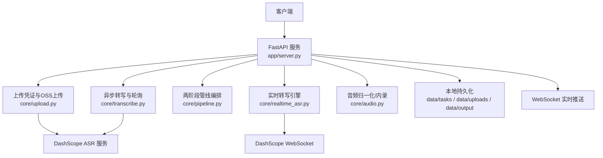
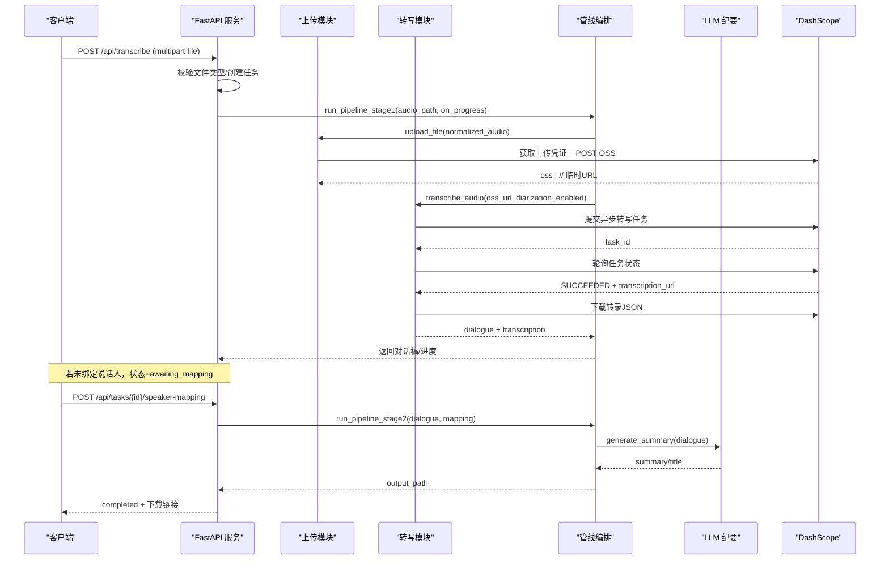
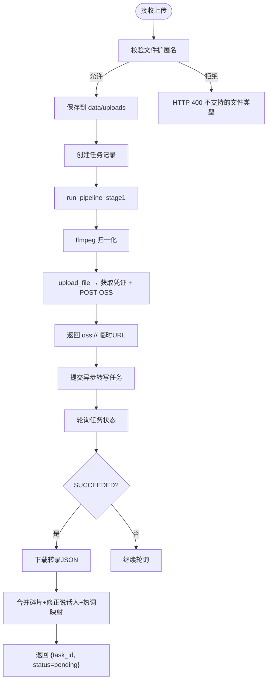
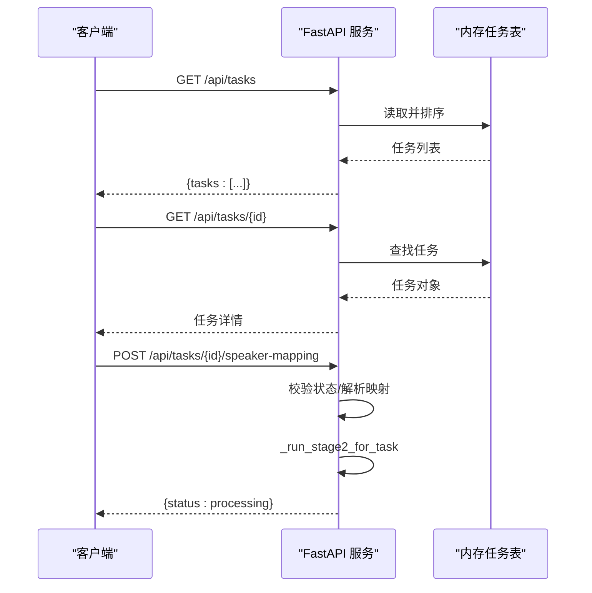
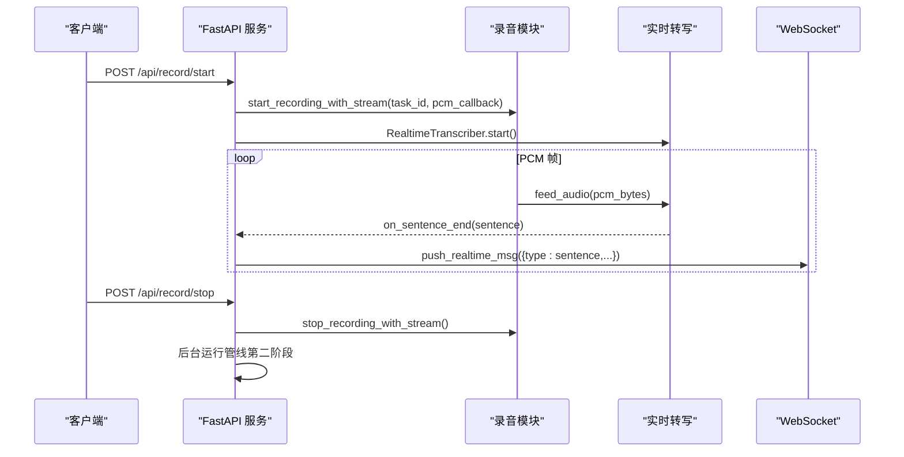
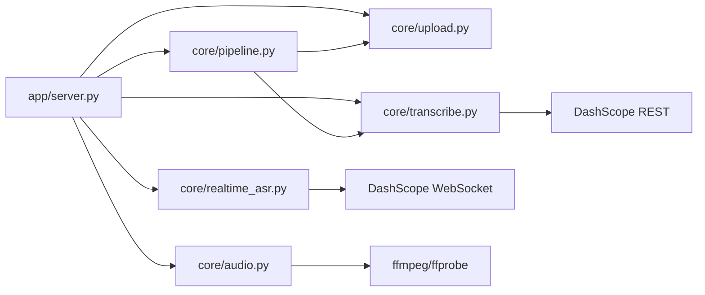

# RESTful API 设计

<cite>
**本文引用的文件**
- [app/server.py](file://app/server.py)
- [core/upload.py](file://core/upload.py)
- [core/transcribe.py](file://core/transcribe.py)
- [core/pipeline.py](file://core/pipeline.py)
- [core/realtime_asr.py](file://core/realtime_asr.py)
- [core/audio.py](file://core/audio.py)
- [docs/API_CONTRACTS.md](file://docs/API_CONTRACTS.md)
- [README.md](file://README.md)
</cite>

## 目录
1. [简介](#简介)
2. [项目结构](#项目结构)
3. [核心组件](#核心组件)
4. [架构总览](#架构总览)
5. [详细组件分析](#详细组件分析)
6. [依赖关系分析](#依赖关系分析)
7. [性能考量](#性能考量)
8. [故障排查指南](#故障排查指南)
9. [结论](#结论)
10. [附录：API 调用示例与错误处理](#附录api-调用示例与错误处理)

## 简介
本文件为 open-meeting-scribe 的 RESTful API 设计文档，聚焦以下目标：
- 音频上传接口实现：文件验证、格式转换、临时 URL 生成机制
- 任务管理接口：任务提交、状态查询、结果获取等核心功能
- 请求响应规范：数据模型、错误码与状态码约定
- 认证授权机制：API Key 验证与安全防护
- 批量处理模式与最佳实践
- 完整 API 调用示例与错误处理指南

本项目基于 FastAPI 提供本地 Web 服务，通过 DashScope 完成转写与纪要生成，支持流式录音与实时转写预览。

**章节来源**
- [README.md:1-39](file://README.md#L1-L39)

## 项目结构
- app/server.py：FastAPI 应用入口，定义所有 REST 端点、后台任务、WebSocket 实时推送、静态资源托管
- core/*：业务核心模块
  - upload.py：本地文件 → DashScope 临时存储 → oss:// 临时 URL
  - transcribe.py：异步转写任务提交、轮询、结果下载与对话稿组装
  - pipeline.py：两阶段管线编排（转写 + 纪要）
  - realtime_asr.py：实时转写引擎（qwen-audio-3.0-asr-flash-streaming）
  - audio.py：音频归一化（ffmpeg）、系统内录（BlackHole）
- docs/API_CONTRACTS.md：外部接口契约（DashScope 鉴权、上传、转写、结果字段、实时识别等）

**图表来源**
- [app/server.py:33-69](file://app/server.py#L33-L69)
- [core/upload.py:22-115](file://core/upload.py#L22-L115)
- [core/transcribe.py:26-131](file://core/transcribe.py#L26-L131)
- [core/pipeline.py:35-134](file://core/pipeline.py#L35-L134)
- [core/realtime_asr.py:47-54](file://core/realtime_asr.py#L47-L54)
- [core/audio.py:31-98](file://core/audio.py#L31-L98)

**章节来源**
- [app/server.py:1-21](file://app/server.py#L1-L21)
- [docs/API_CONTRACTS.md:1-176](file://docs/API_CONTRACTS.md#L1-L176)

## 核心组件
- 上传与临时 URL：通过 DashScope 上传凭证接口获取策略，POST 到 OSS，返回 oss:// 临时 URL（≤1GB，48h 有效）
- 异步转写：提交 paraformer-v2 转写任务，开启说话人分离；轮询任务状态至 SUCCEEDED；下载转录 JSON；合并碎片句子并修正说话人；按 speaker_id 归并为对话稿
- 两阶段管线：第一阶段（音频→对话稿），第二阶段（对话稿→纪要）；进度回调用于前端展示
- 实时转写：基于 qwen-audio-3.0-asr-flash-streaming 的流式识别，PCM 16bit/16kHz/单声道；不支持说话人分离，仅用于预览
- 音频归一化：使用 ffmpeg 将任意音频转为 16kHz/单声道/WAV，满足转写要求
- 任务持久化：内存任务表 + 磁盘 JSON；启动时恢复；删除任务清理文件

**章节来源**
- [core/upload.py:33-115](file://core/upload.py#L33-L115)
- [core/transcribe.py:61-131](file://core/transcribe.py#L61-L131)
- [core/pipeline.py:58-134](file://core/pipeline.py#L58-L134)
- [core/realtime_asr.py:150-368](file://core/realtime_asr.py#L150-L368)
- [core/audio.py:31-98](file://core/audio.py#L31-L98)
- [app/server.py:92-128](file://app/server.py#L92-L128)

## 架构总览
整体流程：
- 客户端 POST /api/transcribe 上传音频
- 服务端校验文件类型，保存本地，创建任务记录
- 后台执行第一阶段：音频归一化 → 上传到 DashScope → 提交异步转写 → 轮询 → 下载结果 → 组装对话稿
- 若未提供说话人映射，任务进入 awaiting_mapping；用户设置映射后触发第二阶段：姓名化 → 生成纪要 → 保存 Markdown
- 支持实时录制与转写预览，通过 WebSocket 推送句子与摘要更新

**图表来源**
- [app/server.py:343-396](file://app/server.py#L343-L396)
- [core/pipeline.py:58-134](file://core/pipeline.py#L58-L134)
- [core/upload.py:33-115](file://core/upload.py#L33-L115)
- [core/transcribe.py:61-131](file://core/transcribe.py#L61-L131)
- [core/transcribe.py:405-446](file://core/transcribe.py#L405-L446)

**章节来源**
- [app/server.py:335-396](file://app/server.py#L335-L396)
- [core/pipeline.py:58-226](file://core/pipeline.py#L58-L226)

## 详细组件分析

### 音频上传接口
- 端点：POST /api/transcribe
- 输入：multipart/form-data，包含 file 字段；可选参数 speaker_mapping（JSON 字符串）
- 文件验证：仅允许 .mp3/.wav/.m4a/.aac/.ogg/.flac/.mp4/.webm
- 保存路径：data/uploads/{task_id前缀}_{文件名}
- 后台处理：
  - 音频归一化（16kHz/单声道/WAV）
  - 上传到 DashScope 临时存储，获得 oss:// URL
  - 提交异步转写任务（paraformer-v2，开启说话人分离）
  - 轮询直至完成，下载转录 JSON，组装对话稿
- 响应：{task_id, status}

**图表来源**
- [app/server.py:343-396](file://app/server.py#L343-L396)
- [core/audio.py:31-98](file://core/audio.py#L31-L98)
- [core/upload.py:33-115](file://core/upload.py#L33-L115)
- [core/transcribe.py:61-131](file://core/transcribe.py#L61-L131)
- [core/transcribe.py:222-304](file://core/transcribe.py#L222-L304)
- [core/transcribe.py:307-352](file://core/transcribe.py#L307-L352)
- [core/transcribe.py:355-402](file://core/transcribe.py#L355-L402)

**章节来源**
- [app/server.py:343-396](file://app/server.py#L343-L396)
- [core/upload.py:33-115](file://core/upload.py#L33-L115)
- [core/transcribe.py:61-131](file://core/transcribe.py#L61-L131)

### 任务管理接口
- 列表：GET /api/tasks → 返回按 created_at 倒序的任务列表
- 详情：GET /api/tasks/{id} → 返回任务状态、进度、消息、音频时长、说话人数、摘要、输出路径等
- 下载：GET /api/download/{id} → 返回 Markdown 纪要文件
- 删除：DELETE /api/tasks/{id} → 删除任务及关联文件
- 更新：PATCH /api/tasks/{id} → 更新标题等元信息
- 说话人绑定：POST /api/tasks/{id}/speaker-mapping → 设置映射并触发纪要生成
- 重新生成：POST /api/tasks/{id}/regenerate-summary → 基于当前映射重新生成纪要

**图表来源**
- [app/server.py:399-415](file://app/server.py#L399-L415)
- [app/server.py:424-439](file://app/server.py#L424-L439)
- [app/server.py:475-497](file://app/server.py#L475-L497)
- [app/server.py:504-514](file://app/server.py#L504-L514)
- [app/server.py:630-671](file://app/server.py#L630-L671)
- [app/server.py:674-714](file://app/server.py#L674-L714)

**章节来源**
- [app/server.py:399-714](file://app/server.py#L399-L714)

### 实时录制与转写
- 开始录制：POST /api/record/start → 创建任务 ID，初始化队列、声纹聚类器、实时总结器，启动流式录音与实时转写
- 停止录制：POST /api/record/stop → 停止录音，自动进入管线
- 暂停/恢复：POST /api/record/pause, /api/record/resume
- 状态查询：GET /api/record/status → 返回是否录制中、已用时长、暂停状态
- 实时推送：WebSocket /ws/transcript/{id} → 推送句子、摘要更新、状态事件

**图表来源**
- [app/server.py:721-800](file://app/server.py#L721-L800)
- [core/realtime_asr.py:216-327](file://core/realtime_asr.py#L216-L327)
- [core/audio.py:139-200](file://core/audio.py#L139-L200)

**章节来源**
- [app/server.py:717-989](file://app/server.py#L717-L989)
- [core/realtime_asr.py:150-368](file://core/realtime_asr.py#L150-L368)
- [core/audio.py:139-200](file://core/audio.py#L139-L200)

### 数据模型与响应规范
- 任务状态模型 TaskStatus：包含 task_id、status、progress、message、audio_name、audio_duration、speaker_count、summary、output_path、created_at、error、dialogue、transcription、speaker_mapping
- 常见状态：pending、processing、awaiting_mapping、completed、failed
- 响应格式：统一 JSON；错误通过 HTTPException 抛出，携带 detail 消息
- 文件下载：FileResponse 直接返回二进制或文本内容

**章节来源**
- [app/server.py:138-152](file://app/server.py#L138-L152)
- [app/server.py:399-439](file://app/server.py#L399-L439)

### 认证授权机制
- 统一使用环境变量 DASHSCOPE_API_KEY
- 请求头 Authorization: Bearer {api_key}
- 公共端点：https://dashscope.aliyuncs.com
- 上传凭证接口限流 100 QPS
- 注意：当前 FastAPI 层未实现 API Key 校验中间件；外部访问建议在前置网关层进行鉴权

**章节来源**
- [docs/API_CONTRACTS.md:5-8](file://docs/API_CONTRACTS.md#L5-L8)
- [core/upload.py:25-30](file://core/upload.py#L25-L30)
- [core/transcribe.py:54-58](file://core/transcribe.py#L54-L58)
- [core/realtime_asr.py:229-233](file://core/realtime_asr.py#L229-L233)

### 批量处理接口的设计模式与最佳实践
- 当前实现以单任务为主，通过 BackgroundTasks 异步执行管线，避免阻塞请求线程
- 批量处理建议：
  - 客户端并发提交多个 /api/transcribe，服务端通过任务 ID 独立跟踪
  - 使用任务列表接口 /api/tasks 轮询汇总状态
  - 对大文件上传增加重试与断点续传逻辑（可在网关层实现）
  - 控制并发度，避免超过 DashScope 限流（上传凭证 100 QPS）
  - 失败任务可重试，成功任务避免重复提交

[本节为概念性指导，不直接分析具体文件]

## 依赖关系分析
- FastAPI 路由依赖 core 模块：pipeline、upload、transcribe、realtime_asr、audio
- 外部依赖：DashScope RESTful API 与 WebSocket
- 本地依赖：ffmpeg、ffprobe、BlackHole（macOS 内录）
- 数据存储：data/tasks、data/uploads、data/output

**图表来源**
- [app/server.py:41-57](file://app/server.py#L41-L57)
- [core/pipeline.py:22-27](file://core/pipeline.py#L22-L27)
- [core/transcribe.py:16-23](file://core/transcribe.py#L16-L23)
- [core/realtime_asr.py:29-44](file://core/realtime_asr.py#L29-L44)
- [core/audio.py:12-23](file://core/audio.py#L12-L23)

**章节来源**
- [app/server.py:41-57](file://app/server.py#L41-L57)
- [core/pipeline.py:22-27](file://core/pipeline.py#L22-L27)

## 性能考量
- 音频归一化：ffmpeg 超时保护（5 分钟），避免长时间阻塞
- 上传凭证：限流 100 QPS，需控制并发
- 异步转写：轮询间隔 3 秒，超时 600 秒；长音频建议分段
- 实时转写：每包 6400 bytes（100ms），语义断句提升可读性
- 内存任务表：重启丢失，生产环境应持久化到数据库
- 文件清理：删除任务时同步清理音频与纪要文件

[本节为通用性能讨论，不直接分析具体文件]

## 故障排查指南
- 文件类型不支持：检查扩展名是否在允许列表
- 任务不存在：确认 task_id 是否正确，或任务已被删除
- 纪要文件不存在：确认任务已完成且 output_path 存在
- 录制已在进行中：确保未重复启动录制
- 实时转写限流：自动重试（指数退避），检查网络与服务状态
- ffmpeg 不可用：安装 ffmpeg 并确保 PATH 正确

**章节来源**
- [app/server.py:350-354](file://app/server.py#L350-L354)
- [app/server.py:413-415](file://app/server.py#L413-L415)
- [app/server.py:427-433](file://app/server.py#L427-L433)
- [app/server.py:724-725](file://app/server.py#L724-L725)
- [core/realtime_asr.py:291-327](file://core/realtime_asr.py#L291-L327)
- [core/audio.py:82-95](file://core/audio.py#L82-L95)

## 结论
本 API 设计围绕“音频→转写→纪要”的核心流程，提供了完整的上传、任务管理、实时录制与转写能力。通过 DashScope 的临时存储与异步转写，实现了高可用与可扩展的处理链路。建议在网关层增加鉴权与限流，生产环境完善持久化与监控。

[本节为总结性内容，不直接分析具体文件]

## 附录：API 调用示例与错误处理

### 音频上传
- 方法：POST /api/transcribe
- 请求体：multipart/form-data，字段 file
- 响应：{task_id, status}
- 错误：
  - 400：不支持的文件类型
  - 500：上传或处理异常

**章节来源**
- [app/server.py:343-396](file://app/server.py#L343-L396)

### 任务查询
- 方法：GET /api/tasks/{id}
- 响应：任务详情（状态、进度、消息、音频时长、说话人数、摘要、输出路径等）
- 错误：
  - 404：任务不存在

**章节来源**
- [app/server.py:410-421](file://app/server.py#L410-L421)

### 下载纪要
- 方法：GET /api/download/{id}
- 响应：Markdown 文件
- 错误：
  - 404：任务不存在或纪要文件不存在

**章节来源**
- [app/server.py:424-439](file://app/server.py#L424-L439)

### 说话人绑定
- 方法：POST /api/tasks/{id}/speaker-mapping
- 请求体：{mapping: {"0": "uuid1", "1": "uuid2"}}
- 响应：{status: processing, message: "正在生成纪要..."}
- 错误：
  - 400：当前状态不允许设置说话人映射
  - 404：任务不存在

**章节来源**
- [app/server.py:630-671](file://app/server.py#L630-L671)

### 实时录制
- 开始：POST /api/record/start
- 停止：POST /api/record/stop
- 暂停/恢复：POST /api/record/pause, /api/record/resume
- 状态：GET /api/record/status
- 错误：
  - 400：未在录制中或已在录制中
  - 500：录制启动/停止失败

**章节来源**
- [app/server.py:721-989](file://app/server.py#L721-L989)

### 错误码约定
- 400：请求参数错误或业务状态不允许
- 404：资源不存在（任务、文件、说话人）
- 500：服务器内部错误（上传、处理、录制异常）

**章节来源**
- [app/server.py:350-354](file://app/server.py#L350-L354)
- [app/server.py:413-415](file://app/server.py#L413-L415)
- [app/server.py:427-433](file://app/server.py#L427-L433)
- [app/server.py:724-725](file://app/server.py#L724-L725)
- [app/server.py:862-876](file://app/server.py#L862-L876)
- [app/server.py:950-951](file://app/server.py#L950-L951)