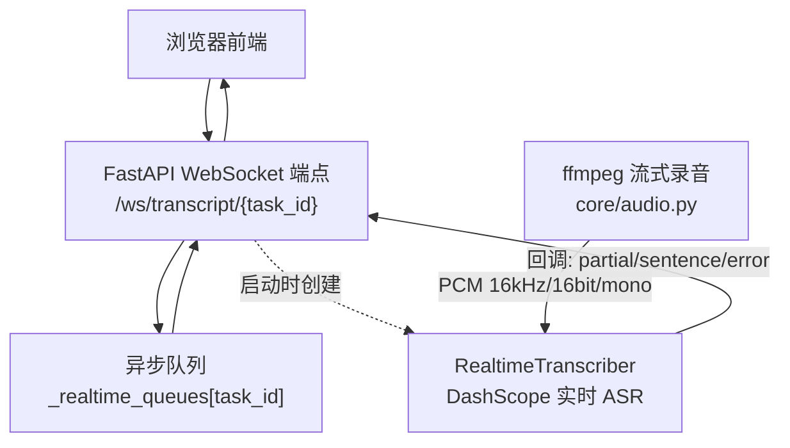
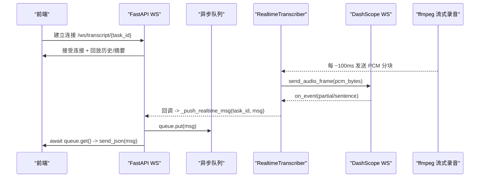
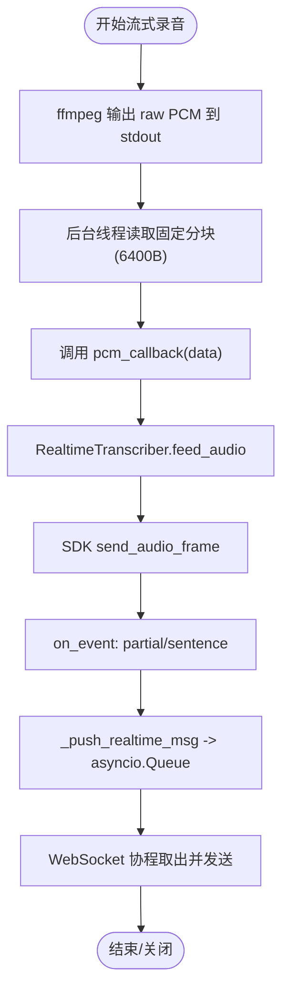
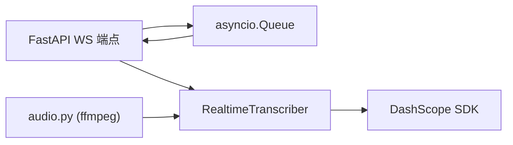

# WebSocket 实时通信

<cite>
**本文引用的文件**
- [app/server.py](file://app/server.py)
- [core/realtime_asr.py](file://core/realtime_asr.py)
- [core/audio.py](file://core/audio.py)
- [docs/API_CONTRACTS.md](file://docs/API_CONTRACTS.md)
- [app/static/index.html](file://app/static/index.html)
</cite>

## 目录
1. [简介](#简介)
2. [项目结构](#项目结构)
3. [核心组件](#核心组件)
4. [架构总览](#架构总览)
5. [详细组件分析](#详细组件分析)
6. [依赖关系分析](#依赖关系分析)
7. [性能考虑](#性能考虑)
8. [故障排查指南](#故障排查指南)
9. [结论](#结论)
10. [附录](#附录)

## 简介
本文件面向 open-meeting-scribe 的 WebSocket 实时通信机制，覆盖连接建立、握手协议、连接状态管理、实时转写数据流（PCM 音频帧格式、采样率与分块策略）、消息格式规范、事件处理模式、心跳保活与断线重连策略，以及客户端集成示例与性能优化建议。目标是帮助开发者快速理解并正确集成实时转写能力。

## 项目结构
- 服务端：FastAPI 应用提供 REST API 与 WebSocket 端点，负责录制、实时转写、说话人分离、总结生成与消息推送。
- 实时转写引擎：封装 DashScope 实时语音识别 SDK，维护 WebSocket 长连接、音频帧发送与回调分发。
- 音频采集：通过 ffmpeg 从系统设备采集 PCM 流，按固定分块大小送入实时 ASR，同时落盘为 WAV。
- 前端：浏览器页面创建 WebSocket 连接，接收并渲染临时结果、定稿句子、历史回放、摘要更新等消息。

图表来源
- [app/server.py:1760-1832](file://app/server.py#L1760-L1832)
- [core/realtime_asr.py:150-368](file://core/realtime_asr.py#L150-L368)
- [core/audio.py:303-438](file://core/audio.py#L303-L438)

章节来源
- [app/server.py:1-22](file://app/server.py#L1-L22)
- [core/realtime_asr.py:1-27](file://core/realtime_asr.py#L1-L27)
- [core/audio.py:1-10](file://core/audio.py#L1-L10)

## 核心组件
- FastAPI WebSocket 端点：负责接受连接、回放历史、轮询队列、超时关闭与异常处理。
- RealtimeTranscriber：封装 DashScope 实时识别 SDK，管理连接生命周期、重试、音频帧发送与回调分发。
- 音频采集模块：使用 ffmpeg 输出 raw PCM 到 stdout pipe，后台线程读取并按固定分块调用回调。
- 消息路由与缓冲：将 SDK 回调中的结果投递到 asyncio.Queue，供 WebSocket 协程消费；同时维护最近 N 条句子的缓冲区用于历史回放与 AI 上下文注入。

章节来源
- [app/server.py:158-200](file://app/server.py#L158-L200)
- [app/server.py:1760-1832](file://app/server.py#L1760-L1832)
- [core/realtime_asr.py:150-368](file://core/realtime_asr.py#L150-L368)
- [core/audio.py:303-438](file://core/audio.py#L303-L438)

## 架构总览
实时转写的端到端流程如下：
- 前端在开始录音后建立 WebSocket 连接到 /ws/transcript/{task_id}。
- 服务端启动流式录音，ffmpeg 输出 PCM 到管道，后台线程以固定分块读取并调用回调。
- 回调中将 PCM 数据送入 RealtimeTranscriber，SDK 内部维护与 DashScope 的 WebSocket 长连接。
- SDK 回调返回临时结果或定稿句子，服务端将其推入任务对应的 asyncio.Queue。
- WebSocket 协程从队列取消息并发送给前端；若连接刷新，先回放历史句子与当前摘要状态。

图表来源
- [app/server.py:1760-1832](file://app/server.py#L1760-L1832)
- [core/realtime_asr.py:216-327](file://core/realtime_asr.py#L216-L327)
- [core/audio.py:399-438](file://core/audio.py#L399-L438)

## 详细组件分析

### 连接建立与握手协议
- 前端连接：根据当前协议构造 ws/wss URL，连接到 /ws/transcript/{task_id}。
- 服务端接受：FastAPI 接受连接后，查找任务对应的异步队列；若不存在则返回错误并关闭。
- 历史回放：连接成功后立即回放近期定稿句子与当前摘要内容/状态，保证页面刷新不丢失上下文。
- 握手协议要点：
  - 地址：/ws/transcript/{task_id}
  - 鉴权：由上层业务控制（当前实现未对 WS 做额外鉴权）
  - 初始消息：服务端主动发送 history、summary_update、summary_status 等

章节来源
- [app/static/index.html:2337-2376](file://app/static/index.html#L2337-L2376)
- [app/server.py:1760-1832](file://app/server.py#L1760-L1832)

### 实时转写数据流与 PCM 格式
- 音频规格：PCM 16bit、单声道、16kHz。
- 分块策略：每次读取约 6400 字节（对应 100ms @16kHz/16bit/mono），通过回调送入实时 ASR。
- 传输路径：ffmpeg 输出 raw PCM → 后台线程读取 → 写入临时 raw 文件 → 调用 pcm_callback → RealtimeTranscriber.feed_audio → SDK 发送帧。
- 停止流程：终止 ffmpeg，等待读取线程退出，将 raw PCM 转为 WAV，清理状态。

图表来源
- [core/audio.py:303-438](file://core/audio.py#L303-L438)
- [core/realtime_asr.py:329-343](file://core/realtime_asr.py#L329-L343)
- [app/server.py:171-200](file://app/server.py#L171-L200)

章节来源
- [core/audio.py:303-438](file://core/audio.py#L303-L438)
- [core/realtime_asr.py:329-343](file://core/realtime_asr.py#L329-L343)
- [docs/API_CONTRACTS.md:114-176](file://docs/API_CONTRACTS.md#L114-L176)

### 消息格式规范
下行消息类型（服务端 → 前端）：
- partial：临时结果，包含文本、说话人 ID/名称、时间戳等。
- sentence：定稿句子，包含文本、说话人信息、起止时间。
- history：历史回放句子（连接恢复时）。
- summary_update：实时摘要内容更新。
- summary_status：实时摘要器状态（idle/paused）。
- speaker_bound：说话人绑定更新（当用户绑定说话人时）。
- error：错误消息。
- ended：转写结束信号。

章节来源
- [app/server.py:1760-1772](file://app/server.py#L1760-L1772)
- [app/server.py:1781-1815](file://app/server.py#L1781-L1815)

### 事件处理机制
- 连接事件：onopen/onclose/onerror 在前端统一处理，记录日志并重置连接对象。
- 数据事件：onmessage 解析 JSON，交由 handleTranscriptMessage 按 type 分发处理。
- 错误事件：onerror 捕获连接异常；服务端异常通过 error 消息通知前端。
- 统一模式：前端集中处理不同消息类型，避免分散逻辑；服务端通过队列解耦 SDK 回调与 WebSocket 发送。

章节来源
- [app/static/index.html:2337-2376](file://app/static/index.html#L2337-L2376)
- [app/static/index.html:2402-2500](file://app/static/index.html#L2402-L2500)
- [app/server.py:171-200](file://app/server.py#L171-L200)

### 心跳保活与断线重连
- 心跳保活：SDK 层启用 heartbeat=True，保持长连接，防止静音时断开。
- 限流重试：RealtimeTranscriber.start 遇到“请求过多”等限流错误时，指数退避重试最多 3 次，并在重试期间向用户反馈进度提示。
- 断线重连：前端在 onclose 中可触发重连逻辑（当前实现仅记录关闭事件，可在业务层扩展重连策略）。

章节来源
- [core/realtime_asr.py:216-327](file://core/realtime_asr.py#L216-L327)
- [docs/API_CONTRACTS.md:155-165](file://docs/API_CONTRACTS.md#L155-L165)
- [app/static/index.html:2337-2376](file://app/static/index.html#L2337-L2376)

### 客户端集成示例
- 连接构建：根据 location.protocol 选择 ws/wss，拼接 host 与路径 /ws/transcript/{taskId}。
- 事件监听：onopen 记录成功；onmessage 解析 JSON 并调用统一处理器；onerror/onclose 记录异常与关闭。
- 消息处理：partial 显示临时结果（斜体/占位），sentence 替换为正式条目，history 回放历史，summary_* 更新摘要面板。

章节来源
- [app/static/index.html:2337-2376](file://app/static/index.html#L2337-L2376)
- [app/static/index.html:2402-2500](file://app/static/index.html#L2402-L2500)

## 依赖关系分析
- FastAPI 与 WebSocket：提供端点与连接生命周期管理。
- RealtimeTranscriber 与 DashScope SDK：封装实时识别的 WebSocket 连接、参数配置、回调分发与重试。
- audio.py 与 ffmpeg：负责音频采集与 PCM 分块，确保格式与分块大小符合 SDK 要求。
- 异步队列：作为 SDK 回调线程与 WebSocket 协程之间的安全通道，避免跨线程直接操作异步资源。

图表来源
- [app/server.py:1760-1832](file://app/server.py#L1760-L1832)
- [core/realtime_asr.py:216-327](file://core/realtime_asr.py#L216-L327)
- [core/audio.py:303-438](file://core/audio.py#L303-L438)

章节来源
- [app/server.py:158-200](file://app/server.py#L158-L200)
- [core/realtime_asr.py:150-368](file://core/realtime_asr.py#L150-L368)
- [core/audio.py:303-438](file://core/audio.py#L303-L438)

## 性能考虑
- 分块大小：6400 字节（~100ms）平衡延迟与网络开销，避免过大导致抖动或过小增加包数。
- 采样率与声道：严格使用 16kHz/单声道/16bit，减少解码与模型输入转换成本。
- 语义断句：开启 semantic_punctuation_enabled，提升会议场景断句质量。
- 热词增强：支持 vocabulary_id 与即时 vocabulary，提高专有名词识别准确率。
- 上下文增强：通过 context 传入领域术语或对话历史，提升识别鲁棒性（注意长度限制）。
- 队列缓冲：限制历史缓冲区最大条目数，避免内存增长。
- 超时与重连：WS 协程设置 60 秒无消息超时，合理释放资源；SDK 层限流重试降低失败率。

章节来源
- [core/realtime_asr.py:235-248](file://core/realtime_asr.py#L235-L248)
- [core/audio.py:399-438](file://core/audio.py#L399-L438)
- [app/server.py:167-169](file://app/server.py#L167-L169)
- [docs/API_CONTRACTS.md:155-170](file://docs/API_CONTRACTS.md#L155-L170)

## 故障排查指南
- 连接失败：检查 DASHSCOPE_API_KEY 是否设置；确认 WebSocket 地址与权限；查看 SDK 回调 on_error 返回的错误信息。
- 限流错误：观察 RealtimeTranscriber 的重试日志；适当降低并发或等待退避时间。
- 音频格式不符：确认 ffmpeg 输出 s16le -ar 16000 -ac 1；检查分块大小是否为 6400 字节。
- 无消息到达：检查任务是否存在、队列是否关联；确认 _push_realtime_msg 是否被调用。
- 前端解析失败：确保 onmessage 中 JSON.parse 包裹 try/catch；核对消息字段是否符合规范。

章节来源
- [core/realtime_asr.py:226-327](file://core/realtime_asr.py#L226-L327)
- [core/audio.py:354-378](file://core/audio.py#L354-L378)
- [app/server.py:171-200](file://app/server.py#L171-L200)
- [app/static/index.html:2358-2366](file://app/static/index.html#L2358-L2366)

## 结论
本项目的 WebSocket 实时通信机制通过 FastAPI 端点、RealtimeTranscriber 与 ffmpeg 流式录音协同工作，实现了低延迟、高可用的实时转写预览。严格的音频格式与分块策略、健壮的重试与心跳机制、以及清晰的消息规范，为前端集成提供了稳定基础。建议在业务层补充断线重连与鉴权策略，并根据实际负载调优分块大小与上下文增强参数。

## 附录
- 关键环境变量：DASHSCOPE_API_KEY、DASHSCOPE_WS_URL（可选覆盖默认地址）。
- 推荐参数：semantic_punctuation_enabled=True、heartbeat=True、language_hints=["zh","en"]。
- 前端最佳实践：统一消息处理器、错误边界处理、历史回放与摘要状态同步。

章节来源
- [core/realtime_asr.py:47-55](file://core/realtime_asr.py#L47-L55)
- [docs/API_CONTRACTS.md:114-176](file://docs/API_CONTRACTS.md#L114-L176)
- [app/static/index.html:2337-2376](file://app/static/index.html#L2337-L2376)