# 数据流架构

<cite>
**本文引用的文件**   
- [core/pipeline.py](file://core/pipeline.py)
- [core/upload.py](file://core/upload.py)
- [core/transcribe.py](file://core/transcribe.py)
- [core/summarize.py](file://core/summarize.py)
- [core/audio.py](file://core/audio.py)
- [core/llm.py](file://core/llm.py)
- [core/speakers.py](file://core/speakers.py)
- [core/hotwords.py](file://core/hotwords.py)
- [core/realtime_asr.py](file://core/realtime_asr.py)
- [core/diarization.py](file://core/diarization.py)
- [core/realtime_summary.py](file://core/realtime_summary.py)
- [app/server.py](file://app/server.py)
- [docs/ARCHITECTURE.md](file://docs/ARCHITECTURE.md)
</cite>

## 目录
1. [引言](#引言)
2. [项目结构](#项目结构)
3. [核心组件](#核心组件)
4. [架构总览](#架构总览)
5. [详细组件分析](#详细组件分析)
6. [依赖关系分析](#依赖关系分析)
7. [性能考量](#性能考量)
8. [故障排查指南](#故障排查指南)
9. [结论](#结论)
10. [附录](#附录)

## 引言
本文件面向开发者，系统化阐述 open-meeting-scribe 的数据流架构：从音频输入到结构化纪要输出的完整流转过程。内容覆盖音频归一化、云端上传、异步转写与结果组装、说话人姓名化、LLM 摘要生成与持久化；同时说明异步处理机制、任务队列设计、错误恢复与数据一致性保障，并配套数据流图与时序图帮助理解全链路。

## 项目结构
系统采用分层模块化组织：采集与归一化（audio）、上云存储（upload）、转写与后处理（transcribe + hotwords）、LLM 提供与纪要生成（llm + summarize）、编排管线（pipeline）、实时能力（realtime_asr + diarization + realtime_summary）、Web API 与服务端状态管理（server），以及架构文档（ARCHITECTURE）。

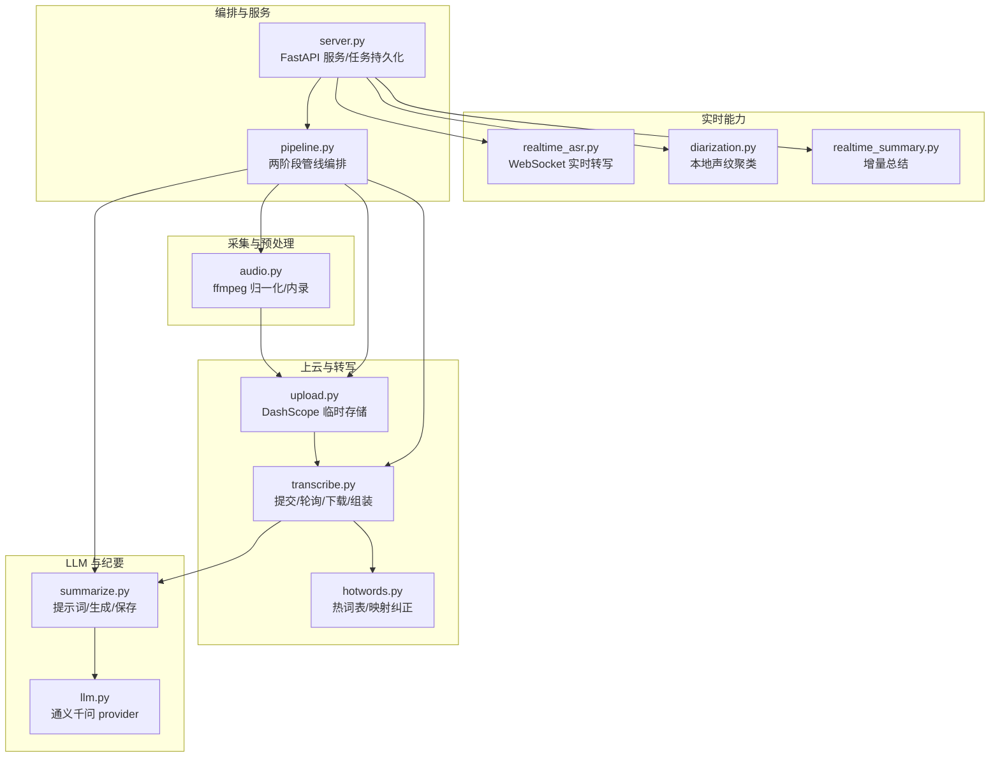

图表来源
- [docs/ARCHITECTURE.md:18-33](file://docs/ARCHITECTURE.md#L18-L33)
- [core/pipeline.py:1-12](file://core/pipeline.py#L1-L12)

章节来源
- [docs/ARCHITECTURE.md:5-16](file://docs/ARCHITECTURE.md#L5-L16)
- [core/pipeline.py:1-12](file://core/pipeline.py#L1-L12)

## 核心组件
- 音频归一化与内录：将任意音频统一为 16kHz/单声道/WAV，支持 macOS BlackHole 系统内录与流式 PCM 输出。
- 云端上传：获取 DashScope 上传凭证，POST 上传至 OSS，返回 oss:// 临时 URL（≤1GB，48h 有效）。
- 异步转写：提交 paraformer-v2 任务（可开启说话人分离），轮询直至完成，下载 JSON 结果并进行碎片合并、说话人修正、热词映射纠正，最终按 speaker_id 归并为对话稿。
- 说话人姓名化：将数字 speaker_id 映射为真实姓名，用于后续纪要展示与提示词构造。
- LLM 纪要生成：基于通义千问，生成结构化 Markdown 纪要（概要、结论、待办、议题）与会议标题，并保存到 data/output。
- 实时能力：通过 WebSocket 接入 qwen-audio-3.0-asr-flash-streaming，实现实时转写与增量总结；本地声纹聚类为实时句子标注说话人。
- 编排与服务：pipeline 串联全流程并提供进度回调；server 暴露 RESTful API，后台执行管线任务，持久化任务状态与结果。

章节来源
- [core/audio.py:31-98](file://core/audio.py#L31-L98)
- [core/upload.py:33-115](file://core/upload.py#L33-L115)
- [core/transcribe.py:61-131](file://core/transcribe.py#L61-L131)
- [core/transcribe.py:222-402](file://core/transcribe.py#L222-L402)
- [core/speakers.py:278-309](file://core/speakers.py#L278-L309)
- [core/summarize.py:157-229](file://core/summarize.py#L157-L229)
- [core/realtime_asr.py:150-368](file://core/realtime_asr.py#L150-L368)
- [core/diarization.py:282-525](file://core/diarization.py#L282-L525)
- [core/realtime_summary.py:68-270](file://core/realtime_summary.py#L68-L270)
- [core/pipeline.py:58-226](file://core/pipeline.py#L58-L226)
- [app/server.py:226-332](file://app/server.py#L226-L332)

## 架构总览
端到端数据流（批处理模式）：
- 音频输入 → ffmpeg 归一化为 16k/单声道/WAV
- 上传至 DashScope 临时存储，获得 oss:// URL
- 提交 paraformer-v2 异步转写任务（开启说话人分离）
- 轮询任务状态，下载结果 JSON
- 后处理：碎片合并、说话人修正、热词映射纠正
- 按 speaker_id 归并为对话稿
- 应用说话人姓名映射
- 调用 LLM 生成纪要与标题，保存 Markdown 到 data/output

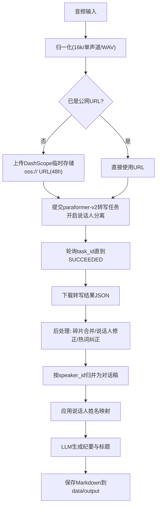

图表来源
- [docs/ARCHITECTURE.md:18-33](file://docs/ARCHITECTURE.md#L18-L33)
- [core/pipeline.py:95-133](file://core/pipeline.py#L95-L133)
- [core/transcribe.py:405-445](file://core/transcribe.py#L405-L445)
- [core/summarize.py:249-282](file://core/summarize.py#L249-L282)

章节来源
- [docs/ARCHITECTURE.md:18-40](file://docs/ARCHITECTURE.md#L18-L40)
- [core/pipeline.py:58-226](file://core/pipeline.py#L58-L226)

## 详细组件分析

### 管线编排（两阶段）
- 第一阶段：音频归一化 → 上传 → 热词准备 → 转写 → 组装对话稿，返回对话稿与原始转写结果。
- 第二阶段：应用说话人姓名映射 → 生成纪要与标题 → 保存 Markdown。
- 提供进度回调 PipelineProgress，便于 UI 显示阶段与百分比。

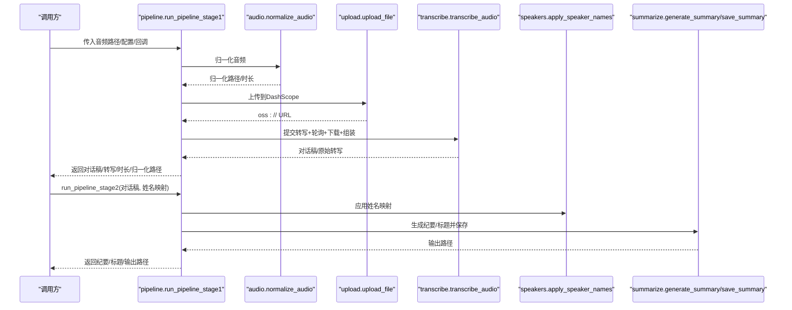

图表来源
- [core/pipeline.py:58-226](file://core/pipeline.py#L58-L226)
- [core/transcribe.py:405-445](file://core/transcribe.py#L405-L445)
- [core/speakers.py:278-309](file://core/speakers.py#L278-L309)
- [core/summarize.py:157-229](file://core/summarize.py#L157-L229)

章节来源
- [core/pipeline.py:58-226](file://core/pipeline.py#L58-L226)

### 音频归一化与内录
- 使用 ffmpeg 将任意格式转为 16kHz/单声道/WAV，满足转写与说话人分离要求。
- 支持 macOS BlackHole 系统内录，流式模式下以 raw PCM 输出并通过回调送入实时 ASR。
- 提供暂停/恢复录制、raw→WAV 转换、有效时长计算（扣除暂停时间）。

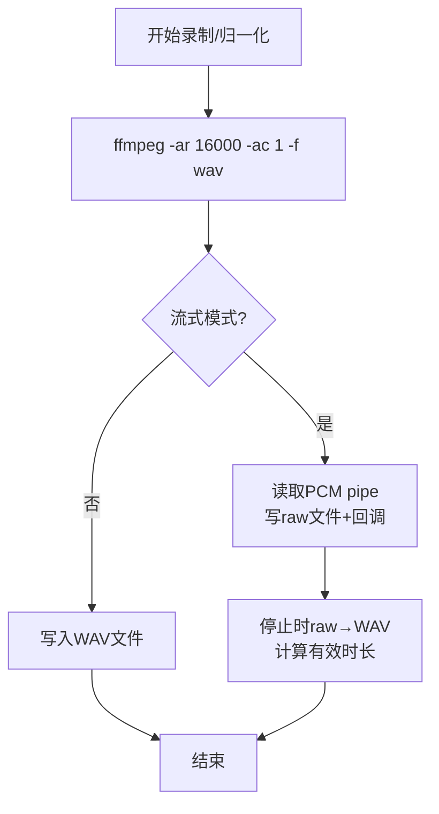

图表来源
- [core/audio.py:31-98](file://core/audio.py#L31-L98)
- [core/audio.py:303-515](file://core/audio.py#L303-L515)

章节来源
- [core/audio.py:31-98](file://core/audio.py#L31-L98)
- [core/audio.py:303-515](file://core/audio.py#L303-L515)

### 云端上传与转写
- 上传：获取上传凭证（getPolicy），POST 到 OSS，返回 oss:// URL（≤1GB，48h）。
- 转写：提交 paraformer-v2 异步任务，设置 X-DashScope-Async 与 oss 解析头；轮询 task_id 直到 SUCCEEDED；下载 transcription_url JSON；进行后处理并组装对话稿。

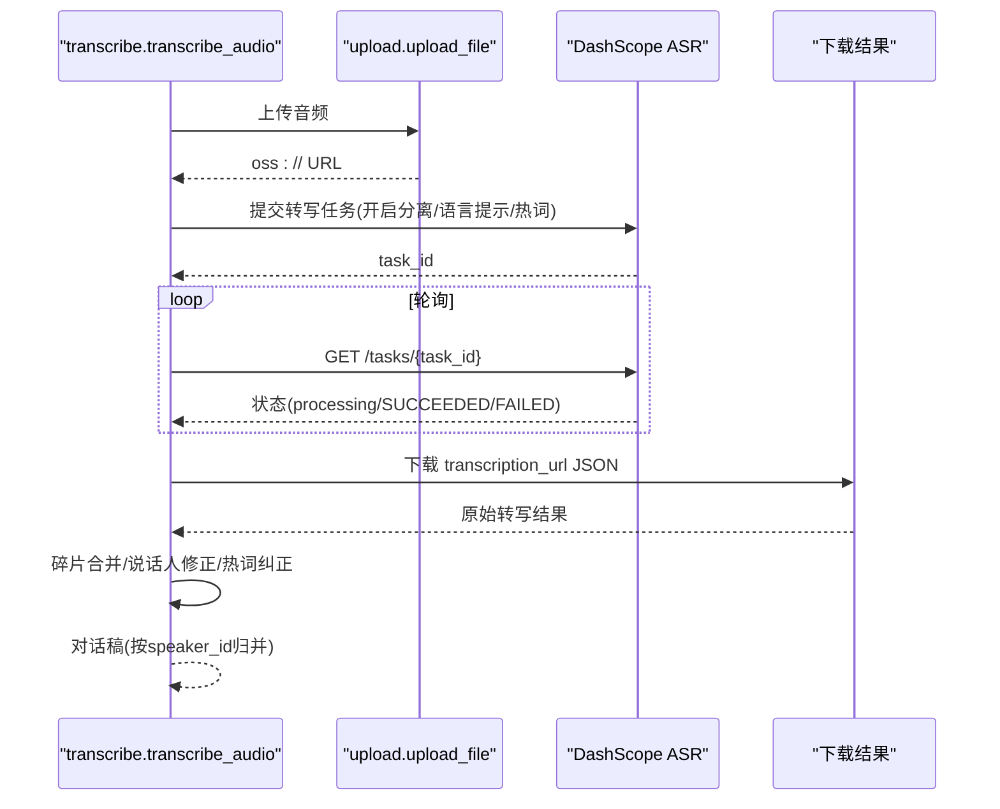

图表来源
- [core/upload.py:33-115](file://core/upload.py#L33-L115)
- [core/transcribe.py:61-131](file://core/transcribe.py#L61-L131)
- [core/transcribe.py:134-187](file://core/transcribe.py#L134-L187)
- [core/transcribe.py:222-402](file://core/transcribe.py#L222-L402)

章节来源
- [core/upload.py:33-115](file://core/upload.py#L33-L115)
- [core/transcribe.py:61-131](file://core/transcribe.py#L61-L131)
- [core/transcribe.py:134-187](file://core/transcribe.py#L134-L187)
- [core/transcribe.py:222-402](file://core/transcribe.py#L222-L402)

### 后处理与热词纠正
- 碎片合并：根据时间间隔阈值、短句长度、句末标点完整性、跨句拆词信号合并碎片。
- 说话人修正：夹心修正（A-B-A→A）与连续短句跟随前句说话人。
- 热词映射：从 data/hotword_mappings.txt 加载映射，对英文词使用词边界匹配，中文直接替换。

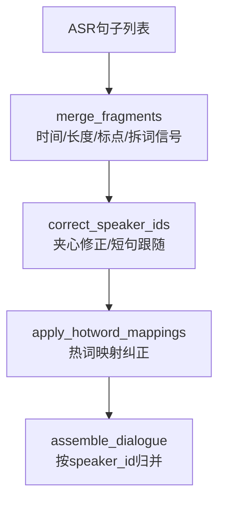

图表来源
- [core/transcribe.py:222-352](file://core/transcribe.py#L222-L352)
- [core/transcribe.py:355-402](file://core/transcribe.py#L355-L402)
- [core/hotwords.py:187-222](file://core/hotwords.py#L187-L222)

章节来源
- [core/transcribe.py:222-352](file://core/transcribe.py#L222-L352)
- [core/transcribe.py:355-402](file://core/transcribe.py#L355-L402)
- [core/hotwords.py:187-222](file://core/hotwords.py#L187-L222)

### 说话人姓名化与会话映射
- 维护全局说话人档案（data/speakers.json）与会议映射历史（data/meeting_mappings.json）。
- 将数字 speaker_id 映射为 UUID 再查姓名，应用到对话稿，供 LLM 提示词与展示使用。
- 支持最近一次会议映射复用建议。

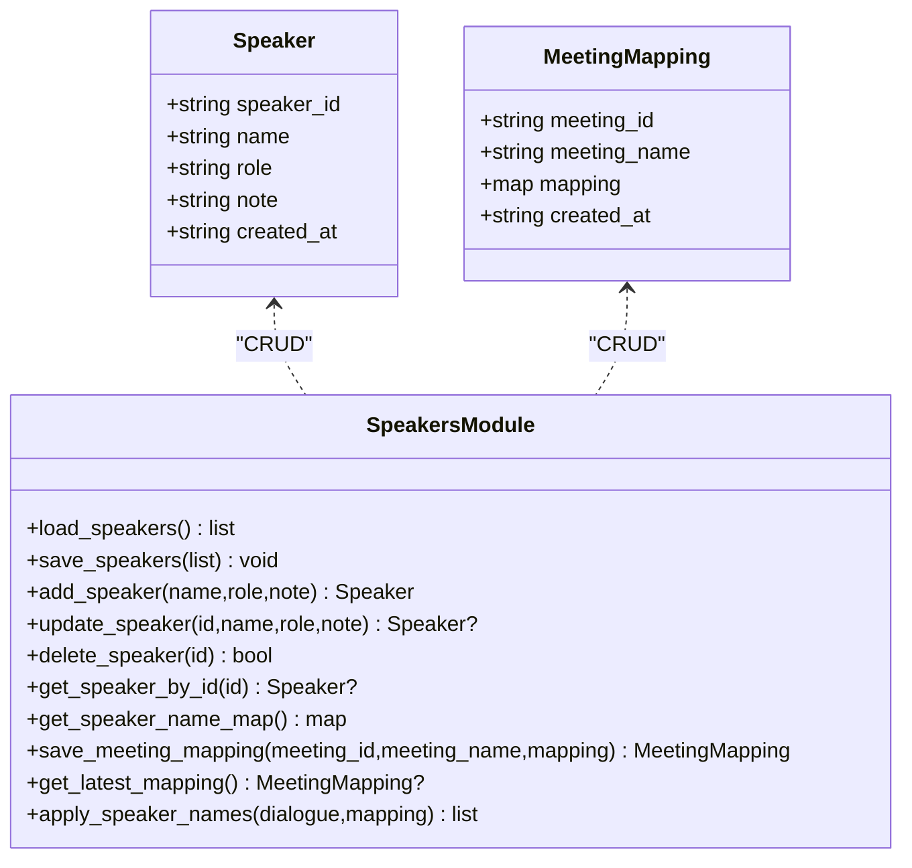

图表来源
- [core/speakers.py:35-103](file://core/speakers.py#L35-L103)
- [core/speakers.py:109-271](file://core/speakers.py#L109-L271)
- [core/speakers.py:278-309](file://core/speakers.py#L278-L309)

章节来源
- [core/speakers.py:35-103](file://core/speakers.py#L35-L103)
- [core/speakers.py:109-271](file://core/speakers.py#L109-L271)
- [core/speakers.py:278-309](file://core/speakers.py#L278-L309)

### LLM 纪要生成与标题
- 使用通义千问 OpenAI 兼容端点，同步/异步两种调用方式。
- 纪要生成包含严格提示词约束，输出结构化 Markdown（概要、结论、待办、议题），并附加原始对话稿。
- 标题生成截取对话前若干字符控制 token 消耗，限制长度并兜底默认值。

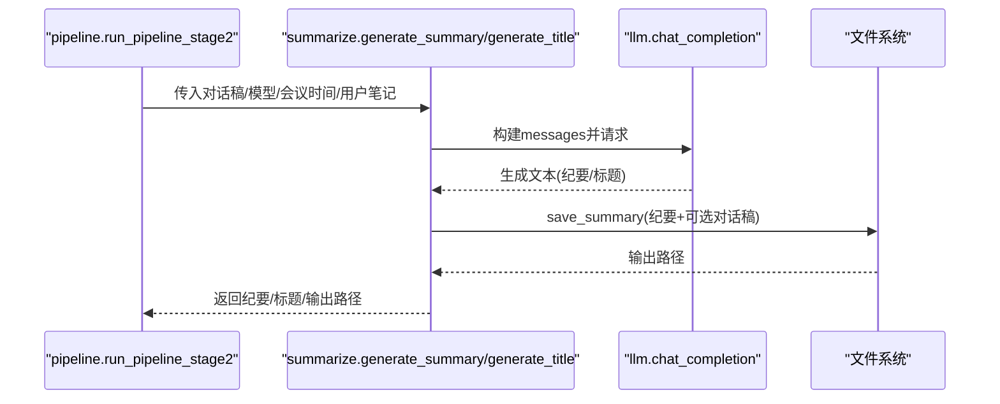

图表来源
- [core/summarize.py:37-84](file://core/summarize.py#L37-L84)
- [core/summarize.py:157-229](file://core/summarize.py#L157-L229)
- [core/summarize.py:249-282](file://core/summarize.py#L249-L282)
- [core/llm.py:89-121](file://core/llm.py#L89-L121)

章节来源
- [core/summarize.py:37-84](file://core/summarize.py#L37-L84)
- [core/summarize.py:157-229](file://core/summarize.py#L157-L229)
- [core/summarize.py:249-282](file://core/summarize.py#L249-L282)
- [core/llm.py:89-121](file://core/llm.py#L89-L121)

### 实时转写与增量总结
- 实时转写：通过 WebSocket 连接 qwen-audio-3.0-asr-flash-streaming，分片送入 PCM，回调推送临时/定稿句子；支持即时热词与上下文增强；具备限流重试。
- 声纹聚类：每 2 秒提取 MFCC+能量特征，余弦相似度匹配已知说话人或创建新说话人；根据时间段查询最可能说话人。
- 增量总结：每 60 秒触发一次 LLM 增量总结，首次仅当前缓冲，后续“上次摘要+新增片段”，低延迟模型 qwen-turbo。

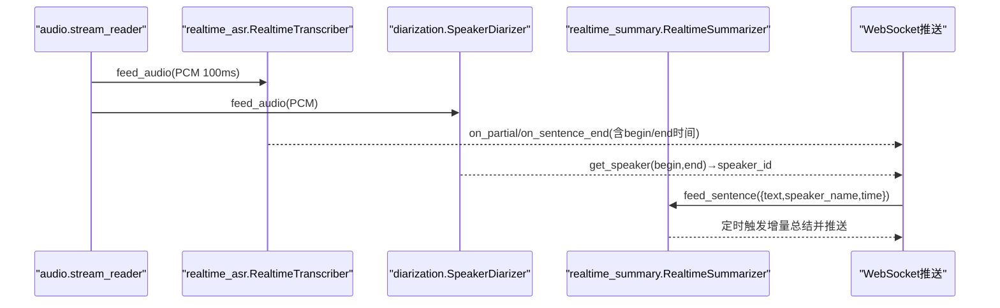

图表来源
- [core/realtime_asr.py:150-368](file://core/realtime_asr.py#L150-L368)
- [core/diarization.py:282-525](file://core/diarization.py#L282-L525)
- [core/realtime_summary.py:68-270](file://core/realtime_summary.py#L68-L270)
- [app/server.py:721-800](file://app/server.py#L721-L800)

章节来源
- [core/realtime_asr.py:150-368](file://core/realtime_asr.py#L150-L368)
- [core/diarization.py:282-525](file://core/diarization.py#L282-L525)
- [core/realtime_summary.py:68-270](file://core/realtime_summary.py#L68-L270)
- [app/server.py:721-800](file://app/server.py#L721-L800)

### Web 服务与任务持久化
- FastAPI 提供上传、任务查询、下载纪要、删除任务、说话人管理等 RESTful 接口。
- 后台线程执行管线任务，更新任务状态与进度；启动时从磁盘恢复任务，避免重启丢失。
- 任务数据持久化为 JSON（剔除大字段 transcription），支持迁移清理。

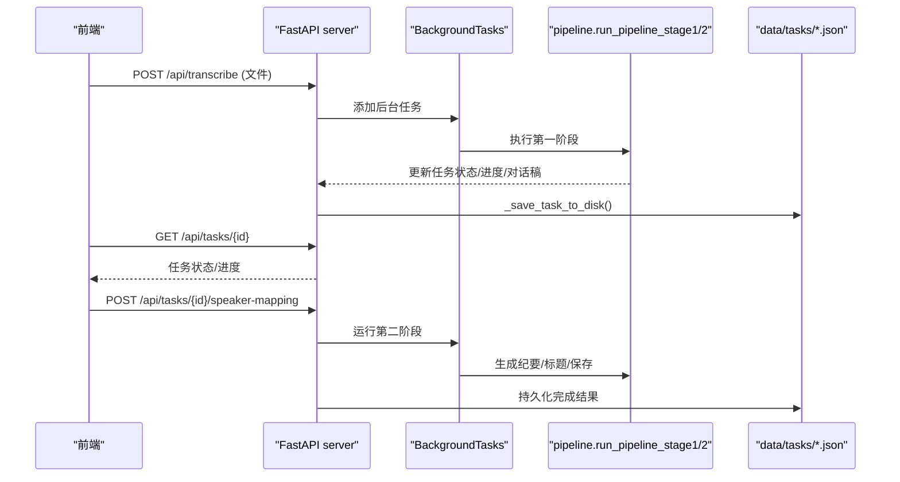

图表来源
- [app/server.py:343-396](file://app/server.py#L343-L396)
- [app/server.py:226-332](file://app/server.py#L226-L332)
- [app/server.py:92-128](file://app/server.py#L92-L128)

章节来源
- [app/server.py:343-396](file://app/server.py#L343-L396)
- [app/server.py:226-332](file://app/server.py#L226-L332)
- [app/server.py:92-128](file://app/server.py#L92-L128)

## 依赖关系分析
- 模块耦合：
  - pipeline 强依赖 audio、upload、transcribe、hotwords、summarize、speakers。
  - transcribe 依赖 hotwords 进行后处理纠正。
  - summarize 依赖 llm 提供 LLM 调用。
  - server 编排 pipeline 与实时组件，负责持久化与 API。
- 外部依赖：
  - ffmpeg/ffprobe（音频处理）
  - DashScope（上传、转写、LLM、实时转写）
  - numpy/scipy（声纹特征提取）
- 潜在循环依赖：无显式循环导入；各模块职责清晰，通过函数级调用解耦。

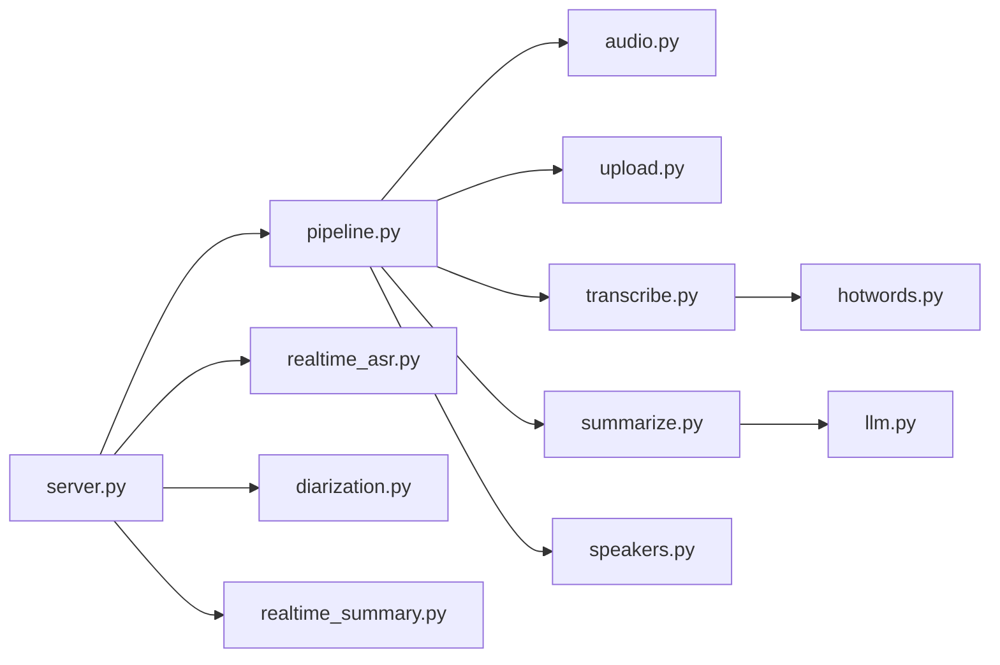

图表来源
- [core/pipeline.py:20-27](file://core/pipeline.py#L20-L27)
- [core/transcribe.py:190-190](file://core/transcribe.py#L190-L190)
- [core/summarize.py:14-14](file://core/summarize.py#L14-L14)
- [app/server.py:41-57](file://app/server.py#L41-L57)

章节来源
- [core/pipeline.py:20-27](file://core/pipeline.py#L20-L27)
- [core/transcribe.py:190-190](file://core/transcribe.py#L190-L190)
- [core/summarize.py:14-14](file://core/summarize.py#L14-L14)
- [app/server.py:41-57](file://app/server.py#L41-L57)

## 性能考量
- 音频格式：统一 16kHz/单声道/WAV，降低转写与分离复杂度，提升稳定性。
- 上传体积：限制 ≤1GB，常规会议足够；超长会议建议分段或自建 OSS。
- 轮询策略：固定间隔与超时控制，避免长时间阻塞；失败快速报错。
- 实时转写：100ms 分片、心跳保活、限流指数退避重试，保证长连接稳定。
- 增量总结：60s 周期、低延迟模型、截断上次摘要控制 token 消耗。
- 文件 IO：批量写入与 raw→WAV 转换，减少频繁小文件操作。

[本节为通用性能指导，不直接分析具体文件]

## 故障排查指南
- 未设置 API Key：检查环境变量 DASHSCOPE_API_KEY。
- ffmpeg 不可用：确认已安装且可用；macOS 需配置 BlackHole 设备名。
- 上传失败：检查网络与权限；确保文件大小 ≤1GB；oss:// URL 特殊字符需编码。
- 转写失败：查看任务状态与错误信息；确认单声道与语言提示；必要时调整热词表。
- 实时转写限流：自动重试（指数退避），若持续失败请降低并发或更换地域。
- 任务持久化异常：检查 data/tasks 目录权限；启动时会自动迁移剔除冗余字段。

章节来源
- [core/upload.py:25-30](file://core/upload.py#L25-L30)
- [core/upload.py:118-133](file://core/upload.py#L118-L133)
- [core/transcribe.py:134-175](file://core/transcribe.py#L134-L175)
- [core/realtime_asr.py:254-327](file://core/realtime_asr.py#L254-L327)
- [app/server.py:92-128](file://app/server.py#L92-L128)

## 结论
open-meeting-scribe 通过清晰的模块化设计与两阶段管线编排，实现了从音频输入到结构化纪要的完整数据流。系统兼顾离线批处理与实时预览能力，结合热词纠正、说话人姓名化与 LLM 结构化输出，形成高可用、可扩展的会议纪要解决方案。服务端通过后台任务与磁盘持久化保障任务可恢复性与一致性，适合本地部署与轻量生产场景。

[本节为总结性内容，不直接分析具体文件]

## 附录
- 关键数据格式与转换规则：
  - 音频：任意格式 → 16kHz/单声道/WAV（ffmpeg）
  - 上传：本地文件 → oss:// URL（DashScope 临时存储）
  - 转写：oss:// URL → 异步任务 → JSON 结果（带 speaker_id、时间戳）
  - 对话稿：按 speaker_id 归并，应用姓名映射
  - 纪要：Markdown 结构化输出，附加原始对话稿
- 异步与队列：
  - 转写：提交 → 轮询 → 下载（RESTful）
  - 实时：WebSocket 流式传输，SDK 内部线程回调，通过 asyncio.Queue 推送到 WebSocket
- 持久化与缓存：
  - 任务状态与结果持久化为 JSON（剔除大字段）
  - 实时转写缓冲保留最近 N 条句子，控制内存占用
- 错误恢复与一致性：
  - 限流重试、超时保护、异常日志记录
  - 启动时恢复任务，迁移冗余字段，保证状态一致

[本节为补充说明，不直接分析具体文件]