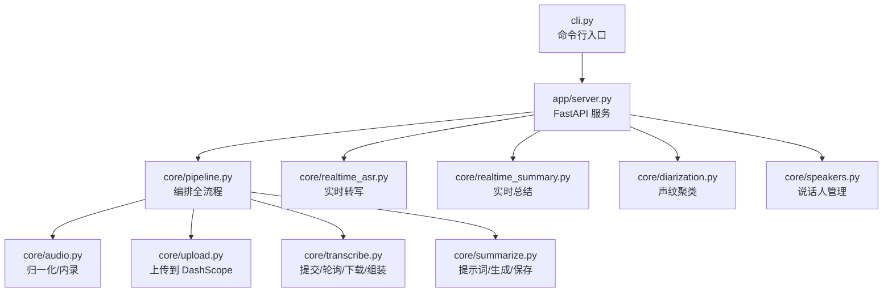
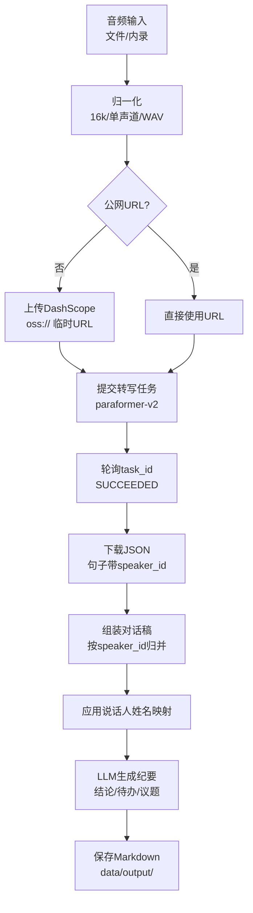
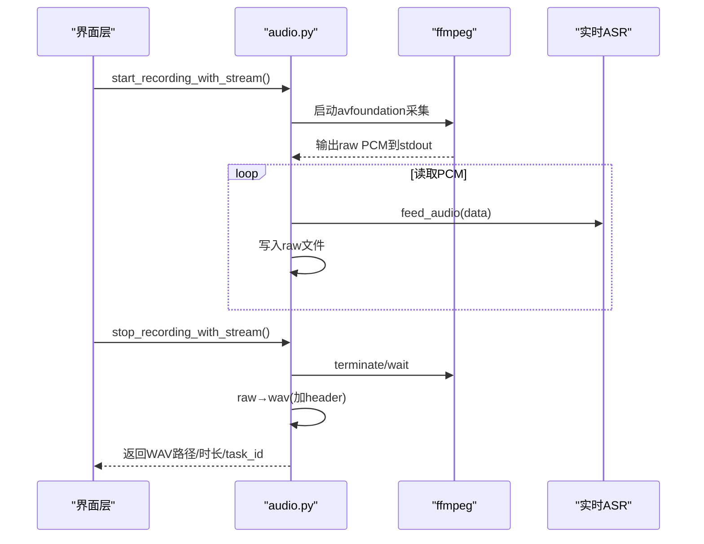
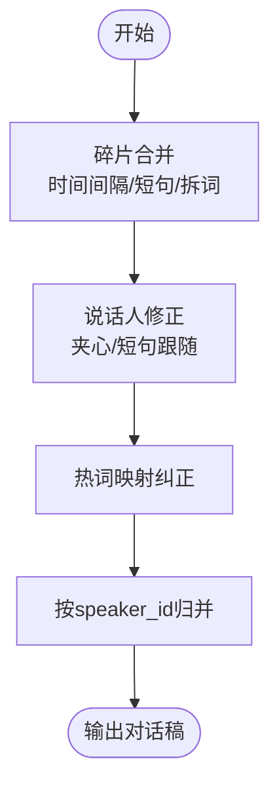
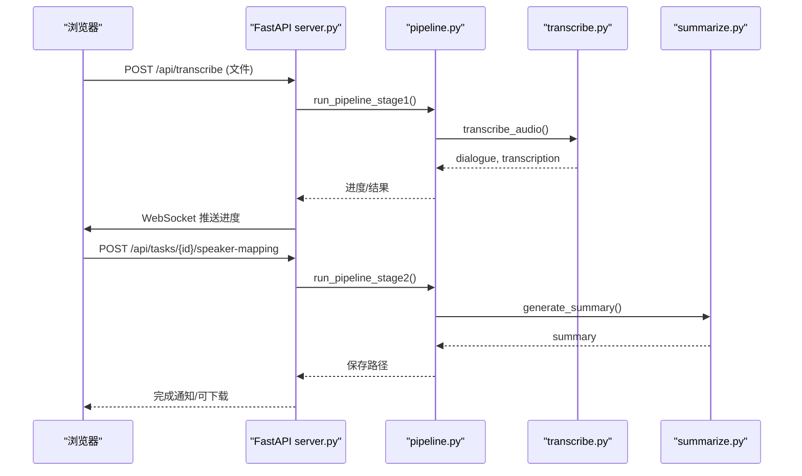
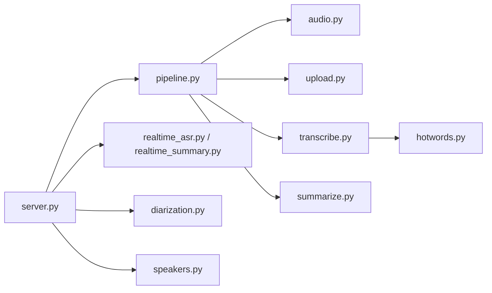

# 整体架构设计

<cite>
**本文引用的文件**
- [README.md](file://README.md)
- [docs/ARCHITECTURE.md](file://docs/ARCHITECTURE.md)
- [MVP_PLAN.md](file://MVP_PLAN.md)
- [app/server.py](file://app/server.py)
- [core/pipeline.py](file://core/pipeline.py)
- [core/upload.py](file://core/upload.py)
- [core/transcribe.py](file://core/transcribe.py)
- [core/summarize.py](file://core/summarize.py)
- [core/audio.py](file://core/audio.py)
- [cli.py](file://cli.py)
- [requirements.txt](file://requirements.txt)
- [docs/adr/0001-mvp走云方案.md](file://docs/adr/0001-mvp走云方案.md)
- [docs/adr/0002-asr选paraformer-v2.md](file://docs/adr/0002-asr选paraformer-v2.md)
</cite>

## 目录
1. [引言](#引言)
2. [项目结构](#项目结构)
3. [核心组件](#核心组件)
4. [架构总览](#架构总览)
5. [详细组件分析](#详细组件分析)
6. [依赖关系分析](#依赖关系分析)
7. [性能与可扩展性](#性能与可扩展性)
8. [故障排查指南](#故障排查指南)
9. [结论](#结论)
10. [附录](#附录)

## 引言
本文件为 open-meeting-scribe 的整体架构设计文档，聚焦分层架构模式在“采集层、上云层、转写层、纪要层、编排层、界面层”的职责划分，解释模块化设计与微服务思想在本项目的体现，描述各层之间的依赖关系与通信机制，并说明技术选型决策（FastAPI、DashScope 云服务、ffmpeg 等）的原因。同时给出系统边界与非目标说明，并提供架构图展示组件交互和数据流向。

## 项目结构
- 顶层入口：命令行工具 cli.py，提供本地 Web 服务启动与任务管理。
- 应用层：app/server.py 基于 FastAPI 暴露 RESTful API 与 WebSocket，托管静态前端页面，负责任务调度与实时推送。
- 核心能力：core/ 下按职责拆分为音频处理、上传、转写、热词、LLM 调用、摘要生成、说话人分离、管线编排等模块。
- 数据与配置：data/ 存放热词表、说话人映射等；requirements.txt 声明运行依赖。
- 文档与决策：docs/ 包含架构、PRD、路线图、ADR 等；README.md 提供快速上手与文档地图。

**图表来源**
- [cli.py:201-219](file://cli.py#L201-L219)
- [app/server.py:33-57](file://app/server.py#L33-L57)
- [core/pipeline.py:22-27](file://core/pipeline.py#L22-L27)

**章节来源**
- [README.md:1-39](file://README.md#L1-L39)
- [docs/ARCHITECTURE.md:5-16](file://docs/ARCHITECTURE.md#L5-L16)

## 核心组件
- 采集层（core/audio.py）：使用 ffmpeg 将任意音频归一化为 16kHz/单声道/WAV；通过 BlackHole + avfoundation 实现 macOS 系统内录；支持流式 PCM 输出，供实时 ASR 消费。
- 上云层（core/upload.py）：获取 DashScope 临时存储凭证，上传本地文件至 OSS，返回 oss:// 临时 URL（≤1GB/48h）。
- 转写层（core/transcribe.py）：提交 paraformer-v2 异步转写任务（开启说话人分离），轮询 task_id 直至完成，下载结果 JSON，执行碎片合并、说话人修正、热词映射，并按 speaker_id 组装对话稿。
- 热词层（core/hotwords.py）：读取 data/hotwords.txt，创建或复用 DashScope 热词表 vocabulary_id，提升识别准确率。
- 纪要层（core/llm.py, core/summarize.py）：调用通义千问 LLM 生成会议标题与结构化纪要（结论/待办/议题），保存 Markdown 到 data/output/。
- 编排层（core/pipeline.py）：串联“归一化→上传→热词→转写→姓名化→摘要→保存”，提供进度回调与两阶段接口（Stage1 转写、Stage2 纪要）。
- 界面层（app/server.py, app/static/）：FastAPI 提供上传、任务查询、下载、录制控制、WebSocket 实时转写推送；托管前端页面，驱动用户交互。
- 入口（cli.py）：封装 HTTP 请求到本地服务，提供 transcribe、record、tasks、speakers、hotwords、settings、chat 等子命令。

**章节来源**
- [core/audio.py:31-98](file://core/audio.py#L31-L98)
- [core/upload.py:59-115](file://core/upload.py#L59-L115)
- [core/transcribe.py:61-131](file://core/transcribe.py#L61-L131)
- [core/summarize.py:157-229](file://core/summarize.py#L157-L229)
- [core/pipeline.py:58-134](file://core/pipeline.py#L58-L134)
- [app/server.py:33-57](file://app/server.py#L33-L57)
- [cli.py:103-147](file://cli.py#L103-L147)

## 架构总览
采用分层架构与模块化设计，遵循“单一职责、低耦合、可替换”的原则。每层通过明确定义的接口进行交互，便于独立演进与测试。微服务思想体现在：
- 功能解耦：上传、转写、摘要各自独立模块，可通过替换 provider 实现多后端兼容（如 OpenAI 兼容端点）。
- 异步与事件驱动：转写任务异步提交与轮询；WebSocket 实时推送转写结果；后台线程处理 PCM 流。
- 外部依赖隔离：DashScope RESTful API、ffmpeg、BlackHole 作为外部服务/工具，通过薄封装接入。

**图表来源**
- [docs/ARCHITECTURE.md:18-33](file://docs/ARCHITECTURE.md#L18-L33)
- [core/pipeline.py:95-134](file://core/pipeline.py#L95-L134)
- [core/transcribe.py:405-446](file://core/transcribe.py#L405-L446)
- [core/summarize.py:157-229](file://core/summarize.py#L157-L229)

**章节来源**
- [docs/ARCHITECTURE.md:5-16](file://docs/ARCHITECTURE.md#L5-L16)
- [MVP_PLAN.md:44-79](file://MVP_PLAN.md#L44-L79)

## 详细组件分析

### 采集层（core/audio.py）
- 职责：音频格式归一化、时长查询、macOS 系统内录（BlackHole）、流式 PCM 输出。
- 关键点：
  - 强制单声道以满足说话人分离要求。
  - 流式录音通过 ffmpeg 输出 raw PCM 到 stdout pipe，后台线程读取并回调实时 ASR。
  - 暂停/恢复逻辑累计暂停时长，确保最终 WAV 时长准确。
- 复杂度：I/O 密集，受限于 ffmpeg 进程与管道吞吐；PCM 块大小 6400 字节（100ms @16kHz/16bit/mono）。

**图表来源**
- [core/audio.py:303-396](file://core/audio.py#L303-L396)
- [core/audio.py:440-515](file://core/audio.py#L440-L515)

**章节来源**
- [core/audio.py:31-98](file://core/audio.py#L31-L98)
- [core/audio.py:303-396](file://core/audio.py#L303-L396)

### 上云层（core/upload.py）
- 职责：获取上传凭证、POST 上传到 DashScope OSS、返回 oss:// 临时 URL。
- 约束：仅接受公网 URL；oss:// 需特定 header；文件大小 ≤1GB；有效期 48h。
- 错误处理：文件不存在、过大、HTTP 非 200 时抛出异常。

**章节来源**
- [core/upload.py:25-56](file://core/upload.py#L25-L56)
- [core/upload.py:59-115](file://core/upload.py#L59-L115)

### 转写层（core/transcribe.py）
- 职责：提交异步转写任务、轮询状态、下载结果、后处理（碎片合并、说话人修正、热词映射）、组装对话稿。
- 关键算法：
  - 碎片合并：基于时间间隔阈值、短句阈值、跨句拆词检测。
  - 说话人修正：夹心修正与连续短句跟随前句说话人。
- 复杂度：O(n) 遍历合并与修正；n 为句子数。

**图表来源**
- [core/transcribe.py:222-304](file://core/transcribe.py#L222-L304)
- [core/transcribe.py:307-352](file://core/transcribe.py#L307-L352)
- [core/transcribe.py:355-402](file://core/transcribe.py#L355-L402)

**章节来源**
- [core/transcribe.py:61-131](file://core/transcribe.py#L61-L131)
- [core/transcribe.py:405-446](file://core/transcribe.py#L405-L446)

### 纪要层（core/summarize.py, core/llm.py）
- 职责：构造提示词、调用 LLM 生成标题与纪要、保存 Markdown。
- 设计要点：
  - 严格约束“忠于原文”，避免编造。
  - 支持会议时间与用户笔记注入上下文。
  - 兜底策略：内容过短直接提示无法生成有效纪要。
- 扩展性：LLM provider 可替换（OpenAI 兼容端点可选）。

**章节来源**
- [core/summarize.py:19-84](file://core/summarize.py#L19-L84)
- [core/summarize.py:157-229](file://core/summarize.py#L157-L229)
- [core/summarize.py:249-283](file://core/summarize.py#L249-L283)

### 编排层（core/pipeline.py）
- 职责：串联全流程，提供进度回调与两阶段接口。
- 流程：
  - Stage1：归一化→上传→热词→转写→组装对话稿。
  - Stage2：姓名化→摘要→标题→保存。
- 设计：默认配置集中管理，支持覆盖；进度对象统一上报。

**章节来源**
- [core/pipeline.py:35-44](file://core/pipeline.py#L35-L44)
- [core/pipeline.py:58-134](file://core/pipeline.py#L58-L134)
- [core/pipeline.py:137-226](file://core/pipeline.py#L137-L226)

### 界面层（app/server.py）
- 职责：RESTful API、WebSocket 实时推送、静态资源托管、后台任务调度。
- 关键端点：
  - /api/transcribe：上传音频并提交任务。
  - /api/tasks/{id}：查询任务状态。
  - /api/download/{id}：下载纪要。
  - /api/record/start|stop|pause|resume|status：录制控制。
  - /ws/transcript/{id}：实时转写推送。
- 实时处理：
  - 从 SDK 线程安全推送消息到 asyncio Queue。
  - 实时说话人绑定映射与缓冲管理。
  - 集成实时总结器增量更新。

**图表来源**
- [app/server.py:343-396](file://app/server.py#L343-L396)
- [app/server.py:630-671](file://app/server.py#L630-L671)
- [core/pipeline.py:58-134](file://core/pipeline.py#L58-L134)
- [core/pipeline.py:137-226](file://core/pipeline.py#L137-L226)

**章节来源**
- [app/server.py:33-57](file://app/server.py#L33-L57)
- [app/server.py:226-332](file://app/server.py#L226-L332)
- [app/server.py:721-800](file://app/server.py#L721-L800)

## 依赖关系分析
- 内部依赖：
  - server.py 依赖 pipeline、audio、transcribe、summarize、speakers、hotwords、realtime_* 模块。
  - pipeline.py 依赖 audio、upload、transcribe、hotwords、summarize。
  - transcribe.py 依赖 hotwords。
- 外部依赖：
  - DashScope RESTful API（上传、转写、LLM）。
  - ffmpeg/ffprobe（音频处理）。
  - BlackHole（macOS 系统内录）。
  - FastAPI/Uvicorn（Web 服务）。
  - requests/httpx（HTTP 客户端）。
  - websockets（实时推送）。

**图表来源**
- [app/server.py:41-57](file://app/server.py#L41-L57)
- [core/pipeline.py:22-27](file://core/pipeline.py#L22-L27)

**章节来源**
- [requirements.txt:1-32](file://requirements.txt#L1-L32)

## 性能与可扩展性
- 性能特性：
  - 异步任务：转写任务异步提交与轮询，避免阻塞主线程。
  - 流式处理：实时 PCM 流低延迟送入 ASR，支持暂停/恢复。
  - I/O 优化：ffmpeg 进程超时保护；管道分块读取。
- 可扩展性：
  - 模块化：各层独立，可替换 provider（如 LLM 切换 OpenAI 兼容端点）。
  - 配置化：默认配置集中管理，支持覆盖。
  - 插件化：热词表、说话人映射可动态更新。
- 瓶颈与优化：
  - 网络延迟：DashScope 响应时间影响端到端延迟。
  - 文件大小：上传限制 1GB，超长会议需分段。
  - 内存占用：实时缓冲区限制条目数，防止内存增长。

[本节为通用指导，无需具体文件分析]

## 故障排查指南
- 常见问题：
  - 未设置 DASHSCOPE_API_KEY：检查 .env 文件。
  - ffmpeg 不可用：确认安装与环境变量。
  - 上传失败：检查文件大小与网络连通性。
  - 转写结果为空：检查音频格式与分离参数。
  - 纪要生成失败：检查 LLM 调用与提示词。
- 日志定位：
  - 查看模块级 logger 输出，定位异常堆栈。
  - 实时转写回调异常记录。
- 恢复策略：
  - 任务持久化：磁盘 JSON 文件恢复任务状态。
  - 重试机制：轮询超时与错误重试。

**章节来源**
- [core/upload.py:25-30](file://core/upload.py#L25-L30)
- [core/transcribe.py:134-176](file://core/transcribe.py#L134-L176)
- [app/server.py:92-128](file://app/server.py#L92-L128)

## 结论
open-meeting-scribe 采用清晰的分层架构与模块化设计，实现了从音频采集到纪要生成的完整链路。通过 DashScope 云服务简化了本地环境复杂度，结合 FastAPI 提供了友好的本地 Web 界面与实时交互。系统在性能、可扩展性与可维护性方面具备良好基础，适合快速迭代与功能增强。未来可考虑引入本地链路作为兜底方案，满足隐私与离线需求。

[本节为总结性内容，无需具体文件分析]

## 附录
- 技术选型决策：
  - 云方案优先：v1 采用纯云方案，避免本地依赖复杂性与网络问题。
  - ASR 模型选择：paraformer-v2 支持说话人分离与热词，满足会议场景。
  - 工具链：ffmpeg 用于音频处理，BlackHole 用于系统内录。
- 系统边界与非目标：
  - 不做本地 ASR/分离/LLM（v2 再议）。
  - 不做声纹姓名化（P3 后续增强）。
  - 一个厂商一套 key，简化凭据管理。

**章节来源**
- [docs/adr/0001-mvp走云方案.md:7-26](file://docs/adr/0001-mvp走云方案.md#L7-L26)
- [docs/adr/0002-asr选paraformer-v2.md:7-21](file://docs/adr/0002-asr选paraformer-v2.md#L7-L21)
- [docs/ARCHITECTURE.md:42-50](file://docs/ARCHITECTURE.md#L42-L50)