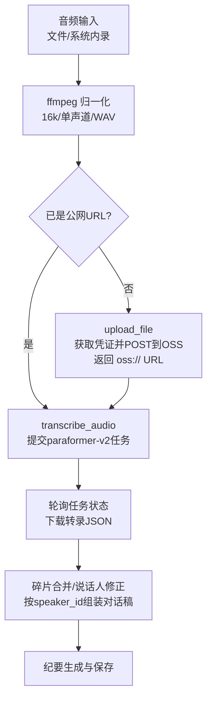
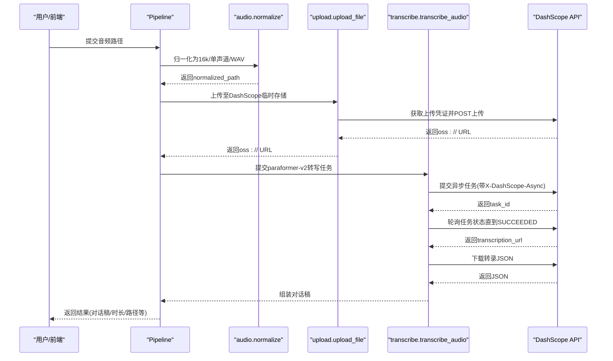
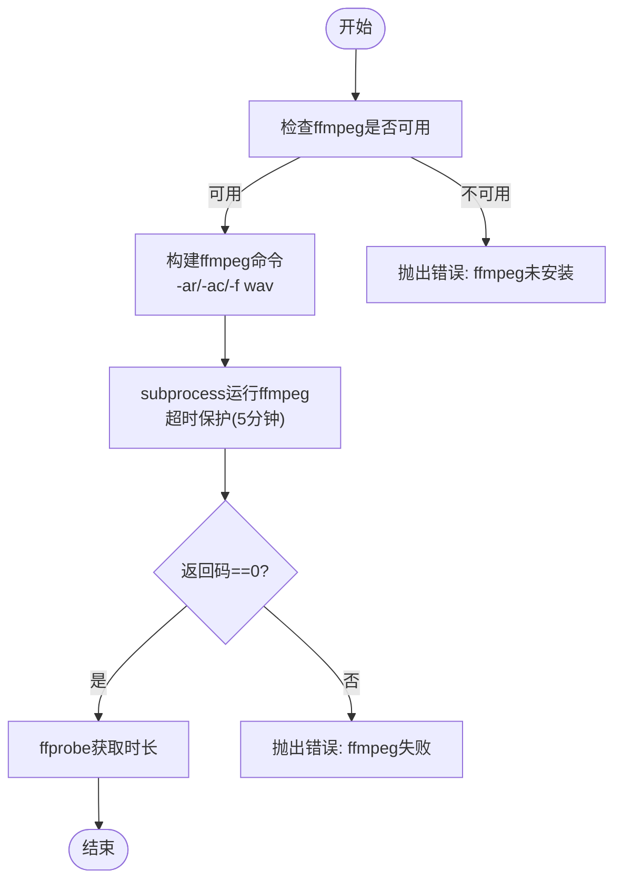
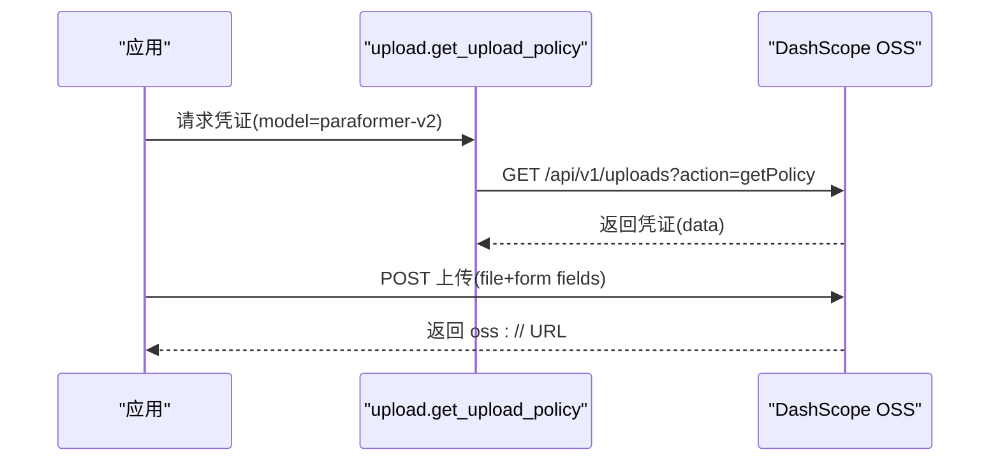
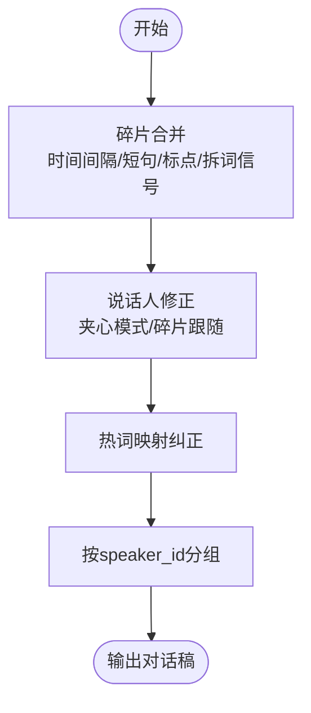
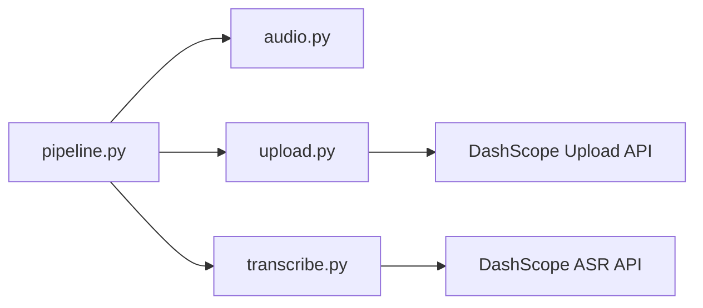

# Audio 音频处理模块

<cite>
**本文引用的文件**
- [core/audio.py](file://core/audio.py)
- [core/upload.py](file://core/upload.py)
- [core/transcribe.py](file://core/transcribe.py)
- [core/pipeline.py](file://core/pipeline.py)
- [docs/ARCHITECTURE.md](file://docs/ARCHITECTURE.md)
- [docs/API_CONTRACTS.md](file://docs/API_CONTRACTS.md)
</cite>

## 目录
1. [简介](#简介)
2. [项目结构](#项目结构)
3. [核心组件](#核心组件)
4. [架构总览](#架构总览)
5. [详细组件分析](#详细组件分析)
6. [依赖关系分析](#依赖关系分析)
7. [性能考量](#性能考量)
8. [故障排查指南](#故障排查指南)
9. [结论](#结论)
10. [附录](#附录)

## 简介
本模块聚焦于会议场景下的音频采集、归一化与转写流水线，目标是把任意来源的音频统一为适合云端转写的标准格式（16kHz、单声道、WAV），并通过 DashScope 临时存储与异步转写服务完成高质量语音识别与说话人分离。同时提供 macOS 系统内录能力（基于 BlackHole + ffmpeg avfoundation）以及流式 PCM 输出以支持实时预览。

## 项目结构
- 音频采集与归一化：core/audio.py
- 上传至 DashScope 临时存储：core/upload.py
- 提交转写任务与结果组装：core/transcribe.py
- 全流程编排与进度回调：core/pipeline.py
- 架构与接口契约说明：docs/ARCHITECTURE.md、docs/API_CONTRACTS.md

图表来源
- [core/audio.py:31-98](file://core/audio.py#L31-L98)
- [core/upload.py:33-115](file://core/upload.py#L33-L115)
- [core/transcribe.py:61-131](file://core/transcribe.py#L61-L131)
- [core/transcribe.py:355-402](file://core/transcribe.py#L355-L402)
- [docs/ARCHITECTURE.md:18-40](file://docs/ARCHITECTURE.md#L18-L40)

章节来源
- [core/audio.py:1-126](file://core/audio.py#L1-L126)
- [core/upload.py:1-134](file://core/upload.py#L1-L134)
- [core/transcribe.py:1-446](file://core/transcribe.py#L1-L446)
- [core/pipeline.py:1-271](file://core/pipeline.py#L1-L271)
- [docs/ARCHITECTURE.md:1-51](file://docs/ARCHITECTURE.md#L1-L51)
- [docs/API_CONTRACTS.md:1-176](file://docs/API_CONTRACTS.md#L1-L176)

## 核心组件
- 音频归一化与时长检测：通过 ffmpeg 将任意输入转为 16kHz/单声道/WAV；使用 ffprobe 获取时长。
- 系统内录与流式录音：macOS 下通过 avfoundation 从 BlackHole 采集系统音频，支持暂停/恢复与 raw PCM 流式读取。
- 上传至 DashScope：获取上传凭证后 multipart POST 到 OSS，返回 48h 有效的 oss:// 临时 URL。
- 转写与对话稿组装：提交 paraformer-v2 异步任务，轮询完成后下载 JSON，执行碎片合并、说话人修正与热词映射，按 speaker_id 组装对话稿。
- 管线编排：串联“归一化→上传→转写→纪要”，并提供进度回调。

章节来源
- [core/audio.py:31-126](file://core/audio.py#L31-L126)
- [core/audio.py:139-266](file://core/audio.py#L139-L266)
- [core/audio.py:303-515](file://core/audio.py#L303-L515)
- [core/upload.py:33-115](file://core/upload.py#L33-L115)
- [core/transcribe.py:61-131](file://core/transcribe.py#L61-L131)
- [core/transcribe.py:222-352](file://core/transcribe.py#L222-L352)
- [core/transcribe.py:355-402](file://core/transcribe.py#L355-L402)
- [core/pipeline.py:58-134](file://core/pipeline.py#L58-L134)

## 架构总览
系统遵循“采集→归一化→上云→转写→纪要”的分层设计，关键约束包括：只认公网 URL、oss:// 需 RESTful 调用并携带特定头、说话人分离仅对单声道生效、异步任务轮询等。

图表来源
- [core/pipeline.py:58-134](file://core/pipeline.py#L58-L134)
- [core/upload.py:33-115](file://core/upload.py#L33-L115)
- [core/transcribe.py:61-131](file://core/transcribe.py#L61-L131)
- [core/transcribe.py:134-187](file://core/transcribe.py#L134-L187)
- [docs/API_CONTRACTS.md:28-64](file://docs/API_CONTRACTS.md#L28-L64)

## 详细组件分析

### 音频归一化与时长检测
- 采样率转换与声道数调整：通过 ffmpeg 参数 -ar/-ac 将输入转换为 16kHz/单声道，输出 WAV。
- 音量标准化：当前实现未进行响度/峰值归一化，如需可在此阶段增加 loudnorm 或 peak normalization 滤镜。
- 时长检测：使用 ffprobe 查询 format=duration，返回秒级浮点。

图表来源
- [core/audio.py:26-98](file://core/audio.py#L26-L98)
- [core/audio.py:101-126](file://core/audio.py#L101-L126)

章节来源
- [core/audio.py:31-98](file://core/audio.py#L31-L98)
- [core/audio.py:101-126](file://core/audio.py#L101-L126)

### FFmpeg 集成与参数配置
- 文件转换：-i 指定输入，-f wav 指定输出容器。
- 质量优化：当前未启用压缩或重采样质量参数，可按需添加 -q:a 或 -c:a pcm_s16le 等。
- 元数据处理：未显式写入元数据，可在输出前插入 metadata 过滤器或封装器选项。
- 设备采集：macOS 使用 -f avfoundation 从 BlackHole 2ch 采集系统音频，直接输出 s16le 流用于实时 ASR。

章节来源
- [core/audio.py:64-77](file://core/audio.py#L64-L77)
- [core/audio.py:182-194](file://core/audio.py#L182-L194)
- [core/audio.py:354-363](file://core/audio.py#L354-L363)

### 音频文件上传到 DashScope OSS
- 流程：
  1) 获取上传凭证（getPolicy），包含 upload_host、upload_dir、签名等。
  2) 构造表单字段（key、policy、signature、ACL 等）。
  3) multipart POST 上传本地文件到 OSS。
  4) 返回 oss:// 临时 URL（48h 有效）。
- 分片上传：当前实现为单次 multipart 上传，未实现分片上传；对于大文件建议分段或自建 OSS。
- 进度监控：requests 默认不提供分块进度回调，可通过自定义传输适配器或第三方库实现。
- 错误处理：对 HTTP 非 200 响应抛出运行时异常；对文件大小超限（>1GB）提前拒绝。

图表来源
- [core/upload.py:33-56](file://core/upload.py#L33-L56)
- [core/upload.py:59-115](file://core/upload.py#L59-L115)
- [docs/API_CONTRACTS.md:12-24](file://docs/API_CONTRACTS.md#L12-L24)

章节来源
- [core/upload.py:33-115](file://core/upload.py#L33-L115)
- [docs/API_CONTRACTS.md:12-24](file://docs/API_CONTRACTS.md#L12-L24)

### 音频时长检测与质量评估算法
- 时长检测：使用 ffprobe 查询 duration，返回秒级浮点。
- 质量评估：当前未实现信噪比、响度、失真等指标；建议在归一化阶段加入 loudnorm 或测量工具（如 sox/ffmpeg filters）以评估并优化响度一致性。
- 碎片合并与说话人修正：在转写后处理中，根据时间间隔阈值、短句长度、标点完整性与常见双字词信号进行句子合并，并对夹心误判进行说话人修正。

图表来源
- [core/transcribe.py:222-304](file://core/transcribe.py#L222-L304)
- [core/transcribe.py:307-352](file://core/transcribe.py#L307-L352)
- [core/transcribe.py:355-402](file://core/transcribe.py#L355-L402)

章节来源
- [core/transcribe.py:222-402](file://core/transcribe.py#L222-L402)

### 支持的音频格式与兼容性
- 输入格式：任意采样率；兼容 wav/mp3/aac 等主流格式（由 ffmpeg 解码支持决定）。
- 输出格式：WAV（16kHz/单声道/PCM），满足 DashScope 转写最优格式要求。
- 实时流：s16le（16bit little-endian），16kHz/单声道，供实时 ASR 消费。

章节来源
- [docs/API_CONTRACTS.md:103-106](file://docs/API_CONTRACTS.md#L103-L106)
- [core/audio.py:354-363](file://core/audio.py#L354-L363)

### 最佳实践与性能优化建议
- 归一化阶段：
  - 保持 16kHz/单声道以启用说话人分离。
  - 如需响度一致，可增加 loudnorm 滤镜进行标准化。
  - 对超长音频考虑分段处理以避免超时。
- 上传阶段：
  - 控制文件大小 ≤1GB；超长会议建议分段或自建 OSS。
  - 如需进度反馈，可引入分块上传与进度回调。
- 转写阶段：
  - 开启 diarization_enabled=true 以获得 speaker_id。
  - 合理设置 language_hints 提升多语种识别准确率。
  - 使用热词表提升专有名词识别率。
- 后处理阶段：
  - 调整 MERGE_GAP_MS、FRAGMENT_CHARS 等阈值以适应不同会议风格。
  - 结合上下文增强（实时流）提高术语识别。

[本节为通用指导，不直接分析具体文件]

## 依赖关系分析
- core/audio.py 依赖外部 ffmpeg/ffprobe 二进制。
- core/upload.py 依赖 requests 与 DashScope 上传接口。
- core/transcribe.py 依赖 DashScope 转写 API（RESTful）与网络稳定性。
- core/pipeline.py 组合上述模块并提供进度回调。

图表来源
- [core/pipeline.py:22-27](file://core/pipeline.py#L22-L27)
- [core/upload.py:14-18](file://core/upload.py#L14-L18)
- [core/transcribe.py:16-22](file://core/transcribe.py#L16-L22)

章节来源
- [core/pipeline.py:22-27](file://core/pipeline.py#L22-L27)
- [core/upload.py:14-18](file://core/upload.py#L14-L18)
- [core/transcribe.py:16-22](file://core/transcribe.py#L16-L22)

## 性能考量
- 归一化耗时：受输入格式与大小影响，设置 5 分钟超时避免长时间阻塞。
- 上传耗时：multipart 上传受网络带宽影响，建议断点续传或分片以提升可靠性。
- 转写耗时：异步任务轮询间隔 3 秒，最大超时 10 分钟；长音频可能接近上限，建议分段。
- I/O 优化：流式录制采用 6400 字节块（约 100ms @16kHz/16bit/mono），降低内存占用与延迟。

[本节为通用指导，不直接分析具体文件]

## 故障排查指南
- ffmpeg 不可用或未安装：检查 PATH 与安装状态；启动录制时若进程立即退出，查看 stderr 信息。
- 上传失败：确认 DASHSCOPE_API_KEY 已配置；检查 HTTP 响应码与错误消息；注意 URL 特殊字符需编码。
- 转写失败：确认已携带 X-DashScope-Async: enable；oss:// URL 需加 X-DashScope-OssResourceResolve: enable；检查语言提示与热词表 ID。
- 无说话人分离结果：确保音频为单声道；检查 diarization_enabled 是否开启。
- 实时预览问题：确认 PCM 格式为 s16le、16kHz、单声道；回调函数异常需捕获并记录日志。

章节来源
- [core/audio.py:26-28](file://core/audio.py#L26-L28)
- [core/audio.py:182-210](file://core/audio.py#L182-L210)
- [core/upload.py:25-30](file://core/upload.py#L25-L30)
- [core/upload.py:106-115](file://core/upload.py#L106-L115)
- [core/transcribe.py:88-97](file://core/transcribe.py#L88-L97)
- [core/transcribe.py:134-175](file://core/transcribe.py#L134-L175)

## 结论
该音频处理模块以 ffmpeg 为核心，实现了跨格式的音频归一化与 macOS 系统内录，结合 DashScope 的临时存储与异步转写能力，构建了端到端的会议转写与纪要生成流程。通过合理的后处理（碎片合并、说话人修正、热词映射）提升了最终对话稿的可读性与准确性。未来可在响度标准化、分片上传、进度监控等方面进一步增强鲁棒性与用户体验。

[本节为总结性内容，不直接分析具体文件]

## 附录
- 环境变量：DASHSCOPE_API_KEY（必需）
- 外部依赖：ffmpeg（≥8.1）、BlackHole 2ch（macOS）
- 关键限制：单文件 ≤1GB（上传）、≤12小时/2GB（转写）；oss:// URL 48h 有效；转写结果链接 24h 有效

章节来源
- [docs/API_CONTRACTS.md:12-24](file://docs/API_CONTRACTS.md#L12-L24)
- [docs/API_CONTRACTS.md:103-106](file://docs/API_CONTRACTS.md#L103-L106)
- [core/upload.py:25-30](file://core/upload.py#L25-L30)