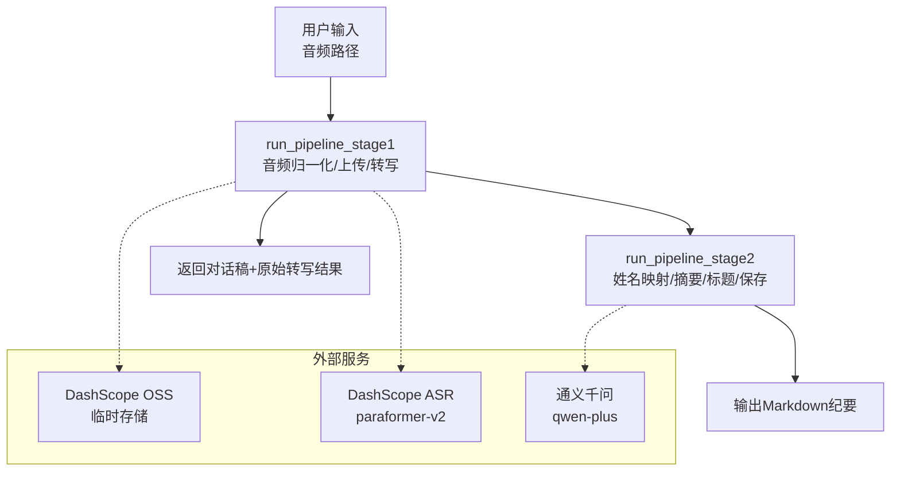
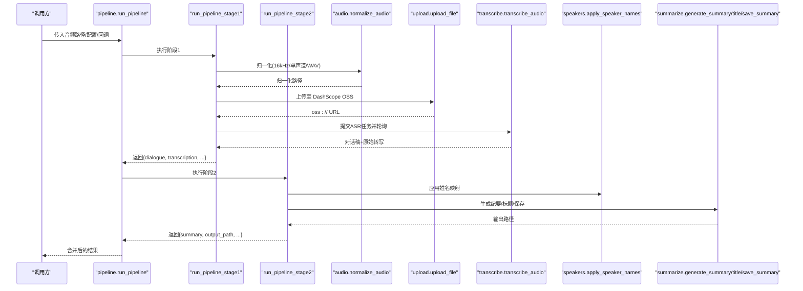
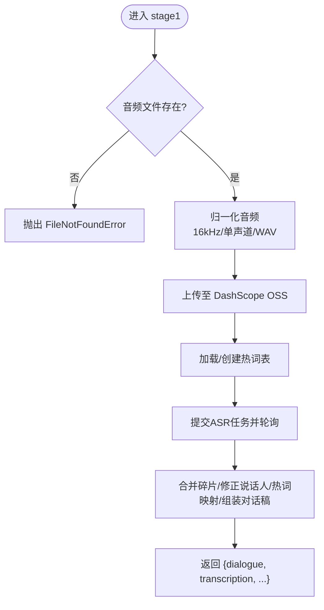
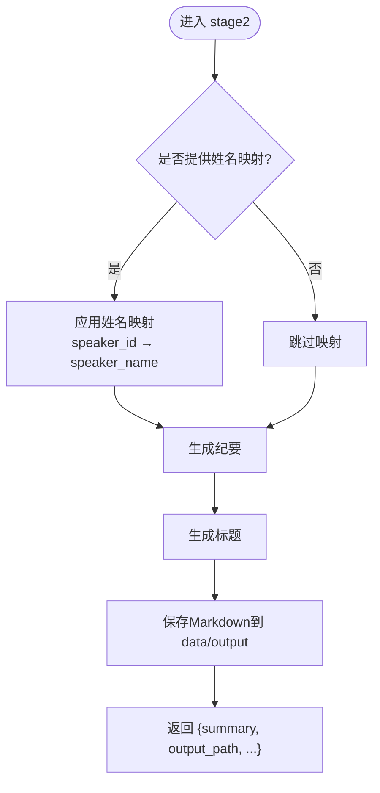
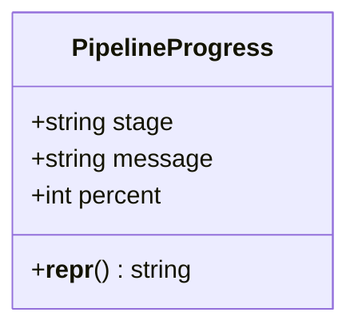
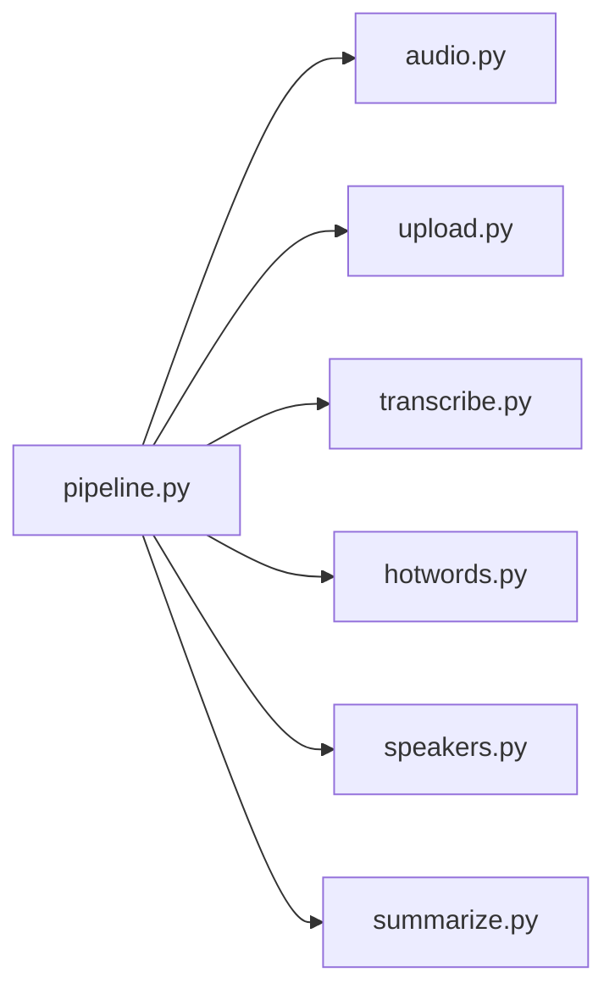

# Pipeline 编排器

<cite>
**本文引用的文件**
- [core/pipeline.py](file://core/pipeline.py)
- [core/audio.py](file://core/audio.py)
- [core/upload.py](file://core/upload.py)
- [core/transcribe.py](file://core/transcribe.py)
- [core/summarize.py](file://core/summarize.py)
- [core/speakers.py](file://core/speakers.py)
- [core/hotwords.py](file://core/hotwords.py)
- [cli.py](file://cli.py)
</cite>

## 目录
1. [简介](#简介)
2. [项目结构](#项目结构)
3. [核心组件](#核心组件)
4. [架构总览](#架构总览)
5. [详细组件分析](#详细组件分析)
6. [依赖关系分析](#依赖关系分析)
7. [性能考量](#性能考量)
8. [故障排查指南](#故障排查指南)
9. [结论](#结论)
10. [附录：使用示例](#附录使用示例)

## 简介
本文件为“Pipeline 编排器”的完整技术文档，聚焦两阶段处理流程的设计与实现：
- 第一阶段：音频归一化 → 上传 → 转写（含说话人分离）→ 组装对话稿
- 第二阶段：应用说话人姓名映射 → 生成纪要与标题 → 保存 Markdown 输出

文档同时覆盖：
- PipelineProgress 进度回调机制（阶段状态、百分比、消息传递）
- 配置系统 DEFAULT_CONFIG 的扩展与参数覆盖策略
- 错误处理与异常恢复策略
- 完整的 API 使用示例（命令行与调用方式）

## 项目结构
Pipeline 编排位于 core/pipeline.py，串联 audio、upload、transcribe、speakers、summarize 等子模块，形成端到端的“音频到纪要”流水线。CLI 入口 cli.py 提供便捷命令以驱动该管线。

图表来源
- [core/pipeline.py:58-226](file://core/pipeline.py#L58-L226)
- [core/upload.py:59-115](file://core/upload.py#L59-L115)
- [core/transcribe.py:61-131](file://core/transcribe.py#L61-L131)
- [core/summarize.py:157-229](file://core/summarize.py#L157-L229)

章节来源
- [core/pipeline.py:1-271](file://core/pipeline.py#L1-L271)
- [cli.py:103-147](file://cli.py#L103-L147)

## 核心组件
- 管线编排：run_pipeline_stage1、run_pipeline_stage2、run_pipeline、run_pipeline_simple
- 进度回调：PipelineProgress（stage/message/percent）
- 配置系统：DEFAULT_CONFIG + 运行时 config 覆盖
- 子模块：
  - 音频：normalize_audio、get_audio_duration
  - 上传：upload_file（获取凭证、POST 上传、返回 oss:// URL）
  - 转写：transcribe_audio（提交任务、轮询、下载、合并碎片、修正说话人、热词映射、组装对话稿）
  - 说话人：apply_speaker_names（将 speaker_id 映射为真实姓名）
  - 摘要：generate_summary、generate_title、save_summary

章节来源
- [core/pipeline.py:35-226](file://core/pipeline.py#L35-L226)
- [core/audio.py:31-98](file://core/audio.py#L31-L98)
- [core/upload.py:59-115](file://core/upload.py#L59-L115)
- [core/transcribe.py:405-446](file://core/transcribe.py#L405-L446)
- [core/speakers.py:278-309](file://core/speakers.py#L278-L309)
- [core/summarize.py:157-229](file://core/summarize.py#L157-L229)

## 架构总览
两阶段流水线通过统一的 on_progress 回调向 UI/CLI 推送阶段状态与百分比，便于前端展示进度条与步骤高亮。

图表来源
- [core/pipeline.py:229-260](file://core/pipeline.py#L229-L260)
- [core/pipeline.py:58-134](file://core/pipeline.py#L58-L134)
- [core/pipeline.py:137-226](file://core/pipeline.py#L137-L226)
- [core/upload.py:59-115](file://core/upload.py#L59-L115)
- [core/transcribe.py:405-446](file://core/transcribe.py#L405-L446)
- [core/speakers.py:278-309](file://core/speakers.py#L278-L309)
- [core/summarize.py:157-229](file://core/summarize.py#L157-L229)

## 详细组件分析

### 第一阶段：音频 → 对话稿（run_pipeline_stage1）
- 职责：完成音频归一化、上传、转写、热词表检查、对话稿组装。
- 关键步骤与百分比：
  - 音频归一化：10% → 20%
  - 上传：30% → 40%
  - 热词表检查：45% → 50%
  - 转写提交与等待：55% → 70%
  - 返回结果包含 dialogue、transcription、audio_duration、normalized_path
- 设计要点：
  - 默认采样率 16kHz、单声道，满足 ASR 最优格式要求
  - 支持可选热词表 vocabulary_id，提升专有名词识别准确率
  - 支持 speaker_count 提示（来自实时声纹聚类估算），辅助说话人分离

图表来源
- [core/pipeline.py:58-134](file://core/pipeline.py#L58-L134)
- [core/audio.py:31-98](file://core/audio.py#L31-L98)
- [core/upload.py:59-115](file://core/upload.py#L59-L115)
- [core/transcribe.py:222-403](file://core/transcribe.py#L222-L403)

章节来源
- [core/pipeline.py:58-134](file://core/pipeline.py#L58-L134)
- [core/transcribe.py:222-403](file://core/transcribe.py#L222-L403)

### 第二阶段：对话稿 → 纪要（run_pipeline_stage2）
- 职责：应用说话人姓名映射、生成纪要与标题、保存 Markdown。
- 关键步骤与百分比：
  - 姓名映射：75% → 80%
  - 生成纪要：85% → 90%
  - 生成标题：92% → 95%
  - 保存输出：98% → 100%
- 设计要点：
  - 支持 meeting_time 与 user_notes 作为上下文注入提示词
  - 输出文件名基于原音频名+时间戳，避免覆盖
  - 可返回 speaker_mapping 与 speaker_uuid_mapping，便于后续复用

图表来源
- [core/pipeline.py:137-226](file://core/pipeline.py#L137-L226)
- [core/speakers.py:278-309](file://core/speakers.py#L278-L309)
- [core/summarize.py:157-229](file://core/summarize.py#L157-L229)

章节来源
- [core/pipeline.py:137-226](file://core/pipeline.py#L137-L226)
- [core/speakers.py:278-309](file://core/speakers.py#L278-L309)
- [core/summarize.py:157-229](file://core/summarize.py#L157-L229)

### 进度回调机制（PipelineProgress）
- 数据结构：stage（阶段名）、message（人类可读消息）、percent（0-100）
- 行为：
  - 每个阶段开始/结束均触发回调，携带当前进度百分比
  - 日志记录与可选 on_progress 回调转发给上层（CLI/UI）
- 用途：
  - CLI 打印进度行；Web UI 渲染进度条与步骤状态
  - 支持失败或警告时通过负数 percent 或特定 stage 表达异常信息

图表来源
- [core/pipeline.py:47-56](file://core/pipeline.py#L47-L56)

章节来源
- [core/pipeline.py:47-56](file://core/pipeline.py#L47-L56)
- [cli.py:114-118](file://cli.py#L114-L118)

### 配置系统 DEFAULT_CONFIG 与覆盖策略
- 默认配置项：
  - asr_model、llm_model、diarization_enabled、language_hints、sample_rate、channels、output_dir
- 覆盖策略：
  - 每次调用内部构造 cfg = {**DEFAULT_CONFIG, **(config or {})}，即传入的 config 字典会覆盖同名键
  - 支持在 run_pipeline_stage1/stage2 中分别传入不同覆盖，灵活定制
- 扩展建议：
  - 新增配置项时，应在 DEFAULT_CONFIG 中声明默认值，并在对应子模块中使用 cfg[key] 读取
  - 对敏感配置（如 API Key）应通过环境变量管理，不在 config 中硬编码

章节来源
- [core/pipeline.py:35-44](file://core/pipeline.py#L35-L44)
- [core/pipeline.py:81-82](file://core/pipeline.py#L81-L82)
- [core/pipeline.py:168-169](file://core/pipeline.py#L168-L169)

### 错误处理与异常恢复
- 文件与工具链校验：
  - 音频文件不存在 → FileNotFoundError
  - ffmpeg/ffprobe 不可用或超时 → RuntimeError（带明确原因）
- 网络与外部服务：
  - 上传失败（HTTP非200）→ RuntimeError（包含响应信息）
  - 转写任务失败/超时 → RuntimeError/TimeoutError（含任务ID与错误信息）
  - 热词表 API 不可用（404）→ 降级跳过热词功能，不影响主流程
- 恢复策略：
  - 热词表创建失败不中断主流程
  - 实时转写（其他模块）具备限流重试与实例清理逻辑（参考 realtime_asr 中的重试与资源释放）
- 日志与可观测性：
  - 各阶段均有结构化日志，便于定位问题
  - 进度回调可用于前端展示错误提示

章节来源
- [core/audio.py:82-98](file://core/audio.py#L82-L98)
- [core/upload.py:87-115](file://core/upload.py#L87-L115)
- [core/transcribe.py:134-176](file://core/transcribe.py#L134-L176)
- [core/hotwords.py:101-117](file://core/hotwords.py#L101-L117)

## 依赖关系分析
- pipeline.py 依赖：
  - audio.normalize_audio/get_audio_duration
  - upload.upload_file
  - transcribe.transcribe_audio
  - hotwords.get_or_create_vocabulary
  - summarize.generate_summary/generate_title/save_summary
  - speakers.apply_speaker_names
- 数据流向：
  - 音频文件 → 归一化 → 上传 → 转写 → 对话稿 → 姓名映射 → 摘要/标题 → Markdown 输出

图表来源
- [core/pipeline.py:22-27](file://core/pipeline.py#L22-L27)

章节来源
- [core/pipeline.py:22-27](file://core/pipeline.py#L22-L27)

## 性能考量
- 音频归一化：
  - 使用 ffmpeg 批量转换，设置超时保护（5分钟）
  - 输出固定 16kHz/单声道/WAV，减少后续处理开销
- 上传与转写：
  - 上传采用 multipart POST，限制文件大小 ≤1GB
  - 转写任务异步提交，轮询间隔 3 秒，最大超时 10 分钟
- 对话稿后处理：
  - 碎片合并与说话人修正算法线性扫描，阈值可调（MERGE_GAP_MS、FRAGMENT_CHARS、SPEAKER_FIX_GAP_MS）
- 摘要生成：
  - 控制输入长度（截取前 2000 字符用于标题生成），降低 token 消耗
- I/O 与磁盘：
  - 输出目录自动创建，避免重复 mkdir 开销
  - 文件名加入时间戳，避免覆盖

[本节为通用性能讨论，不直接分析具体代码片段]

## 故障排查指南
- 常见问题与定位：
  - 音频文件不存在：检查路径与权限
  - ffmpeg 未安装或不可用：安装 ffmpeg 并确保 PATH 正确
  - 上传失败：检查 DASHSCOPE_API_KEY 与网络连通性
  - 转写任务失败：查看任务状态与错误消息，必要时重试
  - 热词表不可用：确认目标模型匹配，或跳过热词功能
- 调试建议：
  - 启用详细日志（logging level=INFO）
  - 使用 CLI 逐步验证：先 normalize，再 upload，最后 transcribe
  - 关注进度回调中的 stage 与 percent，快速定位卡点

章节来源
- [core/audio.py:82-98](file://core/audio.py#L82-L98)
- [core/upload.py:87-115](file://core/upload.py#L87-L115)
- [core/transcribe.py:134-176](file://core/transcribe.py#L134-L176)
- [core/hotwords.py:101-117](file://core/hotwords.py#L101-L117)

## 结论
Pipeline 编排器通过清晰的两阶段设计与统一的进度回调机制，实现了从音频到结构化纪要的端到端自动化。其配置系统支持灵活的运行时覆盖，错误处理兼顾健壮性与可恢复性。结合 CLI 与 Web UI，用户可便捷地完成会议录音、转写与纪要生成。

[本节为总结性内容，不直接分析具体代码片段]

## 附录：使用示例
以下示例展示如何使用 Pipeline API 进行音频转写和纪要生成。注意：示例仅描述调用方式与参数含义，不包含具体代码内容。

- 基本用法（完整管线）
  - 调用 run_pipeline(audio_path, output_path=None, config=None, on_progress=None, speaker_mapping=None, meeting_time=None)
  - 说明：
    - audio_path：输入音频路径
    - output_path：可选，指定输出纪要路径
    - config：可选，覆盖默认配置（如 asr_model、llm_model 等）
    - on_progress：可选，接收 PipelineProgress 对象，用于显示进度
    - speaker_mapping：可选，{speaker_id: speaker_uuid} 映射
    - meeting_time：可选，会议时间字符串，用于纪要上下文

- 分阶段调用
  - 阶段1：run_pipeline_stage1(audio_path, config=None, on_progress=None, speaker_count=None)
    - 返回：dialogue、transcription、audio_duration、normalized_path
  - 阶段2：run_pipeline_stage2(dialogue, speaker_mapping=None, audio_path=None, config=None, on_progress=None, meeting_time=None, user_notes=None)
    - 返回：summary、dialogue（含 speaker_name）、output_path、speaker_mapping

- CLI 示例
  - 转写并生成纪要：python cli.py transcribe <音频文件> [-o 输出路径] [--show]
  - 仅归一化：python cli.py normalize <音频文件>
  - 仅上传（测试）：python cli.py upload <音频文件>

章节来源
- [core/pipeline.py:229-271](file://core/pipeline.py#L229-L271)
- [cli.py:103-147](file://cli.py#L103-L147)