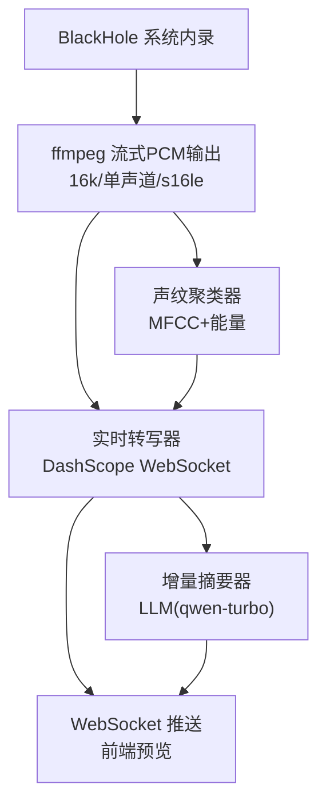
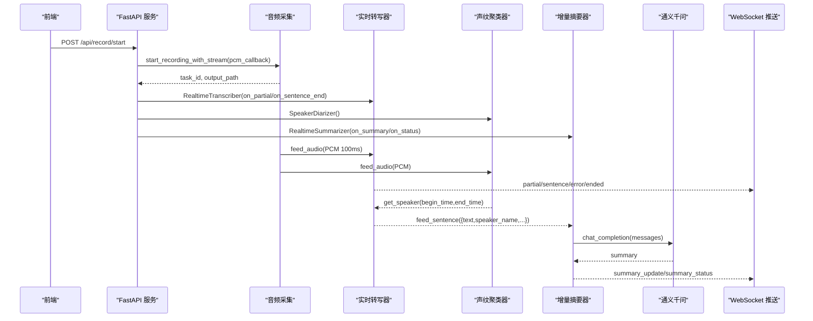
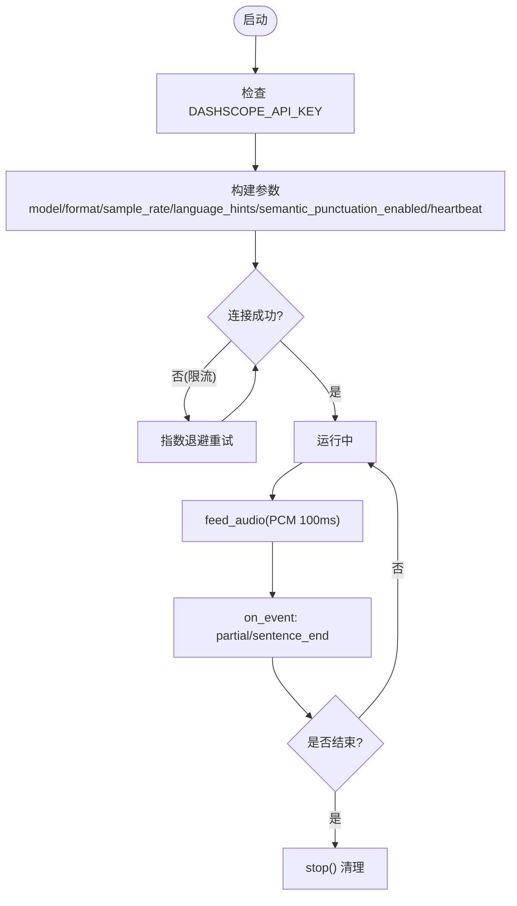
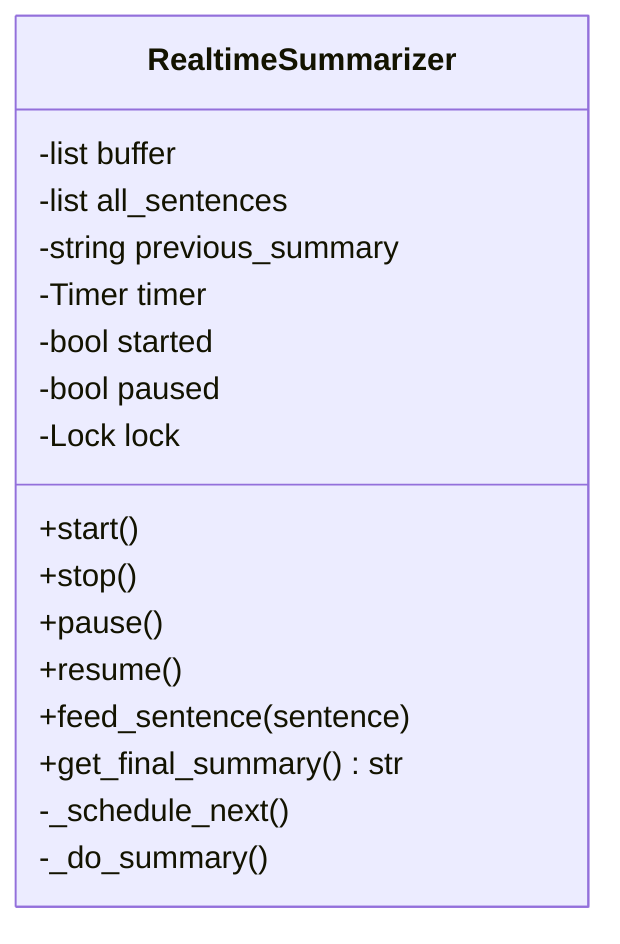
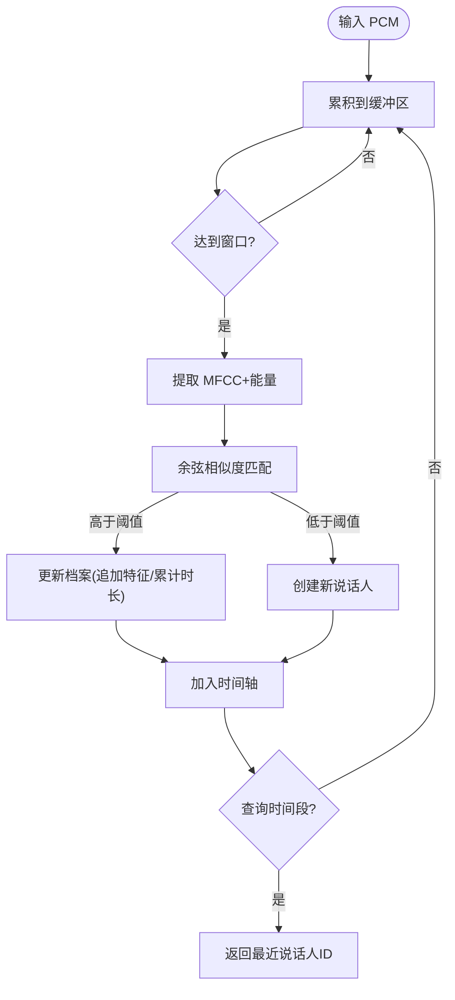
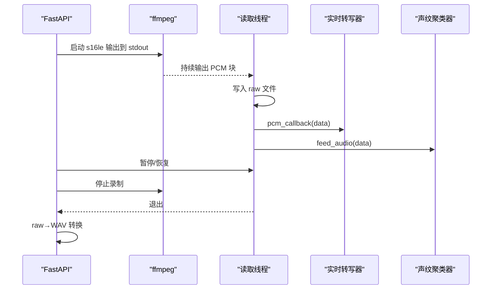
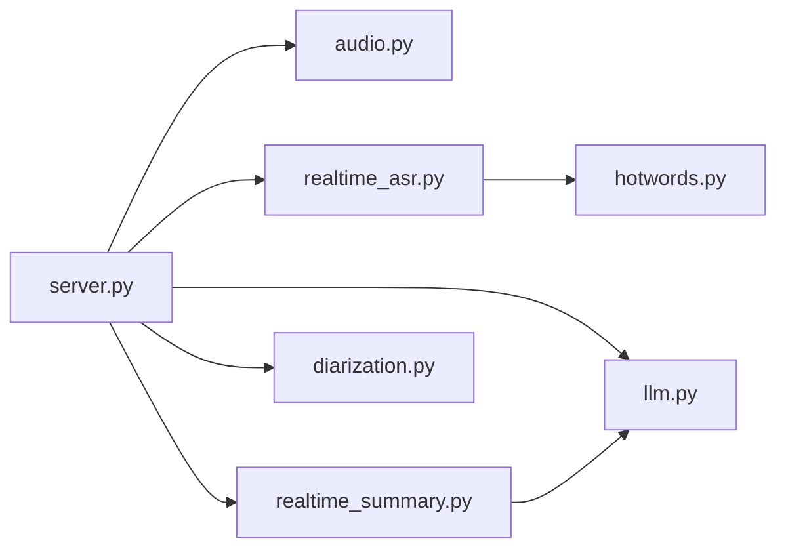

# RealtimeEngine 实时处理引擎

<cite>
**本文引用的文件**
- [core/realtime_asr.py](file://core/realtime_asr.py)
- [core/realtime_summary.py](file://core/realtime_summary.py)
- [core/audio.py](file://core/audio.py)
- [core/diarization.py](file://core/diarization.py)
- [app/server.py](file://app/server.py)
- [core/llm.py](file://core/llm.py)
- [core/hotwords.py](file://core/hotwords.py)
- [docs/API_CONTRACTS.md](file://docs/API_CONTRACTS.md)
- [docs/ARCHITECTURE.md](file://docs/ARCHITECTURE.md)
</cite>

## 目录
1. [简介](#简介)
2. [项目结构](#项目结构)
3. [核心组件](#核心组件)
4. [架构总览](#架构总览)
5. [详细组件分析](#详细组件分析)
6. [依赖关系分析](#依赖关系分析)
7. [性能与内存优化](#性能与内存优化)
8. [故障恢复与断线重连](#故障恢复与断线重连)
9. [集成示例与调试方法](#集成示例与调试方法)
10. [结论](#结论)

## 简介
RealtimeEngine 是会议场景下的实时处理引擎，围绕“流式音频采集 → 实时转写 → 增量摘要 → 说话人分离”的链路构建。其目标是在录音期间提供低延迟的转写预览、按分钟窗口的增量摘要更新，以及基于声纹特征的本地说话人聚类与身份跟踪；最终纪要仍走批管线以保证准确性。

## 项目结构
- 采集层：通过 ffmpeg + BlackHole 实现系统内录与 PCM 流输出，并归一化为 16kHz/单声道/WAV。
- 实时转写层：封装 DashScope qwen-audio-3.0-asr-flash-streaming 的 WebSocket 流式识别，支持热词、上下文增强与语义断句。
- 增量摘要层：每 60 秒触发一次 LLM 增量总结，使用上次摘要+新增片段进行重构。
- 说话人分离层：本地 MFCC+能量特征提取与余弦相似度聚类，为 ASR 句子标注说话人 ID。
- 服务层：FastAPI 暴露录制、暂停/恢复、WebSocket 推送、说话人绑定等接口，串联各模块。

图表来源
- [core/audio.py:303-396](file://core/audio.py#L303-L396)
- [core/realtime_asr.py:150-368](file://core/realtime_asr.py#L150-L368)
- [core/diarization.py:282-525](file://core/diarization.py#L282-L525)
- [core/realtime_summary.py:68-270](file://core/realtime_summary.py#L68-L270)
- [app/server.py:721-858](file://app/server.py#L721-L858)

章节来源
- [docs/ARCHITECTURE.md:5-16](file://docs/ARCHITECTURE.md#L5-L16)
- [docs/API_CONTRACTS.md:114-176](file://docs/API_CONTRACTS.md#L114-L176)

## 核心组件
- 实时转写器（RealtimeTranscriber）：管理 WebSocket 连接、音频分片送入、回调分发、限流重试。
- 增量摘要器（RealtimeSummarizer）：定时窗口缓冲、增量 prompt 构造、LLM 调用与摘要更新。
- 声纹聚类器（SpeakerDiarizer）：PCM→MFCC+能量特征、滑动窗口提取、余弦相似度匹配、时间轴查询。
- 音频采集（audio.py）：ffmpeg 流式采集 raw PCM、后台线程读取 pipe、暂停/恢复控制、raw→WAV 转换。
- 服务层（server.py）：FastAPI 端点编排、WebSocket 消息队列、实时状态管理、说话人绑定与摘要控制。

章节来源
- [core/realtime_asr.py:150-368](file://core/realtime_asr.py#L150-L368)
- [core/realtime_summary.py:68-270](file://core/realtime_summary.py#L68-L270)
- [core/diarization.py:282-525](file://core/diarization.py#L282-L525)
- [core/audio.py:303-623](file://core/audio.py#L303-L623)
- [app/server.py:721-1091](file://app/server.py#L721-L1091)

## 架构总览
实时处理由“采集—转写—摘要—分离—服务”五层构成，数据在多线程/事件循环之间通过回调和队列传递，保证低延迟与可观测性。

图表来源
- [app/server.py:721-858](file://app/server.py#L721-L858)
- [core/audio.py:303-396](file://core/audio.py#L303-L396)
- [core/realtime_asr.py:150-368](file://core/realtime_asr.py#L150-L368)
- [core/diarization.py:282-525](file://core/diarization.py#L282-L525)
- [core/realtime_summary.py:68-270](file://core/realtime_summary.py#L68-L270)
- [core/llm.py:89-121](file://core/llm.py#L89-L121)

## 详细组件分析

### 实时转写器（RealtimeTranscriber）
- 职责：建立 DashScope WebSocket 连接，接收 PCM 分片，回调分发临时结果与定稿句子，统计句数。
- 关键机制：
  - 连接建立：通过 RecognitionCallback 的 on_open/on_error/wait_for_connect 同步等待连接结果。
  - 音频分片：建议每次 6400 bytes（100ms @16kHz/16bit/mono），通过 send_audio_frame 送入。
  - 热词与上下文：支持 vocabulary_id/vocabulary/context 增强识别率。
  - 限流重试：MAX_RETRIES=3，指数退避 2s/5s/10s，错误信息友好提示。
  - 停止流程：stop() 阻塞直到所有结果返回，清理资源。

图表来源
- [core/realtime_asr.py:216-327](file://core/realtime_asr.py#L216-L327)
- [core/realtime_asr.py:329-368](file://core/realtime_asr.py#L329-L368)

章节来源
- [core/realtime_asr.py:57-144](file://core/realtime_asr.py#L57-L144)
- [core/realtime_asr.py:150-368](file://core/realtime_asr.py#L150-L368)
- [docs/API_CONTRACTS.md:114-176](file://docs/API_CONTRACTS.md#L114-L176)

### 增量摘要器（RealtimeSummarizer）
- 职责：收集定稿句子，按 60 秒窗口触发 LLM 增量总结，输出 Markdown 摘要。
- 关键机制：
  - 定时器：threading.Timer 调度，独立线程执行，不阻塞主事件循环。
  - 增量策略：首次仅传入当前缓冲区；后续传入「上次摘要截取」+「新增片段」，要求模型输出完整更新后的摘要。
  - 线程安全：使用锁保护缓冲区写入；回调通过事件循环投递到 asyncio。
  - 失败隔离：单次总结失败不影响后续周期。

图表来源
- [core/realtime_summary.py:68-270](file://core/realtime_summary.py#L68-L270)

章节来源
- [core/realtime_summary.py:68-270](file://core/realtime_summary.py#L68-L270)
- [core/llm.py:89-121](file://core/llm.py#L89-L121)

### 声纹聚类器（SpeakerDiarizer）
- 职责：从 PCM 流中提取声纹特征（MFCC+能量），实时聚类区分不同说话人，并为 ASR 句子标注说话人 ID。
- 关键机制：
  - 特征提取：每 2 秒窗口、1 秒步长提取 MFCC 均值+能量+标准差，L2 归一化。
  - 匹配策略：余弦相似度阈值（默认 0.70），低于阈值创建新说话人。
  - 时间轴查询：根据 begin_time/end_time 找到最近特征，返回说话人 ID。
  - 内存管理：保留最近 10 秒用于回溯，定期清理已读数据。

图表来源
- [core/diarization.py:87-276](file://core/diarization.py#L87-L276)
- [core/diarization.py:282-525](file://core/diarization.py#L282-L525)

章节来源
- [core/diarization.py:282-525](file://core/diarization.py#L282-L525)

### 音频采集与流式管道（audio.py）
- 职责：ffmpeg 采集系统音频（BlackHole），输出 raw PCM 到 stdout pipe，同时写 raw 文件并通过回调送入实时 ASR。
- 关键机制：
  - 流式读取：后台线程持续读取 pipe，按 6400 bytes 块处理，避免阻塞。
  - 暂停/恢复：暂停时丢弃数据但继续读取防止 pipe 满；累计暂停时长以准确计算有效录制时长。
  - 停止流程：终止 ffmpeg，等待读取线程退出，将 raw PCM 转为 WAV（加 44 字节 header）。

图表来源
- [core/audio.py:303-396](file://core/audio.py#L303-L396)
- [core/audio.py:399-438](file://core/audio.py#L399-L438)
- [core/audio.py:440-516](file://core/audio.py#L440-L516)
- [core/audio.py:559-595](file://core/audio.py#L559-L595)

章节来源
- [core/audio.py:303-623](file://core/audio.py#L303-L623)

### 服务层集成（server.py）
- 职责：编排录制、转写、摘要、说话人绑定，通过 WebSocket 推送实时消息。
- 关键机制：
  - 任务状态：tasks 字典维护任务元数据，持久化到磁盘（排除大字段）。
  - 实时消息：_push_realtime_msg 通过 asyncio.run_coroutine_threadsafe 安全投递到事件循环。
  - 说话人绑定：实时映射 _realtime_speaker_maps，优先于全局 speakers.json。
  - 摘要控制：暂停/恢复实时总结，停止时保存最终摘要。

章节来源
- [app/server.py:155-220](file://app/server.py#L155-L220)
- [app/server.py:721-858](file://app/server.py#L721-L858)
- [app/server.py:869-951](file://app/server.py#L869-L951)
- [app/server.py:996-1091](file://app/server.py#L996-L1091)

## 依赖关系分析
- 外部依赖：
  - DashScope WebSocket 实时识别（qwen-audio-3.0-asr-flash-streaming）
  - 通义千问 LLM（qwen-turbo/qwen-plus）
  - ffmpeg/ffprobe（音频归一化、内录、时长查询）
  - BlackHole 2ch（macOS 虚拟声卡）
- 内部依赖：
  - server.py 依赖 audio.py、realtime_asr.py、realtime_summary.py、diarization.py、llm.py、hotwords.py
  - realtime_asr.py 依赖 hotwords.py（后处理纠正）
  - realtime_summary.py 依赖 llm.py（增量总结）

图表来源
- [app/server.py:41-57](file://app/server.py#L41-L57)
- [core/realtime_asr.py:43-44](file://core/realtime_asr.py#L43-L44)
- [core/realtime_summary.py:24-25](file://core/realtime_summary.py#L24-L25)

章节来源
- [docs/ARCHITECTURE.md:5-16](file://docs/ARCHITECTURE.md#L5-L16)
- [docs/API_CONTRACTS.md:114-176](file://docs/API_CONTRACTS.md#L114-L176)

## 性能与内存优化
- 音频分片：固定 6400 bytes（100ms），平衡延迟与网络开销。
- 缓冲区控制：
  - 转写缓冲：仅保留最近 N 条句子（_REALTIME_BUFFER_MAX=10），避免无限增长。
  - 声纹缓冲：保留最近 10 秒用于回溯，定期清理已读数据。
- 垃圾回收策略：
  - 定时器线程：daemon=True，进程退出时自动清理。
  - HTTP 客户端：httpx.AsyncClient 复用连接池，应用关闭时显式 aclose。
- 性能特性：
  - 增量总结：低温度（0.3）提升稳定性，max_tokens=1024 控制 token 消耗。
  - 声纹特征：MFCC 均值+能量+标准差，L2 归一化加速余弦相似度计算。

章节来源
- [core/realtime_asr.py:53-54](file://core/realtime_asr.py#L53-L54)
- [app/server.py:167-199](file://app/server.py#L167-L199)
- [core/diarization.py:411-420](file://core/diarization.py#L411-L420)
- [core/realtime_summary.py:29-36](file://core/realtime_summary.py#L29-L36)
- [core/llm.py:26-38](file://core/llm.py#L26-L38)

## 故障恢复与断线重连
- 实时转写：
  - 限流检测：识别错误信息包含 "too many requests" 或 "throttl" 时触发指数退避重试。
  - 连接等待：wait_for_connect(timeout=5.0) 同步等待 on_open/on_error。
  - 优雅降级：转写启动失败不影响录音继续进行。
- 音频采集：
  - 进程守护：ffmpeg 启动后短暂等待确认未立即退出，捕获 stderr 诊断。
  - 停止健壮性：terminate 超时则 kill，确保进程释放。
- LLM 调用：
  - 超时处理：requests/httpx 超时抛出异常，上层捕获并记录日志。
  - 失败隔离：单次总结失败不影响后续周期调度。

章节来源
- [core/realtime_asr.py:254-327](file://core/realtime_asr.py#L254-L327)
- [core/audio.py:198-217](file://core/audio.py#L198-L217)
- [core/audio.py:468-483](file://core/audio.py#L468-L483)
- [core/realtime_summary.py:263-270](file://core/realtime_summary.py#L263-L270)
- [core/llm.py:118-121](file://core/llm.py#L118-L121)

## 集成示例与调试方法
- 启动录制：
  - 调用 POST /api/record/start，返回 task_id。
  - 后端启动 ffmpeg 流式采集、实时转写、声纹聚类、增量摘要。
- 实时转写：
  - 前端连接 WS /ws/transcript/{task_id}，接收 partial/sentence/error/ended 消息。
  - 通过 diarizer.get_speaker(begin_time,end_time) 获取说话人 ID，解析姓名。
- 说话人绑定：
  - 调用 POST /api/record/bind-speaker，将 speaker_id 绑定到全局说话人 UUID。
  - 后端广播 speaker_bound 消息，前端实时更新转写条目。
- 摘要控制：
  - 暂停/恢复：POST /api/record/summary/pause 或 resume。
  - 停止录制：POST /api/record/stop，保存最终摘要并进入批管线。
- 调试方法：
  - 日志级别：查看 "[实时转写]"、"[实时总结]"、"[声纹聚类]"、"[stream]" 前缀日志。
  - 状态查询：GET /api/record/status 获取录制时长、暂停状态。
  - 设备列表：调用 list_audio_devices() 检查 BlackHole 设备名。

章节来源
- [app/server.py:721-858](file://app/server.py#L721-L858)
- [app/server.py:996-1091](file://app/server.py#L996-L1091)
- [core/audio.py:625-663](file://core/audio.py#L625-L663)

## 结论
RealtimeEngine 通过模块化设计实现了流式音频处理的完整链路：低延迟转写、增量摘要、本地声纹聚类与身份跟踪。其优势在于：
- 实时性与准确性兼顾：实时预览用快速模型，最终纪要用高精度批处理。
- 可扩展性：热词、上下文增强、说话人绑定灵活配置。
- 健壮性：限流重试、进程守护、失败隔离保障稳定性。
- 可观测性：丰富日志与状态接口便于调试与监控。

未来可考虑：
- 引入更先进的声纹模型（如 WeSpeaker）提升准确率。
- 支持多路音频源与混合场景。
- 优化内存占用与并发处理能力。